MMA 把各线程持有的矩阵元素作为寄存器操作数，`ldmatrix` 负责从 Shared 装入这些元素。沿着 **Global→Shared→寄存器** 的数据流，才能区分写入是否连续、读取是否有 Bank Conflict，以及 Padding、Swizzle 改变了哪一段地址。

下面计算行主序 $C=AB$：先看一个 Warp 的 $16\times8\times16$ MMA，再用 $16\times16\times16$ 小矩阵比较五种实现。输入、输出和累加均使用 FP16；`uint32_t` 保存两个 half 的位模式。

## 从 WMMA 到 MMA

WMMA 的 `load_matrix_sync`、`mma_sync`、`store_matrix_sync` 封装了装载、乘加与存储。MMA 直接接收各线程的寄存器，装载前必须明确元素如何分配给 32 个 lane。

| 比较项 | WMMA | 显式 MMA 路径 |
| --- | --- | --- |
| 装载地址 | Warp 使用相同的 tile 起点和 stride | 地址提供 lane 分别给出行起点 |
| 寄存器元素位置 | fragment 内部映射由实现决定 | 对应 PTX 指令规定 lane / 元素映射 |
| 计算 | `wmma::mma_sync` | `mma.sync` |
| 存储 | `store_matrix_sync` | 按结果映射写回 |

**MMA 是寄存器乘加，`ldmatrix` 是 Shared 装载** 。MMA 本身不限定数据必须经过 Shared；这里使用 `ldmatrix` 路径。普通稠密 A 使用 `mma`，结构化稀疏 A 还有相应的 `mma.sp` 变体。

### 单条 m16n8k16 的计算范围

```ptx
mma.sync.aligned.m16n8k16.row.col.f16.f16.f16.f16
    {D0, D1}, {A0, A1, A2, A3}, {B0, B1}, {C0, C1};
```

它计算 $D=AB+C$：A 为 $16\times16$，B 为 $16\times8$，C、D 为 $16\times8$。`.row.col` 描述寄存器中 A、B 的布局；四个 `.f16` 依次对应 D、A、B、C 的类型。D 可以作为下一轮的 C 继续累加。

| 指令 | FP16 形状 | 引入的 PTX ISA 版本 |
| --- | --- | --- |
| `wmma` | `m16n16k16` | 6.0 |
| `wmma` | `m8n32k16`、`m32n8k16` | 6.1 |
| `mma` | `m8n8k4` | 6.4 |
| `mma` | `m16n8k8` | 6.5 |
| `mma` | `m16n8k16` | 7.0 |

这一组 FP16 MMA 没有单条 `m16n16k16`；$16\times16$ 输出需要沿 N 拆为两个 $16\times8$。PTX ISA 版本与 GPU Compute Capability 不同：`ldmatrix.m8n8.b16` 需要 `sm_75`，本例 `mma.m16n8k16` 需要 `sm_80`，组合实现面向 Ampere 及后续支持该指令的架构。

[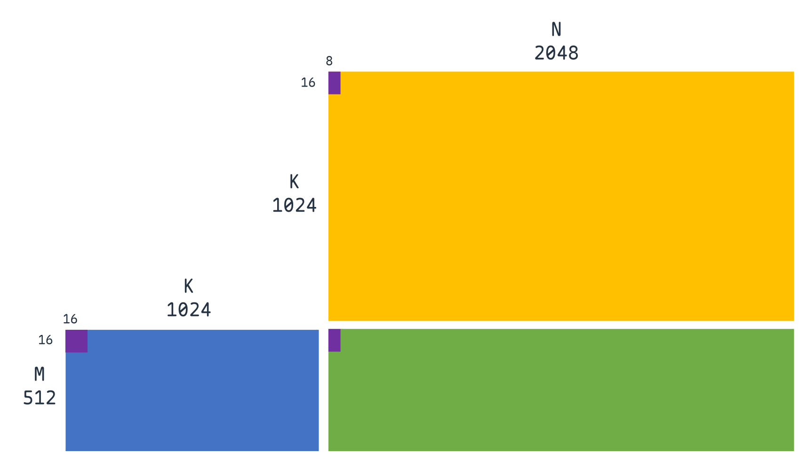{ width="800" }](../../assets/cuda/mma-swizzle/mma-one-warp-tile-ppt224.png)

取 $M=512$、$N=2048$、$K=1024$，一个 Block 为一个 Warp，Grid 的二维尺寸为：

$$
(N/8,M/16)=(256,32).
$$

沿 K 装载 64 个 tile。

## ldmatrix：行地址与接收 lane

```ptx
ldmatrix.sync.aligned.m8n8.x4.shared.b16 {R0, R1, R2, R3}, [addr];
```

`.m8n8.b16` 表示 $8\times8$、16 bit 元素；`.x4` 装载四个子矩阵，Warp 共接收 256 个 half，每个 lane 获得四个 packed half2 寄存器。`.sync.aligned` 要求整个 Warp 一致执行；每个行起点另需满足 16 B 自然对齐。

| 字段 | 含义 |
| --- | --- |
| `.shape` | 子矩阵形状 |
| `.num` | `.x1`、`.x2`、`.x4`，装载 1、2、4 个子矩阵 |
| `.trans` | 按列方向装入寄存器；本例 B 使用 |
| `.ss` | Shared 地址空间，可写 `.shared` 或 `.shared::cta` |
| `.type` | 本例 `.b16`，每个元素 16 bit |
| `r`、`[p]` | 目的寄存器向量、行起点地址 |

| `.shape` | 单个子矩阵 | 元素位宽 |
| --- | --- | --- |
| `.m8n8` | $8\times8$ | 16 bit |
| `.m16n16` | $16\times16$ | 8、6、4 bit |
| `.m8n16` | $8\times16$ | 6、4 bit |

低位宽扩展还有 `.dst_fmt.src_fmt` 形式；`.dst_fmt=.b8x16`，`.src_fmt` 可为 `.b6x16_p32`、`.b4x16_p64`。其中 `.m16n16` 要求 `.trans`，仅支持 `.x1`、`.x2`。**16×16 half 使用四个 m8n8 子矩阵** ，与这些低位宽形式不同。

[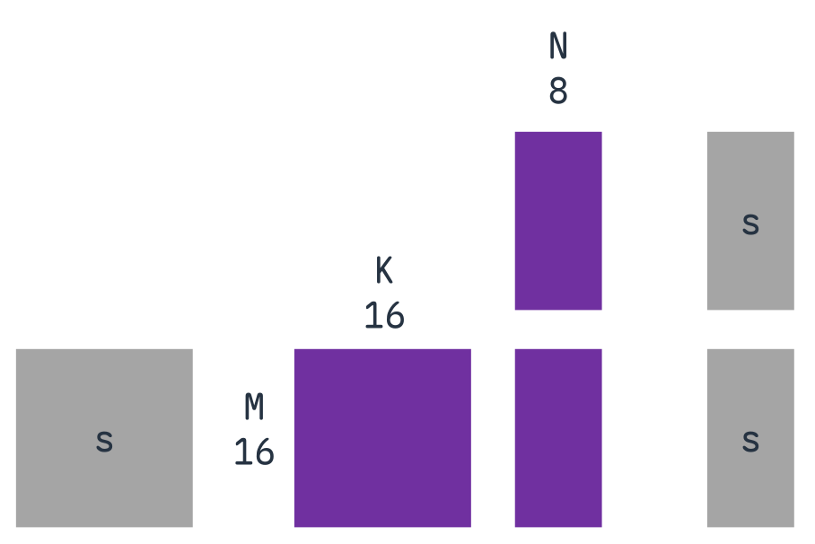{ width="800" }](../../assets/cuda/mma-swizzle/mma-shared-operand-tiles-ppt225.png)

### 哪些 lane 提供地址

一个 $8\times8$ half 子矩阵需要八个行起点，每行八个连续 half，共 16 B。行与行可有 stride、Padding 或重排。

[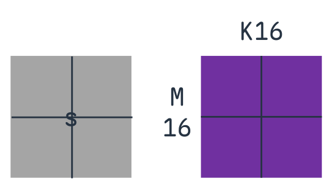{ width="800" }](../../assets/cuda/mma-swizzle/mma-a-four-subtiles-ppt226.png)

| `.num` | lane 0～7 | lane 8～15 | lane 16～23 | lane 24～31 | 每个 lane 接收寄存器数 |
| --- | --- | --- | --- | --- | --- |
| `.x1` | 第 0 块 | — | — | — | 1 |
| `.x2` | 第 0 块 | 第 1 块 | — | — | 2 |
| `.x4` | 第 0 块 | 第 1 块 | 第 2 块 | 第 3 块 | 4 |

**提供行地址与接收元素是两种职责** 。`.x1` 只有 lane 0～7 提供新行地址，32 个 lane 仍共同接收数据。`sm_75` 上其他 lane 也要持有有效地址，可复制低 lane 的地址。

### 哪些 lane 接收元素

不带 `.trans` 时，令 $g=\lfloor\mathrm{lane}/4\rfloor$、$t=\mathrm{lane}\bmod4$。该 lane 接收第 $g$ 行、第 $2t$、$2t+1$ 列的两个 half；四个连续 lane 合起来接收一整行。

[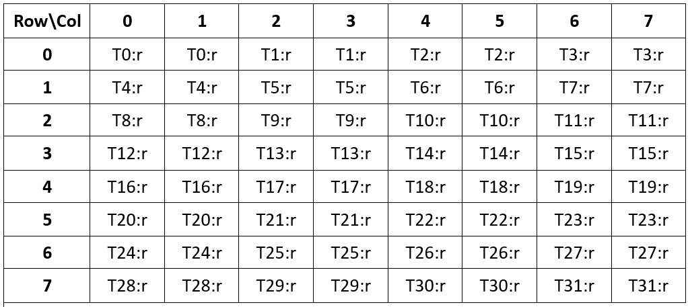{ width="800" }](../../assets/cuda/mma-swizzle/nvidia-mma-ldmatrix-fragments.png)

例如 lane 1 提供第 1 行地址，却接收第 0 行第 2、3 列；lane 4 提供第 4 行地址，却接收第 1 行第 0、1 列。

### A 的 x4 与 B 的 trans

A 使用 `&sa[lane % 16][(lane / 16) * 8]`。四组地址按 **左上、左下、右上、右下** 装入 `RA[0..3]`：

| 地址提供 lane | Shared 行起点 | 目的寄存器 |
| --- | --- | --- |
| 0～7 | `sa[0..7][0]` | `RA[0]` |
| 8～15 | `sa[8..15][0]` | `RA[1]` |
| 16～23 | `sa[0..7][8]` | `RA[2]` |
| 24～31 | `sa[8..15][8]` | `RA[3]` |

[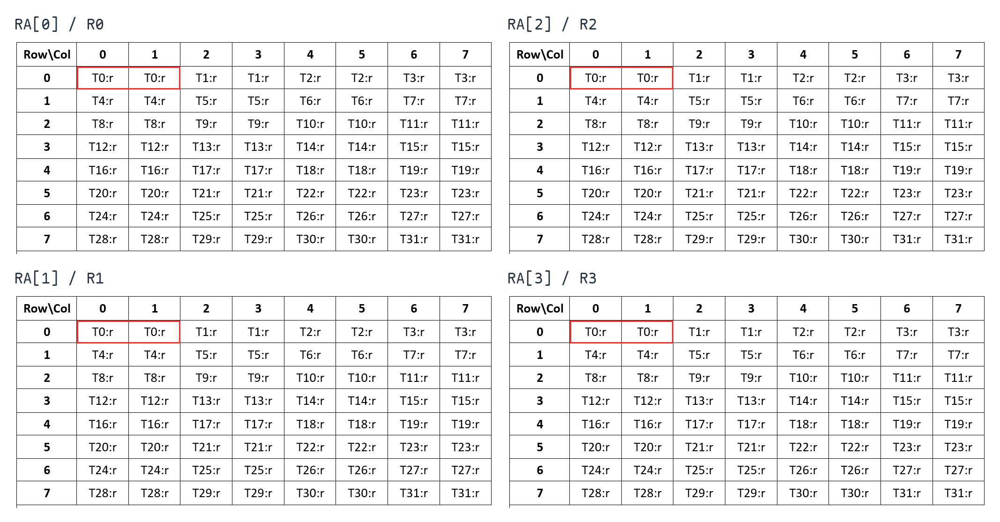{ width="800" }](../../assets/cuda/mma-swizzle/mma-ldmatrix-x4-official.png)

| 寄存器 | 低 16 bit | 高 16 bit |
| --- | --- | --- |
| `RA[0]` | $A[g,2t]$ | $A[g,2t+1]$ |
| `RA[1]` | $A[g+8,2t]$ | $A[g+8,2t+1]$ |
| `RA[2]` | $A[g,2t+8]$ | $A[g,2t+9]$ |
| `RA[3]` | $A[g+8,2t+8]$ | $A[g+8,2t+9]$ |

B 的 `sb[16][8]` 使用 `.x2.trans`，地址为 `&sb[lane % 16][0]`：

| 寄存器 | 低 16 bit | 高 16 bit |
| --- | --- | --- |
| `RB[0]` | $B[2t,g]$ | $B[2t+1,g]$ |
| `RB[1]` | $B[2t+8,g]$ | $B[2t+9,g]$ |

lane 0 因而获得 `B[0,0]`、`B[1,0]`、`B[8,0]`、`B[9,0]`。`.trans` 匹配 B 的寄存器布局；Global、Shared 中的 B 仍按行主序存放。

## MMA 的寄存器与结果映射

### A、B 的 a0～a7 与 b0～b3

下表均为 **每个 lane 各自持有的寄存器** 。A 的四个 half2 共八个元素，32 个 lane 对应 $16\times16$；B 的两个 half2 共四个元素，32 个 lane 对应 $16\times8$。

| 操作数类型 | 每个 lane 的寄存器 | 标量元素顺序 | packed 顺序 |
| --- | --- | --- | --- |
| A，`.f16 / .bf16` | 4 个 `.f16x2` | `a0～a7` | `RA[0]=(a0,a1)`、`RA[1]=(a2,a3)`、`RA[2]=(a4,a5)`、`RA[3]=(a6,a7)` |
| B，`.f16 / .bf16` | 2 个 `.f16x2` | `b0～b3` | `RB[0]=(b0,b1)`、`RB[1]=(b2,b3)` |

<div class="cuda-figure-pair" markdown="1">

<div markdown="1">

[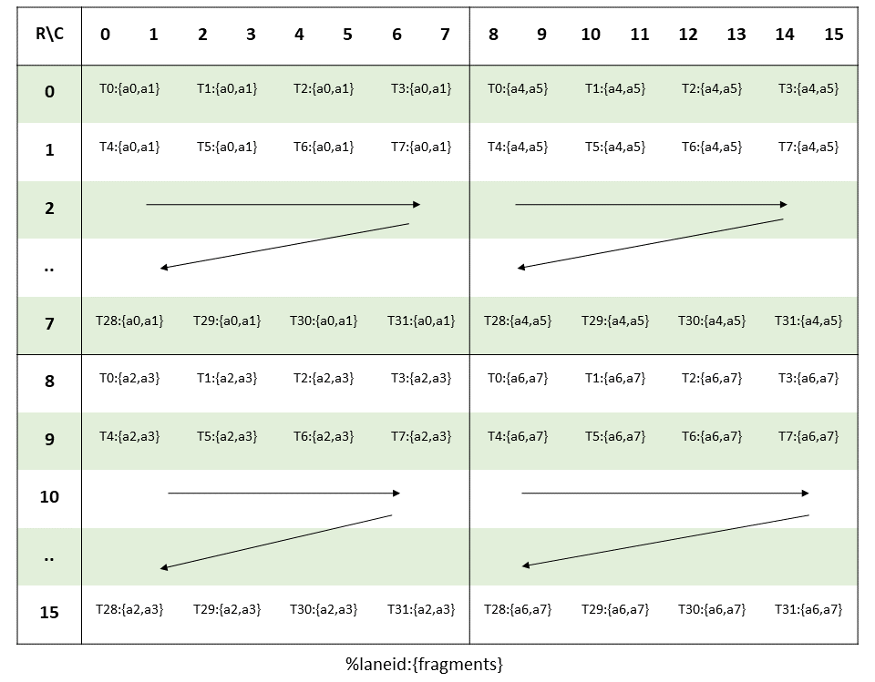{ width="800" }](../../assets/cuda/mma-swizzle/nvidia-mma-16816-A-f16.png)

</div>

<div markdown="1">

[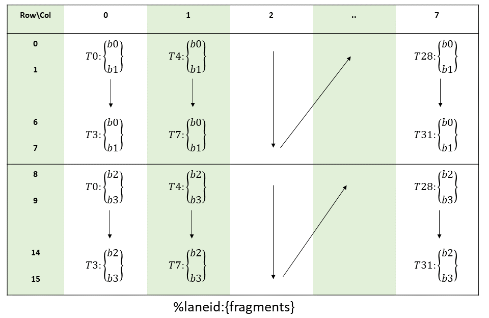{ width="800" }](../../assets/cuda/mma-swizzle/nvidia-mma-16816-B-f16.png)

</div>

</div>

`Tn` 为 lane n，花括号里的 `ai`、`bi` 是该 lane 的标量元素编号；箭头表示省略行按同一规则延续。FP16、BF16 的位置相同，数值编码不同。

### C / D 的 c0～c3

C、D 均为 $16\times8$，同一个 lane 的四个输出元素如下：

| 元素 | 行 | 列 | FP16 packed 位置 |
| --- | --- | --- | --- |
| `c0` | $g$ | $2t$ | `RC[0]` 低 16 bit |
| `c1` | $g$ | $2t+1$ | `RC[0]` 高 16 bit |
| `c2` | $g+8$ | $2t$ | `RC[1]` 低 16 bit |
| `c3` | $g+8$ | $2t+1$ | `RC[1]` 高 16 bit |

| C / D 类型 | 每个 lane 的寄存器形式 | 元素顺序 | 字节数 |
| --- | --- | --- | --- |
| `.f64` | 4 个 `.f64`，每个一个 FP64 | `c0,c1,c2,c3` | 32 B |
| `.f32` | 4 个 `.f32`，每个一个 FP32 | `c0,c1,c2,c3` | 16 B |
| `.f16` | 2 个 `.f16x2`，每个两个 FP16 | `(c0,c1)`、`(c2,c3)` | 8 B |

[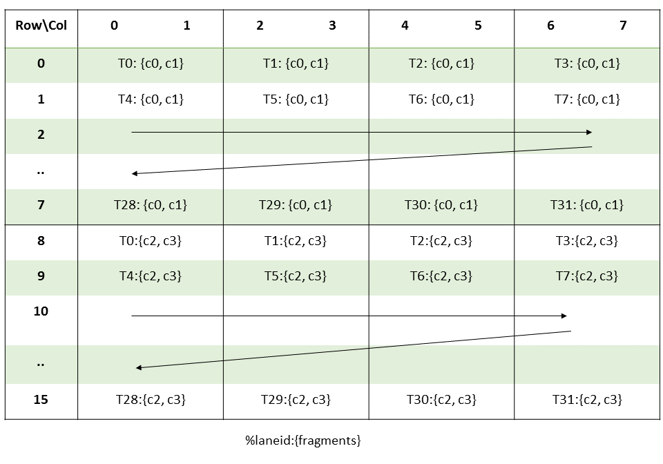{ width="800" }](../../assets/cuda/mma-swizzle/nvidia-mma-16816-C-f16.png)

lane 0 的 `c0,c1` 在第 0 行第 0、1 列，`c2,c3` 在第 8 行第 0、1 列。三种寄存器形式属于相应指令变体；本文使用两个 packed FP16 寄存器，不能直接替换为 FP32 或 FP64 输出。

### packed half2 的位模式

调试器将 `uint32_t` 按整数打印时，显示的是两个 half 拼接后的位模式。低 half 为 1、高 half 为 2 的例子是：

```text
uint32 = 0x40003c00
low16  = 0x3c00 → half 1.0
high16 = 0x4000 → half 2.0
```

检查数值要分别解释低、高 16 bit；把这一个整数当作乘加结果会读错。

### 公共指令函数

`__cvta_generic_to_shared` 得到 Shared 地址。本例使用 32 bit 地址和 `"r"` 约束；`"=r"` 表示输出，`"+r"` 表示输入兼输出。Shared 访问的 `"memory"` clobber 约束编译器重排，跨 lane 数据可见性由同步保证。

```cuda
#include <cassert>
#include <cstdint>
#include <cuda_runtime.h>
#include <cuda_fp16.h>
#include <mma.h>

namespace wmma = nvcuda::wmma;

__device__ __forceinline__ void copy16(void* dst, const void* src) {
    *reinterpret_cast<uint4*>(dst) = *reinterpret_cast<const uint4*>(src);
}

__device__ __forceinline__ uint32_t shared_addr(const void* ptr) {
    return static_cast<uint32_t>(__cvta_generic_to_shared(ptr));
}

template <bool Transpose = false>
__device__ __forceinline__ void ldmatrix_x4(uint32_t* r, const half* ptr) {
    uint32_t addr = shared_addr(ptr);
    if constexpr (Transpose) {
        asm volatile(
            "ldmatrix.sync.aligned.m8n8.x4.trans.shared.b16 "
            "{%0, %1, %2, %3}, [%4];"
            : "=r"(r[0]), "=r"(r[1]), "=r"(r[2]), "=r"(r[3])
            : "r"(addr) : "memory");
    } else {
        asm volatile(
            "ldmatrix.sync.aligned.m8n8.x4.shared.b16 "
            "{%0, %1, %2, %3}, [%4];"
            : "=r"(r[0]), "=r"(r[1]), "=r"(r[2]), "=r"(r[3])
            : "r"(addr) : "memory");
    }
}

__device__ __forceinline__ void ldmatrix_x2_trans(uint32_t* r, const half* ptr) {
    uint32_t addr = shared_addr(ptr);
    asm volatile(
        "ldmatrix.sync.aligned.m8n8.x2.trans.shared.b16 {%0, %1}, [%2];"
        : "=r"(r[0]), "=r"(r[1]) : "r"(addr) : "memory");
}

__device__ __forceinline__ void mma_m16n8k16(
    uint32_t* c, const uint32_t* a, const uint32_t* b) {
    asm volatile(
        "mma.sync.aligned.m16n8k16.row.col.f16.f16.f16.f16 "
        "{%0, %1}, {%2, %3, %4, %5}, {%6, %7}, {%0, %1};"
        : "+r"(c[0]), "+r"(c[1])
        : "r"(a[0]), "r"(a[1]), "r"(a[2]), "r"(a[3]),
          "r"(b[0]), "r"(b[1]));
}

__device__ __forceinline__ void store_half2(half* dst, uint32_t bits) {
    asm volatile("st.shared.b32 [%0], %1;"
                 :: "r"(shared_addr(dst)), "r"(bits) : "memory");
}

// S, B, M 的顺序与下面的地址推导一致，offset 的单位是 half。
template <unsigned S, unsigned B, unsigned M>
__device__ __forceinline__ uint32_t swizzle(uint32_t offset) {
    static_assert(B > 0 && S >= B && M + B + S <= 32);
    constexpr uint32_t mask = ((1u << B) - 1u) << M;
    return offset ^ ((offset >> S) & mask);
}

// 四个 8×8 子块，r[0..3] 依次对应左上、左下、右上、右下。
// row_offset 是各地址提供 lane 的行起点，单位为 half。
__device__ __forceinline__ void store_matrix_x4(
    half* smem, uint32_t row_offset, const uint32_t* r) {
    int lane = threadIdx.x & 31;
    #pragma unroll
    for (int q = 0; q < 4; ++q) {
        uint32_t row = __shfl_sync(0xffffffffu, row_offset, q * 8 + lane / 4);
        store_half2(smem + row + 2 * (lane % 4), r[q]);
    }
}
```

### 一个 Warp 的 16×8 Kernel

每轮沿 K 装入 A、B，执行一次 MMA，C 留在寄存器中累加。A 由 32 个 lane 各搬八个 half，B 由 lane 0～15 各搬八个 half，每次均为 16 B。尺寸要求 $M$ 为 16 的倍数、$N$ 为 8 的倍数、$K$ 为正的 16 的倍数，设备指针满足 16 B 对齐。

=== "核心修改"

    ```cuda
    uint32_t a[4], b[2], c[2] = {0, 0};
    // 每个 K tile 装载新的 a、b，c 跨 tile 保留。
    ldmatrix_x4(a, &sa[lane % 16][(lane / 16) * 8]);
    ldmatrix_x2_trans(b, &sb[lane % 16][0]);
    mma_m16n8k16(c, a, b);
    ```

=== "完整 Kernel"

    ```cuda
    __global__ void hgemm_mma_naive_kernel(
        const half* A, const half* B, half* C, int M, int N, int K) {
        const int m0 = blockIdx.y * 16;
        const int n0 = blockIdx.x * 8;
        if (m0 >= M || n0 >= N) return;  // 整个 Block 作相同判断
    
        __shared__ __align__(32) half sa[16][16];
        __shared__ __align__(32) half sb[16][8];
        __shared__ __align__(32) half sc[16][8];
        const int lane = threadIdx.x;
        uint32_t c[2] = {0, 0};
    
        for (int k0 = 0; k0 < K; k0 += 16) {
            int ar = lane / 2;
            int ac = (lane % 2) * 8;
            copy16(&sa[ar][ac], A + (m0 + ar) * K + k0 + ac);
            if (lane < 16)
                copy16(&sb[lane][0], B + (k0 + lane) * N + n0);
            __syncthreads();
    
            uint32_t a[4], b[2];
            ldmatrix_x4(a, &sa[lane % 16][(lane / 16) * 8]);
            ldmatrix_x2_trans(b, &sb[lane % 16][0]);
            mma_m16n8k16(c, a, b);
            __syncthreads();  // 确保读完本块后再覆盖 sa / sb
        }
        store_half2(&sc[lane / 4][2 * (lane % 4)], c[0]);
        store_half2(&sc[lane / 4 + 8][2 * (lane % 4)], c[1]);
        __syncthreads();
        if (lane < 16)
            copy16(C + (m0 + lane) * N + n0, &sc[lane][0]);
    }
    
    void hgemm_mma_naive(const half* A, const half* B, half* C,
                         int M, int N, int K) {
        assert(M > 0 && N > 0 && K > 0);
        assert(M % 16 == 0 && N % 8 == 0 && K % 16 == 0);
        hgemm_mma_naive_kernel<<<dim3(N / 8, M / 16), 32>>>(A, B, C, M, N, K);
    }
    ```


## 16×16 小矩阵：直接装载与 Shared 装载

A、B、C 均为行主序 $16\times16$，Grid 为 1、Block 为 32，只执行一个 K tile。WMMA 指针需 32 B 对齐，half 的 leading dimension 是 8 的倍数。这个例子比较地址布局，性能还取决于实际指令和数据复用。

### V1：直接从 Global 装载

Warp 直接装入 A、B fragment，乘加后写入 Global，没有显式 Shared 读写。

=== "核心修改"

    ```cuda
    wmma::load_matrix_sync(a, A, 16);
    wmma::load_matrix_sync(b, B, 16);
    wmma::fill_fragment(c, 0.0f);
    wmma::mma_sync(c, a, b, c);
    wmma::store_matrix_sync(C, c, 16, wmma::mem_row_major);
    ```

=== "完整 Kernel"

    ```cuda
    __global__ void wmma_direct_kernel(const half* A, const half* B, half* C) {
        wmma::fragment<wmma::matrix_a, 16, 16, 16, half, wmma::row_major> a;
        wmma::fragment<wmma::matrix_b, 16, 16, 16, half, wmma::row_major> b;
        wmma::fragment<wmma::accumulator, 16, 16, 16, half> c;
        wmma::load_matrix_sync(a, A, 16);
        wmma::load_matrix_sync(b, B, 16);
        wmma::fill_fragment(c, 0.0f);
        wmma::mma_sync(c, a, b, c);
        wmma::store_matrix_sync(C, c, 16, wmma::mem_row_major);
    }
    
    void wmma_direct(const half* A, const half* B, half* C) {
        wmma_direct_kernel<<<1, 32>>>(A, B, C);
    }
    ```


### V2：先写 Shared，再装入 fragment

每个 lane 从 A、B 各搬八个 half 到 Shared 的 `8*lane`，C 也经 Shared 写回 Global。三块 $16\times16$ half 共占 1536 B；跨 lane 写入完成后再读取。

=== "核心修改"

    ```cuda
    copy16(sa + 8 * lane, A + 8 * lane);
    copy16(sb + 8 * lane, B + 8 * lane);
    __syncthreads();
    wmma::load_matrix_sync(a, sa, 16);
    wmma::load_matrix_sync(b, sb, 16);
    ```

=== "完整 Kernel"

    ```cuda
    __global__ void wmma_shared_kernel(const half* A, const half* B, half* C) {
        __shared__ __align__(32) half sa[16 * 16];
        __shared__ __align__(32) half sb[16 * 16];
        __shared__ __align__(32) half sc[16 * 16];
        int lane = threadIdx.x;
        copy16(sa + 8 * lane, A + 8 * lane);
        copy16(sb + 8 * lane, B + 8 * lane);
        __syncthreads();
    
        wmma::fragment<wmma::matrix_a, 16, 16, 16, half, wmma::row_major> a;
        wmma::fragment<wmma::matrix_b, 16, 16, 16, half, wmma::row_major> b;
        wmma::fragment<wmma::accumulator, 16, 16, 16, half> c;
        wmma::load_matrix_sync(a, sa, 16);
        wmma::load_matrix_sync(b, sb, 16);
        wmma::fill_fragment(c, 0.0f);
        wmma::mma_sync(c, a, b, c);
        wmma::store_matrix_sync(sc, c, 16, wmma::mem_row_major);
        __syncthreads();
        copy16(C + 8 * lane, sc + 8 * lane);
    }
    
    void wmma_shared(const half* A, const half* B, half* C) {
        wmma_shared_kernel<<<1, 32>>>(A, B, C);
    }
    ```


### Global→Shared：按八个 lane 分析向量写入

设基址 bank 为 $b_0$、half 元素偏移为 $h$：

$$
\operatorname{bank}(h)=\left(b_0+\left\lfloor h/2\right\rfloor\right)\bmod32.
$$

以下图与算例取 $b_0=0$；其他基址只使 bank 编号循环平移。相邻两个 half 属于同一个 32 bit word。同一请求访问同 bank 的不同 word 需要额外服务，读取同 word 可广播。

若生成 128 bit Shared store，每个 lane 写 16 B，Warp 的 512 B 写入分为四组 128 B 服务，每组八个连续 lane。T0～T7 的起点为 $h=8\,\mathrm{lane}$，各占四个 bank，恰好覆盖 0～31，因此无重复。T8 属于后续服务，不与 T0 合并判断。

[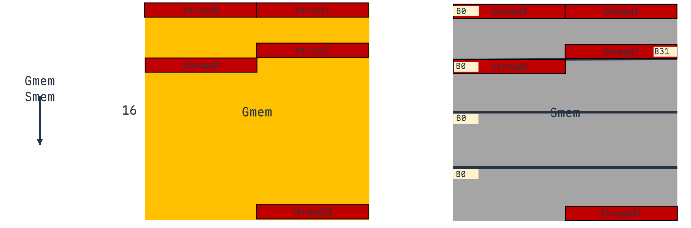{ width="800" }](../../assets/cuda/mma-swizzle/mma-global-to-shared-ppt231.png)

### Shared→寄存器：一个 m8n8 子块内的冲突

一个 $8\times8$ half 子块有 128 B，需要八段连续 16 B。stride 为 16 half 时，左上 R0 子块的行起点 bank 为 **0、8、16、24、0、8、16、24** 。第 0、4 行重复使用 bank 0～3 的不同 word，其他三对同理，形成 2-way conflict。

[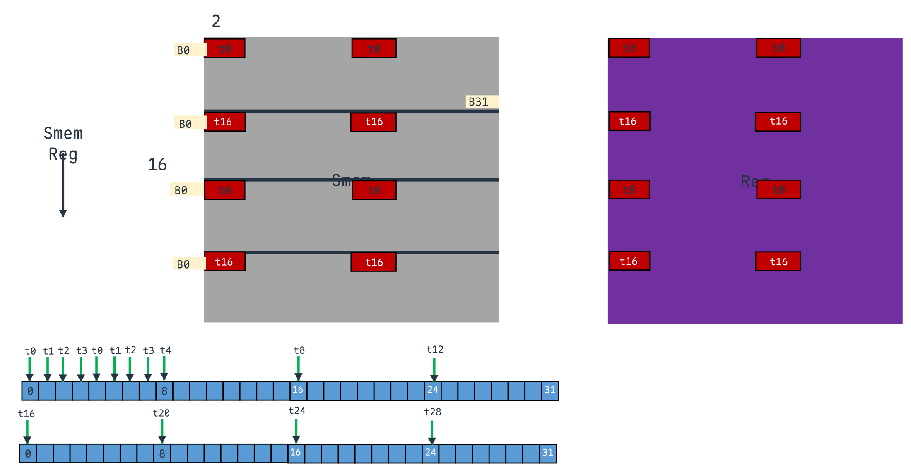{ width="800" }](../../assets/cuda/mma-swizzle/mma-shared-to-register-banks-ppt232.png)

上方红框标记最终属于 T0、T16 的 half2；下方 bank 带示意元素落入哪些 bank。同一个 lane 在不同子块中会再次出现，不能把这些标记直接相加判断冲突。上面的 2-way 结论只统计 **左上 R0 的八段行数据**；其他三个子块、A/B 的两条装载分别判断。

NCU 中分别检查 Shared Load、Shared Store，并在 Source 中定位 `LDSM`、`STS`；用优化构建和 `-lineinfo` 关联源码。累计 Wavefront / Bank Conflict 计数包含执行次数，判断几路冲突仍要回到单次请求的地址集合。这里的 128 B 是 Shared 服务宽度，不是 Shared cache line。

## V3：Padding 改变 Shared stride

A、B 每行增加八个 half 的空槽，Shared 为 `half[16][24]`。Global 地址保持 `8*lane`，Shared 写入改成 `&sa[lane/2][(lane%2)*8]`；fragment 的 leading dimension 同时改为 24。

[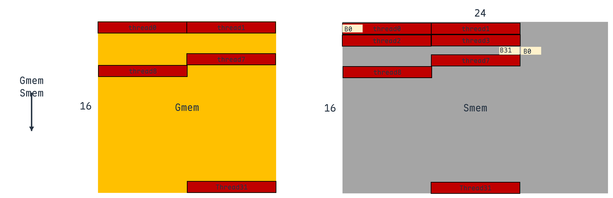{ width="800" }](../../assets/cuda/mma-swizzle/mma-padding-global-to-shared-ppt233.png)

对 128 bit store 的 T0～T7 服务，T1 写入 half 偏移 8，T6 写入偏移 72；两者的不同 word 共用 bank 4～7，产生 2-way 写入冲突。Padding 并不自动保持原来的无冲突写入。

读取左上 $8\times8$ 子块时，行起点 bank 变为 $12r\bmod32$，依次为 **0、12、24、4、16、28、8、20** 。每行占其后的四个 bank，八行恰好覆盖全部 32 个 bank；其他子块同理。

[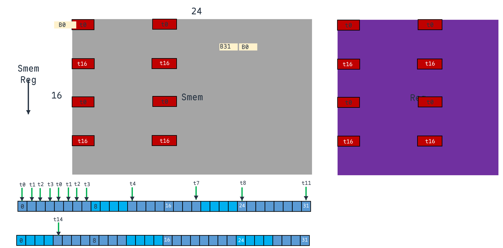{ width="800" }](../../assets/cuda/mma-swizzle/mma-padding-shared-to-register-ppt234.png)

Padding 改善上述读取，代价是 Shared 从 1536 B 增至 2048 B，并可能引入向量写入冲突。空槽无需初始化；C 仍使用 stride 16，其 store 单独判断。若 store 被拆成其他指令宽度，按实际 SASS 的服务分组分析。

=== "核心修改"

    ```cuda
    __shared__ __align__(32) half sa[16][24], sb[16][24];
    copy16(&sa[lane / 2][(lane % 2) * 8], A + 8 * lane);
    copy16(&sb[lane / 2][(lane % 2) * 8], B + 8 * lane);
    __syncthreads();
    wmma::load_matrix_sync(a, sa[0], 24);
    wmma::load_matrix_sync(b, sb[0], 24);
    ```

=== "完整 Kernel"

    ```cuda
    __global__ void wmma_padding_kernel(const half* A, const half* B, half* C) {
        __shared__ __align__(32) half sa[16][24];
        __shared__ __align__(32) half sb[16][24];
        __shared__ __align__(32) half sc[16 * 16];
        int lane = threadIdx.x;
        int row = lane / 2;
        int col = (lane % 2) * 8;
        copy16(&sa[row][col], A + 8 * lane);
        copy16(&sb[row][col], B + 8 * lane);
        __syncthreads();
    
        wmma::fragment<wmma::matrix_a, 16, 16, 16, half, wmma::row_major> a;
        wmma::fragment<wmma::matrix_b, 16, 16, 16, half, wmma::row_major> b;
        wmma::fragment<wmma::accumulator, 16, 16, 16, half> c;
        wmma::load_matrix_sync(a, sa[0], 24);
        wmma::load_matrix_sync(b, sb[0], 24);
        wmma::fill_fragment(c, 0.0f);
        wmma::mma_sync(c, a, b, c);
        wmma::store_matrix_sync(sc, c, 16, wmma::mem_row_major);
        __syncthreads();
        copy16(C + 8 * lane, sc + 8 * lane);
    }
    
    void wmma_padding(const half* A, const half* B, half* C) {
        wmma_padding_kernel<<<1, 32>>>(A, B, C);
    }
    ```


## V4：展开 ldmatrix、MMA 与结果写回

A、B 现在都是 $16\times16$，都用 `.x4`，B 带 `.trans`。行地址仍为：

$$
p(\mathrm{lane})=16(\mathrm{lane}\bmod16)+8\left\lfloor\mathrm{lane}/16\right\rfloor.
$$

B 的前两个 packed 寄存器对应左侧 $16\times8$，后两个对应右侧；两次 MMA 复用同一 A，分别写入 `c[0..1]`、`c[2..3]`。

Ampere 用 half2 store 模拟矩阵写回。`store_matrix_x4` 对子块 q 取 lane `8*q+lane/4` 提供的行起点，再加 `2*(lane%4)`，四个接收 lane 写完一整行。这与装载时的行地址提供规则对应，原有 bank 重复仍存在。

WMMA fragment 也可作为这些元素的容器：`.x` 为 half 数组，`b_frag.x+4` 跳过四个 half，即两个 packed 寄存器。将它与 PTX 指令混用依赖 WMMA 的内部映射；下面显式使用 packed 数组，保持同样的装载和两次 MMA 次序。

=== "核心修改"

    ```cuda
    uint32_t a[4], b[4], c[4] = {0, 0, 0, 0};
    uint32_t p = (lane % 16) * 16 + (lane / 16) * 8;
    ldmatrix_x4(a, sa + p);
    ldmatrix_x4<true>(b, sb + p);
    mma_m16n8k16(c, a, b);
    mma_m16n8k16(c + 2, a, b + 2);
    store_matrix_x4(sc, p, c);
    ```

=== "完整 Kernel"

    ```cuda
    __global__ void mma_shared_kernel(const half* A, const half* B, half* C) {
        __shared__ __align__(32) half sa[256], sb[256], sc[256];
        int lane = threadIdx.x;
        uint32_t g = 8 * lane;
        copy16(sa + g, A + g);
        copy16(sb + g, B + g);
        __syncthreads();
    
        uint32_t a[4], b[4], c[4] = {0, 0, 0, 0};
        uint32_t p = (lane % 16) * 16 + (lane / 16) * 8;
        ldmatrix_x4(a, sa + p);
        ldmatrix_x4<true>(b, sb + p);
        mma_m16n8k16(c, a, b);          // 左侧 16×8
        mma_m16n8k16(c + 2, a, b + 2);  // 右侧 16×8
        store_matrix_x4(sc, p, c);
        __syncthreads();
        copy16(C + g, sc + g);
    }
    
    void mma_shared(const half* A, const half* B, half* C) {
        mma_shared_kernel<<<1, 32>>>(A, B, C);
    }
    ```


## V5：Swizzle 重排 Shared 小组

Swizzle 在原有空间中移动整个八 half 小组，写入、装载和结果写回使用匹配的地址；**寄存器中的逻辑元素位置保持不变** 。

[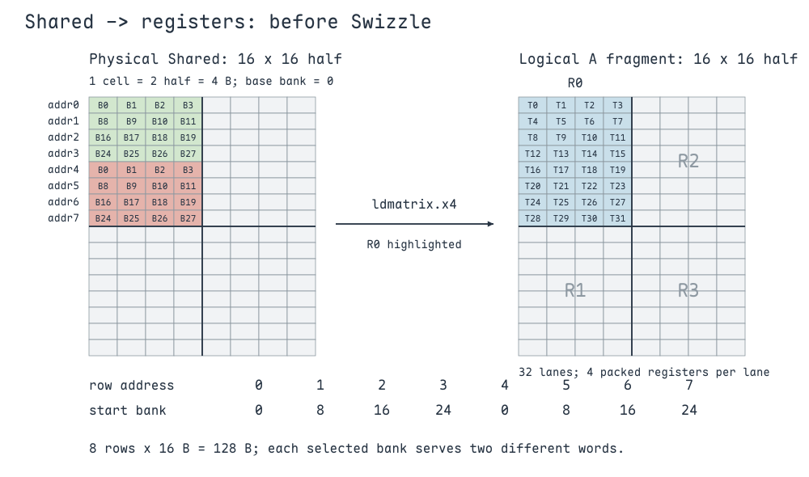{ width="800" }](../../assets/cuda/mma-swizzle/swizzle-shared-register-before.svg)

### 16×16 的两组交换

half 偏移写为 $h=16r+8g+e$：r 为行号，g 为左右组编号，e 为组内偏移。`swizzle<3,1,3>` 使用：

$$
s(h)=h\oplus\left((h\gg3)\ \&\ 8\right),\qquad
g'=g\oplus\left(\left\lfloor r/4\right\rfloor\bmod2\right).
$$

行号和组内顺序不变，第 4～7、12～15 行交换左右两组。图中编号表示从 Global 搬入的八 half 小组。

[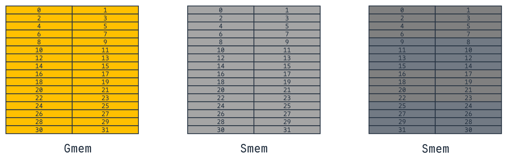{ width="800" }](../../assets/cuda/mma-swizzle/swizzle-group-numbers-ppt236.png)

Global 搬运 lane 8 的逻辑偏移 64 改存到物理偏移 72，lane 9 的 72 改存到 64。Shared 装载的地址提供 lane 4 也改为提供 72，仍取回第 4 行的逻辑左半。

[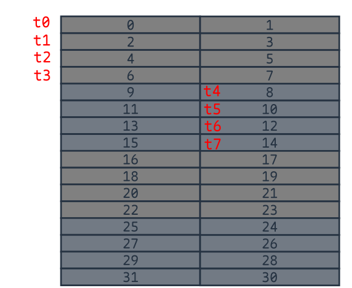{ width="600" }](../../assets/cuda/mma-swizzle/swizzle-row-providers-ppt236.png)

T0～T3 的行地址不变，T4～T7 指向物理右半。接收 lane 仍按官方 fragment 图获得相同元素；只改写入、不改装载地址会取错小组。

[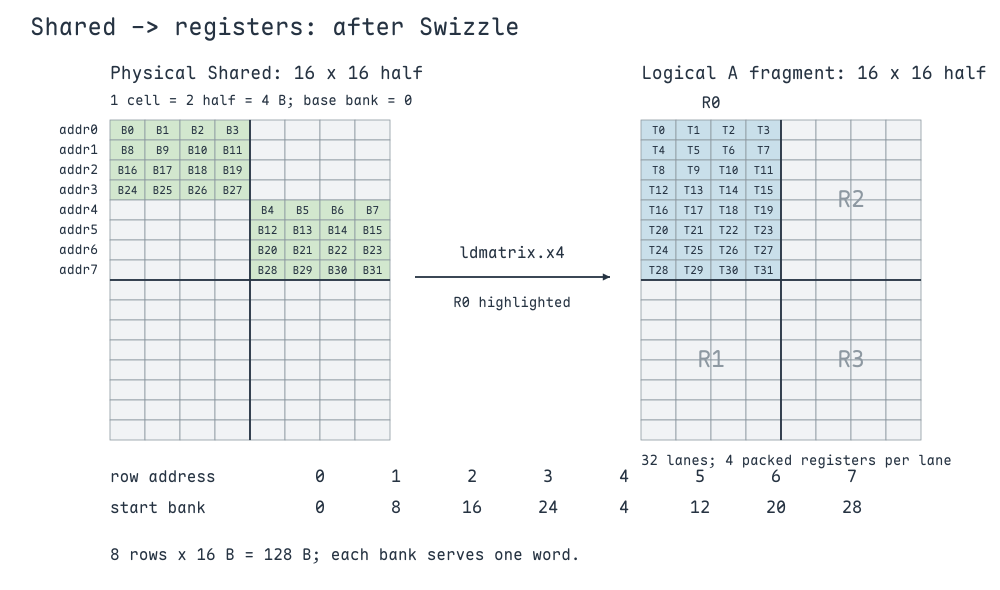{ width="800" }](../../assets/cuda/mma-swizzle/swizzle-shared-register-after.svg)

八个逻辑行的起点 bank 为 0、8、16、24、4、12、20、28，各占四个 bank，不再重复。向量写入也只在每个八 lane 服务内部交换小段，保持无冲突；Shared 仍占 1536 B。

### 写入、装载与 C 写回使用同一映射

`gAddr=8*lane` 是 Global 搬运起点，`rAddr` 是行地址提供者的逻辑起点；两者分别应用 $s$。C 也按 $s$ 写入 Shared，再从 $s(\mathrm{gAddr})$ 取回线性 Global。`__syncthreads()` 保证跨 lane 写入先完成再读取，指令名中的 `.sync` 不替代这一步。

=== "核心修改"

    ```cuda
    uint32_t g2sAddr = swizzle<3, 1, 3>(8 * lane);
    copy16(sa + g2sAddr, A + 8 * lane);
    copy16(sb + g2sAddr, B + 8 * lane);
    __syncthreads();
    uint32_t rAddr = (lane % 16) * 16 + (lane / 16) * 8;
    uint32_t r2sAddr = swizzle<3, 1, 3>(rAddr);
    ldmatrix_x4(a, sa + r2sAddr);
    ldmatrix_x4<true>(b, sb + r2sAddr);
    // 两次 MMA 后，按相同布局写入 sc。
    store_matrix_x4(sc, r2sAddr, c);
    __syncthreads();
    copy16(C + 8 * lane, sc + g2sAddr);
    ```

=== "完整 Kernel"

    ```cuda
    __global__ void mma_swizzle_kernel(const half* A, const half* B, half* C) {
        __shared__ __align__(32) half sa[256], sb[256], sc[256];
        int lane = threadIdx.x;
        uint32_t gAddr = 8 * lane;
        uint32_t g2sAddr = swizzle<3, 1, 3>(gAddr);
        copy16(sa + g2sAddr, A + gAddr);
        copy16(sb + g2sAddr, B + gAddr);
        __syncthreads();
    
        uint32_t a[4], b[4], c[4] = {0, 0, 0, 0};
        uint32_t rAddr = (lane % 16) * 16 + (lane / 16) * 8;
        uint32_t r2sAddr = swizzle<3, 1, 3>(rAddr);
        ldmatrix_x4(a, sa + r2sAddr);
        ldmatrix_x4<true>(b, sb + r2sAddr);
        mma_m16n8k16(c, a, b);
        mma_m16n8k16(c + 2, a, b + 2);
        store_matrix_x4(sc, r2sAddr, c);
        __syncthreads();  // 跨 lane 写入必须先完成，才能读出 sc
        copy16(C + gAddr, sc + g2sAddr);
    }
    
    void mma_swizzle(const half* A, const half* B, half* C) {
        mma_swizzle_kernel<<<1, 32>>>(A, B, C);
    }
    ```


## 16×64：让八行覆盖八个 bank 小段

一行 64 个 half 为 128 B，含八个八 half 小组。固定逻辑列组的八个行起点若只移动到两个物理列组，仍会每四行重复同一四 bank 小段：

[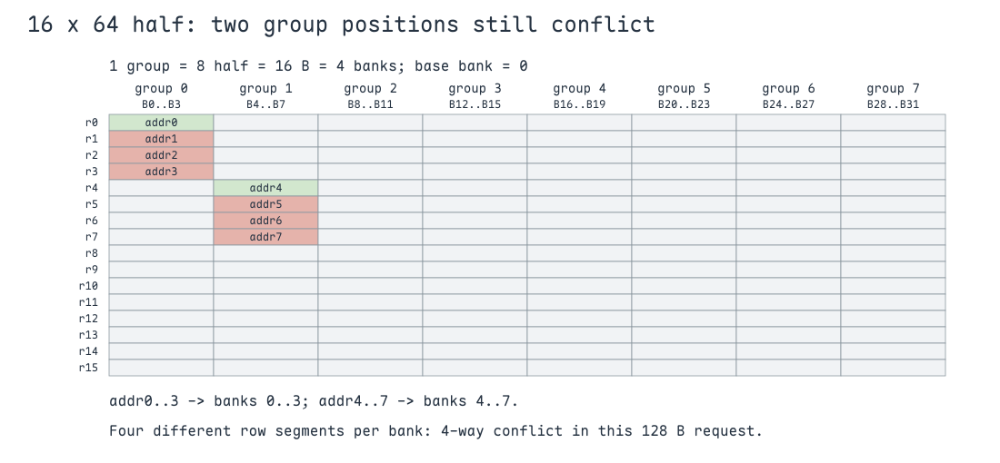{ width="800" }](../../assets/cuda/mma-swizzle/swizzle-half64-remaining-conflict.svg)

### 循环平移与 XOR

让每个八行窗口的固定逻辑列组落入八个不同物理组，就能覆盖全部 32 个 bank。循环平移为：

$$
g'=(g+r)\bmod8.
$$

绿色第 0 组落在 0～7，蓝色第 1 组落在 1～7、0。

XOR 使用 $g'=g\oplus(r\ \&\ 7)$：第 0 组仍落在 0～7，第 1 组则落在 1、0、3、2、5、4、7、6。两种方式均需匹配的写入和行地址，才能得到相同逻辑 fragment。

<div class="cuda-figure-pair" markdown="1">

<div markdown="1">

[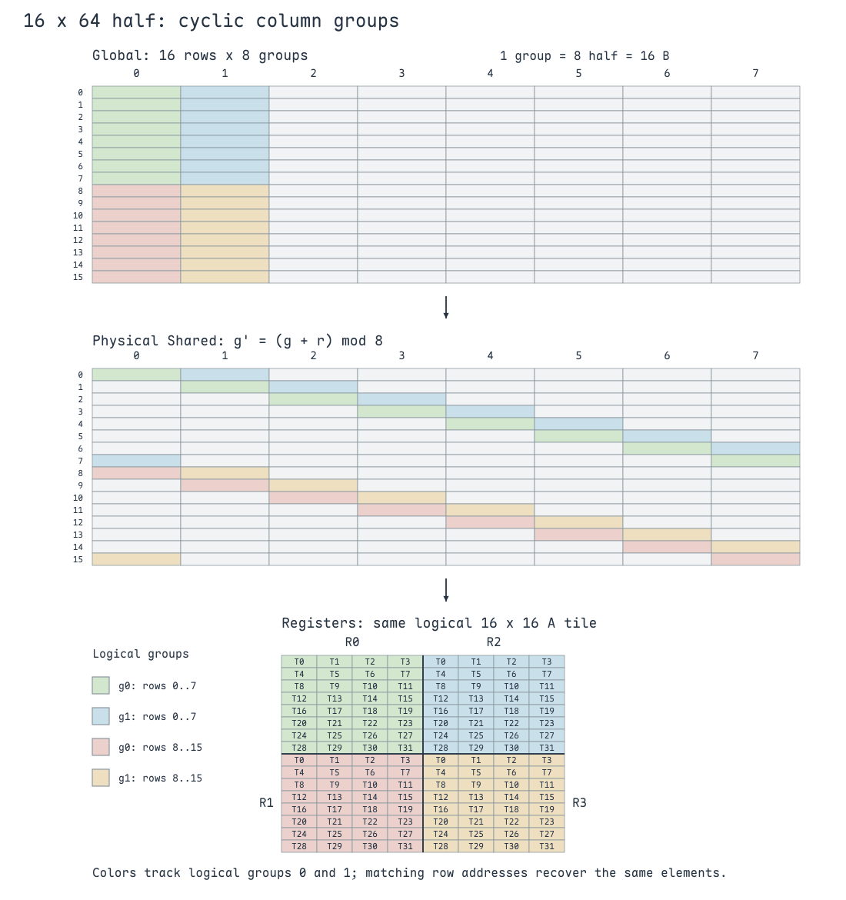{ width="800" }](../../assets/cuda/mma-swizzle/swizzle-half64-cyclic.svg)

</div>

<div markdown="1">

[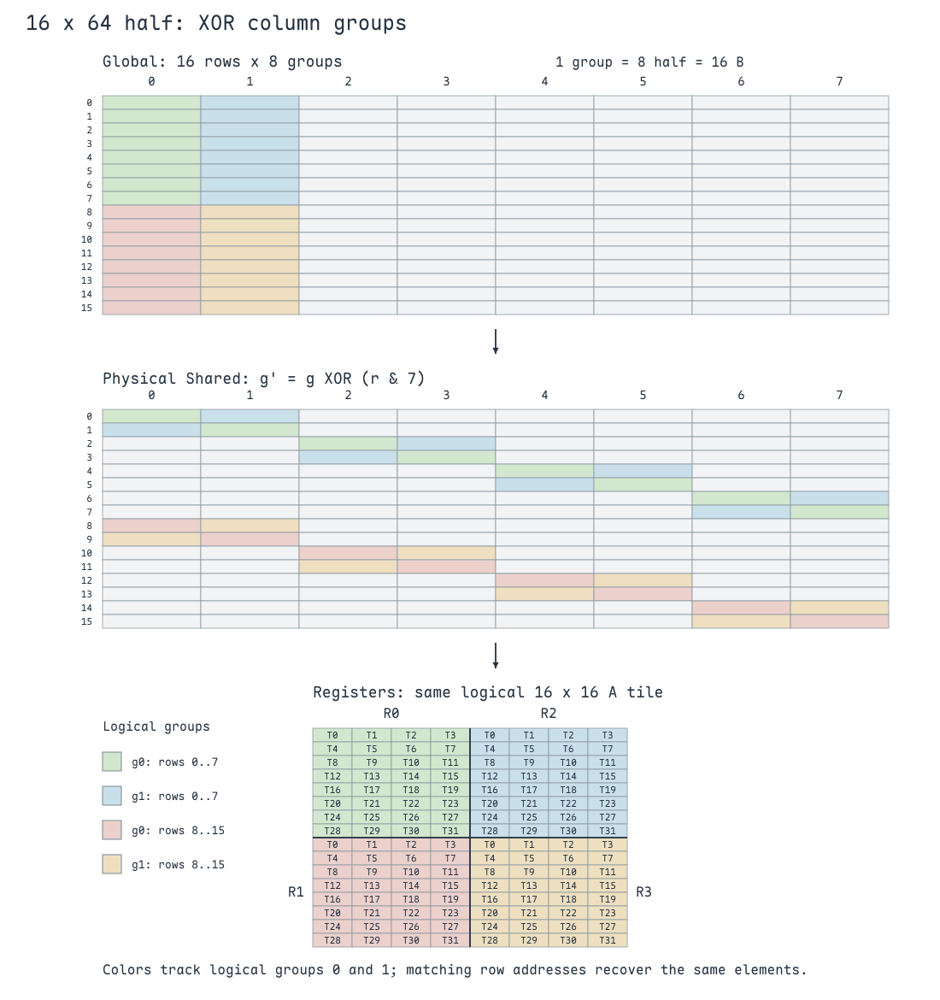{ width="800" }](../../assets/cuda/mma-swizzle/swizzle-half64-xor.svg)

</div>

</div>

### S、B、M 与 264→296

公共 `swizzle<S,B,M>` 先计算 `mask=((1u<<B)-1u)<<M`，再返回 `h ^ ((h>>S)&mask)`。对 $h=64r+8g+e$，half 偏移的十位是 `rrrr ggg eee`：

| 参数 | 位操作含义 | 16×64 half 的取值 |
| --- | --- | --- |
| `M` | 保留最低 M 位 | 3，保护组内八个 half |
| `B` | 修改从 M 开始的 B 位 | 3，覆盖八个列组 |
| `S` | 将来源位右移到目标位 | 3，将行号低三位移到列组位 |

第 4 行、第 1 组的起点为 $h=4\times64+8=264$：

```text
h          = 0100 001 000 = 264
mask       = 0000 111 000 = 56
h >> 3     = 0000 100 001
shift&mask = 0000 100 000 = 32
s(h)       = 0100 101 000 = 296
```

行号保持 4，列组 $1\oplus4=5$，组内偏移仍为 0。

[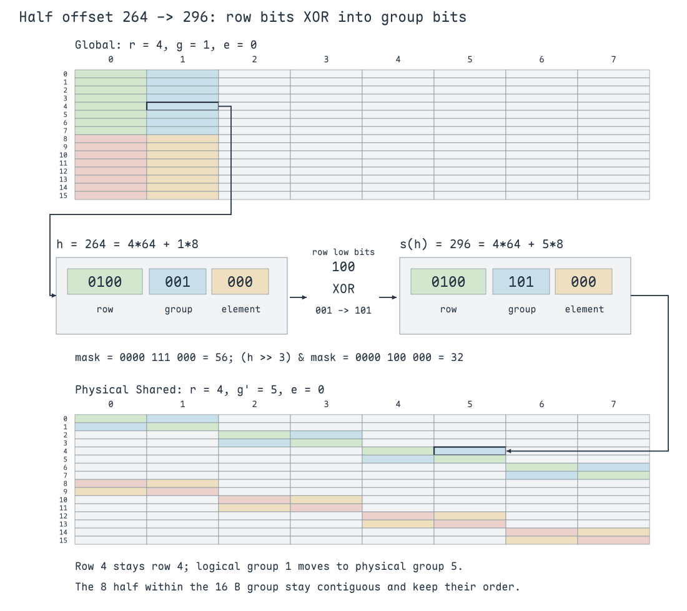{ width="800" }](../../assets/cuda/mma-swizzle/swizzle-half64-bit-transform.svg)

这里的地址单位为 half。若改用 byte 偏移，同一个 16 B 小组要保护四个低位；不能直接套用 M=3。保留组内低位，使写入 `shared[s(h)]` 后，`ldmatrix` 仍可从同一个映射起点连续读取八个 half。
