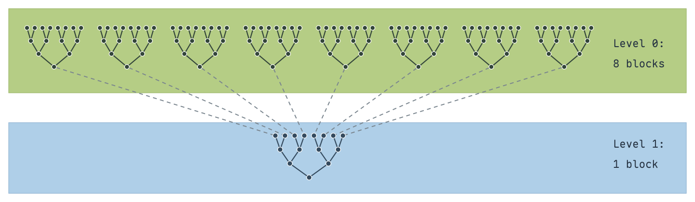
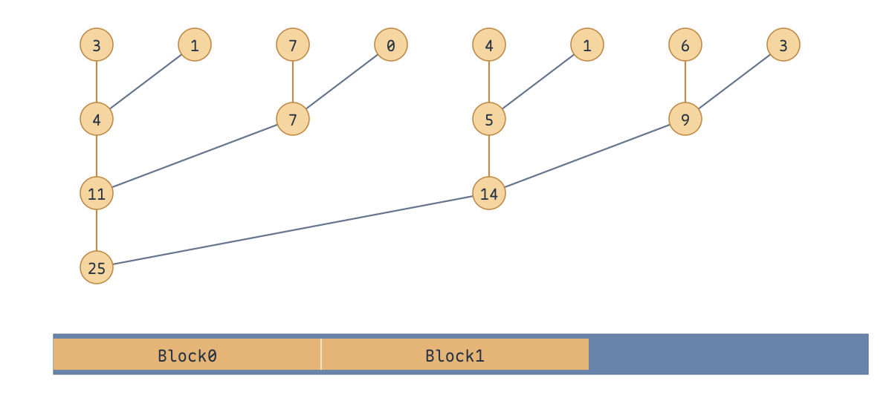
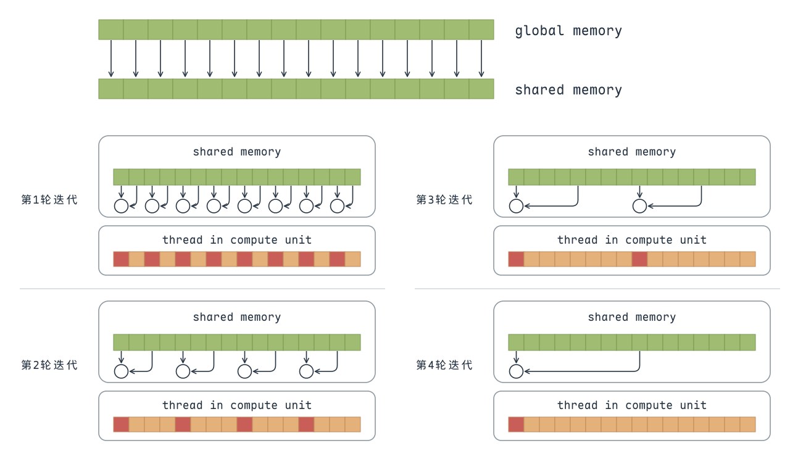
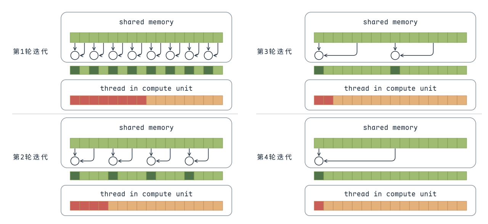
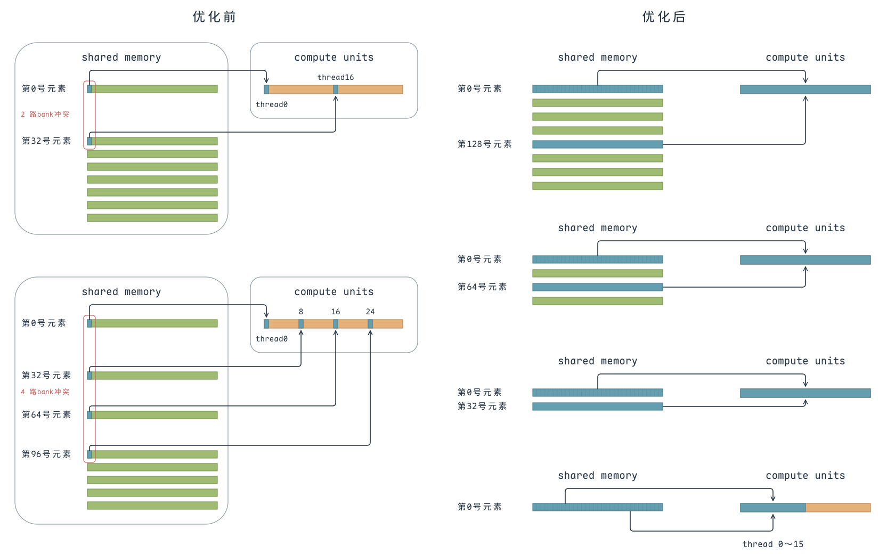
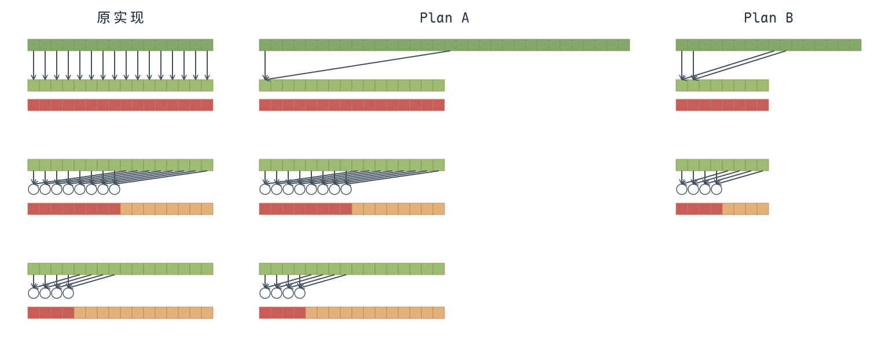
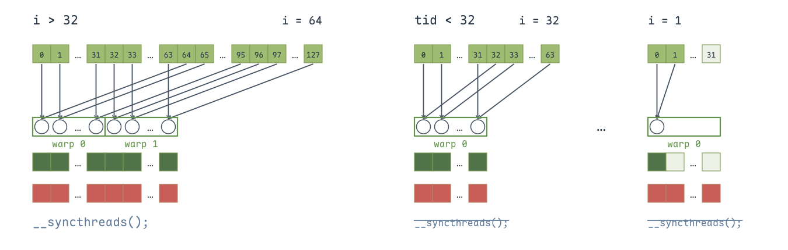
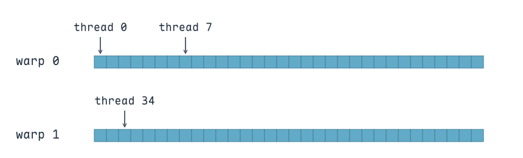
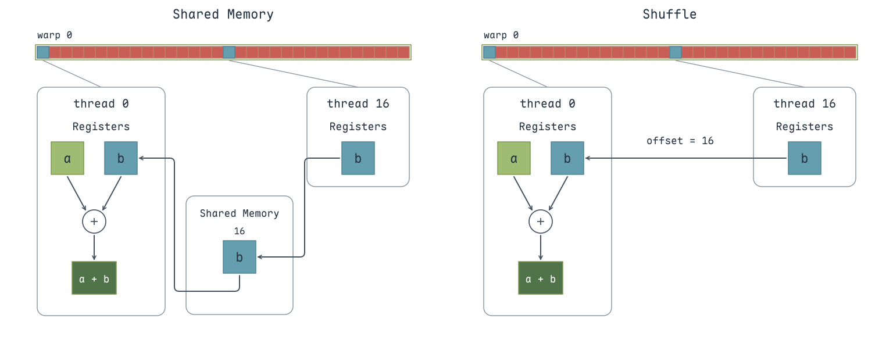

---
tags:
  - Warp
  - Memory
title: Reduce 规约求和
description: 从树形归约与两阶段计算出发，逐步优化线程访问、Bank Conflict、循环展开和 Warp 内求和。
date: 2026-10-26
---

reduce 算法本质上就是计算：

$$
x = x_0 \otimes x_1 \otimes x_2 \otimes x_3 \otimes \cdots \otimes x_{n-1} \otimes x_n.
$$

在GPU中，reduce采用了一种树形的计算方式，由于GPU没有针对global数据的同步操作，只能针对block的数据进行同步。所以，一般而言将reduce分为两个阶段，其示意图如下：

{ width="800" }

假设给定一个长度为N的数组，需要计算该数组的所有元素之和。首先需要将数组分为m个小份。而后，在第一阶段中，开启m个block计算出m个小份的reduce值。最后，在第二阶段中，使用一个block将m个小份再次进行reduce，得到最终的结果。

> 由于第二阶段本质上是可以调用第一个阶段的kernel，所以不做单独说明，下文只是探索**第一阶段**的优化技巧。

最直接的实现方式是：**每个 Block 负责一段连续的输入数据，在 Global Memory 中原地完成树形规约**。每个 thread 对应一个元素，各轮相加后的中间结果仍然写回输入数组。

以图中的 8 个元素为例，规约分为三轮：

- 第一轮，相邻元素两两相加，由 thread 0、2、4、6 执行，结果保留在索引 0、2、4、6 的位置。
- 第二轮，合并上一轮的结果，由 thread 0、4 执行，结果保留在索引 0、4 的位置。
- 第三轮，由 thread 0 合并最后两个结果，得到这一段数据的总和。

**每轮结束后，Block 内所有线程都需要执行 `__syncthreads()`**，保证本轮结果已经写入，下一轮才能安全读取。最终，由 thread 0 将这个 Block 的部分和写入输出数组。

> 先用 `input_begin` 明确当前 Block 的数据起始地址，后续就可以直接用 `threadIdx.x` 索引这段数据，不必每次都加上 Block 的偏移量。

{ width="500" }

```cuda
__global__ void reduce(float *d_input, float *d_output) {
    float *input_begin = d_input + blockDim.x * blockIdx.x;
    for (int i = 1; i < blockDim.x; i *= 2) {
        if (threadIdx.x % (i * 2) == 0)
            // 中间结果原地写回 Global Memory，供下一轮合并
            input_begin[threadIdx.x] += input_begin[threadIdx.x + i];
        __syncthreads();
    }
    if (threadIdx.x == 0)
        d_output[blockIdx.x] = input_begin[0];
}
```

<p class="cuda__label" id="tips">Tips</p>

- 设计算法的时候是按照 **Block** 设计的，但是写程序的时候是按照 **thread** 写的。
- 索引很容易乱套的，所以最好为每一个 **Block** 设计一个更进一步的索引。
- 绘制一个清晰的 **Block** 算法图是很有必要的。

## 优化技巧1：使用Shared Memory

每个 thread 先将一个输入元素从 Global Memory 加载到 Shared Memory，再按上文的树形方式完成规约，最后将这个 Block 的部分和写入输出数组。**中间结果保存在 Shared Memory 中，减少反复访问 Global Memory 的开销。**

**数据加载完成后，以及每轮规约结束后，Block 内所有线程都需要同步。** 图中以 16 个元素为例，四轮参与相加的线程数依次为 8、4、2、1，红色表示当前轮参与计算的线程，其余线程仍需参与同步。

{ width="700" }

```cuda
#define THREAD_PER_BLOCK 256

__global__ void reduce(float *d_input, float *d_output) {
    __shared__ float shared[THREAD_PER_BLOCK];
    float *input_begin = d_input + blockDim.x * blockIdx.x;
    // 先加载到 Shared Memory，后续规约在共享内存中完成
    shared[threadIdx.x] = input_begin[threadIdx.x];
    __syncthreads();

    for (int i = 1; i < blockDim.x; i *= 2) {
        if (threadIdx.x % (i * 2) == 0)
            shared[threadIdx.x] += shared[threadIdx.x + i];
        __syncthreads();
    }
    if (threadIdx.x == 0)
        d_output[blockIdx.x] = shared[0];
}
```

## 优化技巧2：解决warp divergence

GPU 以 **warp** 为单位发射指令，一个 warp 通常包含 32 个线程。上一版参与相加的线程在 warp 内间隔分布，同一个 warp 中，有些线程执行相加，有些线程跳过计算，造成 **warp divergence**，降低线程利用率。

优化思路是：**让参与计算的线程连续分布，再将它们映射到需要相加的数据位置**。这样，前几轮可以让整个 warp 都参与计算，或整个 warp 都跳过计算，减少 warp 内的分歧。树形规约的合并顺序保持不变。

以一个 Block 包含 256 个线程、共 8 个 warp 为例：

- **第 1 轮**：thread 0～127 参与计算，对应 warp 0～3。每个 warp 内的线程都走同一分支，没有分歧。
- **第 2 轮**：thread 0～63 参与计算，对应 warp 0、1，仍然没有 warp 内分歧。
- **第 3 轮**：thread 0～31 参与计算，恰好是完整的 warp 0，没有分歧。
- **第 4 轮**：只有 thread 0～15 参与计算，即 warp 0 的前 16 个线程，此时开始出现 warp 内分歧。

> 因此，这个实现**消除了前 3 轮的 warp divergence**。从第 4 轮开始，参与计算的线程数不足一个 warp，仍会出现分歧；每轮结束后，所有线程仍需参与同步。

{ width="700" }

```cuda
#define THREAD_PER_BLOCK 256

__global__ void reduce(float *d_input, float *d_output) {
    __shared__ float shared[THREAD_PER_BLOCK];
    float *input_begin = d_input + blockDim.x * blockIdx.x;
    shared[threadIdx.x] = input_begin[threadIdx.x];
    __syncthreads();

    for (int i = 1; i < blockDim.x; i *= 2) {
        // 让参与计算的线程连续分布，减少 warp 内分歧
        if (threadIdx.x < blockDim.x / (2 * i)) {
            // 映射回原来的两两相加位置，保持合并顺序
            int index = threadIdx.x * 2 * i;
            shared[index] += shared[index + i];
        }
        __syncthreads();
    }
    if (threadIdx.x == 0)
        d_output[blockIdx.x] = shared[0];
}
```

## 优化技巧3：解决bank conflict

上一版参与计算的线程连续，但访问的数据仍然间隔排列。以 32 个 bank、bank 宽度为 4 字节的情况为例，`float` 元素 $k$ 对应 bank $k \bmod 32$。**同一 warp 在同一条访存指令中访问同一 bank 的不同元素，会产生 bank 冲突。**

假设一个 Block 有 256 个线程，只观察 warp 0 读取第一个操作数的情况：

- **第 1 轮**：thread 0、16 分别读取元素 0、32，均位于 bank 0，产生 **2 路冲突**。
- **第 2 轮**：thread 0、8、16、24 分别读取元素 0、32、64、96，均位于 bank 0，产生 **4 路冲突**。

解决方法是：**每轮合并前后两半中对应的元素，让相邻线程访问连续数据**。合并距离按 128、64、32……逐轮减半。例如，第一轮 warp 0 分别读取元素 0～31 和 128～159，每次读取都覆盖 32 个不同的 bank；后续活跃线程的访问仍然连续，因此没有 bank 冲突。

> 元素 0 和 128 虽然位于同一 bank，但分属两次读取，不会因此产生冲突。右图的两条连线分别表示这两次读取。

{ width="800" }

```cuda
#define THREAD_PER_BLOCK 256

__global__ void reduce(float *d_input, float *d_output) {
    __shared__ float shared[THREAD_PER_BLOCK];
    float *input_begin = d_input + blockDim.x * blockIdx.x;
    shared[threadIdx.x] = input_begin[threadIdx.x];
    __syncthreads();

    // 合并前后两半，每轮将合并距离减半
    for (int i = blockDim.x / 2; i > 0; i /= 2) {
        if (threadIdx.x < i)
            // 每次访存中，相邻线程访问连续元素，避免 bank 冲突
            shared[threadIdx.x] += shared[threadIdx.x + i];
        __syncthreads();
    }
    if (threadIdx.x == 0)
        d_output[blockIdx.x] = shared[0];
}
```

## 优化技巧4：解决idle线程

上一节每个 Block 使用 256 个线程，初始加载时所有线程都参与工作，进入规约后却只有前 128 个线程相加，后续再逐轮减半。**后半线程只参与了加载和同步，没有参与相加。**

可以将一次合并提前到加载阶段：**每个线程读取两个元素，先相加，再将部分和写入 Shared Memory**。这样所有线程都先完成一次相加，随后继续进行树形规约。具体可以增加每个 Block 的数据量，或减少每个 Block 的线程数，形成下面两种方案。

{ width="800" }

<div class="cuda__plans" markdown="1">

<div class="cuda__plan" markdown="1">

<p class="cuda__label" id="tips-plan-a">Tips: PlanA</p>

- **Block 数量减半**：由 $N/256$ 改为 $N/512$。
- **线程数不变**：每个 Block 仍使用 256 个线程。
- **每个线程处理两个元素**：每个 Block 处理 512 个元素。

</div>

<div class="cuda__plan" markdown="1">

<p class="cuda__label" id="tips-plan-b">Tips: PlanB</p>

- **Block 数量不变**：仍为 $N/256$。
- **线程数减半**：每个 Block 改用 128 个线程。
- **每个线程处理两个元素**：每个 Block 仍处理 256 个元素。

</div>

</div>

两种方案使用相同的 kernel：Plan A 将 `THREAD_PER_BLOCK` 设为 256，Plan B 设为 128。

```cuda
#define THREAD_PER_BLOCK 256

__global__ void reduce(float *d_input, float *d_output) {
    __shared__ float shared[THREAD_PER_BLOCK];
    float *input_begin = d_input + blockDim.x * blockIdx.x * 2;
    // 加载时先相加，让每个线程处理两个元素
    shared[threadIdx.x] = input_begin[threadIdx.x]
                       + input_begin[threadIdx.x + blockDim.x];
    __syncthreads();

    for (int i = blockDim.x / 2; i > 0; i /= 2) {
        if (threadIdx.x < i)
            shared[threadIdx.x] += shared[threadIdx.x + i];
        __syncthreads();
    }
    if (threadIdx.x == 0)
        d_output[blockIdx.x] = shared[0];
}
```

启动时，按每个 Block 处理两倍线程数的元素计算 Block 数量：

```cuda
int block_num = N / (THREAD_PER_BLOCK * 2);
reduce<<<block_num, THREAD_PER_BLOCK>>>(d_input, d_output);
```

## 优化技巧5：展开最后一维减少同步

规约进入最后几轮时，只有 warp 0 还在参与有效计算，但循环中仍然每轮调用 `__syncthreads()`，让整个 Block 的线程一起等待。**优化的核心是：将最后一个 warp 内的固定步骤展开，减少循环控制和 Block 级同步。**

以 256 个线程的 Block 为例，循环先完成距离 128、64 的两轮合并。这时仍有多个 warp 参与，**每轮都要保留 `__syncthreads()`，并让 Block 内所有线程执行同步**。距离 64 的合并结束后，还剩 64 个部分和；这一轮的同步也保证了 warp 0 能在下一步读到其他 warp 写回的结果。

之后进入 `tid < 32`，由 warp 0 完成距离 32、16、8、4、2、1 的六步累加。将这些固定步骤直接写出来，就不必继续执行循环中的 Block 级屏障。**32 个线程仍然执行全部六条语句，后续需要的有效结果逐步减少，最后由 thread 0 写出整个 Block 的部分和。**

{ width="800" }

> 绿色框表示一个 warp。一个 warp 包含 32 个线程，thread 0～31 属于 warp 0，thread 32～63 属于 warp 1；因此 thread 0 和 thread 7 同组，thread 34 属于另一组。

GPU 以 warp 为单位执行 SIMT 指令。在传统的 warp 锁步执行下，同一 warp 的线程共同执行指令，而不同 warp 的执行进度相互独立。**thread 0 和 thread 34 之间如果存在 Shared Memory 读写依赖，就需要通过 `__syncthreads()` 保证前一轮的结果已经写回；尾部计算只涉及 warp 0，因此可以在这一执行假设下省去反复的 Block 同步。**

{ width="660" }

> 这里省去尾部同步的写法依赖传统 warp 锁步执行。Volta 及之后的 GPU 支持独立线程调度，不能仅凭“同一 warp”保证 Shared Memory 读写顺序；`volatile` 也不是同步屏障，现代实现需要显式的 `__syncwarp()` 或使用 warp shuffle 完成规约。

```cuda
#define THREAD_PER_BLOCK 256

__device__ void warpReduce(volatile float *cache, unsigned int tid)
{
    // 将最后一个 warp 的固定合并步骤展开
    cache[tid] += cache[tid + 32];
    cache[tid] += cache[tid + 16];
    cache[tid] += cache[tid + 8];
    cache[tid] += cache[tid + 4];
    cache[tid] += cache[tid + 2];
    cache[tid] += cache[tid + 1];
}
__global__ void reduce(float *d_input, float *d_output)
{
    int tid = threadIdx.x;
    __shared__ float shared[THREAD_PER_BLOCK];
    float *input_begin = d_input + blockDim.x * blockIdx.x * 2;
    shared[tid] = input_begin[tid] + input_begin[tid + blockDim.x];
    __syncthreads();

    // 多个 warp 参与的阶段，每轮仍保留 Block 同步
    for (int i = blockDim.x / 2; i > 32; i /= 2)
    {
        if (tid < i)
            shared[tid] += shared[tid + i];
        __syncthreads();
    }
    // 尾部仅由 warp 0 执行，省去重复的 Block 同步
    if (tid < 32)
    {
        warpReduce(shared, tid);
    }
    if (tid == 0)
        d_output[blockIdx.x] = shared[0];
}
```

## 优化技巧6：完全展开减少计算

将剩余的 `for` 循环完全展开，固定每轮步长，**减少循环控制和索引计算的开销**，规约本身的加法次数不变。这项优化在 G80 等早期 GPU 上收益较明显，但随着 GPU 架构和编译器优化的发展，现代 GPU 上手动展开的额外收益通常有限。

```cuda
#define THREAD_PER_BLOCK 256

__device__ void warpReduce(volatile float *cache, unsigned int tid)
{
    cache[tid] += cache[tid + 32];
    cache[tid] += cache[tid + 16];
    cache[tid] += cache[tid + 8];
    cache[tid] += cache[tid + 4];
    cache[tid] += cache[tid + 2];
    cache[tid] += cache[tid + 1];
}
__global__ void reduce(float *d_input, float *d_output)
{
    int tid = threadIdx.x;
    __shared__ float shared[THREAD_PER_BLOCK];
    float *input_begin = d_input + blockDim.x * blockIdx.x * 2;
    shared[tid] = input_begin[tid] + input_begin[tid + blockDim.x];
    __syncthreads();
    // 固定展开各轮合并，编译期移除不适用的分支
    if (THREAD_PER_BLOCK >= 512)
    {
        if (tid < 256)
            shared[tid] += shared[tid + 256];
        __syncthreads();
    }
    if (THREAD_PER_BLOCK >= 256)
    {
        if (tid < 128)
            shared[tid] += shared[tid + 128];
        // 跨 warp 的合并仍需 Block 同步
        __syncthreads();
    }
    if (THREAD_PER_BLOCK >= 64)
    {
        if (tid < 64)
            shared[tid] += shared[tid + 64];
        __syncthreads();
    }

    if (tid < 32)
    {
        warpReduce(shared, tid);
    }
    if (tid == 0)
        d_output[blockIdx.x] = shared[0];
}
```

## 优化技巧7：合理设置block数量

这一节进一步调整数据的分工：**保持每个 Block 的线程数不变，让每个线程处理更多元素**。每个线程先循环读取并累加，再进行 Block 内规约；这样，一个 Block 负责的数据量增加，所需的 Block 数量也随之减少。

Block 数量较多时，有利于提供足够的并行工作，但每个 Block 都要执行一遍规约和同步。**在并行度足够的前提下，让每个线程多处理一些数据，可以减少重复的规约和同步开销。**

> V100 上的一组实验中，Block 数量设为 2048 时，性能优于 512、1024、4096，有效带宽约为 768 GB/s。

```cuda
#define THREAD_PER_BLOCK 256

__device__ void warpReduce(volatile float *cache, unsigned int tid)
{
    cache[tid] += cache[tid + 32];
    cache[tid] += cache[tid + 16];
    cache[tid] += cache[tid + 8];
    cache[tid] += cache[tid + 4];
    cache[tid] += cache[tid + 2];
    cache[tid] += cache[tid + 1];
}
template <unsigned int NUM_PER_BLOCK, unsigned int NUM_PER_THREAD>
__global__ void reduce(float *d_input, float *d_output)
{
    int tid = threadIdx.x;
    __shared__ float shared[THREAD_PER_BLOCK];

    // 每个 Block 负责 NUM_PER_BLOCK 个元素
    float *input_begin = d_input + NUM_PER_BLOCK * blockIdx.x;
    shared[tid] = 0;
    // 每线程累加多个元素，同一轮中相邻线程仍访问连续位置
    for (int i = 0; i < NUM_PER_THREAD; i++)
        shared[tid] += input_begin[tid + i * THREAD_PER_BLOCK];
    __syncthreads();

    // 再将各线程的部分和进行 Block 内规约
    if (THREAD_PER_BLOCK >= 512)
    {
        if (tid < 256)
            shared[tid] += shared[tid + 256];
        __syncthreads();
    }
    if (THREAD_PER_BLOCK >= 256)
    {
        if (tid < 128)
            shared[tid] += shared[tid + 128];
        __syncthreads();
    }
    if (THREAD_PER_BLOCK >= 64)
    {
        if (tid < 64)
            shared[tid] += shared[tid + 64];
        __syncthreads();
    }

    if (tid < 32)
    {
        warpReduce(shared, tid);
    }
    if (tid == 0)
        d_output[blockIdx.x] = shared[0];
}
```

启动时固定 Block 数量，再计算每个 Block 和每个线程负责的元素数：

```cuda
constexpr int N = 32 * 1024 * 1024;
constexpr int block_num = 2048;
constexpr int num_per_block = N / block_num;
constexpr int num_per_thread = num_per_block / THREAD_PER_BLOCK;

// 每个 Block 处理 16384 个元素，每个线程累加 64 个元素
reduce<num_per_block, num_per_thread>
    <<<block_num, THREAD_PER_BLOCK>>>(d_input, d_output);
```

## 优化技巧8：使用shuffle指令

Shuffle 用于**同一 warp 内线程之间的寄存器值交换**，不需要先写入 Shared Memory 再读取。`__shfl_down_sync(mask, sum, offset)` 将同一 warp 内 `laneId + offset` 位置的 `sum` 值传给当前线程，再与当前线程的 `sum` 相加；依次使用 16、8、4、2、1 的偏移，最终由 lane 0 得到整个 warp 的部分和。

{ width="800" }

**Shuffle 只能在 warp 内传值，跨 warp 合并仍需 Shared Memory。** 对于 256 个线程的 Block，先由 8 个 warp 分别完成规约，各自的 lane 0 将部分和写入 Shared Memory。经过一次 `__syncthreads()` 后，warp 0 读取这 8 个部分和，其余 lane 补 0，再用 Shuffle 完成最终规约。

这样，**线程内的累加和 warp 内的规约都在寄存器中完成，Shared Memory 只用于汇集各 warp 的部分和**，减少了共享内存读写和 Block 同步。

```cuda
#define THREAD_PER_BLOCK 256

template <unsigned int NUM_PER_BLOCK, unsigned int NUM_PER_THREAD>
__global__ void reduce(float *d_input, float *d_output)
{
    int tid = threadIdx.x;
    float sum = 0.f;
    float *input_begin = d_input + NUM_PER_BLOCK * blockIdx.x;

    // 每个线程先在寄存器 sum 中累加多个输入元素
    for (int i = 0; i < NUM_PER_THREAD; i++)
        sum += input_begin[tid + i * THREAD_PER_BLOCK];

    // warp 内通过 Shuffle 交换寄存器值，lane 0 得到该 warp 的部分和
    sum += __shfl_down_sync(0xffffffff, sum, 16);
    sum += __shfl_down_sync(0xffffffff, sum, 8);
    sum += __shfl_down_sync(0xffffffff, sum, 4);
    sum += __shfl_down_sync(0xffffffff, sum, 2);
    sum += __shfl_down_sync(0xffffffff, sum, 1);

    __shared__ float warpLevelSums[32];
    const int laneId = tid % 32;
    const int warpId = tid / 32;
    // 每个 warp 仅由 lane 0 将部分和写入 Shared Memory
    if (laneId == 0)
        warpLevelSums[warpId] = sum;

    // 等待所有 warp 写回部分和
    __syncthreads();

    if (warpId == 0)
    {
        // warp 0 读取各 warp 的部分和，其余 lane 补 0，再次进行 Shuffle 规约
        sum = (laneId < blockDim.x / 32) ? warpLevelSums[laneId] : 0.f;
        sum += __shfl_down_sync(0xffffffff, sum, 16);
        sum += __shfl_down_sync(0xffffffff, sum, 8);
        sum += __shfl_down_sync(0xffffffff, sum, 4);
        sum += __shfl_down_sync(0xffffffff, sum, 2);
        sum += __shfl_down_sync(0xffffffff, sum, 1);
    }

    if (tid == 0)
        d_output[blockIdx.x] = sum;
}
```
