SGEMM（Single-precision General Matrix Multiplication）使用单精度浮点数计算矩阵乘法。这里实现的是 $C = AB$，其中 $A$ 为 $M \times K$，$B$ 为 $K \times N$，$C$ 为 $M \times N$：

$$
C_{m,n} = \sum_{k=0}^{K-1} A_{m,k} B_{k,n}.
$$

每个输出元素需要沿 $K$ 维累加，整个矩阵的计算量约为 $2MNK$ FLOPs。优化的核心是**让加载进来的数据参与更多次计算，减少重复访存**。

以下采用行优先存储，矩阵尺寸按分块大小对齐。`blockIdx.x` 对应 $N$ 方向，`blockIdx.y` 对应 $M$ 方向；`bm`、`bn`、`bk` 表示一个 Block 在三个维度上处理的数据范围，**数据块的大小与 Block 的线程数要分开看**。

图中用 `tx`、`ty` 简写 `threadIdx.x`、`threadIdx.y`，短箭头表示下标增大的方向。朴素版本读取 `A[ty][k]` 和 `B[k][tx]`：`k` 在 A 中横向移动，在 B 中纵向移动；C 的列、行分别由 `tx`、`ty` 决定。后续合作加载 A 时，`tx` 才参与 K 方向的加载下标。线程重排或 A 的共享内存转置会改变下标与图中方向的对应关系，需按各版数组的行列下标理解。

**一个线程计算 C 中的一个元素**：读取 A 的一行与 B 的一列，沿 $K$ 维做乘加，结果暂存在寄存器中，最后写回 Global Memory。

同一个 Block 中，计算同一行的线程会重复读取 A 的同一行，计算同一列的线程会重复读取 B 的同一列。按源码中的标量读取次数计算，共读取 $2MNK$ 个 `float`、写入 $MN$ 个 `float`；这是代码层面的访问次数，缓存可以减少实际显存流量。

固定一个 k，相邻线程的 `x` 连续，读取的是 B 同一行的连续元素；同一输出行的线程则读取相同的 A 元素。**B 按线程合并访存，A 在多个输出之间存在复用机会**。这一版直接从 Global Memory 取数，尚未把这些共同输入组织成 Block 内可复用的数据块。

`A_ptr_start` 和 `B_ptr_start` 分别指向当前 Block 对应的 A 行条带、B 列条带；再加上线程的局部行列索引，就能找到参与计算的元素。C 的输出只写一次，接下来要减少的是计算过程中对 A、B 的重复读取。

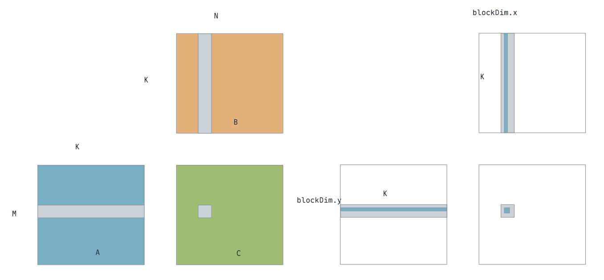{ width="800" }

=== "核心修改"

    ```cuda
    const int x = threadIdx.x + blockDim.x * blockIdx.x;
    const int y = threadIdx.y + blockDim.y * blockIdx.y;

    // 每个线程沿 K 维累加一个输出，结果保存在寄存器中
    float temp = 0.f;
    for (int k = 0; k < K; k++)
        temp += A_ptr[y * K + k] * B_ptr[k * N + x];
    C_ptr[y * N + x] = temp;
    ```

=== "完整 Kernel"

    ```cuda
    __global__ void cuda_sgemm(float *A_ptr, float *B_ptr, float *C_ptr, const int M, const int N, const int K)
    {
        const int x = threadIdx.x + blockDim.x * blockIdx.x;
        const int y = threadIdx.y + blockDim.y * blockIdx.y;
        float *A_ptr_start = A_ptr + blockDim.y * blockIdx.y * K;
        float *B_ptr_start = B_ptr + blockDim.x * blockIdx.x;
        // 每个线程沿 K 维累加一个输出，结果保存在寄存器中
        float temp = 0.f;
        for (int k = 0; k < K; k++)
        {
            temp += A_ptr_start[threadIdx.y * K + k] * B_ptr_start[k * N + threadIdx.x];
        }
        C_ptr[x + y * N] = temp;
    }
    ```

## 优化技巧1：使用 Shared Memory

每个 Block 负责 C 的一个 $bm \times bn$ 区域，先合作加载对应的 $bm \times K$ 个 A 元素和 $K \times bn$ 个 B 元素，再从 Shared Memory 中计算各自的输出。**同一份 A 数据可以被 bn 个输出复用，同一份 B 数据可以被 bm 个输出复用**。

一个 Block 只需从 Global Memory 读取 $bmK+Kbn$ 个输入，却能算出 $bm \times bn$ 个输出。整个矩阵有 $(M/bm)(N/bn)$ 个 Block，因此代码层面的读取量变为：

$$
\frac{M}{bm}\frac{N}{bn}(bmK+Kbn)
= MNK\left(\frac{1}{bn}+\frac{1}{bm}\right).
$$

以本版的 $16 \times 16$ 输出块为例，独立计算时每个 k 需要 512 次标量读取，合作加载只需 16 个 A 值和 16 个 B 值，共 32 个。**重复输入从 Global Memory 转移到 Shared Memory 中复用**，规约方向上的乘加次数并没有减少。

加载时，一个线程每轮写入一个 A 元素和一个 B 元素，循环覆盖整个 K 维；`__syncthreads()` 保证所有线程加载完成，再开始计算。这一版所需共享内存为 $4K(bm+bn)$ 字节，**K 越大，共享内存占用越大**，因此还需要把 K 维拆开。

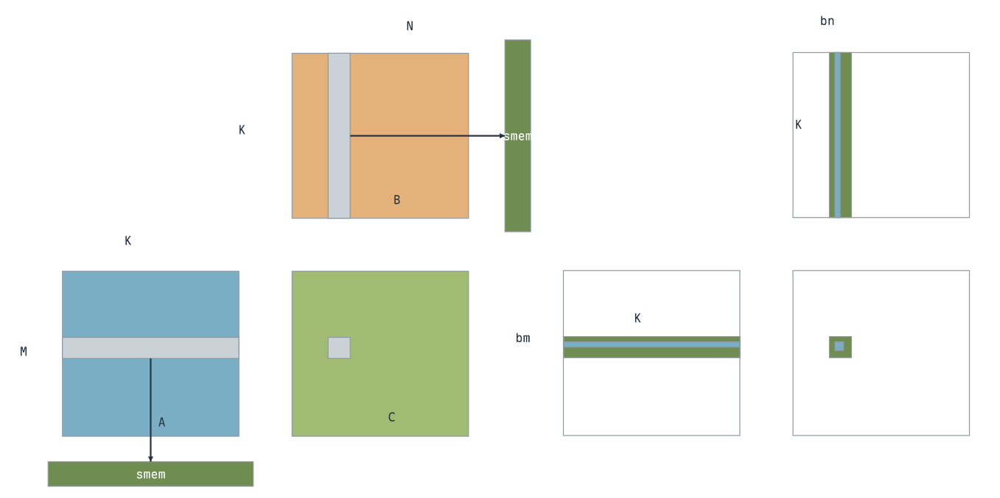{ width="800" }

图中标出的点以 `tx=2、ty=3、s=16` 为例：`a_shared[ty][tx+s]` 对应 `a_shared[3][18]`，来源是 `A_ptr_start[3*K+18]`。第一个下标 `ty` 沿 A 的行方向，第二个下标 `tx+s` 沿 K 方向；`s` 每次增加 16，就把加载位置向右推进 16 列。`A_ptr_start` 已包含当前 Block 的行偏移，因此这里的第 3 行是 Block 内的局部行号。

=== "核心修改"

    ```cuda
    __shared__ float a_shared[BLOCK_SIZE][K_];
    __shared__ float b_shared[K_][BLOCK_SIZE];

    // 合作加载完整 K 维，每份输入在 Block 内只加载一次
    for (int s = 0; s < K; s += blockDim.x) {
        a_shared[threadIdx.y][threadIdx.x + s] =
            A_ptr_start[threadIdx.y * K + threadIdx.x + s];
        b_shared[threadIdx.y + s][threadIdx.x] =
            B_ptr_start[(threadIdx.y + s) * N + threadIdx.x];
    }
    __syncthreads();

    float temp = 0.f;
    for (int k = 0; k < K; k++)
        temp += a_shared[threadIdx.y][k] * b_shared[k][threadIdx.x];
    C_ptr[y * N + x] = temp;
    ```

=== "完整 Kernel"

    ```cuda
    template <unsigned int BLOCK_SIZE, unsigned int K_>
    __global__ void cuda_sgemm(float *A_ptr, float *B_ptr, float *C_ptr, const int M, const int N, const int K)
    {
        const int x = threadIdx.x + blockDim.x * blockIdx.x;
        const int y = threadIdx.y + blockDim.y * blockIdx.y;
        float *A_ptr_start = A_ptr + blockDim.y * blockIdx.y * K;
        float *B_ptr_start = B_ptr + blockDim.x * blockIdx.x;

        __shared__ float a_shared[BLOCK_SIZE][K_];
        __shared__ float b_shared[K_][BLOCK_SIZE];

        // 合作加载完整 K 维，随后在 Block 内复用
        for (int s = 0; s < K; s += blockDim.x)
        {
            a_shared[threadIdx.y][threadIdx.x + s] = A_ptr_start[threadIdx.x + s + threadIdx.y * K];
            b_shared[threadIdx.y + s][threadIdx.x] = B_ptr_start[(threadIdx.y + s) * N + threadIdx.x];
        }

        __syncthreads();

        // 加载并同步后，各线程读取同一份共享数据
        float temp = 0.f;
        for (int k = 0; k < K; k++)
        {
            temp += a_shared[threadIdx.y][k] * b_shared[k][threadIdx.x];
        }
        C_ptr[x + y * N] = temp;
    }
    ```

## 优化技巧2：沿 K 维滑动窗口

不再一次缓存完整的 K 维，而是**每次只加载一个 $bm \times bk$ 的 A 分块和一个 $bk \times bn$ 的 B 分块，计算后沿 K 维移动窗口**。输出仍保存在寄存器中，各次窗口计算的结果持续累加。

共享内存占用变为 $4bk(bm+bn)$ 字节，不再随完整 K 增长。**加载后同步，确保输入可读；计算后再同步，确保所有线程读完，再覆盖这块共享内存。** 这一版使用 `BLOCK_SIZE = 16`，三个分块维度均为 16。

窗口位置由 `s` 决定：A 读取 `A[y, s+tx]`，B 读取 `B[s+ty, x]`。例如 $K=64$ 时，依次处理 `[0,16)`、`[16,32)`、`[32,48)`、`[48,64)` 四段；**`temp` 定义在窗口循环外，四段乘加共同组成同一个输出**，直到所有窗口计算完才写回 C。

滑动窗口保留了上一版的输入复用，主要解决共享内存容量随 K 增长的问题。两个 $16 \times 16$ 的 `float` 分块只占 2 KiB；代价是每个窗口都要经历加载和计算两次同步，为后面的双缓冲留下了优化空间。

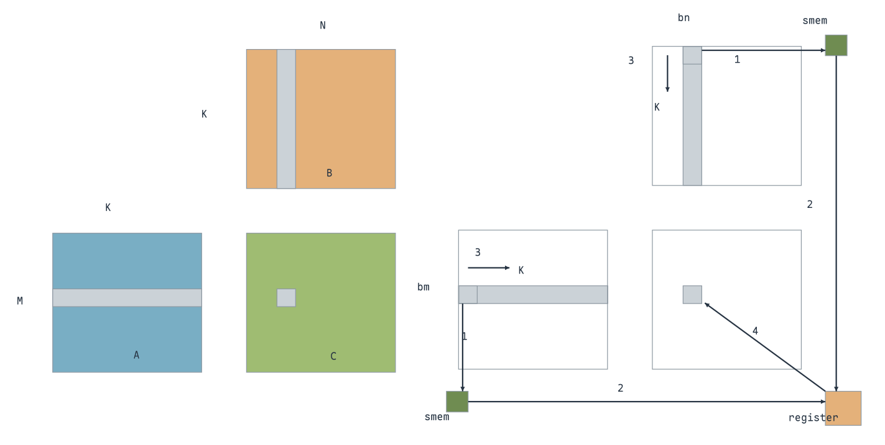{ width="800" }

同样取 `tx=2、ty=3、s=16`，这一版把 `A[y,18]` 写入 `a_shared[3][2]`，共享内存只保留当前窗口内的列号。随后 `k=2` 的乘加读取 `a_shared[3][2]` 和 `b_shared[2][2]`；后者由 `ty=2` 的线程加载。**加载任务由线程分工，计算时读取的是完整共享分块中相同 K 位置的 A、B 元素。**

=== "核心修改"

    ```cuda
    __shared__ float a_shared[BLOCK_SIZE][BLOCK_SIZE];
    __shared__ float b_shared[BLOCK_SIZE][BLOCK_SIZE];
    float temp = 0.f;

    for (int s = 0; s < K; s += BLOCK_SIZE) {
        a_shared[threadIdx.y][threadIdx.x] =
            A_ptr_start[threadIdx.y * K + threadIdx.x + s];
        b_shared[threadIdx.y][threadIdx.x] =
            B_ptr_start[(threadIdx.y + s) * N + threadIdx.x];
        __syncthreads();

        // 沿 K 分块累加，temp 跨窗口保留
        for (int k = 0; k < BLOCK_SIZE; k++)
            temp += a_shared[threadIdx.y][k] * b_shared[k][threadIdx.x];

        __syncthreads();  // 读完当前块后，才允许下一轮覆盖
    }
    C_ptr[y * N + x] = temp;
    ```

=== "完整 Kernel"

    ```cuda
    template <unsigned int BLOCK_SIZE>
    __global__ void cuda_sgemm(float *A_ptr, float *B_ptr, float *C_ptr, const int M, const int N, const int K)
    {
        const int x = threadIdx.x + blockDim.x * blockIdx.x;
        const int y = threadIdx.y + blockDim.y * blockIdx.y;
        float *A_ptr_start = A_ptr + blockDim.y * blockIdx.y * K;
        float *B_ptr_start = B_ptr + blockDim.x * blockIdx.x;

        __shared__ float a_shared[BLOCK_SIZE][BLOCK_SIZE];
        __shared__ float b_shared[BLOCK_SIZE][BLOCK_SIZE];
        float temp = 0.f;

        // 每轮只加载一个 K 分块，累加值跨窗口保留
        for (int s = 0; s < K; s += blockDim.x)
        {
            a_shared[threadIdx.y][threadIdx.x] = A_ptr_start[threadIdx.y * K + threadIdx.x + s];
            b_shared[threadIdx.y][threadIdx.x] = B_ptr_start[threadIdx.x + (threadIdx.y + s) * N];
            // 加载后确保数据可读；计算后确保读完再覆盖
            __syncthreads();
            for (int k = 0; k < BLOCK_SIZE; k++)
                temp += a_shared[threadIdx.y][k] * b_shared[k][threadIdx.x];
            __syncthreads();
        }

        C_ptr[x + y * N] = temp;
    }
    ```

## 优化技巧3：增加每个线程的工作量

前面每个线程只计算一个输出。现在保持 `Block(16,16)`，设置 `STRIDE = 2`，让每个线程计算四个输出，**一个 Block 从覆盖 $16 \times 16$ 个元素扩大到 $32 \times 32$ 个元素**。

这里四个输出的位置是 `(ty + 16i, tx + 16j)`，其中 $i,j \in \{0,1\}$，分布在输出块的四个区域，**不是连续的 $2 \times 2$ 小块**。线程还要合作加载更大的 A、B 分块；计算保持内积形式，四个结果分别累加到 `temp[2][2]` 中。

例如线程 `(ty,tx)=(0,0)` 负责 `(0,0)`、`(0,16)`、`(16,0)`、`(16,16)` 四个输出。加载 A、B 时也用同样的分区索引，让 256 个线程合作填满两个 $32 \times 32$ 分块；**线程数保持不变，输入分块与输出范围一起扩大**。

输出块从 $16 \times 16$ 扩大到 $32 \times 32$ 后，每份 A、B 输入能被更多输出复用，计算整个矩阵所需的 Block 数变为原来的四分之一。相应地，每线程需要四个累加值，共享内存也从两个 $16 \times 16$ 分块扩大到两个 $32 \times 32$ 分块。这里增加工作量的目的，是提高一个 Block 内的数据复用。

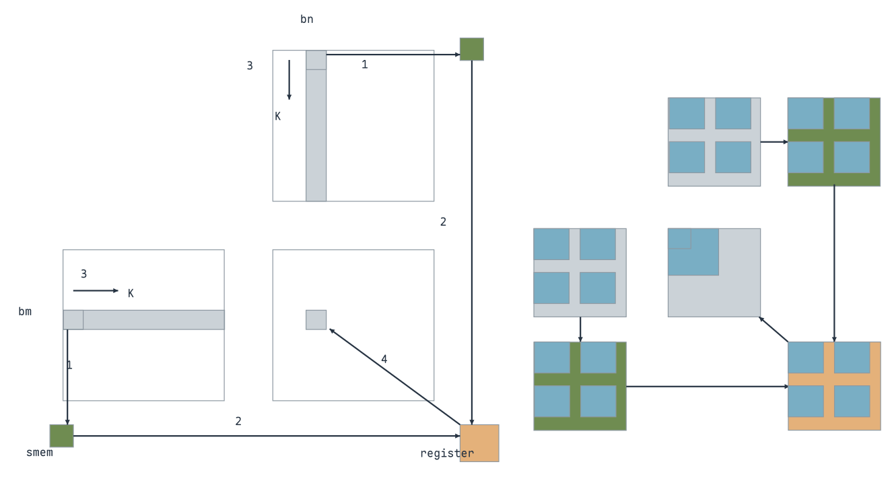{ width="800" }

=== "核心修改"

    ```cuda
    constexpr int STEP = BLOCK_SIZE * STRIDE;
    float temp[STRIDE][STRIDE] = {0.f};

    // 当前 A、B 分块加载并同步后，一个线程计算四个输出
    for (int i = 0; i < STRIDE; i++)
        for (int j = 0; j < STRIDE; j++)
            for (int k = 0; k < STEP; k++)
                temp[i][j] += a_shared[ty + i * BLOCK_SIZE][k]
                            * b_shared[k][tx + j * BLOCK_SIZE];

    // 写回位置与计算时的分散索引一致
    for (int i = 0; i < STRIDE; i++)
        for (int j = 0; j < STRIDE; j++)
            C_ptr_start[N * (ty + i * BLOCK_SIZE) + tx + j * BLOCK_SIZE] =
                temp[i][j];
    ```

=== "完整 Kernel"

    ```cuda
    template <unsigned int BLOCK_SIZE, unsigned int STRIDE>
    __global__ void cuda_sgemm(float *A_ptr, float *B_ptr, float *C_ptr, const int M, const int N, const int K)
    {
        constexpr int STEP = BLOCK_SIZE * STRIDE;
        int tx = threadIdx.x;
        int ty = threadIdx.y;
        float *A_ptr_start = A_ptr + STEP * blockIdx.y * K;
        float *B_ptr_start = B_ptr + STEP * blockIdx.x;

        __shared__ float a_shared[STEP][STEP];
        __shared__ float b_shared[STEP][STEP];
        // 每线程累加四个分散输出，Block 覆盖范围扩大到 32×32
        float temp[STRIDE][STRIDE] = {0.f};

        for (int s = 0; s < K; s += STEP)
        {
            for (int i = 0; i < STRIDE; i++)
            {
                for (int j = 0; j < STRIDE; j++)
                {
                    a_shared[ty + i * BLOCK_SIZE][tx + j * BLOCK_SIZE] =
                        A_ptr_start[(ty + BLOCK_SIZE * i) * K + tx + BLOCK_SIZE * j + s];
                    b_shared[ty + i * BLOCK_SIZE][tx + j * BLOCK_SIZE] =
                        B_ptr_start[(ty + BLOCK_SIZE * i + s) * N + tx + BLOCK_SIZE * j];
                }
            }
            __syncthreads();
            for (int i = 0; i < STRIDE; i++)
            {
                for (int j = 0; j < STRIDE; j++)
                {
                    // 输出索引相隔 BLOCK_SIZE，与四个分区一一对应
                    for (int k = 0; k < STEP; k++)
                    {
                        temp[i][j] += a_shared[ty + i * BLOCK_SIZE][k] * b_shared[k][tx + j * BLOCK_SIZE];
                    }
                }
            }
            __syncthreads();
        }

        float *C_ptr_start = C_ptr + N * blockIdx.y * STEP + blockIdx.x * STEP;
        for (int i = 0; i < STRIDE; i++)
        {
            for (int j = 0; j < STRIDE; j++)
            {
                C_ptr_start[N * (ty + i * BLOCK_SIZE) + tx + j * BLOCK_SIZE] = temp[i][j];
            }
        }
    }
    ```

## 优化技巧4：使用 float4 向量化加载

`float4` 包含四个连续的 `float`，可以通过一次向量加载或存储搬运 16 字节，**减少访存指令数量，搬运的数据总量不变**。地址需要满足 16 字节对齐，四个元素也必须连续。

这一版改用 `Block(8,32)`，每个线程处理同一行的四个连续输出；256 个线程仍然覆盖 $32 \times 32$ 个输出。加载 A、B 到 Shared Memory 时，使用 `float4` 一次搬运四个元素，计算部分仍逐个做内积。

`tx` 现在是四元组的编号：线程 0 搬运第 0～3 列，线程 1 搬运第 4～7 列，直到线程 7 覆盖第 28～31 列，因此列偏移写成 `tx * NUM_PER_THREAD`。**四个元素必须在内存中连续，不能把上一版分散的四个位置直接转成 float4**。

`FETCH_FLOAT4` 将首元素地址按 `float4` 解释，加载和写入 Shared Memory 都以四个数为一组。与逐个加载这四个数相比，它减少的是访存指令与地址计算；后面的乘加仍逐个处理四个输出，尚未显式将 A、B 的计算输入保存在寄存器中反复复用。

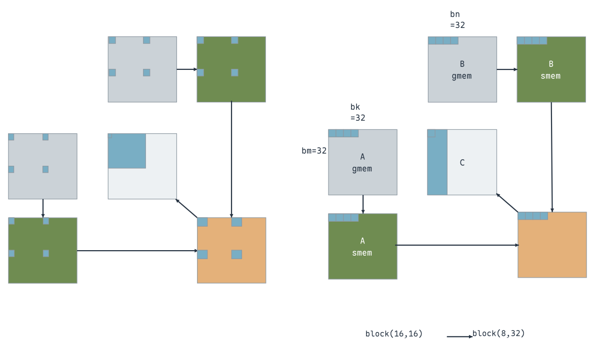{ width="800" }

=== "核心修改"

    ```cuda
    #define FETCH_FLOAT4(pointer) (reinterpret_cast<float4 *>(&(pointer))[0])

    // 一个线程一次加载四个连续元素到 Shared Memory
    FETCH_FLOAT4(a_shared[ty][tx * NUM_PER_THREAD]) =
        FETCH_FLOAT4(A_ptr_start[K * ty + s + tx * NUM_PER_THREAD]);
    FETCH_FLOAT4(b_shared[ty][tx * NUM_PER_THREAD]) =
        FETCH_FLOAT4(B_ptr_start[N * (ty + s) + tx * NUM_PER_THREAD]);
    __syncthreads();

    for (int i = 0; i < NUM_PER_THREAD; i++)
        for (int k = 0; k < K_NUM_PER_BLOCK; k++)
            temp[i] += a_shared[ty][k] * b_shared[k][tx * NUM_PER_THREAD + i];
    ```

=== "完整 Kernel"

    ```cuda
    #define FETCH_FLOAT4(pointer) (reinterpret_cast<float4 *>(&(pointer))[0])

    template <unsigned int M_NUM_PER_BLOCK,
              unsigned int N_NUM_PER_BLOCK,
              unsigned int K_NUM_PER_BLOCK,
              unsigned int NUM_PER_THREAD>
    __global__ void cuda_sgemm(float *A_ptr, float *B_ptr, float *C_ptr, const int M, const int N, const int K)
    {
        int tx = threadIdx.x;
        int ty = threadIdx.y;
        float *A_ptr_start = A_ptr + blockIdx.y * M_NUM_PER_BLOCK * K;
        float *B_ptr_start = B_ptr + blockIdx.x * N_NUM_PER_BLOCK;

        __shared__ float a_shared[M_NUM_PER_BLOCK][K_NUM_PER_BLOCK];
        __shared__ float b_shared[K_NUM_PER_BLOCK][N_NUM_PER_BLOCK];
        float temp[NUM_PER_THREAD] = {0.f};

        for (int s = 0; s < K; s += K_NUM_PER_BLOCK)
        {
            // 一次加载四个连续 float，减少加载指令
            FETCH_FLOAT4(a_shared[ty][tx * NUM_PER_THREAD]) =
                FETCH_FLOAT4(A_ptr_start[K * ty + s + tx * NUM_PER_THREAD]);

            FETCH_FLOAT4(b_shared[ty][tx * NUM_PER_THREAD]) =
                FETCH_FLOAT4(B_ptr_start[N * (ty + s) + tx * NUM_PER_THREAD]);

            __syncthreads();

            for (int i = 0; i < NUM_PER_THREAD; i++)
            {
                // 每线程计算同一行的四个连续输出
                for (int k = 0; k < K_NUM_PER_BLOCK; k++)
                {
                    temp[i] += a_shared[ty][k] *
                               b_shared[k][tx * NUM_PER_THREAD + i];
                }
            }

            __syncthreads();
        }

        float *C_ptr_start = C_ptr + N * blockIdx.y * M_NUM_PER_BLOCK +
                             blockIdx.x * N_NUM_PER_BLOCK;
        for (int i = 0; i < NUM_PER_THREAD; i++)
        {
            C_ptr_start[ty * N + tx * NUM_PER_THREAD + i] = temp[i];
        }
    }
    ```

## 优化技巧5：使用寄存器，内积转外积

Shared Memory 已经减少了 Global Memory 的重复读取，接下来继续减少 **Shared Memory 到寄存器的重复读取**。

**内积**是两个等长向量的对应元素相乘后求和，结果是一个标量。例如 `[1,2]` 与 `[3,4]` 的内积为 $1\times3+2\times4=11$。在矩阵乘法中，取 A 的一行与 B 的一列，沿 K 维求和，就得到 C 中的一个元素。

**外积**是一个列向量与一个行向量相乘，把两者的元素两两组合，结果是一块矩阵。例如，$rm\times1$ 的列向量与 $1\times rn$ 的行向量做外积，得到 $rm\times rn$ 个结果。这里改为**固定 k，取 A 的一列与 B 的一行，形成对一块 C 的贡献**，再累加所有 k 的贡献：

$$
C_{\text{tile}}
= \sum_{k=0}^{bk-1}
  A_{\text{tile}}[:,k]\,B_{\text{tile}}[k,:].
$$

对于一个线程负责的 $rm \times rn$ 个输出，每个 k 只需读取 $rm$ 个 A 元素和 $rn$ 个 B 元素，就能完成 $rm \times rn$ 次乘加。A fragment、B fragment 和输出累加值都暂存在寄存器中，读取一次后反复使用。

以 $2 \times 2$ 输出块为例，固定 k 时读取 `a0`、`a1`、`b0`、`b1`，分别更新 `a0*b0`、`a0*b1`、`a1*b0`、`a1*b1` 四个结果。若把四个输出各自作为独立内积计算，每个 k 会写出八次输入读取；**外积把共同输入明确加载到寄存器中，只需四个输入值，就能更新四个输出**。

核心变化是循环顺序：原来先选定输出，再沿 K 完成它的内积；现在把 k 放在外层，取出一组 A、B fragment 后更新所有输出累加值。**外积没有改变矩阵乘法，只是改变同一批乘加的组织方式**，让输入值在寄存器中复用。

下面比较同一个 $rm \times rn$ 输出子块的两种计算顺序，`m0`、`n0` 是它在当前 Block 输出分块中的行、列起点。左侧每次选 A 的一行与 B 的一列，沿 k 累加一个输出；右侧固定 k，选 A 的一列与 B 的一行，一起更新子块内所有输出。

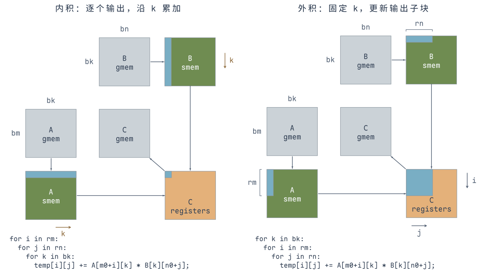{ width="800" }

落实到寄存器时，一个线程先从 Shared Memory 取出 A 的 $rm$ 个行方向元素和 B 的 $rn$ 个列方向元素，分别存入 `a_reg`、`b_reg`，再更新 `temp[rm][rn]`。这些累加值一直保留到所有 K 分块计算完成，最后写回 C；图中的蓝色小块表示该线程负责的 fragment，橙色表示寄存器中的数据。

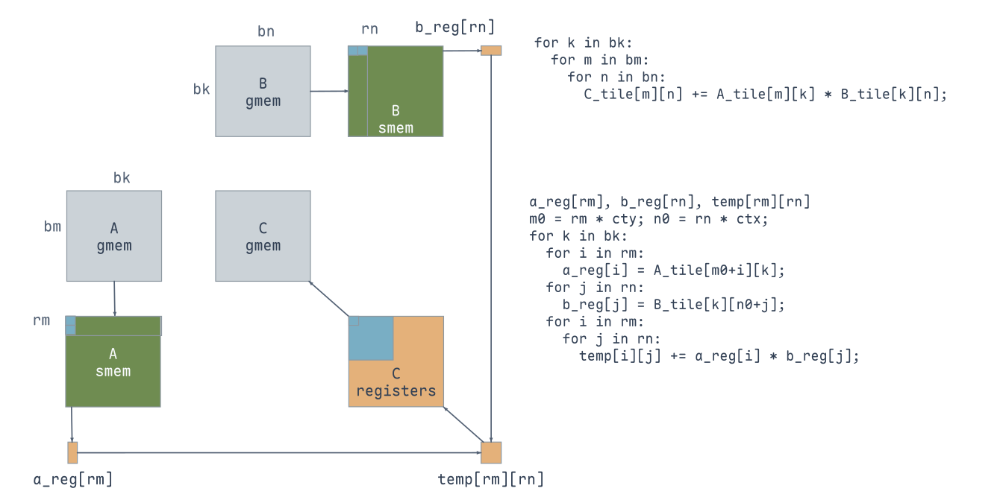{ width="800" }

这一版每个线程计算**连续的 $2 \times 2$ 输出**。加载时仍用 `Block(8,32)`，计算时将 `tid` 重排为 $16 \times 16$ 个线程位置；**负责搬运的数据位置与负责计算的输出位置可以不同**。

`tid = ty * blockDim.x + tx` 先得到 0～255 的线性线程号，再用 `ctx = tid % 16`、`cty = tid / 16` 确定线程的输出小块。输出起点是 `(cty*2, ctx*2)`；这样既保留了加载时的四元素连续访问，也让计算阶段完整覆盖 $32 \times 32$ 个输出。

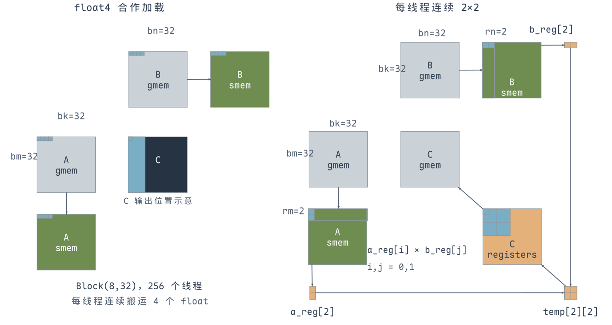{ width="800" }

左侧展示 `float4` 合作加载，C 中的竖条仅作输出位置示意；**V5 每线程的输出范围见右侧的 $2 \times 2$ 寄存器分块**。右侧两个 A 值与两个 B 值形成四次乘加，分别累加到 `temp[0][0]`、`temp[0][1]`、`temp[1][0]`、`temp[1][1]`。

=== "核心修改"

    ```cuda
    int tid = ty * blockDim.x + tx;
    int ctx = tid % 16;
    int cty = tid / 16;
    float a_reg[2], b_reg[2];
    float temp[2][2] = {0.f};

    for (int k = 0; k < K_NUM_PER_BLOCK; k++) {
        a_reg[0] = a_shared[cty * 2][k];
        a_reg[1] = a_shared[cty * 2 + 1][k];
        b_reg[0] = b_shared[k][ctx * 2];
        b_reg[1] = b_shared[k][ctx * 2 + 1];

        // 两个 A 值、两个 B 值，在寄存器中复用并更新四个输出
        for (int i = 0; i < 2; i++)
            for (int j = 0; j < 2; j++)
                temp[i][j] += a_reg[i] * b_reg[j];
    }
    ```

=== "完整 Kernel"

    ```cuda
    #define FETCH_FLOAT4(pointer) (reinterpret_cast<float4 *>(&(pointer))[0])

    template <unsigned int M_NUM_PER_BLOCK,
              unsigned int N_NUM_PER_BLOCK,
              unsigned int K_NUM_PER_BLOCK,
              unsigned int NUM_PER_THREAD>
    __global__ void cuda_sgemm(float *A_ptr, float *B_ptr, float *C_ptr, const int M, const int N, const int K)
    {
        int tx = threadIdx.x;
        int ty = threadIdx.y;
        int tid = ty * blockDim.x + tx;
        // 加载用原线程坐标，计算重排为 16×16 个 2×2 输出块
        int ctx = tid % 16;
        int cty = tid / 16;
        float *A_ptr_start = A_ptr + blockIdx.y * M_NUM_PER_BLOCK * K;
        float *B_ptr_start = B_ptr + blockIdx.x * N_NUM_PER_BLOCK;

        __shared__ float a_shared[M_NUM_PER_BLOCK][K_NUM_PER_BLOCK];
        __shared__ float b_shared[K_NUM_PER_BLOCK][N_NUM_PER_BLOCK];

        constexpr int REG_NUM = NUM_PER_THREAD / 2;
        float a_reg[REG_NUM] = {0.f};
        float b_reg[REG_NUM] = {0.f};
        float temp[REG_NUM][REG_NUM] = {0.f};

        for (int s = 0; s < K; s += K_NUM_PER_BLOCK)
        {
            FETCH_FLOAT4(a_shared[ty][tx * NUM_PER_THREAD]) =
                FETCH_FLOAT4(A_ptr_start[K * ty + s + tx * NUM_PER_THREAD]);
            FETCH_FLOAT4(b_shared[ty][tx * NUM_PER_THREAD]) =
                FETCH_FLOAT4(B_ptr_start[N * (ty + s) + tx * NUM_PER_THREAD]);
            __syncthreads();

            for (int k = 0; k < K_NUM_PER_BLOCK; k++)
            {
                // 固定 k，两个 A 值和两个 B 值复用为四次乘加
                a_reg[0] = a_shared[cty * 2][k];
                a_reg[1] = a_shared[cty * 2 + 1][k];
                b_reg[0] = b_shared[k][ctx * 2];
                b_reg[1] = b_shared[k][ctx * 2 + 1];
                for (int i = 0; i < REG_NUM; i++)
                    for (int j = 0; j < REG_NUM; j++)
                        temp[i][j] += a_reg[i] * b_reg[j];
            }
            __syncthreads();
        }

        float *C_ptr_start = C_ptr + N * blockIdx.y * M_NUM_PER_BLOCK +
                             blockIdx.x * N_NUM_PER_BLOCK;
        for (int i = 0; i < REG_NUM; i++)
            for (int j = 0; j < REG_NUM; j++)
                C_ptr_start[N * (cty * 2 + i) + ctx * 2 + j] = temp[i][j];
    }
    ```

## 优化技巧6：寄存器分块结合 float4

将每个线程的输出扩大到 $4 \times 4$，配合 `Block(16,16)` 覆盖 $64 \times 64$ 个输出；A、B 的 K 分块也设为 64。**每次取四个 A 值和四个 B 值，更新 16 个寄存器累加值**。

Global Memory 到 Shared Memory 的加载继续使用 `float4`。固定 k 时，B 的四个列方向元素连续，可以向量加载到寄存器；输出的每一行也有四个连续元素，可以向量写回。**A 的四个行方向元素仍是间隔存放的，需要分别读取。**

这里需要区分两个动作：加载分块时，线程读取 A 的 K 方向连续元素；计算外积时，却要读取 A 的 M 方向四个元素。`a_shared[ty*4+i][k]` 随 i 改变行号，相邻值相隔一整行，所以前面的 Global Memory 向量化并不能直接解决这一处读取。

每个 k 用四个 A 值和四个 B 值更新 16 个结果，相比逐个输出计算时的 32 次标量输入读取，显式 fragment 只需八个输入值。复用范围扩大到 $4 \times 4$ 后，每线程也要维护 16 个累加值；下一步重点是**让 A fragment 的四个值在 Shared Memory 中也变成连续存放**。

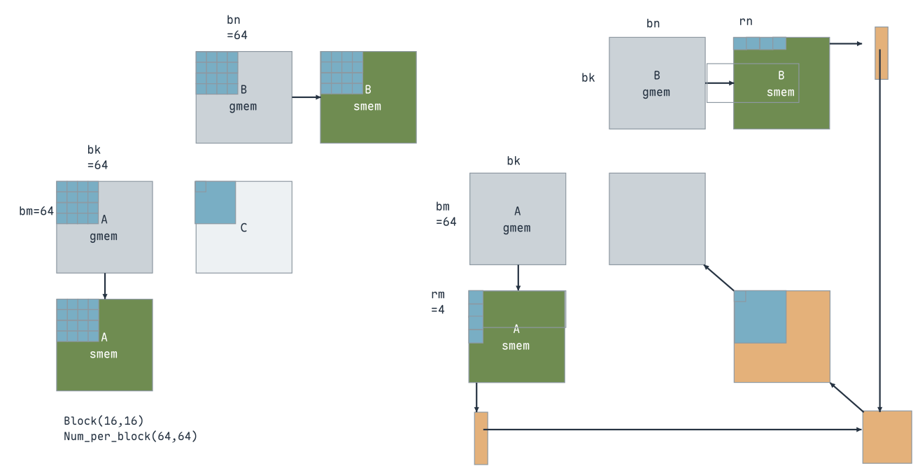{ width="800" }

=== "核心修改"

    ```cuda
    float a_reg[4], b_reg[4];
    float temp[4][4] = {0.f};

    for (int k = 0; k < K_NUM_PER_BLOCK; k++) {
        // A 的行方向不连续，B 的列方向连续
        for (int i = 0; i < 4; i++)
            a_reg[i] = a_shared[ty * 4 + i][k];
        FETCH_FLOAT4(b_reg[0]) = FETCH_FLOAT4(b_shared[k][tx * 4]);

        for (int i = 0; i < 4; i++)
            for (int j = 0; j < 4; j++)
                temp[i][j] += a_reg[i] * b_reg[j];
    }

    // 每一行的四个输出连续，使用 float4 写回
    for (int i = 0; i < 4; i++)
        FETCH_FLOAT4(C_ptr_start[N * (ty * 4 + i) + tx * 4]) =
            FETCH_FLOAT4(temp[i][0]);
    ```

=== "完整 Kernel"

    ```cuda
    #define FETCH_FLOAT4(pointer) (reinterpret_cast<float4 *>(&(pointer))[0])

    template <unsigned int M_NUM_PER_BLOCK,
              unsigned int N_NUM_PER_BLOCK,
              unsigned int K_NUM_PER_BLOCK,
              unsigned int M_NUM_PER_THREAD,
              unsigned int N_NUM_PER_THREAD,
              unsigned int K_NUM_PER_THREAD>
    __global__ void cuda_sgemm(float *A_ptr, float *B_ptr, float *C_ptr, const int M, const int N, const int K)
    {
        int tx = threadIdx.x;
        int ty = threadIdx.y;

        float *A_ptr_start = A_ptr + blockIdx.y * M_NUM_PER_BLOCK * K;
        float *B_ptr_start = B_ptr + blockIdx.x * N_NUM_PER_BLOCK;

        __shared__ float a_shared[M_NUM_PER_BLOCK][K_NUM_PER_BLOCK];
        __shared__ float b_shared[K_NUM_PER_BLOCK][N_NUM_PER_BLOCK];

        float a_reg[M_NUM_PER_THREAD] = {0.f};
        float b_reg[N_NUM_PER_THREAD] = {0.f};
        float temp[M_NUM_PER_THREAD][M_NUM_PER_THREAD] = {0.f};

        for (int s = 0; s < K; s += K_NUM_PER_BLOCK)
        {
            for (int i = 0; i < M_NUM_PER_THREAD; i++)
            {
                FETCH_FLOAT4(a_shared[ty * M_NUM_PER_THREAD + i][tx * K_NUM_PER_THREAD]) =
                    FETCH_FLOAT4(A_ptr_start[K * (ty * M_NUM_PER_THREAD + i) + tx * K_NUM_PER_THREAD + s]);
            }
            for (int i = 0; i < K_NUM_PER_THREAD; i++)
            {
                FETCH_FLOAT4(b_shared[ty * K_NUM_PER_THREAD + i][tx * N_NUM_PER_THREAD]) =
                    FETCH_FLOAT4(B_ptr_start[N * (ty * K_NUM_PER_THREAD + s + i) + tx * N_NUM_PER_THREAD]);
            }
            __syncthreads();

            for (int k = 0; k < K_NUM_PER_BLOCK; k++)
            {
                // A 的行方向分散读取，B 的列方向使用 float4 连续读取
                a_reg[0] = a_shared[ty * M_NUM_PER_THREAD][k];
                a_reg[1] = a_shared[ty * M_NUM_PER_THREAD + 1][k];
                a_reg[2] = a_shared[ty * M_NUM_PER_THREAD + 2][k];
                a_reg[3] = a_shared[ty * M_NUM_PER_THREAD + 3][k];
                FETCH_FLOAT4(b_reg[0]) = FETCH_FLOAT4(b_shared[k][tx * N_NUM_PER_THREAD]);

                // 四个 A 值与四个 B 值在寄存器中更新 4×4 输出
                for (int i = 0; i < M_NUM_PER_THREAD; i++)
                    for (int j = 0; j < N_NUM_PER_THREAD; j++)
                        temp[i][j] += a_reg[i] * b_reg[j];
            }
            __syncthreads();
        }

        float *C_ptr_start = C_ptr + N * blockIdx.y * M_NUM_PER_BLOCK +
                             blockIdx.x * N_NUM_PER_BLOCK;

        for (int i = 0; i < M_NUM_PER_THREAD; i++)
            FETCH_FLOAT4(C_ptr_start[N * (ty * M_NUM_PER_THREAD + i) + tx * N_NUM_PER_THREAD]) =
                FETCH_FLOAT4(temp[i][0]);
    }
    ```

## 优化技巧7：A 转置后存入 Shared Memory

为了让 A 的四个行方向元素也连续，**在加载阶段改变 A 的共享内存布局**：原来是 `a_shared[m][k]`，现在存为 `a_shared[k][m]`。全局内存中的 A 仍保持原来的行优先存储。

一个线程先从 Global Memory 连续读取四个 K 方向元素到临时寄存器，再分别写入转置后的四行。下面两组位置展示不同加载位置的四元素搬运与转置写入：

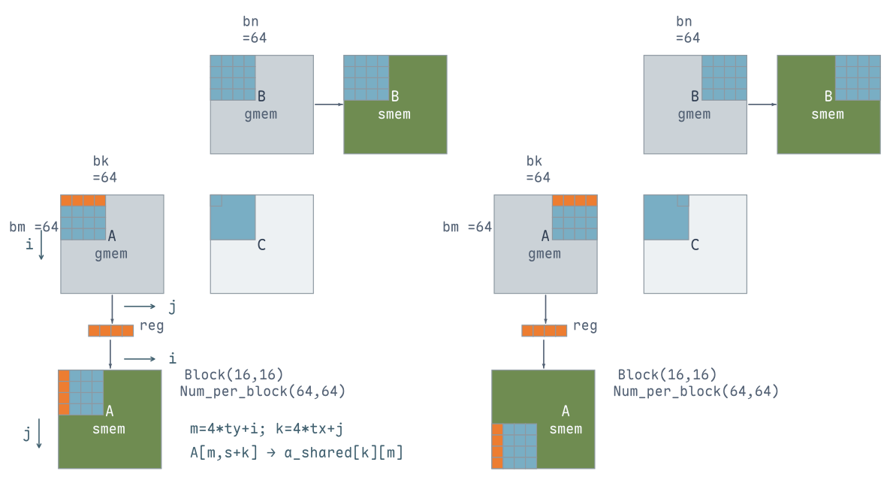{ width="800" }

固定 k 计算时，A 的四个 m 方向元素已经在同一行连续存放，**A、B fragment 都可以使用 float4 读取**，再按上一版的 $4 \times 4$ 外积方式累加。

例如全局 A 中连续的 `A[m,k]`～`A[m,k+3]`，会分别写入 `a_shared[k][m]`～`a_shared[k+3][m]`。加载阶段仍沿 K 方向连续取数，计算阶段则从 `a_shared[k][m:m+4]` 连续读取四个行方向的值。**转置的是 Shared Memory 的存储布局，参与乘法的 A 元素及 C 的输出位置都不变**。

因此，加载 A 时要经过临时寄存器和四次标量写入，换取计算循环中 A fragment 的向量读取。一个 K 分块会被反复用于输出块内的乘加，将布局调整放在加载阶段，就能让后面每次读取 fragment 都采用相同的连续访问方式。

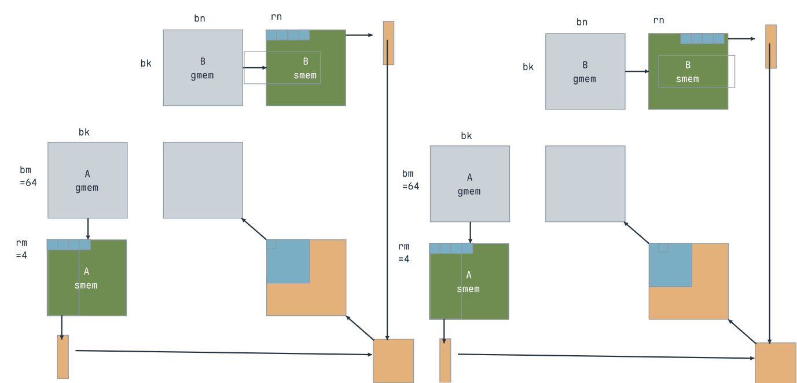{ width="800" }

=== "核心修改"

    ```cuda
    __shared__ float a_shared[K_NUM_PER_BLOCK][M_NUM_PER_BLOCK];
    float a_load_reg[4];

    // 从全局内存连续取四个值，写入共享内存时交换 m、k 的位置
    FETCH_FLOAT4(a_load_reg[0]) =
        FETCH_FLOAT4(A_ptr_start[K * (ty * 4 + i) + tx * 4 + s]);
    for (int j = 0; j < 4; j++)
        a_shared[tx * 4 + j][ty * 4 + i] = a_load_reg[j];

    // 固定 k 时，四个行方向的 A 元素已经连续
    FETCH_FLOAT4(a_reg[0]) = FETCH_FLOAT4(a_shared[k][ty * 4]);
    FETCH_FLOAT4(b_reg[0]) = FETCH_FLOAT4(b_shared[k][tx * 4]);
    ```

=== "完整 Kernel"

    ```cuda
    #define FETCH_FLOAT4(pointer) (reinterpret_cast<float4 *>(&(pointer))[0])

    template <unsigned int M_NUM_PER_BLOCK,
              unsigned int N_NUM_PER_BLOCK,
              unsigned int K_NUM_PER_BLOCK,
              unsigned int M_NUM_PER_THREAD,
              unsigned int N_NUM_PER_THREAD,
              unsigned int K_NUM_PER_THREAD>
    __global__ void cuda_sgemm(float *A_ptr, float *B_ptr, float *C_ptr, const int M, const int N, const int K)
    {
        int tx = threadIdx.x;
        int ty = threadIdx.y;

        float *A_ptr_start = A_ptr + blockIdx.y * M_NUM_PER_BLOCK * K;
        float *B_ptr_start = B_ptr + blockIdx.x * N_NUM_PER_BLOCK;

        // A 在 Shared Memory 中按 [k][m] 存放
        __shared__ float a_shared[K_NUM_PER_BLOCK][M_NUM_PER_BLOCK];
        __shared__ float b_shared[K_NUM_PER_BLOCK][N_NUM_PER_BLOCK];

        float a_reg[M_NUM_PER_THREAD] = {0.f};
        float b_reg[N_NUM_PER_THREAD] = {0.f};
        float a_load_reg[K_NUM_PER_THREAD] = {0.f};
        float temp[M_NUM_PER_THREAD][M_NUM_PER_THREAD] = {0.f};

        for (int s = 0; s < K; s += K_NUM_PER_BLOCK)
        {
            for (int i = 0; i < M_NUM_PER_THREAD; i++)
            {

                // 全局内存连续加载，写入共享内存时交换 m、k
                FETCH_FLOAT4(a_load_reg[0]) =
                    FETCH_FLOAT4(A_ptr_start[K * (ty * M_NUM_PER_THREAD + i) + tx * K_NUM_PER_THREAD + s]);
                a_shared[tx * K_NUM_PER_THREAD][ty * M_NUM_PER_THREAD + i] = a_load_reg[0];
                a_shared[tx * K_NUM_PER_THREAD + 1][ty * M_NUM_PER_THREAD + i] = a_load_reg[1];
                a_shared[tx * K_NUM_PER_THREAD + 2][ty * M_NUM_PER_THREAD + i] = a_load_reg[2];
                a_shared[tx * K_NUM_PER_THREAD + 3][ty * M_NUM_PER_THREAD + i] = a_load_reg[3];
            }
            for (int i = 0; i < K_NUM_PER_THREAD; i++)
            {
                FETCH_FLOAT4(b_shared[ty * K_NUM_PER_THREAD + i][tx * N_NUM_PER_THREAD]) =
                    FETCH_FLOAT4(B_ptr_start[N * (ty * K_NUM_PER_THREAD + s + i) + tx * N_NUM_PER_THREAD]);
            }
            __syncthreads();

            for (int k = 0; k < K_NUM_PER_BLOCK; k++)
            {

                // 固定 k 后，A、B fragment 都能用 float4 读取
                FETCH_FLOAT4(a_reg[0]) = FETCH_FLOAT4(a_shared[k][ty * N_NUM_PER_THREAD]);
                FETCH_FLOAT4(b_reg[0]) = FETCH_FLOAT4(b_shared[k][tx * N_NUM_PER_THREAD]);

                for (int i = 0; i < M_NUM_PER_THREAD; i++)
                    for (int j = 0; j < N_NUM_PER_THREAD; j++)
                        temp[i][j] += a_reg[i] * b_reg[j];
            }
            __syncthreads();
        }

        float *C_ptr_start = C_ptr + N * blockIdx.y * M_NUM_PER_BLOCK +
                             blockIdx.x * N_NUM_PER_BLOCK;

        for (int i = 0; i < M_NUM_PER_THREAD; i++)
            FETCH_FLOAT4(C_ptr_start[N * (ty * M_NUM_PER_THREAD + i) + tx * N_NUM_PER_THREAD]) =
                FETCH_FLOAT4(temp[i][0]);
    }
    ```

## 优化技巧8：使用 Double Buffer

单缓冲每轮先加载、同步，再计算、同步。双缓冲准备**两套 A、B 的 Shared Memory 分块**：加载下一块时写另一套缓冲，当前计算仍读取已经准备好的缓冲，避免覆盖正在使用的数据。

这一版将分块设为 $bm=bn=128$、$bk=8$，线程仍为 `Block(16,16)`；每个线程计算 $8 \times 8$ 个输出。A tile 为 $128 \times 8$，B tile 为 $8 \times 128$，各有 1024 个 `float`，256 个线程每人加载四个元素。

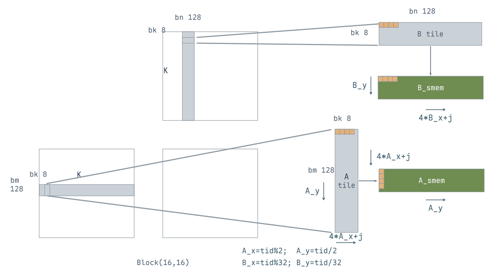{ width="800" }

加载时先将二维线程编号展平，再**按 A、B 各自的加载布局重新分配线程位置**。A 每行 8 个数，需要两个线程；B 每行 128 个数，需要 32 个线程：

例如 `tid=1` 负责 A 第 0 行的第 4～7 个数，却负责 B 第 0 行的第 4～7 列；`tid=2` 已经进入 A 的第 1 行，B 的加载位置仍在第 0 行。两套行列映射不同，但每个线程对 A、B 都各加载四个值，正好覆盖各自的分块。

图中 `A_x/A_y` 简写 `A_tile_tid_x/A_tile_tid_y`，`B_x/B_y` 简写 `B_tile_tid_x/B_tile_tid_y`。A 写入共享内存后，`A_y` 改为横向的 M 下标，`4*A_x+j` 改为纵向的 K 下标；B 仍是纵向 K、横向 N。

```cuda
const int tid = ty * blockDim.x + tx;
const int A_tile_thread_per_row = BLOCK_SIZE_K / 4;  // 2
const int B_tile_thread_per_row = BLOCK_SIZE_N / 4;  // 32
const int A_tile_tid_x = tid % A_tile_thread_per_row;
const int A_tile_tid_y = tid / A_tile_thread_per_row;
const int B_tile_tid_x = tid % B_tile_thread_per_row;
const int B_tile_tid_y = tid / B_tile_thread_per_row;
```

计算时，线程 `(ty,tx)` 负责从 `(ty*8, tx*8)` 开始的 $8 \times 8$ 输出区域。每个 k 读取八个 A 值和八个 B 值，形成外积，更新 64 个寄存器累加值。两套共享内存合计占 $2 \times (128 \times 8 + 8 \times 128) \times 4 = 16384$ 字节，即 16 KiB。

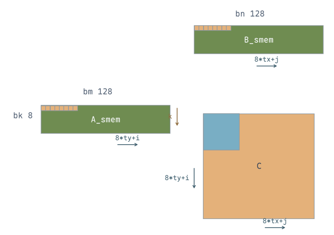{ width="650" }

缓冲轮换的顺序是：

- 先加载首个分块到 `shared_0`，同步后，它可以安全读取。
- 加载下一块到 `shared_1`，**不立即同步**，接着从 `shared_0` 读取并计算；本轮末尾同步，保证下一块准备好，当前块也已经读完。
- 下一轮交换两套缓冲的角色。循环结束后，**再计算最后一块**，因为它已经加载，但还没有累加到输出中。

`write_stage_idx` 用 0、1 标记两套缓冲。循环开头，它表示下一块写入的位置；执行 `write_stage_idx ^= 1` 后，同一个变量改为指向本轮读取的旧缓冲。**加载下一块与读取当前块访问不同的共享内存区域**，因此加载后不必立刻等待整个 Block，可以先计算当前块，在循环末尾统一同步。

例如只有三个 K 分块时，先将第 0 块放入缓冲 0；第一轮加载第 1 块到缓冲 1、计算第 0 块；第二轮加载第 2 块到缓冲 0、计算第 1 块。此时循环结束，但第 2 块还没有参与累加，所以要再次切换读取索引并补算它，之后才能写回 C。

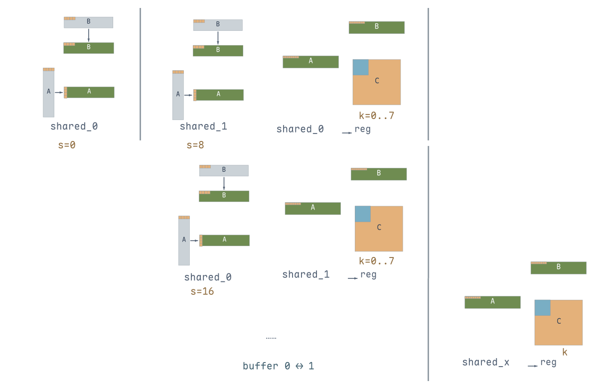{ width="800" }

这一版使用普通 `float4` 加载，两套缓冲让不同 Warp 的搬运与计算有机会交错推进；并不是显式的异步拷贝指令。**Double Buffer 用在 Shared Memory 上，寄存器 fragment 仍只有一套。**

=== "核心修改"

    ```cuda
    __shared__ float a_shared[2][BLOCK_SIZE_K][BLOCK_SIZE_M];
    __shared__ float b_shared[2][BLOCK_SIZE_K][BLOCK_SIZE_N];
    float accum[THREAD_SIZE_Y][THREAD_SIZE_X] = {0.f};

    // 首块已加载到缓冲 0 并同步，后续块从缓冲 1 开始写
    int write_stage_idx = 1;
    for (int s = BLOCK_SIZE_K; s < K; s += BLOCK_SIZE_K) {
        FETCH_FLOAT4(ldg_a_reg[0]) =
            FETCH_FLOAT4(A_ptr_start[K * A_tile_tid_y + A_tile_tid_x * 4 + s]);
        for (int j = 0; j < 4; j++)
            a_shared[write_stage_idx][A_tile_tid_x * 4 + j][A_tile_tid_y] =
                ldg_a_reg[j];
        FETCH_FLOAT4(b_shared[write_stage_idx][B_tile_tid_y][B_tile_tid_x * 4]) =
            FETCH_FLOAT4(B_ptr_start[N * (B_tile_tid_y + s) + B_tile_tid_x * 4]);

        // 切换到上一轮准备好的缓冲，加载后不立即等待整个 Block
        write_stage_idx ^= 1;
        for (int k = 0; k < BLOCK_SIZE_K; k++) {
            FETCH_FLOAT4(reg_a[0]) =
                FETCH_FLOAT4(a_shared[write_stage_idx][k][ty * THREAD_SIZE_Y]);
            FETCH_FLOAT4(reg_a[4]) =
                FETCH_FLOAT4(a_shared[write_stage_idx][k][ty * THREAD_SIZE_Y + 4]);
            FETCH_FLOAT4(reg_b[0]) =
                FETCH_FLOAT4(b_shared[write_stage_idx][k][tx * THREAD_SIZE_X]);
            FETCH_FLOAT4(reg_b[4]) =
                FETCH_FLOAT4(b_shared[write_stage_idx][k][tx * THREAD_SIZE_X + 4]);
            for (int i = 0; i < THREAD_SIZE_Y; i++)
                for (int j = 0; j < THREAD_SIZE_X; j++)
                    accum[i][j] += reg_a[i] * reg_b[j];
        }
        __syncthreads();
    }
    // 最后一块的读取缓冲；随后按相同的外积循环计算，最后写回 C
    write_stage_idx ^= 1;
    ```

=== "完整 Kernel"

    ```cuda
    #define FETCH_FLOAT4(pointer) (reinterpret_cast<float4 *>(&(pointer))[0])

    template <const int BLOCK_SIZE_M,
              const int BLOCK_SIZE_N,
              const int BLOCK_SIZE_K,
              const int THREAD_SIZE_Y,
              const int THREAD_SIZE_X,
              const bool ENABLE_DOUBLE_BUFFER>
    __global__ void cuda_sgemm(float *A_ptr, float *B_ptr, float *C_ptr, const int M, const int N, const int K)
    {

        int bx = blockIdx.x;
        int by = blockIdx.y;

        int tx = threadIdx.x;
        int ty = threadIdx.y;

        const int tid = ty * blockDim.x + tx;
        // 两套共享内存轮换，寄存器 fragment 仍只有一套
        __shared__ float a_shared[2][BLOCK_SIZE_K][BLOCK_SIZE_M];
        __shared__ float b_shared[2][BLOCK_SIZE_K][BLOCK_SIZE_N];

        float accum[THREAD_SIZE_Y][THREAD_SIZE_X] = {0.f};
        float reg_a[THREAD_SIZE_Y] = {0.f};
        float reg_b[THREAD_SIZE_X] = {0.f};
        float ldg_a_reg[4] = {0.f};

        float *A_ptr_start = A_ptr + blockIdx.y * BLOCK_SIZE_M * K;
        float *B_ptr_start = B_ptr + blockIdx.x * BLOCK_SIZE_N;

        const int A_tile_thread_per_row = BLOCK_SIZE_K / 4;
        const int B_tile_thread_per_row = BLOCK_SIZE_N / 4;

        const int A_tile_tid_x = tid % A_tile_thread_per_row;
        const int A_tile_tid_y = tid / A_tile_thread_per_row;
        const int B_tile_tid_x = tid % B_tile_thread_per_row;
        const int B_tile_tid_y = tid / B_tile_thread_per_row;

        // 预先加载第一个 K 分块到缓冲 0
        FETCH_FLOAT4(ldg_a_reg[0]) = FETCH_FLOAT4(A_ptr_start[K * A_tile_tid_y + A_tile_tid_x * 4]);
        a_shared[0][A_tile_tid_x * 4][A_tile_tid_y] = ldg_a_reg[0];
        a_shared[0][A_tile_tid_x * 4 + 1][A_tile_tid_y] = ldg_a_reg[1];
        a_shared[0][A_tile_tid_x * 4 + 2][A_tile_tid_y] = ldg_a_reg[2];
        a_shared[0][A_tile_tid_x * 4 + 3][A_tile_tid_y] = ldg_a_reg[3];
        FETCH_FLOAT4(b_shared[0][B_tile_tid_y][B_tile_tid_x * 4]) =
            FETCH_FLOAT4(B_ptr_start[N * B_tile_tid_y + B_tile_tid_x * 4]);
        __syncthreads();
        // 加载下一块到另一缓冲，再计算已经准备好的当前块
        int write_stage_idx = 1;
        for (int s = BLOCK_SIZE_K; s < K; s += BLOCK_SIZE_K)
        {
            FETCH_FLOAT4(ldg_a_reg[0]) = FETCH_FLOAT4(A_ptr_start[K * A_tile_tid_y + A_tile_tid_x * 4 + s]);
            a_shared[write_stage_idx][A_tile_tid_x * 4][A_tile_tid_y] = ldg_a_reg[0];
            a_shared[write_stage_idx][A_tile_tid_x * 4 + 1][A_tile_tid_y] = ldg_a_reg[1];
            a_shared[write_stage_idx][A_tile_tid_x * 4 + 2][A_tile_tid_y] = ldg_a_reg[2];
            a_shared[write_stage_idx][A_tile_tid_x * 4 + 3][A_tile_tid_y] = ldg_a_reg[3];
            FETCH_FLOAT4(b_shared[write_stage_idx][B_tile_tid_y][B_tile_tid_x * 4]) =
                FETCH_FLOAT4(B_ptr_start[N * (B_tile_tid_y + s) + B_tile_tid_x * 4]);
            // 切换到读取缓冲，循环末尾再进行 Block 同步
            write_stage_idx = write_stage_idx ^ 1;
            for (int k = 0; k < BLOCK_SIZE_K; k++)
            {
                FETCH_FLOAT4(reg_a[0]) = FETCH_FLOAT4(a_shared[write_stage_idx][k][ty * THREAD_SIZE_Y]);
                FETCH_FLOAT4(reg_a[4]) = FETCH_FLOAT4(a_shared[write_stage_idx][k][ty * THREAD_SIZE_Y + 4]);
                FETCH_FLOAT4(reg_b[0]) = FETCH_FLOAT4(b_shared[write_stage_idx][k][tx * THREAD_SIZE_X]);
                FETCH_FLOAT4(reg_b[4]) = FETCH_FLOAT4(b_shared[write_stage_idx][k][tx * THREAD_SIZE_X + 4]);

                for (int i = 0; i < THREAD_SIZE_Y; i++)
                    for (int j = 0; j < THREAD_SIZE_X; j++)
                        accum[i][j] += reg_a[i] * reg_b[j];
            }
            __syncthreads();
        }
        // 循环结束后，补算已经加载但尚未累加的最后一块
        write_stage_idx = write_stage_idx ^ 1;
        for (int k = 0; k < BLOCK_SIZE_K; k++)
        {
            FETCH_FLOAT4(reg_a[0]) = FETCH_FLOAT4(a_shared[write_stage_idx][k][ty * THREAD_SIZE_Y]);
            FETCH_FLOAT4(reg_a[4]) = FETCH_FLOAT4(a_shared[write_stage_idx][k][ty * THREAD_SIZE_Y + 4]);
            FETCH_FLOAT4(reg_b[0]) = FETCH_FLOAT4(b_shared[write_stage_idx][k][tx * THREAD_SIZE_X]);
            FETCH_FLOAT4(reg_b[4]) = FETCH_FLOAT4(b_shared[write_stage_idx][k][tx * THREAD_SIZE_X + 4]);

            for (int i = 0; i < THREAD_SIZE_Y; i++)
                for (int j = 0; j < THREAD_SIZE_X; j++)
                    accum[i][j] += reg_a[i] * reg_b[j];
        }

        float *C_ptr_start = C_ptr + N * by * BLOCK_SIZE_M +
                             bx * BLOCK_SIZE_N;
        for (int i = 0; i < THREAD_SIZE_Y; i++)
        {
            FETCH_FLOAT4(C_ptr_start[N * (ty * THREAD_SIZE_Y + i) + tx * THREAD_SIZE_X]) =
                FETCH_FLOAT4(accum[i][0]);
            FETCH_FLOAT4(C_ptr_start[N * (ty * THREAD_SIZE_Y + i) + tx * THREAD_SIZE_X + 4]) =
                FETCH_FLOAT4(accum[i][4]);
        }
    }
    ```

> 参考：[GEMM 优化（一）](https://zhuanlan.zhihu.com/p/435908830)、[CUDA GEMM 理论性能分析与 kernel 优化](https://zhuanlan.zhihu.com/p/441146275)、[CUDA 矩阵乘法终极优化指南](https://zhuanlan.zhihu.com/p/410278370)、[GEMM 优化（二）](https://zhuanlan.zhihu.com/p/442930482)。
