
本文翻译自 Simon Boehm 的 <a href="https://siboehm.com/articles/22/CUDA-MMM">How to Optimize a CUDA Matmul Kernel for cuBLAS-like Performance: a Worklog</a>。

<h1>CUDA 矩阵乘法优化：逐步接近 cuBLAS 性能</h1>

本文将逐步优化一个用 CUDA 编写的矩阵乘法实现。我的目标是深入理解现代深度学习所用 GPU 最重要的性能特性，而非构建 cuBLAS 的替代品。这些特性包括全局内存访问合并、共享内存缓存和占用率优化等。<label class="margin-toggle sidenote-number" for="1"></label><input class="margin-toggle" id="1" type="checkbox"/>所有 Kernel 的代码都可以从 <a href="https://github.com/siboehm/SGEMM_CUDA">GitHub</a> 下载。也可以看看 <a href="https://github.com/wangzyon/NVIDIA_SGEMM_PRACTICE">wangzyon 的仓库</a>，本文的基准测试配置借鉴自那里。 <label class="margin-toggle sidenote-number" for="2"></label><input class="margin-toggle" id="2" type="checkbox"/>这篇文章没有我平常的文章那么精雕细琢，旁注也更多。编写 Kernel 时，我把它当成记录想法和草稿的笔记本，所以称它为优化日志 :) 

<!--more-->

GPU 上的矩阵乘法或许是当下最重要的算法，因为它占据了大型深度学习模型训练和推理中几乎全部的浮点运算量。那么，从零写出一个高性能的 CUDA SGEMM<label class="margin-toggle sidenote-number" for="3"></label><input class="margin-toggle" id="3" type="checkbox"/>SGEMM 以单精度（32 位）执行 <code class="language-plaintext highlighter-rouge">C=αAB+βC</code>。 需要多少工作？我会从一个朴素 Kernel 开始，逐步应用优化，直到性能达到 cuBLAS（NVIDIA 官方矩阵运算库）的约 95%——状态好的时候：<label class="margin-toggle sidenote-number" for="4"></label><input class="margin-toggle" id="4" type="checkbox"/>这里指的是 FP32 下的 cuBLAS。在我的测试设置中，使用 TF32 或 BF16 做矩阵乘法可以让 cuBLAS 使用 Tensor Core，使 FLOPS 分别提升 2.5 倍或 3.5 倍。以后我可能会研究 Tensor Core / Warp 矩阵函数。

<table>
<thead>
<tr>
<th style="text-align: left">Kernel</th>
<th style="text-align: right">GFLOPs/s</th>
<th style="text-align: left">相对 cuBLAS 的性能</th>
</tr>
</thead>
<tbody>
<tr>
<td style="text-align: left">1：朴素实现</td>
<td style="text-align: right"><code class="language-plaintext highlighter-rouge">309.0</code></td>
<td style="text-align: left"><code class="language-plaintext highlighter-rouge">1.3%</code></td>
</tr>
<tr>
<td style="text-align: left">2：GMEM 访问合并</td>
<td style="text-align: right"><code class="language-plaintext highlighter-rouge">1986.5</code></td>
<td style="text-align: left"><code class="language-plaintext highlighter-rouge">8.5%</code></td>
</tr>
<tr>
<td style="text-align: left">3：SMEM 缓存</td>
<td style="text-align: right"><code class="language-plaintext highlighter-rouge">2980.3</code></td>
<td style="text-align: left"><code class="language-plaintext highlighter-rouge">12.8%</code></td>
</tr>
<tr>
<td style="text-align: left">4：一维 Block 分块</td>
<td style="text-align: right"><code class="language-plaintext highlighter-rouge">8474.7</code></td>
<td style="text-align: left"><code class="language-plaintext highlighter-rouge">36.5%</code></td>
</tr>
<tr>
<td style="text-align: left">5：二维 Block 分块</td>
<td style="text-align: right"><code class="language-plaintext highlighter-rouge">15971.7</code></td>
<td style="text-align: left"><code class="language-plaintext highlighter-rouge">68.7%</code></td>
</tr>
<tr>
<td style="text-align: left">6：向量化内存访问</td>
<td style="text-align: right"><code class="language-plaintext highlighter-rouge">18237.3</code></td>
<td style="text-align: left"><code class="language-plaintext highlighter-rouge">78.4%</code></td>
</tr>
<tr>
<td style="text-align: left">9：自动调优</td>
<td style="text-align: right"><code class="language-plaintext highlighter-rouge">19721.0</code></td>
<td style="text-align: left"><code class="language-plaintext highlighter-rouge">84.8%</code></td>
</tr>
<tr>
<td style="text-align: left">10：Warp 分块</td>
<td style="text-align: right"><code class="language-plaintext highlighter-rouge">21779.3</code></td>
<td style="text-align: left"><code class="language-plaintext highlighter-rouge">93.7%</code></td>
</tr>
<tr>
<td style="text-align: left">0：cuBLAS</td>
<td style="text-align: right"><code class="language-plaintext highlighter-rouge">23249.6</code></td>
<td style="text-align: left"><code class="language-plaintext highlighter-rouge">100.0%</code></td>
</tr>
</tbody>
</table>
<h2 id="kernel-1-naive-implementation">Kernel 1：朴素实现</h2>

CUDA 编程模型将计算组织为三个层级。每次调用 CUDA Kernel 都会创建一个新的 Grid，其中包含多个 Block。每个 Block 最多包含 1024 个独立线程。<label class="margin-toggle sidenote-number" for="5"></label><input class="margin-toggle" id="5" type="checkbox"/>这些常量可以在 <a href="https://docs.nvidia.com/cuda/cuda-c-programming-guide/index.html#compute-capabilities">CUDA 编程指南</a> 中查到。 同一个 Block 中的线程可以访问同一片共享内存（SMEM）。

Block 内的线程数量通常通过名为 <code class="language-plaintext highlighter-rouge">blockDim</code> 的变量配置，它是一个包含三个整数的向量。这三个分量分别指定 <code class="language-plaintext highlighter-rouge">blockDim.x</code>、<code class="language-plaintext highlighter-rouge">blockDim.y</code> 和 <code class="language-plaintext highlighter-rouge">blockDim.z</code> 的大小，如下图所示：

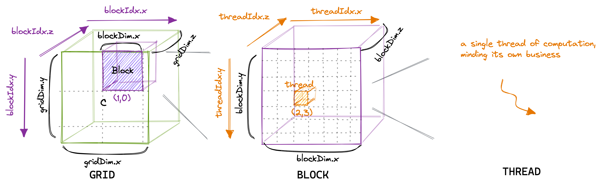

类似地，Grid 中的 Block 数量可以通过 <code class="language-plaintext highlighter-rouge">gridDim</code> 变量配置。从主机端<label class="margin-toggle sidenote-number" for="6"></label><input class="margin-toggle" id="6" type="checkbox"/>在加速器术语中，<em>host（主机）</em> 指 CPU，<em>device（设备）</em> 指加速器，这里就是 GPU。 启动一个新 Kernel 时，会创建一个 Grid，包含指定的 Block 和线程。<label class="margin-toggle sidenote-number" for="7"></label><input class="margin-toggle" id="7" type="checkbox"/>后文只讨论二维 Grid 和 Block，一方面三维结构很少使用，另一方面画三维图太难了。 需要记住，刚才讨论的线程层级主要关系到程序正确性。后面会看到，从性能角度看，把同一个 Block 内的所有线程一视同仁并不是好主意。

第一个 Kernel 利用 Grid、Block 和 Thread 的层级，为每个线程分配结果矩阵 C 中唯一的一个元素。随后，该线程计算 A 对应行与 B 对应列的点积，并将结果写入 C。因为 C 的每个位置都只由一个线程写入，所以不需要同步。Kernel 的启动方式如下：

<pre class="highlight"><code>// 创建足够多的 Block，覆盖 C 的所有元素
dim3 gridDim(CEIL_DIV(M, 32), CEIL_DIV(N, 32), 1);
// 每个 Block 有 32 * 32 = 1024 个线程
dim3 blockDim(32, 32, 1);
// 在设备上异步启动 Kernel
// 该函数调用在主机端立即返回
sgemm_naive&lt;&lt;&lt;gridDim, blockDim&gt;&gt;&gt;(M, N, K, alpha, A, B, beta, C);
</code></pre>

CUDA 代码以单个线程的视角编写。在 Kernel 中，我们访问内置变量 <code class="language-plaintext highlighter-rouge">blockIdx</code> 和 <code class="language-plaintext highlighter-rouge">threadIdx</code>。它们会根据当前访问的线程返回不同的值。<label class="margin-toggle sidenote-number" for="8"></label><input class="margin-toggle" id="8" type="checkbox"/>在这个例子中，<code class="language-plaintext highlighter-rouge">threadIdx.x</code> 和 <code class="language-plaintext highlighter-rouge">threadIdx.y</code> 根据线程的位置从 0 到 31 变化。<code class="language-plaintext highlighter-rouge">blockIdx.x</code> 和 <code class="language-plaintext highlighter-rouge">blockIdx.y</code> 也类似，根据线程所在 Block 在 Grid 中的位置，从 0 到 <code class="language-plaintext highlighter-rouge">CEIL_DIV(N, 32)</code> 或 <code class="language-plaintext highlighter-rouge">CEIL_DIV(M, 32)</code> 变化。 <label class="margin-toggle sidenote-number" for="9"></label><input class="margin-toggle" id="9" type="checkbox"/>我们会频繁对矩阵在内存中的带步幅表示进行索引。Edward Yang 的 <a href="http://blog.ezyang.com/2019/05/pytorch-internals/">PyTorch 内部机制</a> 一文对带步幅的张量有很好的解释。

<pre class="highlight"><code>__global__ void sgemm_naive(int M, int N, int K, float alpha, const float *A,
                            const float *B, float beta, float *C) {
  // 计算当前线程负责的 C 中的位置
  const uint x = blockIdx.x * blockDim.x + threadIdx.x;
  const uint y = blockIdx.y * blockDim.y + threadIdx.y;

  // M 或 N 不是 32 的倍数时，需要这个 if 条件
  if (x &lt; M &amp;&amp; y &lt; N) {
    float tmp = 0.0;
    for (int i = 0; i &lt; K; ++i) {
      tmp += A[x * K + i] * B[i * N + y];
    }
    // C = α*(A@B)+β*C
    C[x * N + y] = alpha * tmp + beta * C[x * N + y];
  }
}
</code></pre>

这个简单 Kernel 的可视化如下：<label class="margin-toggle sidenote-number" for="10"></label><input class="margin-toggle" id="10" type="checkbox"/>如果矩阵大小不能被 Block 大小整除，就需要启动额外的 Block 处理剩余部分。例如下图中会创建 9 个线程数相同的 Block，但只有 4 个能充分利用全部 1024 个线程。这种现象称为 <a href="https://docs.nvidia.com/deeplearning/performance/dl-performance-matrix-multiplication/index.html#tile-quant">分块量化（tile quantization）</a>，把固定大小的计算块映射到可变大小的输入时都会出现。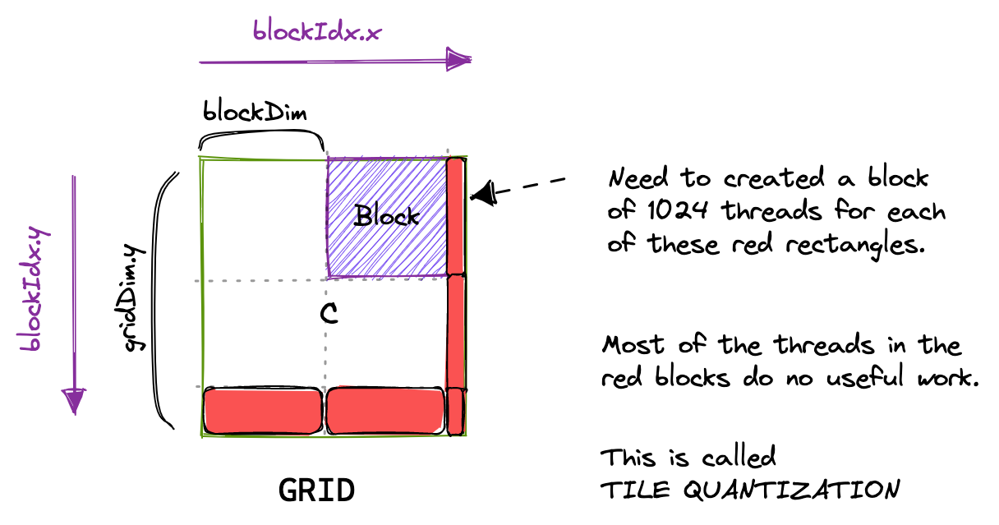

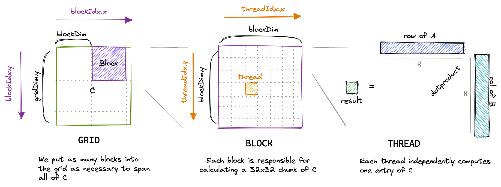

在我的 A6000 GPU 上，这个 Kernel 处理三个 4092² 的 FP32 矩阵大约需要 0.5 秒。先做一些与具体实现无关的计算：

<h3 id="lower-bounding-the-fastest-possible-runtime">估算最快运行时间的下界</h3>

两个 4092² 矩阵相乘，再加上一个 4092² 矩阵（构成 <a href="https://en.wikipedia.org/wiki/Basic_Linear_Algebra_Subprograms#Level_3">GEMM</a>）：

<ol>
<li>总浮点运算量：<label class="margin-toggle sidenote-number" for="11"></label><input class="margin-toggle" id="11" type="checkbox"/>C 的 4092² 个元素中的每一个，都需要计算两个长度为 4092 的向量的点积，每一步包含一次乘法和一次加法。“先乘再加”通常会映射到一条称为 FMA（融合乘加）的汇编指令，但仍按两次浮点运算计数。 <code class="language-plaintext highlighter-rouge">2*4092³ + 4092² = 137 GFLOPS</code></li>
<li>需要读取的数据总量（最少！）：<code class="language-plaintext highlighter-rouge">3 * 4092² * 4B = 201MB</code></li>
<li>需要写入的数据总量：<code class="language-plaintext highlighter-rouge">4092² * 4B = 67MB</code></li>
</ol>

因此，假设缓存足够大，任何实现至少都需要从 GPU 全局内存读取或向其中写入 268 MB 数据。<label class="margin-toggle sidenote-number" for="12"></label><input class="margin-toggle" id="12" type="checkbox"/>全局内存是 GPU 的主内存区域。如果 NVIDIA 宣传某块 GPU 有 80 GB 内存和 1 TB/s 带宽，指的就是全局内存容量和带宽。后面会讨论 GPU 上的其他内存区域，例如共享内存：它在物理上与全局内存分离，性能特性也很不同。<label class="margin-toggle sidenote-number" for="13"></label><input class="margin-toggle" id="13" type="checkbox"/>cuBLAS Kernel 在整个计算过程中总共从 GMEM 加载 500 MB 数据。后面会看到，提高算术强度如何将访问量降到这个水平。 接下来估算 Kernel 性能的上界。GPU 标称的 FP32 计算吞吐为 30 TFLOPs/s，全局内存带宽为 768 GB/s。如果达到这些数值，<label class="margin-toggle sidenote-number" for="14"></label><input class="margin-toggle" id="14" type="checkbox"/>峰值 FLOPs 是一个过于简化的指标，因为它取决于指令组合。如果做的是 DIV，就不可能达到 30 TFLOPs/s。不过矩阵乘法主要使用 FMA，而 FMA 往往是最快的浮点运算，因此我们很有机会接近峰值。 <label class="margin-toggle sidenote-number" for="15"></label><input class="margin-toggle" id="15" type="checkbox"/>带宽也是如此：只有访问模式适合硬件，才能达到峰值带宽。 计算需要 4.5 ms，内存传输需要 0.34 ms。也就是说，粗略估算中，计算耗时约为内存访问的 10 倍。只要最终传输的数据量小于绝对最低内存量 278 MB 的 10 倍，优化后的 Kernel 就会受计算限制。<label class="margin-toggle sidenote-number" for="16"></label><input class="margin-toggle" id="16" type="checkbox"/>A6000 标称的 Tensor Core 性能为 309 TFLOPs/s。如果 FP32 矩阵乘法能使用 Tensor Core，计算只需 0.44 ms，而优化后的 4092² 矩阵乘法 Kernel 几乎肯定仍受内存限制。这让人更能体会 Tensor Core 有多快。

现在已经估算了 FP32 GEMM 运行时间的一些下界，回到当前 Kernel，看看它为什么比理论上可能达到的速度慢这么多。

<h3 id="memory-access-pattern-of-the-naive-kernel">朴素 Kernel 的内存访问模式</h3>

在这个 Kernel 中，同一个 Block 内 ThreadId 分别为 (0, 0) 和 (0, 1) 的两个线程会加载 B 的同一列，但加载 A 的不同行。如果假设最坏情况完全没有缓存，那么每个线程都要从全局内存加载 <code class="language-plaintext highlighter-rouge">2*4092+1</code> 个浮点数。总共有 4092² 个线程，因此会产生 548 GB 的内存流量。

下面以线程 A（红色）和线程 B（绿色）为例，可视化朴素 Kernel 的内存访问模式：

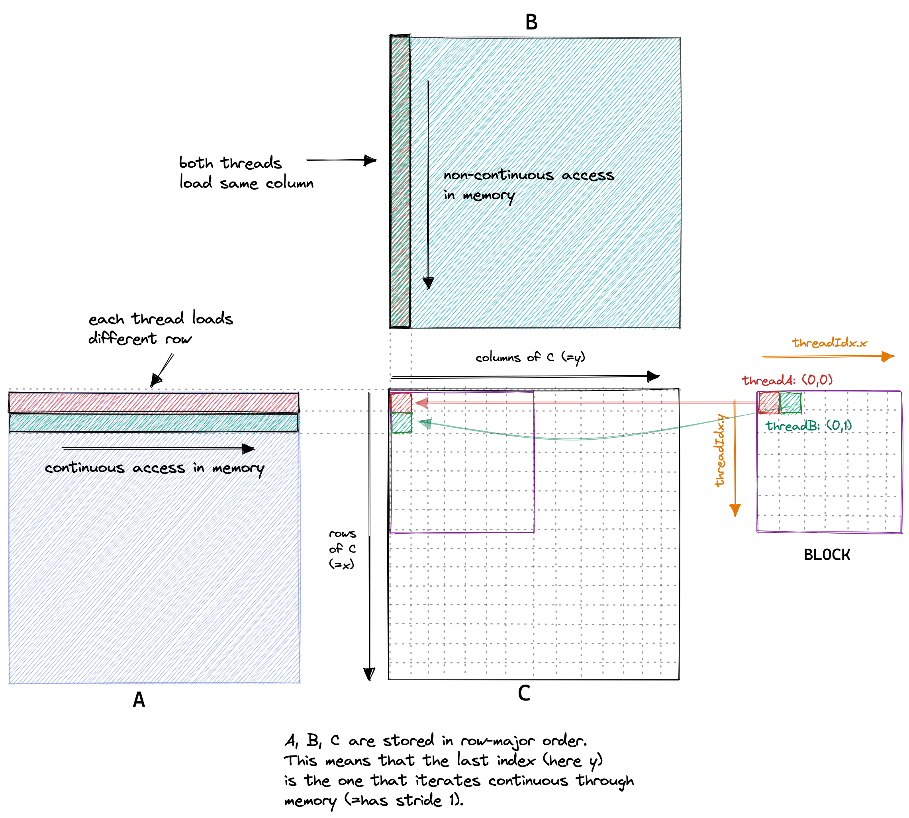

回顾一下，在 A6000 上运行这个 Kernel，计算两个 4092 × 4092 的 Float32 矩阵相乘时，性能约为 300 GFLOPs。考虑到 A6000 的标称性能接近 30 TFLOPs，这个结果相当差。<label class="margin-toggle sidenote-number" for="17"></label><input class="margin-toggle" id="17" type="checkbox"/>作为对照，300 GFLOPs 也大致是优化后的 BLAS 库在 2015 年 Haswell CPU 上的性能，我在<a href="https://siboehm.com/articles/22/Fast-MMM-on-CPU">之前的 CPU 矩阵乘法文章</a>中用过那块 CPU。 怎样开始提速？一种办法是优化内存访问模式，让全局内存访问能够合并成更少的访问。

<h2 id="kernel-2-global-memory-coalescing">Kernel 2：全局内存访问合并</h2>

在讨论全局内存访问合并之前，先了解 Warp。执行时，Block 中的线程被分成称为 Warp 的组，每组包含 32 个线程。每个 Warp 随后被分配给 Warp 调度器，也就是执行指令的物理核心。<label class="margin-toggle sidenote-number" for="18"></label><input class="margin-toggle" id="18" type="checkbox"/>Volta 架构之前，同一个 Warp 的所有线程都来自同一条指令流。遇到分支时，不走该分支的线程会被所谓的 active mask 禁用。但从 Volta 开始，不宜再依赖这种“Warp 同步”行为，因为即使在同一个 Warp 内，不同分支的指令也可能交错执行。 每个多处理器有四个 Warp 调度器。线程按连续的 <code class="language-plaintext highlighter-rouge">threadId</code> 分组。如果 <code class="language-plaintext highlighter-rouge">blockDim</code> 设置为多维，threadId 的计算方式如下：

<pre class="highlight"><code>threadId = threadIdx.x+blockDim.x*(threadIdx.y+blockDim.y*threadIdx.z)
</code></pre>

相邻 <code class="language-plaintext highlighter-rouge">threadId</code> 的线程会组成同一个 Warp。下图用一个更小的“Warp 大小”——8 个线程——来展示这一点（真实 Warp 始终包含 32 个线程）：<label class="margin-toggle sidenote-number" for="19"></label><input class="margin-toggle" id="19" type="checkbox"/>我喜欢把 <code class="language-plaintext highlighter-rouge">threadId</code> 的 <code class="language-plaintext highlighter-rouge">x,y,z</code> 三个维度理解成“列主序”，因为第一个维度 <code class="language-plaintext highlighter-rouge">x</code> 在“Warp 空间”中连续。不知道其他人是否使用这种说法，但这样能让我更容易理解。

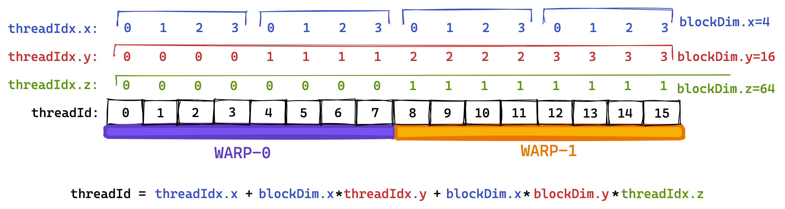

Warp 对第二个 Kernel 很重要，因为同一个 Warp 内线程对连续内存的访问可以合并执行，这称为<strong>全局内存访问合并</strong>。为了让 Kernel 的 GMEM 访问达到峰值带宽，这是最需要记住的一点。

下面的例子中，同一个 Warp 内线程的连续内存访问被合并，每个 Warp 只需两次 32 B 加载就能完成 8 次内存访问：

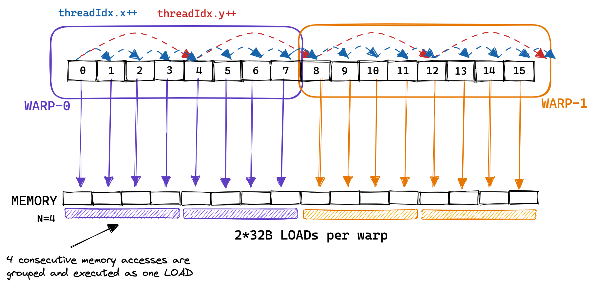

实际上，GPU 支持 32 B、64 B 和 128 B 的内存访问。如果每个线程从全局内存加载一个 32 位浮点数，Warp 调度器（可能是 MIO）就能把这次 <code class="language-plaintext highlighter-rouge">32*4B=128B</code> 加载合并为一次事务。只有浮点数在内存中连续且访问地址对齐，才能做到这一点。<label class="margin-toggle sidenote-number" for="20"></label><input class="margin-toggle" id="20" type="checkbox"/>因此，优化 GPU 全局内存访问合并与优化 CPU 缓存行利用率非常相似。有意思的是，为了合并，同一个 Warp 中线程访问的地址必须连续，但这些访问不必按 Warp 内的线程顺序连续，如下图：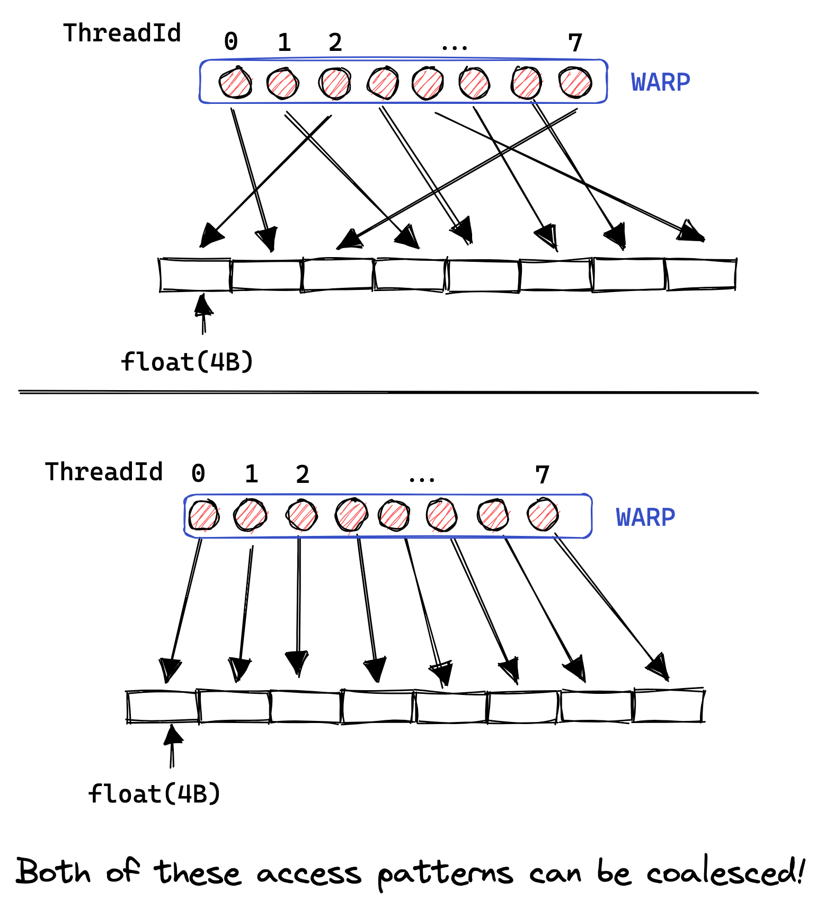 如果不满足条件，或者因其他原因不能合并，GPU 就会执行足够多次 32 B 加载来取齐所有浮点数，造成大量带宽浪费。分析朴素 Kernel 时可以看到非合并访问的负面影响：GMEM 吞吐只有 15 GB/s。

回顾之前的 Kernel，我们这样为线程分配 C 中的元素：

<pre class="highlight"><code>const uint x = blockIdx.x * blockDim.x + threadIdx.x;
const uint y = blockIdx.y * blockDim.y + threadIdx.y;
</code></pre>

因此，同一个 Warp 内的线程（即 <code class="language-plaintext highlighter-rouge">threadIdx.x</code> 连续的线程）从内存中加载 A 的不同行，地址并不连续。朴素 Kernel 对 A 的访问模式如下：

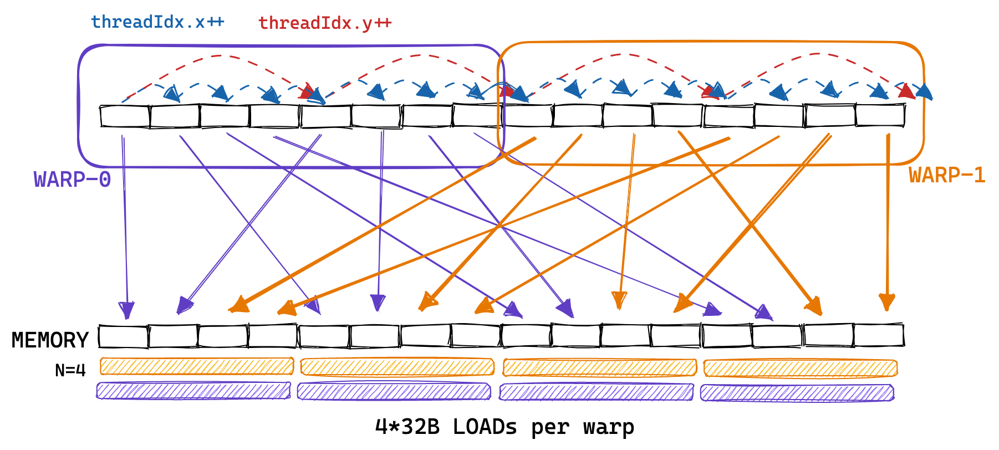

为了支持合并，可以改变结果矩阵 C 的位置与线程之间的分配关系。改变后的全局内存访问模式如下：

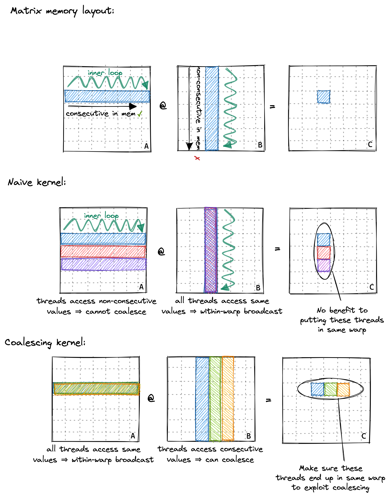

实现这一点只需要修改前两行：

<pre class="highlight"><code>const int x = blockIdx.x * BLOCKSIZE + (threadIdx.x / BLOCKSIZE);
const int y = blockIdx.y * BLOCKSIZE + (threadIdx.x % BLOCKSIZE);

if (x &lt; M &amp;&amp; y &lt; N) {
  float tmp = 0.0;
  for (int i = 0; i &lt; K; ++i) {
    tmp += A[x * K + i] * B[i * N + y];
  }
  C[x * N + y] = alpha * tmp + beta * C[x * N + y];
}
</code></pre>

然后这样调用：<label class="margin-toggle sidenote-number" for="21"></label><input class="margin-toggle" id="21" type="checkbox"/>我起初没想到，启用 GMEM 访问合并并不会改变汇编，可在 <a href="https://godbolt.org/#z:OYLghAFBqd5TKALEBjA9gEwKYFFMCWALugE4A0BIEAZgQDbYB2AhgLbYgDkAjF%2BTXRMiAZVQtGIHgBYBQogFUAztgAKAD24AGfgCsp5eiyahUAV0wtyKxqiIEh1ZpgDC6embZMQAJnLOAGQImbAA5TwAjbFJfWQAHdCViByY3Dy9fcgSk%2ByEgkPC2KJifWRtsOxSRIhZSIjTPbz9yyqFq2qJ8sMjo2OsauoaM5oHO4O6i3tKASmt0M1JUTi4AUh8AZjjSFmA2FgBqISWVrQBBE/ON4NQPHH2V9ZdxJRU6h9wLtfXr2%2Bx7x9QSiIhHQ70%2BVyYNwsfweTyBmHoBAiYLOXx%2B0P%2BTzMESMSgA%2BgA3HwAOiQKMu30hv0x5kseNIZmEBA4pPJFzxeOA9HQEQkHP2BPQBEw%2ByUwGwbDYnO5vPoeI4UowEmwSiWEGCRH2AFlyPsNftQrr9QBpXU0bksTUSOJIKwXfYOx1O50u11ul0YJhA/bm9CW/YAKlOus93t9/oDACFyPb3XH4/Hw5qojUzRbNQGXNN7gB2SOx/WRgIAeRcxpEAEkAFofdYAEXWPge%2BbODtDmv1qAASugAO7/Ov7HHoVAAawrmHUxPUgf2RdL5eruHuPkj%2BwgRCQpGwLEwE6nM4A9HOS2XKzXps3Y%2B29cJ9qg0gOh9yx/viQBPWfzs9Lldrjdbjue6TtOK4AKwngu564Je6wtucrb7Iex4EDQoo1EQErMB2Sj7CESwvLUn4kPseyjn8m7BMAuG9mQo77IyOCkPs9iMPsACOZjGPYABelopAWaEQN2faYtqK4AGxrBJ96PrCBrZiseaxg6SYsWwcRPloxJaFeiGqWQ676gQWnNnqYnGmZaz5quBCKcp%2BmOkQGl/g8g7nGBkYif2Ab7Maf56isYGDr5%2BaeSZvmhAFD7uEFdZ6acTpKfFjkuEFXk9j5BrRWkcVPtatqzs5mnWUO2A1LOaWed5s5RaVMX0HFCUOslnw5nWXCzPQ3Bgfw3hcDo5DoNwLgKHWiVpaupVKPMiwwhsfDkEQ2idbMSBAb0ECzKOsTEgAnAdh1HUdEmGNw0h9StQ3cPwSggFoS0rbMcCwCgGAaQw0SUNQ71xJ9MRMASqCoDwPA5uQOAEgQSwAGoENgvbFnEzBXXQ9CYaQd0QBEV0RMERHcIt70cMIxZMPQ75XTgewmJIA38IQ26VASKpXdg6gVGYmGE/wGrYN19OGEi2ykO%2Bbg4FdRCkMyPOzOaOxKHDCNIyjvD8IIwhiMqUiyBrigqBoV36DwhjGKYFhWIiER3ZAszoHEuRetwAC0xbrPszt1qEda4JGCgAOIe874ohNsmHOxgOBubUqBkvWv1c9geIABynZH2BuelCeYSnp1KFKqd5c7zsO%2BoLBKM79uO0obnOwSHvwm5qDWdZYO3fzFSO04TCuO4jQGIE4yFMUBjZMkQhDN4Jtj47XTD70JstI77SDH3GSLx3rRMCvYwFD0MSL6Mk8GECHRz/vUizDNCxLL4XU9ZdgvDVwBowy4Lj7KDxI5jp674MQhkvg%2BGmPwZa9NphrQ2jELa5AdqlH2sdRBB1ToCwuuQfqg1n63Xuo9cB5AXrIDQFgPAhASAUCoLQT6rAOA8zkJrcQkgZB0P1moTQgt9B%2BCMCYNAFtrCby7hAZwx8/CDz3pMEo8REjj1SGvJoWQpGzyHhfUofDbDLyPrIzIS8qijHPuIvop9V7pDkYY3eEwR4zDmDfZYXwtg7D2IcSEGdUSoghFCO4sJnivCIGyNx1JPHwgcL4yk7iYQAnhFbYJ6IPEAmxLiQkJI44fFcSE/xsS6QMiZCyJJnwzgci5DyPkeIBRChFGKCUUoCmynlBKPEjIlSMFVNgTA6o7w6lvJqQ0HS/Jpj9FaegNo7SOQTCMkZN41JBhDEIMM6ZAzRhUqMxZcY1IpisD6WZmZ7LwQdIWU8i4axuUbM1e80yOx3hqm5Z8I5xwgRnKFPZ0EAoAW3LuN8M41gQW/PsmCxybydjkvWK5r4QKfnuVBX8pVnlATeUhSCP4LwJVjMhPUaFT6YRJjhPCFQVRKCIixdApEWDkRYkgKiNE6IMR7tEFin0OJcSZHxR2gl1wXMeOJaS0lZLuDEqELZCy1LFS0jpY5BlmKtI7KZOC5l5KWSlS3WyfLhnqRKlNQFHkMqiV8v5UqBA8qhXShFbK9VcrBRFbmFKiVHRVQ1VlOqq4uWNWCvlAZhVfKCtKqsyqWdMq1RyrFU1cFYytVRO1TqZ0uC9XQVdZ%2Bo1xr7EmjZNc185orkbKAp6kDdybW2rtJBSCUHnX4GwEA6wf5gSjU/G61gcFgJ0M9RAEA3roA%2BowchP1m1/VbSAQGwNQbg0htDbAStEbIwwerBgGMsY40FnjVgotaHE2wmTCmVMJRmzpoNRmncCAszuoLdmnNuZq0oMIfmV0rYizFsQyW0ti1qzlkYaiw6Vb9UWnrLWjDdbyGUKwo2mQuHm0sELa28A7YOxSHu127tPbe19gHIOIdoiWmwBHYh0dFhxzrNnJOqdyDp0ztVDtidc7WALlJJ1xdS7l0ruB6Ztd67O0bvHeVkY26qO3Y4QRPdj4m1EeYhe8icgpB44J6ReiR4bzUTojoIntFtF0Uo/Rh8ZOaOU3UcTC8r6zVvjwe%2BEbH6YO4K/d%2Bn8eDf1/hAf%2BZDU26fTeAzNTFqA5vgXmxBBauBoLHddLg2CHq1tWuGnwRaQBgW0snHge0JI5h8DwdYoNpA5jAuWrzWDcF1vwQ2htKAB1LG%2BsJDt/1QjsGWKEN%2BH8v4/0Gs0gB0tMAGHfQwzgTC9Y/sNuwrR/CUjd17sYgePcNMH1E47ETM8UgDZPp1%2BTKneuSY49vBTYiJP9Gm/3NTZj54H1mFLbA2BhT3T05GlL3A6zYChksfYw7qWlZMxVizVnAELV1G4Ft1KgEgLSwF9aWboE5ukBJYkElwtA54MDoH4a0HFp4FoB6R2fPVr809DL8BG0gBy9gPLv1CvFe4Nd8rZnKv8Gq2QvbfgGva2a9%2Bg2bDBrG3Y1vbrIm%2BMbdHgo4TqmhtjcU0tuT82Vvrzp%2Bos%2BXOBOmNkwt/jm2lrbl23VrQB2DP8Gfids7fxLvMVx6Z8zWg/6kIe42J7BXW02fe/5iB5AvuOZgTtMC6xiRxdByDx3ydOGFvIJD6HFbDNw7ugj%2BzgXgvSD2sSEHWhGw5lTsnZOYFSgSVOrDuzdac1Q4egLdYCvvMJ4CyzTGXXpBAA%3D%3D">Godbolt</a> 查看 SASS 输出。访问合并由硬件在 Kernel 运行时完成。因为合并需要对齐，而矩阵指针作为函数参数传入，编译时无法保证对齐，所以这很合理。另外，虽然循环次数 <code class="language-plaintext highlighter-rouge">K</code> 在编译时未知，汇编仍然部分展开了内部循环。挺有意思！

<pre class="highlight"><code>// gridDim 保持不变
dim3 gridDim(CEIL_DIV(M, 32), CEIL_DIV(N, 32));
// 将 blockDim 改为一维，但线程总数不变
dim3 blockDim(32 * 32);
sgemm_coalescing&lt;&lt;&lt;gridDim, blockDim&gt;&gt;&gt;(M, N, K, alpha, A, B, beta, C);
</code></pre>

全局内存访问合并将内存吞吐从 15 GB/s 提高到 110 GB/s。性能达到 2000 GFLOPS，相比第一个朴素 Kernel 的 300 GFLOPS 有很大进步。下一个 Kernel 将利用 GPU 上快速的片上内存——共享内存——缓存会被重复使用的数据。

<h2 id="kernel-3-shared-memory-cache-blocking">Kernel 3：共享内存缓存分块</h2>

除了容量较大的全局内存，GPU 还有一片小得多、物理上位于芯片内部的内存，称为共享内存（SMEM）。物理上每个 SM 都有一片共享内存。<label class="margin-toggle sidenote-number" for="22"></label><input class="margin-toggle" id="22" type="checkbox"/>下面这张图很好地展示了 A100 GPU 的内存层级（<a href="https://developer.nvidia.com/blog/cuda-refresher-cuda-programming-model/">来源</a>）：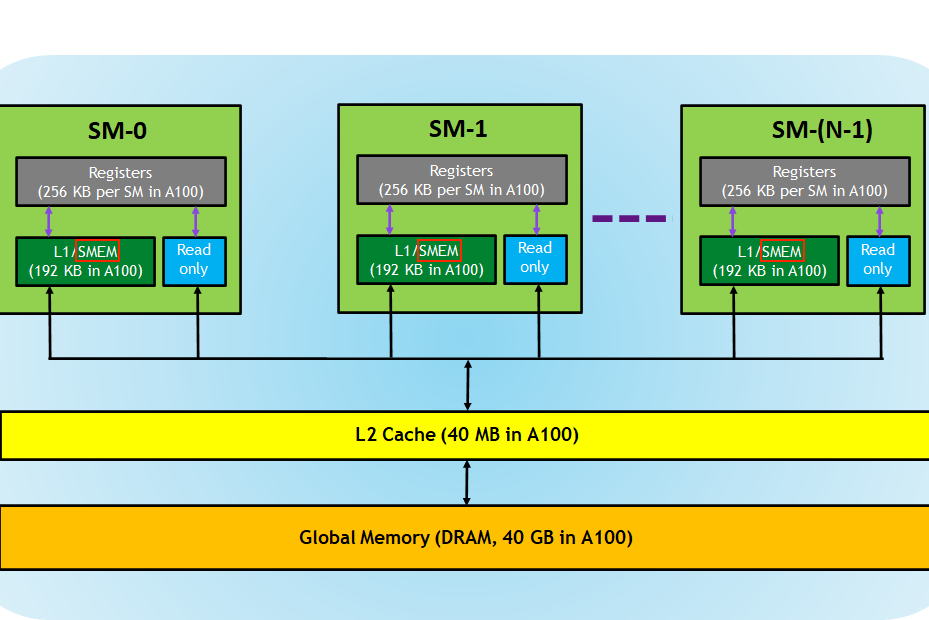 逻辑上，共享内存在各个 Block 间划分，因此线程可以通过自己的共享内存区域与同一个 Block 内的其他线程通信。在我的 A6000 上，每个 Block 最多可访问 48 KB 共享内存。<label class="margin-toggle sidenote-number" for="23"></label><input class="margin-toggle" id="23" type="checkbox"/>SMEM 容量可以配置，以更大的共享内存换取更小的 L1 缓存，具体见<a href="https://docs.nvidia.com/cuda/cuda-c-programming-guide/index.html#compute-capability-8-x">计算能力文档</a>。此外，利用动态共享内存，每个线程也可以使用超过 48 KB 的 SMEM。

共享内存位于片上，所以延迟比全局内存低得多，带宽也高得多。我没找到 Ampere 架构的可靠基准数据，但<a href="https://arxiv.org/abs/1804.06826">这篇论文</a>对 Volta（2017 年发布）的测试给出了 750 GiB/s 的全局内存带宽和 12,080 GiB/s 的共享内存带宽。<label class="margin-toggle sidenote-number" for="24"></label><input class="margin-toggle" id="24" type="checkbox"/>这些数值从 Volta 到现在似乎变化不大。NVIDIA 给我的 A6000（Ampere）标注的最大 GMEM 带宽约为 750 GB。

因此，下一个 Kernel 会从全局内存把 A 的一块和 B 的一块加载到共享内存，然后尽可能多地利用这两块数据计算，每个线程仍负责 C 的一个元素。我们会沿 A 的列方向和 B 的行方向移动这些块，累加 C 的部分和，直到结果计算完成。

如下图所示：

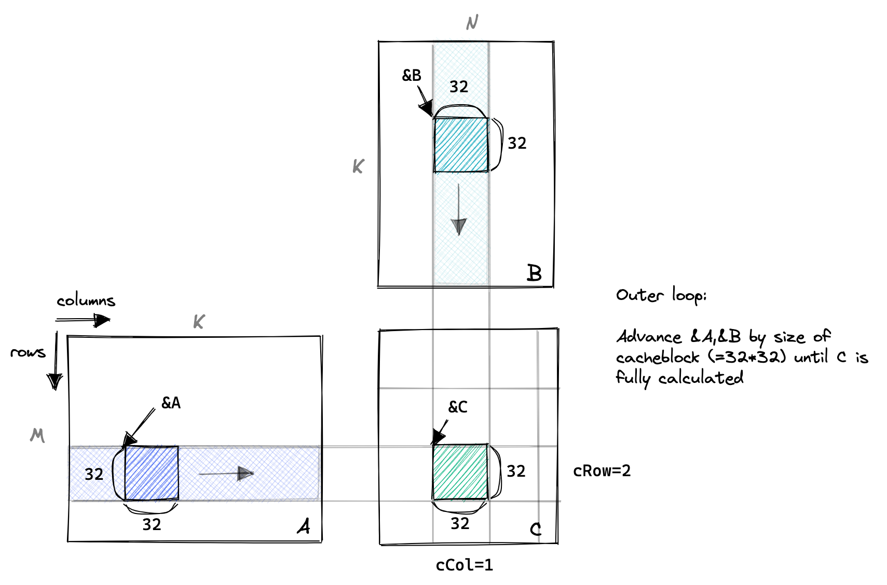

下面是代码中的关键部分，变量名与上图对应：<label class="margin-toggle sidenote-number" for="25"></label><input class="margin-toggle" id="25" type="checkbox"/>总体上，我没有让代码适用于任意 M、N、K，因为条件检查会让代码杂乱，也没什么趣味。为确保 Kernel 正确，我用随机数据和几个不同的矩阵大小与 cuBLAS 比较。

<pre class="highlight"><code>// 将指针移动到起始位置
A += cRow * BLOCKSIZE * K;                    // 行=cRow，列=0
B += cCol * BLOCKSIZE;                        // 行=0，列=cCol
C += cRow * BLOCKSIZE * N + cCol * BLOCKSIZE; // 行=cRow，列=cCol

float tmp = 0.0;
// 外部循环沿 A 的列方向和 B 的行方向推进，
// 直到 C 中的结果全部计算完成
for (int bkIdx = 0; bkIdx &lt; K; bkIdx += BLOCKSIZE) {
  // 每个线程将 A 和 B 中各一个元素
  // 从全局内存加载到共享内存
  // 让 threadCol（=threadIdx.x）成为连续索引，
  // 以支持全局内存访问合并
  As[threadRow * BLOCKSIZE + threadCol] = A[threadRow * K + threadCol];
  Bs[threadRow * BLOCKSIZE + threadCol] = B[threadRow * N + threadCol];

  // 等待 Block 内所有线程，直到缓存填充完毕
  __syncthreads();

  // 将指针移动到下一个块
  A += BLOCKSIZE;
  B += BLOCKSIZE * N;

  // 在当前缓存块上计算点积
  for (int dotIdx = 0; dotIdx &lt; BLOCKSIZE; ++dotIdx) {
    tmp += As[threadRow * BLOCKSIZE + dotIdx] *
            Bs[dotIdx * BLOCKSIZE + threadCol];
  }
  // 结束时需要再次同步，避免较快线程提前
  // 把下一块加载到缓存，而较慢线程尚未完成计算
  __syncthreads();
}
C[threadRow * N + threadCol] =
    alpha * tmp + beta * C[threadRow * N + threadCol];
</code></pre>

这个 Kernel 达到约 2200 GFLOPS，比之前的版本提升了 50%。<label class="margin-toggle sidenote-number" for="26"></label><input class="margin-toggle" id="26" type="checkbox"/>提升只有 50%，部分原因是前一个 Kernel 已经有很不错的 L1 缓存命中率。 但距离 GPU 能提供的约 30 TFLOPs 仍很远。下面的 Roofline 图清楚地显示了这一点：<label class="margin-toggle sidenote-number" for="27"></label><input class="margin-toggle" id="27" type="checkbox"/>注意，我们达到的内存带宽比 cuBLAS 更高，但每从内存加载一个字节所完成的工作少得多（即算术强度更低），所以整体性能更差。

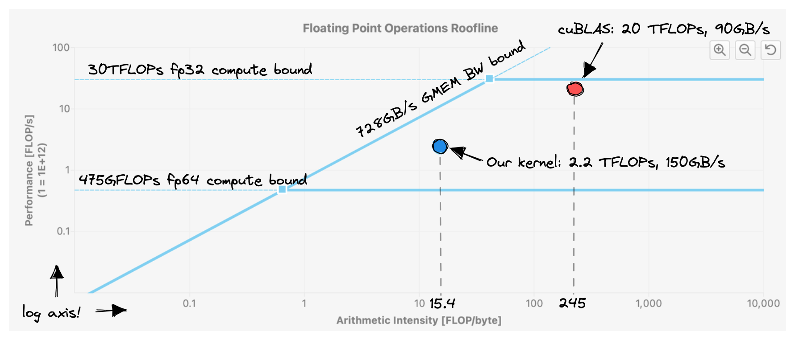

CHUNKSIZE 为 32 时，共享内存占用为 <code class="language-plaintext highlighter-rouge">2*32*32*4B=8KB</code>。<label class="margin-toggle sidenote-number" for="28"></label><input class="margin-toggle" id="28" type="checkbox"/>编译时使用 <code class="language-plaintext highlighter-rouge">--ptxas-options=-v</code> 也可以得到这些信息，输出为：<code class="language-plaintext highlighter-rouge">Used 37 registers, 8192 bytes smem, 400 bytes cmem[0]</code>。 我的 A6000 每个 Block 最多可以使用 48 KB 共享内存，距离上限还很远。这不一定是问题，因为增加每个 Block 的共享内存使用量也有坏处。每个多处理器（SM）最多有 100 KB SMEM，因此如果修改 Kernel，让它用满每个 Block 可用的 48 KB SMEM，那么每个 SM 同时只能驻留两个 Block。用 CUDA 的术语说，增加每个 Block 的 SMEM 使用量可能降低<a href="https://docs.nvidia.com/cuda/cuda-c-best-practices-guide/index.html#occupancy">占用率（occupancy）</a>。占用率定义为每个 SM 的活跃 Warp 数与最大活跃 Warp 数之比。

较高的占用率可以提供更多可发射的指令，从而隐藏操作的高延迟。<label class="margin-toggle sidenote-number" for="29"></label><input class="margin-toggle" id="29" type="checkbox"/>GPU 上 FMA 等数学运算的延迟为 4 个周期，在 1.5 GHz 时钟下为 2.6 ns。相比之下，较新的 x86 CPU 上 FMA 延迟为 6 个周期，在 3.5 GHz 时钟下为 1.8 ns。 限制一个 SM 驻留更多活跃 Block 的主要因素有三个：寄存器数量、Warp 数量和 SMEM 容量。以当前 Kernel 为例计算一下。

<h3 id="occupancy-calculation-for-kernel-3">计算 Kernel 3 的占用率</h3>

通过 <code class="language-plaintext highlighter-rouge">cudaGetDeviceProperties</code> API 得到的 GPU 相关硬件参数如下（Multiprocessor 就是前面说的 SM）：<label class="margin-toggle sidenote-number" for="30"></label><input class="margin-toggle" id="30" type="checkbox"/>可以通过名为 <code class="language-plaintext highlighter-rouge">SharedMemoryCarveout</code> 的功能配置共享内存容量。所谓的统一数据缓存划分为 L1 缓存和共享内存，因此可以减少共享内存，换取更多 L1 缓存。

<table>
<thead>
<tr>
<th>指标</th>
<th>数值</th>
</tr>
</thead>
<tbody>
<tr>
<td>名称</td>
<td>NVIDIA RTX A6000</td>
</tr>
<tr>
<td>计算能力</td>
<td>8.6</td>
</tr>
<tr>
<td>每个 Block 最大线程数</td>
<td>1024</td>
</tr>
<tr>
<td>每个多处理器最大线程数</td>
<td>1536</td>
</tr>
<tr>
<td>每个 Warp 的线程数</td>
<td>32</td>
</tr>
<tr>
<td>Warp 分配粒度</td>
<td>4</td>
</tr>
<tr>
<td>每个 Block 最大寄存器数</td>
<td>65536</td>
</tr>
<tr>
<td>每个多处理器最大寄存器数</td>
<td>65536</td>
</tr>
<tr>
<td>寄存器分配单元大小</td>
<td>256</td>
</tr>
<tr>
<td>寄存器分配粒度</td>
<td>Warp</td>
</tr>
<tr>
<td>全局内存总量</td>
<td>48685 MB</td>
</tr>
<tr>
<td>每个 Block 最大共享内存</td>
<td>48 KB</td>
</tr>
<tr>
<td>CUDA 运行时每个 Block 的共享内存开销</td>
<td>1024 B</td>
</tr>
<tr>
<td>每个多处理器的共享内存</td>
<td>102400 B</td>
</tr>
<tr>
<td>多处理器数量</td>
<td>84</td>
</tr>
<tr>
<td>每个多处理器最大 Warp 数</td>
<td>48</td>
</tr>
</tbody>
</table>

当前 Kernel 的资源需求如下：

<table>
<tbody>
<tr>
<td>每个线程的寄存器数</td>
<td>37</td>
</tr>
<tr>
<td>每个 Block 的 SMEM</td>
<td>8192 B</td>
</tr>
<tr>
<td>每个 Block 的线程数</td>
<td>1024</td>
</tr>
</tbody>
</table>

工作以 Block 为粒度调度到 SM。只要有足够资源容纳，SM 就会继续加载更多 Block。计算如下：<label class="margin-toggle sidenote-number" for="31"></label><input class="margin-toggle" id="31" type="checkbox"/>我找到了许多官方和非官方的占用率计算器，却没有找到官方的计算公式。结果是正确的（已使用 NVIDIA 官方工具检查），但例如取整方式可能存在小错误。

<ul>
<li><strong>共享内存</strong>：8192 B/Block + CUDA 运行时使用的 1024 B/Block = 9216 B/Block。每个 SM 的 102400 B / 每个 Block 的 9216 B = 11.11 ⇒ 上限为 11 个 Block。</li>
<li><strong>线程</strong>：每个 Block 1024 个线程，每个 SM 最多 1536 个线程 ⇒ 上限为 1 个 Block。</li>
<li><strong>寄存器</strong>：每线程 37 个寄存器 × 每 Warp 32 个线程 = 每 Warp 1184 个寄存器。Warp 级寄存器分配粒度为 256 个，向上取整后是每 Warp 1280 个寄存器。每个 Block 有 1024 / 32 = 32 个 Warp，因此每个 Block 需要 1280 × 32 = 40960 个寄存器。每个 SM 最多 65536 个寄存器 ⇒ 上限为 1 个 Block。<label class="margin-toggle sidenote-number" for="32"></label><input class="margin-toggle" id="32" type="checkbox"/>出人意料的是，寄存器文件的空间比共享内存更大！每个 Block 最多使用 48 KB SMEM，却可以使用 65536 × 4 B = 262 KB 寄存器空间。</li>
</ul>

因此，这个 Kernel 受每个 Block 的线程数和每个线程的寄存器数限制。每个 SM 最多只能驻留一个 Block，最终占用率为 32 个活跃 Warp / 最多 48 个活跃 Warp = 66%。

66% 的占用率并不差，所以这无法解释 Kernel 为什么这么慢。<label class="margin-toggle sidenote-number" for="33"></label><input class="margin-toggle" id="33" type="checkbox"/>cuBLAS 达到约 245 FLOPs/Byte，说明这个 Kernel 可以朝高算术强度（AI）优化。算术强度很高或很低时，都不需要高占用率就能达到峰值吞吐。详见 <a href="https://www2.eecs.berkeley.edu/Pubs/TechRpts/2016/EECS-2016-143.pdf">V. Volkov 的博士论文</a>对“尖点行为（cusp behaviour）”的讨论：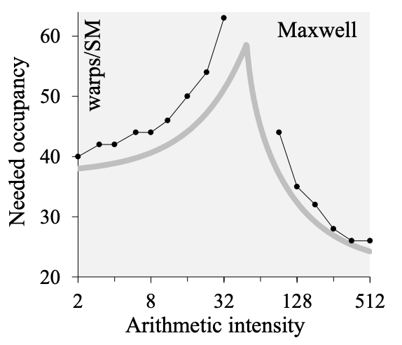 Profiler 提供了一些线索。先看执行的指令组合，大部分指令都是内存加载：<label class="margin-toggle sidenote-number" for="34"></label><input class="margin-toggle" id="34" type="checkbox"/><code class="language-plaintext highlighter-rouge">LDS</code> 是共享内存加载，<code class="language-plaintext highlighter-rouge">FMA</code> 是融合乘加，<code class="language-plaintext highlighter-rouge">IADD3</code> 是“三输入整数加法”，用于沿 K 维移动指针。

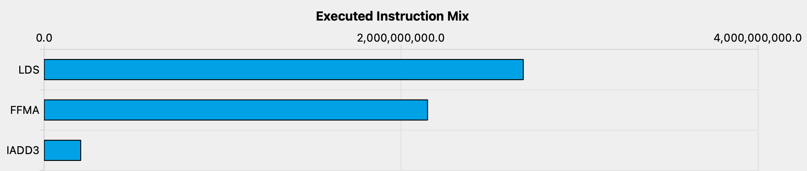

内部循环的 PTX 如下（<a href="https://godbolt.org/#z:OYLghAFBqd5TKALEBjA9gEwKYFFMCWALugE4A0BIEAZgQDbYB2AhgLbYgDkAjF%2BTXRMiAZVQtGIHgBYBQogFUAztgAKAD24AGfgCsp5eiyahUAV0wtyKxqiIEh1ZpgDC6embZMQAVgBs5M4AMgRM2AByngBG2KQgAMwA7OQADuhKxA5Mbh5evgFpGfZCIWGRbDFxSdbYtsVMIkQspEQ5nt7SyTbYdlmNzUSlEdGxCV1NLW15ndYTg6HDFaNJAJTW6GakqJxcAKQATPGhqB44ANS78S4SwGTESGyXuLtaAIIHR0wnFtgXV6hKIiEdBPF7vQ7HU6/S4uAFA%2BgEKKgt4fSE/P6wsxRIxKAD6ADd9gA6JDI8Gfb7nGHmSy40hmYQEDgkslgj44OhhM4uXAASSCuIAIryAGoQACy5DO4RWZyg4tlBwAQnKZQBaHiygD0qpWbLeuNxwHo6CiEkNZ3x6AImDOSmA2DYbFxSiQzWwmFxHGd2PQqAA1hBQkQzpKzsHpVKIwBpKU0E0sEMSFJu8hgs4ZzNZ7M53N5zMYJiAs7x9CJs4AKleUsLxdL5YrSrTb3zrbb%2BfrIZiTTjCZDFZcisSSvTZ1rIYjSqCAHkXNGRLyAFrPeKC%2BL7S4jlsXbdanVEJC/DZEFJmLsmgNnA/lgDuvxvxhDJDH6DYp6Iv1CV6QBCU39I2AsJgvoBqO45nGYEaoAASugN5/IKZwgf6vKYOoRLqJuYFCMWkHCGOOQIUhF4oWhRIAJ5YSiu46hIF6Jr8URmDQNCxCWZBjpsAH4ch4ZMCWLDFq67q2t6o57naboAaJjrhn%2BwnSUh2BEHezBnHR/6AZgf5fiwxF%2Bv6o6GgpHoWp2ZyvEouw%2BEqU6zvOS64JWZx2XOC7LtZgpUa8GbGVJpm4iWfYuVZNmuQ5y7OeF7nPD4XnxFu7w0d%2Bn5MGEpBnKQcEXPsfgvvQ363tgYBcAB6moNsSgZCYfHfr%2BmlAdhRYhnhT5IABQGEZciEHh1mCoeh6g5T4Lkzm5jneRm4GtQ1mCwfB3WzQNGFnDq0UTQl%2Bo%2BattGYPixjbGcaTBrEf7PgevyAgMoTAEd6SZDho4%2Bcqi0wdlFajfZMXOdGm7tnmElZTe3VvTeNbuN1WijiqL2rgR7hRWNEUriq/2toDcGQ%2BD9Agzko4uDlI5w6DiNfY5znhIT8MFR960eQlO2ZZjq6g9juMQ9R23mUQb5EVoRJQ5t26CBlQY8aRQ2LYLKpRBLGJnL9DOywNhOLXTuBDolWYSQAEiw%2BK/IBqBILNZwJraQhHjQKVnLUjrMEQOn8c9uUuaOGYSeKLD%2Br8F2zYREDdb1WnLeosp%2B7WPRngQBt8TgmHbh7%2B7oOp9AmvBxqmhIZzemQ5HlZVf4YBI2BKKgN3uxZoVKsHQHzaT42Rcq/sQ3FRHvDZtdze9CtU13eNxZNmZKtXXf17TSPfc3/et4havWTX7VaeP0p90vnWz95lcSbxXdO3Vf68Qy9gFeIxufn%2BNBmGn%2BdpKeRgfpglfGeRXx7xAepC9tGYu0TiHq0PDMMN9h/0%2Bo3JyH1whb0TozbA6go4fhtpgdAJ4sqYDMHYM4QgbbmFINxIg9B85n0PLaZClcRZygjMgogKspZ/WobQq4YDkZ/ReiAhhaFNaVwzDzFIqs4aWQXmPHu6sqYcMwm3Cs3C8wjwXuIhuyM159QHvFLWmZdiJC8jAiSYQPRXhTkoV%2BqB1LABYLpNqhsmCYClM%2BfW1pbQ0EEh%2BDKe9t46lYkQY2N0bZhHUOeAyfFzqHjHCwc%2BSkRaXXTmxPe6kyrILCM/F0Rj36fzURorR20XBCPXt3eCkClFaRUQhaRyY3TOV4VTbsekPpZM7jklelNp45JUVvTRXA1j0G4D4fg3guA6HIOgbgLgFCCh8lkkBzclAbC2NCQ4fByBEG0O0tYh4gKjA/uQf0vgtCGG4NIHpSyBncH4EoEAOzFl9PaeQOAsAUAYDfAwWIlBqD3JSI8uITB8QVR4DwZIOB8QEG2CKAg2AbzThSMwQ5dB6DONORAKIhyoihGaORbg8z7kcGENOJghDDk4DYMYY0Ox%2BmEAAr0A2pzLmBHgeYD8aL%2BAnU6VShEURSAorcDgQ5RBSBMnpWseMLBgBKGBaC8FkLeD8EEMIMQJcpCyClYoFQGhDn6H2IYQlaALBWBZacyAax0ApHqJSk5dteiOAgM4KY3geCBCsUMcolQDCFAetkdw7QnX3XqPakYcQbXdDNQ0OYVqDD%2BvqP0Fo3qli%2BtmAMYNfq5iRsdZqdYmxthSA6V0g5VLBlcGlCKFwBMflEkSALOU%2BBiAcQ%2BJqfgFydArBWVpdZawtk%2BB2Uy/Z5Ben9JzScs5Cyln1t2VwfY/A2AgGkPzPwPhEgAE5DhaH2IkeIWgfAzp8D4Tthye39suWsG5yAQD/MBdgZ5EBXnvPCOwHY4R82Fp4MWgW/APQVp5ZgAwCqZWSBkHIYQyg1CaCpaqmodQshOCscG6QAAOW1mBE2jB4D4G1zr6hxtSJ6rIcHfXSBncBnoYag1uumNB0NfQE0LAdfBxDMbJiEetdR%2BYZQfVypnWsbl2BsA2jORmrg3TN3Zu4IKbAALDoirvBlG9BazhFpLVoMthASAZSrVKNwDzGCKcOPsFYNaB0NrWXEDZWyeBaDbXs0dvgZ1EniNIfYWhEh%2BBnYkXKM6J2yC7fwbdpzzk6c2VIYzQ74hZu7ccndda1gG1IBkRw0ggA%3D">Godbolt 链接</a>）：

<pre class="highlight"><code>ld.shared.f32   %f91, [%r8+3456];
ld.shared.f32   %f92, [%r7+108];
fma.rn.f32      %f93, %f92, %f91, %f90;
</code></pre>

这并不好，因为内存加载的延迟一定比简单的 FMA 更高，而我们知道这个 Kernel 本应受计算限制。Profiler 对 Warp 状态的采样体现了这一点：它量化了每执行一条指令时，各个状态占用多少周期。<label class="margin-toggle sidenote-number" for="35"></label><input class="margin-toggle" id="35" type="checkbox"/><code class="language-plaintext highlighter-rouge">Stall Not Selected</code> 表示这个 Warp 已满足调度条件，但调度器选择了另一个同样满足条件的 Warp。这进一步支持了前面的假设：当前占用率不是问题。

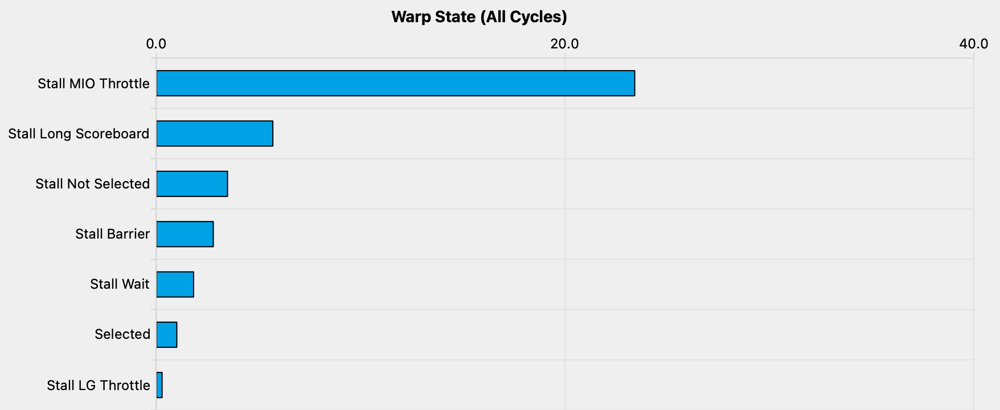

各状态的含义可在 <a href="https://docs.nvidia.com/nsight-compute/ProfilingGuide/index.html#metrics-reference">Kernel 性能分析指南</a>中查到。对于 <code class="language-plaintext highlighter-rouge">Stall MIO Throttle</code>，文档说明如下：

<blockquote>

Warp 因等待 MIO（内存输入/输出）指令队列不再满而停顿。MIO 流水线使用率极高时，这种停顿较多；相关指令包括特殊数学指令、动态分支和共享内存指令。

</blockquote>

我们没有使用特殊数学指令，也没有动态分支，所以显然是在等待 SMEM 访问返回。那么，如何让 Kernel 发射更少的 SMEM 指令？一种办法是让每个线程计算多个输出元素，使更多工作在寄存器中完成，减少对 SMEM 的依赖。

<h2 id="kernel-4-1d-blocktiling-for-calculating-multiple-results-per-thread">Kernel 4：通过一维 Block 分块让每个线程计算多个结果</h2>

下一个 Kernel 与上一个类似，但增加了一个内部循环，让每个线程计算 C 的多个元素。现在 SMEM 缓存大小为 <code class="language-plaintext highlighter-rouge">BM*BK + BN*BK = 64*8 + 64*8 = 1024</code> 个浮点数，每个 Block 共 4 KB。下面是可视化，我用橙色和红色标出了两个线程及它们在内部循环中访问的值。

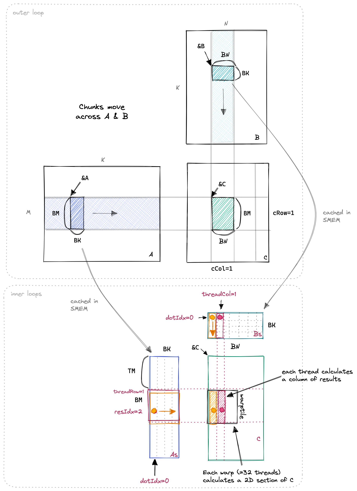

这个 Kernel 的重要变化都在内部循环中。GMEM 到 SMEM 的加载与之前基本相同。代码如下：<label class="margin-toggle sidenote-number" for="36"></label><input class="margin-toggle" id="36" type="checkbox"/><a href="https://godbolt.org/#z:OYLghAFBqd5TKALEBjA9gEwKYFFMCWALugE4A0BIEAZgQDbYB2AhgLbYgDkAjF%2BTXRMiAZVQtGIHgBYBQogFUAztgAKAD24AGfgCsp5eiyahUAV0wtyKxqiIEh1ZpgDC6embZMQs5wBkCJmwAOU8AI2xSEAB2LXIAB3QlYgcmNw8vHwSklKEAoNC2CKjY62xbeyERIhZSInTPb1kbbDtU6tqifJDwyJi4pRq6hszmoa7AnqK%2B2IBKa3QzUlROLgBSACYAZkDUDxwAajWtlwlgMmIkNmPcNa0AQU2dpj2LbCOT8SUVOpu7x%2B2u3272OLlQg0I6D%2BDyeQLeHzBEPoBDC0IBz1eh1B5jCRiUAH0AG4bAB0SDRsJewIR5ks%2BNIZmEBA4ZIpMO2ODoQQOLlwAEk/PiACJ8gBqEAAsuQDsFZgcoBK5ZsAELy2UAWh4coA9GrZv9/vj8cB6OgwhIjQdCegCJgDkpgNg2GweEKAOq1eIAFQYgWAEECRAOUoOgZl0rDAGlpTRTSwgxJ4kgrP8Dmn0xnM1ns1mMExBgdY%2Bh4wcAFT3aV5gtFkul5UxuNBiI1cipnPtjtZmtB0suJXRZUGh5pqtBsPKiUfIUHABs0mOg%2BHB1HoeEB2VwSns/nW0X9xHQgL48jW4AHAu2yuw17J8dp%2Bfd23tbq%2BTQDgB3d6xgjxA7qA7GHaACeBxIJE7yfgcjpBgAflsWibAArAcjDfAc8SRIIpBsMYKyFmQKG1I6Bw4UQpAECsSgkk%2BupemBy5LKQzBENK8FIYWLCDJEy5CHQwBLPGqQHMwShLNgSgHEQyZNqaqAANYSe%2Blz2tgACOZjMQQEg0QcuLoPJfJChJLCoJREkYBk%2BYHOgb6qio6maRI9BAdK75IAw7xKMm5EmJJ9FKOw7ykOg77WW%2B9zUUuz4HHRnmmp%2BpA8UwfECZUTAfos9B2l5tTvBZjQSTZBwVrpZgJqZ4kSYG6DrhlZhZTpEQHEwQjqvZGlMhIJIHCINVSV%2BnFENxeYpaQglCKBnG6dgRBDYlSjxIJEgofpEjEEBOmAaBzB4SwUFMfG3F%2BBsoHEAcY1DZF%2B5JQWZhhqgABKIVbnpBmYOoJIbY%2BS4rnda6oOkL2yXJfLvSS6gXjCP2HkGf1BiQNT0A94n1UQSjKsD9iMFuE5luuwSQ9d0X7lJB12gQElMQth4otjWHLhI5hGPYvk3sJjAcMIVXpf1umYx5l4wwccPNZ4dFk%2Bj/PY3eknoIjyOifQaMY/pclY%2B8tESoTOkK6jSiqJEKvyQcuq60r%2BuROL2AsHad4y1bNsW6QRtyW2nE/EQEBMGLSASy76tTjLr1yUKzLg/q32PFFurW6gSAfp6H4MPQDP0Ezh0HFsGylmz5ROsxSiucpWfTX6fl5e4jS1AchBsFdB75mOa6k9brjuFuLc26DH3/uxG6Ew3R7N77rdPaFMud5g3fgyb%2BPa9HAH0LJGcLSZX4Ebz5ikExa7BwHgQ9RKuBa0uRo5UxmCWt2xVKGsiHKrjpbrpGd9CgPBxn952CX/ihaNuut977KhPE/fuiE36Rx0hKdAhJ3h7w8rLaawBAhMDLkVe4YAuCU2eltZUmDzKVy8G2fcKoZaPWeqAycT8X6RzTKqUhWxpwA3bqAgmtCeRHA2IORhy4x540fjKThqpmEp1YfPImuoSCYHQCAACmBdBmALFJCmiDY7x0noguMdo2Cox/NjZi5FxIASYJgRqM05rCXUPEU0Z1N4mX8gQAAXuJN23xIiewEcAwOPDg6hzruoCOe40zu3cRADc/CTx2x8cDPx4d36/TDCgyI6QSE8MntPXuGxkLAIXCbXU75PTqkYLAlOABxI%2Bk4MASHEqgP0gtG7C0SUwIIpAx6pOnOksG/5dQ5PYQktcSTSDpHoWkkeXcumcOyWw1U0UCmkHiEU7AJSDjlOPjxapShakmHqbdJpLSx4jI6WMqeEyenTKHBIxey8hp%2BTJkU1aKdxBx3XolKmetVznWwMgripA6CMDbNfSeZs0Z32VDeV%2BW41gDi0CSBC0QIF7h0osCxpp0C/hgdxYOkkPK3yXPTCAIswgg3eluBCu5dLEt7icA4NDVREu7kImWwD%2BxBPTNFRI8R6oZ15iICpDNnm4uumme4gDlSDLaREoRq4WkpIhTLR499xUhX3NQqVgzZXgPfnQ0VSr3yqlYWq5pyT3CDnATjUFur9WCJVNK419BTUIrbGmM%2BQEXiTyUBAQJFyMzRRtoSXCcCpbYCdcVRlPDemsroWG6cXin7nKhkKvJqd043IwqQdUGi3nmxDfikW0iiAMplmS1U%2BbC3UojYyrhpb3ospDWmWZ7wcJyXeLzfN8RgqYDMHYFaaLy7WTKskQ4qL4iuXcnHDitTkQ1CGoKrM0UmKKPeEVXmyoJIGJch%2BMd8dILiHSk8%2BiB89pEDYL%2Bf1pB66ZkBSenGorq3/gNTaye6RX5avTLmsMVMy3TmLZ8pQZaXAxS1uS0hXDP01qOAOOt6YgUo2zffMDEMzUMLfkuDsIrQUQCBRQwDUqENylAZErhNc5bdwhU/Y98RX1pihShxNNGQ0urdccj1Xqlz0YTfW/J5EbnIr7VmkFeKCIEo/eJL9Bwf0IYRIB3JIHlR4Yg5GnkGGsOhSfmzG18m41Sqfe4OVjCoPBPoEmPa5HjnAtFQhuVXCDPTRqHjFwymzPYfU0RzT1qiM6foC%2B9h7HHjwq4PMeg3BEL8G8FwHQ5AZFcBcAoIU%2B4HPWaI0oRYywQTbD4OQIg2gAvzDAjbPonryByRAIhOIQWuDSH4GwHw0gSSnnq1sGcTWNjRGkAATliHOcgYWItRf4EoEAcQsvhYC%2BQOAsAUAYBPR5CgVAIBTfiDNkATBCSmR4DwaI5AcCEgotgUUBBsDvgAPIYR6/wP5c0BsQDCNl8gYRAi1CAtwDLU3OZECO0wZyt2cA4RMJIEbW2CBMTaLAgbAPsDqFaGVVYGXAzlFu8iMIY1SBATcDgW7ZFmTPdG7GFgwAlD7cOyd5g2O5DCDENUqQshBDCGUGoTQAP9AbEMMYUwFgrCI4G5AeYaK0pg/VEdrYBx1RCmCEKXAyoFClOF%2BqR0LTDrqgwDgO8tQ453gW9D/Ep4ZzkCV8G/T98NdDS1zrpQbATcQvVOqeIRB1CcXVLz1It9GHqkJMLiE6vZMbf63nNojgIDOBGN4Hg5B/CTEKMUAwiRkhpSD1HnIaVugR76CHlofumAdGGIQ4PZQKjtHGEn3oURU/jDjyXzohfpjF/mMlpYKwDAFOECdgtyUot8EC8F0Lt2osylFC4AD62STRFhfKfAxACJPC1PwYbOhZi5dbgVjvFWqsgC2DwEkPANgtdPIhU80hpDRD39ELY3Xu/cH64NzL2X5jjeQCAZFnKWJzYWzN4IgVuDBD7wP9fw%2BIvf3H%2BRJgAYDTqIOIJIDIGTooCoBoLdkzuQO%2BGNPENjkviFqfgDlFkdmVI/mFL3v3gcIPr/vKG4NNowIlE8BsLMNPtfkvpVuQNVtsCSG1vVkfohC1tEDwKeBsFoJtmdpFuftYJfjPjlkViVmVtwFsF3ugfwUITfogBACgNtrtpQNQC/qQW/hwB/l/vgT/rCvwP/iQIAcAfIBTuAdTvIHTjAYziAMzmnmlE4CYmXqHiYpXpHiHtHrkGkNnvHjHqkC4Snrnq0GlJnvUF4anr7kEQXuHkXgYIMJ0I4bEXUH4dXplkxNgLaINigZIb1twEKEsrtgcITglLgd/kPiPhAGPgYZwmvtKMQYtqQVURQVQSNnPuQHljgFEIVsVqVoYNwLQbwX1gIUNtQT0VwBsCvjwFoHEP0dIcMbAqQMkI4NIEAA%3D%3D%3D">Godbolt 链接</a>。

<pre class="highlight"><code>// 在寄存器文件中分配线程局部的结果缓存
float threadResults[TM] = {0.0};

// 遍历 Block 分块的外部循环
for (uint bkIdx = 0; bkIdx &lt; K; bkIdx += BK) {
  // 填充 SMEM 缓存（与之前相同）
  As[innerRowA * BK + innerColA] = A[innerRowA * K + innerColA];
  Bs[innerRowB * BN + innerColB] = B[innerRowB * N + innerColB];
  __syncthreads();

  // 为外部循环推进 Block 分块
  A += BK;
  B += BK * N;

  // 计算每个线程的结果
  for (uint dotIdx = 0; dotIdx &lt; BK; ++dotIdx) {
    // 将点积循环放在外层，便于复用 Bs 元素，
    // 可以把它缓存到临时变量中
    float Btmp = Bs[dotIdx * BN + threadCol];
    for (uint resIdx = 0; resIdx &lt; TM; ++resIdx) {
      threadResults[resIdx] +=
          As[(threadRow * TM + resIdx) * BK + dotIdx] * Btmp;
    }
  }
  __syncthreads();
}
</code></pre>

这个 Kernel 达到约 8600 GFLOPs，是前一个 Kernel 的 2.2 倍。先计算前一个 Kernel 中每个线程的内存访问量，当时每个线程计算一个结果：

<ul>
<li>GMEM：外部循环 K/32 次迭代 × 2 次加载。</li>
<li>SMEM：外部循环 K/32 次迭代 × BLOCKSIZE（=32）× 2 次加载。</li>
<li>每个结果的内存访问：GMEM 为 K/16，SMEM 为 K × 2。</li>
</ul>

新 Kernel 中每个线程计算八个结果：

<ul>
<li>GMEM：外部循环 K/8 次迭代 × 2 次加载。</li>
<li>SMEM：外部循环 K/8 次迭代 × BK（=8）×（1 + TM（=8））。</li>
<li>每个结果的内存访问：GMEM 为 K/32，SMEM 为 K × 9/8。</li>
</ul>

正如预期，每条指令因内存压力而停顿的周期明显减少：<label class="margin-toggle sidenote-number" for="37"></label><input class="margin-toggle" id="37" type="checkbox"/>注意：坐标轴与前一张图相比发生了变化。

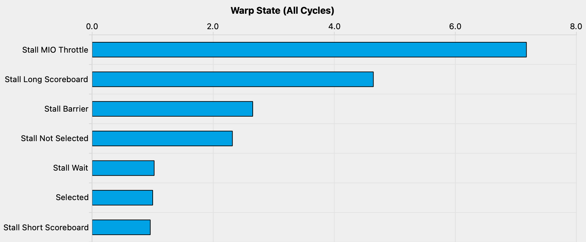

<h3 id="sidenote-on-compiler-optimizations">旁注：编译器优化</h3>

前面为了提高效率，将 B 的元素显式缓存到 <code class="language-plaintext highlighter-rouge">Btmp</code>，并调整了两个内部循环的顺序。如果不这样做，代码如下：

<pre class="highlight"><code>for (uint resIdx = 0; resIdx &lt; TM; ++resIdx) {
  for (uint dotIdx = 0; dotIdx &lt; BK; ++dotIdx) {
    threadResults[resIdx] +=
      As[(threadRow * TM + resIdx) * BK + dotIdx] * Bs[dotIdx * BN + threadCol];
  }
}
</code></pre>

有意思的是，这并没有降低性能。这个结果令人意外，因为两个内部循环现在产生 BK（=8）× TM（=8）× 2 = 128 次 SMEM 访问，而之前是 72 次。汇编给出了答案（<a href="https://godbolt.org/#z:OYLghAFBqd5TKALEBjA9gEwKYFFMCWALugE4A0BIEAZgQDbYB2AhgLbYgDkAjF%2BTXRMiAZVQtGIHgBYBQogFUAztgAKAD24AGfgCsp5eiyahUAV0wtyKxqiIEh1ZpgDC6embZMQAVnLOAGQImbAA5TwAjbFIQAHYtcgAHdCViByY3Dy9fJJS0oSCQ8LYomPjrbFt7IREiFlIiTM9vPxtsO3Ta%2BqJCsMjouISlOoam7NaRnuC%2BkoH4gEprdDNSVE4uAFIAJgBmYNQPHABqDZ2XCWAyYiQ2U9wNrQBBbb2mA4tsE7PxJRUGu4ez12%2B0On1OLlQw0I6ABTxeII%2BXwhUPoBAisKBr3ex3B5giRiUAH0AG5bAB0SAx8LeoKR5kshNIZmEBA4FKpcN2ODoISOLlwAEkAoSACICgBqEAAsuQjqF5kcoFKFdsAEKK%2BUAWh4CoA9Br5oDAYTCcB6OgIhITUdiegCJgjkpgNg2GweCKAOr1RIAFQYwWAEGCRCOMqOwblsojAGlZTRzSwQxJEkgrICjhnM1nsznczmMExhkd4%2BhE0cAFSPWUFoslsvl1VxhMhqJ1cjpvOdrs5ush8suFWxVVGp4ZmshiOqqVfEVHABs0lOw9HR3H4eER1VoRn88XO2XjzHQiLk%2BjO4AHEuO2uIz7p6dZ5f9x3dfqBTQjgB3T7xgiJI7qEcxgOgAnkcSDRJ835HM6IYAH47Fo2w%2BEcjC/EciTRIIpBsMYazFmQqH1M6Ry4UQpAEGsShki%2B%2Bo%2BhBq4rKQzBELKiHIcWLDDNEq5CHQwArIm6RHMwSgrNgShHEQqYtuaqAANaSZ%2B1yOtgACOZgsQQEi0Uc%2BLoApAoipJLCoFRkkYFkhZHOgH7qioGlaRI9AgbKn5IAwnxKKmFEmFJDFKOwnykOgn42R%2Bjw0Sur5HPRXnmt%2BpC8Uw/GCdUTBfss9AOt59SfJZzSSbZRxVnpZhJmZEmScG6CbplZjZbpURHEwQiag5mkshIZJHCItXST%2BXFEDxBapaQQlCOBXF6dgRDDUlSiJEJEioQZEjECBunAeBzD4SwMHMYmPEBFs4HEEc43DVFh7JUWZgRqgABKoU7vphmYOoZKbc%2BK5rvdG6oJkr1yfJAofWS6hXnCv3HiG/0hiQdT0I9EkNUQSiqiD9iMDuU4VpuoRQzdMWHtJh0OgQknMYtx5ojj2GrhI5hGPYfl3iJjAcMI1UZQNelY5516w0c8MtZ49HkxjAs4w%2BUnoEjKNifQ6OYwZ8nY58dFSkTumK2jSiqNEqsKUc%2Bp68rBvRBL2AsA6D6y9btuW6QxvyR2XF/EQEBMOLSCS67GszrLb3ySKrIQ4aP3PNF%2Bo26gSBft6X4MPQjP0MzR1HDsWzluzlQuixShuSp2czQG/n5e4zT1EchBsNdR6FhOG5kzbrjuDure22Dn2ARxW5E43J4t37bfPWFstd5gPcQ6bBM6zHQH0HJmeLaZP6EXz5ikMxG4h4HwS9VKuDayuJq5cxmDWr2JVKBsPiqnj5abtG98ioPRznz52BX4SxbNpuO%2BD9VRnmfgPHw78o66SlOgYknx96eTljNYAwQmDl2Ko8MAXAqYvW2qqLBFkq5eA7IeNUssnovTAdOZ%2Br8o4ZnVGQnYs5AYdzAYTOhfIThbGHEw1c498ZPzlFw9ULDU5sIXsTfUJBMDoBAEBTAugzBFmkpTJBccE5TyQQmB0bA0Z/hxixCiEkgJMEwE1Wa80RLqESOac6W9TIBQIAALwku7X40QvaCJAUHXhIcw713UJHA8GYPYeIgFuARZ57a%2BJBv4iOH8/oRlQdETIpDeFTxnn3LYKEQFLlNvqT83pNSMDganAA4sfacGAJASVQAGIWTcRZJKYCEUg480mzgyeDQC%2BpckcMSRuZJpBMgMPSaPbu3SuE5PYeqGKhTSCJGKdgUpRwKkn14jUpQdSTANLus01p49RmdPGdPSZvSZkjkkUvFew1/Lk2KWtVO4h44byStTfW64LrYBQdxUgdBGAdhvlPc26N76qjvG/HcGwhxaDJEhWIkCDy6WWJY806B/ywJ4iHKSnk74rgZhAUWERQYfR3EhfcekSV9zOEcWh6piU92EbLEBg5gmZhiskRIDVM58xEJUxmLy8U3QzI8IBqohntMicI9crTUmQtls8B%2BErQqHhodKoZcqIEf3oWK5Vn51RsPVS0lJ7hhwQNxmCvVBqhFqhlSa%2BgZrEUdgzOfECbwp5KAgEEy5WYYq22JHheB0tsDOpKky3hfS2X0PDbObxz8LnQ2FQRJKhKIzU0ZbLcl6p02kvBLFbWFKyHcJzYEk4Q5Q0ZgJaLGRRAM28KzbXeWdaXAvzyUW1UNae6sorZmYFqMLZgpLfK7h9sVxdlFWCiAwLKH5ulSWhUYConcMbbWj6kKwFis7aSw1tqp6ZDftqzM0L35jrLSepNrr3UnM9d6lcx6fX5K/BRW5KKK5fKVqC/FhFU0bhLWSvJf680QsLSO4tEku1lqjXySd06wrP3Zra%2Bd%2BNty7pOfu81o6k1ZmTKmfGfaP1iqHRhkdp6sytn2s/FwMGTn8Pg/eZdSH43Sr3e4A9HD71wgRVwRY9BuA%2BH4N4LgOhyCyK4C4BQIpDxUdA/ZZYqwwS7D4OQIg2huOLAgrbAYXryDyV8AkXjXBpD8DYCAaQ0gyTnkszsOcNmtixGkAATniAucggnhOif4EoEACQVNCe4%2BQOAsAUAYDYIkTyFAqAQBC2FxgMQmDEjMjwHgsRyA4GJJRbA4oCDYE/AAeUwm5/g/z5peYgBEVT5AIjBHqCBbgSmQtcyILlpgLkKs4FwiYSQfnUsEGYh0OBXnuvYHUO0cq6wlPBkqBV1EERxqkBAm4HAFXyKsjq/5%2BMLBgBKCyzl/LzA1tyGEGIGpUhZCCGEMoNQmhuv6C2IYYwpgLBWBm15yAix0XpUG5qXLOwjiahFKEEUuBVQKDKX9zUzpWlHU1BgHAD56jxwfNFsbhJzxznILDkNTCwXI%2BGqj9HSg2D48hZqTUiQiDqC4pqD76Q75MM1MSP7UIkftuS55/OHRHAQGcGMbwPB/CmN6MUUoBhkipHSrz0XeR0pC/6DEfnbROdMC6KMIhfOKhVE6JMWXsx5fWEmJLhX2vpjC4GDqJYKw1gGEKcIfLtaUqib4DxvjAmKuiblOKFwLaktkliHCxU%2BBiCEReDqfgvmdDzHU23LTzvDPGZADsHgZIeBbDs%2BeHw54zOxEz7EHYrm3fcE8955TqnFiBeQCAFFXLWKRei%2BF0IQVuChE997pPfvhM/yDxRTABhzuiHEJIGQh3FAqA0BV275BPzjUSGt2P/H8/ddE7l8q1fwoe690cH37fFRuFC%2BFrh2d5hh9L7Hoz5ATO7DJA5yzOefB2diDwc8WwtApcKyJwv1hi/h7UzpvThhuA7Cu6L4f7f5l6IAQAoBpYZaUDUB16xYN4cBN4t6b5t5wr8Cd4kDd697yDHaD5nbyCXZj43YgB3aK7pROCmKG4C6YA64i785i75AZBq5S7i7pC0Fm4a7tDpQq6NDMEK4c7cHG5FBy4GDDDdBUFiENDsHy6LDkTYDYD2jeZz5AHubcAijLIZZHA7aJTr6t6%2B7%2B4QCB6YEH7858joB76xYH5bBH4l5%2BaR7kAaY4AxDaa6Y%2BD6bcBn5v4eaf4%2BYn7/5cBbDx48BaAJBeEgF%2BFwKkCpCODSBAA%3D">Godbolt 链接</a>）：

<pre class="highlight"><code>// 第一个最内层循环
ld.shared.f32   %f45, [%r9];
ld.shared.f32   %f46, [%r8];
fma.rn.f32      %f47, %f46, %f45, %f212;
ld.shared.f32   %f48, [%r9+256];
ld.shared.f32   %f49, [%r8+4];
fma.rn.f32      %f50, %f49, %f48, %f47;
ld.shared.f32   %f51, [%r9+512];
ld.shared.f32   %f52, [%r8+8];
fma.rn.f32      %f53, %f52, %f51, %f50;
ld.shared.f32   %f54, [%r9+768];
ld.shared.f32   %f55, [%r8+12];
fma.rn.f32      %f56, %f55, %f54, %f53;
ld.shared.f32   %f57, [%r9+1024];
ld.shared.f32   %f58, [%r8+16];
fma.rn.f32      %f59, %f58, %f57, %f56;
ld.shared.f32   %f60, [%r9+1280];
ld.shared.f32   %f61, [%r8+20];
fma.rn.f32      %f62, %f61, %f60, %f59;
ld.shared.f32   %f63, [%r9+1536];
ld.shared.f32   %f64, [%r8+24];
fma.rn.f32      %f65, %f64, %f63, %f62;
ld.shared.f32   %f66, [%r9+1792];
ld.shared.f32   %f67, [%r8+28];
fma.rn.f32      %f212, %f67, %f66, %f65;
// 第二个最内层循环
ld.shared.f32   %f68, [%r8+32];
fma.rn.f32      %f69, %f68, %f45, %f211;
ld.shared.f32   %f70, [%r8+36];
fma.rn.f32      %f71, %f70, %f48, %f69;
ld.shared.f32   %f72, [%r8+40];
fma.rn.f32      %f73, %f72, %f51, %f71;
ld.shared.f32   %f74, [%r8+44];
fma.rn.f32      %f75, %f74, %f54, %f73;
ld.shared.f32   %f76, [%r8+48];
fma.rn.f32      %f77, %f76, %f57, %f75;
ld.shared.f32   %f78, [%r8+52];
fma.rn.f32      %f79, %f78, %f60, %f77;
ld.shared.f32   %f80, [%r8+56];
fma.rn.f32      %f81, %f80, %f63, %f79;
ld.shared.f32   %f82, [%r8+60];
fma.rn.f32      %f211, %f82, %f66, %f81;
// ……内部循环 3–8 继续采用同样方式……
</code></pre>

编译器展开了两个循环，<label class="margin-toggle sidenote-number" for="38"></label><input class="margin-toggle" id="38" type="checkbox"/>因为循环次数在编译时已知，所以编译器可以展开循环。 然后消除了对 <code class="language-plaintext highlighter-rouge">Bs</code> 元素的重复 SMEM 加载，所以最终的 SMEM 访问次数与手动优化的 CUDA 代码相同。

PTX 编译为 SASS 时，对 <code class="language-plaintext highlighter-rouge">Bs</code> 的 SMEM 加载被向量化：<label class="margin-toggle sidenote-number" for="39"></label><input class="margin-toggle" id="39" type="checkbox"/>这已经暗示了后面的一个优化：转置 <code class="language-plaintext highlighter-rouge">As</code>，让这些加载也可以向量化。

<pre class="highlight"><code>LDS     R26, [R35.X4+0x800] // 从 As 进行 32 位加载
LDS.128 R8,  [R2]           // 从 Bs 进行 128 位加载
LDS.128 R12, [R2+0x20]
LDS     R24, [R35.X4+0x900]
LDS.128 R20, [R2+0x60]
LDS     R36, [R35.X4+0xb00]
LDS.128 R16, [R2+0x40]
LDS.128 R4,  [R2+0x80]
LDS     R38, [R35.X4+0xd00]
</code></pre>

<h3 id="areas-of-improvement-arithmetic-intensity">改进方向：算术强度</h3>

当前 Kernel 仍存在与 Kernel 3 相同的等待内存问题，只是程度较轻。因此，我们再次使用相同的优化：让每个线程计算更多结果。这样能提速，主要是因为提高了算术强度。<label class="margin-toggle sidenote-number" for="40"></label><input class="margin-toggle" id="40" type="checkbox"/>算术强度定义为：GMEM 与 SMEM 之间每传输一个字节（包括加载和存储！）所执行的浮点运算次数。 下面试着更直观地说明，为什么每线程计算更多结果能提高算术强度：<label class="margin-toggle sidenote-number" for="41"></label><input class="margin-toggle" id="41" type="checkbox"/>每个线程计算一个正方形区域比计算一列结果更高效，因为可以共享更多输入：

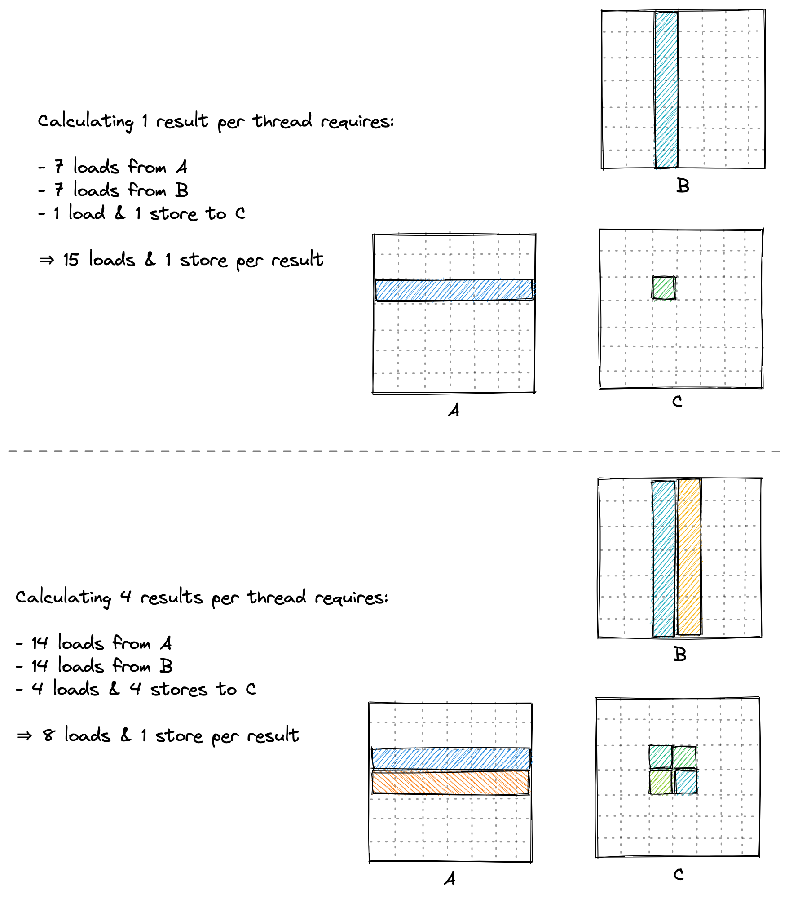

因此，所有 Kernel 执行的浮点运算总量相同，但每个线程计算更多结果可以减少 GMEM 访问次数。只要仍受内存限制，就继续优化算术强度。

<h2 id="kernel-5-increasing-arithmetic-intensity-via-2d-blocktiling">Kernel 5：通过二维 Block 分块提高算术强度</h2>

Kernel 5 的基本思路是让每个线程计算 C 中一个 8 × 8 的区域。第一阶段所有线程协作填充 SMEM 缓存，每个线程加载多个元素。代码如下：<label class="margin-toggle sidenote-number" for="42"></label><input class="margin-toggle" id="42" type="checkbox"/>GMEM 加载的可视化如下：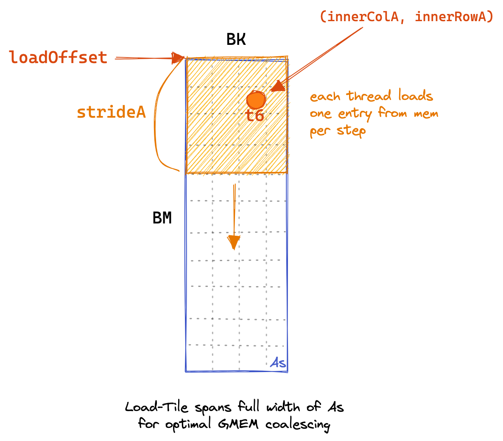

<pre class="highlight"><code>for (uint loadOffset = 0; loadOffset &lt; BM; loadOffset += strideA) {
  As[(innerRowA + loadOffset) * BK + innerColA] =
      A[(innerRowA + loadOffset) * K + innerColA];
}
for (uint loadOffset = 0; loadOffset &lt; BK; loadOffset += strideB) {
  Bs[(innerRowB + loadOffset) * BN + innerColB] =
      B[(innerRowB + loadOffset) * N + innerColB];
}
__syncthreads();
</code></pre>

SMEM 缓存填充完成后，每个线程将自己相关的 SMEM 元素相乘，并把结果累加到局部寄存器。下图展示了沿输入矩阵移动的外部循环（未改变），以及分别沿点积、<code class="language-plaintext highlighter-rouge">TN</code> 和 <code class="language-plaintext highlighter-rouge">TM</code> 维度执行的三个内部循环：

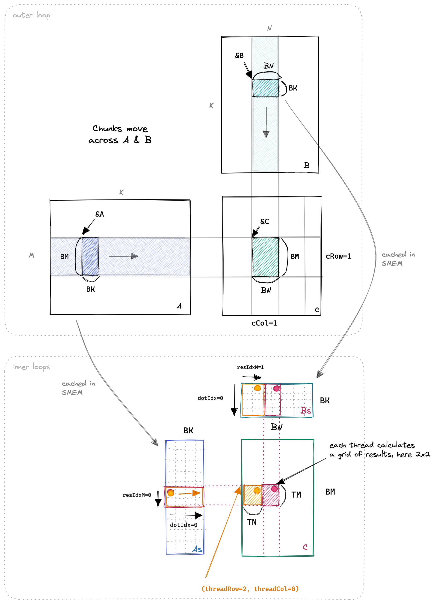

关键代码如下：<label class="margin-toggle sidenote-number" for="43"></label><input class="margin-toggle" id="43" type="checkbox"/><a href="https://godbolt.org/#z:OYLghAFBqd5TKALEBjA9gEwKYFFMCWALugE4A0BIEAZgQDbYB2AhgLbYgDkAjF%2BTXRMiAZVQtGIHgBYBQogFUAztgAKAD24AGfgCsp5eiyahUAV0wtyKxqiIEh1ZpgDC6embZMQAZnLOAGQImbAA5TwAjbFIQAE5ZAAd0JWIHJjcPL19yJJT7ISCQ8LYomPjrbFt8phEiFlIiDM9vPxtsOzTa%2BqJCsMjouNklOoamrNaRnuC%2BkoH4gEprdDNSVE4uAFIAJh9g1A8cAGoNnxcJYDJiJDYT3A2tAEFt3aZ9i2xj0/ElFQbb%2B6eOz2Bw%2BJxcqGGhHQ/0ez2B70%2B4Mh9AIERhgJebyOYPMESMSgA%2BgA3LYAOiQ6LhrxBiPMlgJpDMwgIHHJlNhOxwdBChxcuAAkgECQARfkANQgAFlyIdQvNDlBJfLtgAhBVygC0PHlAHp1fMAQCCQTgPR0BEJMbDkT0ARMIclMBsGw2FthQB1eoJAAqDGCwAgwSIh2lhyDspl4YA0jKaGaWMGJAkkFYAYd0xnM1nsznsxgmMNDnH0AnDgAqB4y/OF4ulssq2Px4NROrkNO5jud7O14NllzKgDsKvb1eD4ZVks%2BwsOPC2AA4TsPHunR2HhIcVaEpzP54uR0JC%2BOo9uFz4lw8Vwex%2BvvZOTtPT%2BfLwXr8HvVv74dH/uX4czOHUAAJXQAB3bc8XQVAAGt%2BUwdRSQATz3ZdDlXf911QDJwLNaDYPg9RkKeFC0PDEg6noQDsCUMx6CIJQVRwqD7EYbcJ3LDdQkI9MdT1C8iCQUhsBYe0CCUQ5BKUJIC1RFjBFIVCJHMIx7BMQ5bzLd9DkqZ1mDotdDn4j4IOg5jsB/Qt0ODJhPG9AShMwejGNM7cyIkSjqNoxzIKYhgPj1CBb3Y98DTPQ0UJ4w53JoujVGiBjvMOPUos82LSFswThKnT90vspRUvi6D2xYH5oiICBrLYHLhK8kzfKynxp2MqDhRZUl1BC892wizcdU0%2BoPkMw4KtKQ50BoAy7Oqgz0AdBJjEOFhUPcZpzNfCaMtcdwXMmzA8La44tgAVgVTdErUuUuKW39SJ24CwM/fiNr29QzogU69WCwiur1CQcITD5JJYNYizICaPnMUhBPXJrnOCB0OBuFDjSUFNBMwK0e0OB4lA2Q6VTYssNyjXHhUu5HUewdGCSLJsNxxvGVWPQnNxJr7wr1SV0CJIynLqkhDiiYBgiYf1RvGh4wC4MTSFAhamHtFVJbEjBMiYdsL1VT8gNl5nJ0J4nQpQtVNYa1CsOZzjDYvXkDuHU3tbA3X2I/LY1UwraLbZ62IvEeglITUXBuCQg1jE/jS340T1vsw4QIYehDnjEThBmkRJVwSVVr/cNheiO6NdNx77Oes7Gcukj11z0gMgL6ci%2BEkvtmOsure4vVff9ogqLBob%2BnksbxNAsSB%2BxibS36gXsFFpPKf0xaUhMFjhmwBJvoFhCFodf0WKarPLIdIhSDtbBa97yqdpqnyWL1Funyuiyc6YEJSDu43C52kub8tu%2BK%2BvZ%2BMjfnXD%2BcF9pNw4pdCKckBboH4ljMSxgFZiRAh8ECxhgxCVQEgROJZ7T80BkwHuNAaIJxVs0DUcdMD8VjGQNeLYu7yQAOLp0nBgCQVFUCiwgMVUaCRcizzwXNJ%2BosiH0ATjLEC5C7SwIQWGehAcTBryBjLH4S1VZKANMRK82d1zDCPjgQBZ8qoOQKlfPy4CrbtjbgtURkF/rR2EhqP6JCgZIA%2BFAiS0UxJw0EkLZepA6CMHbJjeumBkp0VxiqQKhN3wk23BsIcWhSRaHiaTVuiU9Q%2BNEvQhSmDu5QNHjIlUOMUKYx8ZnPGt5YmfniSqRJySBypLvqU7AwBOIVLadOapCSkkpK9lY5Y9CNRsGSMGM06AEijW5vJJqBlfLFOtlAiA%2B8IgwTgtuZJZ4BarJemCQ4Bs1QrLwrbT8jNBx3ysUkBINE7GDTThnHJrj5mZkWfvJOAB5GgNAVDBk/BstU7zPnfMRBuTOmyAVfOwD812n5dHHweGcyxGZsYRMDE/POoENau2wcJD5EKiDymZseVUa5/7uCeIdTpDVEXZnJSqVFz98622xZgXF3yCV7KZVXGurM0npl6ShdMLzwzgqBb8xczLWWQuBbfCVgKpUm2nLC/RCKBUZiKSiqur8mUishey06xKuXuGHBSrKqrszGrpZq0CxssU6vxc7TlaLq5Gp5ec44DTEXIwQq8EJSgIAdTCtbKxwkiTGGBjDXyiLMV22nDKzMEVhncyJqo5oYcZpH2AEgIgiKbUxuTYTb%2B6TDiJo%2BIzQeIExKYFAmrWEqqfaKWuV3Q4CRogahCeJKinjEVCvXFWogRyxWbL7QO04RNxWa1dsOuCKqg0ZgijMoM6aWlZOiE8rMPaxzrPFQQYFlTNkTpVAQGduYykRIIFU02yK8YQBCXdIKd4sVHvYmW4lU6CIUsupmfls7BWgyWTnLdmyd27Jifu6Frsn01OpRmHxbTD0XtjfTFUb7n0uzVCE8251OWuug9%2B7sf794STwneU2fyO1KGI7u0FubVREbgkqd1brnkEfDHR9QH5SPirYxxlw51x3gZVNx49HZb2ds8hEtjessPEu41U6FVKzUdlPXjSTsTCawYk1RPCHTP1Zjw3pj1qr9Ppi9T6i%2B/rLrfrXiBI%2BTaBk9w8eJkpLH1yScA2qNzIHqPHNdpJ4Tv75L/tc1puCHHpxke47uwtB6hOMegy4FFt6dZqQfR5kL6gGMFqZRhj20msWyZNfeaDmYkwpnYqJjy4SVPpak5pGT6WOnHMU5mFsi1CYJevUlx2KWmV%2BYdcSnLCdolofI9pnDRnDPWysw0rgix6DcEOvwbwXAdDkHQNwFwChhQXgSwJh0yxVigh2HwcgRBtCzcWK44SAx/XkCgiAQ6WhDDcGkPwNgIBpDSFJHOH7PgABsAOtgDmkLEAcWg/uyGW6t9bXB%2BBKBAE9s7K3ZvkDgLAFAGA2AJF8hQKgEBMfY8YDEJgRJUCoB4DwAc5AcBEgIGsMUBBsAgTeS2qH/AAn0PhxACI53yARGCPUBC3ATuY44MIN5TB6BC%2BR9T50xhTTrFW4QQSHRubw5l9gdQ7QzBd2F/wIMlRecogiKQQXbgcC88PiyPXiw4wsGAEoBnTOWfMD13IYQYg2FSFkIIYQyg1CaBl/oLYhh5doAsFYY38PICLHGdUdXGo3k%2BEOBqYUoRhS4BVAoBhKeNROmfv9DUGAcD3nqJg%2B8BOdfYAJHOP75Bi9mSpXjSvXca916UGwNvsSNQagSEQdQxUNRx7SDjBqGoiQp8hBXg9lO4faQ6I4CAzgxjeB4P4eWvRiilAMLkVIQgV87%2BSHvpgm%2B%2B4GDaAvmokwD9r4v9ULoDRT%2BzBiLf6/y0siv%2B6E/7f2olgrDWAYKguLn3vyEwIIDbs9lwItuQGzmttwLKGKC4LxhTqSAOEkgqPgMQKDM8NqPwEjjoPMJdvZDdnNi9m9r4DwKSLOEDnOIdHOJ9gOPQQOH4LATDnDgjqdudosGjsgCAAMlckQJQNQATjjqEOwOsKEIgcgZQWgatpTFgXogYL7qIL7JwDIO7ooCoBoLzsHuQDZiwAkBAfNlAUtrzjDm8jrgIWLAgUgTODIegRAG4FjjjgdD4FsPMHgVwaQVwK9uQO9jsKSLED9kwYdEDgODwHOFsFoFTqwdwOwYjl4Xdg9k9sYT4KYTLmwZwcjtwYgBACgDTnTtgEIfjugM4UTmIRwNwJIbYSgbIfwPISQIoWvsoZ7pIOocof7toUHiACHnfmkE4PLDfuvpgN/gMGvrvtUEMRMWkKMS/hUFUJ0G/qrOfvPvfpMLMefksc0JsV/tMFvmMYsIfNgFPJgAjt4dAbEVwMKNgLTsDE7sgvJNUdIagQ4ZgY0a4WvryKUYTtEK4e4Z4dkUQddjELdvdo9pAb4ZcfEVkQQd4VsOQTwFoE9lCTCRduQFMikI4NIEAA">Godbolt 链接</a>。

<pre class="highlight"><code>// 在寄存器文件中分配线程局部的结果缓存
float threadResults[TM * TN] = {0.0};
// As 和 Bs 的寄存器缓存
float regM[TM] = {0.0};
float regN[TN] = {0.0};

// 遍历 Block 分块的最外层循环
for (uint bkIdx = 0; bkIdx &lt; K; bkIdx += BK) {
  // 填充 SMEM 缓存
  for (uint loadOffset = 0; loadOffset &lt; BM; loadOffset += strideA) {
    As[(innerRowA + loadOffset) * BK + innerColA] =
        A[(innerRowA + loadOffset) * K + innerColA];
  }
  for (uint loadOffset = 0; loadOffset &lt; BK; loadOffset += strideB) {
    Bs[(innerRowB + loadOffset) * BN + innerColB] =
        B[(innerRowB + loadOffset) * N + innerColB];
  }
  __syncthreads();

  // 推进 Block 分块
  A += BK;     // 向右移动 BK 列
  B += BK * N; // 向下移动 BK 行

  // 计算每个线程的结果
  for (uint dotIdx = 0; dotIdx &lt; BK; ++dotIdx) {
    // 将相关的 As 和 Bs 元素加载到寄存器
    for (uint i = 0; i &lt; TM; ++i) {
      regM[i] = As[(threadRow * TM + i) * BK + dotIdx];
    }
    for (uint i = 0; i &lt; TN; ++i) {
      regN[i] = Bs[dotIdx * BN + threadCol * TN + i];
    }
    // 对寄存器缓存计算外积，
    // 将结果累加到 threadResults
    for (uint resIdxM = 0; resIdxM &lt; TM; ++resIdxM) {
      for (uint resIdxN = 0; resIdxN &lt; TN; ++resIdxN) {
        threadResults[resIdxM * TN + resIdxN] +=
            regM[resIdxM] * regN[resIdxN];
      }
    }
  }
  __syncthreads();
}
</code></pre>

在内部循环中，将 <code class="language-plaintext highlighter-rouge">dotIdx</code> 设为最外层循环，并将两个内层循环需要的值显式加载到寄存器，可以减少 SMEM 访问。下图按时间展开 <code class="language-plaintext highlighter-rouge">dotIdx</code> 循环，展示每一步中哪些 SMEM 元素被加载到线程局部寄存器：<label class="margin-toggle sidenote-number" for="44"></label><input class="margin-toggle" id="44" type="checkbox"/>为了方便绘图，我缩小了部分维度。Kernel 中的实际配置是：<code class="language-plaintext highlighter-rouge">BK=TM=TN=8</code>。

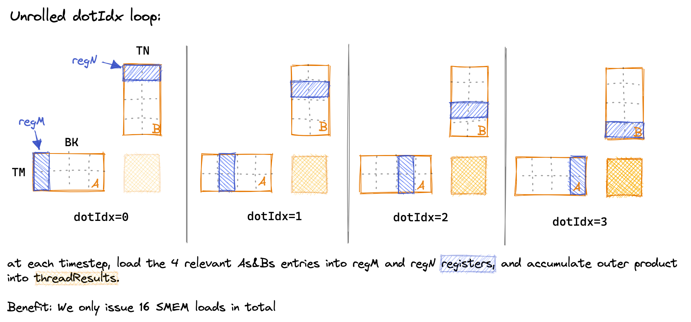

最终性能达到 16 TFLOPs，又提升了 2 倍。再次计算内存访问量。现在每个线程计算 <code class="language-plaintext highlighter-rouge">TM*TN = 8*8 = 64</code> 个结果。

<ul>
<li>GMEM：K/8（外部循环次数）× 2（A + B）× 1024/256（SMEM 大小 / 线程数）次加载。</li>
<li>SMEM：K/8（外部循环次数）× 8（dotIdx）× 2（A + B）× 8 次加载。</li>
<li>每个结果的内存访问：GMEM 为 K/64，SMEM 为 K/4。</li>
</ul>

性能逐渐接近可以接受的水平，但内存流水线拥堵导致的 Warp 停顿仍过于频繁。Kernel 6 将尝试两项改进：转置 <code class="language-plaintext highlighter-rouge">As</code>，使 SMEM 加载能自动向量化；并向编译器保证 GMEM 访问对齐。

<h2 id="kernel-6-vectorize-smem-and-gmem-accesses">Kernel 6：向量化 SMEM 和 GMEM 访问</h2>

前面已提过的第一项优化是转置 <code class="language-plaintext highlighter-rouge">As</code>，这样就可以使用向量化 SMEM 加载从 <code class="language-plaintext highlighter-rouge">As</code> 读取（SASS 中为 <code class="language-plaintext highlighter-rouge">LDS.128</code>）。下图仍展示 Kernel 5 的三个内部循环，但现在 <code class="language-plaintext highlighter-rouge">As</code> 在内存中转置存放：

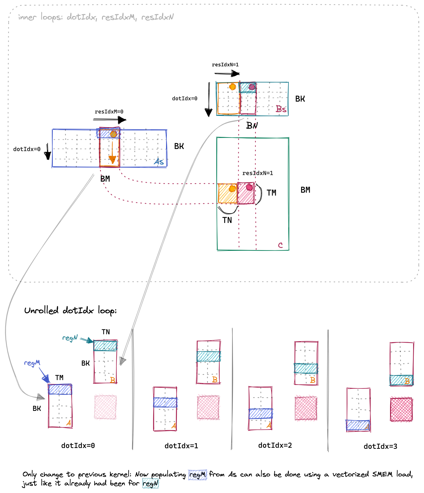

查看汇编，<label class="margin-toggle sidenote-number" for="45"></label><input class="margin-toggle" id="45" type="checkbox"/><a href="https://godbolt.org/#z:OYLghAFBqd5TKALEBjA9gEwKYFFMCWALugE4A0BIEAZgQDbYB2AhgLbYgDkAjF%2BTXRMiAZVQtGIHgBYBQogFUAztgAKAD24AGfgCsp5eiyahUAV0wtyKxqiIEh1ZpgDC6embZMQADnLOAGQImbAA5TwAjbFIQAE4ecgAHdCViByY3Dy9fJJS0oSCQ8LYomPjrbFt7IREiFlIiTM9vPxtsO3Ta%2BqJCsMjouISlOoam7NaRnuC%2BkoH4gEprdDNSVE4uAFIAJgBmYNQPHABqDZ2XCWAyYiQ2U9wNrQBBbb2mA4tsE7PxJRUGu4ez12%2B0On1OLlQw0I6ABTxeII%2BXwhUPoBAisKBr3ex3B5giRiUAH0AG5bAB0SAx8LeoKR5kshNIZmEBA4FKpcN2ODoISOLlwAEkAoSACICgBqEAAsuQjqF5kcoFKFdsAEKK%2BUAWh4CoA9Br5oDAYTCcB6OgIhITUdiegCJgjkpgNg2GwtiKAOr1RIAFQYwWAEGCRCOMqOwblsojAGlZTRzSwQxJEkgrICjhnM1nsznczmMExhkd4%2BhE0cAFSPWUFoslsvl1VxhMhqJ1cjpvOdrs5ush8suFUAdlVHZrIYjqqlXxFRx4Wx8pxHTwzY/DwiOqtC09n88Xo6ERYn0e3C52S8eK4P4/XPqnpxnp/Pl8L15DPq396Oj/3L6OZgjqAAEroAA7tu%2BLoKgADWAqYOoZIAJ57suRyrv%2B66oJk4HmtBsHweoyHPChaERiQdT0IB2BKGY9BEEoqo4VB9iMNuk4VhuoSERmur6heRBIKQ2AsA6BBKEcglKMkhZoixgikKhEjmEY9gmEct7lu%2BRyVC6zB0WuRz8Z8EHQcx2A/kW6Ehkwng%2BgJQmYPRjGmduZESJR1G0Y5kFMQwnz6hAt7se%2BhpnkaKE8Uc7k0XRqjRAx3lHPqUWebFpC2YJwnTp%2B6X2UoqXxdBHYsL80REBA1lsDlwleSZvlZTsM7GVBIqsmS6gheeHYRZuuqafUnyGUcFWlEc6A0AZdnVQZ6COokxhHCwqHuM05mvhNGWuO4LmTZgeFtScWwAKyKpuiVqfKXFLb%2BpE7cBYGfvxG17eoZ0QKd%2BrBYRXX6hIOGJp8kksGsxZkBNnzmKQgnrk1znBI6HC3ChJpKKmgmYNavZHI8SgbIdqpseWG7RrjIqXcjqPYOjhLFs2G443jqrHoTm4k194X6lK6DEkZTl1SQRxRMAwRMAGo3jY8YBcGJpCgQtTAOqqktiRgWRMB2F5qp%2BQGy8zU6E8ToUoeqmsNahWHM5xhsXnyB0jqb2tgbr7Efls6qYVtFts9bEXiPQSmJqLg3BIQaxifxZb8aJ632UcIEMPQRwJiJwgzSIUq4FKq1/hGwvRHdGum499nPWdjOXSR6656QmQFzORfCSX2zHWXVvcfqvv%2B0QVFg0N/TyWN4mgWJA/YxNZb9QL2Ci0nlP6YtqQmCxwzYIk30CwhC2OgGLFNVnlmOkQpD2tgte95VO01T5LH6i3T5XRZOdMCEpB3cbhc7SXN%2BW3fFfXs/mRvzrh/OC%2B0m4cUuhFOSAt0D8SxmJYwCsxIgU%2BCBYwIYhKoCQInUsDp%2BaAyYD3GgNEE4q2aJqOOmB%2BJxjIGvVsXd5IAHF05TgwBIKiqBRYQGKqNRIyQVC4JmvgkWqkiH0ATjLEC5D7SwIQeGehAcTBryBjLX4S1VZKENMRK82d1zDCPjgQBZ8qoOQKlfPy4CrYdjbgtMRkF/rR2EpqP6JCgZIE%2BFAiS0UxJw0EkLZepA6CMA7JjeumBkp0VxqqQKhN3wk23BsYcWgyRaASaTVuiV9S%2BNEvQhSmDu5QNHrI1UOMUKY18ZnPGt44mfgSaqJJKTBxpLvmU7AwBOKVPaTOGpiTkmpK9tY5Y9DNRsBSCGc06BEijW5vJJqBlfIlOtlAiA%2B8IgwTgtuFJZ4BZrJeuCI4Bt1SrLwrbT8jMhx32sckRINF7GDTThnXJbiFlZiWfvJOAB5GgNAVAhk/Js9UHyvk/KRBuTOWzAXfOwL812n49HH0eOcqxmZsaRKrjXdibE1SKirvnW22DhKfMhUQQ0h0ukNSRTmZ4eMgxPzzqBDWrt8WYEJT8hU%2Bs8VovcFSppSK%2BkoQzK8iMELgV/MXEyllUKQW33FUCyVJsZxwoMYi/lmZimRJpc/V%2BeLhVQrZRxDltLq7uBHKSrKKqcwmtVBqulIFjaMp1cS52Br/7GtZukjMfLrYZmRghN4oSlAQA6mFL1GSFqYGJMYYGMNfJIoZXbGc0qswRRGdzImajmhhxmkfYASAiBIrtfGtNhNv6hpTZ8Rmg8QJiUwKBNWcIVU%2B0UjcruRxEjRE1KE8SVEvFIsFeuGtRBjmiq2QOodZwiZis1q7UdcFlUhusbM4MWbWnZOiM87MfbxwbLFQQEFVStlTtVAQOdeZymouqabFFeMZ0vSdli0Jd0gp3kZQQN1FzMyep7KDZZOdt1bN3Xs2JB6YWu2PScYcFLMy%2BPaUei9Cb6aqhvRil26pQnm3Ohyt9kHP0bu/fvCSeE7ym3%2BV2pQhG91goLWqAjcFlTgffS8vDEYaPqA/MRsVLG2MuHOpOkDqpOMns7A%2B7tnlIksb1hhrFnHqkwvJeazsZ68bibiYTaDYmqJ4U6ZdHMOGsy6fA6TFVPq/UX0DZdT1a8QJHxbYMnunjROlKY%2BucTf71QucA5Rk5rtxOCYFU5kMnHXOkc03ukth6BP0cgy4dVD6dZqWfW5jTtG9UoYcZtBOMTUvSdNfeSDWZkypnYsJjyESlNJfUBJzSUnyudJOfJrMrZFqE2i9S2Ljt4t4p806%2B9O10NVcZdlnlKqcMWcaVwRY9BuCHX4N4LgOhyDoG4C4BQIoLzRb446ZYqwwS7D4OQIg2hxuLDccJAYgbyBQRAIdLQhhuDSH4GwEA0hpBkh8G9nYAA2L7WxBzSFiIOLQH3ZCzfm4trg/AlAgBuwdub43yBwFgCgDAbBEi%2BQoFQCAyPUeMBiEwYkqBUA8B4IOcgOBiQEDWOKAg2AQLvLbSD/ggT6GQ4gBEQ75AIjBHqAhbge3kccGEO8pg9Aeew9Jy6YwZp1jzcIIJDo3NIdi%2BwOodoZgu68/4MGSo7PUQRFINztwOB2eH1ZBrxY8YWDACUFTmndPmAa7kMIMQbCpCyEEMIZQahNBi/0FsQwku0AWCsLryHkBFgTOqIWbgmp3k7COJqEUoQRS4FVAoBh8fNTOmfv9TUGAcD3nqJg%2B8WO1fYEJD4D75A89mXJXjEvXdy%2BV6UGwRvcTNSakSEQdQxVNQR/SDjBqmpiTx6hMXw9xOIfaQ6I4CAzgxjeASIEaYxRSgGD4fkDIy1sgJHX5H3oK%2BBhDCn5Hroowt8L4qFUTokx999wMMMbo8/783%2BX3fnUSwVhrAMKgwXneBRMEEDN1uy4Gm3IAZwW24DlHFBcG4yJzJEHGSUVHwGIFBheB1H4Bhx0HmGO3sjOwmzuwexAB2B4DJDnB%2Bx8EOh8Ge0HCoMHB2DAPZzBwhyh320O0WAR2QBAEGWuSIEoGoCxzR1CHYHWFCGgNgJIIQPm0phQP0QMHd1EF9k4BkEd0UBUA0HZ193ICsxYESCAMmxAJm0YO4HeTVx4LFigJgNnAkMQIgDcBRzRwOh2C2HmAwLYPwK4Hu3IEe12DJFiDe1oMOh%2B0HB4B8C2C0BJ3AKYOsBYMwKOwuyuxu30J2EMLFyiNiPYMQAgBQDJwp2wD4Mx3QHsJxyEI4G4FEMsLgMkP4GkJIFkISHkOd0kGUPkM93UJ9xAD9zaGn28Fn3lif0X3llv1mBiB3zyEj36NyFSD31f2GPv2P2v0f3PzmKvxqBfyKDf2sEmAmIfwaCGNX3f0PmwCnkwCh3cNAMiO4BFGwHJ2Bht2QXknKPEPgJsOQNqMcISD5EKOx2iEcOcNcNh2wPIBOxwBiHO0u2u2AM8IuPB2iOhzcOAK2EIJ4C0Bu2hP%2BKwMWGmVSEcGkCAA">Godbolt 链接</a>。 可以看到，将 <code class="language-plaintext highlighter-rouge">As</code> 加载到寄存器的指令从 32 位 <code class="language-plaintext highlighter-rouge">LDS</code> 变成了 128 位 <code class="language-plaintext highlighter-rouge">LDS.128</code>，与之前 <code class="language-plaintext highlighter-rouge">Bs</code> 的加载相同。这带来了 500 GFLOPs、约 3% 的提速。

接下来，用<a href="https://developer.nvidia.com/blog/cuda-pro-tip-increase-performance-with-vectorized-memory-access/">向量数据类型</a>——具体是 <code class="language-plaintext highlighter-rouge">float4</code>——向量化所有 GMEM 加载和存储。

代码如下：<label class="margin-toggle sidenote-number" for="46"></label><input class="margin-toggle" id="46" type="checkbox"/>完整 Kernel 的 <a href="https://godbolt.org/#z:OYLghAFBqd5TKALEBjA9gEwKYFFMCWALugE4A0BIEAZgQDbYB2AhgLbYgDkAjF%2BTXRMiAZVQtGIHgBYBQogFUAztgAKAD24AGfgCsp5eiyahUAV0wtyKxqiIEh1ZpgDC6embZMQAJlnOAGQImbAA5TwAjbFIpHgAOcgAHdCViByY3Dy9fWWTU%2ByEgkPC2KJieeOtsWwKmESIWUiJMz28/Kpr0%2BsaiIrDI6NiEpQamluz2kZ6%2BkrKhgEprdDNSVE4uAFIfAGZg1A8cAGoN7ZcJYDJiJDYT3A2tAEEt3aZ9i2xj0/ElFSbb%2B6eOz2Bw%2BJxcqBGhHQ/0ez2B70%2B4Mh9AIERhgJebyOYPMESMSgA%2BgA3HwAOiQ6LhrxBiPMlgJpDMwgIHHJlNhOxwdBChxcuAAkgECQARfkANQgAFlyIdQvNDlBJfKtgAhBVygC0PHlAHp1fMAQCCQTgPR0BEJMbDkT0ARMIclMBsGw2GLsHZLgAvbAQYJEQ7Sw5%2B2Uy4MAaRlNDNLH9EkSSCshyj6BjhwAVA9yADDjnc3n8wXC7nk6m0yrI9H/VEGhWU/60y5lQB2FXZw4YJgjIPCQ4qyWfYWHHg%2BOInVuPHMdrvBlWhAdDkdjttT/0zsPz0fbccPSdCac9gAq/ZOg83293ndXh7nJ8OZ7by73/rMwdQACV0AB3ed49CoADW/KYOopIAJ5LhO7ZPocL49qgmQ/maAFASB6gQU8kErjBwYkA09BvtgShmPQRBKCqSH/vYjDzn26a9qE6E5jqeo7kQSCkNgLD2gQSiHBxSjJJ2qLUYIpDthI5hGPYJiHEeaYHnO1TOswpHdocbEfL%2BAFUdgj6XthPZMJ4B7sZxmBkRROnzrhEgEURJEWX%2BlEMB8eoQEedEKQaW6GpBzGHHZxGkao0TkU5hx6oFDkhaQJkcVxA63nFZlKDFYUAW2LA/NERAQEZbDJVxjnaS5iXbIOWn/sKLKkuo3nbm2/mzjqCmHI0HwaYc%2BVlIc6A0OpplFep6AOokxhtVBWRMHp%2B7%2Bmx8WuO41mDZgKG1ccPgAKwKrOEWyXKjFQfpOErR%2B363vNZlreoe0QLtepeehjV6hISExh8AksGsSZkANHzmKQHE9pVVnBA6HA3JBxpKAmHGYFaJb%2Bg8SgbJtKq0WmvZhqjwqHdDsPYPDBJJpWvYo2jKrrpjs4409fl6pK6BEpplmlSQhxRMAwRMMEwC9f1DxgFwvGkF%2BbVMPaKpC7xGBTW2O6qre75i9T/aY9jPmQWqivle2CHUwxms7ryG2trryvfqrdE3j4arwUtBt08b/niPQkkxrzf3doQay8WxqZsTxA0LYcn4MPQhzRtxwgjSIkq4JKz2h9gQv0BHUcLnEETEHt2w%2BNn/q3tIhxKRwwi8Yk0TB2ZbX%2BpxqBIA6RDYIkM3PsG3PRGdCu65dXHXbdlN7dI9VtwZV4hKQmQ94OfercB61bNtd3rnqI%2BHS7EnEe9ftIB83VV31fFfrxR/IwNqbtRz2Ce1HhNqSwDq89RIwt0nESgRNqQmNRlVj7B/pRafnqKQO02AZ4KnyoVcy6VnLUUxiPPalNDpYQAd2SeZ1ta9xWgPNy91DjryNheLsaDO5T3cFg2eOCF43SXjtOca9R70x%2BmJCI6A2KHHPsYSWvFPwfE/MYOuX1G4Z3Zp9JgXsaDEQjrLVoGow6YDYpGMg79sBEGbmJAA4vHfsGAJCEVQJ7CAWVeqJDyPfMRY0mA8xklItOx9PzyLtBw7hQYNEexMEnL6osfiTVaEoA0mFoJoKASAsBlCurGRWsVOBrl6HDyYRhZ2L005/netXLiGo3oyOER8USfFCJBV4mDDiXNX6kDoIwNsiMMmYCiqRVGKoPKYwUjjecGwWxaFJFoDpuMiEkzrAU4Aic0ZHjabeDpKouk9KbH088AzUylIYqM5Zg4JmdO6b0p2TE9TLA0RqNgKR/RmnQIkXqzNWEUXUi5FGkF8kQDQREQCwF5w9K3BzZ5tDTiHA1mqJ5KFTa3kps2eZOzDjJESNvZuXs44J3Eg3QibYwVEFIMYASKQPg7k/EgUqUdPbECRQsogxciBsDOSeQleYOJ%2BmiIkDiRACTfCIGCRGxc0y3AgFsAAbE8NGZDu50XXKqdB0Rp50WkDjA0aMembTmYS5GjTfTWNFe4HcCDTaHC0PKK2wr%2BVfl5Ws3uZLaqHRzAqtGSrJ5ivVcK7UdFaK6uVaQbu4yjWJDAqazh5MVSWpVfQNVBCNU%2BG1b2Y8tsRXOv1a62exrPSevNT6sh1rA3Cu2CGh14a9WfgNdZY1n5tm5h1OyyCuZMYAHVQHST5jnEx40mSizTvfE5ZyEy8LICocF0RRJsGMGsGUURxBmA7TnTA6BCJMCFsyktOZMbADMI0QR2APgSAIMAJgZd/RH06lHW5xtS1k0aVmtUBsNVJooeKjVMrDW42nXRXMrY%2BVOswdbU9TrMjHpTeGq9nr7XeqPfam2aoz30A/cXW10bKWY3vYep9X4P2AYje%2Bi94HZU/upn%2B2Dn4P27UdVa89Nrw0%2BAg7eqDOYH0qn/ZjBDwHQNBtpv0/dKoMMYLgwB19eGQPIfDdsYje6Z15nI5R2U7G/W0dTfR0FM6dS%2BT49S4QtL6WMqysy04rL0wcu5UxmDLGsNsdw6J8VkrGlXsSre3McmNF0rUUpkYLLKxso0z4LlgnMPwZE%2BQzjCCjPSok4S6GoFXhzyUBARJhL/JcSJL2lmTkdLysBbrZB7y8z%2BUOczLGfivB%2BxGqA4ASAp18e1rbIFVNZRjginqVLHwh5AN4qOz801YTTs3m7KFHxK6kA1HPAp9kGnTvuWg0dRAAW3jeWqQbw3vmJcK62W243gIgspeVjmVy/TZewGUjRu6Cz9Y7q8srBBESyUTu8xWtsCALbMzmUpIyKPRq9Y0ubN0dXhrnmdTyYagO%2BbM1sszO2ewHZG/tw7rSTtFbOxdvjVL1vLNu7Kmi3rHt6ZeytfW%2B1T1fch8cWZi2/uAMIihY8utRvdYJ8D4703VT8QJxDosuOSfARvETsrVOGfA8NhT22LP1Byix5Jgsr3CkOUaVztWaPhVc9WfFm9mOizXeF/j4CIzByYyWfLpQKFVk/tzD9zHOu8x69zP5wL0SQuHR10nT8laPh7K9vxIp1TfoPODCLvb7yXdgiO8zhX6gPu3jtZMwldOJeu7VMHj3IPQ/e8A0XGn%2BZ/IZxcNad0JAxKraGTxTbOP7PqTJfOCzCnrNMrs3WBz2xcCcsu9rpzLhFWvZVkdjVIuQ0Ibnqj1q4uo/eamRjgs/l2vdsOJohO/YzCJEsNCkp63FukvdV8wccYEx0QFz171LuWkIYl%2BM8N1ZH6YxnyahjuZ9%2Bf1vAv3ftT6mr%2B96L9v4aw/hp4Fvv5ajz/H61/vz084z9L9OoLhpaM18xc78o86M4dhUd8l9Y13880v96B4xX9f8V81dSd19G8QDxMwDt8X9ID3V81D8wVLdiBNIvp/xFt89SArMGUi9VNs92Uy8K8Zcq8uUa8LU69LYG8O91dFdm8NVW8HYgDI8uDucu8TMKVK8cwZ9PUDdzdZkuBFh6BuBNp%2BBvAuAdByB0BuAXAFBhQdwa8wc1QlBlhVhQQdg%2BByAiBtA5DFg94uJBgQtyB/wQBNotBDBuBpB%2BA2AQBpBpBSQ4g/DtguVAifAmxpAABOJsLQLlWQFQtQjQrgfgJQEAFwiw1QuQ8gOAWAFADAMlFyCgKgCAbIxIXIkAJgIkVAVACoJscgHAIkAgNYMUAgbAT8AAeUrhiP4EqU22oAiEsPIGzlYFIFAm4DMOyI3WaKYHoCGNSOqOdGMFNHWDUMIA4jsAIGZkSOmOwHUHdDMGbmGP4BpQUOmJRAiFRUGLcBwF6JRRZD2MWCjBYGACUAaKaNaOYD2LkGEDEH0SkFkEEGEGUDUE0GmP0B8EMDmLQAsCsGOMSMgEWFOVqHWI1GaO2EOA1GFFCGFFwBVAUE0RRI1CdEnneg1AwBwBPEaAbhPEKJ2OwAJDiC5XIGJN0nKkaUpObhpLpKUDYDZLaQ1A1ESCIHUCyg1DhPSBRnKg1CJBRMhApNOxVB4CbASKUhWMcAgGcHGG8B4HIECGCH6FKEGA1LyDSCEDVIMANNqBmAGHKA6GTy6FGGaHcFaAMBsGtKEG6CaHNN1MtKmDGHtOyA1K9N6G1NmD1MWEMJWDWAMAEWEFaKGyYEEBuNcK4CUPIHaPUO4FlDFBcETwqFJCbG6QVHwGIF%2BmeG1H4BSJ0HmGsLMjsPkLcI8JAG2B4FJGHGCLiE2jiG8KbHbKbG2GTN6LiISKSPMMsMWAyOQBAD2UhSIEoGoEKNyNCHYHWFCAzKzMbNzLUMJkLNAUwAMF%2BNEFdk4BkHeMUBUA0F6OBPIEtxYESHjMOKTJTLiOaJ2MnP5nTMzKHFXLzIgDcByMYDEmeGDVLOHJrK4HcPIE8J2FJFCL8K7M2mCKbHiB8C0CqPvO4AHOSKAocKcJcMOO2GUL7NQqHNSJHMQAgBQBqLqOwGnIKPQB/OiHnI4G4CXLfOzLXP4A3JTztB3PkE%2BMkEPN3P%2BNPKBN8CtKVO8BVIlmNI1K1OKAtJAC5XgqSBSENIyB9PVMUvyHSHdLmHkr9MVNqFdLtKmkdL0ptOmEDNkvkpcP9MkusFtK0sGEssWBRSXU4q1QTLvPwq4GFGwFqO%2BieL4TEiYpXJzM/ILJTw2gbJlG/KKN/IioAsIvLMrNsJiHsMcOcITNApQviOsEHLLKsITJ8DrJ4C0BcKysAqIsWAuVSEcGkCAA%3D">Godbolt 链接</a>。

<pre class="highlight"><code>float4 tmp =
    reinterpret_cast&lt;float4 *&gt;(&amp;A[innerRowA * K + innerColA * 4])[0];
// 从 GMEM 传输到 SMEM 时转置 A
As[(innerColA * 4 + 0) * BM + innerRowA] = tmp.x;
As[(innerColA * 4 + 1) * BM + innerRowA] = tmp.y;
As[(innerColA * 4 + 2) * BM + innerRowA] = tmp.z;
As[(innerColA * 4 + 3) * BM + innerRowA] = tmp.w;

reinterpret_cast&lt;float4 *&gt;(&amp;Bs[innerRowB * BN + innerColB * 4])[0] =
    reinterpret_cast&lt;float4 *&gt;(&amp;B[innerRowB * N + innerColB * 4])[0];
__syncthreads();
</code></pre>

这会把 32 位 GMEM 加载指令（<code class="language-plaintext highlighter-rouge">LDG.E</code> 和 <code class="language-plaintext highlighter-rouge">STG.E</code>）替换成 128 位版本（<code class="language-plaintext highlighter-rouge">LDG.E.128</code> 和 <code class="language-plaintext highlighter-rouge">STG.E.128</code>）。起初我不明白，为什么执行下面的代码：

<pre class="highlight"><code>reinterpret_cast&lt;float4 *&gt;(&amp;Bs[innerRowB * BN + innerColB * 4])[0] =
    reinterpret_cast&lt;float4 *&gt;(&amp;B[innerRowB * N + innerColB * 4])[0];
</code></pre>

会比手动展开访问（或者使用 <code class="language-plaintext highlighter-rouge">pragma unroll</code>）更快：

<pre class="highlight"><code>Bs[innerRowB * BN + innerColB * 4 + 0] = B[innerRowB * N + innerColB * 4 + 0];
Bs[innerRowB * BN + innerColB * 4 + 1] = B[innerRowB * N + innerColB * 4 + 1];
Bs[innerRowB * BN + innerColB * 4 + 2] = B[innerRowB * N + innerColB * 4 + 2];
Bs[innerRowB * BN + innerColB * 4 + 3] = B[innerRowB * N + innerColB * 4 + 3];
</code></pre>

编译器难道不能合并第二个版本的访问，也生成 128 位加载吗？我认为原因是：编译器无法验证传入 Kernel 的 <code class="language-plaintext highlighter-rouge">float* B</code> 指针是否按 128 位对齐，而这是使用 <code class="language-plaintext highlighter-rouge">LDG.E.128</code> 的必要条件。因此 <code class="language-plaintext highlighter-rouge">reinterpret_cast</code> 唯一的作用就是向编译器保证 <code class="language-plaintext highlighter-rouge">float* B</code> 指针会对齐。<label class="margin-toggle sidenote-number" for="47"></label><input class="margin-toggle" id="47" type="checkbox"/>相比之下，SMEM 不由用户管理，编译器可以自动生成向量化加载。

Kernel 6 达到 19 TFLOPs。Profiler 仍显示出许多问题和优化机会：存在共享内存 Bank 冲突（cuBLAS 避免了这一点），占用率高于需要，而且还没有实现双缓冲（<a href="https://github.com/NVIDIA/cutlass/blob/master/media/docs/efficient_gemm.md#pipelining">CUTLASS 文档</a>似乎认为双缓冲很有用）。

不过在处理这些问题之前，先做一些更容易取得收益的优化：自动调优 Kernel 参数。

<h2 id="kernel-9-autotuningi-skipped-kernels-7-and-8-which-i-wrote-while-figuring-out-how-to-best-eliminate-shared-memory-bank-conflicts-they-eliminate-the-conflicts-but-were-overall-still-slower-so-i-wont-cover-them-here">Kernel 9：自动调优<label class="margin-toggle sidenote-number" for="48"></label><input class="margin-toggle" id="48" type="checkbox"/>我跳过了 Kernel 7 和 8，它们是在研究如何消除共享内存 Bank 冲突时编写的。虽然消除了冲突，但整体更慢，因此这里不介绍。</h2>

到这里已经有五个模板参数：

<ul>
<li><code class="language-plaintext highlighter-rouge">BM</code>、<code class="language-plaintext highlighter-rouge">BN</code> 和 <code class="language-plaintext highlighter-rouge">BK</code>：指定从 GMEM 缓存到 SMEM 的数据量。</li>
<li><code class="language-plaintext highlighter-rouge">TM</code> 和 <code class="language-plaintext highlighter-rouge">TN</code>：指定从 SMEM 缓存到寄存器的数据量。</li>
</ul>

Kernel 6 中，它们设为 <code class="language-plaintext highlighter-rouge">BM=BN=128</code> 和 <code class="language-plaintext highlighter-rouge">BK=TM=TN=8</code>。我编写了一个 Bash 脚本，搜索所有合理组合并测试运行时间。这需要确保：

<ol>
<li>知道哪些参数组合合理，并跳过不合理的组合。<label class="margin-toggle sidenote-number" for="49"></label><input class="margin-toggle" id="49" type="checkbox"/>不合理配置的例子：我希望向量化所有 SMEM 加载，因此 <code class="language-plaintext highlighter-rouge">BM * BK</code>（As 的大小）必须能被 <code class="language-plaintext highlighter-rouge">4 * NUM_THREADS</code> 整除，因为 GMEM 到 SMEM 加载循环每次迭代中，Block 内的每个线程都会发射一次宽度为 4 的加载。</li>
<li>Kernel 实现在剩余约 400 组超参数配置下都正确。</li>
</ol>

完成这些必要的代码修改花了不少时间。

结果表明，不同 GPU 型号的最优参数差异很大。<label class="margin-toggle sidenote-number" for="50"></label><input class="margin-toggle" id="50" type="checkbox"/>我想，这也是 <a href="https://github.com/openai/triton">Triton</a> 这类编译器提供自动调优例程的原因。不知道 cuBLAS 怎么做；它们很可能在 cuBLAS 二进制中保存一个预计算映射，将 {GPU 类型、矩阵大小、dtype、……} 映射到最优 GEMM 实现。 在我的 A6000 上，<code class="language-plaintext highlighter-rouge">BM=BN=128 BK=16 TM=TN=8</code> 将性能提高了 5%，从 19 TFLOPs 提高到 20 TFLOPs。在 A100 SMX4 40 GB 上，相同配置达到 12 TFLOPs，比自动调优器找到的最优配置（<code class="language-plaintext highlighter-rouge">BM=BN=64 BK=16 TM=TN=4</code>，达到 12.6 TFLOPs）慢 6%。<label class="margin-toggle sidenote-number" for="51"></label><input class="margin-toggle" id="51" type="checkbox"/>A100 的 FP32 性能低于 A6000，所以 FLOPs 数值更低（cuBLAS 在 A100 上达到 14.7 TFLOPs）。NVIDIA 给 A100 标注的是 19.5 TFLOPs，A6000 是 38.7 TFLOPs。

我无法解释为什么恰好是这些参数带来了最优性能。自动调优确实有效，每个高性能库都在用，但它也让人觉得不够令人满意。<label class="margin-toggle sidenote-number" for="52"></label><input class="margin-toggle" id="52" type="checkbox"/>我相信，只要有足够时间、足够多的底层性能计数器，以及一些与 NVIDIA 工程师交流的机会，最终一定能弄明白。坚定地相信<a href="https://blog.nelhage.com/post/computers-can-be-understood/">计算机是可以被理解的</a>，是件好事。

<h2 id="kernel-10-warptiling">Kernel 10：Warp 分块</h2>

目前的循环结构如下：

现在在 Block 分块和 Thread 分块循环之间再增加一个分块层级：Warp 分块。它起初有些难理解，因为与 Block 和 Thread 不同，Warp 并不会显式出现在 CUDA 代码中。它是硬件特性，在标量 CUDA 软件世界中没有直接对应的概念。给定线程的 warpId 可以通过 <code class="language-plaintext highlighter-rouge">warpId=threadIdx.x % warpSize</code> 计算，其中 <code class="language-plaintext highlighter-rouge">warpSize</code> 是内置变量，在我用过的所有 CUDA GPU 上都等于 32。

Warp 与性能密切相关，原因包括：

<ul>
<li>Warp 是调度单位，会映射到 SM 中的 Warp 调度器。<label class="margin-toggle sidenote-number" for="53"></label><input class="margin-toggle" id="53" type="checkbox"/>我的 A6000 每个 SM 有四个 Warp 调度器。我想象中的结构如下：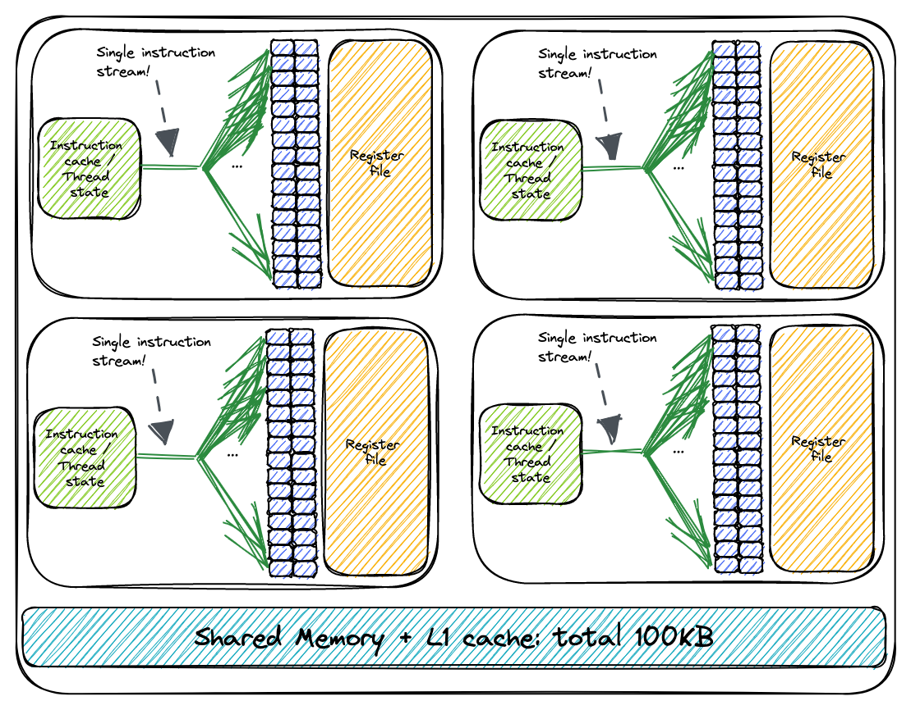</li>
<li>共享内存 Bank 冲突（以后会专门介绍）只发生在同一个 Warp 的线程之间。</li>
<li>较新的 GPU 有寄存器缓存，更紧凑的 Thread 分块能提供更好的寄存器缓存局部性。</li>
</ul>

Warp 分块很优雅，因为现在显式表达了所有并行层级：

<ul>
<li>Block 分块：不同 Block 可以在不同 SM 上并行执行。</li>
<li>Warp 分块：不同 Warp 可以在不同 Warp 调度器上并行执行，也可以在同一个 Warp 调度器上并发执行。</li>
<li>Thread 分块：同一个 CUDA Core 上可以并行执行少量指令（即指令级并行，ILP）。</li>
</ul>

CUDA 代码中的 Warp 分块如下：<label class="margin-toggle sidenote-number" for="54"></label><input class="margin-toggle" id="54" type="checkbox"/><a href="https://godbolt.org/#z:OYLghAFBqd5TKALEBjA9gEwKYFFMCWALugE4A0BIEAZgQDbYB2AhgLbYgDkAjF%2BTXRMiAZVQtGIHgBYBQogFUAztgAKAD24AGfgCsp5eiyahUAV0wtyKxqiIEh1ZpgDC6embZMQAVnLOAGQImbAA5TwAjbFIpACZyAAd0JWIHJjcPL19E5NShIJDwtiiYnnibbDs0kSIWUiIMz28/CqqhGrqiArDI6LjrWvrGrJbBruCe4r6ygEprdDNSVE4uAFJYgGZg1A8cAGpVjZcJYDJiJDZD3FWtAEF1raYdi2wDo/ElFXqrm/vN7d2r0OLlQSiIhHQPzuDwBLzeILBmHoBAiUL%2Bj2e%2B2B5giRiUAH0AG6xAB0SDRMKegPh5ks%2BNIZmEBA4ZIp0M2ODoIT2LlwAEkAviACJ8gBqEAAsuQ9qEZnsoJK5esAELy2UAWh4coA9GqZjNfhgmGC9sEiHsAOq3ABKqhEfIAWrg3kK9htYodVdrdQB3OoJEQEABerwISj2THQ5qNYOw6gSpF%2Bv21ACpfnsU3sAAJEBJ1dh7ZUSvYAFSQryISFI2BYmFx6FQAGs9ikQ3tBKQ9sXCBxjWk9iIJbhi%2BJUEhgsASenMzm86QC8rQqXy3tK9Xa/Wmy3g68OzK9j3mCkhAOhyOWGOJ1O7hns7n82xCwBpZcVqs1uv0BvN1u7sh7F9Dz7E9B2HPZR3HExr1uW9ZwfS1i27Zk9nQGhwPkYIzAWcN7EYdC2ASMwiGwTA9giABPPYazHPY/VIBJpzvOcCwtJclx7FC0KNewmCwswcIYV4MAIoiSLIyjqKQWj/UYuD50fC0JT5EtcGtV8I16TtUJbMwIjohJVwYCcW2IhJw2CLsD2ZI80mg2D73ky1QmU1T1N4qYtLQpRdP0wzkRMEzsDM00mH3IDjyYOyZwcgsS2LMtXgSaJ1TXD8/NeX923/JDewiqKmPgkslwSvYktIFL31rdLtzbPd2Os4DIunbUkzuGNzTMM0ZQUCV8RLAAJa1cFuIURBdPYygADk9VrbnxfFgC/CIJHmvZCXQAhSPmoxGTHfEIgWJhMAJfEIFCHq%2BsG4bRoNG89nupRgGwNg2Atf1cInCAuqlELzVCaUuqfaUaC/FhzQkBIkCsdtQfNFNbmB2GM2Vch03u9GMcxzGQfQMGyOwWpEdxuGXCVAB2ZU0favZOuEQsl0OV0ppmu7qdp80i3GgA2aQWZg9DjQ6rrlRfRm9mmjZKdZoQTXZpzud5yWqZloW6cU8b3T5%2B62a61iXLUsWPSV6XBZprqivGxWpf5nW6biy2%2BeV025dQa10B9cbN0bPlMHUElyK1gXZa61AMk9r8mx9v31Edu7vT2VQjGWXtzW0ytXl8iz09XSrP2/dKneDun9Kj8bUtrKOSXUPZdStW17SdT0a91bPfMrMMc/XUiO%2BCQvVfNfSw7FkvfYOWIfHlRca6cg1jZtlWzeL/03Y94f/VL3UICn2vZVj/n48ytOV187yIlw7A%2B7jBNF/NRT9fGiB1czVidXlOu7UdZ1M3t7%2Bl2f5yVLWlntbbWKsr6djlhaEQChOZi3VrXJSgCm7xx5tqI2QpNYm1jPGCButoFTzgUuHe%2BtkG6ndGgxmPAuazXuvHROF5nrMFTmhbO5du6hVbv6HSZ9BJ9xvp3D8Uc%2BRMDevRMuudK7V3WBPd%2BDdriSyxujeOqwfDKi0NKDYPAVFCj4XLNhGRhGiIMmLNhQiRFcOkW/fBRDSy7wUfHAg0iIBUO1NIW689nZdTYSvQxFiNiulMb7XxYjN5QJgTYoqwDm6mlcTQ6JEgI5gwynmZYWVOzZ3MKQasdMvbnxCqeYcaN5pKChtWTAq0cZ41uEoFRypOaZhFtowOxTSkkQqUjZUNTVEi1vIuJpc80bxwlOgQkrxcmCVXOgfGwBghMGMtpW4YAuDhlIO7PYxhSLKiWeGDAmQmBoxgiqMWrs1kNOLJmJ8gdVRHP8eBMODTQiByGSM14Lh8QJCIOkqZ%2BltkoSIoRc0580YuDHpTW5EATkezOaC6S9EV63kUnKTMDNYiqlDu4XpKLVSDwxf/PetDdTiHoOYIwPFgA51DEdAgywcJQ0BeOWlXdaIMHoHsUG7CSAFIlIM302Aln0FZeyiasRJoRGINPd0YrzRi2kFRRgKdwxlQEVVPGklAoMSwf3EKIRSAr0ObcwJ0dp5bxfLqNxgdbbmlmdEDI%2BqAkSN9lXMeE8TXT3NXPUBgtwH8NWT6GopBNrYDtWqC6A0hojTGpmNx09GkeqDlq61ur3bXINQ6o1m9t57HdSA%2BN/DE0ZBTfarukjnWTxsdmy%2BOCfXu39YGwt3VephuumNDN5bgFxPjgkhsSTlWYHVIk1lEE/ydmrN5egRBzKhWrDM2MpA6CMDRpU%2BlXdrTYDHRO2pd9AG3h/k5e%2Bv9tHjVWBTLQJItDHp0XG%2BOPohIXhXGaKZ06wzEVIOGE8nD6J5MYKM%2Bgi6kbTu5aordrlv6AddGLY9aiz0XsDkuvY07HlAYASB2xh6IMnug2TS91seV/JfeqNgyRzRfnQAZF5nYvbpRqXdPcEA5YRG9qPMW56FEMdLsCACTc2NMdRWLEW5Mc33Vo3LVCNAVDStuSx1UonxMwt9bWnA%2BqXB8e5QomTBNQVi3k58wNtwBNowxku2VRACLjWrGaaICYCb4g%2BEQYERmMxXAgAZxR6wub3FUV9JgOq9UwvU0QJFAEYX5vcDBKN2iDSqPPT4bDLmCWrnnMaJIKg9gwR9OOPCYIzgBWIHF1LXTlReZ1ba28sqVR7C0IF2BqLtXRF8%2BV/zaGDUESroHDG1TalFZtaF0rMKtS9OLOVxN9WauNZi2XFrAc43tYK110gJWo0wtiFVwbNXhvu0OaNmgYmCZNYCS1oMbX0Ydc8yF%2BgYWs0wo2Ct4L3m6sbb89t8Te3VwtZ9EdmD0I7pCf/HRrq/nxpSc4jt6VNXtMBpwCm5TtzY3Saexpm5rpwd1v0999G5nhCWerEQGzLAwT2dhrKtMGxcDObR1jNznTOvrZ9NcrbIOqtYtq/N9wqpwsxci2ovbeWMYY5fVZnHtmCfEyJ05nnrnYhc0pqdu7SbaePYZ7eJnZ22dZoi7U6LsW0eff5vdYp5EnhsKUBAdtX3ddpPlHLTAUZ2OSabtbogtuQWw806ih3UdUfm/i0kQipLXhPtneGPc6X3AZ3erw8nFu/vFxELpHxTG7cKL9XH92TuEIkIUUc1FyeIjx/UJ7xRUe5YEEB03EvHG4pNyz8qAgBfC/wewMAQDyoc9553at1UjjxuM3F1jE7hX3ejzOUqGr%2Bl4XPw77RWPufU9D8tPgjvvfC/eNT%2BYsRoHgv9ME5jHXFOsN5eE11HPBiE%2BuiB8f9wae9ZIMz7x7P0%2BT/54OBTcXh%2B6bl8T53%2BEqHb%2BU1RbX5/bfLGBDWpC/egUuX%2BTfbvfxJfDGKnTzQfauB5EfbFf0e5eWcrMAiA%2BfcJTTSPeve6fRS/NfAySAobLfcXXfHfffM3LGeOOMSoUSWFD5CZNgMGNgMwX9SPN/AeafNvZjJuVvWfKRI4dPG/OnP/FvPg4QuvLGHgqfXSR/UvJPB/S/BPEFa/VSKvO/KQxQtQp/SDJfeOIlElHtMqCqJlUdTgjdfA9GeQ0dKOQbT/BvJQRw7/SvX/FUBw32CUWQ%2BvewtdKOBmZw7w9QYIkFIqbQyQ0I2UQA2A9GbxNdaw2bIQn0bA%2B2crUI3w28R%2BZDNSX%2BFA%2BIggrGCALAufSJOTQI32RDcDXjGA2wgggDUA6QtI8oyfLIw9NMBo%2BvEA1RMopA2xSo1w6oig7o%2B6KgwvCY6gnRSPKYqYzbMFV0F3DGeOQjUZZ8dCPZHCR9AgYAJAOzNHCQvjF8ZFUhPYNY14HpX1cMa3H0fZNHfXQ3XOY3U3fmHXXDH0ANYiPDClFw5IxdX7OWVI23M/QQloq/RBLQzw%2B/FPVogwl/NHeQ/o5Q7FVQ8A9QvdcQ13XQiIR/Pw%2BLC4nkUqDaTHL5cCRYbJAeLhU%2BIFbgpGFMN5CzANR8MWEFcrUo8EufMJIsQLJnZE5%2BaxI7H7TsaPc0LIlElwtwivVTVUcUxHCafEuwwErqGIiU1UivR5BRdUuo10aNQw7o%2BOIVEFUZOwf8B9BvGdF9ajL3bGQnV7YxW5PnLHazIXI4BzYnUnIoseLmRk0k5kTrFfNIkg9vIYxw3kvAm04o5fXOAxYMsgsHKosI9XKLUYyMpRXUMqDsR8AAcWHGLDMASEsG%2BIsmnSX2pi6g/1dA5NhPSPaMTOyMzFyP3VsUKLGKjIUNxP0J3SZxiKFMxhMwSCdTFghihlvESPXQK3Lxq01xhSiFqDHJaxjmm0UQHP9nGhHJYDHNzlXQnNqSnNVC0W7xqznM3MzFXKmyAP7IO3XPoEhlPN7R3P%2BNUX3L2A9CPNVBPIXMHMO2XKxlXNXluQ3K3JXSSPHUnKuzQ2PIJnvP/L7JWN9C%2BLGQvEbCXydPomx1x3xzdLtI9LJzTIp0l19JfX9M80DOCVINLDrOGPUAbP3COTbPbKIPALjMGMyMTJqM5xnJMQIjgufxmJtLmJoLeKEovS4DmHoG4B8H4G8C4B0HIHQG4BcAUCFBgmUx0JbAWCWCBE2D4HICIG0DErmEbF8FPUmjJg2E0XMo2AAE5YgeAfANgyYuZDBuBpB%2BA2AQAyYyYSQeZJppARVpAtAfAyhYhNhyAZK5KFKuB%2BAlAQB1F9LZKxLyA4BYAUAFhcwiJKBqBhIEhBJSBQh2AVgJQAg%2BQ1JSNzQZAz0SQpL/BCASAIcDBBBhAxAJBOAZA5BhBlA1BNBEryB9AeByBPiWAEhuA%2BBxLJLpKDL5LuAAB5f5IiTiGUUUFwEFMoKqngeUNwAiPKseTRGYfgBKnQOYCAFAHKvKrKiFdAbaxgGIJgQkVAVAMoLQMwAanAQkalbAUUAgbAH0GapKCK/gedK06gCIKasVVgUgciUa/gcGuociGaiIXQSoBK3S4SFOGapgegKG3qnANgkwSQHGggasKoUZWK3qhg8wYiaGygTHCS3q5ECIecSGtwHAKanTDy3gJKkGFgYAJQL6n6v65gampq0QIlNq2QEWrqjQKa/qwwYwUwCwKwBm2KyAOYcqtIMm9UGajYPYdUIUUIIUXAZUBQbM3W9UJ6HVJJdUDAHARmOoMcRmHK0SfESaZym2i%2BGA1RJ24iF25ypQNgX2w9dUdUD5dQPHdUdWmWRmdUQkXWxER26vHgMmGK7AWwewRwCAZwYYbwAawICYIoEoAwZLPIdIdwJoIu3IdOpgboAu6YawVO5G6oMYbOgwVoKujoeoGuzSVu5usurIAasEToLujyKQOYJQTS5YUelyrgGqgG6argJala4Vda%2BUfAYgf8B4LUA6gy/UcgcsWsPoE3aety8gDy0KkkDYYKnwMmey6y6QMyry5yueqKmKgwQ6wy8gYynwU9WIayngHgIKry6y8yvysmaejYSa3ql%2BvSne5KxAE6kAN6j6i6s6m6gqjgbgUIZa1a0kU9XSpByergEQW4EQMaCAf232/a2q9ehqgakWlqyQdqyWlQaW3q2WtutIJwI6Fu3Oo6Yewuga4uqunhnIFIKu/huujh9oXuvZVuhutoJgDu8YQobugemR8utRoe/O1RuYT5bAbATaOK8ameyByK7gIUbAd61Jfmm9TsLBpetavB1euqjenS6ULa3Km63aremBxK3e4y6QaykkMmLQSaSaO%2B0KrQSXey2QOmk%2B5%2B7gV%2B%2BKne4x2IUx/gaB9%2B3e0ZV9Th6QIAA%3D">Godbolt 链接</a>。

<pre class="highlight"><code>// dotIdx 遍历 SMEM 中的数据
for (uint dotIdx = 0; dotIdx &lt; BK; ++dotIdx) {
  // 为该线程负责的 Warp 分块区域填充寄存器
  for (uint wSubRowIdx = 0; wSubRowIdx &lt; WMITER; ++wSubRowIdx) {
    for (uint i = 0; i &lt; TM; ++i) {
      regM[wSubRowIdx * TM + i] =
          As[(dotIdx * BM) + warpRow * WM + wSubRowIdx * WSUBM +
             threadRowInWarp * TM + i];
    }
  }
  for (uint wSubColIdx = 0; wSubColIdx &lt; WNITER; ++wSubColIdx) {
    for (uint i = 0; i &lt; TN; ++i) {
      regN[wSubColIdx * TN + i] =
          Bs[(dotIdx * BN) + warpCol * WN + wSubColIdx * WSUBN +
             threadColInWarp * TN + i];
    }
  }

  // 执行 Warp 分块矩阵乘法。以后这可以很好地映射到
  // 在 Tensor Core 上执行的 Warp 级矩阵指令
  for (uint wSubRowIdx = 0; wSubRowIdx &lt; WMITER; ++wSubRowIdx) {
    for (uint wSubColIdx = 0; wSubColIdx &lt; WNITER; ++wSubColIdx) {
      // 利用寄存器缓存局部性计算每个线程的结果
      for (uint resIdxM = 0; resIdxM &lt; TM; ++resIdxM) {
        for (uint resIdxN = 0; resIdxN &lt; TN; ++resIdxN) {
          threadResults[(wSubRowIdx * TM + resIdxM) * (WNITER * TN) +
                        (wSubColIdx * TN) + resIdxN] +=
              regM[wSubRowIdx * TM + resIdxM] *
              regN[wSubColIdx * TN + resIdxN];
        }
      }
    }
  }
}
</code></pre>

虽然结构已经相当复杂，我还是尽量把三个分块层级都画了出来。<label class="margin-toggle sidenote-number" for="55"></label><input class="margin-toggle" id="55" type="checkbox"/><a href="https://github.com/NVIDIA/cutlass/blob/master/media/docs/efficient_gemm.md">CUTLASS 的高效 GEMM 文档</a>对 Warp 分块有更深入的讨论，其中的可视化很有启发。 每个 Warp 计算一个大小为 <code class="language-plaintext highlighter-rouge">(WSUBN * WNITER) x (WSUBM * WMITER)</code> 的块。每个线程计算 <code class="language-plaintext highlighter-rouge">WNITER * WMITER</code> 个大小为 <code class="language-plaintext highlighter-rouge">TM*TN</code> 的小块。

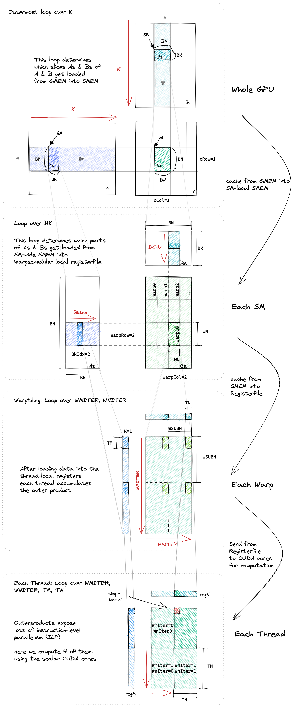

自动调优参数后，A100 上的性能从 19.7 TFLOPs 提升到 21.7 TFLOPs。

下图比较了矩阵大小逐渐增加时，Warp 分块 Kernel 与 cuBLAS 的性能：<label class="margin-toggle sidenote-number" for="56"></label><input class="margin-toggle" id="56" type="checkbox"/>这张图在 A100 上生成，所以绝对 FLOPs 数值不同。

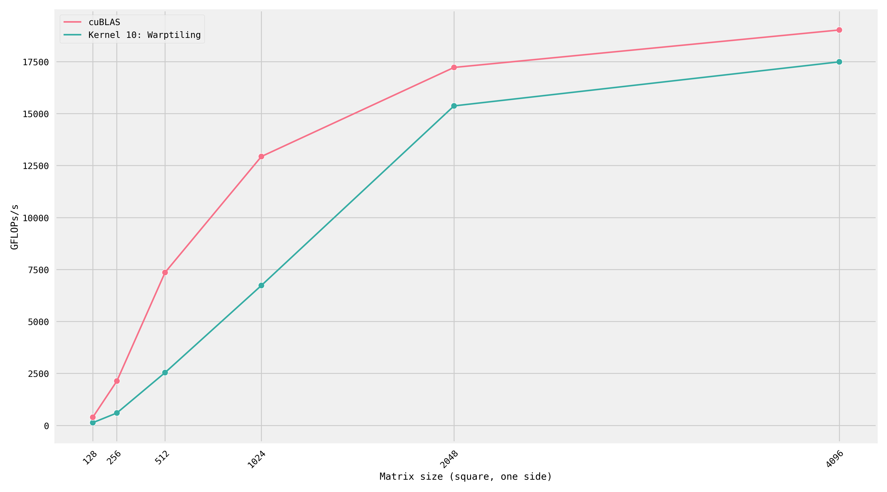

维度为 2048 和 4096 时，测得的 FLOPs 只比 cuBLAS 低几个百分点。但在较小矩阵上，我们与 NVIDIA 库相比表现很差！原因是 cuBLAS 并非只有一个 SGEMM 实现，而是有数百个。<label class="margin-toggle sidenote-number" for="57"></label><input class="margin-toggle" id="57" type="checkbox"/>这个库包含 500 MB 编译后的代码，大概是有原因的。打印全部 Kernel：<code class="language-plaintext highlighter-rouge">cuobjdump --list-text &lt;cublas location&gt;</code>。 运行时，cuBLAS 会根据维度选择执行哪个 Kernel。<label class="margin-toggle sidenote-number" for="58"></label><input class="margin-toggle" id="58" type="checkbox"/>我对不超过 4096 的所有维度启动了方阵乘法，找到了 16 个不同的 SGEMM Kernel。这里有一个<a href="https://gist.github.com/Chillee/f86675147366a7a0c6e244eaa78660f7#file-4-matmul-bench-py-L11">脚本</a>，可以查出 cuBLAS 启动的 Kernel（感谢 <a href="https://horace.io/">Horace He</a> 提供）。 我跟踪了 cuBLAS 调用，各个大小对应的 Kernel 如下：<label class="margin-toggle sidenote-number" for="59"></label><input class="margin-toggle" id="59" type="checkbox"/>这里使用了 <a href="https://developer.nvidia.com/nsight-systems">Nsight Systems</a> 命令行工具。

<table>
<thead>
<tr>
<th>矩阵大小</th>
<th>名称</th>
<th>耗时</th>
</tr>
</thead>
<tbody>
<tr>
<td>128</td>
<td><code class="language-plaintext highlighter-rouge">ampere_sgemm_32x32_sliced1x4_nn</code></td>
<td>15.295 μs</td>
</tr>
<tr>
<td>256</td>
<td><code class="language-plaintext highlighter-rouge">ampere_sgemm_64x32_sliced1x4_nn</code> <em>随后执行</em> <code class="language-plaintext highlighter-rouge">splitKreduce_kernel</code></td>
<td>12.416 μs + 6.912 μs</td>
</tr>
<tr>
<td>512</td>
<td><code class="language-plaintext highlighter-rouge">ampere_sgemm_32x32_sliced1x4_nn</code></td>
<td>41.728 μs</td>
</tr>
<tr>
<td>1024</td>
<td><code class="language-plaintext highlighter-rouge">ampere_sgemm_128x64_nn</code></td>
<td>165.953 μs</td>
</tr>
<tr>
<td>2048</td>
<td><code class="language-plaintext highlighter-rouge">ampere_sgemm_128x64_nn</code></td>
<td>1.247 ms</td>
</tr>
<tr>
<td>4096</td>
<td><code class="language-plaintext highlighter-rouge">ampere_sgemm_128x64_nn</code></td>
<td>9.290 ms</td>
</tr>
</tbody>
</table>

维度为 256 时会调用两个 Kernel：先执行矩阵乘法，再执行归约。<label class="margin-toggle sidenote-number" for="60"></label><input class="margin-toggle" id="60" type="checkbox"/>Split-K 指将 K 维划分给多个 Thread Block，因此每个 Block 只计算 C 中一个块的部分结果，随后 cuBLAS 用归约 Kernel 累加最终结果。归约之前需要额外内存保存中间结果。我想象中的结构如下（但这里不太确定）：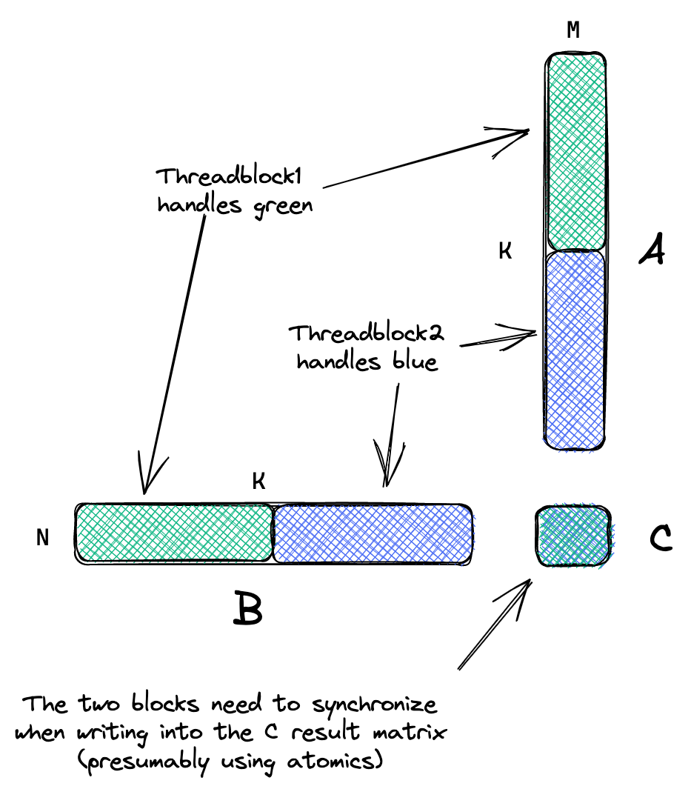 因此，如果要写一个适用于各种形状和大小的高性能库，就需要为不同形状提供特化实现，并在运行时分派到最合适的版本。

也记录一个负面结果：我还为这个 Kernel 实现了称为<em>线程重排（thread swizzling）</em>的优化。它假设 Thread Block 按 <code class="language-plaintext highlighter-rouge">blockIdx</code> 递增顺序启动，通过优化 <code class="language-plaintext highlighter-rouge">blockIdx</code> 到 C 中各块的映射来提高 L2 局部性。<label class="margin-toggle sidenote-number" for="61"></label><input class="margin-toggle" id="61" type="checkbox"/>记住，L2 是全局内存的缓存，整个 GPU 只有一份。 这篇 <a href="https://developer.nvidia.com/blog/optimizing-compute-shaders-for-l2-locality-using-thread-group-id-swizzling/">NVIDIA 博客</a>有更多信息和图示。它没有提高性能，可能因为 L2 命中率已经达到较高的 80%，所以我最后删除了重排代码。<label class="margin-toggle sidenote-number" for="62"></label><input class="margin-toggle" id="62" type="checkbox"/>如果感兴趣，可以在<a href="https://github.com/siboehm/SGEMM_CUDA/commit/9a4dd77232d416649c13401c2382cdf95ded3760">这里</a>查看提交。

把 BK 循环向外移很合理，因为它遵循了“加载一些数据，然后尽可能多地使用这些数据计算”的原则。这也意味着 BK 循环内部的全部<em>计算</em>都相互独立，可以并行化，例如使用 ILP。

现在也可以开始预取下一次循环迭代需要的数据，这项技术称为双缓冲。

<h2 id="work-in-progress-kernel-11">尚在进行的工作：Kernel 11</h2>

如果以后继续完善这篇文章，接下来会研究：

<ol>
<li>双缓冲，更好地交错执行计算与内存加载。目前可参考 <a href="https://github.com/NVIDIA/cutlass/blob/master/media/docs/efficient_gemm.md#pipelining">CUTLASS 流水线</a>。CUTLASS 在两个层级做双缓冲：GMEM ⇒ SMEM，以及 SMEM ⇒ 寄存器文件。<ul><li>Hopper 引入了用于 Warp 特化的新指令，例如让部分 Warp 使用更少的寄存器。结合直接从 GMEM 加载到 SMEM、无需先经过寄存器的特殊指令，可以降低寄存器压力。</li></ul></li>
<li>消除 SMEM Bank 冲突，可以通过<a href="https://github.com/NVIDIA/cutlass/blob/master/media/docs/implicit_gemm_convolution.md#shared-memory-layouts">优化 SMEM 数据布局</a>实现。</li>
<li>查看生成的 PTX，更好地理解 <a href="https://github.com/openai/triton">Triton</a> 中实现的 GEMM Kernel。</li>
</ol>
<h2 id="conclusion">结论</h2>

写这篇文章的体验，与之前<a href="https://siboehm.com/articles/22/Fast-MMM-on-CPU">优化 CPU SGEMM</a>的文章很相似：逐步优化 SGEMM，是深入理解硬件性能特性的最佳方式之一。编写 CUDA 程序时，令我惊讶的是，一旦把希望 Kernel 如何工作画清楚，代码实现就变得很容易。

另外，幂律无处不在。我用两个周末写出了前六个 Kernel，达到峰值 FLOPs 的 80%；又用了四个周末做自动调优和 Warp 分块，达到 94%。编写代码时学到的东西也在逐渐减少，所以追求最后 6% 的工作留到以后。

全部代码都可以在 <a href="https://github.com/siboehm/SGEMM_CUDA">GitHub</a> 找到。

最后，特别感谢 <a href="https://godbolt.org/">Godbolt.org</a>（查看 PTX 和 SASS 汇编）与 <a href="https://excalidraw.com/">Excalidraw</a>（绘制 Kernel）的开发者！这两个工具都很好用，帮助我更快地学习。

<h2 id="further-resources-and-references">更多资料与参考</h2>
<ul>
<li>我偶然发现了 <a href="https://github.com/wangzyon/NVIDIA_SGEMM_PRACTICE">wangzyon 的 GitHub 仓库</a>，先尝试其中的 Kernel，然后从零重写全部代码，因此开始写这篇文章。这篇介绍 CUTLASS 库的 <a href="https://developer.nvidia.com/blog/cutlass-linear-algebra-cuda/">NVIDIA 博客</a>也很相关。</li>
<li>必读参考：官方 <a href="https://docs.nvidia.com/cuda/cuda-c-programming-guide/index.html">CUDA Toolkit 编程指南</a>与 <a href="https://docs.nvidia.com/cuda/cuda-c-best-practices-guide">CUDA 最佳实践指南</a>。<a href="https://docs.nvidia.com/nsight-compute/ProfilingGuide/index.html">Kernel 性能分析指南</a>包含更多缓存、流水线等底层硬件细节，以及可以采集的各类指标。</li>
<li>Onur Mutlu 是 ETH 的教授，会把课程上传到 YouTube。与本文尤其相关的是<a href="https://www.youtube.com/playlist?list=PL5Q2soXY2Zi-Mnk1PxjEIG32HAGILkTOF">计算机体系结构</a>和<a href="https://www.youtube.com/playlist?list=PL5Q2soXY2Zi_OwkTgEyA6tk3UsoPBH737">异构系统加速</a>。</li>
<li><a href="https://www2.eecs.berkeley.edu/Pubs/TechRpts/2016/EECS-2016-143.pdf">理解 GPU 上的延迟隐藏</a>是一篇博士论文，深入讨论如何设计工作负载以充分利用内存带宽和计算能力。论文发表于 2016 年，因此只覆盖较老的 GPU 架构。Warp 同步编程章节已过时，可参看<a href="https://developer.nvidia.com/blog/using-cuda-warp-level-primitives/">使用 CUDA Warp 级原语</a>。</li>
<li>NVIDIA 工程师 Lei Mao 的<a href="https://leimao.github.io/tags/CUDA/">博客</a>有很好的 CUDA 内容，包括<a href="https://leimao.github.io/blog/Proper-CUDA-Error-Checking/">正确的 CUDA 错误处理</a>。</li>
<li>似乎没有很好的官方资料解释 SASS。可以参考 <a href="https://docs.nvidia.com/cuda/cuda-binary-utilities/index.html">NVIDIA 的 CUDA 二进制工具文档</a>，但阅读开源 SASS 汇编器可能更有帮助，例如 Da Yan 的 <a href="https://github.com/daadaada/turingas">turingas</a>。</li>
<li>我正在收集可读性好、又经过优化的 CUDA 代码来学习：<ul><li>ONNX Runtime 的 <a href="https://github.com/microsoft/onnxruntime/tree/main/onnxruntime/core/providers/cuda">CUDA 执行提供程序</a>，例如它的 <a href="https://github.com/microsoft/onnxruntime/blob/main/onnxruntime/core/providers/cuda/math/softmax_warpwise_impl.cuh">Softmax 实现</a>。</li><li>NVIDIA 开源的 <a href="https://github.com/NVIDIA/cutlass">CUTLASS</a> 库，例如其 <a href="https://github.dev/NVIDIA/cutlass/blob/master/include/cutlass/gemm/device/gemm.h">GEMM 实现</a>，使用双缓冲预取最内层维度的数据，而我的 Kernel 还没有实现这一点。</li></ul></li>
</ul>

