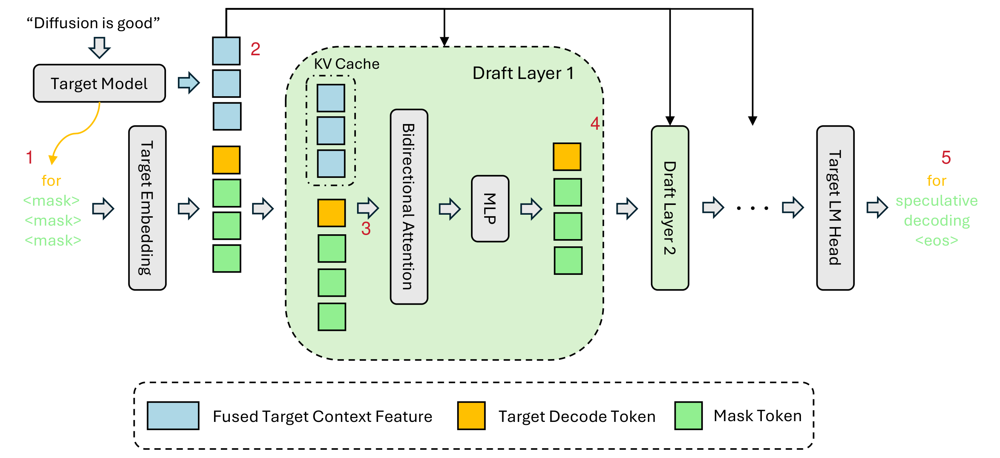
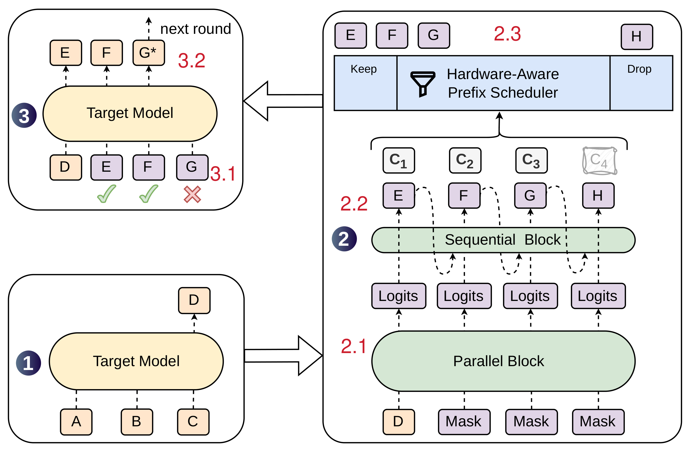
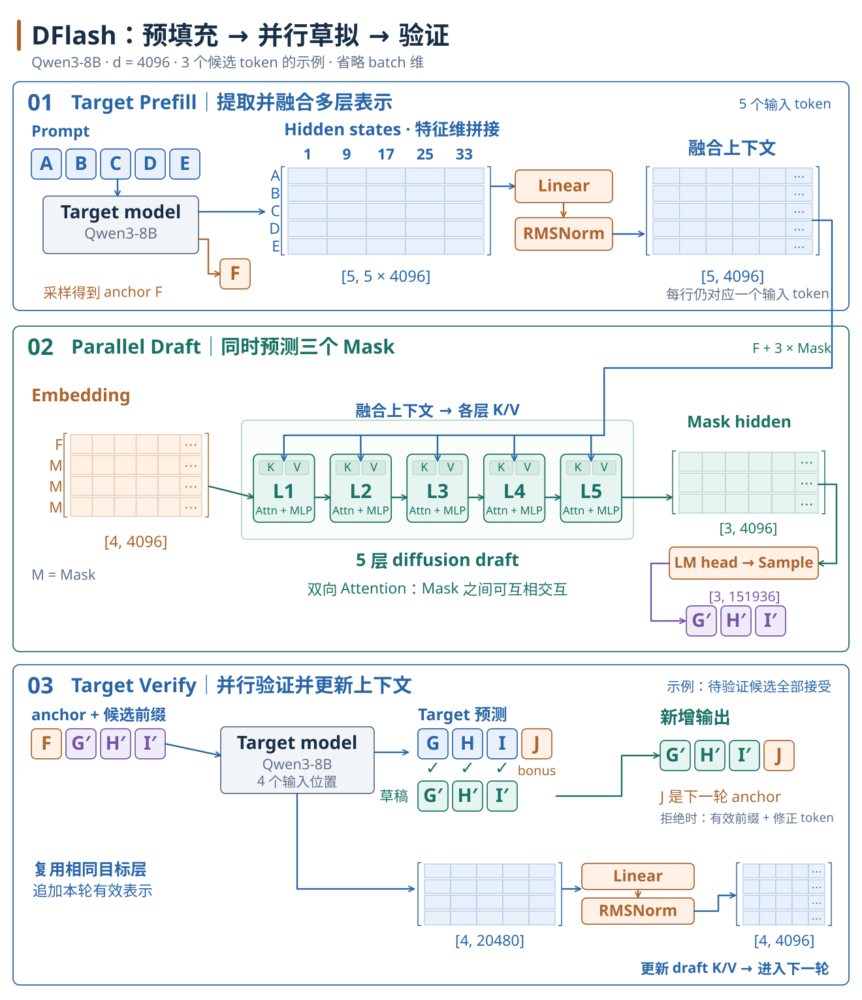
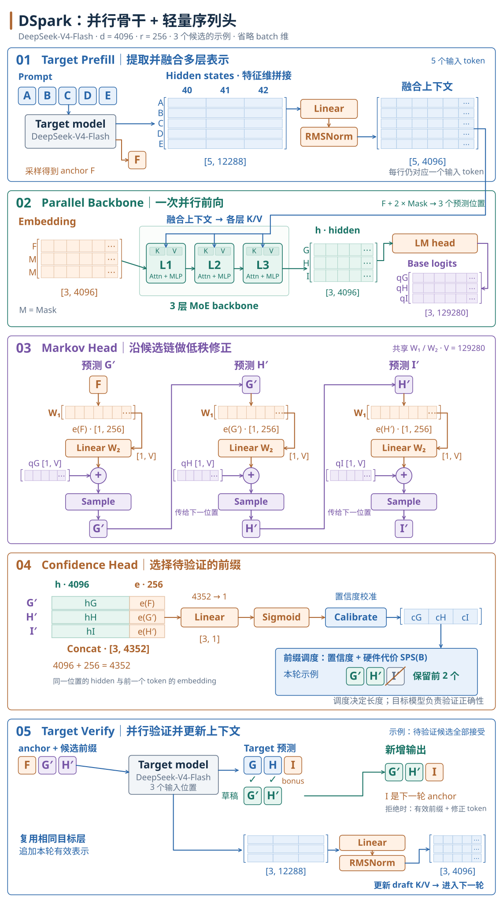

## Question

**LLM 推理的瓶颈与扩散模型的困境**

- 当前 SOTA 方法如 **EAGLE-3 仍是自回归式草稿**，实际加速上限约 **2-3×**
- 扩散模型可以并行生成 token，但用作草稿器并不简单
- DiffuSpec、SpecDiff-2 等方法使用庞大的 **7B 参数草稿器**，实际部署成本过高
- 单纯缩小扩散模型也不行：
  - 5 层朴素块扩散草稿器（无目标模型条件）在 Qwen3-4B 上的加速仅约 3×，效果有限
  - 因为小草稿器无法访问目标模型的内部知识，必须从零预测未来 token

**核心问题：能否构建一个既小又准的草稿器？**

## Architecture

为了解决草稿模型的能力没有主模型强，生成token过多时被采纳可能性会降低的问题，提高draft model的能力，在**DFlash中的解决方案**：抽取主模型若干层的hidden，融合成一个额外的上下文信息（记作$H_{ctx}$），再注入到草稿模型每一层的Attention里。DFlash的原理如下图:

[{ width=600 }](../../assets/ai-infra/speculative-decoding/dflash-inference-design-numbered.png)

**计算步骤**

1. 主模型（target model）接收输入“Diffusion is good”，预测生成第一个token "for"，将其作为草稿模型的anchor；草稿侧再配上若干mask，表示需要并行填空的位置；
2. 主模型先对自己的前缀做forward，抽出若干层hidden，融合成上下文信息$H_{ctx}$；
3. 草稿模型在每一层做Attention时，把$H_{ctx}$投影后拼进K/V的前半段，后半段才是Draft自身token侧的表示
   $H_d$，Query仍然只来自Draft的token侧（$H_d$）,去读[$H_{ctx}$||$H_d$]
4. 得到该层输出，并以此类推算完所有Draft层；
5. 最后用与主模型共享的LM head，从mask位置采样得到草稿输出，例如“for speculative decoding”.

**DSpark为了解决接受字符数量不确定、以及长块验证可能浪费算力的问题**，对DFlash做了进一步的工程优化。如下图所示：

[{ width=600 }](../../assets/ai-infra/speculative-decoding/dspark-decoding-cycle-numbered.png)

**计算步骤**

1. 主模型输入字符“ABC”，生成字符“D”；
2. **parallel block处理**：将D字符以及Mask作为并行生成模块（diffusion）的输入，计算完后得到多个位置的中间logits；
    { data-number=2.1 }
2. **sequential block处理**：这些中间logits再通过一个串行模块（RNN或Markov）从左到右逐个生成tokens，即“EFGH”，同时计算每个token的置信度confidence（图中的$c$，表示该token被主模型采纳的可能性）;
   { data-number=2.2 }
2. **筛选**：根据2.2的输出，结合硬件当前负载，决定本轮验证多长。机器越空闲、字符置信度越高，验证长度往往越长，反之亦然。图中被丢弃的字符是“H”；
   { data-number=2.3 }
3. token “EFG”进入主模型验证；
   { data-number=3.1 }
3. token “G”未通过校验，接受“EF”，并以主模型新生成的“G*”作为修正 token 和下一轮的 anchor。
   { data-number=3.2 }

!!! note "Hardware-Aware Prefix Scheduler"
    对于步骤 2.3 的筛选，Hardware-Aware Prefix Scheduler 可以概括成一句话：草稿可以很长，但不一定整段都拿去让 Target 验证；按“还值得验吗”和“现在机器忙不忙”裁出一段前缀。

    其中关键的筛选动作大致分三步。

    **step1 先有每位的条件置信度**

    Confidence Head 给出 $c_k$：在前面都已被接受的前提下，第 $k$ 个草稿还能过验证的概率。前缀存活概率为：$a_j = \prod_{i \le j} c_i$

    $a_j$ 越大，说明“验到第 $j$ 位时整段前缀仍有希望都过”的把握越大；越往后通常越小。

    **step2 用硬件曲线估计“验得越长是否越划算”**

    引擎事先 profile 一条 $\mathrm{SPS}(B)$（Steps Per Second，即每秒能跑多少步 forward）：一次 forward 的 batch 里有 $B$ 个 token 时，大约每秒能跑多少步。若本轮有 $R$ 个请求，每个请求验证长度为 $\ell_r$，则大致有：

    - 验证 batch 大小 $B = \sum_r (1 + \ell_r)$，其中每个请求自身要占一个位置；
    - 期望接受量 $\tau$ 随新增验证位置的 $a_{r,j}$ 增加；
    - 吞吐估计 $\Theta = \tau \cdot \mathrm{SPS}(B)$。

    多验一个 token，$\tau$ 可能涨一点，但 $B$ 变大后，SPS 往往降低。Scheduler 就是在找让 $\Theta$ 尽量大的那组 $\ell_r$。

    **step3 贪心扩展 + 早停（真正的筛选）**

    把所有“再多验一位”的候选按 $a_{r,j}$ 从高到低排。从空前缀开始，每次挑当前存活概率最高的那一位扩进去，更新 $B$、$\tau$、$\Theta$：

    - $\Theta$ 变好：接受这次扩展，继续；
    - $\Theta$ 不再升：立即停，返回此前吞吐最好的各请求前缀长度 $\ell_r^*$。

    只把前 $\ell^*$ 个草稿（图中的“EFG”）送给主模型；后面的后缀直接丢掉（图中的“H”），不占验证算力。

## DFlash 推理流程

以 Qwen3-8B 为例，隐藏维度为 4096。本例每轮生成 3 个草稿 token，下文的形状省略 batch 维。

<div class="inference-section" markdown="1">
<div class="inference-layout" markdown="1">
<div class="inference-figure" markdown="1">

[{ width=1100 }](../../assets/ai-infra/speculative-decoding/dflash-prefill-draft-verify.svg)

</div>
<div class="inference-description" markdown="1">

**Step 1：Target Model Prefill**

目标模型处理 `[A, B, C, D, E]`，执行多层 Transformer 前向，建立这 5 个输入位置的 KV Cache，并从最后一个位置的 logits 采样得到首个输出 token `F`。`F` 作为本轮草稿生成的 anchor，此时其自身的 KV 尚未计算。

抽取第 1、9、17、25、33 层的隐藏状态，沿特征维拼接，得到 `[5, 20480]`；再经 Linear 投影和 RMSNorm，得到融合上下文 $H_{ctx}$，形状为 `[5, 4096]`。

**Step 2：Draft Model Decode**

构造草稿输入 `[F, MASK, MASK, MASK]`，使用与目标模型共享的 Embedding，得到 `draft_emb`，形状为 `[4, 4096]`。

这 4 个位置一起经过 5 层草稿 Transformer。取 3 个 MASK 位置的最终隐藏状态，通过共享的 LM head 得到 logits，再分别采样，一次生成 `G′、H′、I′`。`F` 是已知 anchor，其位置不再生成一个草稿候选。

**KV 注入**

每层以该层的草稿隐藏状态 $H_d$ 产生 Query，并用本层的投影权重分别处理 $H_{ctx}$ 和 $H_d$。第一层的 $H_d$ 来自 `draft_emb`，后续层使用上一层的输出。投影与拼接关系如下：

```python
Q = q_proj(H_d)
K = concat(k_proj(H_ctx), k_proj(H_d), dim=token_dim)
V = concat(v_proj(H_ctx), v_proj(H_d), dim=token_dim)
```

`concat` 沿 token 维拼接。本例有 4 个 Query 位置，而 Key、Value 各包含 5 个上下文位置和 4 个草稿位置，共 9 个位置。草稿模型由目标模型的隐藏特征构造自己的 K/V，并在各层进行 Q/K 归一化、RoPE 和 Attention 计算。

**双向 Attention 的可见范围**

- 草稿块使用非因果注意力，即 `is_causal=False`。每个草稿位置的 Query 可以读取全部已知上下文，以及同一块内的 `F` 和所有 MASK 位置。
- $H_{ctx}$ 只提供 Key、Value；本次 Attention 的 Query 来自草稿位置，上下文行不会反过来读取草稿行。
- 推理时 MASK 代表未知位置，$H_{ctx}$ 来自已经处理的前缀，因此这种可见性不会引入真实的未来 token。

草稿位置的隐藏状态会通过双向 Attention 相互影响；独立的是最终的逐位置采样。后一个候选的采样不以刚采出的前一个候选为条件，所以不同位置仍可能选择彼此不兼容的语义分支，出现多模态碰撞。

**Step 3：Target Model Decode / Verify**

把 `[F, G′, H′, I′]` 送入目标模型，复用已有前缀 KV Cache，以标准因果注意力完成一次前向。4 个输入位置依次给出下一 token 的预测，记作 `G、H、I、J`。

下面按贪心解码说明验证过程：依次比较 `G′` 与 `G`、`H′` 与 `H`、`I′` 与 `I`，只接受首次不匹配之前的连续前缀。

- **3 个候选全部接受**：本轮新增 `[G′, H′, I′, J]`，共 4 个 token。`J` 是额外的 bonus token，也成为下一轮的 anchor。
- **只接受 `G′`，在 `H′` 处拒绝**：本轮新增 `[G′, H]`，共 2 个 token。`H` 替换被拒绝的候选，是修正 token，并成为下一轮的 anchor；后面的草稿候选全部丢弃。

`F` 已在 Prefill 阶段输出，因此不计入本轮新增数量。验证后，只保留 `F` 和已接受候选对应的有效 KV、隐藏状态，裁去无效后缀；有效隐藏状态经过同样的多层融合，用来更新下一轮的草稿上下文。

随机采样时，验证需要依据目标分布和草稿分布执行拒绝采样，不能仅比较两次独立采样是否得到同一个 token。

</div>
</div>
</div>

## DSpark 推理流程

以 DeepSeek-V4-Flash 为例，`hidden_size=4096`、`vocab_size=129280`、`markov_rank=256`。本例取草稿长度 $\gamma=3$，演示 3 个候选的生成和验证，形状同样省略 batch 维。

<div class="inference-section" markdown="1">
<div class="inference-layout" markdown="1">
<div class="inference-figure" markdown="1">

[{ width=1100 }](../../assets/ai-infra/speculative-decoding/dspark-backbone-markov-confidence.svg)

</div>
<div class="inference-description" markdown="1">

**Step 1：Target Model Prefill**

目标模型处理 `[A, B, C, D, E]`，建立输入前缀的 KV Cache，采样得到首个输出 token `F`。

抽取第 40、41、42 层的隐藏状态，沿特征维拼接为 `[5, 12288]`，再经过 Linear 投影和 RMSNorm，得到 `main_x`，形状为 `[5, 4096]`。

**Step 2：Parallel Backbone**

构造输入 `[F, MASK, MASK]`。DSpark 的第一个候选与 anchor 所在的骨干位置对齐，因此生成 $\gamma$ 个候选只需 anchor 加 $\gamma-1$ 个 MASK。Embedding 输出为 `[3, 4096]`。

3 个位置经过 3 层草稿骨干，得到 `draft_hidden`，形状为 `[3, 4096]`；再经 LM head 得到 `base_logits`，形状为 `[3, 129280]`。索引 0、1、2 分别提供生成 `G′、H′、I′` 的基础 logits。

骨干同样利用目标模型的融合隐藏状态构造上下文 K/V，并与当前草稿位置的 K/V 合并，让草稿位置读取目标上下文。这里先并行产生所有位置的基础特征，候选 token 随后由 Markov Head 依次采样。

**Step 3：Markov Head**

Markov Head 用前一个 token 的低秩 embedding，为当前位置的基础 logits 增加一项修正。生成 `G′` 时，前一个 token 是 `F`：

```python
e_F = markov_embedding(F)              # [1, 256]
bias_G = markov_linear(e_F)            # [1, 129280]
logits_G = base_logits[0:1] + bias_G    # [1, 129280]
G_prime = sample(logits_G)
```

随后，以 `G′` 为输入修正索引 1 的基础 logits，采样 `H′`；再以 `H′` 为输入修正索引 2 的基础 logits，采样 `I′`。同一组 Markov Embedding 和 Linear 权重在各位置共享，`e_F` 等中间 embedding 也提供给 Confidence Head。

候选链为 `F → G′ → H′ → I′`：后一个候选依赖前一个已经采出的 token。并行骨干承担主要计算，轻量 Markov Head 引入一阶依赖，缓解逐位置独立采样的多模态碰撞，这就是半自回归生成。

**Step 4：Confidence Head 与前缀筛选**

Confidence Head 使用**骨干隐藏状态**和**前一个 token 的 Markov embedding**预测条件接受概率。三个位置分别配对为：

- 生成 `G′` 的骨干 hidden，与 `F` 的 Markov embedding；
- 生成 `H′` 的骨干 hidden，与 `G′` 的 Markov embedding；
- 生成 `I′` 的骨干 hidden，与 `H′` 的 Markov embedding。

特征拼接发生在最后一维：`[3, 4096]` 与 `[3, 256]` 合并为 `[3, 4352]`，再经 Linear 和 Sigmoid，得到 `[3, 1]` 的置信度。

```python
prev_ids = [F, G_prime, H_prime]
prev_emb = markov_embedding(prev_ids)             # [3, 256]
features = concat(draft_hidden, prev_emb, dim=-1) # [3, 4352]
c = sigmoid(confidence_linear(features))         # [3, 1]
```

以固定阈值作直观示例：若三个条件置信度为 `0.98、0.95、0.40`，逐位阈值设为 `0.9`，则只保留 `G′、H′`，验证输入为 `[F, G′, H′]`。

硬件感知调度还会结合前缀存活概率与 $\mathrm{SPS}(B)$ 估计验证收益。本例的前缀存活概率依次为 `0.98、0.931、0.3724`；实际选择多长的前缀，要按前文 Hardware-Aware Prefix Scheduler 的吞吐目标判断。

**Step 5：Target Model Decode / Verify**

只将选中的 `[F, G′, H′]` 送入目标模型，以标准因果注意力完成一次前向，得到这 3 个位置对应的下一 token 预测 `G、H、I`。继续按贪心解码比较候选并接受最长匹配前缀：

- **`G′、H′` 全部接受**：本轮新增 `[G′, H′, I]`，共 3 个 token。`I` 是额外的 bonus token，也是下一轮的 anchor。
- **只接受 `G′`，在 `H′` 处拒绝**：本轮新增 `[G′, H]`，共 2 个 token。`H` 是修正 token，也是下一轮的 anchor。

这些数量同样不包含已经输出的 `F`。验证后，裁去无效的目标 KV 后缀，保留有效位置的隐藏状态，融合为新的目标上下文，供下一轮草稿生成使用。随机采样时使用与 DFlash 相同的拒绝采样原则。

</div>
</div>
</div>
