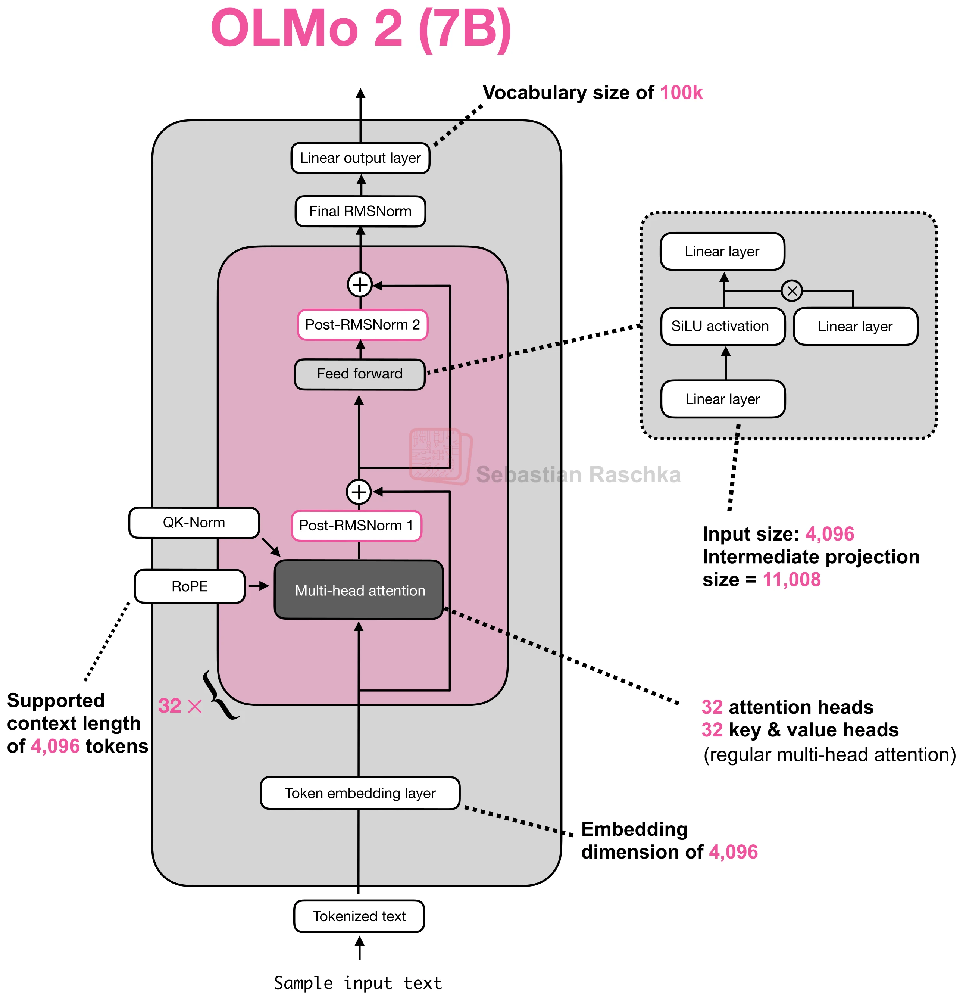
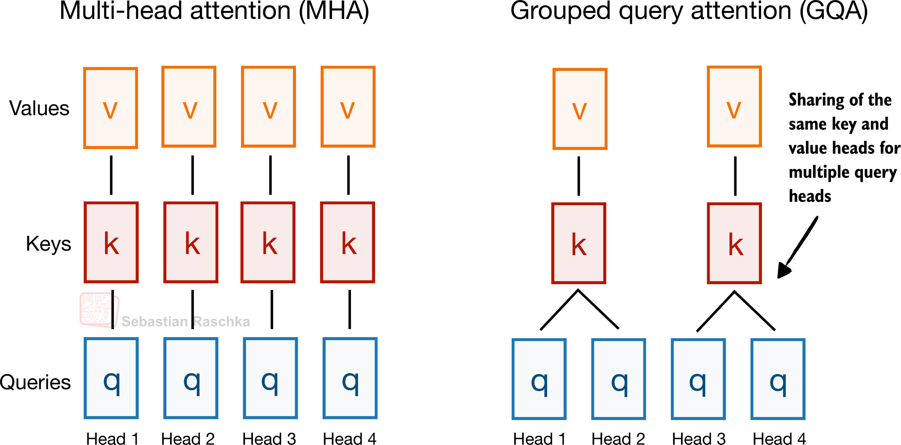
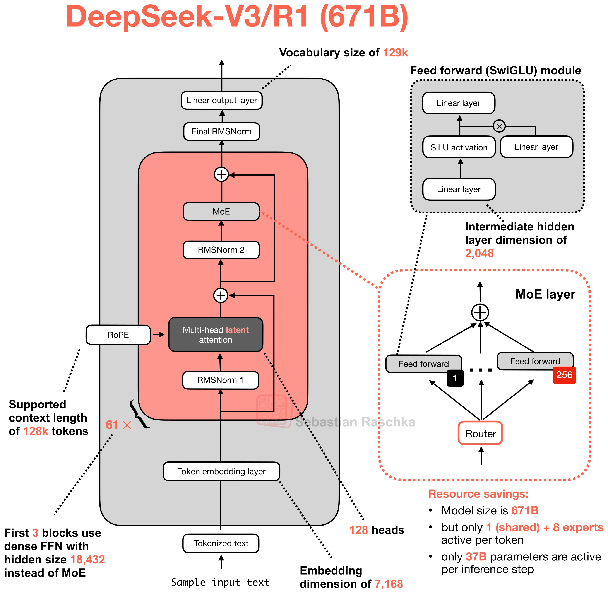
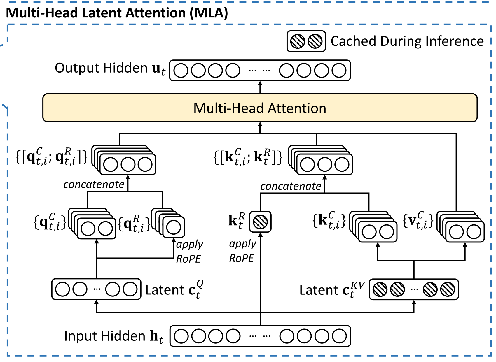
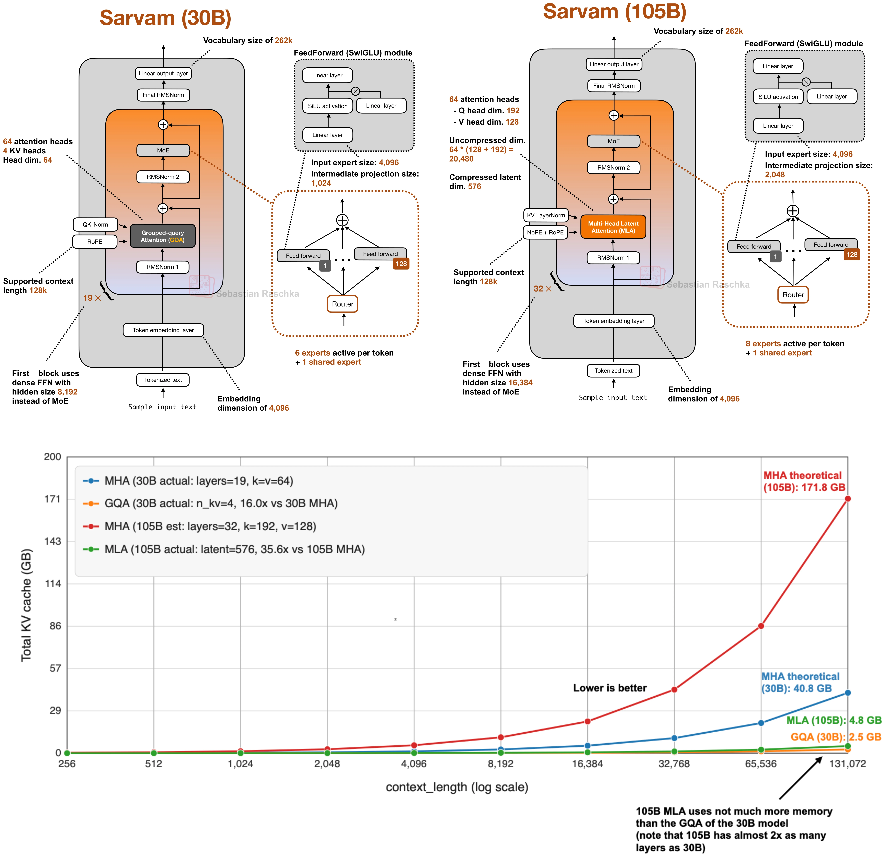
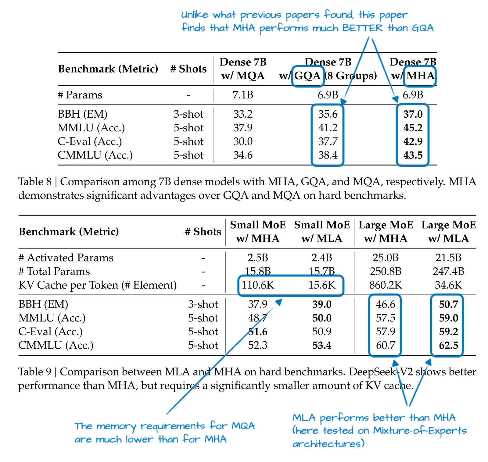

# LLM 主流模型结构之 Dense Attention

Dense Attention 让每个 Query 对掩码允许的全部 Key 计算注意力权重，再对相应的 Value 加权求和。在自回归 LLM 中，当前 token 通常可以读取自身及全部前缀位置。

MHA、GQA/MQA 与 MLA 都保留了这种连接范围。它们的主要区别在于：**多个 head 如何表示上下文，以及历史 token 的 K/V 以什么形式保存。** 从 MHA 的独立 K/V，到 GQA/MQA 的共享 K/V，再到 MLA 的联合低秩压缩，核心都是在多头表达能力与推理成本之间寻找更好的平衡。

这里的 Dense 指注意力连接，并不要求 FFN 也是普通的密集前馈网络。DeepSeek-V3 同时使用 MLA 和 MoE，两者分别作用于 Attention 和 FFN。

## MHA：独立的多头表示

**Multi-Head Attention（多头注意力）**将同一份输入隐藏状态投影到多个特征子空间。每个 head 都有自己的 Q、K、V：Query 表示当前位置想检索什么，Key 提供各个位置用于匹配的特征，Value 提供匹配后汇入输出的信息。

每个 head 独立计算注意力分布，并对 Value 加权：

$$
O_i=\operatorname{Softmax}\left(
\frac{Q_iK_i^{\mathsf T}}{\sqrt{d_h}}+M
\right)V_i.
$$

$d_h$ 是 Query、Key 的 head 维度，$M$ 是掩码；Softmax 沿 Key 的 token 维归一化。因果掩码屏蔽未来位置，使当前位置只使用已经可见的信息。

常见模型还会在匹配前加入 **RoPE** 与 **QK-Norm**。RoPE 按各 token 的位置旋转 Query、Key，使它们的点积包含相对位置关系，Value 通常不做这种旋转。QK-Norm 则对 Query、Key 归一化，控制注意力 logits 的尺度，缓解 Softmax 权重过度集中在少数位置的情况。它们分别处理位置与数值稳定性，可以与多种 Attention 结构配合。

多个 head 可以学习不同的关系，例如局部依赖、语义关联或位置关系。各 head 的输出沿特征维拼接，再经过输出投影 $W^O$，回到模型隐藏维度。

[{ width=650 }](../../assets/ai-infra/dense-attention/raschka-olmo2-mha-architecture-hires.webp)

OLMo 2 的结构展示了 MHA 在模型中的位置：Token Embedding 之后，隐藏状态依次经过多层 Attention 与 FFN，最后由输出层产生 logits。Attention 负责不同 token 之间的信息交互，FFN 则对各位置的特征进行变换。

自回归推理分为 **Prefill** 与 **Decode**。Prefill 同时处理整个 prompt，在因果掩码下计算各层的 Q/K/V，将历史 K/V 保存为 **KV Cache**，并由 prompt 最后位置的输出预测第一个新 token。Decode 再把刚生成的 token 作为输入，计算它在各层的 Q/K/V，追加新 K/V，读取历史缓存并预测下一个 token。

例如输入 `[A, B, C]`，Prefill 预测出 `D`，此时缓存包含 `A/B/C` 的状态；下一轮输入 `D`，才把 `D` 的 K/V 加入缓存并预测 `E`。**因果 Attention 下，追加 token 不会改变此前位置的隐藏状态，历史 K/V 因而可以复用。** 当前 Query 完成本轮计算后通常不需要长期保存。

MHA 为每个 head 保存独立 K/V，缓存会随序列长度、层数和并发请求数增长。Prefill 的多个 Query 可以复用同一批 K/V，更容易利用矩阵计算；单请求 Decode 每轮只有一个新 Query，却仍要读取整个可见历史，小 batch 下容易受到显存带宽限制。KV Cache 节省了历史投影的重复计算，缓存容量和每轮读取成本仍然需要解决，实际瓶颈取决于上下文长度、batch 和 Kernel 实现。

## GQA / MQA：共享 K/V，保留独立 Query

**Grouped-Query Attention（分组查询注意力）**保留多个 Query head，但让同组 Query 共用一套 Key、Value。例如下图中的 4 个 Query head 分为两组，每两个 Query 读取一套 K/V。

[{ width=700 }](../../assets/ai-infra/dense-attention/raschka-mha-gqa-head-sharing.png)

**共享的是 K/V，不是注意力权重或输出。** 同组 Query 仍然由不同的投影产生，与相同 Key 的点积可以不同，因此各 head 仍会得到自己的注意力分布和输出。

**Multi-Query Attention（多查询注意力）**将共享推到极端：全部 Query head 共用一个 Key head 和一个 Value head。它仍然保留多个 Query head，只是 K/V 只有一套。

GQA 可以看作 MHA 与 MQA 之间的选择范围：KV head 数等于 Query head 数时，就是 MHA；只有一个 KV head 时，就是 MQA。MQA 在 2019 年提出，GQA 在 2023 年将其推广为可调的分组共享。

减少 KV head 可以直接缩小缓存。例如 32 个 Query head、8 个 KV head，在 head 维度和精度相同的情况下，GQA 的缓存是 MHA 的 **1/4**；若改为 MQA，则是 **1/32**。Query head 数和拼接后的输出维度都可以保留。

代价是 K/V 的独立表示能力受到限制。MQA 的共享最强，可能更容易影响模型质量；GQA 保留多组 K/V，通常更容易取得质量与推理成本之间的平衡。Llama 3、Qwen3 等模型都采用了 GQA。它是模型结构的一部分，需要相应的训练或继续训练，不能仅在推理时删掉已有 MHA 的几组 K/V。

## MLA：压缩上下文，保留不同的内容投影

**Multi-head Latent Attention（多头潜在注意力）**由 DeepSeek-V2 引入，并沿用到 DeepSeek-V3/R1。它先把每个 token 的隐藏状态压缩为一个低维 latent，再通过不同的上投影生成各 head 的内容 K/V。

**GQA/MQA 共享已经投影好的 K/V，MLA 则共享生成内容 K/V 的低维表示。** 各 head 虽然读取同一份 latent，但使用不同的上投影权重，展开后的内容 Key、Value 仍然可以不同。

[{ width=700 }](../../assets/ai-infra/dense-attention/raschka-deepseek-v3-architecture-hires.webp)

MLA 位于各层的 Attention 子层中，负责上下文交互。下面的原始结构图展开它的内部数据流：Query latent 与 KV latent 分别上投影为内容分量，RoPE 分支单独产生位置分量；带阴影的 KV latent 和位置 Key 是推理时保存的部分。

[{ width=700 }](../../assets/ai-infra/dense-attention/deepseek-v2-mla-dataflow.svg)

**低秩联合压缩**

以第 $t$ 个 token 的 Attention 输入隐藏状态 $h_t$ 为例，使用列向量约定，核心计算为：

$$
\begin{aligned}
c_t^{KV}&=W^{DKV}h_t,\\
k_t^C&=W^{UK}c_t^{KV},\\
v_t^C&=W^{UV}c_t^{KV}.
\end{aligned}
$$

上标 $C$ 表示内容分量。$c_t^{KV}$ 同时承载生成 Key、Value 所需的信息，因此是**一份联合 latent**，而不是两份分别压缩的 K 和 V。$k_t^C$、$v_t^C$ 包含全部 head 的内容表示，各 head 对应上投影矩阵中的不同切片。

DeepSeek-V3 将 7168 维隐藏状态压缩为 512 维 KV latent，再生成 128 个 head、每头 128 维的内容 K/V。内容表示由这 512 个 latent 分量线性组合而成，这就是低秩约束的含义。上投影学到的是 MLA 自己的表示，并不是把某个已有 MHA 的 K/V 无损复原。

Query 侧也先降维，再生成各 head 的 Query；DeepSeek-V3 的 Query latent 为 1536 维。实际实现会在 Query 和 KV 下投影后加入 RMSNorm。**Query 压缩主要减少训练时的激活开销，长期缓存的节省来自 KV 侧。** 当前 Query 用完即可释放，不会随历史长度累积。

**解耦 RoPE 与注意力计算**

只缓存 latent 后，还要让当前位置与历史位置之间的匹配保留位置信息。若直接对展开后的内容 Key 做 RoPE，Key 上投影就会与各个历史位置的旋转矩阵耦合，难以用一个固定变换直接读取全部压缩缓存。

MLA 因此把内容与位置分开：内容 Query、Key 不使用 RoPE；额外的位置 Query、Key 单独投影并旋转。每个 head 有自己的位置 Query，而同一 token 的位置 Key 由全部 head 共享。完整 Q/K 沿特征维拼接为 $[q^C;q^R]$、$[k^C;k^R]$，其中 $R$ 表示位置分量。

对当前 token $t$、head $i$，注意力由内容匹配与位置匹配共同决定：

$$
\begin{aligned}
a_{t,j,i}&=\operatorname{Softmax}_{j\le t}\left(
\frac{(q_{t,i}^C)^{\mathsf T}k_{j,i}^C
+(q_{t,i}^R)^{\mathsf T}k_j^R}
{\sqrt{d_h+d_h^R}}
\right),\\
o_{t,i}&=\sum_{j\le t}a_{t,j,i}v_{j,i}^C.
\end{aligned}
$$

$d_h$、$d_h^R$ 分别是内容和位置 head 维度。**两路分数相加、共同缩放后，只做一次 Softmax，再对内容 Value 加权。** 各 head 的输出仍然拼接并经过 $W^O$，与传统多头 Attention 的输出方式一致。

完整缓存因此包含两部分：KV latent $c_t^{KV}$，以及已经按该位置旋转的 Key $k_t^R$。DeepSeek-V3 每个 token、每层保存 **512 + 64 = 576 个数**，而不是全部展开后的内容 K/V。与 128 个 head、每头内容 K/V 各 128 维的 MHA 基线相比，缓存约为其 1.76%；这个比例比较的是缓存容量。

**矩阵吸收：直接在压缩表示上计算**

如果每轮 Decode 都重新展开全部历史 K/V，虽然长期缓存小了，仍会反复执行上投影。MLA 利用矩阵乘法结合律，把 Key 上投影移到当前 Query，把 Value 上投影移到加权之后：

$$
\begin{aligned}
(q_{t,i}^C)^{\mathsf T}W_i^{UK}c_j^{KV}
&=\left((W_i^{UK})^{\mathsf T}q_{t,i}^C\right)^{\mathsf T}c_j^{KV},\\
\sum_{j\le t}a_{t,j,i}W_i^{UV}c_j^{KV}
&=W_i^{UV}\left(\sum_{j\le t}a_{t,j,i}c_j^{KV}\right).
\end{aligned}
$$

第一行表示：先变换**当前 Query**，就能直接与所有历史 latent 匹配，无需逐个恢复内容 Key。第二行表示：先按注意力权重对 latent 加权，再投影为该 head 的输出，无需逐个恢复内容 Value；Value 上投影还可以继续与输出投影结合。

解耦 RoPE 让内容分支保持这样的计算路径，位置分数则单独加入。**矩阵吸收是同一个 MLA 模型的等价计算重排**，不会改变注意力的数学结果；缩放也沿用原来的 Q/K 维度与模型配置。

DeepSeek-V3.2 论文将这两条执行路径称为 **MHA-mode MLA** 与 **MQA-mode MLA**：前者展开各 head 的内容 K/V，再执行多头 Attention；后者将 Key 上投影移到 Query 侧、Value 上投影移到加权之后，让多个 Query head 直接读取共享 latent。这里的模式名描述 MLA 的执行方式，各 head 的独立 Query 和内容投影仍然保留。

Decode 可以利用 MQA-mode 直接读取压缩缓存，避免逐个展开历史 K/V；Prefill 同时处理多个 Query，使用 MHA-mode 临时展开 K/V，有利于复用高效的 Attention Kernel。DeepSeek-V3.1-Terminus 就采用训练与 Prefill 使用 MHA-mode、Decode 使用 MQA-mode 的组合，具体后端也会结合序列长度和硬件选择执行路径。

从实际模型的选择看，GQA 和 MLA 都有应用空间。Sarvam 30B 使用 GQA，105B 使用 MLA；下图把两种模型的结构和 KV Cache 开销放在一起，可以看到参数规模增长，并不要求历史缓存按相同比例增长。

[{ width=700 }](../../assets/ai-infra/dense-attention/raschka-sarvam-gqa-mla-cache-comparison.webp)

图中蓝色、红色 MHA 曲线是对应模型配置的理论基线，橙色、绿色是 GQA、MLA 的缓存估算。在 128K 上下文附近，105B 模型的 MLA 缓存约为 4.8 GB，30B 模型的 GQA 缓存约为 2.5 GB；层数与 head 配置不同，因此应分别看它们相对自身 MHA 基线的下降。

缓存收益也需要结合模型质量判断。DeepSeek-V2 的消融中，7B 模型使用 GQA/MQA 时，在所列任务上弱于 MHA；另外两组 MoE 对照中，MLA 用显著更小的缓存取得了有竞争力的结果。

[{ width=700 }](../../assets/ai-infra/dense-attention/deepseek-v2-attention-ablation.svg)

两部分实验的模型类型和规模不同，应分别比较各自的对照组，不能把结果拼成所有模型都适用的质量排序。MLA 的意义在于，**通过学习一个共享低维表示，让小缓存与不同 head 的内容表达同时成立**。

这些结构仍然读取因果掩码允许的全部前缀，缓存压缩不会自动把 Attention 变成稀疏或线性复杂度。进一步减少参与匹配的位置，见 [Sparse Attention：SWA 与 DSA](<LLM主流模型结构之Sparse Attention.md>)。

FlashAttention 通过分块、融合和 Online Softmax 减少中间结果的显存读写，可以与相应的 Attention 结构配合，相关计算过程见 [FlashAttention v1 & v2 浅析](../cuda/FlashAttention.md)。

## 参考

- [1.5 万字速通 LLM 主流模型结构](https://zhuanlan.zhihu.com/p/2060741715095560795)
- [DeepSeek 文本模型的 Attention 架构演进](https://zhuanlan.zhihu.com/p/2033298038605751155)
- [LLM Attention 变体详细总结](https://zhuanlan.zhihu.com/p/2041537304318235012)
- [A Visual Guide to Attention Variants in Modern LLMs](https://magazine.sebastianraschka.com/p/visual-attention-variants)
- [LLM Architecture Gallery](https://sebastianraschka.com/llm-architecture-gallery/)
- [Fast Transformer Decoding: One Write-Head is All You Need](https://arxiv.org/abs/1911.02150)
- [GQA: Training Generalized Multi-Query Transformer Models from Multi-Head Checkpoints](https://arxiv.org/abs/2305.13245)
- [DeepSeek-V2](https://arxiv.org/abs/2405.04434)
- [DeepSeek-V3 Technical Report](https://arxiv.org/abs/2412.19437)
- [DeepSeek-V3 配置](https://huggingface.co/deepseek-ai/DeepSeek-V3/blob/main/config.json)
- [DeepSeek-V3.2](https://arxiv.org/abs/2512.02556)

