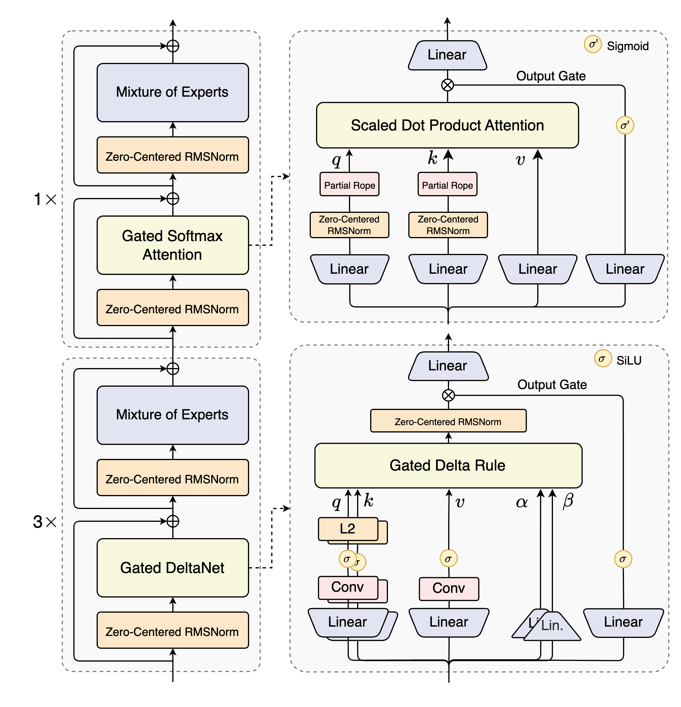
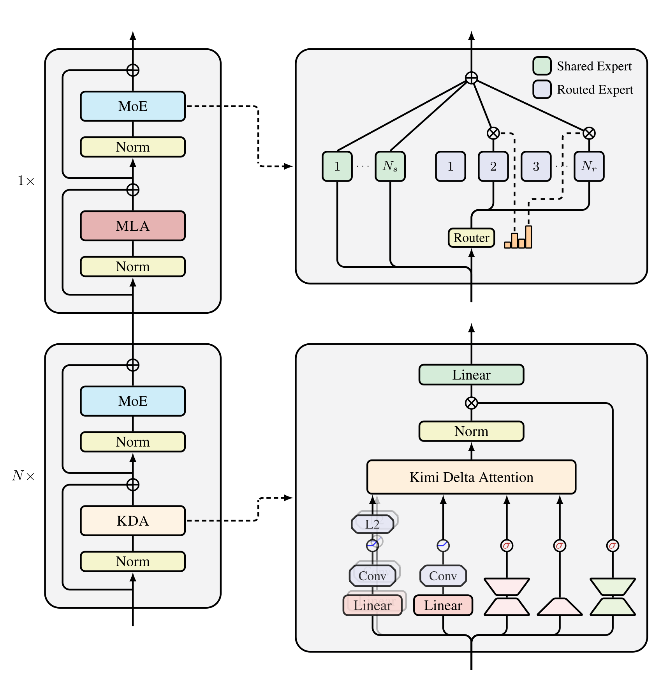
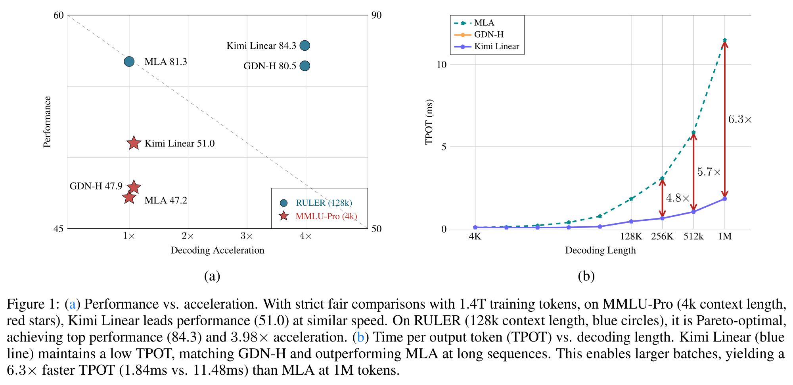
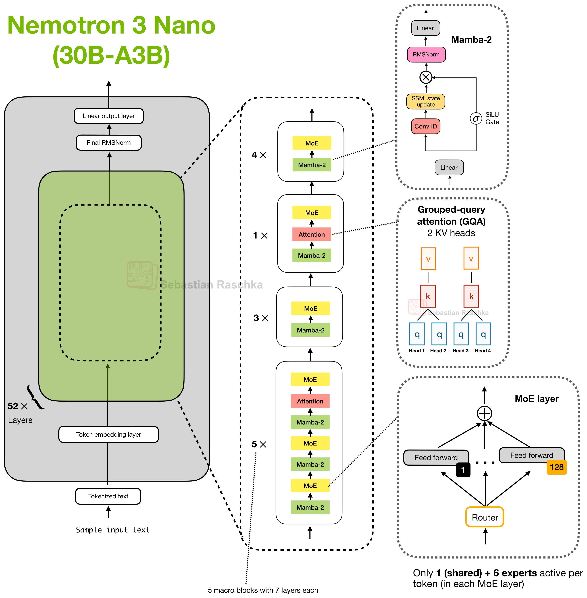

# LLM 主流模型结构之 Recurrent / Linear Attention

[Dense Attention](<LLM主流模型结构之Dense Attention.md>) 中的 GQA、MLA 改变历史 K/V 的表示方式，[Sparse Attention](<LLM主流模型结构之Sparse Attention.md>) 中的 SWA、DSA 则减少当前 Query 读取的位置。线性注意力与选择性状态空间模型采用了另一种保存历史的思路：**把已经读过的内容汇入固定大小的状态，再按当前输入从状态中读取信息。**

它借鉴了 RNN 的递归记忆：每一步接收新输入，更新隐藏状态，再产生输出。区别在于，GDN、KDA 等结构通常维护的是多个 head 的**矩阵状态**，可以把它理解为持续更新的 Key→Value 关联记忆。

以单个 head 为例，统一使用列向量，将状态写为 $S_t\in\mathbb R^{d_v\times d_k}$。省略特征映射与归一化后，最简单的线性 Attention 可以写成：

$$
\begin{aligned}
S_t&=S_{t-1}+v_tk_t^{\mathsf T},\\
o_t&=S_tq_t.
\end{aligned}
$$

外积 $v_tk_t^{\mathsf T}$ 把当前 Key、Value 的关联写入状态，$S_tq_t$ 则按 Query 读取。若从零状态开始，展开后就是 $o_t=\sum_{j\le t}v_j(k_j^{\mathsf T}q_t)$：历史 Value 的贡献取决于它的 Key 与当前 Query 的匹配程度。这里没有沿历史位置执行 Softmax，可以利用乘法结合律先聚合 K/V，再计算输出。

**Linear 指序列长度上的计算复杂度。** 固定 head 数和状态维度时，这类递归核心处理 $T$ 个 token 的成本随 $T$ 线性增长；Decode 更新一步所需的状态大小与历史长度无关。输入投影、激活和门控仍然可以是非线性的，也不要求训练或 Prefill 逐 token 串行执行。

固定状态也意味着有限的记忆容量。不同历史关联共享同一组状态元素，可能相互干扰；持续累加还会让无用信息占据记忆。因此，关键问题变成了：**保留多少旧信息，如何写入新信息，以及如何修正已有的关联。** Gated DeltaNet、Kimi Delta Attention 和 Mamba-2 在这些问题上采用了不同的更新方式。

## GDN：遗忘与定向更新

**Gated DeltaNet（GDN）**结合了遗忘门与 **Delta Rule**。遗忘门控制旧状态保留多少，Delta Rule 则根据当前 Key 的预测误差，定向修改对应的 Value 关联。

可以把一步更新分成“先衰减、再修正”：

$$
\begin{aligned}
\widetilde S_t&=\alpha_tS_{t-1},\\
S_t&=\widetilde S_t
  +\beta_t\bigl(v_t-\widetilde S_tk_t\bigr)k_t^{\mathsf T},\\
o_t&=S_tq_t.
\end{aligned}
$$

$\alpha_t$ 是每个 head 的标量衰减门，由当前输入产生。接近 1 时保留较多旧记忆，较小时释放更多状态容量。$\beta_t$ 控制本次修正的强度。

$\widetilde S_tk_t$ 表示：**用当前 Key 去读旧记忆，它会给出什么 Value？** 将这个预测与新 Value $v_t$ 相减，得到需要补上的误差，再沿 $k_t$ 的方向写回状态。于是，新信息既可以补充记忆，也可以修正过时的关联。

例如，某个归一化 Key 表示“颜色”，旧状态在这个 Key 上读出“红色”，新输入希望写入“蓝色”。取理想化的 $\alpha_t=\beta_t=1$，Delta 更新写入的是“蓝色 − 红色”，更新后用同一 Key 读取就得到“蓝色”；直接累加则会把红色与蓝色叠在一起。与这个 Key 正交的关联在这一步保持原值。实际学习到的 Key 会有重叠，门控也通常是连续值，因此模型需要共同学习检索方向、遗忘程度与写入强度。

从这个角度看，$S_t$ 类似推理过程中持续更新的临时权重，常称为 **fast weights**：它学习当前序列里的 Key→Value 映射，产生 Q/K/V 和门控的模型参数仍由训练得到。

Qwen3-Next 将 GDN 与 **Gated Full Attention** 交替放入模型。80B-A3B 版本共有 48 层，按 **3 层 GDN + 1 层 Full Attention** 重复，即 36 层 GDN、12 层 Full Attention。Qwen3.5 也继续采用这类 3:1 混合布局。

[{ width=700 }](../../assets/ai-infra/linear-attention/qwen3-next-gdn-gated-attention.png)

图的下半部分是 GDN：输入先投影为 Q/K/V，经过短因果卷积与 SiLU，Q/K 再做 L2 归一化，随后进入 Gated Delta Rule。Qwen3-Next 的卷积核大小为 4，短卷积补充邻近 token 的局部信息，递归状态承载更长的历史。状态读出的结果经过归一化、**SiLU 输出门**和输出投影，回到模型隐藏维度。

这里有三种不同用途的门：$\alpha_t$ 控制旧记忆的衰减，$\beta_t$ 控制关联的修正，输出门控制本次读出的特征传给后续层多少。前两者改变递归状态，输出门作用于读取结果。

上半部分的 Full Attention 仍执行 Softmax Attention，采用 GQA、QK-Norm 与 Partial RoPE，并在 Attention 输出后加入 **Sigmoid 输出门**。它保留按历史位置检索的能力，与大部分 GDN 层的递归记忆配合。

因此，Qwen 的混合结构同时保存两类推理状态：GDN 层的矩阵状态与短卷积缓冲区，以及 Full Attention 层的历史 KV Cache。**固定大小的记忆属于 GDN 层，整个模型的缓存仍会随上下文增长。**

## KDA：按通道控制记忆

**Kimi Delta Attention（KDA）**沿用 Gated Delta Rule，将 GDN 的标量遗忘门扩展为**按 Key 特征通道变化的向量门**。GDN 在一个 head 内统一衰减全部状态，KDA 则让同一 head 的不同特征方向保留不同数量的旧信息。

沿用上文 $d_v\times d_k$ 的状态约定，核心更新为：

$$
\begin{aligned}
\widetilde S_t&=S_{t-1}\operatorname{Diag}(\boldsymbol\alpha_t),\\
S_t&=\widetilde S_t
  +\beta_t\bigl(v_t-\widetilde S_tk_t\bigr)k_t^{\mathsf T}.
\end{aligned}
$$

读取仍然是 $o_t=S_tq_t$。Kimi 论文把状态写为 $d_k\times d_v$，对应这里的转置形式；两种写法表达相同的更新。

$\boldsymbol\alpha_t$ 有 $d_k$ 个分量，右乘对角矩阵会分别衰减状态的各列。例如，一些通道的衰减因子可以接近 0.99，另一些接近 0.1：前者保留更多旧状态，后者更快腾出容量。它作用于已经聚合历史的**特征通道**，由模型学习哪些方向适合长期保留、哪些方向需要快速更新。

Delta 修正仍然围绕当前 Key 的预测误差展开。因此，KDA 同时具有细粒度的遗忘与定向写入能力。它的状态转移由对角衰减和秩一修正组成，是 **Diagonal-Plus-Low-Rank（DPLR）** 转移的一种特例；这种结构也为高效的分块算法留下了空间。

[{ width=700 }](../../assets/ai-infra/linear-attention/kimi-linear-kda-mla-architecture.svg)

图中右下角展开了 KDA 模块。Q/K/V 同样经过短因果卷积与 Swish，Q/K 做 L2 归一化；向量衰减门与输出门使用低秩投影产生。KDA 的结果经过每个 head 的 RMSNorm，再乘上 **Sigmoid 输出门**并执行输出投影。这个输出门与状态中的衰减门、修正门承担不同作用。

**KDA 是其中的递归模块，Kimi Linear 是混合模型。** 它主要按 3 层 KDA、1 层 Full MLA 交替；发布的 27 层模型实际包含 20 层 KDA、7 层 Full MLA，最后一层为 MLA。KDA 负责大部分序列处理，少量 MLA 层提供全局的、按历史 token 匹配的检索。

这里的 Full MLA 使用 **No Position Encoding（NoPE）**，完整注意力层不添加 RoPE。位置信息与近邻偏置主要由 KDA 的递归顺序、衰减及短卷积提供。MLA 仍保留联合 KV latent 与矩阵吸收的思路，但位置分支与 DeepSeek-V3 的解耦 RoPE 设计不同，不能直接照搬后者的结构。

论文报告长上下文下 **KV Cache 用量最多减少约 75%**，这与主要采用 3:1 的 KDA/MLA 布局对应：只有较少的 MLA 层继续保存逐 token 的历史缓存。KDA 的矩阵状态和卷积缓冲区还需要额外存储；随着序列变长，Full MLA 层的 latent 缓存仍然增长。

[{ width=800 }](../../assets/ai-infra/linear-attention/kimi-linear-quality-decoding-results.svg)

左图比较的是 **1.4T 训练 token 的匹配实验**，MLA、GDN-H 与 Kimi Linear 使用对应的全 MLA 或混合结构。Kimi Linear 在 MMLU-Pro 上为 51.0，在 RULER 128K 上为 84.3，展示了细粒度记忆更新与混合全局检索可以兼顾质量和效率。

右图是每个输出 token 的耗时 **TPOT**。论文在 1M 长度下报告约 6.3 倍差距，Kimi Linear 与 MLA 分别为 1.84 ms、11.48 ms；减少缓存还允许使用更大的 batch。这是论文条件下的模型解码结果，不能直接当作所有长度、batch 下 KDA 算子的固定加速倍数。

递归形式也可以转换为 **chunkwise parallel** 计算：将序列分块，块内利用矩阵运算并行处理，块间传递状态。GDN 与 KDA 都有这类实现，KDA 的专用算法进一步利用其状态转移结构，让细粒度遗忘能与 Tensor Core 矩阵计算配合。Prefill 与训练可以走分块路径，逐 token Decode 则直接更新递归状态。

## Mamba-2：选择性状态空间更新

**Mamba-2 的主要归类是选择性状态空间模型（Selective SSM）。** 它也采用递归状态，其 **State Space Duality（SSD）** 框架建立了 SSM 与一类结构化线性 Attention 的联系，因此可以放在同一条“固定状态处理序列”的思路下理解。

SSM 用状态转移、输入写入和输出读取描述序列处理。Mamba 的选择性体现在：写入与读取系数随当前输入变化，离散化步长也由输入控制，使模型能够选择保留或忽略哪些信息。

将单个 head 的状态写成 $H_t\in\mathbb R^{d_h\times d_s}$，Mamba-2 的简化核心可以表示为：

$$
\begin{aligned}
H_t&=a_tH_{t-1}+x_t\bar b_t^{\mathsf T},\\
y_t&=H_tc_t+D x_t,\\
a_t&=\exp(\Delta_t A).
\end{aligned}
$$

$x_t$ 是该 head 的输入特征，$\bar b_t$ 控制如何把输入写入状态，$c_t$ 控制如何读取状态；$\bar b_t$ 已包含离散化带来的写入系数。$D x_t$ 是直接传递当前输入的跳连分量。

$A$ 是每个 head 学到的负标量，$\Delta_t$ 是输入相关的正步长。它们得到离散衰减 $a_t$：步长较大时旧状态衰减更多，同时也会改变输入写入的尺度。Mamba-2 将每个 head 的状态转移约束为**标量乘单位矩阵**，让一个 head 内的状态使用相同的时间衰减，这也是 SSD 能高效计算的关键结构。

与 GDN/KDA 的联系在于，它们都以矩阵状态汇入历史，再根据当前输入读取。更新侧的区别是，Mamba-2 采用**衰减加选择性写入**；GDN/KDA 还利用“新 Value 与旧记忆预测之差”，沿当前 Key 修正关联。KDA 则进一步把统一的时间衰减细化到特征通道。

把 Mamba-2 的递归展开后，每个历史输入对当前输出的贡献，由读写向量的匹配与沿途衰减的乘积共同决定。这可以写成带结构化因果掩码的 Attention 形式。SSD 利用这种对偶关系，把长序列计算拆为块内矩阵计算与块间状态传递，从而兼顾递归推理与 GPU 上的并行计算。

实际 Mamba-2 模块还包括输入投影、短因果卷积、SiLU 门控、归一化与输出投影。短卷积保留局部模式，SSM 状态聚合更长历史，输出门控制送往后续层的特征。

[{ width=700 }](../../assets/ai-infra/linear-attention/raschka-nemotron3-nano-mamba2-gqa-hires.webp)

**Nemotron 3 Nano** 采用这种 Mamba-Transformer 混合结构。52 层中包含 23 层 Mamba-2、6 层 GQA 和 23 层 MoE；负责 token 之间信息交互的是前两类，MoE 处理各位置的特征变换。

图中右上角展示 Mamba-2 的处理路径，右侧中部展示 GQA 的 K/V 共享关系。GQA 示意用 4 个 Query 画出分组，实际模型配置是 **32 个 Query head、2 个 KV head**。少量 GQA 层保留按历史位置读取的能力，大部分 token 交互由递归 SSM 完成。

Mamba-2 层在 Decode 时保存 SSM 状态与卷积缓冲区，它们的大小不随历史长度增长；6 层 GQA 的 KV Cache 仍然随序列增长。它与 Qwen、Kimi 的混合设计具有相似的分工：**用固定状态降低大部分层的长序列成本，再由 Full Attention 补充显式的历史检索。** 整个模型的缓存和 Prefill 计算仍包含 Full Attention 部分，需要按实际层组成判断收益。

## 参考

- [LLM Attention 变体详细总结](https://zhuanlan.zhihu.com/p/2041537304318235012)
- [A Visual Guide to Attention Variants in Modern LLMs](https://magazine.sebastianraschka.com/p/visual-attention-variants)
- [LLM Architecture Gallery](https://sebastianraschka.com/llm-architecture-gallery/)
- [Gated Delta Networks: Improving Mamba2 with Delta Rule](https://arxiv.org/abs/2412.06464)
- [Qwen3-Next](https://qwen.ai/blog?id=4074cca80393150c248e508aa62983f9cb7d27cd) 及 [80B-A3B 配置](https://huggingface.co/Qwen/Qwen3-Next-80B-A3B-Instruct/blob/main/config.json)
- [Qwen3.5-397B-A17B 配置](https://huggingface.co/Qwen/Qwen3.5-397B-A17B/blob/main/config.json)
- [Kimi Linear: An Expressive, Efficient Attention Architecture](https://arxiv.org/abs/2510.26692)
- [Kimi Linear 48B-A3B 配置](https://huggingface.co/moonshotai/Kimi-Linear-48B-A3B-Instruct/blob/main/config.json)
- [Transformers are SSMs](https://arxiv.org/abs/2405.21060)
- [Nemotron 3 Nano Technical Report](https://arxiv.org/abs/2512.20848) 及 [模型配置](https://huggingface.co/nvidia/NVIDIA-Nemotron-3-Nano-30B-A3B-BF16/blob/main/config.json)

