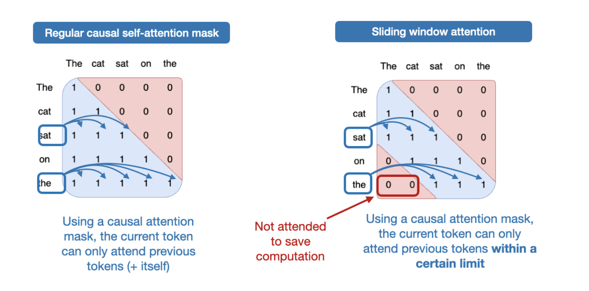
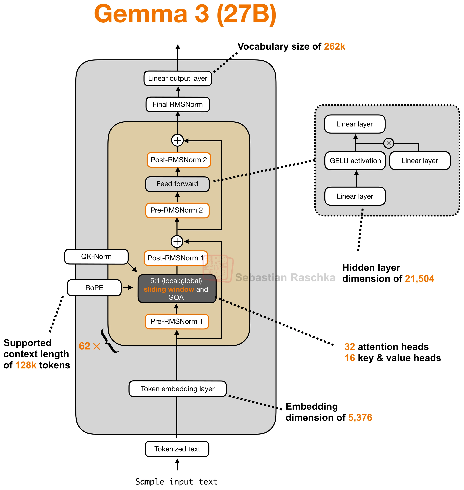
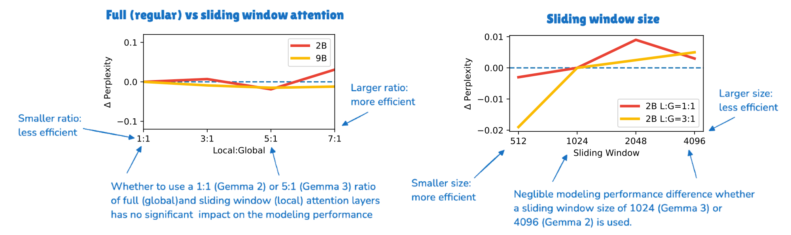
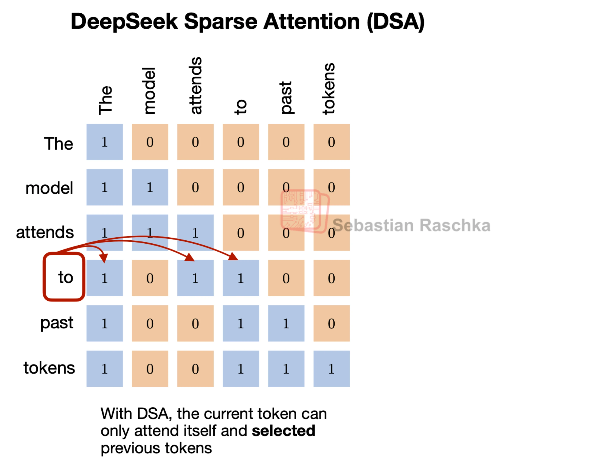
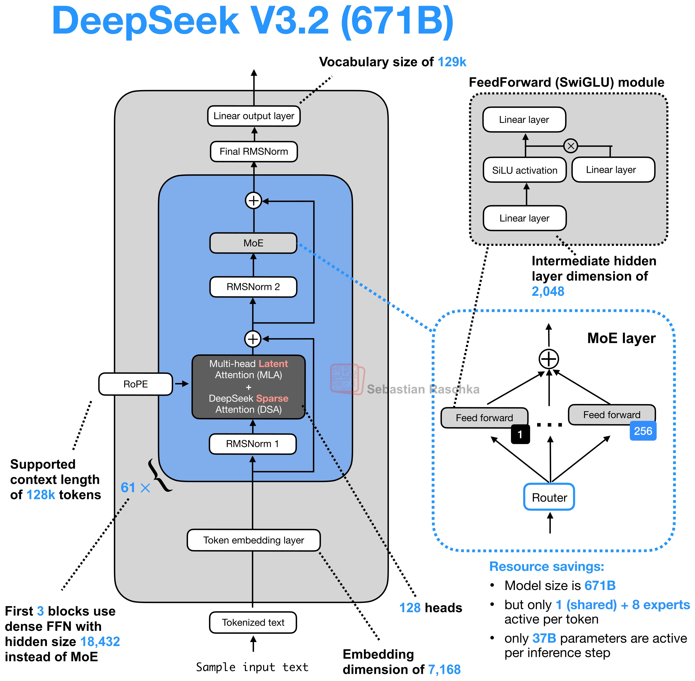
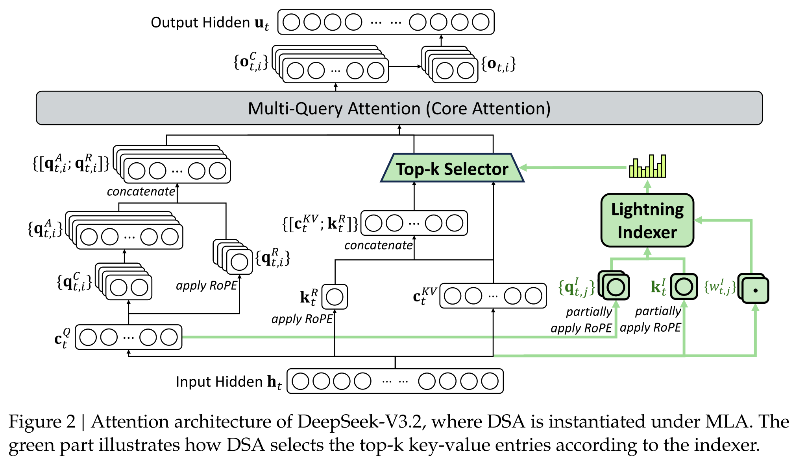
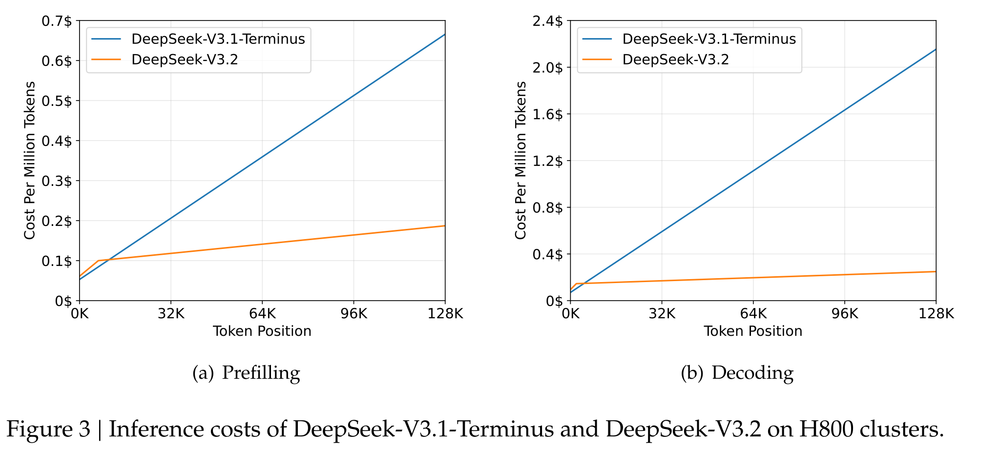

# LLM 主流模型结构之 Sparse Attention

[Dense Attention](<LLM主流模型结构之Dense Attention.md>) 中，MHA、GQA/MQA 与 MLA 调整了多头表示和 KV Cache 的保存方式，当前 Query 仍然读取因果掩码允许的全部前缀。**Sparse Attention 进一步缩小每个 Query 参与注意力计算的历史位置集合**，降低长上下文下的读取与计算开销。

SWA 按位置保留一个固定的局部窗口，DSA 则根据当前 token 的表示动态选择相关位置。两者都保留因果约束，并在选中的位置上计算注意力分数、Softmax 和 Value 加权；稀疏连接的计算收益，需要由能够跳过未选中位置的 Kernel 实现。

## SWA：固定窗口内的局部 Attention

**Sliding Window Attention（滑动窗口注意力）**让每个 Query 只读取自身及附近的一段历史。若窗口大小为 $w$，并把当前位置计入窗口，那么第 $t$ 个 token 的可见位置就是 $\max(1,t-w+1)\le s\le t$。随着生成继续，窗口向右移动，较早的位置退出当前层的直接读取范围。

[{ width=700 }](../../assets/ai-infra/sparse-attention/raschka-causal-vs-sliding-window-hires.png)

图中蓝色区域的 1 表示允许访问，红色区域的 0 表示屏蔽。左侧的因果 Attention 保留整个下三角；右侧窗口大小为 3，只保留沿对角线移动的带状区域。例如末尾的 `the` 直接读取 `sat`、`on`、`the`，更早的 `The`、`cat` 不参与这一层的注意力计算。

**窗口限制的是单层的直接连接，跨层仍然可以传播更早的信息。** 下一层读取的是各位置上一层的表示：`on` 已经融合了 `cat`、`sat`、`on` 的信息，因此末尾的 `the` 可以通过它间接获得更早的上下文。窗口重叠和层数叠加扩大了信息传播范围，但多跳传递可能损失细节，也不能保证远处的信息都能被有效保留。

Gemma 将局部层与全局层穿插使用：局部层处理附近 token 的交互，全局层提供直接读取完整可见前缀的机会，补充长距离的信息联系。

**Gemma 2** 按 **1 个局部层、1 个全局层**交替排列，局部窗口为 **4096**，全局 Attention 的上下文跨度为 **8192**。**Gemma 3** 提高局部层比例，采用 **5 个局部层、1 个全局层（5:1）**的排列，从局部层开始，局部窗口缩小为 **1024**。

[{ width=700 }](../../assets/ai-infra/sparse-attention/raschka-gemma3-27b-swa-architecture-hires.webp)

图中以 27B 模型展示 Attention 在 Block 中的位置；实际 62 层按上述模式穿插局部与全局 Attention。Gemma 3 的 Attention 还采用 GQA，**GQA 减少 KV head 数，SWA 减少每个 Query 读取的 token 数**，两种设计可以同时使用，Query 的匹配和 Value 加权仍在各个 head 内进行。

局部窗口为 1024，也不意味着模型只能处理 1024 个 token。Gemma 3 的 **4B、12B、27B 支持 128K 上下文，1B 支持 32K**；全局层负责跨越局部窗口的直接交互。两类层也使用不同的 RoPE base frequency：局部层为 10K，全局层为 1M，并配合长上下文扩展。

SWA 的收益既体现在计算，也体现在缓存。对于长度为 $N$ 的序列，单个局部层在 Prefill 中只计算窗口内的连接，注意力部分的工作量约为 $O(Nw)$。Decode 时，在支持窗口缓存管理的后端中，局部层只需保留最近 $w$ 个位置的 K/V，可以滚动复用缓存空间；全局层仍然需要保留完整历史。因此，Gemma 的混合模型仍包含全局层的二次方计算和随上下文增长的缓存。

局部层比例与窗口大小需要结合模型质量选择。Gemma 3 的消融分别改变 Local:Global 比例和局部窗口，观察验证集上的困惑度变化：

[{ width=800 }](../../assets/ai-infra/sparse-attention/gemma3-local-global-ablation.svg)

左图比较 1:1 到 7:1 的局部与全局层比例，右图比较 512 到 4096 的局部窗口。所测试的文本模型中，困惑度变化较小，说明可以通过增加局部层、缩小窗口降低成本。这些实验支持 Gemma 的结构选择，具体任务中的长距离检索能力仍需单独评估。

## DSA：按当前 Query 动态选择历史 token

**DeepSeek Sparse Attention（DSA）**先用一个轻量的 **Lightning Indexer** 为可见位置打分，再通过 **Top-k Selector** 选出一部分 token，交给主 Attention 计算。选中位置由当前 token 决定，可以分散在较远的前缀中。

[{ width=700 }](../../assets/ai-infra/sparse-attention/raschka-dsa-token-selection.png)

沿用前面的句子，位置 `to` 在窗口大小为 3 的 SWA 中读取 `model`、`attends`、`to`；图中的 DSA 则选择 `The`、`attends`、`to`，跳过较近的 `model`，保留更远的 `The`。**被选中的位置可以不连续，集合也会随 Query 改变。** 蓝色的 1 表示允许参与本轮计算，实际注意力权重还需要由主 Attention 计算。

DeepSeek-V3.2-Exp 在 DeepSeek-V3.1-Terminus 的 MLA 上引入 DSA，DeepSeek-V3.2 沿用相同架构。**MLA 压缩每个 token 的 KV 表示，DSA 减少主 Attention 本轮读取的 token 数**，两者分别控制单个缓存条目的大小和参与计算的条目数量。即使每条缓存已经很小，全前缀匹配仍随上下文增长而变贵，这就是继续引入稀疏选择的动机。

[{ width=700 }](../../assets/ai-infra/sparse-attention/raschka-deepseek-v32-dsa-architecture.webp)

Indexer 有自己的 Query、Key 和 head 权重。对当前 token 的隐藏状态 $h_t$，生成各个索引 head 的 $q^I_{t,j}$ 与权重 $w^I_{t,j}$；每个历史位置的隐藏状态 $h_s$ 生成一个索引 Key $k^I_s$。其核心评分为：

$$
I_{t,s}=\sum_{j=1}^{H_I}w^I_{t,j}\,
\operatorname{ReLU}\left((q^I_{t,j})^{\mathsf T}k^I_s\right).
$$

$H_I$ 是 Indexer 的 head 数。各 head 的匹配分数经过 ReLU，再按当前 token 产生的权重汇合，得到该位置用于排序的一个分数。DeepSeek-V3.2-Exp 的实现使用 64 个索引 head，每个 head 为 128 维，并可用 FP8 执行；它省去了主 Attention 的完整内容与位置匹配、Value 加权等工作，对全部候选位置初筛的成本更低。

Top-k 根据 $I_{t,s}$ 返回**位置索引**。DeepSeek-V3.2 为每个 Query 选择 **2048 个 KV 位置**；可见位置不足时使用全部可见位置。选择范围仍受因果掩码限制，未来 token 不会因为得分高而变得可见。

[{ width=700 }](../../assets/ai-infra/sparse-attention/deepseek-v32-mla-indexer-topk.svg)

图中绿色分支负责选择位置，主分支负责实际 Attention。Indexer 可以复用 MLA 的 Query 低秩中间表示 $c_t^Q$，再经过自己的投影生成索引 Query；索引 Key 也由独立投影产生，并维护自己的历史缓存。**索引 Key 与 MLA 的 KV latent 是两种表示，索引分数也不是主 Attention 的权重。**

图中的主分支采用 MLA 的 **MQA-mode**。拿到位置集合后，它读取这些位置对应的 KV latent $c_s^{KV}$ 与位置 Key $k_s^R$，计算内容匹配和位置匹配，在选中集合上做 Softmax，再得到加权输出。图中的 $q^A$ 是吸收 Key 上投影后的内容 Query，相关计算见 [MLA 的低秩压缩与矩阵吸收](<LLM主流模型结构之Dense Attention.md#mla>)。

**同一 token 的多个主 Attention head 共用选中位置集合，但保留各自的注意力分布和输出。** 某个位置被 Indexer 选中，只表示它进入候选集合；各 head 会根据自己的 Query 重新判断它的权重。

Indexer 的训练目标来自主 Attention。初始化时保留 Dense Attention，冻结主模型，只训练 Indexer：把主 Attention 多个 head 的注意力分布聚合并归一化，用 KL 散度让索引分数经 Softmax 后的分布与之对齐。随后启用 Top-k，继续训练主模型，使其适应稀疏连接；Indexer 继续在选中集合上对齐主 Attention。这样，主模型按语言建模目标学习，Indexer 则学习哪些位置值得被主模型读取。

动态选择与缓存淘汰也需要区分。**本轮未选中的历史位置，下一轮仍可能被选中。** DSA 因此仍需保存历史 MLA 缓存，并额外维护 Indexer 的 Key 缓存；Top-k 主要减少主 Attention 的计算与缓存读取，不能像固定窗口那样直接把所有未选中的历史永久丢弃。

对长度为 $N$ 的 Prefill，主 Attention 的工作量从 $O(N^2)$ 降为约 $O(Nk)$，其中 $k$ 为选中位置数。**Indexer 仍需为各个 Query 检查可见历史，整体仍有 $O(N^2)$ 的索引计算**，只是这部分更轻。Decode 中也要先扫描历史索引 Key，再由主 Attention 读取选中的条目；在 128K 前缀上，2048 个位置约为全部候选位置的 1/64，这个比例描述主 Attention 的读取集合。

[{ width=700 }](../../assets/ai-infra/sparse-attention/deepseek-v32-inference-cost.svg)

图中横轴是 token 在序列中的位置，纵轴是每百万 token 的推理成本。随着前缀增长，DeepSeek-V3.2 的 Prefill 和 Decode 成本增长更缓，长上下文下与 Dense MLA 基线的差距扩大。这是基于实际 H800 服务测试、按每 GPU 每小时 2 美元租金估算的计算成本，速度收益还包含具体 Kernel 与部署实现。

质量方面，DeepSeek-V3.2-Exp 与 DeepSeek-V3.1-Terminus 使用对齐的数据和相同的后训练策略，在短上下文与长上下文评估中保持了接近的表现。它说明，经训练的动态稀疏连接可以在降低成本的同时保留有竞争力的能力。最终 DeepSeek-V3.2 还有后训练和强化学习等变化，整体任务得分的提升包含多项因素。

## 参考

- [LLM Architecture Gallery](https://sebastianraschka.com/llm-architecture-gallery/)
- [1.5 万字速通 LLM 主流模型结构](https://zhuanlan.zhihu.com/p/2060741715095560795)
- [DeepSeek 文本模型的 Attention 架构演进](https://zhuanlan.zhihu.com/p/2033298038605751155)
- [LLM Attention 变体详细总结](https://zhuanlan.zhihu.com/p/2041537304318235012)
- [A Visual Guide to Attention Variants in Modern LLMs](https://magazine.sebastianraschka.com/p/visual-attention-variants)
- [The Big LLM Architecture Comparison](https://magazine.sebastianraschka.com/p/the-big-llm-architecture-comparison)
- [Gemma 2: Improving Open Language Models at a Practical Size](https://arxiv.org/abs/2408.00118)
- [Gemma 3 Technical Report](https://arxiv.org/abs/2503.19786)
- [DeepSeek-V3.2](https://arxiv.org/abs/2512.02556)
- [DeepSeek-V3.2-Exp](https://github.com/deepseek-ai/DeepSeek-V3.2-Exp)
- [DeepSeek-V3.2-Exp 推理实现](https://huggingface.co/deepseek-ai/DeepSeek-V3.2-Exp/blob/main/inference/model.py)
- [DeepSeek-V3.2-Exp 配置](https://huggingface.co/deepseek-ai/DeepSeek-V3.2-Exp/blob/main/config.json)

