---
tags:
  - vLLM
  - KV Cache
  - 推理调度
title: PD 分离推理架构详解
description: Prefill 与 Decode 的计算差异、混合部署中的性能干扰，以及分离部署和 KV Cache 传输机制。
date: 2026-10-18
---

# PD 分离推理架构详解

在大语言模型推理过程中，prefill 阶段和 decode 阶段具有截然不同的计算特性：

- prefill 阶段需要并行处理整个输入序列来生成首个 token，属于计算密集型操作。
- decode 阶段则逐个生成后续 token，需要频繁访问 KV cache，属于内存密集型操作。

传统的 continuous batching 将两个阶段混合处理，导致相互干扰，难以同时满足 TTFT（首 token 延迟）和 TPOT（token 间延迟）的严格要求。为了解决这一问题，PD 分离架构应运而生，通过将 prefill 和 decode 分配到不同的 GPU 实例上，针对各自特性进行专门优化。这种分离式设计不仅消除了阶段间的干扰，还能显著提升系统的有效吞吐量（Goodput），为大规模 LLM 服务提供了更优的解决方案。

## 1、吞吐量（Throughput）vs 有效吞吐量（Goodput）

目前，大多数 LLM 服务系统（如 vLLM、TensorRT-LLM）都以吞吐量（Throughput） 作为主要性能指标——即单位时间内处理的请求数（RPS）或生成的 token 数。这种度量方式直观，并且与成本（$/req）有直接关联，因此被广泛采用。

实际上，下游应用的类型多种多样，它们在用户体验上的延迟需求各异，因此需要满足的服务等级目标（SLO）也存在显著差异。大模型服务中最常用的 SLO 包括：

- TTFT (Time To First Token)：首 token 响应延迟，直接影响用户的等待体验。
- TPOT (Time Per Output Token)：衡量两个连续生成的 token 之间的平均延迟，决定交互的流畅程度。

例如，实时聊天机器人更关注低 TTFT 以保证响应及时，而 TPOT 只需快于人类阅读速度（约 250 词/分钟）即可；相反，文档摘要则更强调低 TPOT，以便更快地产生完整摘要。

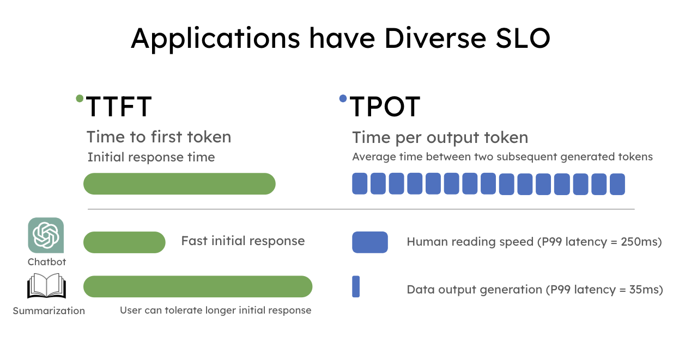{ width="800" }

单纯依赖 Throughput 作为指标，并不能反映延迟表现，系统看似处理了大量请求，但其中不少未能满足 SLO，最终呈现给用户的仍是不理想的服务体验。

- **Throughput（吞吐量）**：通常指系统单位时间内处理的 token 数或请求数。很多工作把“提高吞吐量”作为主要优化目标，但在实际场景下，这并不直接代表用户体验。
- **Goodput（有效吞吐量）**：指系统在满足延迟约束（如 TTFT/TPOT SLO）的前提下，真正完成的请求数量。如果一个请求因为延迟过长而被用户放弃，或者超过服务约束而无效，那么即便它产生了 token，也不能算作有效产出。

在 [DistServe](https://arxiv.org/abs/2401.09670) 论文中，引入了 Goodput 概念，**即在满足 SLO（TTFT 和 TPOT 要求）的前提下，每秒完成的有效请求数** 。与单纯的吞吐量相比，Goodput 是更优的衡量指标，**因为它能够体现请求在满足 SLO 情况下的吞吐水平**，从而同时反映成本效益与服务质量。

为了简要说明 Goodput，假设某个应用要求至少 90% 的请求满足 TTFT < 200ms 且 TPOT < 50ms，则可以得到如下定义：

> Goodput (P90 TTFT < 200ms 且 P90 TPOT < 50ms) 表示在至少 90% 的请求同时满足 TTFT < 200ms 和 TPOT < 50ms 的条件下，系统所能维持的最大每秒请求数。

下图展示了一个简单的例子：某应用的吞吐量为 10 RPS（每秒请求数），但由于延迟约束的限制，只有 3 RPS 的请求满足 SLO，因此该系统的 Goodput 仅为 3 RPS。可以想象，用户在这样一个高吞吐但低 Goodput 的系统中，依然会感受到较差的服务体验。

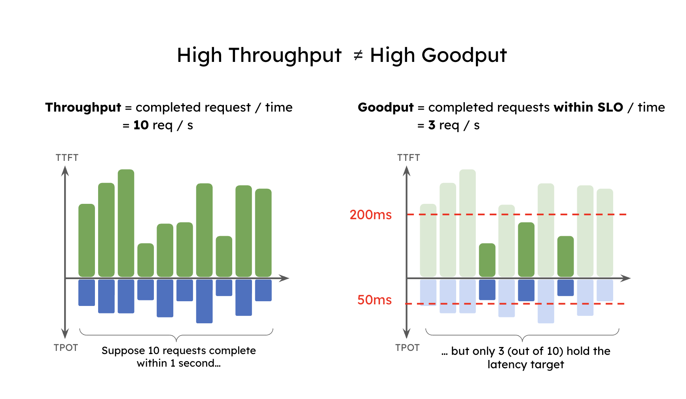{ width="850" }

## 2、Prefill 与 Decode 共置导致干扰

在 LLM 服务中请求的生命周期通常包含两个阶段：prefill（生成首个 token）和 decode（逐步生成后续 token）。大多数现有系统（如 vLLM、TensorRT-LLM）采用 continuous batching 技术，将 prefill 和 decode 混合在一起统一批处理。这种方式确实能够提升整体吞吐量，但由于两者计算特性和 SLO 目标差异显著，将它们共置在同一 GPU 上往往并不理想。

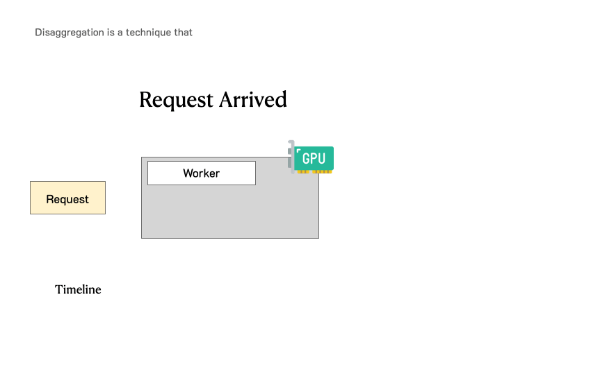{ width="800" }

如下图所示，continuous batching 会带来明显的干扰。**当 prefill 和 decode 被放在同一批次时，decode 请求的延迟（TPOT）会被显著拉长，而 prefill 请求的首 token 延迟（TTFT）也会有所增加。**

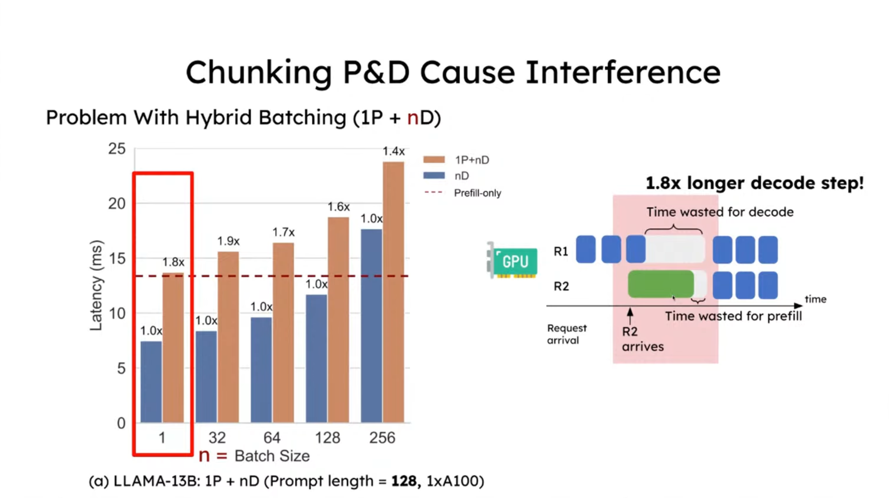{ width="900" }

图中展示了三种不同的执行方式：

* 1P+nD（棕色柱子）：1 个 prefill 与 n 个 decode 混合批处理。
* nD（蓝色柱子）：仅包含 decode 请求的批处理。
* prefill-only（红色虚线）：仅运行 prefill 请求的延迟。

**在 prompt 长度为 128 时，相比仅包含 decode 的请求，延迟增加约 1.8 倍；而当 prompt 长度为 1024 时，干扰效应显著放大，decode 延迟提升至 12.6 倍**

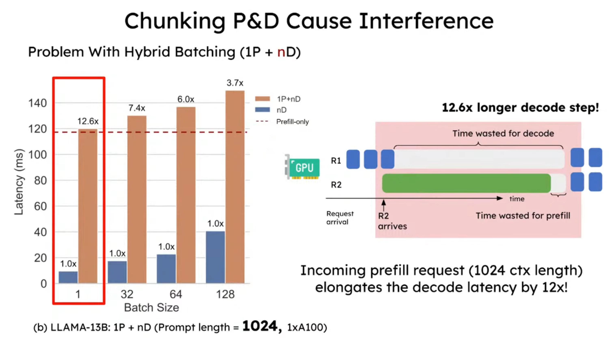{ width="900" }

由于这种干扰，如下图所示，当服务必须同时满足 TTFT 和 TPOT 的 SLO 时， **系统往往需要进行资源的过度配置才能达到延迟目标** ，尤其是在任一 SLO 要求较严格的情况下。

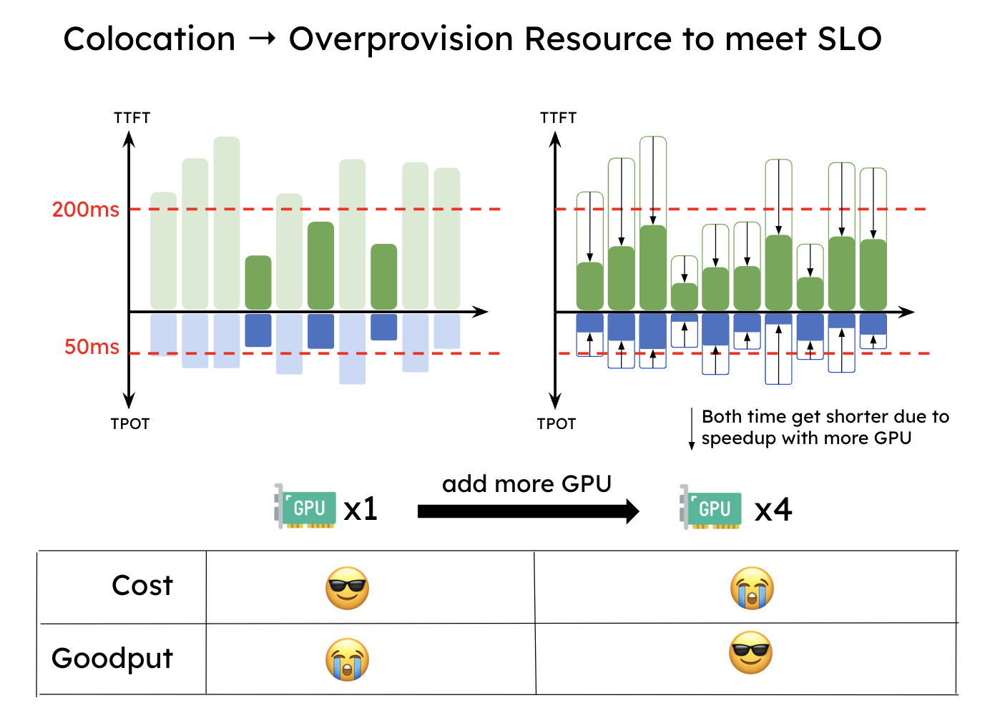{ width="800" }

## 3、PD 分离的整体思路

直观的思路很简单：将 prefill 和 decode 分离到不同的 GPU 上，并为每个阶段定制并行策略。这自然解决了前面提到的两个问题：

* **没有干扰** ：prefill 和 decode 各自独立运行，更快地完成计算，也更容易满足各自的 SLO。
* **资源分配与并行策略解耦** ：可以针对 prefill 和 decode 分别进行优化。

下图展示了在这样一个分离式系统中，请求是如何被处理的。当一个请求到达系统时，它会先被分配到 prefill worker 完成 prefill 阶段；随后系统将其中间状态（主要是 KV Cache）迁移到 decode worker，并执行多步 decode 以生成后续 token；当生成完成后，请求才会离开系统。

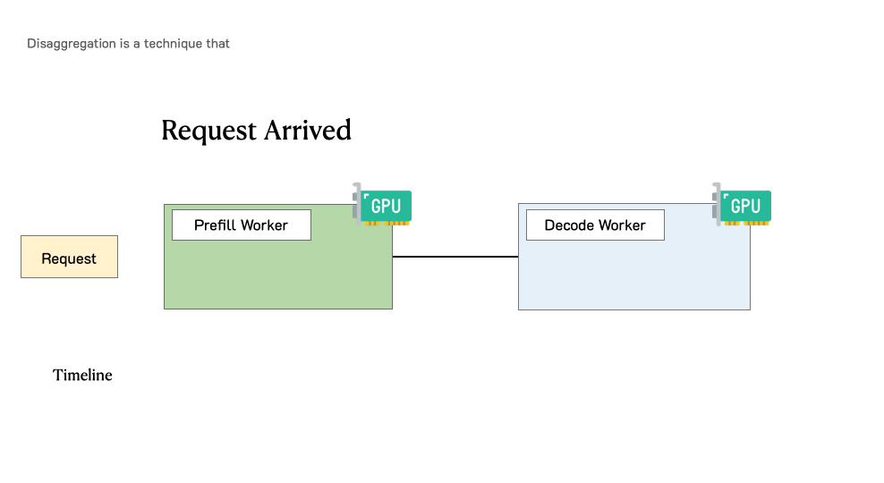{ width="800" }

让我们通过一个简单的实验来看看为什么 PD 分离是有益的。我们在一张 A100-80GB GPU 上运行一个 130 亿参数的 LLM，请求到达服从泊松分布，输入长度为 512，输出长度为 64。我们逐步增加请求速率（x 轴），并在下图测量两类延迟（P90 TTFT 和 P90 TPOT，y 轴）的变化。

假设我们设定 SLO：P90 TTFT = 0.4 秒，P90 TPOT = 0.04 秒（下图中的横线）。实验结果表明：在单卡情况下，现有系统大约可以在 3 rps 下满足 TTFT 的延迟约束，而 TPOT 只能维持在 1.6 rps（下图左边）。由于必须同时满足两个约束条件，现有共置系统的 Goodput = min(3, 1.6) = 1.6 rps/GPU。

在分离之后，性能得到了显著提升。如果单独处理一个阶段，prefill worker 和 decode worker 的 rps 都优于之前的结果 —— 如下图右边所示，一个 prefill worker 大约可达到 5.6 rps，一个 decode worker 大约可达到 10 rps。更重要的是，我们现在可以灵活地分配资源，例如配置 2 个 prefill worker + 1 个 decode worker（记作 2P1D），共 3 张 GPU。此时：

$$
Goodput (2P1D) = min(5.6 × 2, 10) = 10 reqs/s ÷ 3 GPUs ≈ 3.3 rps/GPU
$$

这个实验表明，即便没有引入任何并行优化，仅仅通过简单的分离，Goodput 就提升了约 2 倍。

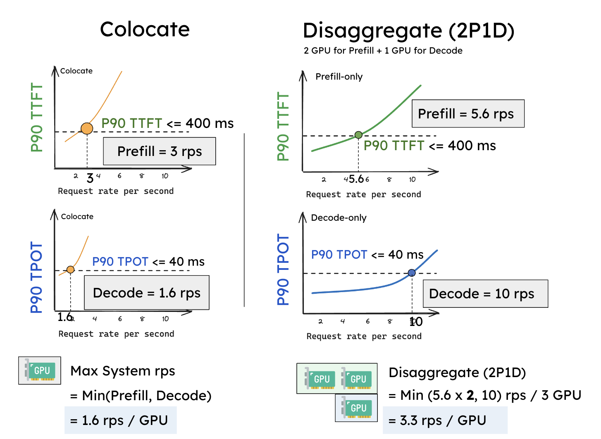{ width="850" }

## 4、分离式推理架构的优化方向

### 4.1、算力与存储

* prefill 阶段：拥有计算受限的性质（compute-bound），特别是在请求流量较大，用户的 prompt 也比较长的情况下。prefill 阶段算完 KV cache 并发给 decode 阶段后，理论上 prefill 就不再需要这个 KV cache 了（当然也可以采用 LRU 等策略对 KV cache 的保存做管理，而不是一股脑地清除）。
* decode 阶段：拥有内存受限的性质（memory-bound），因为逐个 token 的生成方式，decode 阶段要频繁从内存中读取 KV Cache，同时也意味着它需要尽可能保存 KV cache。

因此在分离式框架下，计算和存储可以朝着两个独立的方向做优化。

### 4.2、Batching 策略

* prefill 阶段：随着 batch size 的增加，吞吐量的提升很快趋于平缓。这是因为 prefill 属于 compute-bound，当 batch 中的总 tokens 数超过一定规模后，GPU 的计算能力已经被完全吃满，再增加请求只会延长整体处理时间，而不会带来明显的吞吐提升。
* decode 阶段：随着 batch size 的增加，吞吐量的增长趋势越来越显著。这是因为 decode 阶段是 memory-bound，即相比于计算，读写数据的时间要更多。所以在 decode 阶段中，如果我们能提升 batch size，就能把计算强度提起来，吞吐量就上去了。

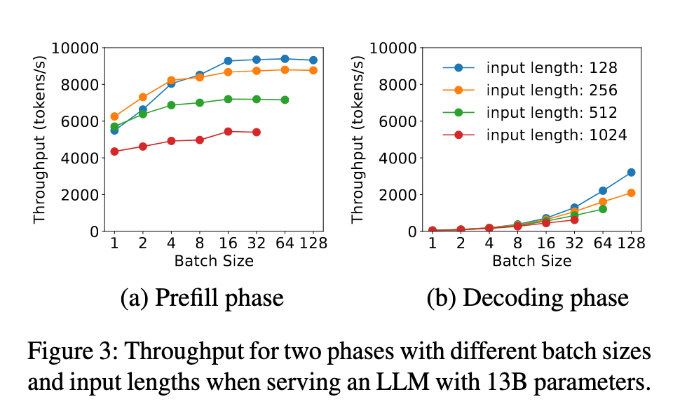{ width="800" }

在分离架构下，我们可以针对 prefill 和 decode 的特性对 batching 策略分别进行优化：

* 具体来说，对于 prefill 实例，需要事先结合特定的 LLM 和 GPU 做性能分析，找出输入长度的临界点——一旦超过这个点，prefill 就会进入 compute-bound，此时增加 batch size 只会拖慢整体处理速度。在实际应用中，用户的 prompt 往往已有数百个 tokens，因此  **prefill 的 batch size 通常保持较小** 。
* **相对地，decode 阶段更适合采用较大的 batch size，以充分提升 GPU 利用率和整体吞吐。**

### 4.3 并行策略

由于 prefill 和 decode 具有不同的计算模式和延迟目标，这两个阶段的最佳并行策略通常并不相同。例如，当 TTFT 要求严格而 TPOT 要求相对宽松时，prefill 更适合采用**张量并行**来满足低延迟，而 decode 则通常采用**数据并行**或**流水线**并行来提升吞吐。

## 5、KV Cache 传输

PD 分离带来的代价是需要在 prefill 和 decode 的 GPU 之间传输中间状态（即 KV cache）。接下来，我们来看看 KV cache 传输的开销分析、传输方式以及相关的优化策略。

### 5.1 KV Cache 传输开销

初看之下，KV cache 是 LLM 推理中巨大的内存开销，而 GPU 之间 KV cache 的传输似乎会成为瓶颈。然而，DistServe 的论文中展示了相反的结果：通过合理的放置，KV Cache 的传输开销可以被有效地最小化，甚至低于一次 decode 步骤的时间，这得益于当今高速互联网络（如 NVLink 和 PCI-e 5.0）。

假设我们在 GPU 之间使用 8 通道 PCIe 5.0 x16（每条链路 64GB/s）作为节点内互联。对于一个包含 2048 tokens 的请求，在服务 OPT-175B 时传输 KV cache 的延迟可以估算如下：

$$
Latency = 2048 tokens * (4.5 MB/token) / (64GB/s * 8) = 17.6 ms
$$

对于 OPT-175B，延迟小于单次 decode 步骤（在 A100 上约为 30-50 毫秒）。对于更大的模型、更长的序列或更先进的网络（例如带宽为 600GB/s 的 A100-NVLink），如下图所示，与单次 decoe 步骤相比，KV cache 传输相关的相对开销变得不那么显著。总之，通过精心安排 prefill 和 decode 工作节点以利用高带宽网络，可以有效隐藏 KV cache 传输的开销。

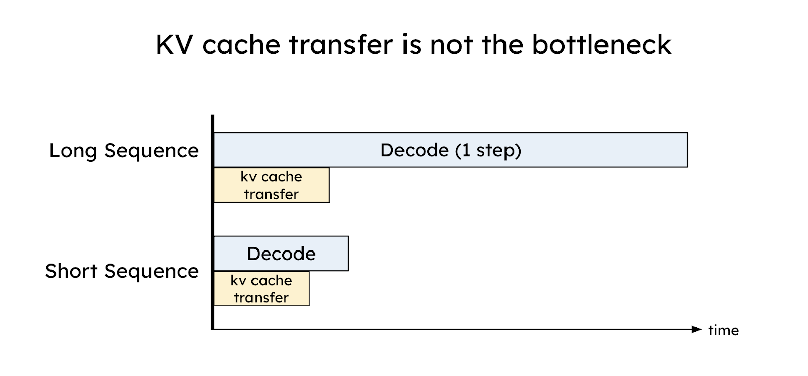{ width="800" }

### 5.2 KV Cache 传输方式

目前 KV cache 的传输主要有两种方式：**中心存储**和**点对点（P2P）** ，当然在实际系统中也可能采用二者结合的混合方案。

* **中心存储** ：建立一个跨设备的 KV store，由它统一管理 KV cache 的增、删、查和传递等操作。prefill 和 decode 实例只需与这个 KV store 交互，负责写入或读取数据。
* **P2P 传输** ：每个实例独立管理自己的存储。例如，一个 prefill 实例完成计算后，会直接与目标 decode 实例建立通信，将 KV cache 传过去，不依赖统一的中介。

两种方式各有优劣：

* **中心存储** ：更适合构建大规模集群，能充分利用多种存储介质和传输通道，并提升计算结果的复用效率，但在某些场景下性能可能受限，同时系统维护成本较高。
* **P2P 传输** ：架构更简单，性能表现通常更好，但在扩展性和链路稳定性方面会面临挑战。

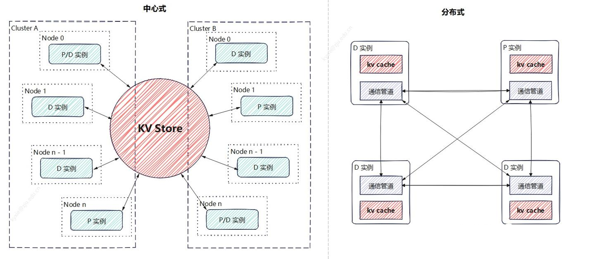{ width="950" }

### 5.3 KV Cache 传输的网络堆栈

现有的物理数据链路可以分为 3 类：

* **Direct** ，即 GPU 之间通过高速直连链路（如 NVLink 或 HCCS）相互连接。在这种情况下，可以利用底层的内存拷贝原语或集体通信库来完成数据传输。
* **Direct-NIC** ，即 GPU 通过其配套的网卡（NIC）进行通信。在这里，可以使用定制化的库，通过 PCIe 和以太网（或 InfiniBand）进行数据传输。
* **Indirect** ，即当 GPU 之间没有直接链路时，必须通过其 CPU 的 DRAM 中转数据，从而带来额外的内存拷贝开销。

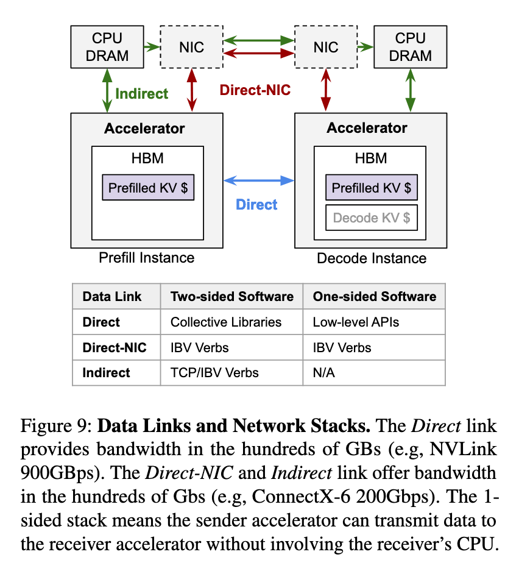{ width="600" }

### 5.4 KV Cache 传输粒度

KV cache 传输粒度可以分为 3 类：

* **请求级** ：等到 prefill 阶段完成后，将 KV cache 一次性传输。这种方式的好处是能够减少网络传输次数，因为每次传输的数据量更大，从而降低了通信开销。然而当 KV cache 大小较大时，会影响 TTFT 的延迟。
* **层级** ：Splitwise 通过在 prefill 阶段的计算与 KV cache 传输之间实现重叠来优化性能。**每一层计算完成后，都会异步传输该层的 KV cache，同时继续执行下一层的计算，从而降低传输开销。**层级传输还能带来额外优势，例如更早启动 decode 阶段，以及更早释放 prefill 端的内存。层级 KV cache 传输与下一层的 prefill 计算并行进行，这需要逐层的细粒度同步以确保正确性，因此可能会带来性能干扰并增加 TTFT，尤其是在小 prompt 的场景下。不过对于小 prompt 来说，KV cache 的总体规模很小，不需要层级传输来隐藏延迟。由于在计算开始时批次中的 token 数已经是已知的，**Splitwise 会选择最合适的 KV cache 传输方式：小 prompt 使用序列化传输，而大 prompt 使用层级传输。**

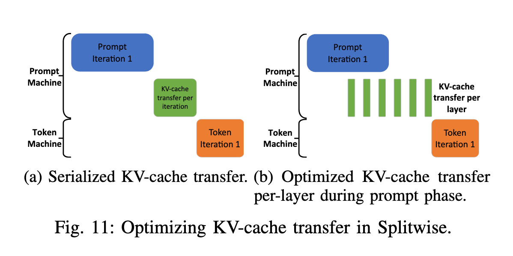{ width="850" }

* **块级** ：TetriInfer 在 PD 分离的基础上，还会将输入的 prompt 划分为固定大小的 chunk，以便让 GPU 始终运行在接近计算饱和的状态。因此，TetriInfer 论文中也提出了基于块级的 KV cache 传输方案。

## 6、vLLM 的 PD 分离

> 本节源码以稳定版 [vLLM v0.31.0](https://github.com/vllm-project/vllm/releases/tag/v0.31.0)（2026-10-06 发布）为准，源码链接固定到该版本。

vLLM 提供了 **KV Connector** 作为管理实例间 KV Cache 交换的抽象层，它提供统一接口来实现 KV Cache 的保存、加载与传输，使不同的 vLLM 实例（如 Prefill 与 Decode 实例）能够共享已经计算好的 KV。通过实现这一接口，各类 Connector（例如共享文件示例 `ExampleConnector`、使用 NIXL 传输的 `NixlConnector` 等）接入不同的存储和通信方式，从而支持 PD 分离与外部 KV 缓存复用。

### 6.1、KV Connector 的接口与执行角色

[`KVConnectorBase_V1`](https://github.com/vllm-project/vllm/blob/v0.31.0/vllm/distributed/kv_transfer/kv_connector/v1/base.py#L179-L229) 是 V1 Connector 的抽象基类，定义了 Scheduler 侧和 Worker 侧的接口。两侧分别负责传输决策与实际执行，主要 API 如下。

**Scheduler 侧方法：**

- `get_num_new_matched_tokens()`：查询本地已计算或缓存命中部分之外，还有多少 token 的 KV 可以从外部复用，同时返回是否异步加载。它获取的是额外命中量，外部 KV 可以来自另一实例，也可以来自文件或缓存服务。
- `update_state_after_alloc()`：本地 KV blocks 分配后，更新 Connector 状态，记录接收位置和待加载任务。对于网络传输，需要将远端源 blocks 与本地接收 blocks 对应起来。
- `build_connector_meta()`：构建本轮 `KVConnectorMetadata`，告诉 Worker 哪些 KV 需要加载、保存或传输。元数据随 `SchedulerOutput` 交给 Worker，由具体 Connector 定义其中的任务结构。

**Worker 侧方法：**

- `register_kv_caches()`：初始化时注册本地 KV 存储。NIXL 等实现利用注册信息访问 GPU KV buffer，为后续传输准备内存描述信息。
- `bind_connector_metadata()`：绑定 Scheduler 下发的本轮计划，加载和保存接口通过它取得任务信息。
- **`start_load_kv()`** ：从远端实例或外部缓存加载 KV，写入 vLLM 本地的 paged KV buffer。加载可以同步完成，也可以异步进行，取决于 Connector 的实现和任务类型。
- `wait_for_layer_load()`：对于支持逐层异步加载的实现，在 Attention 使用当前层 KV 前等待加载完成，保证该层读取的数据已经就绪。
- **`save_kv_layer()`** ：将 vLLM 当前层的 KV 交给 Connector 保存或传输。逐层实现可以让当前层的 KV 搬运与后续层计算重叠。
- `wait_for_save()`：提交保存任务并完成必要的同步。同步实现需要确保保存完成后再返回；异步实现可以通过保留源 blocks、稍后报告完成来保证数据不会提前被覆盖。

vLLM V1 中，Connector 有两个执行角色：`KVConnectorRole.SCHEDULER` 和 `KVConnectorRole.WORKER`，通常分别位于 EngineCore 与 Worker 进程。**Scheduler 负责指挥 Worker 进行 KV Cache 的传递，两者之间的信息桥梁是 `KVConnectorMetadata`，Worker 通过元数据知道哪些 KV 需要加载、保存，以及写入哪些本地 blocks。**

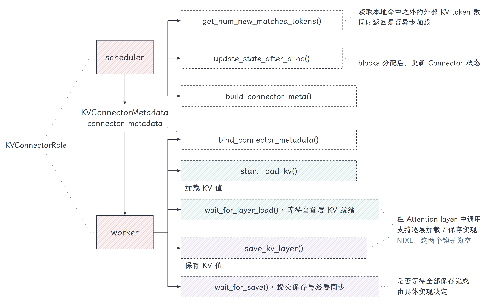{ width="1100" }

图中的加载、保存方法是一组通用接口，**不代表所有 Connector 都执行同一套逐层传输流程** 。例如，NIXL 的 `wait_for_layer_load()` 和 `save_kv_layer()` 当前为空操作，实际采用块级传输；共享文件或外部缓存实现则可以使用逐层保存钩子。

传输结束后，Worker 通过 `get_transfer_results()` 报告接收完成、发送完成或接收失败，结果由 `ModelRunnerOutput` 中的 `KVConnectorOutput` 返回 Scheduler。Scheduler 据此恢复等待中的请求或回收源 blocks，因此 Connector 的职责还包括 **完成反馈与资源生命周期管理** 。

这里的 `SCHEDULER` / `WORKER` 表示代码执行位置；配置中的 `kv_producer` / `kv_consumer` 表示实例的部署角色。P 和 D 各自的引擎都需要调度侧与执行侧 Connector，不能把 Scheduler 等同于 P、Worker 等同于 D。

### 6.2、NIXL：接收方异步读取 KV blocks

[`NixlConnector`](https://github.com/vllm-project/vllm/blob/v0.31.0/vllm/distributed/kv_transfer/kv_connector/v1/nixl/connector.py#L339-L408) 默认采用 **Pull 模式：接收方发起 NIXL READ，读取源端已经准备好的 KV blocks** 。一次普通的 P→D 交接可以分为三步：

1. **P 完成 Prefill** ：保留可供读取的 KV blocks，将块位置信息返回 Router。
2. **D 发起读取** ：Router 把请求与 P 的元数据交给 D；D 分配本地接收 blocks，由 Worker 发起 NIXL READ。
3. **D 接收完成后继续计算** ：Worker 报告 `finished_recving`，Scheduler 将请求恢复到可调度状态，随后进入 Decode。

**Router 转交请求和 KV 位置信息，真实 KV 数据在 P、D 之间传输。** READ 由 D 发起，KV 字节从 P 流向 D。

异步读取期间，[Scheduler](https://github.com/vllm-project/vllm/blob/v0.31.0/vllm/v1/core/sched/scheduler.py#L1232-L1278) 将该请求置于 `WAITING_FOR_REMOTE_KVS`。**等待的是当前请求，引擎仍可执行其他请求** ，因此 KV 传输可以与其他请求的计算重叠。

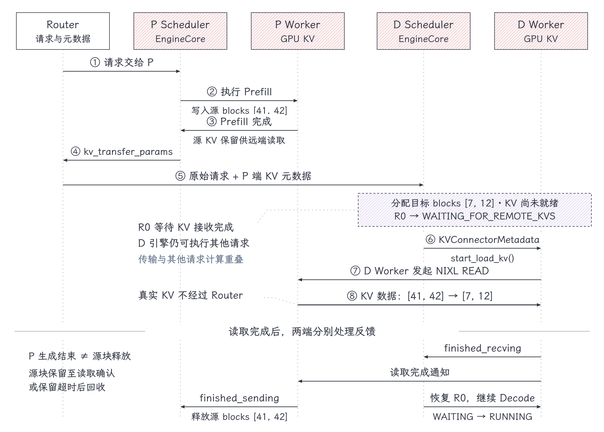{ width="1100" }

图中以 32-token prompt、block size 为 16、D 无本地前缀命中为例：P 的源块 `[41, 42]` 对应 D 的接收块 `[7, 12]`，两端块号各自管理。读取完成后，**D 侧根据接收完成反馈恢复请求，P 侧根据远端读取完成通知回收保留的源块** ；两端各自处理反馈，不需要等 D 重新开始计算才释放 P 的源块。

这里还需要区分 **请求生成结束** 与 **源端 blocks 释放** ：远端可能尚未读取 KV，源端必须暂时保留这些块；读取完成或保留超时后，再由 [Scheduler 回收](https://github.com/vllm-project/vllm/blob/v0.31.0/vllm/v1/core/sched/scheduler.py#L3133-L3158)。否则，源块提前被其他请求覆盖，就无法保证传输正确。

NIXL 当前的 `wait_for_layer_load()` 和 `save_kv_layer()` 是[空操作](https://github.com/vllm-project/vllm/blob/v0.31.0/vllm/distributed/kv_transfer/kv_connector/v1/nixl/connector.py#L288-L300)，实际走异步块传输。接收完整 prompt KV 后，普通自回归路径一般仍需重算最后一个 token，以得到采样所需的表示。

### 6.3、常见 Connector 与组合方式

vLLM 已有多种 Connector，分别接入共享文件、P2P 传输和外部缓存服务。下面保留与 PD 分离关系最直接的几类，具体名称与支持范围以[当前注册表](https://github.com/vllm-project/vllm/blob/v0.31.0/vllm/distributed/kv_transfer/kv_connector/factory.py#L152-L249) 和对应文档为准。

- **ExampleConnector** ：当前共享文件示例通过同一个文件路径（如本地磁盘或 NFS）保存与加载 KV。保存时，将指定 token 的 KV 按层序列化为 SafeTensors 文件；读取时，根据 token 内容生成缓存目录，再按层名找到文件，将数据填入本地 KV buffer。缓存目录由 token 字节及必要的多模态标识经过 `safe_hash` 生成，文件名对应层名。**实例之间通过共享文件交换数据** ，网络访问是否发生取决于底层文件系统。这是用于演示和调试的实现，不能直接当成完整的生产缓存服务。相关逻辑见[文件加载与保存](https://github.com/vllm-project/vllm/blob/v0.31.0/vllm/distributed/kv_transfer/kv_connector/v1/example_connector.py#L174-L262) 和[缓存路径生成](https://github.com/vllm-project/vllm/blob/v0.31.0/vllm/distributed/kv_transfer/kv_connector/v1/example_connector.py#L405-L454)。
- **NixlConnector / NixlPullConnector** ：使用 NIXL（NVIDIA Inference Xfer Library）管理 KV 传输，通过内存注册和传输描述信息访问本地与远端的 KV blocks。当前这两个名称指向同一个 Pull 实现，**由接收方发起 READ，支持异步块传输** 。普通 P→D 交接由 D 读取 P，后面的双向复用则允许 P 读取 D 已缓存的历史 KV；两个方向共用 READ 机制。
- **NixlPushConnector** ：同样使用 NIXL，但 **由 P 端发起 WRITE，将 KV 写入 D 提前准备好的接收空间** 。Router 需要更早选定 D；D 分配并注册目标 blocks 的过程可以与 P 的 Prefill 计算重叠。P 的 KV 与目标信息都就绪后，再由后台传输线程发起 WRITE。它的重叠重点是接收端准备和 Prefill 计算，不能因为叫 Push 就假定逐层 `save_kv_layer()` 会自动传输。具体流程见官方 [NIXL Push 文章](https://vllm.ai/blog/2026-10-14-nixl-push-connector)。
- **LMCacheConnectorV1 / LMCacheMPConnector** ：通过与 LMCache 集成实现 KV 的外部存储和检索，支持 CPU 内存、本地磁盘及其他[存储后端](https://docs.lmcache.ai/getting_started/quickstart/offload_kv_cache.html#supported-offloading-destinations)。已经计算好的 KV 可以在 GPU 之外保留，后续请求命中相同前缀时再加载，减少重复计算；实际复用范围取决于缓存配置、token 匹配和数据可用性。`LMCacheMPConnector` 使用独立的缓存服务进程。
- **MultiConnector** ：允许同时接入多个 Connector，例如将 NIXL 的实例间交接与外部缓存保存组合。加载时，**按配置顺序选择首个提供有效额外命中的 Connector** ，由它负责该请求的加载；保存时，向各子 Connector 分发保存钩子。需要注意，调用保存接口不等于每个子实现都把 KV 写出：例如 NIXL 的逐层保存钩子为空，而文件实现会实际保存。相关逻辑见[加载选择](https://github.com/vllm-project/vllm/blob/v0.31.0/vllm/distributed/kv_transfer/kv_connector/v1/multi_connector.py#L429-L448) 与[保存分发](https://github.com/vllm-project/vllm/blob/v0.31.0/vllm/distributed/kv_transfer/kv_connector/v1/multi_connector.py#L334-L346)。

此外，还有 Mooncake、MoRI 等 Connector，分别接入不同的传输系统与硬件生态。部署时应按所用版本确认名称与能力；当前共享文件示例的名称是 `ExampleConnector`。

例如，在普通 Full Attention 模型上，将 NIXL 与共享文件示例组合，P 端可配置为：

```bash
--disable-hybrid-kv-cache-manager --kv-transfer-config '{
  "kv_connector": "MultiConnector",
  "kv_role": "kv_both",
  "kv_connector_extra_config": {
    "connectors": [
      {"kv_connector": "NixlConnector", "kv_role": "kv_producer"},
      {
        "kv_connector": "ExampleConnector",
        "kv_role": "kv_both",
        "kv_connector_extra_config": {"shared_storage_path": "local_storage"}
      }
    ]
  }
}'
```

D 端的 NIXL 子配置使用 `kv_consumer`，文件示例需访问同一个共享路径。这里关闭混合 KV Cache 管理，是因为 `ExampleConnector` 不支持它；NIXL 自身的 `kv_both` 已弃用，不能照搬组合容器的角色。更多示例见[官方 PD 分离文档](https://docs.vllm.ai/en/v0.31.0/features/disagg_prefill/)。

### 6.4、双向 KV Transfer 架构

单向 P→D 传输解决了一次请求中两个阶段的交接，但多轮对话仍会重复计算：**上一轮回答的 KV 在 D 端，下一轮的 prompt 包含这段回答，却交给 P 重新处理。** P 即使保留了上一轮 prompt 的缓存，通常也没有上一轮回答的 KV；如果切换 P 实例或本地缓存被逐出，需要重算的历史还会更多。

官方[双向 KV 传输方案](https://vllm.ai/blog/2026-10-12-bidirectional-kvxfer-multiturn-agentic-workload#bi-directional-kv-transfer) 增加了 **D→P 的历史 KV 回读：P 先复用 D 保留的缓存，再计算新增或未命中的部分** 。这样可以减少长历史、多轮交互中的重复 Prefill 计算，降低 TTFT。

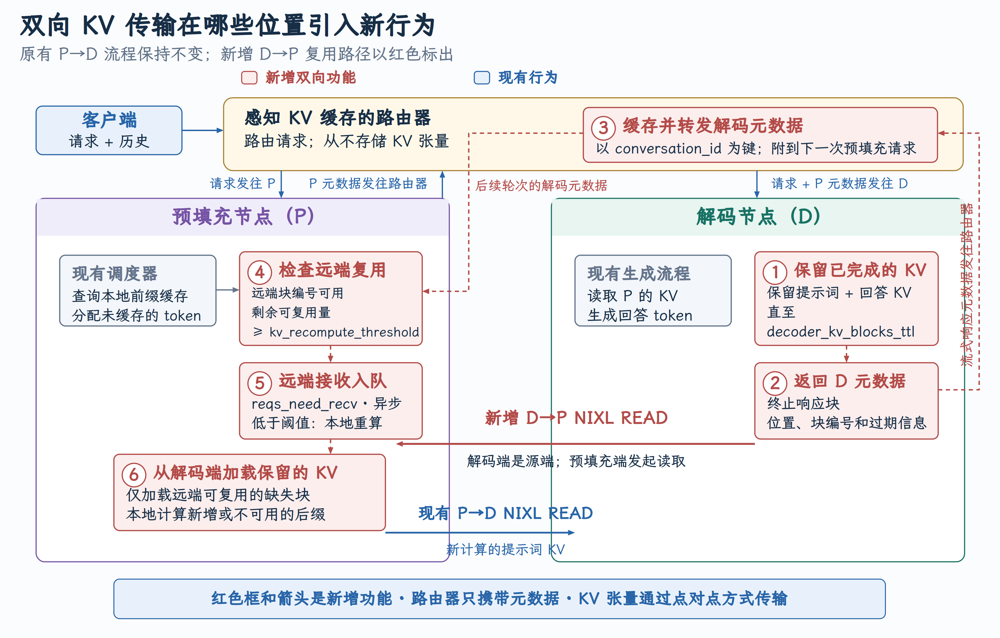{ width="1100" }

**怎么看这张图**

蓝框是现有 P→D 流程。红框是新增的 D→P 复用 6 步：Decode 保留 KV（①）→ 返回 block 元数据（②）→ Router 按 `conversation_id` 缓存（③）→ Prefill 查远程可复用 block（④）→ 达到阈值后发起异步接收（⑤）→ D→P 用 NIXL READ 拉回 KV（⑥）。**NIXL**（NVIDIA Inference Xfer Library，vLLM 使用的 KV 跨节点传输库）负责点对点搬运 KV tensor。在支持 **GPUDirect RDMA** 的链路上，网卡直接访问 GPU 显存，KV 数据无需经 CPU 内存中转；Router 只传元数据，不搬运 KV 数据。

**说明什么**

不是把 Decode 变成另一个 Prefill。**Decode 仍然只“持有和提供已算好的 KV”，真正跨实例读取 KV 的动作由 Prefill 发起。** 传输机制复用已有的 NIXL READ，只是方向反过来。

## 7、Chunked-Prefills VS PD 分离

chunked-prefills 方案的核心思想是：将长序列的 prefill 请求拆分为几乎相等大小的小块，然后构建了由 prefill 小块和 decode 组成的混合 batch。或者说，chunked-prefills 策略通过将不同长度的 prompts 拆分成长度一致的 chunks 来进行 prefill，以避免长 prompt 阻塞其他请求，同时利用这些 chunks 的间隙进行 decode 的插入/捎带（piggyback）操作，从而减少延迟并提高整体的吞吐。

decode 阶段的开销不仅来自从 GPU 内存中获取 KV cache，还包括提取模型参数。而通过这种 piggyback 方法，decode 阶段能够重用 prefill 时已提取的模型参数，几乎将 decode 阶段从一个以内存为主的操作转变为一个计算为主的操作。因此，这样构建的混合批次具有近乎均匀的计算需求（而且增加了计算密集性），使我们能够创建平衡的微批处理调度，缓解了迭代之间的不平衡，导致 GPU 的管道气泡最小化，提高了 GPU 的利用率。也最小化了计算新 prefill 对正在进行的 decode 的 TBT 的影响，从而实现了高吞吐量和低 TBT 延迟。

chunked-prefills 有两个明显的好处：

* 所有节点被平等对待，使调度更简单。
* 将 chunked prefill 内联到 decode 批处理中可以提高 decode 批次的计算强度，从而带来更好的 MFU（Model FLOPs Utilization，指的是模型实际使用的计算量占 GPU 理论峰值算力的比例，用来衡量算力利用效率）。

然而，chunked-prefills 也有一些缺点：

* chunked-prefills 会增加 prefill 的计算开销，如果 chunk 大小明显低于 GPU 饱和点，会延长 prefill 的执行时间。
* prefill 阶段仍难以完全最大化 MFU，因为在 chunk-prefill 中，profiling 只会估算特定设备上一个 batch 的最大 tokens 配额，这个配额同时包含 prefill 和 decode，而不是分别针对两者优化。
* chunked-prefills 也会显著增加 prefill 阶段的内存访问量，每个 chunk 的 Attention 操作都需重复读取此前的 KV cache，增加内存访问负担。而且长序列可能会持久地占据着 KV cache 的存储空间以及 GPU 的计算资源。
* 在 TPOT 方面，将 prefill 与 decode 合并批处理实际上会降低所有 decode 任务的平均速度。

**总之，chunked-prefills 可能有助于最大化整体吞吐量，但由于动态分割无法完全解耦 prefill 和 decode 操作，会导致资源争用以及 TTFT 与 TPOT 之间的妥协。当应用程序无法在 TTFT 和 TPOT 之间进行权衡，而是要同时遵守这两者时，PD 分离就成为更好的选择。**

## 8、 PD分离工业界项目

### 8.1 Mooncake

[Mooncake](https://kvcache-ai.github.io/Mooncake/index.html) 是 Moonshot AI 提供的领先大模型服务 Kimi 的推理平台。Mooncake 是 PD 分离应用比较早也是规模比较大的成功例子：

* Mooncake 采用了以 KV cache 为核心的解耦架构，将 prefill 集群与 decode 集群分离。
* 同时，它还利用 GPU 集群中未被充分利用的 CPU、DRAM 和 SSD 资源，实现了解耦式的 KV cache 缓存。
* Mooncake 的核心是一个以 KV cache 为中心的调度器，它在最大化整体有效吞吐量和满足延迟相关的 SLO 之间进行平衡。
* 与传统假设所有请求都会被处理的研究不同，Mooncake 需要应对高负载场景带来的挑战。为此，Mooncake 提出了一种基于预测的早期拒绝策略。

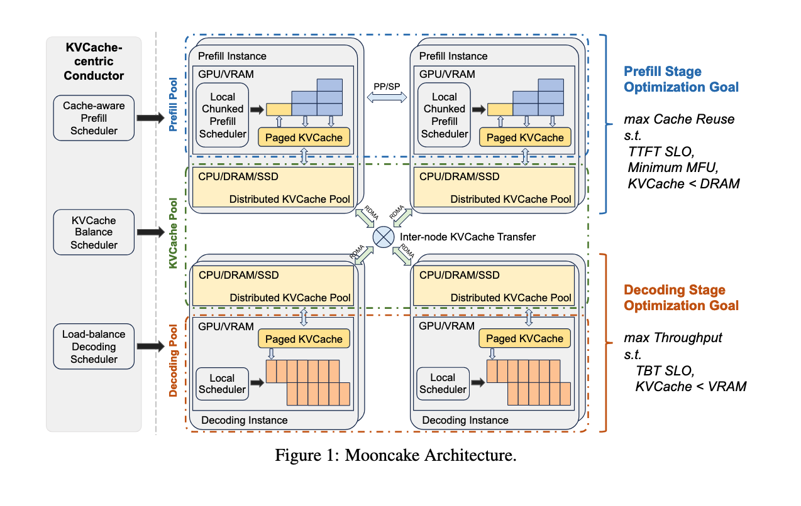{ width="900" }

实验结果表明，Mooncake 在 长上下文场景下表现尤为突出：在某些模拟场景中，吞吐量相比基线方法最高可提升 525%，同时仍能满足 SLO。在真实负载下，Mooncake 的创新架构使 Kimi 能够多处理 75% 的请求。

使用 Mooncake 运行 PD 分离服务请参考文档：[vLLM V1 Disaggregated Serving with Mooncake Store and LMCache](https://kvcache-ai.github.io/Mooncake/getting_started/examples/vllm-integration/vllmv1-lmcache-integration.html)
