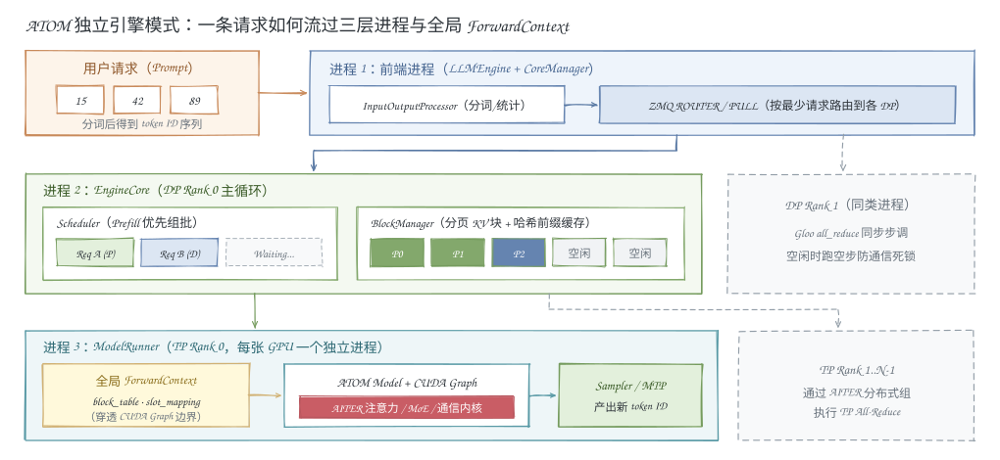
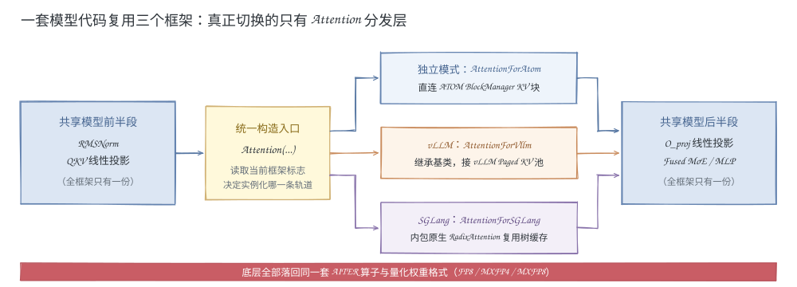
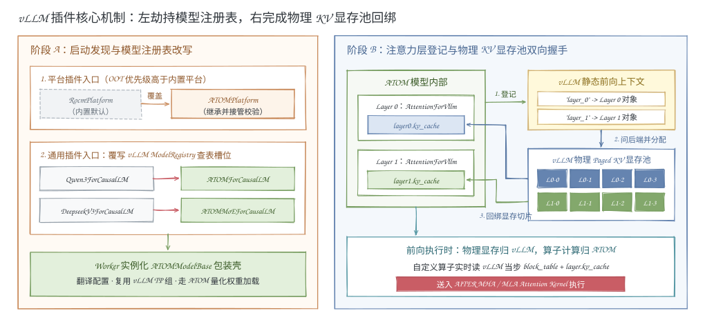
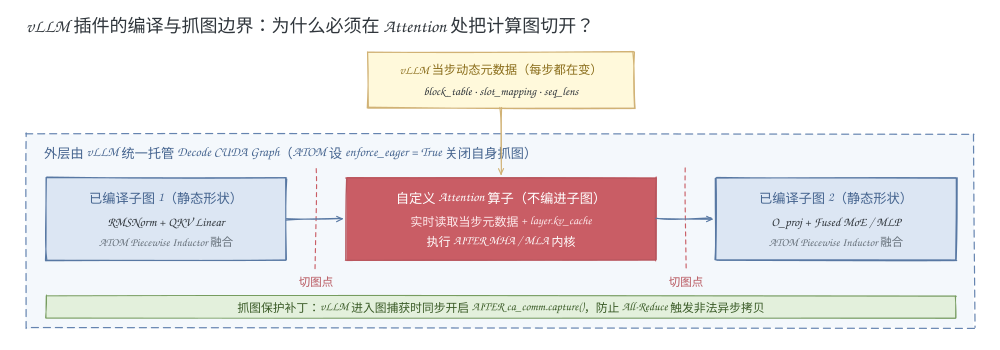
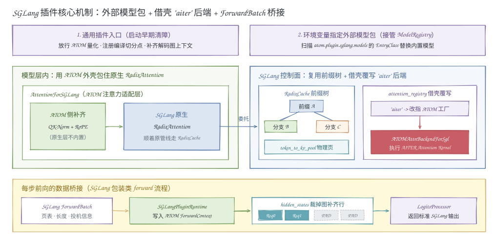
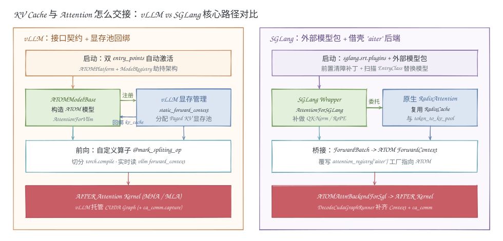

# ROCm ATOM 架构与 vLLM / SGLang 插件接入机制

在 AMD ROCm 平台上做大模型推理优化，经常会遇到一个现实矛盾：底层算子库 **AITER**（汇总了 ASM、CK、Triton 与 FlyDSL 高性能内核）迭代非常快，新模型和 FP8 / MXFP4 量化优化往往最先在这里跑通；但到了生产部署阶段，团队又离不开 vLLM 或 SGLang 成熟的请求调度、HTTP 服务、前缀缓存与生态工具链。如果为了追算子优化而长期维护上游框架的私有分支，后续同步升级的成本会非常高。

[**ROCm/ATOM**](https://github.com/ROCm/ATOM)（AiTer Optimized Model）给出的解法是“**一套模型与算子底座、两种运行形态**”：

- **独立引擎模式**：自带一套受 `nano-vllm` 启发的轻量级推理引擎，适合 Day-0 快速适配新模型、验证激进优化和跑极限吞吐；
- **插件模式**：作为外置 Python 包直接“换芯”接入 vLLM 或 SGLang——**上层框架继续掌握 API 服务、请求调度与 KV 显存池，ATOM 接管热路径上的模型计算、量化权重加载与 AITER 底层内核**。

这篇笔记用六张机制图串起完整脉络：先跟着一条具体请求看懂 ATOM 独立引擎怎么运转、一套模型代码如何同时适配多个框架，再逐关拆解 ATOM 接进 vLLM 与 SGLang 的具体模块和 KV Cache 交接方式。

---

## 一、ATOM 自己怎么跑：跟着一条请求走完三层进程

假设我们往独立运行的 ATOM 发一条请求，经过分词后得到三个 token：`[15, 42, 89]`。它从进入服务到吐出新 token，会依次流过三层隔离的进程：

[{ width="960" }](../../assets/ai-infra/atom/atom-standalone-process-flow.svg)

顺着图从上往下看，每一层的职责边界非常清楚：

1. **进程 1（前端进程）**：负责分词、记录请求到达时间与统计指标，然后通过 ZMQ 把请求路由给负载最轻的引擎核心进程；等生成完成后，再从回收通道拿回结果做反分词。
2. **进程 2（EngineCore，每个 DP rank 一进程）**：在一个持续轮询的主循环里配合两件事——左边的**调度器**采用 Prefill 优先的连续批处理策略，把等待中的新请求和正在解码的旧请求编成当前步的批次；右边的**块管理器**维护物理 KV 页槽（图里的 `P0`、`P1`、`P2`）与基于哈希的前缀缓存复用。多卡数据并行时，各核心进程还会互相同步步调，空闲进程跑空步防止集合通信死锁。
3. **进程 3（ModelRunner，每张 GPU 一进程）**：真正执行模型计算与采样的地方。注意图中黄色那块**全局 ForwardContext**——LLM 在 Decode 阶段要跑 CUDA Graph，模型前向的输入签名必须固定，不能每步把动态变化的块表和写入槽位当参数层层传进去。ATOM 把当步的块表与槽位统一放进这份模块级全局上下文里，模型主体保持干净的 `(input_ids, positions)` 向前跑，各层 Attention 在调 AITER 内核前自己去取数。

### 一套模型代码怎么同时跑在三个框架里？

如果 ATOM 既要自己跑，又要插进 vLLM 和 SGLang，难道要维护三套模型实现吗？其实不用。ATOM 在底层只留了一处“铁路道岔”：

[{ width="940" }](../../assets/ai-infra/atom/atom-unified-dispatch.svg)

看这张图就能一眼分清**哪些是共享的，哪些是随框架切换的**：

- **前后半段全共享**：RMSNorm、QKV 投影、O 投影、MoE / MLP 和底层 AITER 算子在三个框架里完完全全只有一份代码；
- **只在 Attention 构造入口分叉**：进程里维护一个当前框架标志（默认独立模式，被 vLLM 或 SGLang 拉起时切到对应框架）。所有模型层都调用同一个统一入口，构造期按标志扳动道岔，实例化对应的注意力适配层：

```python
# atom/model_ops/base_attention.py（简化示意）
class Attention:
    def __new__(cls, *args, **kwargs):
        if is_vllm():
            return AttentionForVllm(*args, **kwargs)     # 遵守 vLLM 注意力层契约
        if is_sglang():
            return AttentionForSGLang(*args, **kwargs)   # 包装 SGLang 原生 RadixAttention
        return AttentionForAtom(*args, **kwargs)         # 独立模式 Paged Attention
```

---

## 二、外置插件接入推理框架，本质上要过哪四关？

在扎进 vLLM 和 SGLang 的接入细节前，先建立一张统一的路线图。任何外置后端想**不改上层框架一行源码**就插进去，都必须依次打通四个交界：

1. **启动接管**：用户只敲了框架自己的启动命令，框架怎么自动发现环境里装了 ATOM 并激活初始化代码？
2. **模型替换**：框架读到模型配置里的架构名（比如 Qwen3 或 DeepSeek-V3）后，怎么让它去创建 ATOM 的模型，而不是框架自带的实现？
3. **KV Cache 交界（最核心）**：调度器和物理显存池归上层框架管，Attention 内核归 ATOM 管。框架怎么知道该为 ATOM 分配多大显存？每步前向时，物理显存张量和逻辑块表怎么交到 ATOM 手里？
4. **编译与 CUDA Graph 分工**：上层框架要抓 CUDA Graph，ATOM 内部又有图编译和自定义通信原语，两边怎么切分边界才不打架？

接下来我们带着这四关，先看 vLLM，再对照着看 SGLang。

---

## 三、ATOM 如何通过插件机制接入 vLLM

ATOM 接入 vLLM 完全基于 vLLM 官方的 **Out-of-Tree（外置插件）体系**。在同一个 Python 环境里装好 ATOM 后，直接运行标准的 `vllm serve` 就会自动生效，不需要改任何 vLLM 源码（排查问题时设 `ATOM_DISABLE_VLLM_PLUGIN=1` 即可退回纯 vLLM）。

### 1. 启动劫持与 KV 显存池双向握手

前三关——**启动发现、模型替换、KV Cache 交接**——在 vLLM 里是一条非常规整的接口契约链。先对照下面这张图建立全局画面：

[{ width="960" }](../../assets/ai-infra/atom/atom-vllm-plugin-hijack-and-kv.svg)

**先看左半边（阶段 A：启动接管与模型替换）：**

ATOM 在打包配置 `pyproject.toml` 里向 Python 元数据注册了 vLLM 识别的两个官方入口点：

```toml
[project.entry-points."vllm.platform_plugins"]
atom = "atom.plugin.vllm.register:register_platform"

[project.entry-points."vllm.general_plugins"]
atom_model_registry = "atom.plugin.vllm.register:register_model"
```

- **平台插件入口**切入的是 vLLM 的平台探测模块。vLLM 规定**外置平台插件的优先级高于内置平台**，所以当 `register_platform` 返回继承自 ROCm 平台的 `ATOMPlatform` 时，整个 vLLM 就会切到 ATOM 平台（图左上灰色虚线的 `RocmPlatform` 被橙色 `ATOMPlatform` 覆盖）。
- **通用插件入口**会在 vLLM 的 API 进程、EngineCore 和每个 Worker 进程启动时执行。ATOM 在这里把当前框架置为 vLLM，然后直接改写 vLLM 全局模型注册表（ModelRegistry）里的查表槽位——看图左中两根红线：`Qwen3ForCausalLM` 被改指到 `ATOMForCausalLM`，`DeepseekV3ForCausalLM` 被改指到 `ATOMMoEForCausalLM`。
- 随后 Worker 加载模型时，实例化的就是 ATOM 的薄壳包装类 `ATOMModelBase`。它顺手完成三件事：**翻译配置**（把 vLLM 配置映射为 ATOM 配置并关闭 ATOM 自身抓图）、**复用通信组**（常规 TP 场景直接复用 vLLM 已建好的 TP 进程组挂载 AITER 通信，避免建两套通信组拖慢归约）、**接管权重加载**（绕过 vLLM 默认权重迭代器，直接走 ATOM 插件加载管线完成量化格式重排）。

!!! question "为什么要分成平台插件和通用插件两个入口？"

    因为平台探测发生在刚导入 vLLM 的极早阶段——哪怕当前跑的是 SGLang，只要同环境里的代码顺带导入了 vLLM，平台探测也可能被触发。ATOM 因此故意不在平台插件里把全局框架锁死为 vLLM，而是把框架切换和模型注册放在每个 vLLM 进程必定执行的通用插件里。

**再看右半边（阶段 B：物理 KV 显存池的双向握手）：**

在 vLLM 里，**物理 KV 显存池完全归 vLLM 统一分配和回收，每步读写哪些块由 vLLM 调度器决定，ATOM 只负责把这批数据送进 AITER 内核算快**。两边靠图右的三步握手打通：

1. **向上登记（箭头 1）**：ATOM 模型构造每一层时，统一 Attention 入口分发到继承自 vLLM 注意力基类的 `AttentionForVllm`，每一层在初始化末尾把自己登记进黄色框的 **vLLM 静态前向上下文**（以层名为键的字典）。
2. **问后端并分配（箭头 2）**：模型建完后，vLLM 显存规划器扫描这份字典，逐层询问它声明的注意力后端类型（MHA 或 MLA），统一分配图右侧蓝色（`L0-0..3`）与绿色（`L1-0..3`）的物理 Paged KV 页池。
3. **回绑显存切片（箭头 3）**：vLLM 把各层对应的物理张量切片反向绑回 `layer0.kv_cache` 和 `layer1.kv_cache`。等真正前向执行时，ATOM 的自定义算子直接从 vLLM 当步的前向上下文中读出块表与回绑好的显存切片，喂给 AITER 内核：

```python
# 构造期：ATOM 注意力适配层把自己登记到 vLLM 的静态前向上下文
vllm_config.compilation_config.static_forward_context[layer.layer_name] = layer

# 前向期：自定义注意力算子实时读取 vLLM 维护的当步元数据与回绑好的 kv_cache
ctx = vllm.forward_context.get_forward_context()
layer = ctx.no_compile_layers[layer_name]
return layer.forward_impl(query, key, value, layer.kv_cache, attn_metadata=ctx.attn_metadata[layer_name])
```

### 2. 编译与 CUDA Graph 边界：为什么必须在 Attention 处切图？

第四关往往最容易让人困惑：vLLM 要抓 CUDA Graph，ATOM 自己又带 Piecewise `torch.compile`，两边同时开不会冲突吗？看下面这张切图示意图就瞬间明白了：

[{ width="940" }](../../assets/ai-infra/atom/atom-vllm-compile-graph-boundary.svg)

整层 Transformer 的计算被划成了清晰的两层边界：

- **外层大框归 vLLM（Decode CUDA Graph）**：ATOM 翻译配置时强制设 `enforce_eager = True` 关掉自己的抓图逻辑，完全由 vLLM 统一决定捕获哪些批大小、何时回放。为了防止 AITER 自定义 All-Reduce 在抓图期间冒出非法异步拷贝，ATOM 还给图捕获入口挂了底部绿色条的保护补丁，让 vLLM 抓图时同步开启 AITER 通信捕获。
- **内部切图归 ATOM（Piecewise 编译）**：Attention 前后的 RMSNorm、QKV、O 投影和 MoE / MLP 都是纯静态形状计算（左右两块蓝色子图），照常交给 Inductor 编译融合；而中间红色块被标成**图切分点（splitting op）**，刻意留在编译子图之外——正因为切开了，每次执行都能通过顶部箭头动态读取 vLLM 当步最新的 `block_table` 与 `slot_mapping`，不会把抓图那一刻的块表地址写死在静态图里。

---

## 四、ATOM 如何接入 SGLang：外部模型包 + 借壳 `"aiter"` 后端

带着同样的四关再看 SGLang。与 vLLM 靠官方双入口自动接管不同，SGLang 的扩展机制决定了 ATOM 需要走一条**“前置清障 + 外部模型包 + 借壳原生 RadixAttention”**的三段式路径：

[{ width="960" }](../../assets/ai-infra/atom/atom-sglang-radix-bridge.svg)

对照这张图，拆开看上、中、下三层到底做了什么：

### 1. 顶部两步：通用插件先清障，外部模型包接管注册表

ATOM 在 `pyproject.toml` 里注册了 SGLang 的通用插件入口：

```toml
[project.entry-points."sglang.srt.plugins"]
atom_sglang = "atom.plugin.sglang.register:register_plugin"
```

- **图左上（自动触发清障）**：SGLang 服务和调度进程启动早期会自动运行这个插件，在解析参数前先扫清障碍——放行由 ATOM 自己加载的量化格式、往编译切分列表里追加 ATOM 自定义注意力算子、给解码抓图运行器补齐缺失的前向上下文。
- **图右上（环境变量替换模型）**：SGLang 模型注册表原生支持通过环境变量 **`SGLANG_EXTERNAL_MODEL_PACKAGE`** 加载外部模型包。启动时把它设为 `atom.plugin.sglang.models`，SGLang 就会跳过先加载内置模型，转而扫描该包导出的入口类（`EntryClass`），把支持架构直接指向 ATOM 的 SGLang 包装类：

```python
# sglang/srt/models/registry.py（核心逻辑示意）
if external_pkg := envs.SGLANG_EXTERNAL_MODEL_PACKAGE.get():
    ModelRegistry._default_models_loaded = False
    ModelRegistry.models.update(import_model_classes(external_pkg))
```

当 SGLang 的 ModelRunner 实例化这个包装类时，ATOM 会依次完成框架切换、配置翻译、注意力后端注册、AITER 通信初始化与模型构建，并在权重加载时同样绕过 SGLang 默认迭代器，改走 ATOM 自己的加载管线。

### 2. 中部核心：内包原生 RadixAttention + 借壳覆写 `"aiter"` 后端

这是 SGLang 和 vLLM 接入方式**差异最大的地方**。SGLang 的命令行 `--attention-backend` 只认树内预定义的一组固定名字（如 `aiter`），而且它的前缀缓存核心是围绕 **RadixCache 前缀树** 和 **RadixAttention** 构建的。

看图中间左右两块，ATOM 用“一包一换”巧妙地把两者合二为一：

- **左侧（模型层内包一层）**：统一 Attention 入口在 SGLang 模式下构造 `AttentionForSGLang`。它内部直接持有一个 **SGLang 原生的 RadixAttention**。前向时先在 ATOM 侧补做原生层不内置的 QK-Norm 和旋转位置编码，再把张量委托给内部的原生 RadixAttention——顺理成章复用图右上的 **RadixCache 前缀树** 与物理页池。
- **右侧（注册表里借壳换芯）**：与此同时，ATOM 在模型准备阶段直接把 SGLang 注意力注册表里的 `"aiter"` 工厂（以及投机解码草稿直调的同名类）覆写为 `ATOMAttnBackendForSgl`。这样启动时只要传 `--attention-backend aiter`，请求穿过原生 RadixAttention 和前缀树后，最终落回的依然是 ATOM 自己的 AITER 注意力内核。

```python
# atom/plugin/sglang/.../radix_attention.py（简化示意）
class AttentionForSGLang(BaseAttention):
    def __init__(self, ...):
        self.attn = sglang.RadixAttention(num_heads, head_dim, scaling, layer_id=layer_num, ...)

    def forward(self, query, key, value, positions=None, ...):
        query, key = apply_qknorm_and_rope(query, key, positions)
        return self.attn(query, key, value, forward_batch=get_current_forward_batch())
```

!!! note "混合线性注意力模型的例外处理"

    对于 Qwen3-Next、Qwen3.5 这类包含混合线性注意力的架构，ATOM 在 SGLang 插件模式下会刻意跳过后端覆写，让它们直接沿用 SGLang 上游已验证的注意力与投机验证路径，只复用 ATOM 侧的线性层、MoE 与权重加载优化。

### 3. 底部流水：把 `ForwardBatch` 桥接进全局上下文并裁掉补齐行

看图底部那条黄色流水线，就能直观看到 SGLang 每次前向调用是如何与 ATOM 对齐数据格式的：

1. SGLang 把当步的页表、序列长度和投机信息打包在 `ForwardBatch` 里传给模型；
2. `SGLangPluginRuntime` 上下文管理器把它实时翻译并写入 ATOM 全局 `ForwardContext`，驱动 `self.model` 完成整网前向；
3. 因为 SGLang 在 CUDA Graph 回放或数据并行对齐时会在批次末尾补上占位行（图里带虚线的灰色 `PAD` 格子），算完 `hidden_states` 后必须先裁掉这些补齐行，再交给 SGLang 原生的 `LogitsProcessor` 产出标准输出。

---

## 五、一图总览：记住两套插件路径的本质区别

最后把 vLLM 和 SGLang 两条接入路径并排放在同一张画面里收束：

[{ width="940" }](../../assets/ai-infra/atom/atom-vllm-sglang-hooks.svg)

合上笔记后，其实只需要记住三点：

1. **启动与接管方式不同**：vLLM 靠官方的平台插件 + 通用插件两个入口**零配置自动激活**；SGLang 靠通用插件先清障、再用外部模型包环境变量接管模型，并配合 `--attention-backend aiter` 走借壳后端。
2. **KV Cache 交接方向不同**：vLLM 是**双向显存回绑**——ATOM 自己写注意力层登记给 vLLM，vLLM 分配物理页池后再把显存切片塞回每一层；SGLang 是**内包委托 + 工厂覆写**——ATOM 在模型层里包住原生 RadixAttention 复用前缀树，再把底层 `"aiter"` 工厂悄悄换成自己的后端。
3. **底层执行底座完全统一**：不管上层是 ATOM 独立引擎、vLLM 还是 SGLang，一旦穿过各自那层薄壳和注意力适配层，底层跑的都是**同一套 ATOM 模型实现、同一套量化权重加载逻辑和同一套 AITER 内核**。

!!! tip "关于带每请求状态的新型混合架构"

    对于 DeepSeek-V4.1、Kimi-K3、GLM-5.2 这类除了常规 KV Cache 外还带循环状态、滑窗环或稀疏索引器的新架构，ATOM 还在各自插件目录下提供了专用桥接层，把每请求状态槽位和前缀缓存检查点同步到 vLLM 或 SGLang 的块回收生命周期中。

??? info "源码核对版本与核心目录索引"

    本文机制核对自以下固定 commit，想对照源码深入阅读时可直接按主目录切入：

    - **ROCm/ATOM**（[`4dd0e47c`](https://github.com/ROCm/ATOM/tree/4dd0e47c74516f0f07246f4ffc1fa339a2ea336e)）：独立引擎见 `atom/model_engine/`，统一框架标志与注意力分发见 `atom/plugin/prepare.py` 与 `atom/model_ops/base_attention.py`，两大插件实现分别位于 `atom/plugin/vllm/` 与 `atom/plugin/sglang/`。
    - **vllm-project/vllm**（[`a53e0a05`](https://github.com/vllm-project/vllm/tree/a53e0a05167117aaf671e7c10d2b91a9fa0c88a3)）：平台插件加载见 `vllm/platforms/__init__.py`，通用插件加载见 `vllm/plugins/__init__.py`。
    - **sgl-project/sglang**（[`71f7ad05`](https://github.com/sgl-project/sglang/tree/71f7ad05316b7b99cbf6042807894e2bfed295c1)）：通用插件加载见 `python/sglang/srt/plugins/__init__.py`，外部模型包发现见 `python/sglang/srt/models/registry.py`。

