---
tags:
  - vLLM
  - Scheduling
title: vLLM Model Runner V2 架构
description: 从 Persistent Batch 解耦与 RequestState 管理出发，理解模型执行中的异步调度、输入输出组织与投机解码。
date: 2026-10-18
---

# vLLM Model Runner V2 架构

## 一、Persistent Batch 解耦

**背景**

vLLM 的 Persistent Batch 是其高性能推理的核心优化手段之一，通过复用批次状态，避免每步重建输入张量的 CPU 开销。然而 V1 的实现方式埋下了不少技术债务，Persistent Batch 既是请求状态的持久存储，又是 per-step 的模型输入，两种职责的耦合导致了一系列复杂度。

MRV2 对这块做了系统性重构，本文聚焦其中**持久状态与 per-step 输入解耦**的内容。

在 LLM 推理中，每个 Step 做的事情本质上很简单：

1. 由调度器从请求队列中选出一批请求（batch）
2. 为每个请求准备输入：token 序列、位置编码、采样参数
3. 执行模型 Forward，得到输出 logits
4. 根据 logits 采样新 token
5. 更新每个请求的状态（新生成的 token、计算进度、KV cache 使用情况等）
6. 检查是否有请求完成或需要被驱逐，决定下一轮 batch 的组成

Persistent Batch 优化的是步骤 2 （准备输入）和 5（更新状态），如果每步都从零构建这些数据，特别是那些占用大量内存的大 tensor，开销会非常大。

V1 的设计思路是：让这张「批次表」从请求进入系统起就常驻内存，每步复用，只做增量修改。这就是「Persistent」的含义——持久化，不是每步重建。

这个设计在初期很简单，但随着系统复杂度上升，问题逐渐暴露。

### 1、V1 的 Persistent Batch：一套数据，两种用途

V1 的 Persistent Batch 核心是一张"大表"，每行代表一个请求，每列代表一种数据。这张表从请求进入系统开始就存在，直到请求离开才释放。表里存放了所有请求的 token 序列、KV cache 的 block 映射、以及请求进行到哪一步了。每个字段都是一个大 tensor。

```python
class InputBatch:
    # token 序列：每行是一个请求的完整 token 历史
    self.token_ids_cpu = torch.zeros(max_num_reqs, max_model_len)

    # KV cache 的 block 映射：每行是一个请求的 block 列表
    self.block_table = ...

    # 采样参数：每行是一个请求的 temperature、top_p 等
    self.temperature_cpu = torch.zeros(max_num_reqs, ...)
    self.top_p_cpu = torch.ones(max_num_reqs, ...)

    # 进度跟踪
    self.num_computed_tokens_cpu = torch.zeros(max_num_reqs, ...)

    # （其他字段省略）
```

这就是「Persistent」的含义：这张表从请求进入系统起就常驻内存，每步复用，只做增量修改，而不是每步重建。

在 LLM 推理的六个步骤中，步骤 2 和步骤 5 直接依赖这张表：

- **步骤 2（准备输入）**：数据直接来自 Persistent Batch，不需要从零构建
- **步骤 5（更新状态）**：step 结束后原地修改 Persistent Batch，追加新 token、更新进度等

但这张表的职责远不止「存储」。它同时承担了两个角色：既是每个请求的状态仓库，又是每步模型 Forward 的直接输入。V1 直接把这张表的数据传给模型，不需要任何转换。

**问题正出在这里：持久状态和 per-step 的输入被绑在同一张表里，任何一方提出的「修改」需求，都会成为另一方的负担。**

具体表现为两个问题：

1. 当一个请求被驱逐时，其在表中的位置需要释放给新请求占用。但被驱逐的请求可能随后恢复，这意味着它的状态必须另找地方备份。于是有了 CachedRequestState，这相当于在主表之外又维护了一套冗余的备份机制。
2. 当需要调整请求顺序时（常见于 Attention backend 优化请求分组），不能简单地换个索引了事，而要交换大表中几乎所有列的整行数据，包括token 序列、block table、temperature、top\_p 等，每次重排序都涉及大量数据移动。

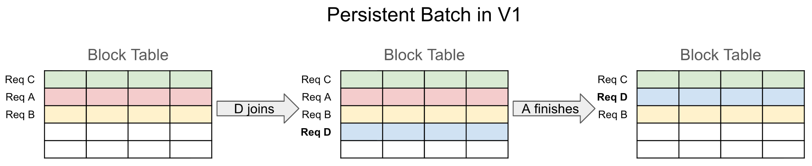{ width="1200" }

持久化Batch中的块表会在step内的读写示意图（图源于MRV2设计文档）

冗余备份和重排序代价这两个问题都源于同一个根因：**持久状态和 per-step 输入的耦合**。MRV2 对 Persistent Batch 的重构，正是从这里开始。

### 2、V1 实现带来的问题

V1 设计中的 InputBatch既要做请求的持久状态仓库，又要做 per-step 的模型输入。这两个需求对InputBatch的要求完全不同：持久状态要求位置固定，请求一旦获得行索引就不该变，否则恢复时找不到；而 per-step 输入要求灵活重排序，由于Attention backend 需要按类型分组以优化性能。

两种约束放在同一张表里，互相牵制，具体表现为两个问题。

#### 需要额外的 CachedRequestState

要理解为什么需要额外的 CachedRequestState，就要理解驱逐的含义。

驱逐的本质是暂停请求的处理。当 KV Cache 不够用时，调度器选择某个请求释放其占用的 KV cache blocks，让出 GPU 内存给其他请求用。被选中的请求暂停 forward，其在 InputBatch 中对应的行索引也需要释放出来给新请求占用。

但暂停不等于终结，该请求可能很快恢复。如果直接丢弃，请求的所有状态就找不回来了。所以需要使用CachedRequestState对象，单独保留「恢复时需要用到的信息」：

```python
@dataclass
class CachedRequestState:
    # 重新计算 KV cache 需要用到的数据
    prompt_token_ids: list[int]  # prompt 有哪些 token
    num_computed_tokens: int    # 计算到第几个 token 了（驱逐后归零）

    # 继续生成需要用到的数据
    output_token_ids: list[int]  # 已经输出了哪些 token

    # KV blocks 需要用到的数据
    block_ids: tuple[list[int], ...]  # 驱逐后无效，仅作恢复时重新分配的参考

    # 采样配置
    sampling_params: SamplingParams | None
    generator: torch.Generator | None
```

> `block_ids` 在驱逐期间是无效的——它只是驱逐前状态的快照，恢复时用来重新分配 GPU blocks。同理 `num_computed_tokens` 被清零，恢复时从头计算。这些字段在驱逐后都失去了意义，但必须保留，因为没有它们就无法恢复。

这些都是 CPU 端的数据——Python list、int、普通的 Python 对象。它们几乎不占 GPU 内存，保留代价极低。

```python
class GPUModelRunner:
    # 大表：batch_idx → 请求数据（直接喂给模型）
    self.input_batch = InputBatch()

    # 备份字典：req_id → 完整状态（CPU 端，不占 GPU 内存）
    self.requests: dict[str, CachedRequestState] = {}
```

驱逐时，从 InputBatch 移除请求（归还 GPU 资源），但 CachedRequestState 保留在 self.requests 字典中。恢复时，从字典中取出重新加入 InputBatch。

存在这个设计的根本原因是：**V1 的 InputBatch 中只存储运行时状态，一旦位置被新请求占用，旧请求的数据就被覆盖了**。因此必须在外层维护一套备份。CachedRequestState 本质上是一块补丁，而不是干净的设计。

更糟糕的是，这套补丁需要和原表**保持同步**。每步更新状态时，既要写 InputBatch，又要更新 self.requests 里的 CachedRequestState。两套数据结构、两套更新逻辑，又存在CPU/GPU之间的同步等待。

#### 重排序代价高：swap\_states 的开销

LLM 推理中，每个 step 的请求通常是混合的，有些正在进行 prefill，有些在进行 decode。不同类型的请求 Attention 计算特征不同：decode 是 memory-bound，prefill 是 compute-bound。

某些 Attention backend（典型如 MLA）为了最大化性能，会主动要求把请求按 decode/prefill 分组，分别计算。调度器在每个 step 开始前，可能会调整 batch 中请求的顺序，让同一类型的请求连续存放。新请求加入或请求完成时，也需要去除空洞，让表保持连续紧凑。

V1 的重排序靠 swap\_states 完成，交换了不同请求的**整行数据**：

```python
def swap_states(self, i1: int, i2: int):
    # 交换 _req_ids（batch_idx → req_id 的映射）
    self._req_ids[i1], self._req_ids[i2] = self._req_ids[i2], self._req_ids[i1]

    # 交换所有列——每列都要移动 O(max_model_len) 的数据
    self.token_ids_cpu[i1, :], self.token_ids_cpu[i2, :] = ...
    self.block_table.swap_row(i1, i2)
    self.temperature_cpu[i1], self.temperature_cpu[i2] = ...
    self.num_computed_tokens_cpu[i1], self.num_computed_tokens_cpu[i2] = ...
    # ... 其他所有字段

    # 交换反向映射
    self.req_id_to_index[req_id_i1] = i2
    self.req_id_to_index[req_id_i2] = i1
```

其中 allowed\_token\_ids\_mask\_cpu\_tensor 的代价最为突出。启用结构化输出时，它的 shape 为 (max\_num\_reqs, vocab\_size)，vocab\_size 通常是 3 万到 20 万。即使未启用结构化输出，交换 token\_ids\_cpu 也需要拷贝 max\_model\_len 这么长的数据。

这些操作虽然都是 CPU 端，不涉及 GPU ，但它们发生在每步的 \_update\_states 阶段，是 CPU 侧的固定开销。随着 batch 中请求类型混合程度增加，重排序频率和代价都会上升，成为 CPU 侧的瓶颈。

### 3、MRV2 的解耦：分离状态与输入

RV2 的核心洞察是：V1 的两个问题——冗余备份和重排序代价——同源于**持久状态和 per-step 输入的耦合**。解法也很直接，把它们分开即可。V2 引入了两个类：

```python
# RequestState：持久状态仓库，每个请求在活跃期间占据固定行索引
# InputBatch：per-step 输入容器，每步根据当前 batch 顺序 gather 所需数据
```

两者通过整数数组 idx\_mapping 数组进行关联：

```text
RequestState（持久，行索引固定不变）
 行 0: req_A 的完整状态
 行 1: req_B 的完整状态
 行 2: req_C 的完整状态
 ...
 │
 │ idx_mapping = [2, 0, 5, ...]   ← batch_idx → req_state_idx
 ▼
InputBatch（per-step 输入，每步重新构建）
 batch 位置 0: req_C 的输入（从 RequestState 行 2 gather）
 batch 位置 1: req_A 的输入（从 RequestState 行 0 gather）
 batch 位置 2: req_F 的输入（从 RequestState 行 5 gather）
```

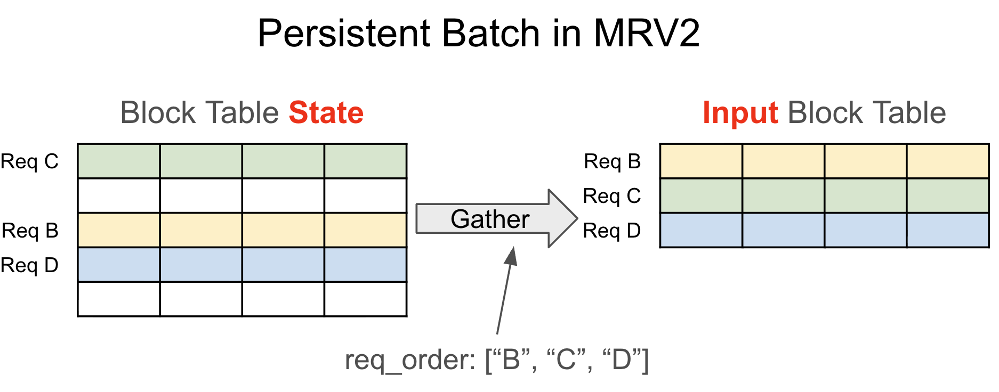{ width="1000" }

MRV2 对块表的处理逻辑示意（图源于MRV2设计文档）

#### 消除 CachedRequestState

V1 需要 CachedRequestState 的根因是：**驱逐时 InputBatch 中的位置要被新请求覆盖，原数据必须另找地方备份**。V2 重新设计了数据分层，从根本上消除了这个需求：

|                     | V1                               | V2                                             |
| ------------------- | -------------------------------- | ---------------------------------------------- |
| 数据存储            | CPU pinned memory                | GPU / UVA                                      |
| Scheduler → Worker | 传递完整数据，触发 CPU→GPU 拷贝 | 只传递 req\_id，不拷贝                         |
| Worker 需要备份？   | 需要，恢复时 Worker 自己提供数据 | 不需要，Scheduler 保留完整数据，恢复时重新传来 |

在V2 中，Scheduler 持有请求的原始数据（prompt、output、sampling\_params），而Worker 只持有运行时状态。

在驱逐时，Worker 丢弃运行时状态，Scheduler 保留完整数据等待重新调度。

恢复时，Scheduler 发来新请求，Worker 将其作为全新请求处理，**不需要知道这个请求曾经被驱逐过**。

#### 消除 swap\_states

V1 需要重排序，是因为持久状态直接用作模型输入，请求顺序必须与 tensor 行顺序一致。重排序 = 交换整行数据。

V2 中，持久状态和输入是分离的。请求在 RequestState 中的位置永远不变，per-step 的 batch 顺序完全由 idx\_mapping 决定。重排序只需要改变这个映射数组：

```text
V1 重排序：
  swap_states(0, 2)
  → 交换 token_ids_cpu 的两行（O(max_model_len)）
  → 交换 block_table 的两行
  → 交换 temperature、top_p、allowed_token_ids_mask 等（十几个字段）

V2 重排序：
  idx_mapping = [0, 1, 2] → [2, 1, 0]
  → 构建一个新的整数数组（O(n)）
  → RequestState 中的数据完全不动
```

此外，V2 的 \_may\_reorder\_batch 不再调用 swap\_states，只需在 prepare\_inputs 中按 attention backend 要求的顺序构建 idx\_mapping 即可。

但这里引入一个新问题：每步需要根据 idx\_mapping 从 RequestState 中 gather 出 per-step 的输入 tensor，这本身也是一种数据拷贝，开销如何？

答案是：**V2 的 gather 只拷贝当前 step 实际需要的 token，而 V1 的 swap 要移动请求的完整 token 历史**。

- V1 swap：把请求 A 的完整 token 序列和请求 B 的完整 token 序列互换。如果一个请求已经生成了 1000 个 token，就要移动 1000 个元素，即使当前 step 只需要其中最后 1 个。
- V2 gather：从持久状态中只拷贝当前 step 需要的 token。decode 时只拷贝 1 个，prefill 时只拷贝当前 chunk 的 token。

在 decode 场景下，V1 的 swap 移动的是 **O(S)。**其中，S = 已生成 token 数，而 V2 的 gather 移动的是 **O(1)**。随着请求生成进度推进，S 越来越大，V1 的开销随之增长，V2 始终是 O(1)。

#### 高效的增量更新：GPU/UVA 存储与 StagedWriteTensor

分离状态和输入后，还有一个工程问题需要解决：如何高效地更新 RequestState 中的大 tensor。

每步结束后，需要将新采样的 token 追加到对应请求的 token 序列中。以 all\_token\_ids 为例，它是一张巨大的表。但每步每个请求通常只新增 1 个 token（decode）或几十个 token（prefill chunk）。如果每步都做一次完整的 CPU→GPU 拷贝，绝大部分带宽都浪费了。

V2 的解决思路分为两层，消除CPU/GPU的等待与加速拷贝效率。

**第一层：数据存在 GPU 或 UVA 上，消除 CPU/GPU 等待。**

V1 将数据存在 CPU pinned memory，每步需要显式 copy\_to\_gpu()。V2 将 RequestState 的核心 tensor 直接放在 GPU 或 UVA（Unified Virtual Addressing）上：

```python
class RequestState:
    # GPU/UVA 存储的大 tensor
    all_token_ids = StagedWriteTensor(
        (max_num_reqs, max_model_len),
        dtype=torch.int32,
        device=device,
        uva_instead_of_gpu=True,   # ← UVA：CPU 存储，GPU 直接访问
    )

    # 其他运行时状态同样使用 UvaBackedTensor
    prompt_len = UvaBackedTensor(max_num_reqs, dtype=torch.int32)
    prefill_len = UvaBackedTensor(max_num_reqs, dtype=torch.int32)
    num_computed_tokens = StagedWriteTensor(max_num_reqs, dtype=torch.int32, device=device)
```

UVA 的核心特性是：**数据在 CPU 端存储，但 GPU 可以通过虚拟地址直接访问，无需显式拷贝**。这彻底消除了 V1 中每步 copy\_to\_gpu() 带来的同步等待开销。

**第二层：StagedWriteTensor，批量写入减少 kernel 启动开销。**

即便数据已在 GPU/UVA，直接每步写入也有问题：每次写入都要调用一次 GPU kernel，调用开销（kernel launch overhead）在高频小写入场景下会成为瓶颈。V2 使用 StagedWriteTensor，先记录后批量写入：

```text
Step N 执行期间（CPU 端）：
  stage_write(req_idx=3, start=100, [tok1, tok2])  ← 只是 Python list 的 append，无 GPU 操作
  stage_write(req_idx=7, start=50, [tok3])

Step N 结束时（GPU 端）：
  apply_write()  ← 单次 Triton kernel，一次性应用所有写入
```

CPU 端的 stage\_write 只是把写入操作记录到 Python list 中，几乎零开销。等到 step 结束时，apply\_write() 将所有记录打包，一次性传到 GPU，由一个 Triton kernel 批量执行所有写入。

这个设计针对推理的 workload 特点：大部分 step 只有少数请求有新 token，单次写入量很小，但频率很高。StagedWriteTensor 把大量小写入累积起来，用一次高效批量 kernel 完成。

V2 的 Persistent Batch 重构，本质上是**把「状态存储」和「per-step 输入」从一张表拆成两张表，用 idx\_mapping 按需组装**。这一拆，驱逐不需要备份了，重排序不需要 swap 了，大 tensor 的更新也可以批量做了。

## 二、核心数据结构RequestState

在上一节中，看到 MRV2 将 Persistent Batch 的两类职责解耦：InputBatch 保留为 per-step 的输入容器，持久化状态则单独抽象为 RequestState。本章**聚焦 RequestState**，讨论它如何管理分布在 CPU 与 GPU 上的状态数据，并保证每个 Step 都能正确、高效地访问它们。

### 1、RequestState 成员变量总览

为了管理 Model Runner 中，分布在不同位置上的、与请求相关的状态数据，RequestState 按数据的存储位置与访问模式，将其成员变量划分为三类：

**纯 CPU 变量**：仅存在于 Python 侧，提供 req\_id ↔ 行索引的映射关系：

- req\_id\_to\_index：Scheduler 的 req\_id → GPU tensor 的行索引
- index\_to\_req\_id：反向索引，供 Worker 的 update\_requests 使用
- free\_indices：空闲行索引池

**CPU/GPU 混合型**：数据在 CPU 侧初始化或更新，GPU 按需访问：

- all\_token\_ids：完整 token 历史，\[max\_num\_reqs, max\_model\_len\]
- num\_computed\_tokens：已计算 token 数
- total\_len：prompt\_len + output\_len
- prompt\_len：prompt 长度（不变）
- prefill\_len：prefill 长度（≥ prompt\_len）

**纯 GPU 型**：数据在 GPU 侧存储和参与计算：

- last\_sampled\_tokens：\[max\_num\_reqs, 1\]，最后采样的 token
- draft\_tokens：\[max\_num\_reqs, num\_spec\_steps\]，投机 draft tokens

### 2、RequestState 的运行时行为

以上是 RequestState 的静态结构。接下来，我们从**运行时视角**，看 RequestState 在 MRV2 的执行循环中是如何被操作的。本章先从索引层看 RequestState 中调度与状态的交互，再从 Tensor 生命周期看数据在计算过程中的演进。

#### 索引层

索引层的变化由 SchedulerOutput 驱动。每次 Scheduler 输出新的调度批次时，GPUModelRunner 围绕 RequestState 的索引字段完成三类操作：**添加新请求add\_requests、查找已有请求update\_requests、释放已结束请求finish\_requests**。

涉及的数据全部在 CPU 侧，不参与任何 GPU tensor 计算，包含req\_id\_to\_index、index\_to\_req\_id和free\_indices。

**add\_requests：添加新请求**

add\_requests 将调度的新请求放入 RequestState，分配物理行索引，并初始化相关字段：

1. 从 free\_indices 取出一个空闲行索引
2. 在 req\_id\_to\_index 和 index\_to\_req\_id 中注册该请求的映射关系
3. 用 prefill\_token\_ids 初始化 all\_token\_ids 对应行
4. 初始化 num\_computed\_tokens、total\_len、prompt\_len、prefill\_len

add\_requests还涉及 Tensor 数据的初始化和拷贝，all\_token\_ids 是在 CPU 侧进行初始化的，后续会通过 StagedWriteTensor 的能力拷贝到GPU中。

**update\_requests：查找已有请求**

update\_requests根据行索引查询对应的 req\_id，供 Worker 使用。

此时不修改任何 RequestState 字段，update\_requests通过 index\_to\_req\_id 反查到 req\_id，再执行后续操作，如更新 InputBatch 的 block\_tables。

这里仅有读取 index\_to\_req\_id的 CPU 侧操作。

**finish\_requests：释放已结束请求**

finish\_requests 将已完成的请求从 RequestState 中移除，释放行索引回池：

1. 从 req\_id\_to\_index 中移除该请求，得到行索引 idx
2. 从 index\_to\_req\_id 中删除 idx
3. 将 idx 放回 free\_indices

涉及到的三个索引字段均在 CPU 侧读写，无 GPU tensor 操作。

```python
idx = req_id_to_index.pop(req_id)
del index_to_req_id[idx]
free_indices.append(idx)
```

#### Tensor 生命周期

索引层刻画的是调度与状态注册的交互，不涉及数据本身。顺着请求的执行路径，我们再看 Tensor 数据在计算过程中如何产生、流转与更新。

计算过程中 Tensor 的生命周期由每个 Step 驱动。请求从进入到全部完成，会依次经历 **Prefill 阶段**和 **Decode 阶段**两个阶段。每个 Step 内遵循同一套循环进行：**Prepare Input → 采样 → postprocess 更新**。

我们以核心的数据 all\_token\_ids与last\_sampled\_tokens 为例，讲讲各阶段中的数据读写与数据交换。

- all\_token\_ids 最初存储于 CPU 中，在计算时需要在 GPU 中参与运算
- last\_sampled\_tokens 是采样后的结果，数据位于GPU中，并且也会参与后续的计算。

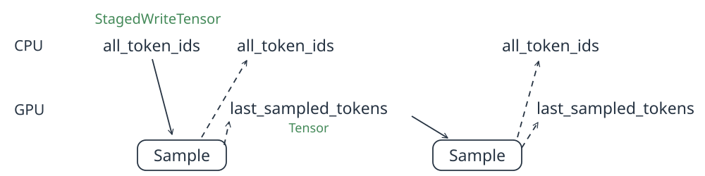{ width="1000" }

all\_token\_ids与last\_sampled\_tokens 数据交换示意图

**请求首次进入**到 Step 时，add\_requests 将位于 CPU 的数据使用 StagedWriteTensor 批量写入到GPU中。

**Prefill 阶段**

Prefill 阶段需要将 prompt 的完整 token 序列送入 forward，生成 Logits 并采样出预测的 Token。

1. Prefill 阶段的 Prepare Input ，会根据 idx\_mapping **从 all\_token\_ids 对象 gather** 出 Prefill 的输入序列，并构建 InputBatch。（all\_token\_ids比较特殊，其使用了 UVA 技术，数据并未移动到 GPU 中）
2. Prefill 阶段的 postprocess ，会将新产生的 token 追加写入 all\_token\_ids 对应行的末尾，并将同一 token 覆盖写入 last\_sampled\_tokens 中，更新 num\_computed\_tokens等数据

Prefill 阶段结束后，请求会进入 Decode 循环直到结束。

**Decode 阶段**

Decode 阶段逐 token 生成。每 step 根据上一轮采样的 token 预测下一个 token，直到所有请求结束。Decode 和 Prefill 在 Prepare Input 阶段的最大差异在于：Prefill 需要完整历史 token 作为输入，Decode 只需要最新采样的一个 token。因此，两者的数据来源是不同的：

1. Decode 阶段的 Prepare Input ，会根据 idx\_mapping **从 last\_sampled\_tokens 对象 gather** 出上一轮生成的token，并构建 InputBatch。
2. Decode 阶段的 postprocess ，会将新产生的 token 追加写入 all\_token\_ids 对应行的末尾，并将同一 token 覆盖写入 last\_sampled\_tokens 中，更新 num\_computed\_tokens等数据

反复进行 Decode ，直到请求结束，此时 SchedulerOutput **触发 finish\_requests**，将该请求从 RequestState 中移除并释放其行索引。

在整个计算周期内，数据不会重新流回 CPU 中，而是保证其在 GPU 中不断的读取、更新，这保证了 Decode 阶段的高效进行。采样产生的 output token 最终通过 AsyncOutput 异步传回 CPU 供用户使用。

下一轮中 **Step 所需的数据已位于 GPU **中，这样就完成了 CPU 和GPU 的完全异步。

### 3、细节补充

以上对 Prefill 与 Decode 的描述中，有两个关键技术点值得单独展开：StagedWriteTensor 的批量写入机制，以及 UVA 如何实现 CPU 与 GPU 的直接数据访问。这分别对应 Prefill 阶段提到的「all\_token\_ids 比较特殊，使用了 UVA 技术，数据并未显式拷贝到 GPU」，以及 postprocess 阶段提到的「通过 StagedWriteTensor 的能力写入 GPU」。

我们分别讨论。

#### StagedWriteTensor：CPU → GPU 的批量写入

Prefill 阶段新请求进入时，prompt token 是位于 CPU 的 Python list 数据。如果每条数据的 Append 都单独发起一次 GPU 写入，细粒度的 kernel launch 开销会拖累性能。StagedWriteTensor 将这个过程分两阶段完成。

**数据位于 CPU**

当调用 stage\_write 时，数据不立即写入 GPU，将数据暂存在 CPU 端，同时记录目标位置（index、start）和内容，这是纯 Python 操作，不涉及任何 GPU 调用。

```python
def stage_write(self, index: int, start: int, x: Iterable[int]):
    self._staged_write_indices.append(index)
    self._staged_write_starts.append(start)
    self._staged_write_contents.extend(x)
```

积累到一定数量后，调用一次 apply\_write 完成批量写入：

1. 将 index、start 等索引数据拷贝到 UVA-backed buffer 中
2. async\_tensor\_h2d 异步地将内容数据从 CPU 拷贝到 GPU 中
3. 启动 Triton kernel，将 CPU 数据批量写入 index、start 指定的位置中
4. 最后，清空积攒的写入数据

这一步才是真正发生 CPU → GPU 数据传输的地方。

**数据位于GPU**

采样完成后，sampler\_output.sampled\_token\_ids 本身已经是 GPU tensor，这些操作就不必进行传输了。此时由postprocess 中的 \_post\_update\_kernel 直接在 GPU 上完成写入。

#### UVA：GPU 直接访问 CPU 数据

上面我们提到，all\_token\_ids 由于占用空间大且访问并不频繁，因此这份数据是放在 CPU 内存中的，其在 StagedWriteTensor 中的存储结构正是基于 UVA。

MRV2 将 all\_token\_ids 存储在 Pinned CPU Memory 中，利用 UVA（Unified Virtual Addressing） 使 CPU 和 GPU 共享同一块物理内存的虚拟地址视图。GPU 可以按需直接访问这块数据，无需 CPU 发起传输请求，也无需 CPU 侧下发 kernel 来触发传输。

这优化的是 cudaMemcpy 中 CPU 侧 kernel launch 的固定开销，数据其实一直在 CPU 内存中，只是 GPU 现在可以直接访问，而不必等 CPU 下发指令。

```python
class UvaBuffer:
    def __init__(self, size, dtype):
        self.cpu = torch.zeros(size, dtype=dtype, device="cpu", pin_memory=True)
        self.np = self.cpu.numpy()
        self.uva = get_accelerator_view_from_cpu_tensor(self.cpu)
```

其中 get\_accelerator\_view\_from\_cpu\_tensor 将 pinned CPU tensor 转换为 GPU 可见的地址视图。

> CPU 和 GPU 并行读写同一块 UVA buffer 时会产生竞态问题。vLLM 在使用 UVA 时借助了双缓冲机制：两块 buffer 轮转使用，CPU 写入时 GPU 读另一块。这个机制的存在让高效并行访问成为可能，细节这里不展开。

到这里，RequestState 的全貌已经清晰。它不仅是数据的容器，更是 MRV2 实现 CPU 与 GPU 协同工作的核心抽象。理解它之后，我们再去看 MRV2 的其他优化设计，会有更清晰的上下文。

## 三、异步调度

在推理系统中，CPU 和 GPU 分别承担不同的工作，CPU 负责任务调度、资源管理，GPU 负责计算密集的 forward 和 sampling。两者若串行执行，GPU 在等待 CPU 时会空闲，CPU 在等待 GPU 时也会闲置。异步调度的目标正是让这两者尽可能并行，相互掩盖延迟，从而提升整体吞吐。

衡量推理系统的两个关键指标：TTFT（Time to First Token）反映首 token 延迟，由 Prefill 阶段的计算速度决定；ITL（Inter-token Latency）反映生成吐出的间隔，由 Decode 阶段的每步延迟决定。异步调度主要优化的是 ITL。

vLLM V1 很早就支持了异步调度模式，但这种支持是事后叠加在原有架构上的，需要使用 synchronize\_input\_prep 等 CUDA Event 屏障来防止竞态，代码复杂度和维护成本高。MRV2 则将 Async-First 作为核心设计约束，并以此重新设计了异步调度。

### 1、V1 的异步调度：机制与代价

vLLM 的调度存在同步和异步两种模式。同步模式下，Scheduler 每发起一次调度后必须等待 GPU 完成当前步，才能发起下一次调度。异步模式下，Scheduler 提交调度后立即返回，不需要等待 GPU 完成。同时，EngineCore 也能够通过 batch queue 限制并发度，防止调度超前过多。

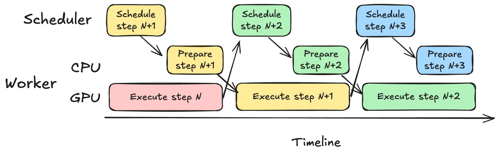{ width="1200" style="background-color: #fff;" }

#### 异步模式下的竞态问题

异步执行带来的核心挑战是：CPU 和 GPU 可能并发访问同一块内存。V1 在 \_prepare\_inputs 中将输入数据写入 pinned CPU buffer，然后通过 non\_blocking=True 发起异步 H2D 拷贝。如果下一步的 CPU 写入在上一步拷贝完成之前发生，buffer 中的数据就会被覆盖。

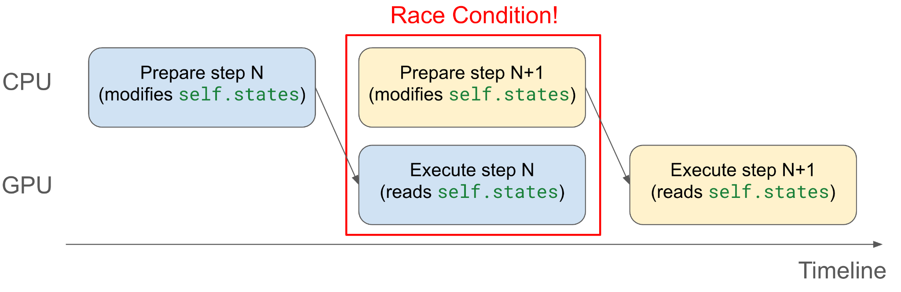{ width="1200" }

这一问题出现在被 step 间复用的 pinned CPU 中间 buffer 上，例如 seq\_lens、query\_start\_loc 等。

#### synchronize\_input\_prep 屏障

V1 通过 CUDA Event 机制保护临界区，确保每一步的拷贝完成后，下一步才能写入同一块 buffer。

```python
# gpu_model_runner.py
@contextmanager
def synchronize_input_prep(self):
    if self.prepare_inputs_event is None:
        yield
        return

    self.prepare_inputs_event.synchronize()  # 等待上一步 H2D DMA 完成
    try:
        yield
    finally:
        self.prepare_inputs_event.record()   # 标记当前步 H2D DMA 完成
```

synchronize\_input\_prep 上下文管理器包裹了每个 step 中准备输入的代码。结束准备后，会调用 prepare\_inputs\_event.record() 记录一份事件，这个事件会在下一个准备输入时被 synchronize，阻塞 CPU 直到上一步的 DMA 拷贝完成。

这样，读写被 CUDA Event 隔离开来，竞态得以避免。

```python
# gpu_model_runner.py
with (
    record_function_or_nullcontext("gpu_model_runner: preprocess"),
    self.synchronize_input_prep(),  # 关键同步点
):
    deferred_state_corrections_fn = self._update_states(scheduler_output)
    # ... 准备输入 ...
```

#### 为什么 V1 一定有 CPU 等待

synchronize\_input\_prep 避免了两个 Step 之间的竞态。但细看会发现，Step N 和 Step N+1 虽然分别是 CPU 和 GPU 操作，但它们被串成了一个整体，这就是 V1 一定有 CPU 等待的原因。

根本的原因在于，**整个调度执行的架构完全围绕着 CPU 进行的，CPU 是 V1 的状态管理中心**。GPU 在 CPU 的指挥下进行计算、采样、返回结果，然后等待 CPU 的下一步指令。

采样输出 sampled\_token\_ids 在 GPU 上生成后，有两个地方依赖这份数据：

1. 下一步的 input\_ids：可以直接留在 GPU 上，通过 tensor 引用传递给下一次 forward，CPU 不需要参与
2. CPU 侧的状态更新：Scheduler 需要知道生成了哪些 token 才能做调度决策；logits processors 需要拿到真实 token id 才能在 CPU 上计算惩罚值；token\_ids\_cpu 作为 InputBatch 的持久状态也需要 CPU 来维护

CPU 侧对采样输出的依赖也是另一个导致 CPU 等待的原因。只要 CPU 要用这份数据，GPU 必须把数据传到 CPU，而 CPU 必须等数据到了才能继续下一轮的 Prepare Input。

非异步模式下，数据流的完整路径是这样的：

1. \_prepare\_inputs() 把 input\_ids 从 CPU 的 token\_ids\_cpu 拷贝到 GPU
2. GPU 完成 forward 和 sample，输出 sampled\_token\_ids
3. sample 计算完成后，进入 \_bookkeeping\_sync()。在旧版本的代码中，这里使用了隐式D2H同步sampled\_token\_ids.tolist()，Python 要把 GPU tensor 转成 list，就必须等 GPU 先把数据拷贝到 CPU。
4. 拷贝和后续调度完成后，CPU 才能发起下一次 H2D，把 token\_ids\_cpu 里更新后的数据拷回 GPU。
5. 此时，GPU 才能开始下一步 forward。

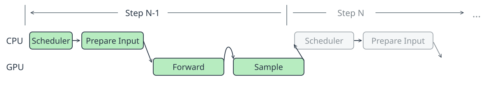{ width="1200" }

非异步调度时的CPU/GPU行为示意图

GPU 和 CPU 被串成一个锁步执行的两段式流程。GPU 在等 CPU 的这段时间完全空闲。V1 的异步优化针对的也是这两个地方：GPU 零拷贝跳过步骤 2 中的 GPU→CPU→GPU 往返；CPU 异步拷贝把步骤 3 的同步点推迟到 Worker 返回结果前最后一刻，用独立的拷贝流异步发起 D2H，不阻塞其他 GPU 操作。

但本质上，**V1 的 async 是「延迟等待」，不是「消除等待」**。只要 CPU 仍是状态管理中心，采样输出就必须回 CPU，同步点就存在，天花板就在那里。

这也给 MRV2 的设计埋下了伏笔：与其在 CPU 侧打补丁，不如把状态管理中心搬到 GPU 上。

> 引用 vLLM 社区的性能测试结论。
> 我们用 `Qwen3-0.6B`（极小模型）在 `1×GB200`（强算力 GPU）上进行了压测，刻意选择这个组合是为了放大 host 侧开销的相对占比。在这种配置下，MRV2 通过将输入准备迁移到 GPU，实现了 56% 的吞吐提升。

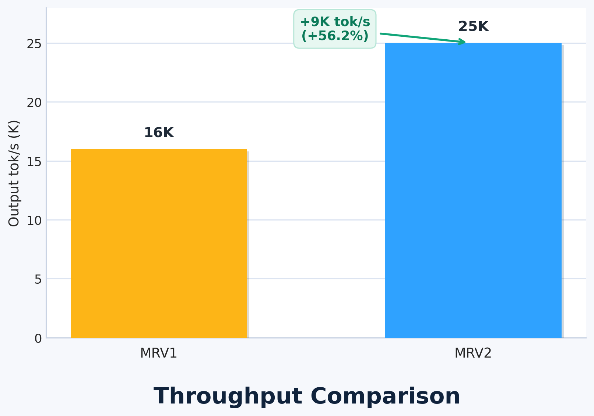{ width="850" }

图 5：MRV1 与 MRV2 在 Qwen3-0.6B × 1×GB200 上的吞吐对比。MRV2 达到 25K output tok/s，相比 MRV1 的 16K 提升 56.2%。

### 2、MRV2 的 Async-First 设计

MRV2 的核心转变是：GPU 是主角，CPU 只负责把初始数据拷贝到 RequestState，之后就不再参与核心执行路径。V1 中，CPU 是整个调度执行架构的中心，GPU 在 CPU 的指挥下工作，采样结果必须回 CPU 才能驱动下一步调度。MRV2 则是反过来，CPU 只做必要的初始数据处理和每步的数据接收，中间过程全部由 GPU 自主完成，甚至连 H2D 拷贝也由 GPU 主动发起。

这体现在 execute\_model 的实现上：整个方法是一条无 CPU 同步点的 CUDA stream。Scheduler 提交调度后立即返回，ModelRunner 在 GPU 上完成前向传播、采样、H2D 状态更新，全程没有任何 synchronize\_input\_prep 或 Event 屏障。

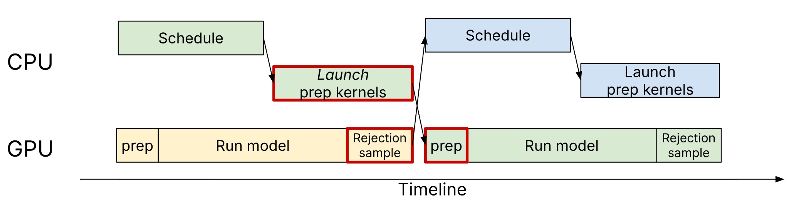{ width="1200" }

异步调度的目标也从「让 GPU 在 CPU 工作期间不空闲」变成了「让 CPU 和 GPU 完全独立运行，通过 batch\_queue 解耦」。Scheduler 只需要往队列里塞调度决策，ModelRunner 从队列里取，GPU 执行结果通过异步 D2H 返回给真正需要 CPU 数据的消费者，两者不需要在同一个时间窗口内互相等待。

### 3、MRV2 Worker 端的异步实现

上一篇文章（Model Runner V2 架构（二）：RequestState）中提到，MRV2 将采样输出 sampled\_token\_ids 存入 RequestState，由 GPU 直接访问，不再回传给 CPU。这与 V1 对 GPU 零拷贝的优化思路一脉相承，解决了采样输出的一条数据通路问题。

本节聚焦另一条数据通路：采样结果如何非阻塞地返回给 CPU。

#### AsyncOutput：非阻塞返回

MRV2 Workes 本身已经实现了完全的异步，而在sample\_tokens的末尾返回结果时，单独为异步调度场景准备了AsyncOutput返回值。

```python
# sample_tokens 末尾
if self.use_async_scheduling:
    return async_output  # 立即返回

return async_output.get_output()  # 阻塞等待后返回
```

AsyncOutput 使用了独立的拷贝 Stream 执行 D2H，不占用主计算 Stream。这使得AsyncOutput在进行异步 D2H 拷贝的时候，不会阻塞 main stream 的计算和拷贝。

```python
with stream(copy_stream, main_stream):
    copy_stream.wait_stream(main_stream)  # 等主 Stream 当前计算完成

    self.sampled_token_ids = async_copy_to_np(sampler_output.sampled_token_ids)
    # ...
    self.copy_event.record(copy_stream)  # 记录拷贝完成事件
```

而 CPU 侧则通过 get\_output 函数，在需要时阻塞等待并获取结果。

```python
def get_output(self) -> ModelRunnerOutput:
    self.copy_event.synchronize()  # 只等 D2H 拷贝完成

    sampled_token_ids: list[list[int]] = self.sampled_token_ids.tolist()
    self.model_runner_output.sampled_token_ids = sampled_token_ids
    # ...
    return self.model_runner_output
```

关键在于，synchronize() 只等拷贝 Stream 的事件，不等 GPU 计算。GPU 主 Stream 和拷贝 Stream 完全并行，GPU 在 CPU 等待期间可以继续下一次 forward。

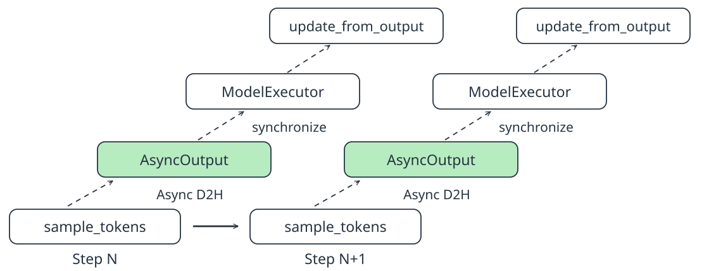{ width="1000" }

异步D2H与Synchronize示意图，Step之间不存在任何CPU同步点，拷贝完成的事件会由ModelExecutor 等待

### 4、Scheduler 与 ModelRunner 的异步协作

上一章讲了 Worker 侧如何异步返回结果。但仅有 Worker 侧的异步支持还不够，需要 Scheduler 与 ModelRunner 协同工作，才能让异步调度真正运转起来。

要理解 Scheduler 侧做了哪些配合，先要看 vLLM 的调度策略是如何设计的。vLLM 的调度不区分 Prefill 和 Decode，而是将其统一抽象为两个状态变量：

- num\_computed\_tokens：已计算的 token 数量
- num\_tokens\_with\_spec：需要计算的 KV Cache token 总数（prompt tokens + output tokens + spec tokens）

调度的目标始终是：让 num\_computed\_tokens 追上 num\_tokens\_with\_spec。这个抽象同时覆盖了 Chunked Prefill、Speculative Decoding 等多种场景。

**异步调度下的 num\_output\_placeholders**

在异步调度下，Step N 的调度完成后会立刻开始 Step N+1 的调度，此时 Scheduler 面临一个问题：Step N 的结果还未返回，GPU 还在执行中，请求的 num\_computed\_tokens 不会发生变化，但调度又必须继续。

Scheduler 的解决策略是，为每个请求引入 num\_output\_placeholders，表示该请求已被调度，但 GPU 还未输出 token 的数量。

这样，本轮实际需要调度的新 token 数，就可以用以下公式计算。

num\_tokens\_with\_spec 与 num\_output\_placeholders 之和，表示把这个请求在飞的输出也计入之后，它最终会有的 token 数；减去已经提交给 GPU 的 num\_computed\_tokens，就是本轮实际需要新增调度的 token 数。

同步模式下 num\_computed\_tokens 不会超过 num\_tokens\_with\_spec，直接相减即可；异步模式下调度跑到了执行前面，num\_computed\_tokens 里已经混入 token 尚未返回的位置，因此要把这部分「预支」的输出补回总量。

```python
num_new_tokens = (
    request.num_tokens_with_spec
    + request.num_output_placeholders
    - request.num_computed_tokens
)
```

num\_tokens\_with\_spec、num\_computed\_tokens的概念比较清晰易懂，我们只需要理解清楚， num\_output\_placeholders 在调度与执行过程中，会发生怎样的的变化即可：

- **每轮调度时**：需要增加 1 + scheduled\_spec\_decode\_tokens，其中 1 表示一轮 decode  正常产生的 token数，scheduled\_spec\_decode\_tokens表示上一轮 ModelRunner 执行完毕后，由投机解码产生的额外 token。
- **每轮 ModelRunner 执行完毕后**：需要减少 len(new\_token\_ids) + num\_rejected，表示新生成的若干个 token 数（Decode 场景下该值为1），再加上被拒绝的草稿 token 数。

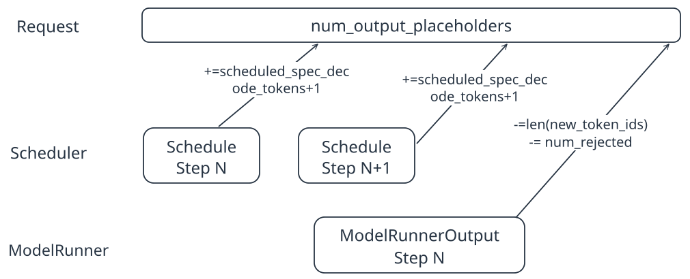{ width="1000" }

num\_output\_placeholders 变化示意图

### 5、EngineCore：调度与执行的流水线

前面两节分别讲了 Scheduler 的调度决策和 ModelRunner 的异步返回。但仅有这两者还不够——它们需要一个中转机制来实现调度领先执行一步，从而让 GPU 始终有任务可跑。EngineCore 中的 batch\_queue 正是为此设计的。

EngineCore 与 Scheduler、ModelRunner 的关系是：EngineCore 调用 scheduler.schedule() 获取调度决策，将决策交给 model\_executor.execute\_model() 执行 GPU 前向传播，执行结果通过 batch\_queue 在调度与执行之间缓冲。

具体来说，EngineCore 在异步调度场景下，会在 run\_busy\_loop 循环中不断调用 step\_with\_batch\_queue 进行调度和执行。step\_with\_batch\_queue 单次调用只调度一次，不内含循环。

#### 请求生命周期视角下的 step\_with\_batch\_queue

我们以请求的生命周期视角看step\_with\_batch\_queue逻辑会简单一些。

**阶段 A：调度并提交（不阻塞）**

调用 scheduler.schedule() 获取调度决策后，会同时非阻塞地提交 execute\_model 和 sample\_tokens，并将返回的 Future 加入 batch\_queue 队列中：

```python
batch_queue.appendleft((future, scheduler_output, exec_future))
```

放入后，检查是否还可以继续调度。如果可以则提前退出，进行下一轮的step\_with\_batch\_queue：

```python
if (
    model_executed
    and len(batch_queue) < self.batch_queue_size  # 队列未满
    and not batch_queue[-1][0].done()  # 最新入队的批次尚未完成
):
    return None, True  # 不阻塞，直接返回
```

**阶段 B：等待并处理（阻塞）**

此时调度、执行队列已经满了，需要阻塞等待最老的批次结果。此时调用 .result() 阻塞等待 GPU 执行结果：

```python
future, scheduler_output, exec_model_fut = batch_queue.pop()
model_output = future.result()
```

待结果返回后，EngineCore 会将结果交给 scheduler.update\_from\_output() 处理，这包括更新请求状态、检查停止条件、释放 KV Cache 等。

此时队列空出一个位置，下一次迭代又可以继续调度。

这样，能够保证调度始终领先 GPU 执行至少一步，GPU 每次 forward 完成后立即有下一轮调度可以处理，不会因等待 Scheduler 而空闲。

---

至此，我们可以完整地看清 MRV2 异步调度的全貌：

1. Scheduler 通过 num\_output\_placeholders 实现超前调度，将调度决策写入 batch\_queue 后立即返回
2. ModelRunner 从队列中取出决策，在 GPU 上完成前向传播和采样，全程无 CPU 同步点；
3. 采样结果通过 AsyncOutput 的独立拷贝 Stream 异步返回 CPU，不阻塞 GPU 主 Stream；
4. EngineCore 通过 batch\_queue 的先进先出机制，保证调度始终领先 GPU 执行至少一步。

整个设计贯穿了一个核心思路：让 CPU 和 GPU 成为两个独立运行的生产者，而不是被锁步绑定在一起。

V1 试图在 CPU 侧打补丁，最终受限于 CPU 状态管理中心的架构；MRV2 则把状态管理中心搬到 GPU，让 CPU 只做必要的初始数据处理和数据接收，解放了 GPU 的计算资源。这才是 Async-First 的真正含义。

## 四、投机解码

> 尽管投机解码还有一些问题待解决，但其已经成为生产级功能，也是所有 Provider 必须的能力。本节会带你理解当前 vLLM 的投机解码是怎么跑的。

本篇只涉及 MRV2 + 异步调度下的投机实现，这也是 vLLM 很长一段时间内不会改变的路线。

> 文章基于 vLLM v0.20.1，代码路径可能随版本更新变化，但核心逻辑会保持稳定。

### 1、投机解码基础

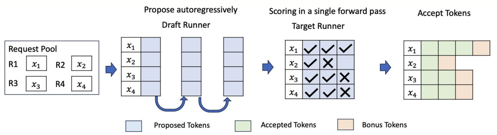{ width="1200" }

Speculative Decoding 的核心循环

#### 核心循环：Draft → Verify → Accept

投机解码（Speculative Decoding）解决的问题很简单：自回归模型每步生成一个 token，内存带宽是瓶颈。可以说Decode流程中，GPU 计算单元大部分时间在空转。但是如果在这一阶段，一次能够计算后续 N 个 token，就能把这个串行瓶颈打破。

投机解码的本质是希望把负载从**访存密集**转换为**计算密集**，吃满计算核心。

投机解码的流程分三步：

1. **Draft**：用低成本方式快速生成 N 个候选 token。低成本可以是小模型的一次 forward（EAGLE3），可以是主模型自带的并行预测头（MTP），也可以是基于统计的文本模式匹配（NGram、Suffix Decoding）。
2. **Verify**：目标模型把这 N 个候选 token 拼到输入里，一次 forward 算出每个位置的概率分布。
3. **Accept**：对比 draft 和 target 的概率分布，决定接受哪些 token。接受率越高，加速效果越好。

验证多 token 的过程是并行计算的，即使部分候选被拒绝，分摊下来也比逐 token 串行生成快。

#### 两种思路：基于模型 vs 基于统计

vLLM 当前支持的投机方法可以分成两类，这里说下主流的方法。

**GPU 侧**：基于模型的方法，需要额外的显存或计算资源。

- **MTP（Multi-Token Prediction）**：模型训练时就加了多个预测头，推理时用自己的预测头「自己猜自己」。需要模型本身支持 MTP 架构，如 DeepSeek-V3、DeepSeek-V4、MiniMax-M2、Qwen3.5 等。
- **EAGLE3**：训练一个极轻量的草稿模型，用主模型中间层的隐藏状态做输入来预测后续 token。通过自行训练 EAGLE3 可适配已有开源模型，针对特定业务场景还可以微调草稿模型以实现更好的接受率。

**CPU 侧**：基于统计的方法，优势是不占用显卡资源，投机成本低。不过 MRV2 + 异步模式下 CPU 和 GPU 之间存在同步点，会削弱这部分优势。此外，基于统计的方法，在接受率上通常会低于基于模型的方法。

- **NGram**：在已生成的文本里查找当前后缀的匹配，把匹配后面的 token 拿来当候选。目前 vLLM 已将其从 CPU 迁移到了 GPU。
- **Suffix Decoding**：用后缀树（suffix tree）做模式匹配，比 NGram 覆盖更全，长文本下更稳定。

两类方法的本质区别在于 draft 怎么产生，但最终的产物都是 draft tokens（候选 token id 序列）。

### 2、架构总览

#### 核心组件

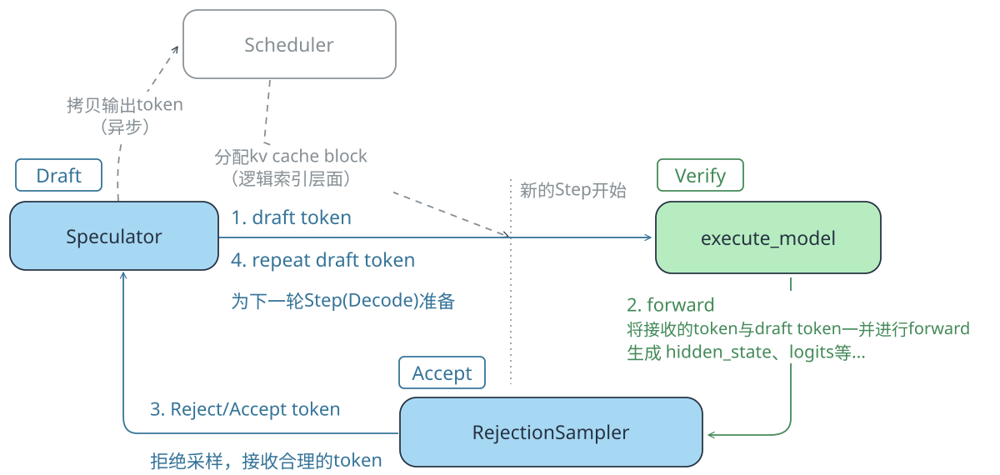{ width="1100" }

投机解码中各组件作用

MRV2 下投机解码涉及四个组件：

- **Scheduler**：负责决定当前 step 跑哪些请求，以及为这些请求分配和留出 KV Cache 空间。调度输出中包含了 scheduled\_spec\_decode\_tokens 信息，标记每个请求有几个 draft token 需要验证。
- **GPUModelRunner**：MRV2 的核心。它把投机解码的组件集成到了 execute\_model、 sample\_tokens 两个方法的内部，负责完成目标模型推理、拒绝采样、状态更新、下一轮 draft 生成。
- **Speculator**：投机方法的统一入口，通过暴露 propose() 方法生成下一轮的 draft tokens。底层包装了投机方法的实现，比如EAGLE模型自己的 KV Cache。
- **RejectionSampler**：对比 target logits 和 draft logits，决定每个位置接受还是拒绝。

#### 调用链路

vLLM 的 Draft → Verify → Accept 是跨 step 流水线式的。Step N 产生的 draft tokens，在 Step N+1 进行验证和接受。同时，Step N+1 的尾巴上又会生成下一轮的 draft tokens，供 Step N+2 使用，如此循环。

可以认为 EngineCore 在 step() 中依次调用 GPUModelRunner 的两个方法，投机解码的验证和生成全在 GPU 上跑完，通过 RequestState 存储和传递不同 Step 之间的数据。

这种设计让投机解码的额外开销降到了最低，不需要把 draft tokens 拷到 CPU 再拷回来，不需要在 CPU 上执行拒绝采样逻辑。CPU 侧唯一的同步点就是等 AsyncOutput 的 D2H 拷贝完成，而这是一个独立的拷贝流，不阻塞 GPU 主 stream 的后续计算。

```text
EngineCore.step()
  │
  ├── GPUModelRunner.execute_model()     ← 目标模型推理
  │    ├── prepare_inputs()
  │    │    └── combine_sampled_and_draft_tokens()  ← 拼接上一步的 draft
  │    ├── model.forward()               ← 1 + K 个 token 并行推理
  │    └── return None                   ← 不返回到 CPU
  │
  └── GPUModelRunner.sample_tokens()     ← 采样 + 验证 + draft
       ├── rejection_sampler()           ← 对比 draft/target logits
       ├── postprocess()                 ← 更新 req_states
       ├── speculator.propose()          ← 生成下一轮的 draft tokens
       └── return AsyncOutput            ← 异步 D2H，不阻塞
```

#### Draft 阶段：草稿模型生成候选 tokens

Draft 发生在 sample\_tokens() 的末尾，目标模型刚完成验证，speculator.propose() 开始为下一步生成新的候选。

```python
# model_runner.py, sample_tokens()
spec_hidden_states = hidden_states
# MTP 模型（如 DeepSeek V4）有特殊的 hidden state

draft_tokens = self.speculator.propose(
    input_batch,                      # 当前 step 的批次信息
    attn_metadata,                    # attention 元数据
    slot_mappings_by_layer,           # KV cache slot 映射
    spec_hidden_states,               # 目标模型的隐藏状态（MTP 可能有特殊处理）
    aux_hidden_states,                # EAGLE3 专用：多层辅助隐藏状态
    num_sampled,                      # [num_reqs] 每个请求接受了几个 token
    num_rejected,                     # [num_reqs] 每个请求拒绝了几个
    self.req_states.last_sampled_tokens,    # 上一步采样的 token
    self.req_states.next_prefill_tokens,    # chunked prefill 用
    self.sampler.sampling_states.temperature.gpu,  # Gumbel 采样温度
    self.sampler.sampling_states.seeds.gpu,        # Gumbel 采样种子
    mm_inputs=mm_inputs,              # 多模态输入
)
```

调用方传入了目标模型产出的几乎所有内容（比如 hidden states、attention 元数据等），每个投机方法都能获取自己需要的部分。比如，EAGLE/MTP 这类 neural draft 方法几乎用到了所有参数，使用hidden states 做输入、attention metadata 构建草稿模型的 KV cache 访问、last\_sampled\_tokens 拼接输入序列。而 Suffix Decoding 和 NGram 主要用 input\_batch 里的 token 序列做模式匹配。

propose 会返回一个 shape 为(num\_reqs, num\_speculative\_steps) 的 GPU tensor，之后同时放在两个地方，一个保留在 GPU 中用于下一次计算，一个通过异步返回给调度器：

```python
# 1) 存入 req_states GPU buffer，供下一轮 prepare_inputs 使用
self.req_states.draft_tokens[input_batch.idx_mapping] = draft_tokens

# 2) 只有 structured output 请求需要异步拷贝到 CPU（供 grammar 验证）
self.draft_tokens_handler.set_draft_tokens(input_batch, draft_tokens)
```

至此，Step N 的 draft 生成完毕，等下一轮 prepare\_inputs 时送进目标模型的输入。

#### Verification 阶段：目标模型并行验证

上一步产生的 draft tokens 放在 req\_states.draft\_tokens GPU buffer 中，下一轮 prepare\_inputs() 能够通过一个 Triton kernel 直接读取到这份数据。

```python
# input_batch.py
# 这个 Triton kernel 的核心逻辑很简单：
# 把每个 decode 请求的 last_sampled_token 和 draft_tokens 拼接起来
# 形成输入序列的末尾部分。Prefill 请求不受投机影响，不会拼接 draft tokens。
combine_sampled_and_draft_tokens(
    self.input_buffers.input_ids,              # 输出：构建好的 input_ids
    idx_mapping,
    self.req_states.last_sampled_tokens,        # 上一步采样的 token
    query_start_loc, seq_lens,
    self.req_states.prefill_len.gpu,
    self.req_states.draft_tokens,               # 上一步存的 draft tokens
    cu_num_logits, total_num_logits,
)
```

拼接完成后，目标模型会一次 forward 算完所有位置。输入长度是 1 + K 个 token（1 个已采样的 + K 个候选），这一步的输出是每个位置的 hidden\_state 信息。

```python
# model_runner.py, execute_model()
model_output = self.model(**model_inputs)
# target model 对 1 + K 个位置同时产出 logits
```

#### Accept 阶段：拒绝采样决定接受哪些 token

验证完成后，execute\_model 返回并将控制权转到 sample\_tokens中。sample() 方法会将目标模型产出的 hidden states 转成 logits，然后交给 RejectionSampler 做 accept/reject 决策。

```python
# model_runner.py, sample_tokens()
logits = self.model.compute_logits(hidden_states[input_batch.logits_indices])
# logits shape: [num_logits, vocab_size]
# num_logits = num_reqs + num_draft_tokens (每个请求至少 1 个，加 draft tokens)

if input_batch.num_draft_tokens == 0:
    sampler_output = self.sampler(logits, input_batch)  # 普通采样
else:
    sampler_output = self.rejection_sampler(
        logits, input_batch, self.speculator.draft_logits,
    )
```

RejectionSampler 内部拿到的数据包括：

- **target logits**：目标模型对每个位置算出的概率分布
- **draft tokens**：输入序列中的候选 token
- **draft logits**：草稿模型在生成时的概率分布

> 这里为不了解拒绝采样的同学简单介绍下。拒绝采样（Rejection Sampling）是一种用于从复杂目标分布中生成样本的蒙特卡洛方法。其核心逻辑是借助一个易于**采样的「propose distribution」**来间接获得**目标分布**的样本，并通过一个接受/拒绝的步骤来保证最终样本的正确性。

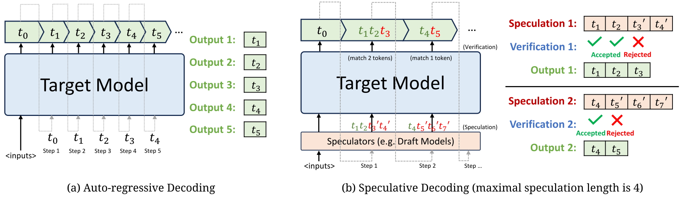{ width="1200" }

最终保留一个连续的前缀，从第一个就开始拒绝意味着一个也没接受，全通过则意味着 K 个候选全部有效，还会额外从 target 采样一个 bonus token。输出包括sampled\_token\_ids 、num\_sampled 和 num\_rejected：

```python
# model_runner.py
sampler_output = self.rejection_sampler(logits, input_batch, self.speculator.draft_logits)

num_sampled, num_rejected = get_num_sampled_and_rejected(
    sampler_output.num_sampled,
    input_batch.seq_lens, input_batch.cu_num_logits,
    ...
)
# num_logits = 1 + num_draft_tokens
# num_rejected = num_logits - num_sampled
```

采样完成后，还会根据num\_sampled 和 num\_rejected等信息更新 req\_states，并将 ModelRunner 的输出异步返给 Scheduler。

产出的 sampled tokens 信息也会分为两份，一份更新 req\_states 的状态，另一方面传给 speculator.propose() 做下一轮 draft 的输入，形成完整的循环。

```python
# postprocess() 中的核心逻辑
# 1) 只追加被接受的 tokens
all_token_ids += sampled_tokens[:num_sampled]

# 2) 更新 last_sampled
last_sampled_tokens = sampled_tokens[num_sampled - 1]

# 3) 软回滚：不删 KV cache，只回滚计数器
num_computed += query_len - num_rejected
```

#### 调度层的视角

在 MRV2 Async-First 异步调度中，Scheduler 不需要知道 draft 怎么生成的，也不需要接触实际的 draft tokens。它只需要知道每个请求有几个 draft token 需要验证，以便在 token 预算里预留空间即可。

核心机制是 num\_output\_placeholders，在 MRV2 异步调度的文章中有详细讲解，这里只做简要说明：

```python
# scheduler.py，schedule() 之后
for req_id in scheduler_output.num_scheduled_tokens:
    cur_num_spec_tokens = len(scheduled_spec_decode_tokens.get(req_id, ()))
    request.num_output_placeholders += 1 + cur_num_spec_tokens
```

调度器为这个 step 新增的 token 计数加上 placeholder（1 个已采样 + K 个 draft tokens），这些 token 已经被调度但 GPU 还没产出。等到 GPU 返回结果后，再按实际接受数减去 placeholder。

SchedulerOutput 中的 scheduled\_spec\_decode\_tokens 字段就是调度层传给 GPUModelRunner 的唯一接口：

```python
SchedulerOutput(
    scheduled_spec_decode_tokens={
        req_id: spec_token_ids,
        ...
    },
    ...
)
```

**异步调度下，投机解码的调度变得更为简单了**，draft tokens 从 draft 生成到 verification 都在 GPU 上完成，CPU 完全不需要接触实际 token 值。调度器只处理 num\_output\_placeholders 的数字增减，并在计算结束后更新Accept 和 Reject 的 token数即可。

```python
# EngineCore.step()，只有同步模式才需要
if not self.async_scheduling and self.use_spec_decode and model_executed:
    draft_token_ids = self.model_executor.take_draft_token_ids()
    self.scheduler.update_draft_token_ids(draft_token_ids)
```
