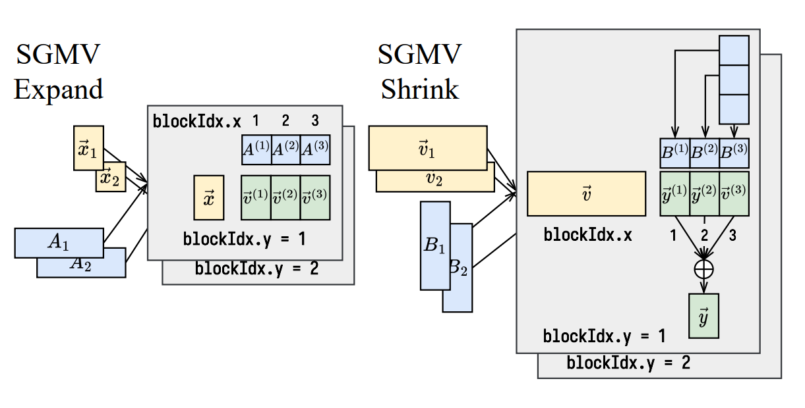

---
tags:
  - vLLM
  - LoRA
title: vLLM Multi-LoRA 推理
description: LoRA 权重管理、请求与 adapter 的映射，以及 Shrink / Expand 算子如何组织不同请求的低秩计算。
date: 2026-09-06
---

## LoRA基础概念

LoRA（Low-Rank Adaptation）通俗理解就是一套高效微调（PEFT）的机制，它可以在基座模型的基础上，通过调整极少量的参数，实现模型在特定领域的优秀表现。

从数学角度看，训练过程本质是计算权重矩阵 $W$ 的增量 $\Delta W$，若基座矩阵 $W \in \mathbb{R}^{d \times k}$，其参数量为 $d \times k$，全参数微调的计算量极大。LoRA 的核心思想是将 $\Delta W$ 表示为两个**低秩（Low Rank）矩阵**的乘积：

$$
\Delta W = A \times B  
$$

其中 $A \in \mathbb{R}^{d \times r}$，$B \in \mathbb{R}^{r \times k}$，秩 $r$ 通常设得很小（如 8 或 16）。此时，微调参数量由 $d \times k$ 骤减至 $r \times (d + k)$。这种低秩分解构成了 LoRA 高效微调的基础。

> 在实际业务中，一个基座模型通常会衍生出多个下游 LoRA 模型以适配不同场景。  
> 当使用 **vLLM** 等推理引擎时，一个 Batch 内的多个请求往往指向不同的 LoRA 权重，这种现象称为**请求的异构性（Multi-tenancy）**。设计一套面向异构请求的高效推理机制，主要面临两大挑战：
>
> - **显存管理**：在有限的显存中，如何高效调度和缓存数量庞大的 LoRA 权重？
> - **高效分发（计算效率）**：如何在同一 Batch 中确保每个 Request 准确找到对应的 LoRA 权重，并最大化 GPU 吞吐？
>
> 针对这些问题，[Punica](https://arxiv.org/pdf/2310.18547) 进行了完善的探索，其核心方案已被集成至 vLLM 中。

## Punica: Multi-Tenant LoRA Serving

### LoRA 显存的动态管理

Punica 采用了类似 **LRU（Least Recently Used）** 的冷热分层机制来管理显存：

- **缓存池设计**：在显存中开辟一段独立空间作为 LoRA 缓存池，并划分为若干 **Slot**，每个 Slot 装载一组低秩矩阵（A 和 B）。
- **映射机制**：维护一个 `Slot_ID -> LoRA_ID` 的映射表。
- **淘汰策略**：遵循 LRU 原则，保留热权重，淘汰冷权重。
- **加载逻辑**：当缓存未命中时，系统不会“自动 Swap”，而是将旧权重 **Evict（移除）**，并依赖 CPU 内存中的备份重新触发 **H2D（Host to Device）** 加载。
- **调度协同**：Scheduler 在生成 Batch 后，收集所有请求涉及的 LoRA ID，由缓存池提前完成权重换入或复用。

### 高效LoRA算子（SGMV）

在vLLM Continuous Batching的场景下，我们需要为每一个token进行路由，找到其对应的LoRA权重，并批量和LoRA权重做乘积。

#### LoRA计算原则

在计算 $y_i = x_i \cdot A_{lora\_id} \cdot B_{lora\_id}$ 时，为了最大化吞吐并兼容 vLLM 的 Continuous Batching 架构，LoRA 计算遵循两个原则：

- **残差累加原则**：由于基座模型的全量参数权重 $W$ 的计算（$xW$）由于已经经过了高度优化的算子处理，故 LoRA 算子仅负责计算修正项 $x\Delta W$。

- **LoRA 两步计算**：利用低秩特性，将 $x\Delta W$ 的计算拆分为两步：

  - **Shrink ($P = xA$)**：将 Hidden State 从维度 $d$ 投影到极小的秩 $r$。

  - **Expand ($y = PB$)**：将秩 $r$ 的中间结果重新投影回维度 $k$。再乘 B 恢复维度。这种策略将计算复杂度从 $O(d \cdot k)$ 降低到了 $O(r(d + k))$。

    { width="60%" }

### 数据预处理

举例来说：一个 batch 包含 3 个请求 A、B、C，其推理 Token 数分别为 1, 3, 2。对应的 LoRA Slot 索引 (lora_id) 分别为 1, 2, 1。

推理时，输入 hidden_states 会组织成 `shape=(num_tokens, D)` 的张量。目标是高效实现批量向量矩阵乘法语义：$y_i = x_i \cdot A_{lora\_id} \cdot B_{lora\_id}$。

由于 vLLM 底层使用 Triton 进行 block 级别的并行计算，为了便于处理，我们对输入数据进行预处理：

- **将 lora_id 转成 token 级**：构造长度为 N 的 `lora_indices` 向量，即该 batch 中每个 token 对应的 lora_id: \[1, 2, 2, 2, 1, 1\]。（表示 index=0, 4, 5 的 token 对应 lora_id=1，index=1, 2, 3 的 token 对应 lora_id=2）
- **将 token 的 index 按照 lora_id 排序**：得到 `[0, 4, 5, 1, 2, 3]`。
- **偏移量维护**：外加一个位置索引 `lora_start_pos = [0, 3, 6]`，表示每个 lora 处理的 Token 段的起始位置。这样，同一个 lora_id 处理的 token 序号就可以被连续访问了。

**SGMV 算子的核心设计**：由于 Batch 中每个请求的 LoRA 可能不同且 Token 长度不一，传统的 GEMM 无法直接应用。**SGMV (Segmented Gather Matrix-Vector Multiplication)** 算子的任务就是处理这种“非连续、分段式”的矩阵乘法。vLLM 用 Triton 实现了高效的并行。

> 以shrink操作为例介绍：
>
> 1. **线程块（CTA）划分策略：**
>    - **PROGRAM_ID\[0\] (Batch 维度)**：对应 `lora_id` 的分段。每个 Batch 处理一个特定 LoRA 对应的所有 Token。
>    - **PROGRAM_ID\[1\] (N 维度)**：在当前 LoRA 关联的 Token 序列中，按照 `BLOCK_N` 进行切分。
>    - **PROGRAM_ID\[2\] (M 维度)**：对应低秩维度 r 的切分（对于 Shrink 操作）。
>    - (可选) *Split-K*：在 d 维度较大时，通过原子累加进一步提升并行度。
> 2. **计算流程**
>    - **索引寻址**：对于每一个CTA而言，在`lora_id`确定时，根据 `lora_start_pos` 定位当前 `lora_id` 的 Token 段起始地址。通过预处理得到的 `lora_indices`（排序后的索引），计算出当前线程块需要加载的 x 在原始内存中的偏移地址。
>    - **间接加载 (Gather)**：利用指针向量 `x_ptr` 批量加载不连续的 Token 数据（维度为 `BLOCK_N * BLOCK_K`）。与此同时，加载对应的 LoRA A 权重块（维度为 `BLOCK_K * BLOCK_M`）。
>    - **计算与写回**：调用 `tl.dot` 执行高效率的小矩阵乘法。计算结果经过累加后，写回到中间张量（秩为 r 的激活值）。

## vLLM框架LoRA逻辑

### LoRA Layer替换处理

首先在加载model阶段，把原始的 Linear / ColumnParallelLinear / RowParallelLinear 换成对应的带 LoRA 功能的类，并且为每一层LoRA做初始化，分配显存buffer。让模型结构具备支持 LoRA 的能力，并开好存储空间。

先从load_model为入口，以下是一个主要调用流程：

```python
self.model_runner.load_model() 
        │
        ▼
create_lora_manager(...)  ➜  return lora_manager.model
        │
        ▼
LoRAModelManager
        │
        ▼
_create_lora_modules()
        │
        ├─ from_layer(...)            
        └─ replace_submodule(...)    
```

可以看到在加载模型阶段，会调用**create_lora_manager(** )方法，创建一个 LoRA adapter，并将其作用于模型，返回挂载 LoRA 后的模型。而如何更改的这个模型结构，则是通过LoRAModelManager这个类实现的，这个类主要管理了activate_adapter( )、\_create_lora_modules( )等方法。具体如何将base linear更改成了带LoRA的linear，主要通过\_create_lora_modules( )方法实现的

from_layer( )中lora_cls为具体的LoRA linear层的某个类， 遍历 `_all_lora_classes` 中注册的所有**LoRA 包装层类**，然后调用can_replace_layer方法，返回一个bool类型值，确认是否进行符合替换条件。  
然后通过调用create_lora_weights( )方法，进行LoRA权重的初始化，给权重开出具体的buffer， 提前准备好显存空间，方便后续动态加载多个 LoRA adapter。

```python
def from_layer(
    layer: nn.Module,
    max_loras: int,
    lora_config: LoRAConfig,
    packed_modules_list: list,
    model_config: PretrainedConfig | None = None,
) -> nn.Module:
    for lora_cls in _all_lora_classes:
        # specifying kwargs so they can be easily accessed in decorator
        if lora_cls.can_replace_layer(
            source_layer=layer,
            lora_config=lora_config,
            packed_modules_list=packed_modules_list,
            model_config=model_config,
        ):
            instance_layer = lora_cls(layer)
            instance_layer.create_lora_weights(max_loras, lora_config, model_config)
            return instance_layer
    return layer
```

以下代码则是一个基类，上述提到的一些带lora的linear类，都是继承并重写了这个基类的方法，完成了一些权重加载等操作：

```python
class BaseLayerWithLoRA(nn.Module):

    def slice_lora_a(
        self, lora_a: Union[torch.Tensor, list[Union[torch.Tensor, None]]]
    ) -> Union[torch.Tensor, list[Union[torch.Tensor, None]]]:
        """Slice lora a if splitting for tensor parallelism."""
        ...

    def slice_lora_b(
        self, lora_b: Union[torch.Tensor, list[Union[torch.Tensor, None]]]
    ) -> Union[torch.Tensor, list[Union[torch.Tensor, None]]]:
        """Slice lora b if splitting with tensor parallelism."""
        ...

    def create_lora_weights(
        self,
        max_loras: int,
        lora_config: LoRAConfig,
        model_config: Optional[PretrainedConfig] = None,
    ) -> None:
        """Initializes lora matrices."""
        ...

    def reset_lora(self, index: int):
        """Resets the lora weights at index back to 0."""
        ...

    def set_lora(
        self,
        index: int,
        lora_a: torch.Tensor,
        lora_b: torch.Tensor,
        embeddings_tensor: Optional[torch.Tensor],
        bias: Optional[torch.Tensor] = None,
    ):
        """Overwrites lora tensors at index."""
        ...

    def set_mapping(
        self,
        punica_wrapper,
    ):
        self.punica_wrapper: PunicaWrapperBase = punica_wrapper

    @classmethod
    def can_replace_layer(
        cls,
        source_layer: nn.Module,
        lora_config: LoRAConfig,
        packed_modules_list: list,
        model_config: Optional[PretrainedConfig],
    ) -> bool:
        """Returns True if the layer can be replaced by this LoRA layer."""
        raise NotImplementedError
```

> 以上是在load_model阶段的时候做的事情，这时候可以看到已经把nn.module中的一些linear层替换成了带LoRA的linear层，并且已经将LoRA adpter挂载到了model上，后续dummy_run或者是真正推理的时候，都会跑到对应的带LoRA的linear类中，而对LoRA权重的处理可以看到只是为 LoRA 权重预分配了内存空间（即分配了对应形状的零张量），并没有对 LoRA 权重做任何实际的赋值和加载，也是为了后续动态配置LoRA权重准备。 真实的 LoRA 权重会在之后的加载步骤（activate_adapter）中被读取、切分（如果有分片）并写入这块预分配的空间

### LoRA权重加载和切分

在这部分过程中，我们结合`worker_busy_loop()`（也就是一个worker持续读取输入、进行推理、写入输出）的过程来看在LoRA部分如何对权重做的处理。

从dummy_run阶段去看， dummy_run是只走一遍模型forward的初始化：

```python
class LoRAModelRunnerMixin:

    def maybe_dummy_run_with_lora(
        self,
        lora_config: LoRAConfig | None,
        num_scheduled_tokens: np.ndarray,
        num_sampled_tokens: np.ndarray,
        remove_lora: bool = True,
        num_active_loras: int = 0,
        mapping_type: LoRAMappingType = LoRAMappingType.LANGUAGE,
    ):
        with (
            self.maybe_setup_dummy_loras(lora_config, remove_lora),
            self.maybe_select_dummy_loras(
                lora_config,
                num_scheduled_tokens,
                mapping_type,
                num_sampled_tokens,
                num_active_loras,
            ),
        ):
            yield
```

在maybe_select_dummy_loras函数中主要模拟 prompt → LoRA的映射， 模拟 token → LoRA 映射例如：

```python
prompt_lora_mapping = [1, 2]         # 第一个 prompt 用 LoRA ID 1，第二个用 LoRA ID 2
num_scheduled_tokens = [3, 2]        # 第一个 prompt 有 3 个 token，第二个有 2 个 token

token_lora_mapping = [1, 1, 1, 2, 2]  #匹配到第几个token对应的哪一个LoRA ID
```

并且构造出一个临时的 LoRA adapter 请求列表，例如：

```python
{
  LoRARequest("warmup_1", 1, "/not/a/real/path"),
  LoRARequest("warmup_2", 2, "/not/a/real/path"),
}
```

临时数据构造完成后调用 LoRA 管理器，激活这些dummy adapter。把传进来的 LoRA 请求和prompt、token 映射表 注册到 lora_manager，让模型在 forward 时按这些映射使用对应的 LoRA adapter。加载并激活 adapter 权重到模型模块里并且记录每个 prompt 和 token 使用哪个 adapter的映射表。

最后对适配器的激活，其实也是通过LoRAModelManager这个类去管理的，调用 module.set_lora( )，把这些权重写入到该module内部的buffer中。 index则是选用哪个lora适配器，lora的id是全局唯一的，所以他的索引全局也只有唯一一个:

```python
class LoRAModelManager:
    def activate_adapter(
        self,
        lora_id: int,
    ) -> bool:
    ... 
    module_lora = self._get_lora_layer_weights(lora_model, module_name)
    ...
    module.set_lora(index, module_lora.lora_a, module_lora.lora_b)
```

### LoRA适配器服务中加载

这部分背景是当我们已经启动了在线服务的情况下，还想在请求阶段挂载一个新的LoRA适配器：

可以看到是在model_runner阶段可以添加lora适配器

```python
class Worker(WorkerBase):
    
    def add_lora(self, lora_request: LoRARequest) -> bool:
        return self.model_runner.add_lora(lora_request)
```

返回的是lora_manager实例下的add_adapter方法

```python
def add_lora(self, lora_request: LoRARequest) -> bool:
        self._ensure_lora_enabled()
        return self.lora_manager.add_adapter(lora_request)
```

这部分代码可以看到将lora的适配器做了load，注册之后。又调用了上面提到的activate_adapter( )函数，对lora适配器进行加载激活，也就是加载他的权重信息。（上文已经提到具体加载的细节）

```python
class LRUCacheWorkerLoRAManager(WorkerLoRAManager):

    def add_adapter(self, lora_request: LoRARequest) -> bool:
        # Note that this method is not thread-safe. It may be invoked multiple
        # times for the same adapter when using multiple API servers.
        # This is ok because it's currently only called from
        # the single-threaded core engine loop.

        if (
            lora_request.lora_int_id not in self.list_adapters()
            or lora_request.load_inplace
        ):
            # Load the new adapter first to ensure it is actually valid, before
            # evicting any existing adapters.
            # This may cause the # of loaded lora adapters to very temporarily
            # exceed `--max-cpu-loras`.
            lora = self._load_adapter(lora_request)

            # Remove the existing adapter if it exists
            # Use case for LoRA inplace
            self._adapter_manager.remove_adapter(lora.id)

            # Loading succeeded, now check if we will exceed cache capacity and
            # evict if the oldest adapter if so
            if len(self._adapter_manager) + 1 > self._adapter_manager.capacity:
                assert isinstance(self._adapter_manager, LRUCacheLoRAModelManager)
                self._adapter_manager.remove_oldest_adapter()
            # Then add the new adapter to the cache
            loaded = self._adapter_manager.add_adapter(lora)
        else:
            # If the lora is already loaded, just touch it to
            # update its position in the caches
            loaded = (
                self._adapter_manager.get_adapter(lora_request.lora_int_id) is not None
            )
        self._adapter_manager.activate_adapter(lora_request.lora_int_id)
        return loaded
```

### 执行model

前面已经完成了nn.module的替换和weight的加载分配，还是从worker_busy_loop函数入口，在def \_dummy_run的时候，加载完权重会执行推理，主要实现如下：

```python
class GPUModelRunner(LoRAModelRunnerMixin):

      def _dummy_run():
      
                outputs = model(
                    input_ids=input_ids,
                    positions=positions,
                    intermediate_tensors=intermediate_tensors,
                    inputs_embeds=inputs_embeds,
                )
```

由于在nn.mudule部分已经对网络的结构做了lora的替换，所以在走到具体model forward中时，则会调到对应的带lora的linear层中

```python
class Qwen2Attention(nn.Module):
    def forward(
        self,
        positions: torch.Tensor,
        hidden_states: torch.Tensor,
    ) -> torch.Tensor:
        qkv, _ = self.qkv_proj(hidden_states)
        q, k, v = qkv.split([self.q_size, self.kv_size, self.kv_size], dim=-1)
        q, k = self.rotary_emb(positions, q, k)
        attn_output = self.attn(q, k, v)
        output, _ = self.o_proj(attn_output)
        return output
```

此例中则会调用RowParallelLinearWithLoRA类中的forward：

```python
  def apply(self,
              x: torch.Tensor,
              bias: Optional[torch.Tensor] = None) -> torch.Tensor:
        output = self.base_layer.quant_method.apply(self.base_layer, x)

        x = x.view(-1, x.shape[-1])
        output, out_orig_shape = output.view(-1,
                                             output.shape[-1]), output.shape
        buffer = torch.zeros(
            (self.n_slices, x.shape[0], self.lora_a_stacked[0].shape[2]),
            dtype=torch.float32,
            device=x.device,
        )

        shrunk_buffer: Optional[torch.Tensor] = self.punica_wrapper.add_shrink(
            buffer, x, self.lora_a_stacked, 1.0)
        if not current_platform.can_update_inplace():
            buffer = shrunk_buffer

        buffer = tensor_model_parallel_all_reduce(buffer)

        # following S-LoRA, allows the fusing of all_gather and all_reduce
        # by adding the column partitioned lora output to a slice of output
        # tensor, which is a partial sum due to row parallel. All that
        # remains is a standard all_reduce. User should be aware though that
        # the output is not the same as a normal row_parallel, it should be
        # reduced before being used
        # NOTE offset are based on the rank.
        shard_size = self.lora_b_stacked[0].shape[2]
        offset_start = self.tp_rank * shard_size
        lora_output: Optional[torch.Tensor] = self.punica_wrapper.add_expand(
            output,
            buffer,
            self.lora_b_stacked,
            self.lora_bias_stacked,
            self.output_slices,
            offset_start=offset_start,
            add_input=True,
        )

        if not current_platform.can_update_inplace():
            output = lora_output

        output = output.view(*out_orig_shape)
        return output
```

深入add_shrink这个函数去看可以发现已经调用到了底层算子，也就是前面提到的降维和升维矩阵那部分，底层算子由triton生成：

```python
    _lora_shrink_kernel[grid](
        inputs,
        lora_ptr_tensor,
        output_tensor,
        M,
        N,
        K,
        token_indices_sorted_by_lora_ids,
        num_tokens_per_lora,
        lora_token_start_loc,
        lora_ids,
        scaling,
        inputs.stride(0),
        inputs.stride(1),
        lora_strides_d0,
        lora_strides_d1,
        lora_strides_d2,
        output_tensor.stride(0),
        output_tensor.stride(1),
        output_tensor.stride(2),
        BLOCK_M,
        BLOCK_N,
        BLOCK_K,
        EVEN_K,
        SPLIT_K,
        NUM_SLICES,
        num_warps=NUM_WARPS,
        num_ctas=NUM_CTAS,
        num_stages=NUM_STAGES,
    )
```

> 至此vLLM LoRA推理已经全部完成，可以很明显的看到，vLLM会通过动态注入方式，将 LoRA adapter 挂载到模型模块上
