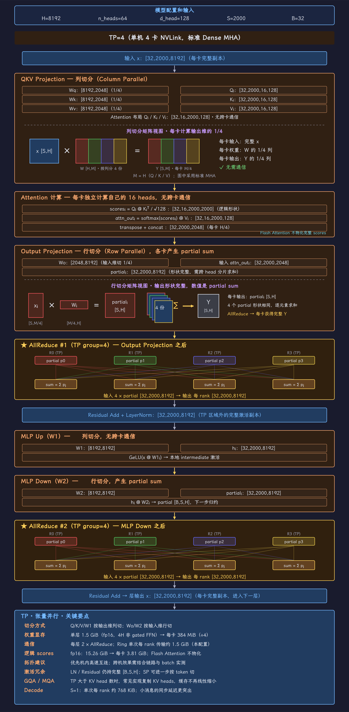
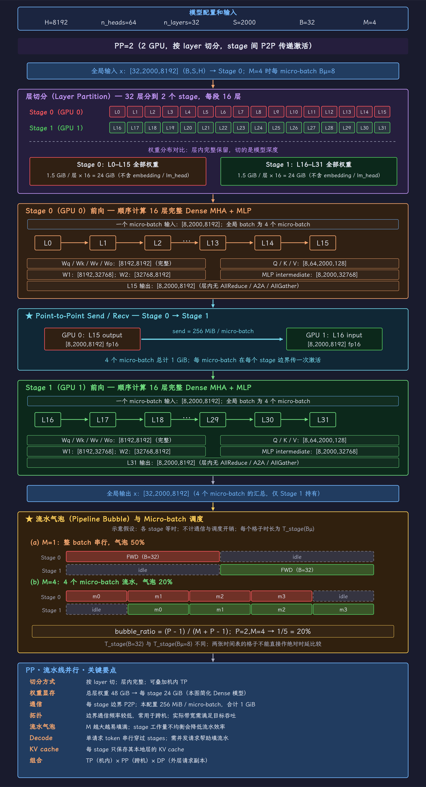
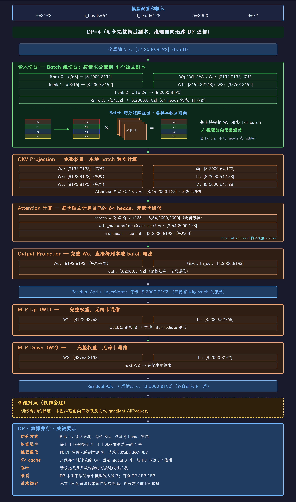
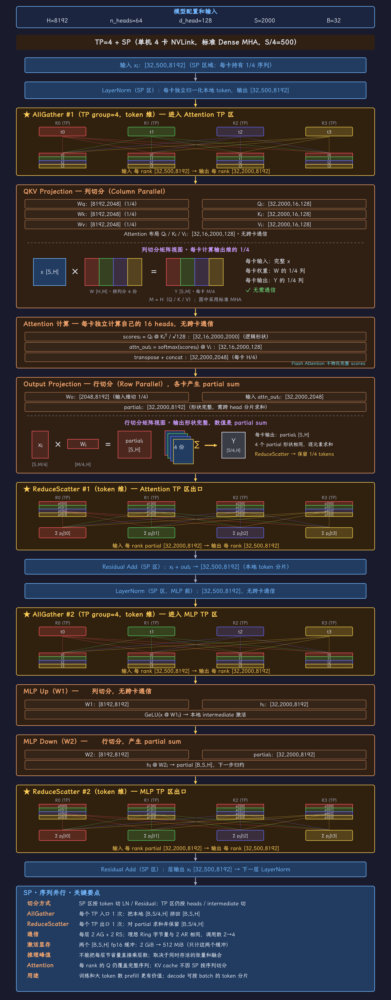

# 完整流程图

## TP · 张量并行 {#tp}

{ width="100%" loading="lazy" }

## PP · 流水线并行 {#pp}

{ width="100%" loading="lazy" }

## DP · 数据并行 {#dp}

{ width="100%" loading="lazy" }

## EP · 专家并行 {#ep}

{ width="100%" loading="lazy" }

## DP Attention · 小 TP 与大 EP {#dp-attention}

{ width="100%" loading="lazy" }

## SP · 序列并行 {#sp}

{ width="100%" loading="lazy" }

## CP · 上下文并行 {#cp}

{ width="100%" loading="lazy" }
