# 推理并行策略

模型推理的并行选择，首先要区分三个问题：**权重与 KV Cache 能否放进显存、GPU 计算能否满足吞吐和延迟目标、跨卡数据搬运会不会成为瓶颈。** 切参数、切请求、切序列、切层，解决的是不同问题；部署时常常需要组合使用。

这篇笔记围绕七种策略展开，局部流程图放在对应机制的解释之后。[完整流程图附件](推理并行策略-完整流程图.md)单独收录七张长图，供连贯查看。正文小图与附件长图均保留 **3840px 宽** 的高清 PNG。

整理依据：[知乎 @科英的文章](https://zhuanlan.zhihu.com/p/2035106376138085860)及其七张流程图。原文声明依据 2026-05-05 的 SGLang / vLLM 代码；本笔记修正了明确的数字、配置和表述冲突，涉及具体 backend、并行组别名及 flag 的行为仍需绑定框架版本核实。

## 先认清切分对象

| 切分对象 | 策略 | 每个 rank 承担什么 | 首要用途 |
| --- | --- | --- | --- |
| 参数的矩阵维度 | TP | 每层的一部分 heads / intermediate features | 分摊单层权重和计算 |
| 模型深度 | PP | 一段完整 Transformer layers | 分摊整模型，减少跨机通信频率 |
| 请求 / batch | DP | 一个完整模型副本服务一组请求 | 扩展服务吞吐 |
| MoE 专家列表 | EP | 一组 experts，接收路由来的 tokens | 分摊 expert 权重与计算 |
| Attention 的请求与 heads | DP Attention | 不同请求分组，每组内部可用小 TP | 让 Attention 与全域 MoE EP 使用不同通信范围 |
| TP 区域外的 token 激活 | SP | LN / Residual 等阶段的一部分 token rows | 降低冗余激活存储 |
| Attention 的上下文 | CP | 一部分 Query / context，并交换所需跨段信息 | 分摊长序列计算；缓存布局随实现而定 |

这些维度可以组合，但 **SP 依附 TP，DP Attention 是 Attention 的并行布局，EP/CP 的兼容组合还受框架与 backend 限制**。不能把七个名字都视为互相独立、可以随意相乘的启动维度。

图中的 $B$ 是序列数，$S$ 是每条序列本轮处理的 token 数，$H$ 是 hidden size，$T=B\times S$ 是本轮总 token 数。Prefill 常有很大的 $T$；普通 Decode 每条请求本轮只有一个新 token，但仍读取已有 KV Cache。实际引擎多用扁平 $[T,H]$ 缓冲，图中的 $[B,S,H]$ 用于理解形状。

图 1、2、3、6 固定 $H=8192$、64 heads、$d_{\mathrm{head}}=128$、$S=2000$、$B=32$，使用标准 MHA 与 intermediate 为 $4H$ 的非 gated Dense FFN。权重和示例激活按 FP16 计，$1\,\mathrm{GiB}=2^{30}\,\mathrm{bytes}$，$1\,\mathrm{MiB}=2^{20}\,\mathrm{bytes}$；不把这些估算当成部署实测。

## 1. TP：分摊每层的矩阵乘法 {#tp}

[查看本节完整流程图](推理并行策略-完整流程图.md#tp)

> 每个 rank 持一部分权重，独立计算这部分特征，再对输出投影产生的 partial sum 归约。标准 Dense Transformer 一层通常有两次这样的归约。

### 列切与行切怎样配对

这里采用数学书写 $Y=XW$，权重矩阵的两轴依次是输入维、输出维；PyTorch 常以相反顺序存储，判断切分应看输入/输出轴的语义。

列切把形状为 $[H,M]$ 的权重 $W$ 沿输出维切成四份：每卡接收相同的输入 $X$，形状为 $[T,H]$；本地权重 $W_i$ 为 $[H,M/4]$，输出 $Y_i$ 为 $[T,M/4]$。每个输出特征由一张卡独立计算，因此这里不通信。

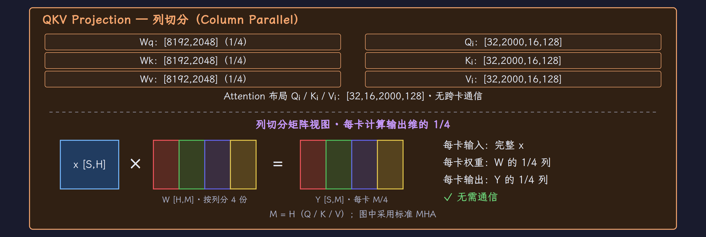{ width="100%" loading="lazy" }

*每卡拿完整输入，权重按输出轴切分；彩色列标识各 rank 独立计算的特征。*

随后行切消费已经切开的 $Y_i$：每卡持有形状为 $[M/4,H]$ 的权重 $W_{o,i}$，计算 $P_i=Y_iW_{o,i}$，形状为 $[T,H]$。**$P_i$ 的形状完整，但数值只有完整矩阵乘法的一部分贡献。** 正确输出是 $\sum_i P_i$，需要跨 rank 归约。

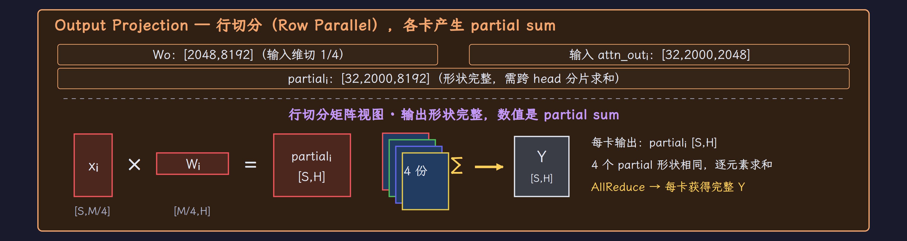{ width="100%" loading="lazy" }

*行切的输出沿完整 hidden 轴排列，数值仍是本 rank 的 partial contribution。*

列切负责生成本地特征，行切负责生成完整 hidden 轴上的 partial，最后 AllReduce 对同一 token 的各份贡献求和。

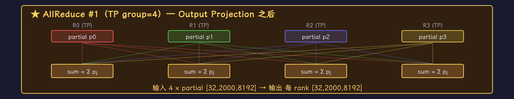{ width="100%" loading="lazy" }

*AllReduce 对同一 token 的四份贡献求和，各 rank 得到相同的完整输出。*

在 Attention 中，Q/K/V 投影按 heads 切，每卡处理 16 个 heads，$W_o$ 行切后归约一次。MLP 中，Up Projection 按 intermediate 切，Down Projection 行切后再归约一次。列切与行切之间无需为这个配对额外交换数据。

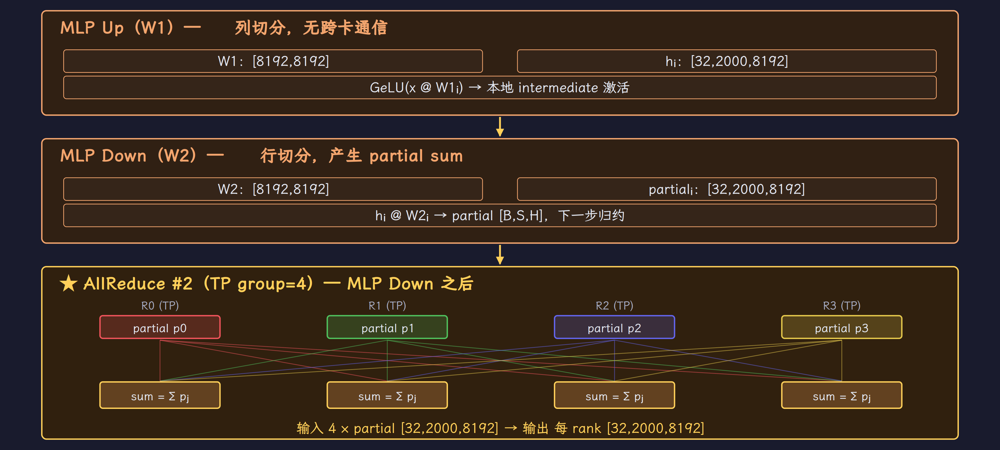{ width="100%" loading="lazy" }

*MLP 在 intermediate 轴复用列切 → 行切的配对，块尾完成第二次归约。*

### 显存减少在哪里

| 操作 | TP4 权重形状 | 本地输出 | 通信 |
| --- | --- | --- | --- |
| Q / K / V 列切投影 | 各 $[8192,2048]$ | 各 $[B,S,16,128]$ | 无 |
| Wo 行切投影 | $[2048,8192]$ | partial $[B,S,8192]$ | AllReduce #1 |
| MLP Up 列切 | $[8192,8192]$ | $[B,S,8192]$，全 intermediate 的 1/4 | 无 |
| MLP Down 行切 | $[8192,8192]$ | partial $[B,S,8192]$ | AllReduce #2 |
| LN / Residual | LN 参数不按 TP 切 | 完整 $[B,S,8192]$ | 本地计算 |

两处 $[B,S,8192]$ 不能只看数字判断布局：MLP Up 的 8192 是 $4H/\mathrm{TP}$ 的 intermediate 分片，Wo / Down 出口的 8192 是完整 hidden 轴上的 partial contribution。

该例每层包含四个 $H\times H$ 矩阵（Q/K/V/O）与两个 $H\times 4H$ 矩阵，权重为：

$$
\begin{aligned}
M_{\mathrm{layer}}
&=(4H^2+2\times 4H^2)\times 2\,\mathrm{bytes} \\
&=1.5\,\mathrm{GiB} \\
M_{\mathrm{rank}}
&=\frac{M_{\mathrm{layer}}}{4}=384\,\mathrm{MiB}
\end{aligned}
$$

| 数据 | 不切 TP | TP4 每 rank |
| --- | --- | --- |
| 每个 Q/K/V 权重 | $[8192,8192]$，128 MiB | $[8192,2048]$，32 MiB |
| Wo 权重 | $[8192,8192]$，128 MiB | $[2048,8192]$，32 MiB |
| 每个 W1/W2 权重 | 512 MiB | 128 MiB |
| 一层权重合计 | 1.5 GiB | 384 MiB |
| Q/K/V 的 token-head 布局 | $[32,2000,64,128]$ | $[32,2000,16,128]$ |
| 逻辑 scores，FP16 | $[32,64,2000,2000]$，15.26 GiB | $[32,16,2000,2000]$，3.81 GiB |

scores 的数字用于理解二次增长的逻辑矩阵，Flash Attention 不会把整块 scores 物化到显存。若 scores 按 FP32 计，字节数为表中两倍。

这是特定 Dense 层的估算。GQA、MLA、gated FFN、量化及共享参数都会改变结果。标准 TP 外的 LN / Residual 仍可能持完整 $[B,S,H]$，所以总激活峰值不会自动全部除以四。

### 每层通信的代价

令一次归约的完整消息大小为 $A=B\times S\times H\times 2\,\mathrm{bytes}=1\,\mathrm{GiB}$。理想 Ring AllReduce 每 rank 的发送量约为：

$$
V_{\mathrm{AR}}\approx 2\frac{N-1}{N}A
$$

取 $N=4$，每次归约与每层两次归约的传输量分别为：

$$
\begin{aligned}
V_{\mathrm{AR}}&\approx 1.5\,\mathrm{GiB} \\
V_{\mathrm{layer}}&\approx 2V_{\mathrm{AR}}=3\,\mathrm{GiB}
\end{aligned}
$$

这里是 **每 rank 的估算传输量**，不是全集群流量；发送与接收的计数也应保持相同口径。普通 Decode 取 $S=1$、$B=32$，对应单次约 768 KiB：字节数小了，但层数带来的同步点仍然存在。

若沿这个简化模型扩展到 80 层，一次前向有 160 次归约，每 rank 的估算发送量为 240 GiB。这个累计量不等于额外显存，也不直接等于端到端耗时：每次操作的带宽、同步延迟、拓扑与 overlap 决定实际代价。

### GQA / MQA 会改变 KV 的切分收益

以 64 个 Q heads、8 个 KV heads 为例：TP8 每 rank 有八个 Q heads 和一个 KV head；TP16 每 rank 有四个 Q heads，而常见实现仍需至少一个 KV head，因此一个 KV head 被两卡持有。

Q heads 的切分还能增加，K/V 的全局副本数却增加了。MQA 只有一个 KV head 时更明显。选 TP 大小应同时检查 Q heads、KV heads、head_dim 与投影实现的可分性，不能只算权重总量除以卡数。

TP 通常优先安排在机内高速互连域。是否值得跨机取决于计算规模、链路带宽、collective 实现和目标指标，不能用“必须 NVLink”或一个固定效率百分比代替测量。

## 2. PP：把模型深度分到多个 stage {#pp}

[查看本节完整流程图](推理并行策略-完整流程图.md#pp)

> PP 把 layers 切成前后相接的 stages。纯 PP 中每层完整计算，只有 stage 边界传激活；吞吐依靠多个 micro-batch 的流水重叠。

### 层内完整，边界传激活

32 层分成两段：GPU0 持有 L0–L15，GPU1 持有 L16–L31。一个 micro-batch 必须先走完 Stage0，才能把输出交给 Stage1。每个 stage 的本地 KV Cache 只覆盖它持有的 layers。

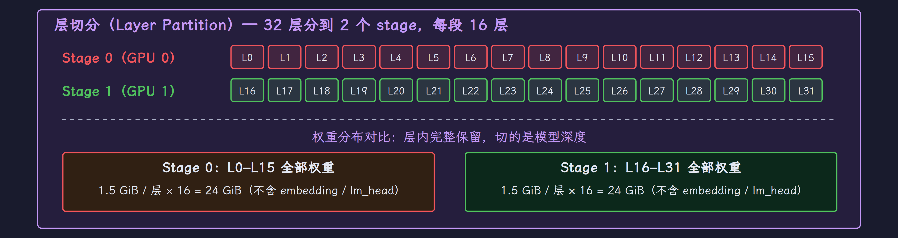{ width="100%" loading="lazy" }

*纯 PP 按 layer 边界分模型；图中的每层在所属 stage 内完整保留。*

按上一节的层权重口径，完整 32 层为 48 GiB，两段各 24 GiB；embedding、LM Head 与 KV Cache 要另外计。PP 也可与 TP 组合，此时“层内无通信”只适用于 TP=1 的纯 PP 例子。

本图 $B=32$、$M=4$，所以每个 micro-batch 的 $B_\mu=8$：

Stage0 的 L15 将输出激活通过 P2P 交给 Stage1 的 L16；两端的张量形状都是 $[8,2000,8192]$。

每个 stage 边界的单次传输量与四个 micro-batch 的累计量为：

$$
\begin{aligned}
V_{\mathrm{micro}}
&=8\times 2000\times 8192\times 2\,\mathrm{bytes} \\
&=256\,\mathrm{MiB} \\
V_{\mathrm{boundary}}
&=4V_{\mathrm{micro}}=1\,\mathrm{GiB}
\end{aligned}
$$

{ width="100%" loading="lazy" }

*边界传的是一个 micro-batch 的完整 hidden 激活，本例每次 256 MiB。*

通信频率由 stage 边界决定，明显少于逐层 TP 归约；边界张量本身仍可能很大，所以低速以太网也不能自动满足任意吞吐目标。

### 气泡来自串行依赖

| 策略 | 权重如何分布 | 纯策略的层内通信 | 模型深度方向的通信 |
| --- | --- | --- | --- |
| TP | 每层矩阵分片 | Dense 示例每层两次 AllReduce | 无 stage 边界 |
| DP | 各副本完整权重 | 无跨副本通信 | 无跨副本通信 |
| PP | 每 stage 一段完整 layers | 无，假设 TP=1 | 每 micro-batch 每 stage 边界一次 P2P |

两个 stage 开始与结束时总有一段没有可处理的工作。若各 stage 等时、忽略通信与调度成本，$P$ 段与 $M$ 个 micro-batch 的纯 forward 气泡率为：

$$
\mathrm{bubble\_ratio}=\frac{P-1}{M+P-1}
$$

例如两个 stages 时，一个 micro-batch 的气泡率为 50%，四个 micro-batch 则为 20%。

分成 micro-batch 后，Stage0 算 m1 时，Stage1 可以算 m0。图中的等宽格子只表达流水关系；整 batch 与小 micro-batch 的 stage 计算时间不同，不能直接用格子数比较两种方案的实际时延。

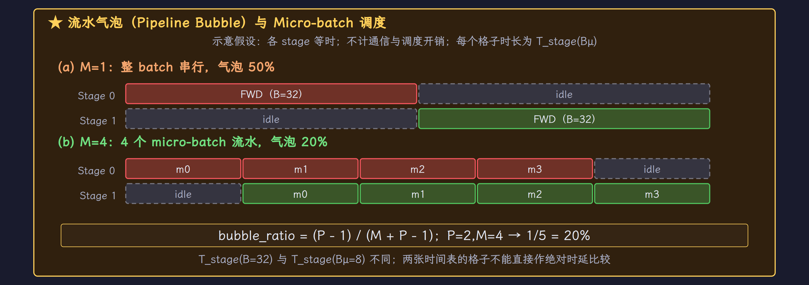{ width="100%" loading="lazy" }

*下方时间格展示 m0–m3 的流水重叠；空白部分是启动与排空气泡。*

### PP 什么时候有价值

| stages $P$ | micro-batches $M$ | 理想气泡率 |
| --- | --- | --- |
| 2 | 1 | 50% |
| 2 | 4 | 20% |
| 2 | 16 | 5.88% |
| 4 | 32 | 8.57% |

图用纯 forward 的 GPipe 风格说明流水。训练里的 1F1B 与 interleaved schedules 还要处理反向依赖和激活生命周期；推理引擎可以采用自己的连续批处理与异步调度，不能据此把 GPipe 写成所有推理部署的必选实现。

整模型装不进单机时，PP 常与机内 TP 组合，把较低频的 stage 边界通信放到跨机链路。Stage 的层数不必完全相等：应平衡计算、权重、缓存与首尾 embedding / LM Head 的额外成本。

一个 Decode token 仍要顺序穿过所有 stage，PP 通常不降低单请求的流水穿越延迟。多个并发请求可以交错填流水；是否改善总体吞吐，要看服务引擎实际调度与 stage 利用率。Prefill 也不能把同一 prompt 随意切成独立样本，需要保持历史 K/V 与因果依赖。

| 观察项 | Prefill | Decode |
| --- | --- | --- |
| 单请求本轮输入 | 多个 prompt tokens，或保留历史依赖的 chunk | 通常一个新 token |
| 增加流水工作 | 多请求 / 引擎支持的 prompt 分块 | 更多并发请求及不同执行步骤 |
| 常见限制 | 大激活传输、stage 计算不平衡 | 小 micro-batch、同步与气泡占比 |
| PP 的目标 | 装下模型并改善流水吞吐 | 装下模型；需衡量额外穿越延迟 |

常见组合是 **机内 TP × 跨机 PP × 外层 DP**；MoE 再按支持情况加入 EP。405B 参数仅 FP16 权重就约 810 GB（十进制），体现的是跨卡容量需求，并不证明 PP 是唯一可用的容量方案，量化与其他分片布局也会改变选择。

## 3. DP：复制模型以服务更多请求 {#dp}

[查看本节完整流程图](推理并行策略-完整流程图.md#dp)

> 纯 DP 用多个独立模型副本服务不同请求。单个副本如何执行模型不变，前向计算无需跨副本交换 hidden states。

### 按请求分配 batch

$B=32$、DP=4 时，四个副本各处理八条请求。纯单卡 DP 的每卡输入为 $[8,2000,8192]$，Q/K/V 投影、64 个 heads、输出投影与 MLP 都完整留在本卡。

| Rank | 请求编号（半开区间） | 执行与输出 |
| --- | --- | --- |
| 0 | $[0,8)$ | 完整模型 → 本地输出 |
| 1 | $[8,16)$ | 完整模型 → 本地输出 |
| 2 | $[16,24)$ | 完整模型 → 本地输出 |
| 3 | $[24,32)$ | 完整模型 → 本地输出 |

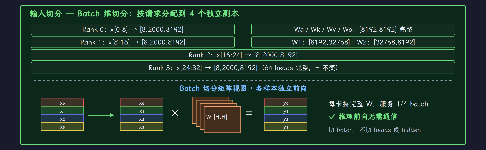{ width="100%" loading="lazy" }

*四个 rank 分别接收八条请求，各自持完整模型权重。*

服务层仍需分发请求、收集响应和协调负载，但这些不是模型前向的 AllReduce。训练中常见的 gradient AllReduce 也不属于这里的推理过程。

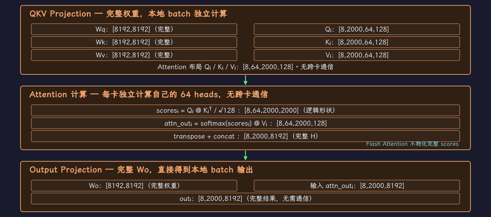{ width="100%" loading="lazy" }

*橙色阶段各自处理本地请求的全部 heads，输出无需跨副本求和。*

### 权重复制，KV 属于各自请求

四个副本意味着总权重存储为单份模型的四倍。KV Cache 只属于本副本处理的请求；**固定同一 global batch 时，总请求 KV 不因 DP 复制成四倍。** 如果保持每副本并发不变，再增加副本，总并发与已占用 KV 才会随之增加。

同一请求已有 KV 后，通常继续留在原副本。可以做迁移，但要处理 KV 传输、调度一致性和迁移成本；因此请求数相同不保证负载相同，prompt 长度、生成长度与前缀命中都影响工作量。

### DP 可以复制一个多卡模型

单卡装不下模型时，DP 本身没有帮助。可以先用 TP / PP 把一个模型副本放到一组卡，再复制这组卡：例如四个 TP4 副本总共需要 16 卡。纯副本间仍可无模型前向通信，副本内部则有自己的 TP 通信。

当请求充足、模型副本可独立执行且负载均衡时，DP 吞吐有机会接近线性扩展。单请求的计算路径没有被拆短，所以不应期望 DP 直接降低该请求的模型计算延迟。

## 4. EP：把 tokens 送到持有目标 expert 的 rank {#ep}

[查看本节完整流程图](推理并行策略-完整流程图.md#ep)

> EP 按 expert 列表分权重。Router 为 token 选择 top-k experts，dispatch 发送输入，expert FFN 本地计算，combine 返回并加权合并输出。

### 先区分副本与 expert group

图 4 使用四个独立副本，每个副本内部 TP4 + EP4；总共 16 卡，但一个 EP group 只有四卡。256 个 experts 分到该副本四个 rank，每 rank 持 64 个完整 experts。四个副本各自有完整的 expert 集合，副本间不做 EP A2A。

| 副本 | GPU 范围 | 副本内并行 |
| --- | --- | --- |
| 0 | GPU 0–3 | TP4 + EP4 |
| 1 | GPU 4–7 | TP4 + EP4 |
| 2 | GPU 8–11 | TP4 + EP4 |
| 3 | GPU 12–15 | TP4 + EP4 |

图示 moe_tp=1，所以单个 expert 的权重不再内部 TP 切分。EP 与 expert TP 的概念不同：前者分 expert 列表，后者分一个 expert 的矩阵。具体 rank 分解与合法配置取决于框架。

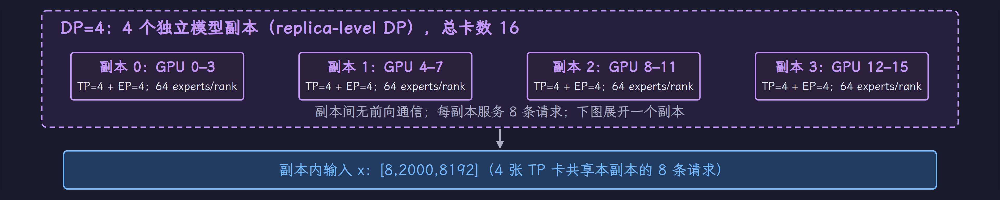{ width="100%" loading="lazy" }

*紫色边界分出四个独立副本；每份副本内部才有 TP4 与 EP4。*

### Attention 出口为什么先切 token

该副本有八条请求、16000 tokens。Attention TP 的 $W_o$ 出口每卡持有 形状为 $[16000,8192]$ 的 partial。如果先 AllReduce，每卡都会得到同一份完整 token 输出；让这些副本都进入同一 EP dispatch 会重复发送 token。

本图选择的 A2A 路径先 ReduceScatter：**对不同 head 分片的 partial 求和，再让每个 token 只归一个来源 rank。** 四卡各持 $[4000,8192]$，据此进行路由。MoE combine 返回本 rank 的 token 输出后，AllGather 在 Attention TP 小组内拼回完整 token 序列。

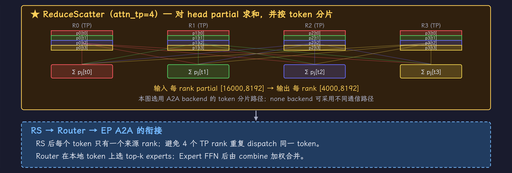{ width="100%" loading="lazy" }

*RS 完成 head partial 归约，同时按 token rows 分片，Router 据此选择目标 experts。*

Router 根据本 rank 的 tokens 选择 experts，dispatch 将输入送过去，FFN 本地计算，再由 combine 返回输出；最后 AG 拼回本副本的 16000 tokens。

RS 与 AG 构成 AllReduce 的两个原语，但这里中间执行了非线性的 MoE。应分别理解 **RS 归约 Attention 贡献、AG 拼接 MoE 结果**，不能说“含 MoE 的整个过程等价于一个 AllReduce”。

### Expert 通信与负载

dispatch / combine 常由 All-to-All 类 backend 实现；一个 token 选择多个 experts 时，可产生多个目的包。实际传输量与 top-k、同 rank / 同节点去重、量化、容量限制及后端实现有关，图中的彩条表示路由类别，不代表等量分配。

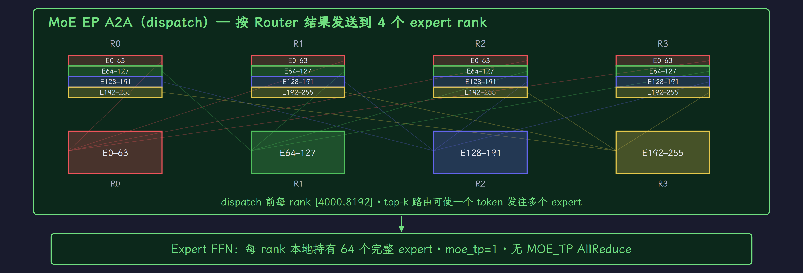{ width="100%" loading="lazy" }

*沿彩色 token 包看 dispatch：输入被送到持有目标 expert 的 rank，FFN 在当地计算。*

EP 分散总 expert 权重，但热门 expert 仍可能使某个 rank 排队。Expert Load Balancing、冗余 experts 或其他调度手段有助于缓解负载偏斜；不能把可能丢 token 的 capacity 策略当成推理通用默认方案。小 batch 下，每个 expert 的 token 数太少，也可能使 FFN GEMM 利用率不足。

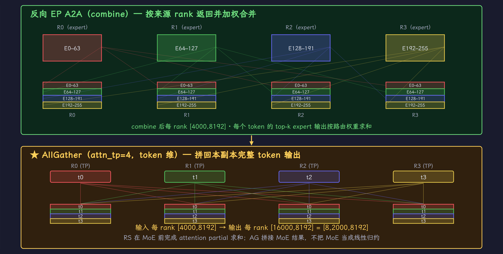{ width="100%" loading="lazy" }

*combine 将 expert 输出返回来源 rank，再由 AG 恢复本副本的完整 token 集合。*

### 一个 sparse 层的通信账

| 阶段 | group 大小 | 输入 → 输出 / 作用 |
| --- | --- | --- |
| Attention ReduceScatter | attn_tp=4 | partial $[16000,H]$ → token 分片 $[4000,H]$ |
| Expert dispatch | EP=4 | 按 top-k 路由到本副本 expert ranks |
| Expert FFN | 本 rank | 本地完整 expert 矩阵计算 |
| Expert combine | EP=4 | 返回来源 rank，对同 token 输出加权合并 |
| Attention AllGather | attn_tp=4 | $[4000,H]$ → 本副本 $[16000,H]$ |
| 最终 LM Head vocab gather | 本图 TP=4 | 拼 vocab，只有模型出口需采样时才涉及 |

LM Head 不属于每个 sparse 层的通信。归约、路由与 vocab 拼接都是 collective，但它们的轴和参与 group 不同。

### Expert 里面能不能再做 TP

沿原文的 SGLang 分解，MoE 子系统可有三个维度：

$$
\begin{aligned}
N_{\mathrm{replica}}
&=\mathrm{moe\_ep}\times\mathrm{moe\_tp}\times\mathrm{moe\_dp} \\
\mathrm{moe\_tp}
&=\frac{N_{\mathrm{replica}}}{\mathrm{moe\_ep}\times\mathrm{moe\_dp}}
\end{aligned}
$$

这里 $N_{\mathrm{replica}}$ 表示副本内 world size，$\mathrm{moe\_ep}$、$\mathrm{moe\_tp}$、$\mathrm{moe\_dp}$ 分别对应下表的三个 size。

| 维度 | 切分对象 | 不应混淆为 |
| --- | --- | --- |
| moe_ep_size | expert 列表 | 单 expert 的 intermediate 轴 |
| moe_tp_size | 单 expert 的 Up/Gate/Down 矩阵 | Attention 的 head TP |
| moe_dp_size | 独立 MoE 权重副本 | 请求 DP 或 CP group 的变量别名 |

world=16、EP=16、moe_dp=1 推出 expert TP=1，256 个 experts 时每 rank 持 16 个完整 experts。若一个合法布局采用 world=16、EP=8、moe_tp=2，八个 experts 各由两张卡分摊矩阵权重；FFN 的 partial 输出还需要 expert TP 组内归约。**这个例子只解释分解语义，不保证原文 flag 组合在所有 SGLang backend 中可启动。**

是否切 expert TP 要看每层 expert 矩阵大小、expert 数、每个 expert 的 token 数、量化与通信实现。对 gated FFN，hidden 为 $H$、intermediate 为 $I$，三个权重矩阵约有 $3HI$ 个参数；FP16/BF16 每层一个 expert 约为 $3HI\times 2\,\mathrm{bytes}$。同一 expert 编号在多层出现时，每层权重是不同的，不能用“一个 expert 1.5 GB”而不交代层数。

加载后也不能只依赖 `mlp.experts.N.gate_proj.weight.shape` 检查：融合 MoE 常将 experts 打包成一个张量，还可能量化或重排布局。应结合加载映射与实际本地权重形状确认分片。

### MoE DP 与 backend 约束

原文用 `--moe-data-parallel-size` 描述独立 MoE 副本，每份副本内部持完整 expert 集合，份间不做 EP dispatch。它用复制权重换更小的 expert 通信范围，与请求 DP 可以有关联，但并不是由请求 DP 必然推导出来。

原文要求 EP size 与 MoE DP size 的乘积不超过 TP world size，某些 EP 路径下还要求两者相等；Attention CP size 与 MoE DP size 不同时，只允许 moe_dp_size=1。这些约束与前面 EP=8、moe_tp=2 的例子未必同时适用于同一 backend；应把它们视为待核实的版本约束，不能按一个跨 backend 通用公式照填启动参数。

原文提到 `layers/communicator.py` 的 `ScatterMode.SCATTERED` 分支，表示 sparse 层和 A2A backend 会影响激活布局。这里记录查找位置与意图，不复用未固定 commit 的行号，也不把“backend!=none”推成每个模型都严格走同一条 RS/AG 调用链。

### SGLang 与 vLLM 的 DP + EP 配置不能直接互换

| 需要核对的项目 | 原文涉及的 SGLang 语境 | 原文涉及的 vLLM 语境 |
| --- | --- | --- |
| 请求 DP 与副本关系 | 未开 DP Attention 时描述为 replica-level DP | MoE 中 DP ranks 可共同参与 expert 分布 |
| Attention TP 大小 | DP Attention 用较小 attn_tp 小组 | 根据模型与 TP/DP 配置确定 |
| expert group 范围 | 取决于副本内 world 与 MoE 分解 | EP 可覆盖 $\mathrm{DP}\times\mathrm{TP}$ 的相应 ranks，CP 扩展需核实 |
| MoE 激活布局 | 本图用 RS → MoE → AG | 取决于 SP、EP backend 与具体模型 |

“保留 AllReduce”本身不能证明某框架跨机更差；要看 AllReduce 的实际 group、消息大小，以及全域 expert 交换有没有变化。DP Attention 的概念也不是某一个框架独有。

SGLang 风格的 `--tp 4 --dp 4 --ep-size 4` 是本图的原文配置背景。它与下一节开启 DP Attention 后的 world 划分不同；这些 flag 的具体约束应查看所用版本，而不是直接跨框架搬配置。

## 5. DP Attention：让 Attention 用小 TP，MoE 用大 EP {#dp-attention}

[查看本节完整流程图](推理并行策略-完整流程图.md#dp-attention)

> Attention 把请求分给不同小组，每组内部按 heads 用 TP；MoE 可以在更大的 rank 集合中分专家。关键是不同模块使用不同的并行组。

### 同样 16 卡，改变的是专家共享范围

上一图是四个独立 EP4 副本。图 5 改成一个 world=16 的 MoE EP group，Attention 仍分四个请求组，每组 attn_tp=4。global $B=32$，所以每个 Attention 组处理八条请求，各卡仍计算 16 个 heads。

| Attention 组 | GPU 范围 | 请求编号（半开区间） |
| --- | --- | --- |
| 0 | GPU 0–3 | $[0,8)$ |
| 1 | GPU 4–7 | $[8,16)$ |
| 2 | GPU 8–11 | $[16,24)$ |
| 3 | GPU 12–15 | $[24,32)$ |

MoE EP group 覆盖 GPU 0–15，共同持有 256 个 experts。

因此 EP4 每 rank 的 64 个 experts 降为 EP16 的 16 个，**减少四倍的是本例每 rank 的 expert 权重份额**。Attention 参数在四个小组之间仍复制，各组内部再按 TP 切。

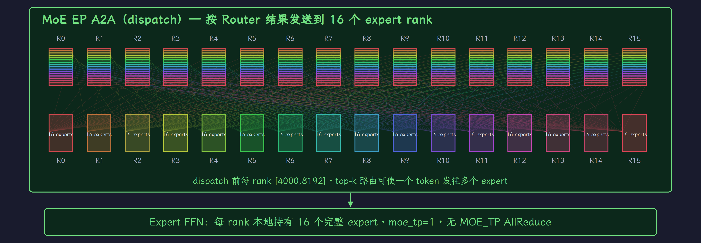{ width="100%" loading="lazy" }

*EP16 的交换覆盖整个 world；每 rank 持 16 个 experts，四个 Attention 组共享这份集合。*

### Attention 与 MoE 使用不同通信范围

假设总共 16 卡、global $B=32$、64 Q heads；MoE 的 expert 分布另行选择，三种 Attention 布局可以对照：

| Attention 布局 | 请求/rank | Q heads/rank | Attention 权重份额 | 本地 tokens/rank |
| --- | --- | --- | --- | --- |
| DP16，无 head TP | 2 | 64 | 一整份 | 4000 |
| TP16，全 batch 共享 | 32 | 4 | $1/16$ | 64000 |
| DP4 × attn_tp4 | 8 | 16 | $1/4$，四组间复制 | 16000 |

第一种没有 Attention head 归约，但每 rank 持完整 Attention 权重。第二种参数分得最细，却要在 16 卡范围归约 head partial。第三种把这个归约限制在四卡小组，是图 5 的布局。

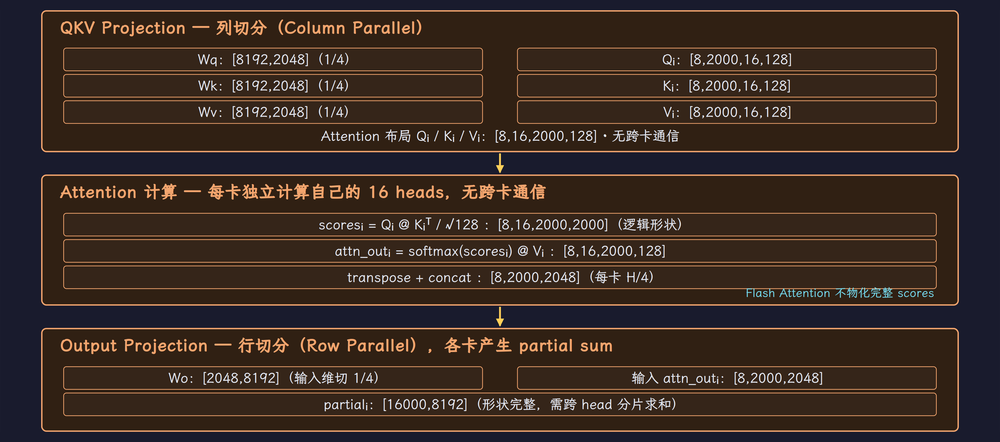{ width="100%" loading="lazy" }

*每个请求组在局部四卡切 heads；QKV、Attention 和 Wo 都使用 attn_tp=4。*

这三种布局在语义上都可以配合 EP；哪个有效率还取决于 token 来源去重与重排。固定 global tokens 与 EP group 时，每 expert 的平均有效 token 数主要由路由决定，不能只凭一个 rank 的输入 batch 小就断定 expert GEMM 一定更小。

| Expert 分布 | 每 rank expert 数 | 若全模型 expert 权重合计为 $E$ |
| --- | --- | --- |
| 四个独立 EP4 副本 | 64 | 每 rank 约 $E/4$；四份副本合计约 $4E$ |
| 一个 EP16 全域 group | 16 | 每 rank 约 $E/16$；全域一份约 $E$ |

这解释了原文强调的容量收益，同时避免使用缺乏层数口径的“96 GB / 24 GB”估算。共享 experts、路由器、Attention、KV Cache 和 workspace 还要另外计入显存；EP16 与 DP Attention 也不是某个大模型唯一可能的部署方案。

每组 Attention 输出仍走 RS，16000 tokens 分成每 rank 4000 tokens；随后所有 16 个 rank 参与全域 EP dispatch / combine。MoE 完成后，各 Attention 小组 AG 拼回自己八条请求的输出。

| 操作 | 通信范围 | 作用 |
| --- | --- | --- |
| Attention RS / AG | 每个 attn_tp=4 小组 | 归约 head partial，分片/恢复本组 tokens |
| MoE dispatch / combine | EP=16 全域 | 按 expert 路由与返回 tokens |
| 本图 LM Head vocab AG | 每个 attn_tp=4 小组 | 拼本组请求需采样的 logits |

这种布局可以把频繁的 Attention TP 通信安排到局部高速互连，同时让 expert 权重分布到更多卡。它没有消除 MoE 的跨机交换；收益要和 Attention 权重复制、KV 布局及 expert 通信共同评估。

### 两个容易混淆的命名

图中的逻辑编号按 DP 组排列，同组内再按 TP rank 排列：

$$
\mathrm{rank}=\mathrm{dp\_rank}\times\mathrm{attn\_tp}+\mathrm{tp\_rank}
$$

| DP 坐标 | TP0 | TP1 | TP2 | TP3 |
| --- | --- | --- | --- | --- |
| DP0 | GPU0 | GPU1 | GPU2 | GPU3 |
| DP1 | GPU4 | GPU5 | GPU6 | GPU7 |
| DP2 | GPU8 | GPU9 | GPU10 | GPU11 |
| DP3 | GPU12 | GPU13 | GPU14 | GPU15 |

每一行是 Attention TP group，负责 RS/AG；整张表是 MoE EP16 group。列可以标识不同 DP rank 的同一 TP 坐标，但本图 Attention 主线没有在这些列上做 token↔head A2A。实际框架仍可能有调度同步或控制通信，“没有图中 collective”不等于服务全程零通信。

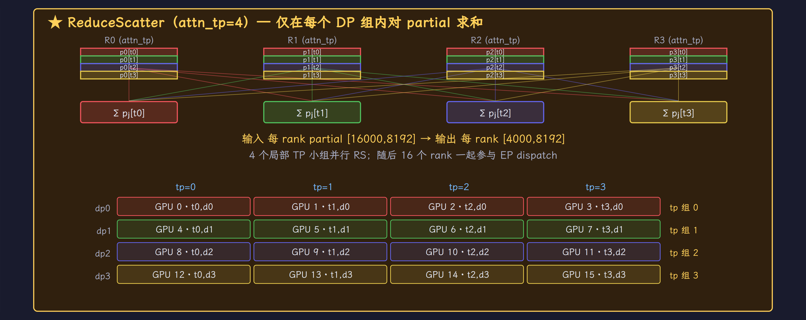{ width="100%" loading="lazy" }

*网格中每一行是一组局部 Attention TP；RS 留下各卡所属的 token 分片。*

原文展示 `QKVParallelLinear(..., tp_size=attn_tp_size)` 与 `RowParallelLinear(..., reduce_results=False)`：它想说明 Linear 按 Attention 小组切权重，并把出口归约交给 communicator。这个意图与图吻合；具体模型构造参数和 communicator 路径仍需按版本核实。

**DP Attention 确实在请求维度复制 Attention 模块；每个副本内部又可以有 TP。** “只切 heads”或“Attention 没做 DP”都不足以描述这个布局。

标准 TP Attention 也不强迫 MoE 使用 expert TP。$W_o$ 输出归约后有完整 hidden vector，可以重排 token 再交给 EP。DP Attention 的优势是允许 Attention 使用更小的 TP 组，同时共享更大的 expert group；不是解决一个数学上无法组合的问题。

本图使用 16 卡，Attention 按 DP4 × attn_tp4 布局。在原文涉及的 SGLang DP Attention 语境中，应区分 `--tp 16` 的 world 与真正的 Attention TP=4；vLLM 的 DP / TP / EP 分组规则也应按相应版本单独核实。图中的局部 LM Head 明确选择 DP LM Head 配置，不表示所有模型的默认通信路径。

### KV Cache 仍与请求所属组绑定

该 MHA 示例每卡 K 和 V 各有逻辑布局 $[8,16,S,128]$。请求落在一个 DP 组内，其 heads 的 KV 分散在组内四卡；要迁到另一 DP 组，需要另做缓存迁移。按 head 分片不会自动解决请求长度不均或 hot/cold 副本问题。

## 6. SP：把 TP 两侧的冗余激活也切开 {#sp}

[查看本节完整流程图](推理并行策略-完整流程图.md#sp)

> SP 在 LN / Residual 等逐 token 算子中保留 token 分片，进入 TP 区之前 AllGather，行切输出之后 ReduceScatter。Attention 的本地 heads 仍处理完整序列。

### 哪些阶段需要完整 token

LayerNorm 与 Residual 都可逐 token 计算。标准 TP 往往让每卡在这些位置持完整 $[B,S,H]$；SP 将其改为每卡 $[B,S/4,H]$，避免四份相同激活。

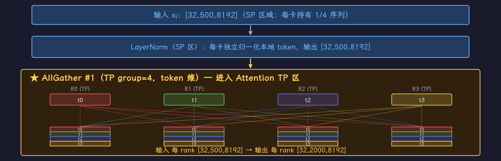{ width="100%" loading="lazy" }

*LN 只处理本地 token rows；AG 在列切 Linear 之前恢复完整 token 集合。*

但进入 TP 的列切 Linear 前，每个 rank 要为它持有的输出特征处理全部 tokens。因此先 AG 拼回 $[B,S,H]$，再算 QKV / Attention / Wo；Wo 的 partial 用 RS 求和并恢复 token 分片，而不是 AllReduce 后保留完整副本。

这次布局切换的顺序是：本地 LN、AG 恢复完整 tokens、TP 计算、RS 归约并切回本地 tokens，最后做 Residual。

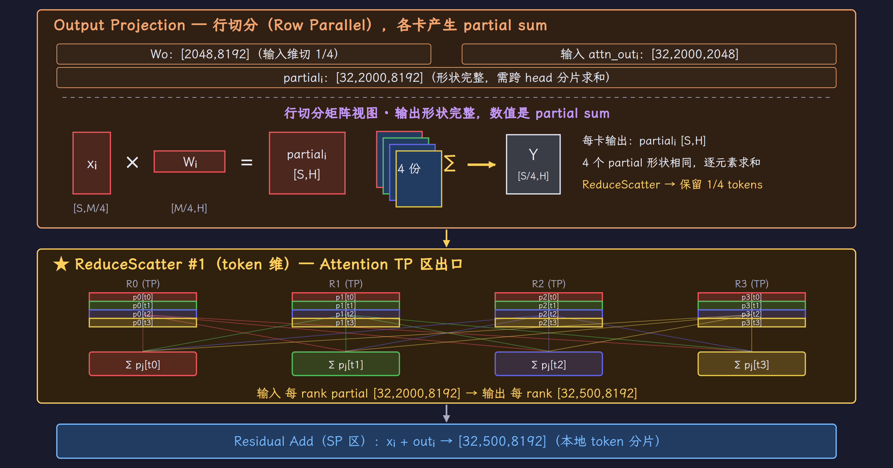{ width="100%" loading="lazy" }

*Wo 的 partial 经 RS 求和后重新按 tokens 分片，Residual 回到 SP 布局。*

MLP 块重复同样的布局切换，一层有两次 AG 与两次 RS。实际实现可按扁平 token 维 $T$ 切，不必保证每个 rank 恰好持每条序列的连续 $S/4$ 段；图采用整齐形状帮助比较。

### 省显存的口径

| 阶段 | token 布局 | 每 rank 形状 |
| --- | --- | --- |
| 输入 / LN / Residual | SP token 分片 | $[32,500,8192]$ |
| AG 后，进入 QKV 或 MLP | 完整 token 集合 | $[32,2000,8192]$ |
| 本地 Attention 逻辑 scores | 完整 tokens，16 heads | $[32,16,2000,2000]$ |
| 行切输出，RS 前 | 完整 token 的 partial | $[32,2000,8192]$ |
| RS 后 | 完整数值的 SP token 分片 | $[32,500,8192]$ |

该例一个 $[32,2000,8192]$ FP16 缓冲为 1 GiB。若只比较两个这样的 LN / Residual 相关缓冲，SP4 将 2 GiB 缩为 512 MiB，减少 1.5 GiB。

这不能推成“整层峰值除以四”，更不能在推理中直接把每层节省乘 80 层。推理激活通常用完即释放，峰值由同时存活的张量、融合和执行方式决定。训练要保留反向需要的激活，SP 的收益往往更大。

### 通信没有按字节消失

理想 Ring 下，一对 AG + RS 的传输字节量与相应 AllReduce 相同；collective 调用数则由每层两次 AR 变成四次 AG/RS。实际开销取决于融合、overlap 和 backend，不能仅凭调用数保证 SP 一定更慢或更快。

SP 不改变这里 Attention 的上下文分布，也不自动按序列拆 KV Cache。Prefill 总 token 数大时，降低冗余缓冲可能有价值；Decode 的 $S=1$ 也不等于绝对不能 SP，因为一个 batch 仍有多个 token rows，但是否值得启用取决于负载。

## 7. CP：分摊长上下文的 Attention 计算 {#cp}

[查看本节完整流程图](推理并行策略-完整流程图.md#cp)

> CP 让一个请求的上下文跨 rank 分布。每个 rank 只算本地 Query 的输出，但必须通过通信取得可见的跨段信息。K/V 怎样移动，决定工作区、缓存与通信成本。

### CP 与 SP 的边界

SP 在 Attention 外保存 token 分片，进入 Attention 前恢复完整序列；本例 CP 在 Attention 内也只处理本地 Query 段，跨 rank 补齐 K/V 依赖。两者都涉及 token 轴，但切分范围不同。

CP 并不等同于 Ring Attention。常见实现可以收集 K/V、环形交换 K/V 块，也可以有不同 head / sequence 重排方式。是否分片长期 KV Cache、是否支持 Decode，都要看具体实现。

| 比较项 | SP（本笔记的 TP 配套布局） | CP |
| --- | --- | --- |
| 切分发生在哪里 | LN / Residual 等 TP 外阶段 | Attention 内也拆 Query / context |
| 本地 Attention 的 Query | 本 TP 组完整 token 集合 | 本 CP rank 的 Query 子集 |
| Attention 所需 K/V | TP 分到的 heads 的全部可见 context | 本地与远端可见 context，按实现交换 |
| 主要目标 | 去掉重复激活存储 | 分摊长上下文计算，缓存能力取决于实现 |
| 通信 | TP group 内 AG / RS | CP group 内 KV gather、块交换或状态归并等 |

### 本图采用 AllGather KV 的 Prefill CP

图 7 使用 16 卡，配置为 DP2 × CP2 × attn_tp4、EP16，全局两条请求，每 DP 组一条长度 4000 的序列。CP 的两卡各持 2000 token 的 Q/K/V；每个 attn_tp rank 持 16 个 heads。

本地 Q/K/V 的形状都是 $[2000,16,128]$。K/V 经 CP AllGather 后恢复为 $[4000,16,128]$，并按原序列顺序排列；本地 Q 与这份完整 K/V 做 Attention，输出仍为 $[2000,16,128]$。

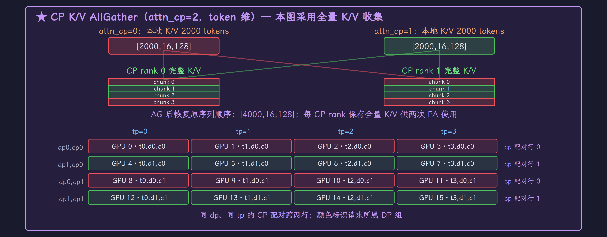{ width="100%" loading="lazy" }

*CP pair 交换并恢复完整 K/V 的原序列顺序，本地 Query 保持分片。*

**这条路径的 Attention 工作区持全量 K/V。** 所以它可分摊 Query 计算，却不能用这张图证明该工作区按 CP 等比例缩小。其实际长期缓存布局与退回非 CP 路径的条件也不能从这段示意直接推出。

### Zigzag 为什么分早晚两段

因果 Attention 越晚的 Query 可见历史越多。把序列简单切成前后两半，会让后一卡做更多工作。将 4000 tokens 切成四个 1000-token chunks，再首尾配对：

| CP rank | 早段 chunk 与 token 区间 | 晚段 chunk 与 token 区间 |
| --- | --- | --- |
| 0 | chunk 0：$[0,1000)$ | chunk 3：$[3000,4000)$ |
| 1 | chunk 1：$[1000,2000)$ | chunk 2：$[2000,3000)$ |

各 chunk 的因果交互数约与 $1:3:5:7$ 成比例，首尾配对均为 $8$，从而平衡工作量。每 rank 的两段 Query 在原序列中不连续，因此本图按两次 FA 调用分别指定可见 KV 范围。

更一般地，$\mathrm{CP}=C$ 时切成 $2C$ 个等长 chunks，每 rank $r$ 拿 $r$ 与 $2C-1-r$。若每 chunk 长 $L$，第 $j$ 个 chunk 的精确因果交互数为 $jL^2+\frac{L(L+1)}{2}$；首尾两段相加得到 $2CL^2+L$，与 $r$ 无关。这修正了原文把朴素等分的计算量写成 $1:2:3:4$ 的粗略说法：连续的等长因果块实际更接近 $1:3:5:7$。

| CP size | 全局 chunks 数 | $S=4000$ 的 chunk 大小 | 每 rank tokens |
| --- | --- | --- | --- |
| 2 | 4 | 1000 | 2000 |
| 4 | 8 | 500 | 1000 |
| 8 | 16 | 250 | 500 |

所以原文 `torch.chunk(q, 2, dim=0)` 的 2 表示本 rank 的早晚两段，**不是 CP size**。CP size 增长改变总 chunks 数和每段长度，并不把本地 Q 分成 $C$ 段。

| CP rank | 早段 KV 末位置 | 晚段 KV 末位置 | 两段范围长度之和 |
| --- | --- | --- | --- |
| 0 | 1000 | 4000 | 5000 |
| 1 | 2000 | 3000 | 5000 |

范围长度包括各段内部需 causal mask 的位置，不能把这两个长度直接当作精确 FLOPs。图按原文的单序列 zigzag 条件组织；是否支持变长 multi-batch 或 round-robin token 分片，应检查所用 kernel 与 metadata 实现，不能泛化成只有 NSA 才可能支持。

按原文函数名记录两段计算的语义，以下为伪代码：

```python
q_early, q_late = split_local_q_into_two_chunks(q)
out_early = causal_attention(q_early, full_kv[:kv_len_early])
out_late = causal_attention(q_late, full_kv[:kv_len_late])
out = concat([out_early, out_late], axis=0)
```

全量 K/V 需恢复原序列顺序，且每段 causal mask 必须对齐它在原序列中的位置；不是简单截一段 K/V 就能省掉位置元数据。两段普通 FA 调用是参考实现表达跳跃位置的方式，也可以由支持更复杂 metadata 的 kernel 表达，不能说数学上只能做两次调用。

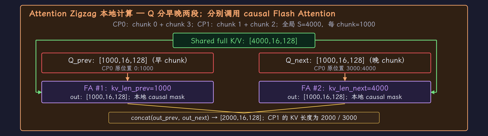{ width="100%" loading="lazy" }

*早晚两段 Q 分别调用 causal Attention，各自使用对应的可见 KV 范围。*

### Round-robin 与 zigzag 的差别

Round-robin 将编号为 $t$ 的 token 分配给 rank $t\bmod C$，使各 rank 混合早晚位置；query 的原位置与存储行号不再连续。要做正确因果 Attention，kernel 与 metadata 需要保留这种映射。

| 切分 | 每 rank 的 Query | 实现需要解决什么 |
| --- | --- | --- |
| Zigzag | 一段早 chunk + 一段晚 chunk | 两段可见 KV 范围、拼接与恢复顺序 |
| Round-robin | 原序列中按步长交错的 token rows | 任意/交错位置的 causal 规则和变长请求边界 |

原文将 round-robin 关联到 NSA/DeepSeek V3.2 专用路径，这是特定实现背景。Dense Attention 在有合适位置映射或重排支持时也可处理这样的 Query；“只有稀疏 Attention 能用”不是普遍限制。

### Ring 的机制与这张图不同

Ring 路径让本地 Q 不动，K/V 块在 CP ranks 间逐步流转；每处理一块，维护并合并该 Query 的 softmax 最大值、归一化和与加权输出。分块局部 softmax 不能直接相加，需要按共同最大值重新缩放状态。

这允许在某些实现中把通信与计算重叠，避免一次收集完整工作 K/V；它也引入块调度和归并开销。短序列、低并发或小计算量未必获益。长上下文阈值不能仅用“32K+”定义，要比较本地计算、缓存压力和新增通信。

### 与 Attention TP、DP、MoE 的组合

在本图的分解中：

$$
\begin{aligned}
\mathrm{attn\_tp}
&=\frac{N_{\mathrm{world}}}{\mathrm{attn\_dp}\times\mathrm{attn\_cp}} \\
&=\frac{16}{2\times 2}=4
\end{aligned}
$$

DP 分请求、CP 分该请求的 token 段、attn_tp 分 heads，随后 MoE EP 仍可覆盖整个 world。Wo 后的 RS 将本 CP 段 $[2000,8192]$ 分成 $[500,8192]$，MoE 后 AG 恢复本段。

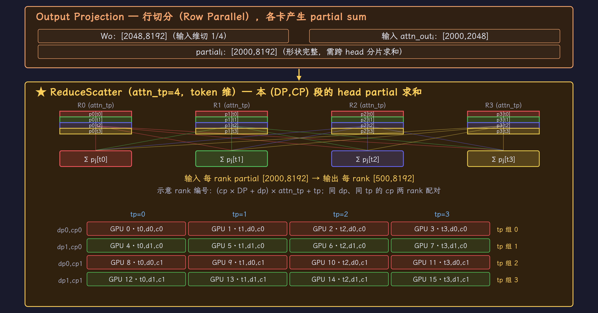{ width="100%" loading="lazy" }

*Wo 与 RS 仍在局部 attn_tp 组内；网格同时标出请求、context 与 head 三个坐标。*

图中还按原参考保留了 `MOE_DP=ATTN_CP` 的 MoE gather/scatter 接口。**具体 buffer、重复 token 去重、group 别名以及 backend 的数据所有权尚未核实**，因此这部分用于记录原图的接口关系，不作为已验证的 SGLang 执行 trace。尤其不能把 group 变量名直接解释为独立 MoE 权重副本。

### 原文的 CP flag 与单序列约束

| 原文 flag | 所描述的作用 |
| --- | --- |
| `--attn-cp-size N` | Attention CP group 大小 |
| `--enable-prefill-context-parallel` | 通用 prefill CP 路径 |
| `--prefill-cp-mode in-seq-split / round-robin-split` | 序列切分方式 |
| `--enable-nsa-prefill-context-parallel` | NSA 专用 prefill CP 路径 |

这些名字来自附件，用于查找对应版本。原文 `can_cp_split` 条件包含：$\mathrm{CP}>1$、当前为 context-parallel extend、序列够长且本 DP 执行单元只有一条序列。限制源于该单序列 zigzag metadata，不代表 CP 概念要求所有部署 global $B=1$。

| Attention DP size | 若每组恰好一条请求，global B | 例子：world、DP、CP → attn_tp |
| --- | --- | --- |
| 1 | 1 | 8、1、4 → 2 |
| 2 | 2 | 16、2、2 → 4 |
| 4 | 4 | 32、4、2 → 4 |

这里 $B=\mathrm{DP}$ 是“每组恰好一条请求”的状态，并非最小 batch 通用公式。存在 idle DP rank、连续批处理或 fallback 时，实际执行 batch 还会变化。图 7 采用第二行，因此不会与本地单序列条件冲突；原文另一个 $B=32$、DP=4 的示例只能解释轴分解，不能同时当作该 zigzag 路径的合法运行 batch。

### CP 与 MoE 的 gather / scatter 接口

按图 7 的参考数据流，每 CP rank 从 2000 tokens 经 Attention RS 获得 500 tokens。原文随后在 CP pair 上合并成 1000，再经 world EP16 dispatch / combine，最后切回 500：

| 阶段 | group / 接口 | 每 rank token 形状 |
| --- | --- | --- |
| Attention RS 后 | attn_tp=4 | $[500,H]$ |
| MOE_DP gather 后 | CP pair，参考图接口 | $[1000,H]$ |
| dispatch / FFN / combine | 全域 EP16 | $[1000,H]$ |
| MOE_DP scatter 后 | CP pair，参考图接口 | $[500,H]$ |
| Attention AG 后 | attn_tp=4 | $[2000,H]$ |

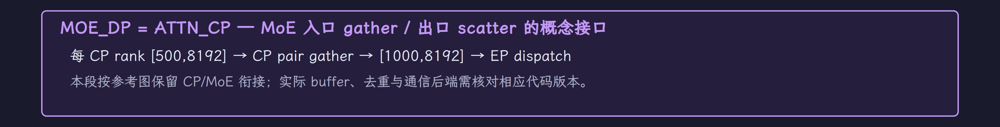{ width="100%" loading="lazy" }

*此处保留原图的 CP/MoE 接口示意；backend 如何管理 token 所有权仍需按版本核实。*

如果 gather 在两卡都产生同一份 1000-token 结果，就不能让两份重复 token 无条件独立 dispatch。backend 必须处理数据所有权、复制/归约和去重；group 别名本身无法证明这些规则。原文把 `_MOE_DP=_ATTN_CP` 当作接口复用线索，这部分后续应沿实际 dispatcher 与 communicator 代码确认。

在 16 卡、DP4、64 heads 的另一个轴分解例子中，CP 越大，留给 head TP 的预算越小：

| CP | $\mathrm{attn\_tp}=\frac{16}{4\times\mathrm{CP}}$ | 每 rank Q heads |
| --- | --- | --- |
| 1 | 4 | 16 |
| 2 | 2 | 32 |
| 4 | 1 | 64 |

这个表只算整除与 head 分配，不替代模型/backend 的 CP 兼容性检查。增加 CP 同时降低 attn_tp，Attention 权重每 rank 份额与跨 CP 依赖都会变化，不能只看 token 数除以 CP。

## 把策略放回部署目标

| 策略 | 主通信 | 通信发生在哪里 | 跨机需要关注什么 |
| --- | --- | --- | --- |
| TP | 激活 AllReduce，或等价原语重排 | 标准 Dense 例子的两处行切出口 | 频繁同步、小消息延迟和组内带宽 |
| PP | P2P 激活传递 | 每 micro-batch 的 stage 边界 | 单次激活大小、stage 平衡与流水深度 |
| DP | 纯副本前向无 collective | 服务层请求分发另计 | 副本负载与请求/KV 迁移 |
| EP | dispatch / combine | 每个 routed MoE 层 | token 路由、top-k、去重与热门 experts |
| DP Attention | 小 attn_tp 组归约 + 大 EP 路由 | Attention/MoE 使用不同 groups | 局部 TP 拓扑与全域 expert 交换 |
| SP | AG + RS | TP 区入口/出口 | 复用 TP group，融合与 overlap |
| CP | KV gather、块交换或状态归并 | Attention 跨段依赖 | 实际 KV 布局、长序列规模与 kernel 支持 |

| 当前瓶颈 | 优先考虑 | 接着检查 |
| --- | --- | --- |
| 单个 Dense 层权重或矩阵计算过大 | TP | 组内互连、GQA KV head 复制、Decode 同步成本 |
| 整模型跨多机才能容纳 | PP + 机内 TP | stage 权重/算力平衡、流水气泡、单请求延迟 |
| 单副本能运行，服务请求排队 | DP | 请求分发、生成长度偏斜、各副本缓存占用 |
| MoE expert 总权重过大 | EP，必要时 expert TP | dispatch 带宽、top-k、热门 expert 和本地 GEMM 规模 |
| MoE 需要大 EP，Attention 大 TP 通信昂贵 | DP Attention + EP | Attention 参数复制、局部组拓扑、跨组 KV 迁移 |
| LN / Residual 等冗余激活造成峰值压力 | TP + SP | 实际存活缓冲、融合、额外 collective 调度成本 |
| 一个长请求的 Attention 计算或缓存压力过大 | 实现支持的 CP | Prefill/Decode 支持、K/V 工作区与长期缓存布局、通信重叠 |

带宽、显存和算力应分开算，再用相同模型、dtype、请求长度分布与并发下的 TTFT、TPOT 和吞吐判断组合。MoE 的总参数决定要存多少 expert 权重，激活参数只反映每 token 选中的计算量；两者不能互相替代。

对于图中的模型，LM Head 保留了完整 token logits 的逻辑形状以便追踪维度，实际实现通常只计算需采样位置。采样若使用随机数，需要各 rank 一致的 RNG 或同步采样结果，不能无条件认为“各卡独立采样即可”。

## 来源与本地图稿

- [知乎原文：@科英](https://zhuanlan.zhihu.com/p/2035106376138085860)。原文的源码时间点为 2026-05-05，本笔记不把其行号作为已核实的本地源码证据。
- [完整流程图附件](推理并行策略-完整流程图.md)：七张完整长图。
- [七图本地浏览页](../../assets/vllm/parallelism/gallery.html)：SVG 与 3840px 高清 PNG 图稿。
- [图稿复现说明与修正记录](../../assets/vllm/parallelism/README.md)：权重口径、micro-batch、DP KV、SP 显存与 CP AllGather/Ring 等修正。
- 生成脚本：仓库内 `scripts/reproduce_parallel_diagrams.py`。修改图后重新导出可更新全部高清图片；图片底部不含参考小字。
