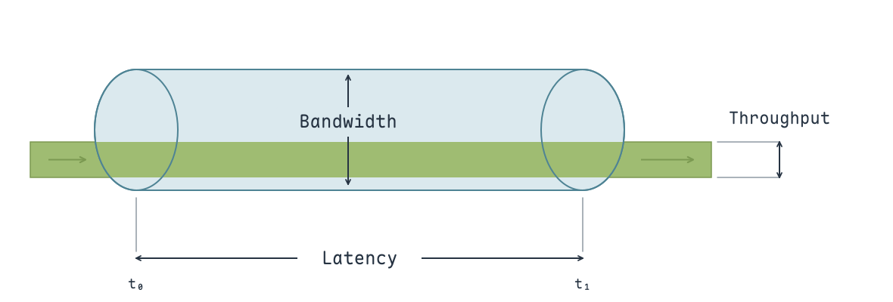
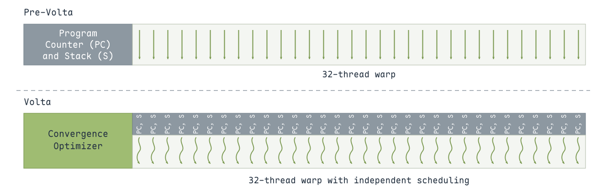
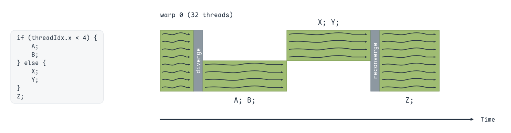
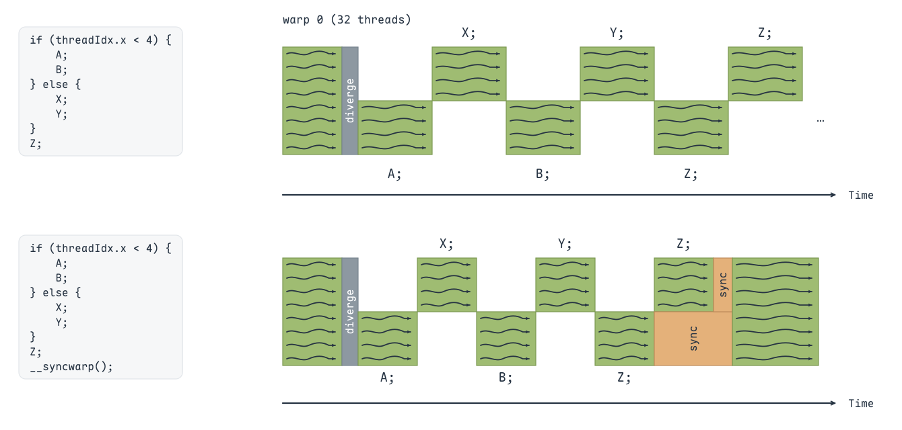
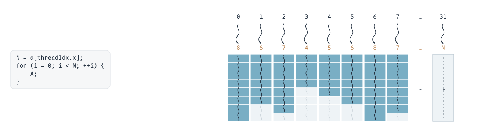
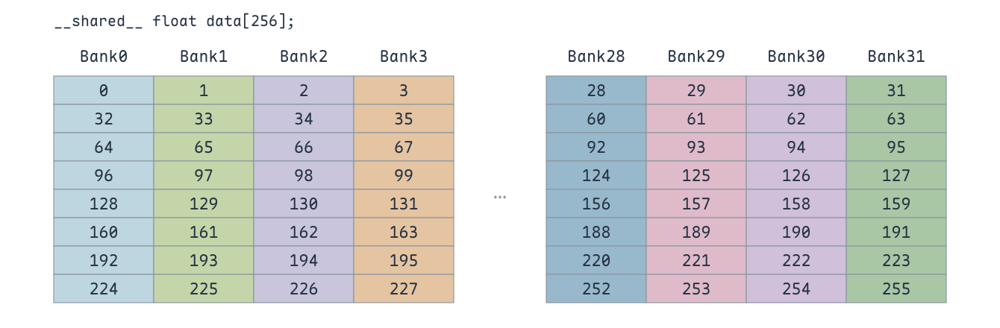
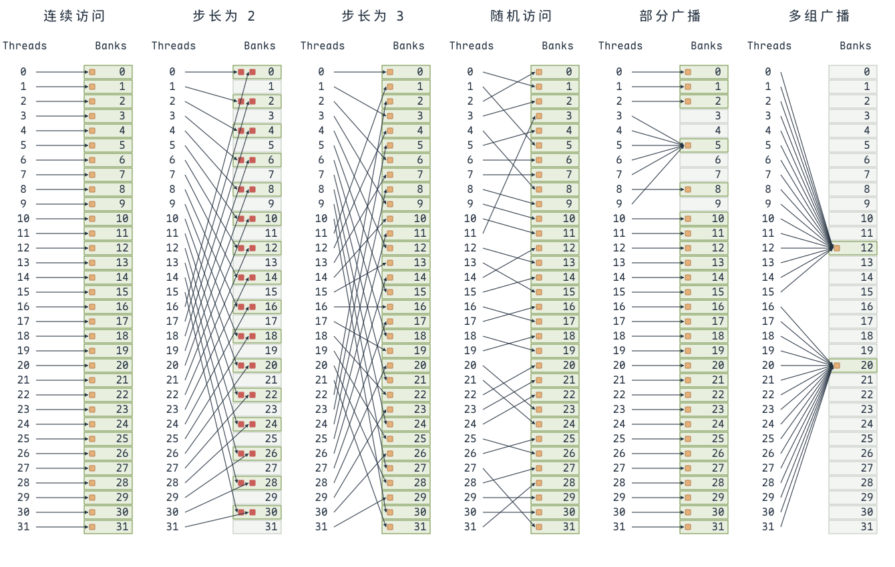
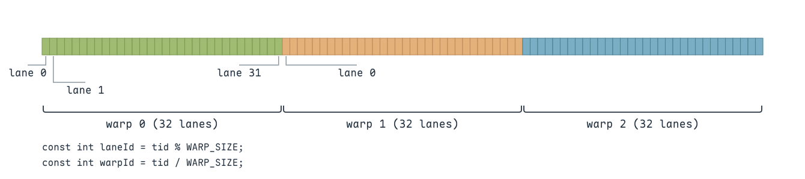
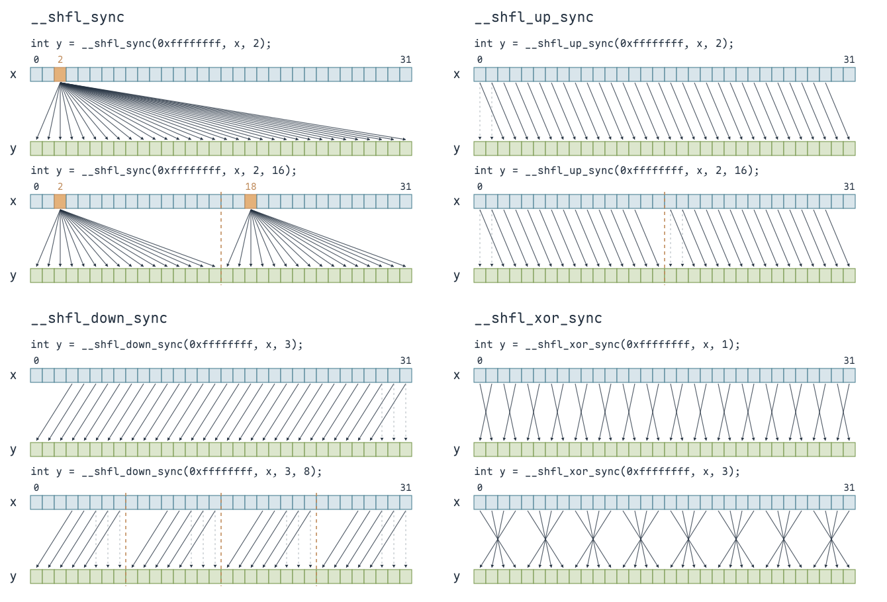

---
tags:
  - 访存优化
  - Warp
title: CUDA 基础
description: GPU 存储层次、Warp 执行、Shared Memory 的 Bank Conflict，以及线程间的 Shuffle 数据交换。
date: 2026-10-20
---

> GPU基础数据查询: https://www.techpowerup.com/gpu-specs/

**NVIDIA 显卡算力计算**

FLOPS （Floating-point operations per second的缩写），即每秒浮点运算次数。FLOPS = GPU核数 * 单核主频 * GPU单个周期浮点计算能力

> 以 RTX 5090 为例，它拥有 **21,760 个 CUDA Core**，Boost 频率约为 **2410 MHz**。每个 CUDA Core 每周期可执行一次 FP32 乘加运算，计为 2 次浮点运算，因此理论 FP32 峰值算力为 $21760 \times 2410 \times 10^6 \times 2 \approx 104.9\,\mathrm{TFLOPS}$。

**NVIDIA 显卡带宽计算**

显存带宽（Memory Bandwidth）表示 GPU 与显存之间每秒可传输的数据量。理论带宽 Bandwidth = 显存数据速率 × 显存总线位宽 / 8，其中显存数据速率指规格表中以 Gbps 标注的 Memory Clock（Data Rate），即每引脚的数据速率；位宽以 bit 为单位，结果为 GB/s。

> 以 RTX 5090 为例，它使用 GDDR7 显存，显存数据速率 Memory Clock（Data Rate）为 **28 Gbps**，显存总线位宽为 **512 bit**，因此理论显存带宽为 $28 \times 512 \div 8 = 1792\,\mathrm{GB/s}$。

**带宽、吞吐量与延迟**

**带宽（Bandwidth）**是理想情况下的数据传输速率，描述理论上限；**吞吐量（Throughput）**是实际达到的数据传输速率。两者单位相同，如 bit/s、Byte/s。

> 例如，一个人每秒最多能吃 10 个鸡蛋，相当于带宽；实际每秒只吃了 5 个，相当于吞吐量。

吞吐量可以按一段时间内完成的数据传输量除以耗时计算，类似汽车从 A 到 B 的平均速度。

**延迟（Latency）**表示完成一次传输或操作所需的时间，单位为 s、ms 或 μs。

{ width="750" }

## Warp divergence

GPU 以 **Warp** 为单位执行 SIMT 指令，一个 Warp 包含 32 个线程。当同一个 Warp 内的线程进入不同分支，或循环次数不同时，就会出现 **Warp divergence（Warp 分歧）**：不同执行路径需要分别处理，部分线程暂时不参与计算，降低线程利用率。

{ width="1000" }

在 Pascal 及更早的架构中，同一个 Warp 的线程共享一个 **Program Counter（PC，程序计数器）**，通过 **Active Mask（活跃线程掩码）**标记当前指令由哪些线程执行。

以 `threadIdx.x < 4` 为例，warp 0 中的 thread 0～3 执行 A、B，其余线程执行 X、Y。**两个分支分别执行，每次只激活当前分支对应的线程**；完成分支后，在共同的 Z 处重新汇合。分支的先后顺序不应作为程序正确性的前提。

{ width="1000" }

同一个 Warp 内的不同分支不能依赖彼此同时推进；如果一组线程在分支中等待另一组线程完成操作，可能造成死锁。不同 Warp 则有各自独立的执行进度。

> - 旧的执行方式中，同一个 Warp 内的线程共享程序计数器，通过“活跃线程掩码”标记哪些线程参与当前指令。
> - 在 `if` 分支内进行线程间通信或同步时要特别小心，尤其是没有明确指定参与线程的掩码时。
> - 分支执行结束后，线程会自动重新汇合。
> - 典型的条件加载表达式，如 `cond ? x[i] : 0.f`，可以通过带谓词的加载指令实现，不一定产生分支分歧。
>
> —— 取自 CUDA MODE 4

从 Volta 开始，GPU 引入 **Independent Thread Scheduling（独立线程调度）**，为每个线程维护 PC、调用栈等执行状态。调度器仍按 SIMT 方式，将同一个 Warp 内可以共同执行的线程分组发射指令，但不同分支的线程可以交错推进。

**独立线程调度并没有消除 Warp divergence，也不能保证所有线程到达共同的 Z 时已经同步。** 同一个 Warp 内存在跨线程通信或共享内存读写依赖时，需要明确同步位置。

`__syncwarp(mask)` 等待掩码指定的线程到达屏障，并保证参与线程之间的内存访问顺序。无参数的 `__syncwarp()` 默认使用完整 Warp 的掩码，应放在所有未退出的参与线程都会执行到的位置。

{ width="1000" }

> 示例在 Z 后调用 `__syncwarp()`，表示参与线程完成 Z 后再继续执行；如果 Z 本身需要读取其他线程写入的数据，同步就应放在 Z 之前。

当循环上限 `N` 由每个线程的数据决定时，线程的迭代次数可能不同。**迭代次数较少的线程先退出循环，其他线程继续执行**，后几轮的活跃线程逐渐减少；需要等所有线程完成各自的工作，这个 Warp 才全部完成。

{ width="1000" }

## Bank Conflict

为了提高并发读写带宽，**Shared Memory 被划分为 32 个大小相等、可以并行访问的 Bank**。每个 Bank 都能存放多个数据，并不是“一个线程固定对应一个 Bank”；线程访问哪个 Bank，由它访问的数据地址决定。

以 4 字节的 `float` 为例，连续元素依次映射到连续 Bank，元素 $k$ 对应的 Bank 编号为 $k \bmod 32$；若用字节地址表示，则为 $\lfloor \mathrm{addr} / 4 \rfloor \bmod 32$。因此，`data[0]`、`data[32]`、`data[64]` 都位于 Bank 0，但它们是不同地址的数据。这里的 4 字节是映射的基本单位，不是一个 Bank 的总容量。

{ width="850" }

以下以同一个 Warp 的每个线程执行一次 `float` 读取为例。**当同一条访存指令中的多个线程访问同一个 Bank 的不同地址时，就会产生 Bank Conflict（Bank 冲突）**。硬件需要将这次请求拆成多次无冲突访问，依次处理，从而降低有效带宽。不同指令先后访问同一个 Bank，不属于这里讨论的冲突。

如果同一个 Bank 需要读取两个不同的 `float`，就是 **2-way Bank Conflict（2 路冲突）**；需要读取四个不同的 `float`，就是 4 路冲突。判断冲突程度，要看同一个 Bank 中被访问的**不同数据地址的数量**，不能只数访问它的线程数。

**多个线程读取同一个地址时，可以通过 Broadcast（广播）共享读取结果，不产生 Bank 冲突**。广播不要求整个 Warp 都读取同一个地址，一部分线程读取同一个地址也可以。多组线程分别读取各自相同的地址，只要这些地址落在不同 Bank，也可以并行广播。多个线程对同一地址执行普通写入则存在数据竞争，最终由哪个线程写入不确定，不能按广播读取来理解。

{ width="1000" }

从左到右看这六种访问方式：

- **第 1、3、4 种没有冲突**：连续访问、步长为 3 的访问，以及图中的随机访问，都将 32 个线程的请求映射到不同 Bank。访问顺序看起来交错，并不意味着存在冲突。
- **第 2 种产生 2 路冲突**：线程 $t$ 读取元素 $2t$，线程 0 和 16 分别读取 `data[0]`、`data[32]`，访问同一个 Bank 的不同地址；其余被访问的 Bank 也各有两个不同地址需要读取。
- **第 5、6 种通过广播读取，没有冲突**：多条连线指向同一个数据地址，只需要读取一次，再将结果提供给对应线程。与第 2 种访问同一 Bank 内的不同地址相比，区别在于是否读取**同一个地址**。

避免 Bank 冲突的关键是**调整数据布局或索引，让同一条访存指令中不同地址的访问尽量分散到不同 Bank**。例如，`float tile[32][32]` 按列读取时，各行的同一列都落在同一个 Bank；将其改为 `float tile[32][33]`，通过 Padding 错开每行起始位置，就可以让相邻线程的列访问分散到不同 Bank。定位这类问题，可以用 Nsight Compute 查看 Shared Memory 的访存与 Bank Conflict 指标。

> 参考：[【CUDA编程概念】一、什么是 bank conflict？](https://zhuanlan.zhihu.com/p/659142274)。

## Shuffle

**Shuffle 用于同一个 Warp 内的寄存器数据交换**。每个线程将自己的变量作为参数传入，再按指定规则获取另一个线程的变量值，不需要经过 Shared Memory 中转。这里交换的是**值的副本**，源线程仍然保留自己的数据，也不是任意读取另一个线程的寄存器地址。

一个 Warp 包含 32 个线程，每个线程在 Warp 内的编号称为 **Lane ID**，范围为 0～31。对于一维 Block，令 `tid = threadIdx.x`、`WARP_SIZE = 32`，则 `laneId = tid % WARP_SIZE`，`warpId = tid / WARP_SIZE`；这里的 `warpId` 是 Block 内的 Warp 编号。每进入下一个 Warp，Lane ID 都从 0 重新开始，Shuffle 只能在同一个 Warp 内传值。

{ width="1000" }

四种 Shuffle 函数分别采用不同的方式选择**源线程**：

- **`__shfl_sync(mask, x, srcLane, width)`：按编号读取。** 例如 `srcLane = 2` 时，各线程都获取 lane 2 的 `x`，实现 Warp 内广播；设置 `width = 16` 后，两个分组分别读取各自的第 2 个 lane，即整个 Warp 中的 lane 2 和 18。
- **`__shfl_up_sync(mask, x, delta, width)`：从较小的 Lane ID 读取。** 偏移量为 2 时，lane $i$ 获取 lane $i-2$ 的 `x`；每组最前面的两个线程没有组内对应的源线程，返回自己的 `x`。
- **`__shfl_down_sync(mask, x, delta, width)`：从较大的 Lane ID 读取。** 偏移量为 3 时，lane $i$ 获取 lane $i+3$ 的 `x`；每组最后三个线程返回自己的 `x`。它常用于规约，让前面的线程获取后面线程的部分结果。
- **`__shfl_xor_sync(mask, x, laneMask, width)`：按 Lane ID 的异或结果读取。** 默认 `width = 32` 时，源线程编号为 $i \mathbin{\oplus} \mathrm{laneMask}$。例如 `laneMask = 1` 时，lane 0、1 相互获取对方的值，lane 2、3 也是如此；`laneMask = 3` 时，配对关系变为 0 与 3、1 与 2，以此类推，形成蝶形交换。

{ width="1000" }

`width` 默认为 32，合法值为 **1、2、4、8、16、32**。对按编号读取和 `up/down`，它将 Warp 划分为连续的逻辑分组，各组按组内编号选择源线程；例如 `width = 8` 时，一个 Warp 中有四个 8 线程分组，`up/down` 不会跨越分组边界。**这只是传值范围的划分，并没有改变实际的 Warp 大小。**

`mask` 是参与调用的线程掩码，**`0xffffffff` 表示全部 32 个 lane 参与**。调用线程自身的位必须包含在掩码中，掩码内所有尚未退出的线程都必须以相同的掩码执行同一种 Shuffle 调用；被读取的源线程也必须参与，否则返回值未定义。这里的 `mask` 用于指定参与线程，与 `__shfl_xor_sync` 中用于计算源线程编号的 `laneMask` 不同。

`_sync` 保证参与线程在这次 Shuffle 操作处汇合，**不提供 Shared Memory 的内存访问顺序保证**。如果还存在共享内存读写依赖，仍然需要对应的同步；仅通过 Shuffle 在寄存器之间传值，则不需要为了这次传值先写入共享内存再读取。

> 参考：[【CUDA编程】束内洗牌函数（Warp Shuffle Functions）](https://zhuanlan.zhihu.com/p/669957986)、[CUDA Programming Guide：Warp Shuffle Functions](https://docs.nvidia.com/cuda/archive/12.6.3/cuda-c-programming-guide/index.html#warp-shuffle-functions)。
