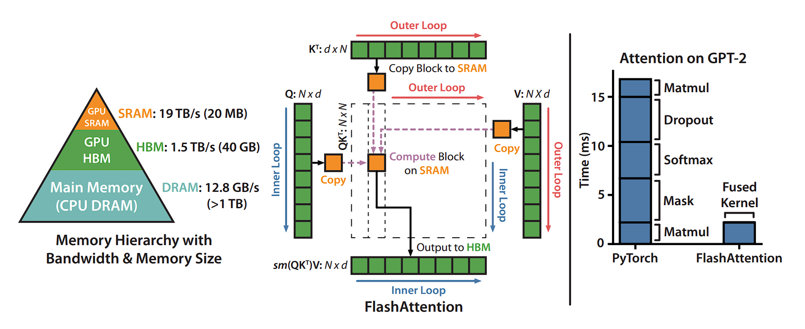
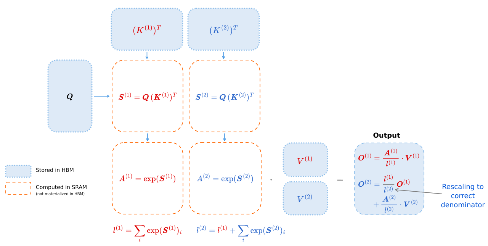
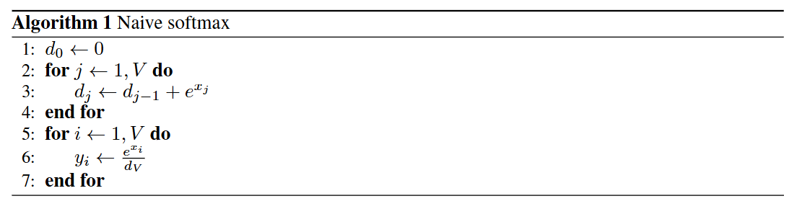
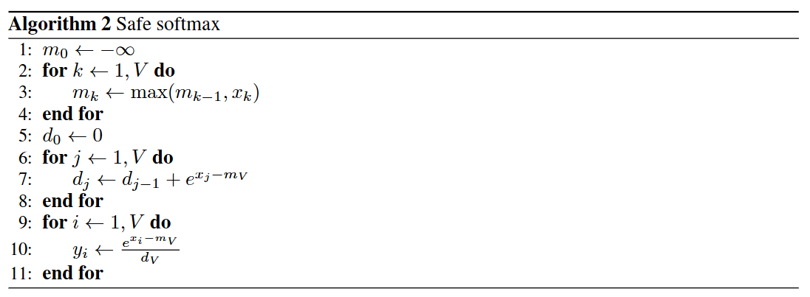
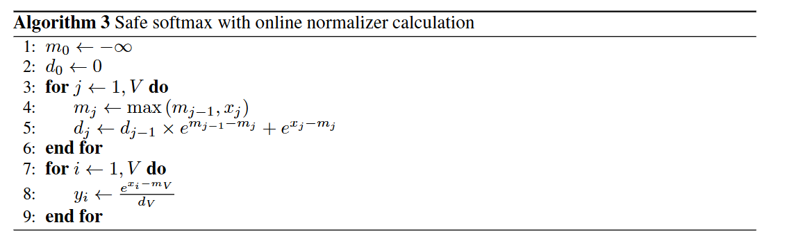
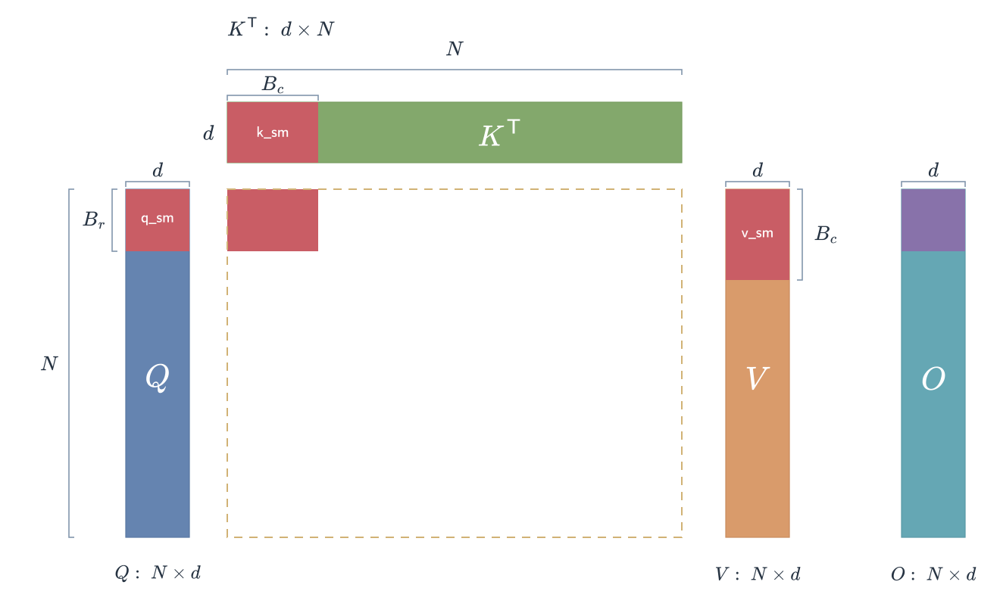
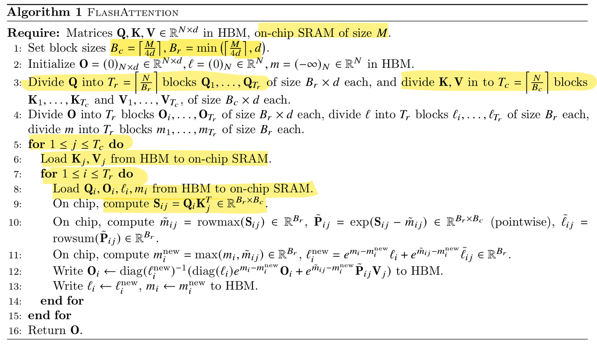
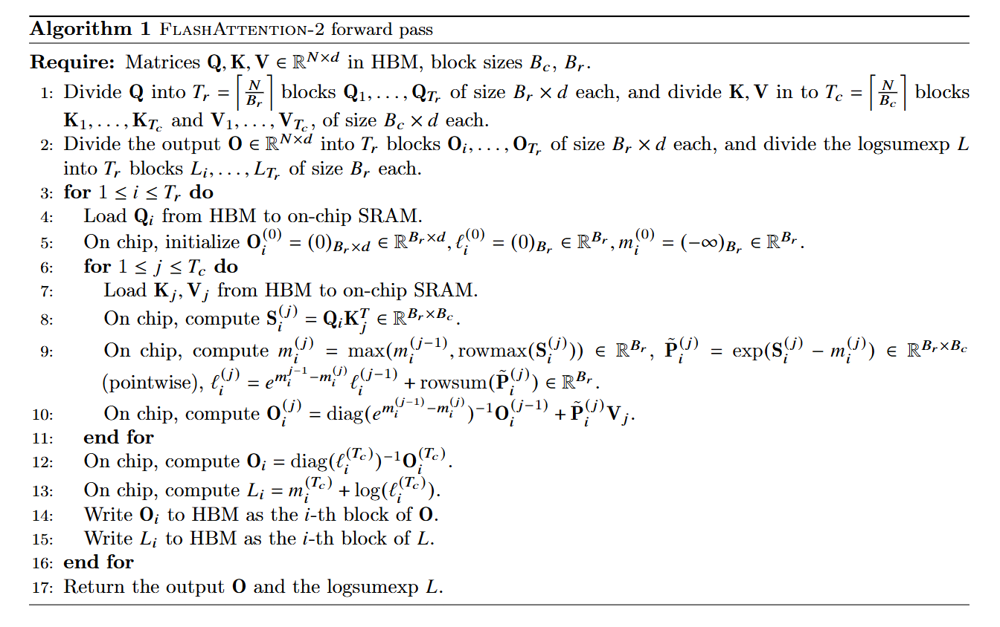
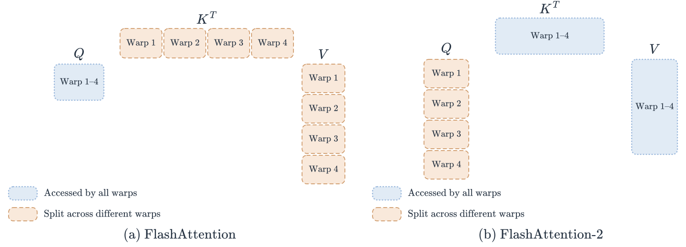

---
tags:
  - Attention
  - Memory
title: FlashAttention v1 & v2 浅析
description: 分块 Attention、Online Softmax、线程块与 Warp 分工，以及 Flash-Decoding 的并行方式。
date: 2026-10-18
---

# FlashAttention v1 & v2 浅析

## FlashAttention v1 算法

标准的缩放点积注意力（Scaled Dot-Product Attention）公式如下：

$$
\operatorname{Attention}(Q, K, V)
= \operatorname{Softmax}\left(\frac{QK^{\mathsf{T}}}{\sqrt{d_k}}\right)V
$$

在硬件执行层面，这个公式通常被分解为以下步骤：

1. **计算分数**：$S = QK^{\mathsf{T}} \in \mathbb{R}^{N \times N}$，其中 $N$ 为序列长度。
2. **缩放与掩码**：$S_{\mathrm{scaled}} = \frac{S}{\sqrt{d_k}}$，其中 $d_k = d_{\mathrm{model}} / n_{\mathrm{head}}$ 为每个 head 的维度；缩放后按需应用掩码。
3. **计算权重**：$P = \operatorname{Softmax}(S_{\mathrm{scaled}}) \in \mathbb{R}^{N \times N}$。
4. **加权求和**：$O = PV \in \mathbb{R}^{N \times d}$，其中 $d$ 为 Value 向量的维度。

在标准实现中，$S$ 和 $P$ 的矩阵大小都是 $N \times N$。当序列长度 $N = 64\mathrm{K}$ 时，这些中间矩阵会占用巨大的显存，并频繁地在 GPU 显存（HBM）和片上存储（SRAM）之间来回读写，导致计算单元大部分时间都在等待数据传输。

**FlashAttention 并不改变公式的数学结果，而是改变了计算过程。** 它主要通过两个手段减少中间矩阵的读写：

1. **Tiling（分块）**：将大矩阵拆分成小块，使其能够放入 SRAM（速度快但容量小的片上存储）。
2. **算子融合（Kernel Fusion）**：在一个 GPU Kernel 中完成这些计算，不再将完整的中间矩阵 $S$ 和 $P$ 写回 HBM。

{ width="800" }

> [FlashAttention](https://link.zhihu.com/?target=https%3A//arxiv.org/abs/2205.14135) 是一种重新排序注意力计算并利用分块和重新计算来显著加速并减少内存使用（从序列长度的二次方降至线性）的算法。我们使用分块将输入块从 HBM（GPU 内存）加载到 SRAM（快速缓存），对该块执行注意力计算，并更新 HBM 中的输出。
> 通过不将大型中间注意力矩阵写入 HBM，我们减少了内存读写量，从而使实际时间加快 2-4 倍。

此处展示了 FlashAttention 正向传播的示意图：通过分块和 softmax 重缩放，我们以块为单位进行操作，避免从 HBM 读取/写入，同时获得正确的输出而没有近似值。

{ width="800" }

实现分块计算最大的难点在于 **Softmax，因为**要计算序列中任意一个位置的 Softmax 值，你必须先知道**整个序列**中的最大值和所有数值的指数和。

### online softmax

**Native softmax**

由于在实际的计算中，指数计算exp存在不稳定性，比如数值容易溢出，超过一定范围计算精度会下降等问题

{ width="800" }

**Safe softmax**

计算时每个数减去数组中的最大值，与Naive版本相比，不会出现数值溢出，但是多了一次寻找最大值的遍历。一共需要三次遍历。

{ width="800" }

**Online softmax**

Online Softmax 提出了一种**增量更新**的策略。具体实现策略如下：

{ width="800" }

使得我们可以在不知道全局最大值的情况下，开始计算和存储中间结果。允许将巨大的 Attention 矩阵切分成小块放入 SRAM（共享内存）中计算，这是**FlashAttention**能够减少显存访问（HBM Access）并提升速度的数学基础。

### 算法流程

**FlashAttention v1其实是按照 batch 和 Heads 维度做并行的，每个block计算一个[N,head_dim]的Q、K、V矩阵的attention计算结果**

由下图可以清晰的看到计算过程中每个分块的大小

{ width="800" }

{ width="800" }

**关键变量定义**：

- $m^{(i)}$：当前行到第 $i$ 步时的最大值（用于数值稳定性）。
- $l^{(i)}$：当前行到第 $i$ 步时，以当前最大值 $m^{(i)}$ 为基准的指数累加和（归一化因子）。
- $O^{(i)}$：当前行到第 $i$ 步时的部分注意力输出结果。

这三个变量与 online softmax 有关，储存在全局内存中。

$Q_i$ 的大小为 $B_r \times d$，$K_j$、$V_j$ 的大小为 $B_c \times d$，得分块 $S_{ij}$ 的大小为 $B_r \times B_c$。

其中 $S$ 是得分矩阵，由于要继续和 $V$ 进行运算，所以存储在共享内存中，减少读写次数。

$B_c$ 和 $B_r$ 的值根据片上存储容量确定，保证当前分块和中间结果能够放入片上存储。

Q 矩阵块 $[B_r, d]$，所以一共要循环 $T_r = \left\lceil N / B_r \right\rceil$ 次。

K、V 矩阵块 $[B_c, d]$，所以一共要循环 $T_c = \left\lceil N / B_c \right\rceil$ 次。

上述计算循环的总次数为：

$$
T_c T_r
= \left\lceil \frac{N}{B_c} \right\rceil
  \left\lceil \frac{N}{B_r} \right\rceil
$$

因此前向计算复杂度为：

$$
O\left(\frac{N^2}{B_c B_r} B_r B_c d\right)
= O(N^2 d)
$$

## FlashAttention v2

相比于 FA1，FA2 的改进主要集中在**并行维度、算法开销和任务划分**这三大块：

### 减少非矩阵乘法（Non-matmul）开销

GPU 最擅长做矩阵乘法（Matmul），而做指数运算、缩放等操作相对较慢。

公式优化：FA2 改进了在线 Softmax（Online Softmax）的计算逻辑。在 FA1 中，每一步循环都要对输出 $O$ 进行归一化。FA2 则维护未归一化的输出累加值，将除以累计指数和的操作移到了循环结束处，减少了重复计算。

#### 1、去掉了什么缩放？

在 FA1 的内循环中，每次计算出一个新的块注意力后，都会对历史输出 $O^{(i-1)}$ 进行缩放并合并当前块的贡献。

具体来说，FA1 会在每次更新时，将历史输出乘以旧的累计指数和 $l^{(i-1)}$，并根据最大值的变化进行指数重缩放，再将合并后的结果除以新的累计指数和 $l^{(i)}$。

FA2 去掉的正是这个「除以 $l^{(i)}$」和「乘以 $l^{(i-1)}$」的中间归一化步骤。最大值变化时，对历史累加值的指数重缩放仍然保留。

#### 2、为什么能去掉？

FA2 直接维护未归一化的加权分子，因此可以将归一化留到最后。同时，FA2 **改变了循环的嵌套顺序**，使当前 Q 块的累加状态能够持续保留在片上，减少 HBM 读写：

- **FA1 的循环顺序**：外循环遍历 K/V 分块，内循环遍历 Q/O 分块。每次更新后，将**已经归一化的部分输出** O 写回 HBM。
- **FA2 的循环顺序**：外循环遍历 Q/O 分块，内循环遍历 K/V 分块。当前 Q 块及其未归一化的输出累加值保留在片上，直到遍历完所有 K/V 分块，再归一化并写回显存。
- **结论**：FA2 在片上维护未归一化（Unnormalized）的输出累加值，保留最大值变化时的指数重缩放，遍历完所有 K/V 分块后，再除以累计指数和完成归一化。

#### 3、数学推导

以下以单条 Query 为例。为了防止指数溢出，我们维护当前 Query 行的两个累计状态（也就是之前代码里的 $m$ 和 $l$）。其中，$S_i$ 是第 $i$ 个 K/V 块的分数行向量，$m_i = \max_j S_{i,j}$ 是当前块的最大分数，$V_i$ 是对应的 Value 块。

累计最大值更新：

$$
m^{(i)} = \max\left(m^{(i-1)}, m_i\right)
$$

累计分母（指数和）更新：

$$
l^{(i)} = l^{(i-1)} e^{m^{(i-1)}-m^{(i)}}
+ \sum_{j=1}^{B_c} e^{S_{i,j}-m^{(i)}}
$$

FlashAttention v1 的更新公式（繁琐缩放）：

$$
O^{(i)} = \frac{1}{l^{(i)}}\left(
l^{(i-1)} e^{m^{(i-1)}-m^{(i)}} O^{(i-1)}
+ e^{S_i-m^{(i)}} V_i
\right)
$$

可以看到，每次循环都需要将合并后的输出除以 $l^{(i)}$，这会增加非矩阵乘法开销。

在 FA2 中，我们不再维护归一化的 $O^{(i)}$，而是引入一个未归一化的中间变量 $\widetilde{O}^{(i)}$。

定义 $\widetilde{O}^{(i)} = l^{(i)} O^{(i)}$。我们将 $\widetilde{O}^{(i)}$ 代入上面的公式，两边同时乘以 $l^{(i)}$，奇迹就发生了：

$$
\widetilde{O}^{(i)}
= \widetilde{O}^{(i-1)} e^{m^{(i-1)}-m^{(i)}}
+ e^{S_i-m^{(i)}} V_i
$$

推导结果：

**内循环中**：计算出指数权重和重缩放系数后，通过乘法和加法更新 $\widetilde{O}^{(i)}$。在输出累加值的更新中，不再每轮除以 $l^{(i)}$、乘以 $l^{(i-1)}$；累计分母的更新仍然需要对旧的 $l^{(i-1)}$ 进行指数重缩放。

**循环结束后（走出内循环）**：当遍历完所有的 K、V 块后（假设共有 $T$ 个块），我们手里拿到了最终的未归一化结果 $\widetilde{O}^{(T)}$ 和最终的分母 $l^{(T)}$。

此时，对输出向量统一做一次归一化：

$$
O = \frac{\widetilde{O}^{(T)}}{l^{(T)}}
$$

#### 算法流程

{ width="800" }

### 更强的并行化

- **FA1 的局限**：原始 FA1 前向实现主要在 Batch（批次）和 Head（头数）维度上并行，一个线程块（CTA）负责一个 Batch、一个 Head 的完整 Attention 计算。当 $B \times H$ 较小时，可并行的线程块数量不足，部分 GPU 流多处理器（SM）无法得到充分利用。
- **FA2 的改进**：在 Batch 和 Head 的基础上，增加了**查询序列维度的并行**，将同一个 Head 内不同 $Q_i$ 块的计算交给独立的线程块。即使只有一个 Head，只要序列足够长，也能提供多个可并行执行的任务。
- **为什么可以这样划分？** FA2 的外循环遍历 **$Q$ 分块**，每个线程块在内部遍历所需的 K/V 分块，完成自己负责的输出。

  - **独立性**：每个 $Q_i$ 块的输出 $O_i$ 由该 Q 块与所需的 K/V 分块计算得到，**不依赖其他 Q 块的输出**。这种独立性在 FA1 中也成立。
  - **任务划分**：FA1 将 Q/K/V 分块循环放在同一个线程块内执行；FA2 将不同 Q 块分配给不同线程块，由 GPU 调度到 SM 上执行。各线程块写入不同的输出行，彼此不需要交换输出结果。
- **示例**：设 $B = 1$、$H = 12$，序列长度 $N = 8192$，Q 块大小 $B_r = 128$。

  - FA1 有 $B \times H = 12$ 个线程块；FA2 有 $B \times H \times \left\lceil N / B_r \right\rceil = 1 \times 12 \times 64 = 768$ 个线程块。
  - 相比 12 个线程块，768 个线程块能为 A100 的 108 个 SM 提供更多可调度任务，**有助于提高 GPU 利用率**。实际利用率仍受寄存器、共享内存占用和任务执行时间等因素影响。

### 优化 Warp 级任务划分

在 NVIDIA GPU 中，一个 Warp 由 32 个线程组成。FA2 调整了同一线程块内各 Warp 的分工，减少了通过**共享内存（Shared Memory）**交换、归约中间结果所需的读写与同步开销。

{ width="800" }

## Flash-Decoding

前面介绍的 FA2 前向方案沿 Batch、Head 和 Q 的序列维度并行。Flash-Decoding 在此基础上增加了一个新的并行维度：**K/V 的序列长度**。当 Batch 较小、上下文较长时，这种划分能提供更多并行任务，提高 GPU 利用率。

与 FlashAttention 类似，Flash-Decoding 避免将完整的注意力得分矩阵写回全局内存，但需要额外保存各分段的局部输出和归约统计量。

在 Prefill（提示词处理）阶段，Q 通常包含多个 Token，可以沿 Q 的序列维度并行。在常规自回归 Decode 阶段，**每个请求每步处理一个新 Token**，因此 $N_q = 1$。

在前面按 Query Head 和 Q 分块划分任务、未沿 KV 维度拆分的方案中，线程块数量约为 $B \times H \times \left\lceil N_q / B_r \right\rceil$。当 $N_q = 1$ 时，Q 分块数为 1，线程块数量约为 $B \times H$。若这个乘积较小，即使 KV Cache 很长（比如 128K），也只有少量线程块分别扫描较长的 K/V，难以充分利用 GPU 的 SM 和显存带宽。

这里对比的是**未采用 Split-KV 的前向方案**。[官方 Flash-Decoding 介绍](https://crfm.stanford.edu/2023/10/12/flashdecoding.html)说明，这项能力已从 FlashAttention 2.2 起提供。

### Flash-Decoding 的核心优化：KV 维度并行化

Flash-Decoding 引入了“分而治之”的思想，沿 KV 序列维度划分计算区间，让多个线程块并行处理同一 Query 所需的不同 K/V 分段。

它的三步走流程：

1. **拆分（Split）**：将 K/V 序列逻辑上划分为若干较小的分段（例如每段 1024 个 Token）。分段本身无需复制或重新排列 KV Cache。
2. **局部计算（Partial Attention）**：启动多个线程块，分别计算 Q 与各 K/V 分段的局部注意力，并保存对应的局部结果和归约统计量。
3. **最终聚合（Reduction）**：通过一个较小的归约内核，对各分段结果进行重缩放、求和与归一化，得到**最终的注意力输出**。

以下以**单个 Query 行、单个 Head**为例，用未归一化分子推导聚合过程。将当前 Query 可见的 K/V 划分为 $S$ 个互不重叠的分段，第 $i$ 段的 Token 索引集合为 $\mathcal{J}_i$，$S_{ij}$ 为当前 Query 与第 $i$ 段中索引为 $j$ 的 Key 的注意力得分，$V_j$ 为对应的 Value 向量。定义各段统计量：

$$
m_i = \max_{j\in\mathcal{J}_i} S_{ij},\qquad
l_i = \sum_{j\in\mathcal{J}_i} e^{S_{ij}-m_i}
$$

$$
\widetilde{O}_i = \sum_{j\in\mathcal{J}_i} e^{S_{ij}-m_i} V_j
$$

其中 $\widetilde{O}_i$ 是**未归一化的局部分子**。官方介绍采用局部归一化输出 $O_i = \widetilde{O}_i / l_i$ 和对应的 Log-sum-exp $\mathrm{LSE}_i = m_i + \log l_i$ 保存分段结果；这与下面的推导在数学上等价。

#### 第一步：寻找全局最大值（Global Max）

$$
M = \max(m_1, m_2, \ldots, m_S)
$$

#### 第二步：统一指数基准（Rescaling）

将各分段相对于局部最大值 $m_i$ 的指数权重，转换为相对于全局最大值 $M$ 的指数权重：

$$
L_i = l_i \cdot e^{m_i-M}
= \left(\sum_{j\in\mathcal{J}_i} e^{S_{ij}-m_i}\right) \cdot e^{m_i-M}
= \sum_{j\in\mathcal{J}_i} e^{S_{ij}-M}
$$

$$
\widehat{O}_i = \widetilde{O}_i \cdot e^{m_i-M}
= \left(\sum_{j\in\mathcal{J}_i} e^{S_{ij}-m_i} \cdot V_j\right) \cdot e^{m_i-M}
= \sum_{j\in\mathcal{J}_i} e^{S_{ij}-M} \cdot V_j
$$

#### 第三步：全局求和与归一化

$$
L = \sum_{i=1}^{S} L_i
$$

$$
\widetilde{O}_{\mathrm{global}} = \sum_{i=1}^{S} \widehat{O}_i
$$

$$
O = \frac{\widetilde{O}_{\mathrm{global}}}{L}
= \frac{\sum_{i=1}^{S} \widetilde{O}_i \cdot e^{m_i-M}}
       {\sum_{i=1}^{S} l_i \cdot e^{m_i-M}}
$$

针对 Decode 阶段的好处：

- **长上下文下加速生成**：官方在 CodeLlama-34B、Batch 为 1 的长上下文测试中报告，端到端生成速度最高约为当时 FlashAttention v2（2.2 之前）的 8 倍。
- **提高显存带宽利用率**：通过增加并行任务，让更多 SM 参与 K/V 的读取和计算，缓解任务不足造成的带宽利用率低的问题；扫描 K/V 所需的数据读取量仍然存在。
