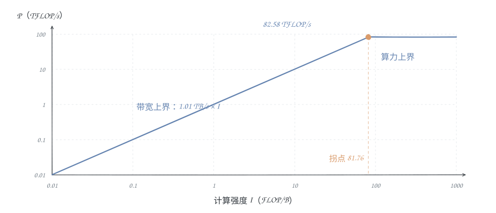
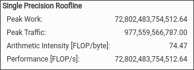
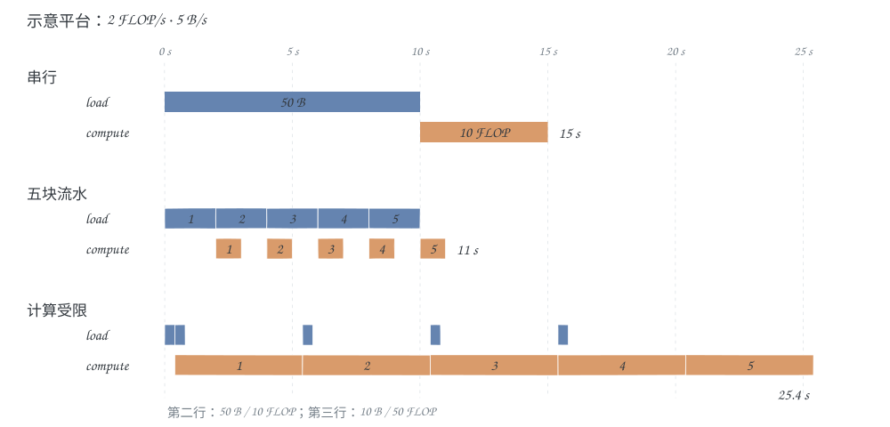
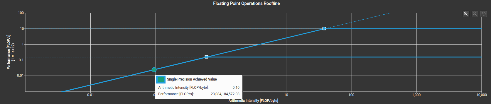
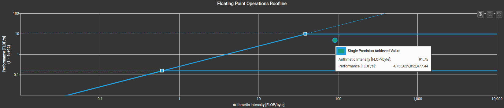

# NCU 性能分析与 Roofline

Nsight Compute（NCU）聚焦**单个 Kernel 内部**的执行细节：耗时、计算与访存吞吐、Occupancy、Warp 发射与指令级等待。**先确认 Kernel 慢在哪里，再选对应指标解释原因**——孤立地盯着某一个百分比，往往会把调优带偏。

??? info "实验口径与工具分工"

    - 本文属于 **NCU 性能分析与 Kernel 调优** 系列第 4 篇（收官篇），把 [合并访存与缓存](合并访存与缓存.md)、[Occupancy 与 Warp 调度](Occupancy与Warp调度.md) 与 [矩阵转置与访存优化](矩阵转置与访存优化.md) 收敛为一套可复用的采集工作流与 Roofline 分析框架。
    - **工具边界**：若怀疑瓶颈在于 CPU 提交开销、Kernel 间空隙、H2D/D2H 拷贝与计算重叠，应先用 **Nsight Systems（nsys）** 查看全局系统时间线；锁定高耗时 Kernel 后，再进入 **Nsight Compute（ncu）** 剖析其内部硬件管线。

---

## 1. 采集 Kernel、关联源码与控制变量

### 1.1 编译配置：保留 `-lineinfo`，勿用 `-G`

要让 NCU 的 **Source** 页面把 SASS 指令精准关联到 CUDA 源码行，必须在 **Release 优化构建**中加入 `-lineinfo`；切忌使用会关闭大量编译器优化的设备调试开关 `-G` 做性能比较：

```cmake
target_compile_options(my_transpose_v1_naive PRIVATE -lineinfo)
if(CMAKE_BUILD_TYPE STREQUAL "Debug")
    target_compile_options(my_transpose_v1_naive PRIVATE
        $<$<COMPILE_LANGUAGE:CUDA>:-G>)
endif()
```

（配套根 CMake 默认仅启用 CUTLASS 章节，分析本系列案例时需启用 `3_kernel_profiling_guide` 对应子目录并切换 Release 构建。）

### 1.2 GUI 与 CLI 精确筛选目标 Launch

在 NCU GUI 中新建 Profile 活动，设置好 **Executable**（构建产物）、**Working Directory**（决定相对路径文件查找）与程序参数，选好指标集后即可采集。打开报告后记住两个常用入口：

- 在 **Memory Workload Analysis** 将表格显示切到 `All`，才能查看完整的 L1TEX、L2、DRAM 与 Shared Memory 计数；
- 点击具体指标的 **Metrics Details** 核对单位、定义与归一化分母；需追踪等待源头时再切到 **Source** 对照源码与 SASS。

命令行下先用 `--set full` 全量采集，定位瓶颈后改用 `--section` 只采必要章节以加速 replay：

=== "全量采集指定 Launch"

    ```bash
    ncu --set full \
        --kernel-name-base function \
        --kernel-name 'regex:transpose_naive' \
        --launch-skip 10 --launch-count 1 \
        -o transpose-naive \
        ./my_transpose_v1_naive
    ```

=== "定向采集调度与源码计数"

    ```bash
    ncu --section SchedulerStats --section WarpStateStats --section SourceCounters \
        --kernel-name-base function --kernel-name 'regex:transpose_naive' \
        --launch-skip 10 --launch-count 1 \
        -o transpose-scheduler ./my_transpose_v1_naive
    ```

!!! warning "`--launch-skip` 只计入匹配筛选条件的启动"

    配套 `main` 按 `32×8`、`16×16`、`8×32` 的顺序各运行 5 次同名 Kernel，因此 `--launch-skip 10` 选中的是 **`8×32` 的第 1 次启动**（而非 `8×32` 预热 10 次后的结果）。若要分别采集三种布局的第 1 次（或第 2 次），应将 `--launch-skip` 设为 `0 / 5 / 10`（或 `1 / 6 / 11`），并在报告中再次核对 Grid / Block。

### 1.3 控制变量：计时口径、缓存清理与时钟频率

| 采集/对比项 | 推荐做法与注意事项 |
| --- | --- |
| **正确性与纯耗时** | 先跑数值校验确保输出一致；耗时对比用 Release + 预热 + **CUDA Event**（避免 CPU 计时混入排队/同步），**常规计时确认性能变化，NCU 用来解释变化**（整条 `ncu` 命令耗时绝非算子时间） |
| **`--cache-control all`**（默认） | NCU 多轮 replay 前自动清理缓存，适合看冷缓存基准，但不能直接拿去和热缓存纯跑计时对比 |
| **`--cache-control none`** | 不清理缓存，但在默认 Kernel replay 模式下后几轮会看到前几轮残留缓存 |
| **`--replay-mode application --cache-control none`** | 复现程序自身预热状态的推荐组合：每轮重跑整个程序由前置工作填缓存（要求各轮启动顺序一致，所有版本同口径） |
| **`--clock-control`** | NCU 锁频模式可能不同于常规 Boost 状态，横向对比耗时时必须一起核对报告中的 GPU 型号与 **SM Frequency** |

---

## 2. 沿着性能问题读懂 NCU 报告

拿到报告后，先在顶部核对 **Kernel Duration、Grid / Block（`Size` 列）和实际处理数据量**，再看 **Speed Of Light** 与 **Launch Statistics**（每线程寄存器、静态/动态 Shared Memory），最后按症状对号入座：

| 观察到的核心问题 | 优先查看的 NCU 页面 | 重点核对指标 | 延伸阅读 |
| --- | --- | --- | --- |
| 访存是否浪费带宽？ | Memory Workload Analysis | Request、Sector、`Sectors/Req`、L1/L2 Hit Rate、DRAM 流量 | [合并访存与缓存](合并访存与缓存.md) |
| Warp 驻留够不够、能否持续发射？ | Occupancy + Scheduler Statistics + Warp State | Theoretical/Achieved Occupancy、Active / Eligible / Issued、主要 Stall | [Occupancy 与 Warp 调度](Occupancy与Warp调度.md) |
| 等待到底卡在哪条指令？ | Source Counters | Hot PC Samples、Executed Instructions、**向前追溯产生数据的 Load** | [Occupancy 与 Warp 调度 §6](Occupancy与Warp调度.md) |
| 受限于算力还是带宽？ | GPU Speed Of Light Roofline Chart | 算术强度 $I$、FP32 Achieved Value、本报告校准峰值与拐点 | 本文 §3～§6 |

!!! tip "读图与 Baseline 对比的四条避坑纪律"

    1. **别把 `Size` 看成矩阵 `M, N`**：顶部 `Size` 同时列的是 Grid 和 Block 三维尺寸（例如 `float4` 每线程处理 16 元素，即使 Block 相同，Grid 也会缩小为 1/16），必须乘以每线程数据范围才是处理量。
    2. **同域才能用周期换算时间**：如 `250,000` 个 SM elapsed 周期除以 `2.5 GHz` SM Frequency 得 `100 μs`；各管线 active cycles 仅表忙碌时间，不等于总 Duration。
    3. **`Est. Speedup / Est. Local Speedup` 只是优先级提示**：它是根据指标偏离度估算的潜在空间，并非修改代码后的实测加速比，更不能把多条提示的百分比相加。
    4. **Baseline 颜色不是固定版本号**：横向对比前务必核对顶部 Kernel 名、Grid / Block、数据规模与采集条件，**最终看总 Duration 是否下降并能解释指标变化**，不必强求所有子指标同时变绿。

---

## 3. Roofline 模型：计算强度、峰值算力与带宽上界

Roofline 模型把 Kernel 的浮点运算量 $F$（单位 FLOP）、数据搬运量 $Q$（单位 B）与执行时间 $t$ 串成一条简洁的定律。定义**计算强度（Arithmetic Intensity）** $I$、实际算力 $P$ 与实际带宽 $B$：

$$
I = \frac{F}{Q},\qquad
P = \frac{F}{t},\qquad
B = \frac{Q}{t},\qquad
P = I \times B.
$$

其中 **FLOP** 是运算次数（一次浮点加记 1 FLOP，一次 FMA 含乘加记 2 FLOPs；转置的整数地址索引不计入 FP32 Roofline 的 $F$），**FLOP/s** 是每秒运算次数。若硬件峰值算力为 $P_{\mathrm{peak}}$、峰值带宽为 $B_{\mathrm{peak}}$，则理想性能上界为：

$$
P \le \min\!\left(P_{\mathrm{peak}},\ B_{\mathrm{peak}} I\right), \qquad I_{\mathrm{ridge}} = \frac{P_{\mathrm{peak}}}{B_{\mathrm{peak}}}.
$$

[{ width="800" }](../../assets/cuda/roofline/roofline-bandwidth-compute-ceiling.svg)

- **左侧斜线（Memory-Bound，带宽上界）**：计算强度 $I < I_{\mathrm{ridge}}$，算力再强也供不上数据。
- **右侧平台（Compute-Bound，算力上界）**：$I > I_{\mathrm{ridge}}$，继续增加每字节计算量也无法突破峰值算力。
- **拐点 $I_{\mathrm{ridge}}$**：从带宽受限转向计算受限的临界强度，**不是计算强度的最大值**。

### 3.1 理论规格估算 vs NCU 报告实测校准峰值

以 RTX 4090 公版参数估算 **CUDA Core FP32 FMA** 峰值（16,384 Core × 2.52 GHz × 2 FLOP/clk）与显存理论带宽（21 Gbit/s × 384 bit / 8）：

$$
P_{\mathrm{peak}} = \frac{16384 \times 2.52 \times 2}{1000} \approx 82.58\ \mathrm{TFLOP/s}, \qquad
B_{\mathrm{peak}} = \frac{21 \times 384}{8} = 1008\ \mathrm{GB/s} \approx 1.01\ \mathrm{TB/s}.
$$

| 来源 | Peak Work（FP32） | Peak Traffic（DRAM） | 拐点 $I_{\mathrm{ridge}}$ | 使用场景 |
| --- | --- | --- | --- | --- |
| RTX 4090 理论公版规格 | `82.58 TFLOP/s` | `1.01 TB/s` | `81.76 FLOP/B` | 估算硬件量级 |
| **本份 NCU 报告校准值** | **`72.80 TFLOP/s`** | **`977.56 GB/s`** | **`74.47 FLOP/B`** | **衡量本报告实测点距上界距离** |

[{ width="620" }](../../assets/cuda/roofline/ncu-roofline-report-peaks.png)

!!! warning "读 Roofline 图时最容易踩的四个口径坑"

    1. **$Q$ 必须绑定同一内存层级**：算法输入输出字节、L2 流量、DRAM 流量各不相同（数据命中缓存会让 DRAM 的 $Q$ 下降、DRAM 算术强度升高），绝不能拿一个层级的 $I$ 去配另一层级的带宽。
    2. **计算路径必须对齐**：普通 `float` 加法看 **CUDA Core Single Precision（FP32）** 上界，绝不能套 Tensor Core（TF32/FP16）或稀疏峰值，也不能把 Double Precision 曲线错看成 FP32。
    3. **位于左侧 ≠ 打满带宽，位于右侧 ≠ 打满算力**：实测点贴近上界才表示逼近硬件极限；远低于上界时，需继续查延迟隐藏、数据依赖与访存效率。
    4. **留意对数坐标与数量级后缀**：纵轴若标 `1e+12`，`0.023` 代表 `0.023 TFLOP/s`（23 GFLOP/s）而非 `0.023 FLOP/s`；每份报告的点都只能和**本报告自身的校准屋顶**比较。

---

## 4. 从执行时间与流水重叠理解 Roofline

Roofline 同样可以直接从时间下界推导：计算至少耗时 $t_{\mathrm{compute}} = F / P_{\mathrm{peak}}$，搬运至少耗时 $t_{\mathrm{memory}} = Q / B_{\mathrm{peak}}$；当两者完全重叠时，总时间满足：

$$
t \ge \max\!\left(\frac{F}{P_{\mathrm{peak}}},\ \frac{Q}{B_{\mathrm{peak}}}\right)
\iff
P \le \min\!\left(P_{\mathrm{peak}},\ B_{\mathrm{peak}} I\right).
$$

在同一个简化平台（$P_{\mathrm{peak}} = 2\ \mathrm{FLOP/s}$、$B_{\mathrm{peak}} = 5\ \mathrm{B/s}$、$I_{\mathrm{ridge}} = 0.4\ \mathrm{FLOP/B}$）上，三种执行方式直观呈现了流水重叠如何把实测点推向上界：

[{ width="800" }](../../assets/cuda/roofline/roofline-load-compute-pipeline.svg)

| 执行方式 | $(Q,\ F)$ 与强度 $I$ | 理论时间下界 | 实际耗时 $t$ | 实际算力 $P$ / 实际带宽 $B$ | 关键结论 |
| --- | --- | --- | --- | --- | --- |
| **1. 访存与计算完全串行** | `50 B, 10 FLOP`（$I=0.2$） | `10 s`（访存） | `10 + 5 = 15 s` | `0.667 FLOP/s` / `3.33 B/s` | 两阶段均未占满，离屋顶尚远 |
| **2. 拆成 5 块流水（访存受限）** | `50 B, 10 FLOP`（$I=0.2$） | `10 s`（访存） | `10 + 1 = 11 s` | `0.909 FLOP/s` / `4.55 B/s` | **流水不改变 $I$，仅把点垂直推近带宽斜线** |
| **3. 拆成 5 块流水（计算受限）** | `10 B, 50 FLOP`（$I=5.0$） | `25 s`（计算） | `0.4 + 25 = 25.4 s` | `1.969 FLOP/s` / `0.394 B/s` | 访存藏进计算期，**此时带宽低完全正常** |

---

## 5. 实战对照：从带宽受限（`add1`）到高算术强度（`add2`）

用两个最小数组 Kernel 在 NCU Roofline 图上观察“增加线程内计算量”究竟如何移动实测点：

=== "add1（典型访存受限）"

    ```cuda
    void __global__ add1(float *x, float *y, float *z)
    {
        int n = threadIdx.x + blockIdx.x * blockDim.x;
        // 1 次浮点加法，对应读 2 个 float + 写 1 个 float = 12 B
        z[n] = x[n] + y[n];
    }
    ```

=== "add2（增加 1000 次依赖式累加）"

    ```cuda
    void __global__ add2(float *x, float *y, float *z)
    {
        int n = threadIdx.x + blockIdx.x * blockDim.x;
        float a = x[n];
        float b = y[n];
        float c = 0;
        // 数据只加载一次，随后在寄存器中反复累加（改变输出以演示坐标移动）
        for (int i = 0; i < 1000; i++)
        {
            c += (a + b);
        }
        z[n] = c;
    }
    ```

[{ width="800" }](../../assets/cuda/roofline/ncu-roofline-vector-add.png)

[{ width="800" }](../../assets/cuda/roofline/ncu-roofline-repeated-add.png)

| 版本 | 算法理论强度 $I_{\mathrm{alg}}$ | NCU 实测强度 $I$ | NCU 实测算力 $P$ | 同口径推算带宽 $B = P / I$ | 落点解读 |
| --- | --- | --- | --- | --- | --- |
| **`add1`** | $1 / 12 \approx 0.0833\ \mathrm{FLOP/B}$ | `~0.10 FLOP/B` | `23.08 GFLOP/s` | `~230 GB/s` | 贴近**本报告的带宽斜线**；算力低是因为运算本来就少，不代表实现差 |
| **`add2`** | 若外提 `a+b`：$1001 / 12 \approx 83.42\ \mathrm{FLOP/B}$ | `91.75 FLOP/B` | `4.76 TFLOP/s` | `~51.8 GB/s` | 已右移至平台区，但**远未贴顶**——受限于串行累加数据依赖 |

!!! example "用 Roofline 坐标反推工作量的小公式"

    已知实测点 $(I, P)$ 与 Kernel Duration $t$，可反推出该层级统计的工作量：$F = P\times t$、$Q = (P / I)\times t$（若为 DRAM 层级，$Q$ 对应 DRAM Read + Write 字节之和；注意报告里的 Throughput 已经是每秒速率，不可再除一次 $t$）。同时，编译器外提 `a + b`、合并/删除指令或缓存命中都会让 NCU 实测强度（如 `0.10`、`91.75`）与手算理论值略有差异，精确核对应查 SASS 与流量计数。

!!! warning "为什么 `add2` 强度已达 `91.75 FLOP/B`，算力却远未贴顶、带宽反而降到 `51.8 GB/s`？"

    1. **高算术强度只是解除了带宽枷锁，不保证算力打满**：`c += (a + b)` 存在强串行数据依赖，单累加器链让 FP32 管线缺乏足够独立指令可发射，此时必须继续检查 Math Pipe、Wait、Eligible 与 Issued。
    2. **带宽下降不代表访存变差**：同样搬运 12 B 数据，因计算耗时大幅拉长，分摊到更长时间上的平均带宽自然下降（与 §4 算例 3 完全一致）。

---

## 6. 把代码调优动作映射到 Roofline 移动方向

最终，所有 Kernel 优化都能映射回 Roofline 坐标系里的三种移动方式：

| 优化目标 | Roofline 移动方向 | 典型工程手段 | 适用算子 |
| --- | --- | --- | --- |
| **减少数据搬运量 $Q$** | **向右移动**（提高 $I$） | Shared Memory / 寄存器分块复用、算子融合省掉中间落盘 | SGEMM、Attention、Fused RMSNorm |
| **缩短执行时间 $t$** | **向上移动**（逼近上界） | 合并访存消除多余 Sector、消除 Bank Conflict、`float2/float4` 向量化 | 转置、数组加法等访存受限算子 |
| **增加独立并发工作** | **消除管线空洞、贴近屋顶** | 平衡 Occupancy 与寄存器、多独立累加器（ILP）、分块软件流水 | 受依赖链或延迟暴露拖累的计算/访存算子 |

**先按算子的有效工作确定核心指标**（如转置没有浮点强度可挖，看有效带宽、Sector 与 Warp 调度；SGEMM 则同时靠复用提强度与流水逼近算力平台），**再用 Roofline 判断当前受哪道上界约束，沿着 NCU 证据一步步验证每一次改动是否真的缩短了端到端时间**。

> 参考：[Nsight Compute CLI](https://docs.nvidia.com/nsight-compute/NsightComputeCli/index.html)、[Profiling Guide：Roofline Charts](https://docs.nvidia.com/nsight-compute/ProfilingGuide/index.html#roofline-charts)、[Roofline Model 与深度学习性能分析](https://zhuanlan.zhihu.com/p/34204282)、[Occupancy 与峰值算力计算](https://blog.csdn.net/wd1603926823/article/details/108871290)。
