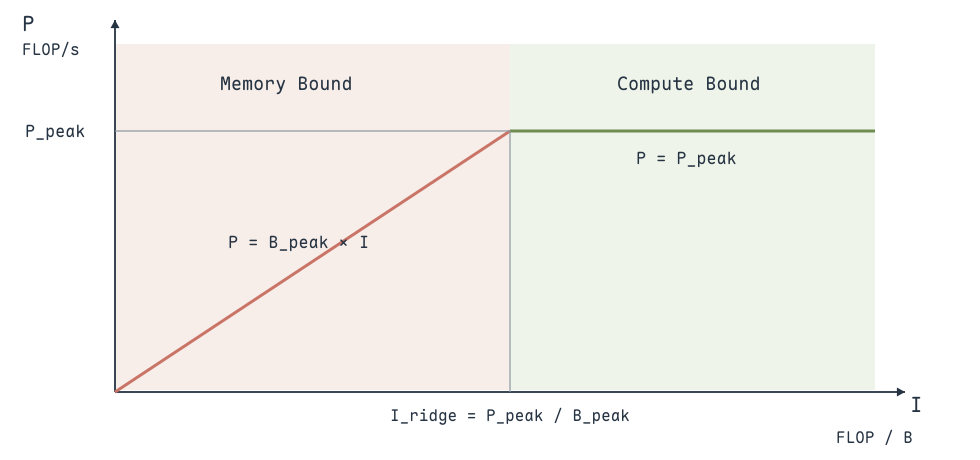
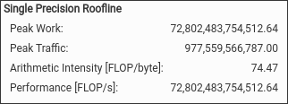
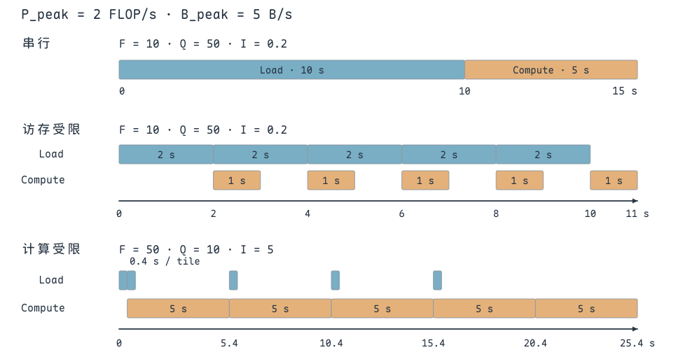
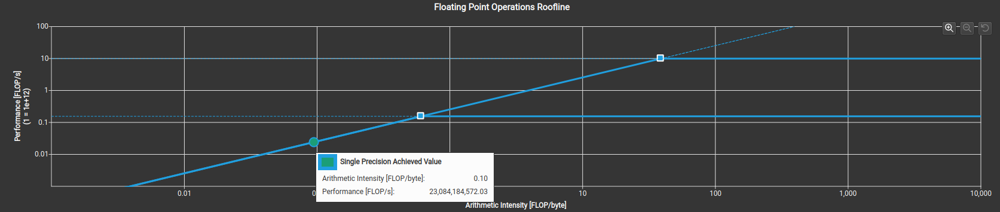
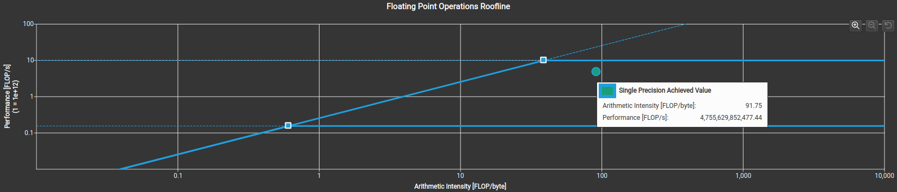

Nsight Compute（NCU）分析单个 Kernel 的执行：耗时、计算与访存吞吐、Occupancy、Warp 发射和指令级等待。**先确认 Kernel 慢在哪里，再选择对应指标解释原因**；一个百分比本身不能替代瓶颈判断。

## 采集 Kernel 并关联源码

编译时使用优化构建，并保留 `-lineinfo`，让 Source 页面能把 SASS 与源代码关联。配套 CMake 已为各目标加入 `-lineinfo`；Debug 构建额外启用 `-G`，不适合拿来比较优化性能。

配套目标里的关键配置是：

```cmake
target_compile_options(my_transpose_v1_naive PRIVATE -lineinfo)
if(CMAKE_BUILD_TYPE STREQUAL "Debug")
    target_compile_options(my_transpose_v1_naive PRIVATE
        $<$<COMPILE_LANGUAGE:CUDA>:-G>)
endif()
```

根 CMake 当前只启用 CUTLASS 章节，分析这里的案例时，需要启用 `3_kernel_profiling_guide` 对应子目录，并使用 Release 构建。保留行号不等于关闭优化，`-lineinfo` 与用于设备调试的 `-G` 要分开。

在 GUI 中，新建 Profile 活动，设置 **Executable、Working Directory 和程序参数**，选择完整指标集后启动。Executable 应指向构建出的二进制；工作目录决定程序如何查找相对路径文件。一次程序运行可能启动很多次相同 Kernel，报告会按 launch 分开，先选择要分析的那一次。

打开报告后，在 **Memory Workload Analysis** 将表格显示切到 `All`，才能查看完整的 L1TEX、L2、DRAM 和 Shared Memory 计数；点击具体指标的 **Metrics Details**，查看其单位、定义与归一化方式。若要追踪某行为什么等待，再切到 Source，对照源代码、SASS 和该指令的计数。

以已编译的 `my_transpose_v1_naive` 为例，筛选转置 Kernel，跳过前十次匹配的启动，只采集下一次，并导出报告：

```bash
ncu --set full \
    --kernel-name-base function \
    --kernel-name 'regex:transpose_naive' \
    --launch-skip 10 --launch-count 1 \
    -o transpose-naive \
    ./my_transpose_v1_naive
```

`--launch-skip` 只计入匹配 Kernel 筛选条件的启动。配套 `main` 按 `32×8`、`16×16`、`8×32` 的顺序各运行五次同名 Kernel，因此这里跳过十次后选中的是 **`8×32` 的第一次启动**；前十次属于另外两种布局，不是该布局的十次预热。

要分别采集三种布局，可将 `--launch-skip` 设为 0、5、10；若选各布局的第二次启动，则用 1、6、11。报告中仍要核对 Grid / Block，不能只凭相同 Kernel 名称判断配置。导出的 `transpose-naive.ncu-rep` 可以在 NCU 图形界面打开。

`--set full` 用于完整观察，定位问题后可以只采集所需 section，减少重复执行：

```bash
ncu --section SchedulerStats --section WarpStateStats --section SourceCounters \
    --kernel-name-base function --kernel-name 'regex:transpose_naive' \
    --launch-skip 10 --launch-count 1 \
    -o transpose-scheduler ./my_transpose_v1_naive
```

**采集配置要和比较目标一致**。NCU 为收集多组计数器可能 replay Kernel，默认会在 replay 前清理缓存；直接反复运行程序则可能已经把数据留在缓存里。比较两个版本时，要保持数据规模、启动配置、缓存控制和采集方式一致，不能把冷缓存截图与热缓存计时直接对照。

开始比较前，先运行正确性检查，确保各版本处理相同输入、产生相同结果。耗时比较使用优化构建，预热后用 CUDA Event 记录 GPU 时间；CPU 在提交 Kernel 前后计时，可能把启动、异步排队或同步时间混在一起。

NCU 的完整采集可能插入额外的执行与同步，也可能 replay 多轮。因此，**常规计时用来确认性能变化，NCU 用来解释变化**。报告中的 Kernel Duration 可以用于同一采集条件下对照，但整次 NCU 命令耗时不能当作算子执行时间。

缓存控制也不能只看“是否预热”：即使跳过了若干次 Kernel，默认的 replay 缓存清理仍会影响被采集那次的状态。`--cache-control all` 在每轮 replay 前清理缓存；`--cache-control none` 保留缓存，但多轮 Kernel replay 会让后面的采集轮次看到前一轮留下的缓存状态。

若目标是复现程序自身的预热状态，可以使用 `--replay-mode application --cache-control none`，让每轮重新执行整个程序、由前置工作填充缓存。它要求各轮 Kernel 的启动顺序和配置可匹配；所有对照版本都要采用相同口径。另要核对 GPU 时钟：NCU 的 `--clock-control` 与常规运行的 Boost 状态可能不同，比较时间时一起记录报告中的 GPU 型号和 SM Frequency。

## 沿着性能问题读报告

先确认 **Kernel Duration、Grid / Block 和实际处理的数据量**，再看 Speed Of Light 中计算与内存吞吐。NCU 的 `% of Peak` 要结合对应单元和指标解释；L1/TEX、L2、DRAM 吞吐对应不同层级。

报告顶部的 `Size` 一般同时列出 Grid 与 Block 的三维尺寸，不是输入矩阵的 M、N。只有结合每线程的数据范围，才能算出实际处理量。Launch Statistics 还会列出每线程寄存器、每 Block 的静态 / 动态 Shared Memory，用来解释理论 Occupancy 的限制来源。

例如 250000 个 SM 周期、2.5 GHz 的 SM Frequency，对应约 100 μs；这里频率从 GHz 换算为每秒周期数，Cycles 也必须是同一 SM 时钟域的 elapsed 计数。不同管线的 active cycles 描述忙碌时间，不等于整个 Kernel 的 Duration。

若问题是 CPU 提交、Kernel 之间的空隙、拷贝与计算重叠，先用 **Nsight Systems** 查看系统时间线；确定耗时的具体 Kernel 后，再用 NCU 分析其内部管线。NCU 的单 Kernel 报告不能代替整个程序的系统调度时间线。

**访问模式是否浪费传输**：进入 Memory Workload Analysis，查看 Request、Sector、命中率及 DRAM 流量。比如数组索引偏移一个元素，Warp 标量 load 会从四个 sector 变成五个；这类问题的具体计算见 [合并访存与缓存](合并访存与缓存.md)。

**Warp 是否足够、是否准备好发射**：先看 Occupancy 和 Scheduler Statistics，再看主要 Warp Stall。如果 Active 很多、Eligible 很少，增加 Block 数不一定能解决问题，要继续检查数据依赖、访存队列和同步。指标关系见 [Occupancy 与 Warp 调度](Occupancy与Warp调度.md)。

**等待落在哪条指令**：Source 页面把热点行、执行指令和 PC Sampling 放在一起。Long Scoreboard 可能出现在使用 load 结果的指令上，需要向前追踪产生结果的 load；不能只改采样最多的那一行。

对照两个版本时，可以把一个报告设为 Baseline，再查看相同 section 的变化。**最终看 Kernel 时间是否下降，并解释相关指标为何变化**，而不追求所有 Occupancy、Stall、带宽指标同时变好。

报告提示中的 **Est. Speedup / Est. Local Speedup** 是 NCU 根据指标偏离程度给出的优化潜力估计，用来帮助确定排查优先级。它不是修改代码后实测得到的加速比；例如 Occupancy 不足与发射空洞可能同时出现，不能把几条提示的百分比相加。

把报告加入 **Baseline** 后，优先对照同一矩阵尺寸、同一 Block 形状和相同采集条件，再逐项观察变化。不同报告中的 Baseline 颜色不是固定版本编号，要先读顶部的 Kernel 名称、Grid / Block 和时间，再读柱状图。

例如转置代码的 `float4` 版本，每线程处理 16 个元素，不能只保持 Block 线程数相同，就认为两个版本有相同 Grid。要重新计算每 Block 的数据范围，并确认截图中 `Size` 一列的前半部分是 Grid、后半部分是 Block。

## Roofline：计算强度与性能上界

Roofline 把一个 Kernel 的运算量与数据搬运量联系起来。设浮点运算数为 $F$、访问字节数为 $Q$、运行时间为 $t$，则计算强度、实际算力和实际带宽分别为：

$$
I=\frac{F}{Q},\qquad
P=\frac{F}{t},\qquad
B=\frac{Q}{t},\qquad
P=I\times B.
$$

计算强度 $I$ 的单位是 FLOP/B，表示每搬运一个字节能完成多少次浮点运算。**Q 必须绑定同一内存层级**：算法输入输出字节、L2 流量和 DRAM 流量可以不同，不能拿一个层级的 $I$ 和另一个层级的带宽比较。

**FLOP 是运算次数，FLOP/s 是每秒完成的运算次数**。一个浮点加法通常记一个 FLOP，FMA 记两个 FLOPs，因为它完成一次乘法和一次加法；转置本身几乎没有浮点运算，索引整数计算不会计入这个 FP32 Roofline 的 F。

算法的 $F/Q$ 用来分析工作量，而 NCU 的点使用所选浮点指令与流量计数。若输入命中缓存，DRAM 的 Q 可能减少，DRAM Roofline 的计算强度就会提高；若编译器删掉或合并运算，实际 F 也会变化。

若平台峰值算力为 $P_{\mathrm{peak}}$、峰值带宽为 $B_{\mathrm{peak}}$，Kernel 的理想性能上界为：

$$
P\leq\min\left(P_{\mathrm{peak}},\ B_{\mathrm{peak}}I\right).
$$

{ width="800" }

左侧斜线是带宽上界：计算强度较低时，即使算力很强，也没有足够快的数据供应。右侧平台是计算上界：计算强度足够高之后，继续增加每字节的运算量，也不能突破硬件峰值算力。

两条上界相交的计算强度为 $I_{\mathrm{ridge}}=P_{\mathrm{peak}}/B_{\mathrm{peak}}$。它是**从带宽上界转向计算上界的拐点，不是计算强度的最大值**。按 RTX 4090 的规格参数 82.58 TFLOP/s、1.01 TB/s，拐点约为 81.76 FLOP/B；NCU 报告中的校准峰值应以报告本身为准。

## 峰值算力与峰值带宽

对于 CUDA Core 的 FP32 FMA 路径，理论峰值可以按 **FP32 Core 数 × 时钟频率 × 每周期浮点运算数**计算。以 RTX 4090 公版参数为例，16384 个 FP32 Core、2.52 GHz，按 FMA 每周期两次运算估算：

$$
16384\times2.52\times2/1000\approx82.58\ \mathrm{TFLOP/s}.
$$

显存带宽按有效数据速率和位宽计算，21 Gbit/s、384 bit 对应：

$$
21\times384/8=1008\ \mathrm{GB/s}\approx1.01\ \mathrm{TB/s}.
$$

这里使用的是**CUDA Core FP32 峰值**，不能拿 Tensor Core 的 TF32 / FP16 或含稀疏条件的峰值给普通数组加法画上界。读取硬件规格时，数据类型、执行单元、是否使用稀疏，都必须与 Kernel 的计算路径对应。

图中的 NCU 提示给出 Peak Work 为 **72.80 TFLOP/s**，Peak Traffic 为 **977.56 GB/s**，拐点为 **74.47 FLOP/B**，与上面的规格估算不同。

{ width="620" }

理论 Core 数和 Boost Clock 用来估算硬件规格；NCU 图中的上界则采用该报告的设备与峰值参数。判断实测点距离上界多远，应使用报告里的数值。其他报告的测试点也要与各自的 roofline 比较，不能统一套用 RTX 4090 的规格。

Roofline 的横纵轴通常采用对数尺度，Kernel 在图中表现为一个点。点接近上界，说明在当前计算强度下已接近对应限制；点远低于上界，则还要分析延迟隐藏、指令依赖、访存效率等因素。**位于左侧不代表已经打满显存带宽，位于右侧也不代表计算单元已经满载。**

同一张 NCU 图还可能同时显示 Single Precision 与 Double Precision 的算力平台和实测点。这里的数组类型是 `float`，应选择 **Single Precision Achieved Value**，并与对应的 FP32 上界比较。横轴通常为 FLOP/B，纵轴若标注 `1e+12`，0.023 就代表约 0.023 TFLOP/s，而不是 0.023 FLOP/s。

## 从执行时间理解 Roofline

Roofline 也可以由两项时间下界推导。运算至少需要 $t_{\mathrm{compute}}=F/P_{\mathrm{peak}}$，搬运至少需要 $t_{\mathrm{memory}}=Q/B_{\mathrm{peak}}$；若两者能充分重叠，理想执行时间至少是两者中的较大值：

$$
t\geq\max\left(F/P_{\mathrm{peak}},\ Q/B_{\mathrm{peak}}\right).
$$

这就得到 $P\leq\min(P_{\mathrm{peak}},B_{\mathrm{peak}}I)$。**Roofline 假设能充分使用管线，是上界；真实依赖、启动与同步会让时间更长。**

下面三种执行过程使用同一个简化平台：峰值算力为 2 FLOP/s，峰值带宽为 5 B/s，拐点为 0.4 FLOP/B。按下面三个执行过程比较：

{ width="800" }

**访存与计算完全串行**：任务搬运 50 B、执行 10 次浮点运算，计算强度为 0.2 FLOP/B。先搬运花 10 s，再计算花 5 s，总时间 15 s；实际算力为 $10/15\approx0.667$ FLOP/s，实际带宽为 $50/15\approx3.33$ B/s。两个阶段都没有占满整个执行区间。

**同一任务拆成五块流水**：每块搬运 10 B，花 2 s；计算两次，花 1 s。第一块读完即可计算，同时读取下一块。读数据的阶段仍持续到第 10 s，最后一块再计算 1 s，总时间为 11 s；实际算力为 $10/11\approx0.909$ FLOP/s，实际带宽为 $50/11\approx4.55$ B/s。

这个任务的访存时间下界为 10 s，流水已接近它，但最后一个计算阶段仍留下 1 s 尾部开销。**流水提升了时间利用率，任务的 F、Q 和计算强度没有变化**。

**计算受限的五块流水**：改为搬运 10 B、执行 50 次浮点运算，计算强度为 5 FLOP/B。每块读 2 B，花 0.4 s；计算十次，花 5 s。后续块的读取能藏在计算期间，总时间为 $0.4+5\times5=25.4$ s；实际算力为 $50/25.4\approx1.969$ FLOP/s，实际带宽为 $10/25.4\approx0.394$ B/s。

这一任务的计算时间下界是 25 s，访存只需 2 s，主要限制已经转向算力。带宽没有接近 5 B/s，也没有必要强行达到：**少量数据支撑了长时间计算，此时应该让计算阶段连续运行**。

## 数组加法：运算少、数据搬运多

`z[n] = x[n] + y[n]` 每个元素做一次浮点加法，按输入输出字节计算，读取两个 `float`、写入一个 `float`，共 12 B，因此算法计算强度为：

$$
I_{\mathrm{algorithm}} = 1/12\approx0.0833\ \mathrm{FLOP/B}.
$$

```cuda
void __global__ add1(float *x, float *y, float *z)
{
    int n = threadIdx.x + blockIdx.x * blockDim.x;
    // 一次浮点加法，对应两个 float 读取和一个 float 写入
    z[n] = x[n] + y[n];
}
```

{ width="800" }

截图中的点位于带宽斜线一侧。报告按实际执行的浮点指令和测得的流量给出计算强度，可能与算法的 $1/12$ 不完全一致；读取时应确认是 Single Precision，以及对应的是哪条内存层级的 roofline。

图中的实测点给出约 0.10 FLOP/B 和 23.08 GFLOP/s，按同一口径的 $B=P/I$ 粗略估计，带宽在 230 GB/s 左右。显示值经过取整，精确吞吐应读取报告中对应路径的计数。

还可以结合 Kernel Duration 反推工作量：$F=P\times t$，$Q=(P/I)\times t$。若这一层统计的是 DRAM，Q 就应该对应 DRAM Read 与 Write 字节之和；再用 $Q/t$ 核对吞吐。Throughput 已经是每秒的传输量，不能再除一次时间。

这个点接近的是**当前截图报告的带宽斜线**。不能把这一带宽估计描述成已经接近前文 RTX 4090 的 1.01 TB/s；判断是否接近上界，要读取采集设备和本报告的参数。

这类 Kernel 几乎没有数据复用，主要观察访存合并和有效带宽。**较低 FLOP/s 可以是工作负载本身运算少，不能单凭算力利用率低判断实现很差。**

## 增加线程内计算量

保持每线程读取两个元素、最后写入一个元素，在中间增加 1000 次累加，便能增加每次数据搬运对应的运算量：

```cuda
void __global__ add2(float *x, float *y, float *z)
{
    int n = threadIdx.x + blockIdx.x * blockDim.x;
    float a = x[n];
    float b = y[n];
    float c = 0;
    // 数据只加载一次，随后在线程寄存器中反复累加
    for (int i = 0; i < 1000; i++)
    {
        c += (a + b);
    }
    z[n] = c;
}
```

{ width="800" }

NCU 中的点向右移动，但没有贴近算力平台。原因之一是 **`c += ...` 存在连续的结果依赖**，后一次累加要等待前一次；另外，编译器可以将不变的 `a+b` 提到循环外，所以不能机械地按源代码给每轮记两次加法，应结合实际生成的 SASS 计数。

若编译器把 `a+b` 提到循环外，并保留 1000 次依赖式累加，每线程对应一次 `a+b` 加法和 1000 次累加，即 1001 FLOPs；按 12 B 输入输出字节估算，计算强度为 $1001/12\approx83.42$ FLOP/B。NCU 截图的 91.75 使用实际指令和实测流量，不能直接拿源代码循环次数去强行配平。

这里改变了输出计算，用来演示 Roofline 点的位置变化，并不是原数组加法的等价优化。**增加计算强度，只是减少带宽上界对算力的约束；是否真正接近算力上界，还取决于指令并行性和管线吞吐。**

按截图的 91.75 FLOP/B、约 4.76 TFLOP/s，$B=P/I$ 得到约 51.8 GB/s。计算量增加后，总执行时间变长，所以同样的输入输出字节摊到更长时间上，实际带宽反而下降；**带宽低并不总是访存实现变差，也可能是现在大部分时间在计算或等待计算依赖。**

如果每轮只有依赖前一轮的一个累加器，虽然算术强度高，FP32 管线也不一定有足够的独立指令可发射。要把这个问题与“运算量已经很多、计算单元必然饱和”区分开，继续查看 Math Pipe、Wait、Eligible 和 Issued。

## 将调优方向与 Roofline 的变化对应起来

**减少 Q，让点向右移动**：SGEMM 用 Shared Memory / 寄存器 tile 复用输入，不再为每个输出独立读取所有操作数。计算量 F 保持不变，但 Global / DRAM 流量可能减少。

**缩短 t，让点向上移动**：在工作量固定时，改善合并访问、减少 bank conflict、使用向量指令或隐藏等待，主要目标是缩短时间。算法计算强度保持不变，实际点的横坐标还可能因缓存流量变化而有所移动。

**增加独立工作，让管线更连续**：提高可调度 Warp 数、安排独立寄存器累加、分块流水，可以在不额外增加算法 FLOPs 的情况下，减少等待暴露。需要同时观察寄存器、Shared Memory 与 Occupancy 的代价。

转置没有值得提高的浮点算术强度，主要用有效带宽、Memory Workload 和 Warp 调度分析；SGEMM 则能通过复用输入显著提高强度。**先按算子的有效工作确定指标，再用 Roofline 解释该指标受哪个上界约束。**

对于有输入复用的算子，通常通过共享内存分块、寄存器复用来减少 $Q$，提高计算强度；对于运算已经固定、没有复用的数组加法，重点则在于减少多余传输，让同一份数据尽可能高效地到达线程。

> 参考：[Nsight Compute CLI](https://docs.nvidia.com/nsight-compute/NsightComputeCli/index.html)、[Profiling Guide：Roofline Charts](https://docs.nvidia.com/nsight-compute/ProfilingGuide/index.html#roofline-charts)、[Roofline Model 与深度学习性能分析](https://zhuanlan.zhihu.com/p/34204282)、[Occupancy 与峰值算力计算](https://blog.csdn.net/wd1603926823/article/details/108871290)。
