# Occupancy 与 Warp 调度

GPU 依靠多个驻留 Warp 交错执行来隐藏延迟：某个 Warp 等待访存结果时，调度器可以零开销地发射另一个已经就绪的 Warp。**Occupancy 决定 SM 上最多能驻留多少 Warp，Warp Scheduler 决定这些驻留 Warp 到底有没有指令可发**——只有把两者串起来看，才能解释“驻留了一大堆线程，Kernel 依然跑得很慢”的现象。

??? info "硬件基线（Ada SM 8.9）与系列定位"

    - 本文属于 **NCU 性能分析与 Kernel 调优** 系列第 2 篇；以下资源与 Occupancy Calculator 推导均以 **RTX 4090 / Ada（Compute Capability 8.9）** 架构参数为基线：

    | Ada SM 8.9 硬件资源 | 容量上限 | 说明 |
    | --- | --- | --- |
    | 最大驻留 Warp / 线程数 | `48 Warps` / `1,536 Threads` | 4 个 Warp Scheduler × 12 个 Warp slot |
    | 最大驻留 Block 数 | `24 Blocks / SM` | 单 Block 最多 `1,024` 线程，且不可跨 SM 拆分 |
    | 32-bit 寄存器总量 | `65,536 / SM`（单线程上限 `255`） | 4 个子分区各 `16,384`，Warp 按 256 粒度取整 |
    | FP32 CUDA Core | `128 / SM` | 执行管线数量与可驻留线程数分属不同维度 |

!!! abstract "阅读主线：从“放得下多少”到“为什么发不出”"

    1. **资源算账**：线程数、Block 数、寄存器、Shared Memory 四道上限取最小值，决定 Theoretical Occupancy。
    2. **运行态差距**：Tail Effect（尾部效应）与 Warp 提前退出，拉开 Achieved 与 Theoretical 的差距。
    3. **调度瓶颈**：检查 Active → Eligible → Issued，用 Warp State 与 Source Counters 锁定真正堵住发射的指令。

---

## 1. Occupancy 与片上驻留资源

**Occupancy** 是单个 SM 上活跃（Active）Warp 数占硬件可容纳 Warp 数上限的比例。在 Ada（8.9）架构上：

$$
\mathrm{Occupancy} = \frac{\text{每个 SM 的驻留 Warp 数}}{48}.
$$

这里的 **Active Warp 指已驻留且尚未退出的 Warp**——哪怕它正在苦等显存返回或卡在同步点，也依然计入 Active，因此 Occupancy **不等于** CUDA Core 的计算利用率。

GPU 能在单周期内无开销切换 Warp，前提是**所有驻留 Warp 的寄存器上下文都常驻在 SM 寄存器文件中**（无需像 CPU 线程切换那样换入换出内存）。这决定了“最多驻留多少线程”由片上容量上限决定，而 SM 的 128 个 FP32 Core 只是负责消费发射出来的指令。

---

## 2. 四道资源限制：用 Occupancy Calculator 算清上限

设每 Block 有 $T_{\mathrm{block}}$ 个线程，其占用的 Warp 数为 $W_{\mathrm{block}} = \lceil T_{\mathrm{block}} / 32 \rceil$（不足 32 线程的尾部 Warp 仍占一整个 Warp slot）。**所有限制都按完整 Block 取整后取最小值**，不能把半个 Block 塞给另一块 SM。

[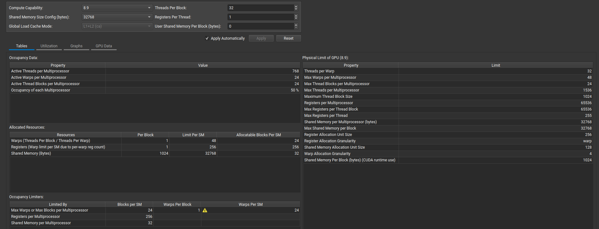{ width="800" }](../../assets/cuda/occupancy/ncu-occupancy-calculator.png)

下表汇总了本文 5 组典型 Calculator 算例，清晰展示最先耗尽的资源如何卡死驻留量：

| 算例配置 | 瓶颈资源 | 关键取整推导（Ada SM 8.9） | 驻留 Block / Warp | Theoretical Occupancy |
| --- | --- | --- | --- | --- |
| `Block = 160 线程` | Warp 槽位（整块取整） | `5 Warps/Block`，`⌊48 / 5⌋ = 9` | `9 Blocks / 45 Warps` | **93.75%** |
| `Block = 32 线程` | Block 槽位上限（24） | `1 Warp/Block`，先撞 24 Block 上限 | `24 Blocks / 24 Warps` | **50.00%** |
| `Block = 128, 51 Reg/Thr` | 寄存器容量 | `⌈51×32/256⌉×256 = 1792/Warp`，4-Warp 粒度 → 36 Warps | `9 Blocks / 36 Warps` | **75.00%** |
| `Block = 128, 90 Reg/Thr` | 寄存器容量 | `⌈90×32/256⌉×256 = 3072/Warp`，4-Warp 粒度 → 20 Warps | `5 Blocks / 20 Warps` | **41.67%** |
| `Block = 128, 5000 B SMEM`（32 KiB 池） | Shared Memory | `⌈(5000+1024)/128⌉×128 = 6144 B/Block`，`⌊32768/6144⌋ = 5` | `5 Blocks / 20 Warps` | **41.67%** |

### 2.1 线程数与 Block 数限制

Block 为 160 线程（5 Warp）时，48 个槽位只能放下 9 个完整 Block（45 Warp，93.75%）；而把 Block 缩到 32 线程（1 Warp）时，反而先撞上每 SM 最多 24 个 Block 的上限，Occupancy 暴跌至 50%。因此 **Block 越小并不意味着 SM 能装下更多线程**。

[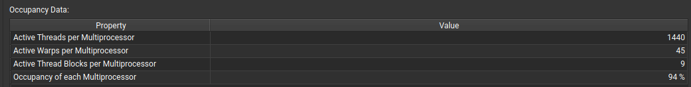{ width="800" }](../../assets/cuda/occupancy/ncu-occupancy-block160.png)

[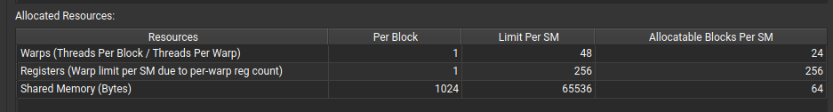{ width="800" }](../../assets/cuda/occupancy/ncu-occupancy-block32.png)

同为 100% 理论 Occupancy 的配置（如 128 线程 × 12 Block vs 256 线程 × 6 Block），其线程分组、同步粒度与实际调度表现仍可能不同。此外，Calculator 的 **Graphs** 页会把这类离散限制画成**阶梯曲线**：例如每 Block 768 线程（24 Warp）时可放 2 个 Block（48 Warp = 100%），一旦涨到 832 线程（26 Warp），SM 只能放 1 个完整 Block，理论 Occupancy 立刻跳崖至 $26/48 \approx 54.17\%$。

### 2.2 寄存器粒度与 Warp 分配粒度

寄存器约束需要同时经过**两层粒度取整**，再按完整 Block 截断：

- **寄存器分配粒度（256 Regs）**：每线程 51 个寄存器时，一个 Warp 需 $51\times 32 = 1{,}632$，向上取整至 `1,792`（每 Block 4 Warp 共 7,168）；每线程 90 个寄存器时，$90\times 32 = 2{,}880$ 向上取整至 `3,072`（每 Block 共 12,288）。
- **Warp Allocation Granularity（4 Warps）**：Calculator 将寄存器能容纳的 Warp 上限按 4 个 Warp 向下取整——51 寄存器对应 $\lfloor 65536/1792 \rfloor \to 36$ Warps（9 Blocks，75%）；90 寄存器对应 $\lfloor 65536/3072 \rfloor \to 20$ Warps（5 Blocks，41.67%），不能按 $65536/3072\approx 21.33$ 误以为能驻留 21 个 Warp。

[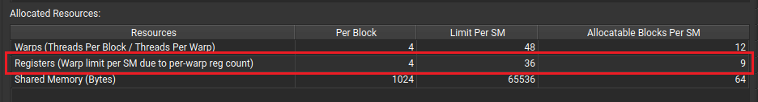{ width="800" }](../../assets/cuda/occupancy/ncu-occupancy-register51.png)

[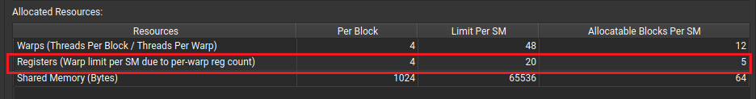{ width="800" }](../../assets/cuda/occupancy/ncu-occupancy-register-limits.png)

!!! note "Calculator 只是离线模型，真实用量以编译结果为准"

    更改 Occupancy Calculator 里的数字并不会改变已编译的 Kernel。真实每线程寄存器数应从 NCU 的 **Launch Statistics** 或 `ptxas -v` 读取，静态 Shared Memory 来自 `__shared__` 声明，动态 Shared Memory 来自启动参数；且不同架构的分配粒度与上限不同，切忌直接套用上表终值。

### 2.3 Shared Memory 保留量与对齐

Shared Memory 按 Block 分配，需计入静态声明、动态申请、系统保留空间与对齐粒度。以每 Block 5000 B、SM 共享内存配置 32 KiB、每 Block 保留 1024 B 且按 128 B 向上取整为例：

$$
\left\lceil \frac{5000 + 1024}{128} \right\rceil \times 128 = 6144\ \mathrm{B/Block}.
$$

32 KiB 池中最多放下 5 个 Block；对 128 线程 Block 而言对应 20 个 Warp（41.67%）。

[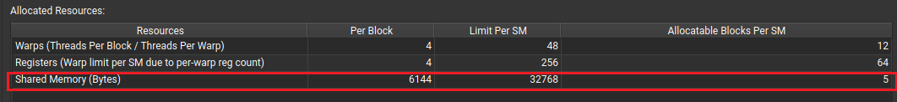{ width="800" }](../../assets/cuda/occupancy/ncu-occupancy-shared-memory.png)

!!! tip "增大 Tile 的经典权衡"

    在 SGEMM 或转置中增大 Tile 能提升片上数据复用、降低 Global 流量，但也会同步推高 Shared Memory 与寄存器需求，压低可驻留 Block 数。是否划算必须以实际端到端耗时和吞吐为准。

---

## 3. 理论 Occupancy、实际 Occupancy 与尾部效应

**Theoretical Occupancy** 是配置允许的静态上限，**Achieved Occupancy** 是运行期间按活跃周期测得的平均驻留比例。下图中理论为 48 Warp（100%），实测平均为 41.55 Warp（$41.55/48 \approx 86.57\%$），差距往往来自 Block 补入空隙、Warp 提前退出或任务尾部不足。

[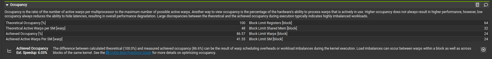{ width="800" }](../../assets/cuda/occupancy/ncu-occupancy-high-achieved.png)

**Wave** 描述当前资源限制下全卡 SM 一次能同时装下的一批 Block（容量 $= S \times B$，$G / (S\times B)$ 估测波次数）。虽然硬件会随个别 Block 提前结束动态补入新 Block，但在各 Block 耗时相近时，波次模型能非常直观地暴露 **Tail Effect（尾部效应）**。

[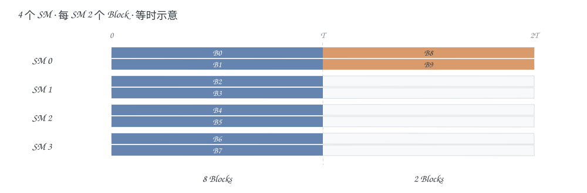{ width="800" }](../../assets/cuda/occupancy/occupancy-wave-tail-effect.svg)

!!! example "手算闭合：10 个 Block 在 4 个 SM 上为何只有 62.5% 全卡利用率，Achieved Occupancy 却依然很高？"

    设 4 个 SM、每 SM 最多放 2 个 Block（每 Block 768 线程 = 24 Warp，单 SM 48 Warp），Grid 共 10 个等耗时（$T$）Block：

    - 第 1 轮 8 个 Block 铺满全部 4 个 SM；第 2 轮仅剩 2 个 Block，如果都落在 SM 0，其余 3 个 SM 彻底闲置。
    - 按全卡 `4 SM × 2T` 的总容量（16 个 Block 槽位）计，实际利用率仅 $10 / 16 = \mathbf{62.5\%}$。
    - **但注意 NCU 口径**：`pct_of_peak_sustained_active` 等指标以 SM **活跃周期**为分母——SM 0 在两轮内一直驻留 48 个 Warp，其余空闲 SM 不计入活跃周期，因此 Achieved Occupancy 仍可能显得很高！排查尾部效应必须联看 **Waves per SM、SM 活跃周期分布与总 Duration**（同时，计算吞吐与内存吞吐百分比不同并不叫“负载不均衡”）。

!!! warning "高 Occupancy ≠ 高性能：别为了追数字而触发 Register Spill"

    一旦已有足够多的驻留 Warp（或线程内足够多的独立指令级并行 ILP）盖住延迟，盲目提高 Occupancy 往往毫无收益；如果强行压低寄存器数换取更高 Occupancy，反而可能触发 **Register Spill（溢出到 Local Memory）** 或丢弃可复用的中间值，得不偿失。

---

## 4. Warp Scheduler：Active、Eligible 与 Issued

Ada 的每个 SM 内含 **4 个调度子分区**，每分区拥有独立的 Warp Scheduler、Dispatch 单元和 16,384 个 32-bit 寄存器，管理最多 12 个 Warp slot。

[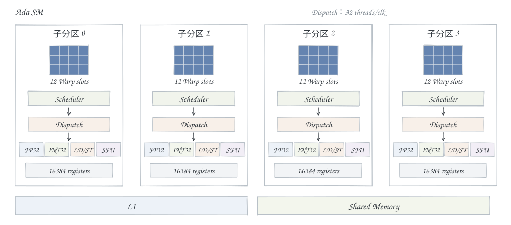{ width="620" }](../../assets/cuda/occupancy/scheduler-ada-sm-partitions.svg)

!!! note "先澄清两个最容易读错的硬件数字"

    - **12 个 Warp slot ≠ 每周期发射 12 个 Warp**：Slot 是可管理的驻留名额，发射能力远小于槽位数。
    - **Dispatch 标注的 `32 threads/clk` ≠ 每周期发射 32 个 Warp**：它指一条 Warp 32 个线程通道的执行宽度。

每个周期，调度器只在 **Active → Eligible → Issued（Selected）** 这三层状态间做选择：

- **Active**：驻留在 slot 中的所有 Warp（含正在等待的 Warp）。
- **Eligible**：下一条指令已满足全部数据与资源条件、随时可发射的 Active Warp。
- **Issued / Selected**：本周期被调度器实际选中并发射下一条指令的 Warp（**Selected 属于 Eligible 的子集**；发射的是单条指令而非跑完整个程序，未选中的 Eligible Warp 进入 `Not Selected`）。

[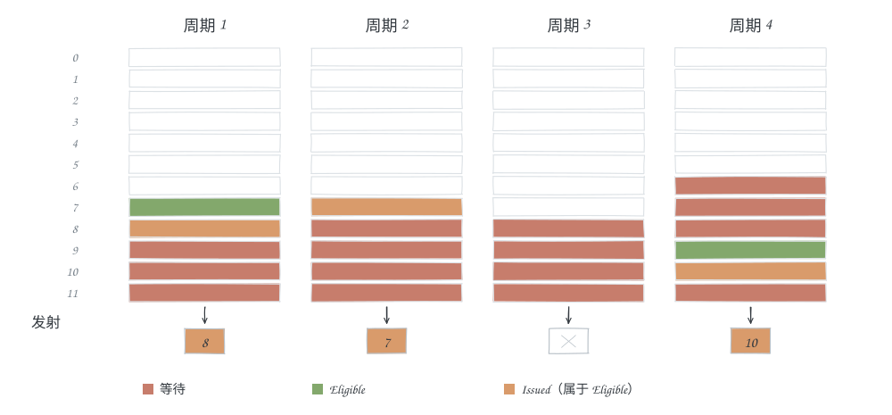{ width="800" }](../../assets/cuda/occupancy/scheduler-warp-four-cycles.svg)

!!! example "手算闭合：4 周期调度窗口中的 41.67% Occupancy 与 0.75 Issued"

    - **Active**：4 个周期分别为 `5、5、4、6`，平均 5 个，占 12 个 slot 的 $5 / 12 \approx \mathbf{41.67\%}$。
    - **Eligible**（含本周期 Selected）：分别为 `2、1、0、2`，总计 5 个。
    - **Issued**：第 3 周期虽然仍有 4 个 Active Warp，但全部在等待导致发射槽空转，4 周期共发射 3 次，平均每周期 **0.75 次**。可见**驻留足够多却没有 Eligible Warp，依然无法掩盖延迟**。

---

## 5. 用 NCU 定位 Warp 为什么在等

排查调度瓶颈的黄金顺序是：**Scheduler Statistics（有没有发射空洞）→ Warp State Statistics（在等什么）→ Source Counters（哪条指令在等）**。

以下数组加法实测中，理论 Occupancy 为 100%，实际约 43.2%（每 SM 20.74 Warp，均分到 4 个调度器约 5.19，与 Scheduler 表中 5.15 接近，因采样分母略有差异）。虽然每个调度器平均有 5.15 个 Active Warp，但 **Eligible 只有 0.04 个**，平均每 **23.9 个周期**才发射一次（约 0.0418 次/周期——注意 **Instructions per Active Issue Slot = 1** 只统计实际发生发射的槽位，不能误读成每周期都发射一条）。

[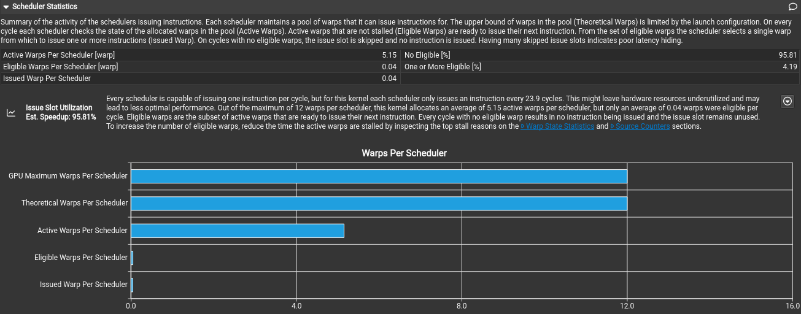{ width="800" }](../../assets/cuda/occupancy/ncu-scheduler-statistics.png)

[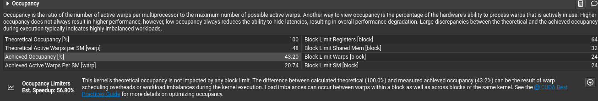{ width="800" }](../../assets/cuda/occupancy/ncu-occupancy-theoretical-achieved.png)

继续打开 **Warp State Statistics**，该例两条连续指令平均间隔 123.0 周期，其中 **Long Scoreboard 占 115.2 周期（93.7%）**，矛头直指 L1TEX 返回结果的等待：

[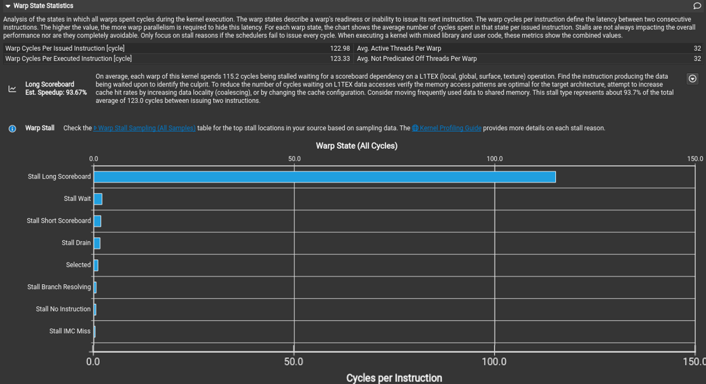{ width="800" }](../../assets/cuda/occupancy/ncu-warp-state-statistics.png)

下表把最核心的 Warp 状态按根因归为四类，方便读图时立刻分类定位：

| 类别 | 状态名 | 含义与排查起点 |
| --- | --- | --- |
| **数据结果依赖** | **Long Scoreboard** | 等待 L1TEX 路径结果（Global / Local load）；不代表必然触发 DRAM miss 或打满显存带宽 |
| | **Short Scoreboard** | 等待 MIO 路径结果（Shared Memory、特殊数学指令、动态分支） |
| | **Wait** | 等待固定延迟的执行依赖（如连续乘加链），需靠独立指令或更多 Warp 隐藏 |
| **队列 / 管线拥塞** | **LG Throttle** | Local / Global 指令提交队列已满；排查重复访存、窄指令过多、Register Spill |
| | **MIO Throttle** | MIO 提交队列承压（Shared Memory、特殊数学、动态分支及分散访问拆分） |
| | **Math Pipe Throttle** | 目标数学执行管线暂无空位，需调整指令混合或减少单一管线压力 |
| **同步与收尾** | **Barrier** | 等待同 Block 其他 Warp 到达同步点；排查负载不均或多余同步 |
| | **Drain** | 已执行 `EXIT`，等待在途内存写回完成释放资源（常见于末尾分散写回或尾部效应） |
| **就绪 / 非阻塞** | **Selected / Not Selected** | 本周期已选中发射，或已就绪仅让位给其他 Warp——**均不属于访存阻塞** |

??? note "展开查看其余常见 Warp 状态速查（No Instructions / IMC Miss / Membar 等）"

    - **No Instructions**：下一条指令尚未取回，可能与指令缓存缺失或极短 Kernel 的取指开销有关。
    - **IMC Miss**：等待 Immediate Constant Cache 数据；同 Warp 线程访问不同常量地址时可能串行化。
    - **Branch Resolving**：等待分支目标与下一条 PC 确定。
    - **Dispatch Stall**：指令在分发阶段等待硬件槽位。
    - **Membar**：等待内存序屏障完成（区别于等待其他 Warp 的 `Barrier`）。
    - **Tex Throttle**：纹理指令提交队列已满。
    - **Sleeping**：执行 `__nanosleep()` 后主动休眠。
    - **Misc**：其他原因，需下钻到对应 SASS 指令排查。

### 5.1 案例对比：Long Scoreboard vs LG Throttle

=== "依赖式读取（Long Scoreboard）"

    ```cuda
    int idx = laneid;
    #pragma unroll
    for (int i = 0; i < 1000; i++)
        idx = dramptr[idx];  // 上一次 load 返回后，才能确定下一次 load 的地址
    ```

    循环展开只能减少循环控制指令，无法解除串行地址依赖；即便数据命中缓存，消费指令仍要等 L1TEX 返回（图中 Active 接近上限，但 Eligible/Issued 很低，Long Scoreboard 约每指令 20 周期——与前例 115.2 周期属不同案例，不可直接比较延迟大小）。解法是插入无依赖工作或提高独立 Warp 并行度。

    [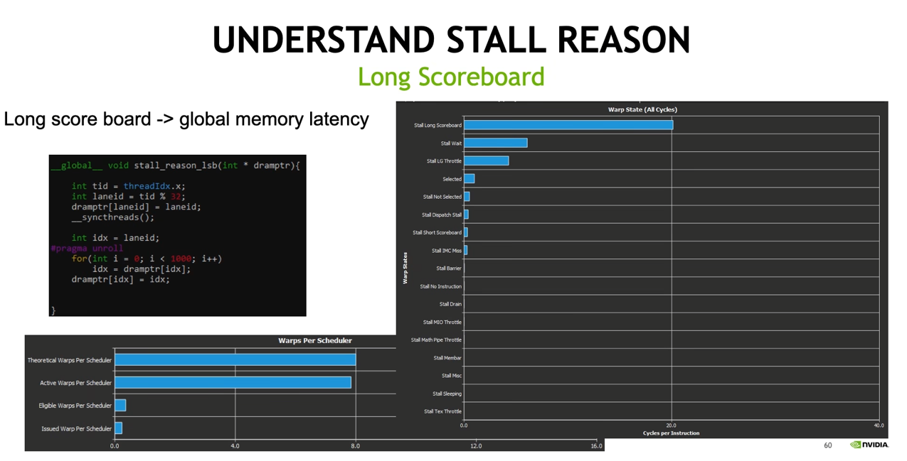{ width="800" }](../../assets/cuda/occupancy/ncu-stall-pointer-chasing.png)

=== "密集窄访问（LG Throttle）"

    ```cuda
    #pragma unroll
    for (int i = 0; i < 2000; i++)
        dst[offset + i] = src[offset + i];  // 大量窄 int8 load/store 塞满 LG 指令队列
    ```

    后一次 load 不依赖前一次结果，但单字节窄访存指令过于密集，把提交队列塞满——每个 Scheduler 虽有 8.13 个 Active Warp，却只有 0.01 个 Eligible，99.79% 周期空转。解法是在满足对齐前提下改用更宽的向量指令减少内存指令数，并在访存间穿插计算（注意减少指令数与改善合并访存是两件事，仍需核对 Sector）。

    [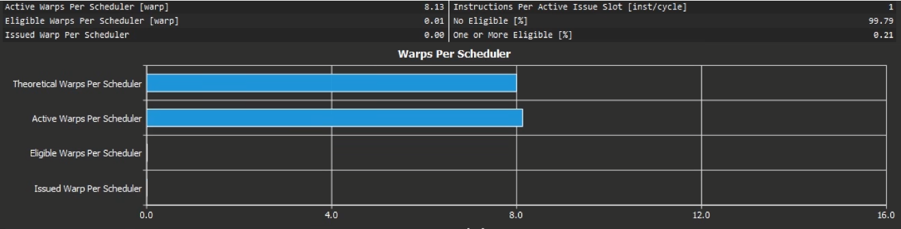{ width="800" }](../../assets/cuda/occupancy/ncu-stall-byte-copy-scheduler.png)

!!! note "一句话分清 Scoreboard 与 Throttle"

    - **Long / Short Scoreboard** 区分的是**数据来自哪条路径**（L1TEX vs MIO），不是按延迟周期数划阈值；它表示“指令已发出，消费者在等结果回来”。
    - **LG / MIO Throttle** 表示“提交队列满了，下一条指令根本塞不进去”。

---

## 6. Stall 指标分母辨析与 Source Counters 源码定位

!!! warning "读 Stall 图前，务必核对 Metrics Details 的单位与分母"

    - **Cycles per Instruction**：同一 Warp 两次连续发射之间平均在某状态等待的周期数（如 `115.2 / 123.0 ≈ 93.7%`）。
    - **`smsp_average_warps_issue_stalled_*_per_issue_active.ratio`**：按活跃发射周期归一化的平均等待 Warp 数，**不是 Kernel 总时间的百分比**。
    - **Stall 占比上升 ≠ 性能变差**：其他等待消除后，剩余 Stall 的占比自然升高；向量化减少总指令数后，每指令等待周期也可能反而变长。**只有发射槽频繁空转且影响吞吐时，Stall 才是优先优化目标。**

最后进入 **Source Counters** 把等待精确落到源码行与 SASS 指令：

[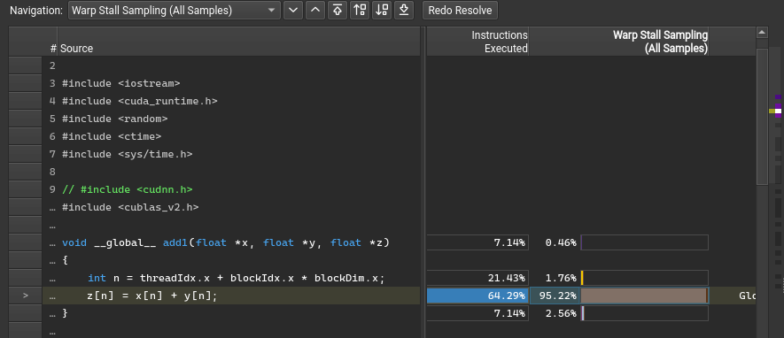{ width="800" }](../../assets/cuda/occupancy/ncu-source-counters.png)

这份报告里，多条 SASS 的执行次数均为 262,144（对应 Warp 总数），但 **Warp Stall Sampling** 却几乎全砸在同一个位置（20,949 个样本）——说明**执行次数相同的指令，等待耗时可以相差几个数量级**，且采样数不是源码实际执行次数。

[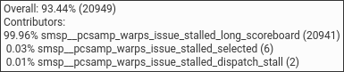{ width="650" }](../../assets/cuda/occupancy/ncu-source-hot-pc-samples.png)

[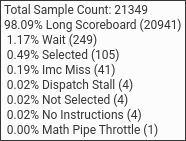{ width="420" }](../../assets/cuda/occupancy/ncu-source-overall-stall-samples.png)

!!! tip "Source Counters 排查三步法"

    1. **分清两个采样分母**：左图位置提示中 `Overall 93.44% (20949)` 回答“等待集中在哪”，内部 `20941 / 20949 = 99.96%` 回答“该处主要在等什么”；右图整体提示分母为 `21349`（Long Scoreboard 98.09%、Wait 1.17%、Selected 0.49%），与前图口径不同，切勿跨图强行相除。
    2. **向前追生产者指令**：PC Sampling 往往标在**消费 load 结果的指令**上，不要只盯着采样最高的那一行，应沿 SASS 向前找到产生数据的 load，检查地址合并、重排或并行隐藏空间。
    3. **正确理解顶部分支指标**：`Branch Instructions Ratio`（如 0.07%）是分支指令占比，`Branch Efficiency` 衡量 Warp 内分支目标一致性；执行分支指令不等于发生 Warp Divergence，应结合 uniform / divergent 计数判断。

下一篇 [矩阵转置与访存优化](矩阵转置与访存优化.md) 将把这两篇建立的 Sector、Wavefront、Occupancy 与 Stall 工具全部投入真实算子调优实战。

> 参考：[Ada Tuning Guide：Occupancy](https://docs.nvidia.com/cuda/ada-tuning-guide/index.html#occupancy)、[NCU Scheduler Statistics 与 Warp Stall Reasons](https://docs.nvidia.com/nsight-compute/ProfilingGuide/index.html)、[Occupancy Calculator](https://zhuanlan.zhihu.com/p/657005697)、[NVIDIA GPU 架构与 CUDA 算力](https://cuiyuhao.com/posts/8a630bae/)、[Warp Scheduler 状态解释](https://blog.csdn.net/feng__shuai/article/details/125665305)、[Occupancy Calculator 分配公式](https://blog.csdn.net/wd1603926823/article/details/108871290)。
