GPU 用多个驻留 Warp 交错执行：某个 Warp 等待访存结果时，调度器可以发射另一个已经准备好的 Warp。**Occupancy 决定能驻留多少 Warp，Warp Scheduler 决定这些 Warp 是否有指令可以发射**。两者要结合起来分析，才能解释“驻留很多线程，Kernel 仍然很慢”的情况。

## Occupancy 与驻留资源

Occupancy 是 SM 上活跃 Warp 数占硬件可容纳 Warp 数的比例。这里的 **Active Warp 指已经驻留、尚未退出的 Warp**，即使它正在等待访存或同步，也仍然算 Active；这个比例不是 CUDA Core 的计算利用率。

以下资源计算采用 RTX 4090 / Ada、计算能力 8.9 的配置。一个 SM 最多容纳 48 个 Warp，也就是 1536 个线程；同时最多驻留 24 个 Block，拥有 65536 个 32-bit 寄存器。**一个 Block 的线程要放在同一个 SM 上，Block 不能拆开分配。**

$$
\mathrm{Occupancy} = \frac{\text{每个 SM 的驻留 Warp 数}}{48}.
$$

Warp 之间能够快速切换，是因为**驻留线程的寄存器和执行状态已经保留在 GPU 上**。调度器选择另一个 Warp 的下一条指令时，不需要像 CPU 操作系统切换线程那样，把寄存器上下文保存到内存后再恢复。

这种机制需要给每个驻留 Warp 保留资源。因此，SM 上 128 个 FP32 CUDA Core 的数量与“最多驻留多少线程”是两件事：执行管线可以服务更多驻留 Warp，后者的上限由线程、Warp、Block、寄存器和共享内存容量共同决定。

## Block 大小如何进入资源计算

设每 Block 有 $T_{\mathrm{block}}$ 个线程，其 Warp 数为：

$$
W_{\mathrm{block}}=\left\lceil T_{\mathrm{block}}/32\right\rceil.
$$

不足 32 个线程的最后一个 Warp 仍占一个 Warp slot，但只有部分 lane 参与执行。忽略寄存器与 Shared Memory 时，驻留 Block 数要同时满足 Block 上限和 Warp / 线程限制。**先计算能放下多少个完整 Block，再乘每 Block 的 Warp 数**，不能把计算出的零点几个 Block 分给另一块 SM。

NCU 的 **Occupancy Calculator** 输入 Block 线程数、每线程寄存器数、每 Block 的 Shared Memory，以及架构对应的资源容量，计算这些约束共同允许的最大驻留量。

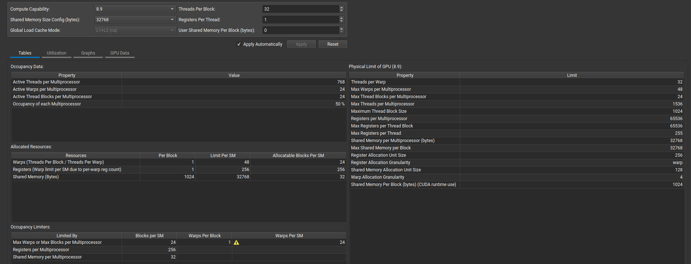{ width="950" }

**线程数与 Block 数限制**：假设寄存器和共享内存占用很少，Block 为 160 个线程时，每 Block 有五个 Warp。48 个 Warp 只能容纳九个完整 Block，即 45 个 Warp，理论 Occupancy 为 $45/48=93.75\%$。

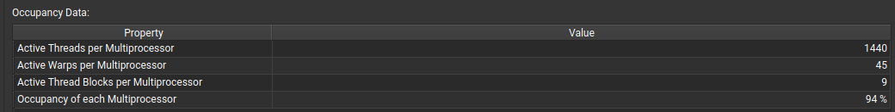{ width="900" }


Block 为 32 个线程时，每 Block 只有一个 Warp，先触及 24 个 Block 的上限，只能驻留 24 个 Warp，Occupancy 为 $24/48=50\%$。所以，Block 足够小并不意味着 SM 能放下更多线程。

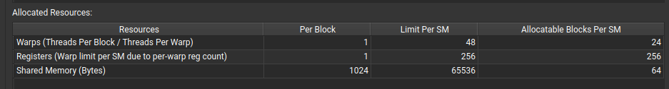{ width="900" }

例如 128 个线程的 Block 有四个 Warp，若其他资源足够，12 个 Block 恰好填满 48 个 Warp；256 个线程则每 Block 八个 Warp，六个 Block 同样可以填满。**理论 Occupancy 相同，线程分组、同步粒度和实际调度表现仍然可能不同。**

Calculator 改的是计算输入，并不会修改正在运行的 Kernel。真实的每线程寄存器数由编译结果决定，可从 NCU 的 Launch Statistics 或 `ptxas` 编译信息读取；静态 Shared Memory 来自声明，动态 Shared Memory 来自启动参数。

此外还要满足单 Block 和单线程的硬件上限。Ada 每 Block 最多 1024 个线程；例如 `32×32` 已达到这一上限，不能继续扩大为 `64×32` 来填满 SM。截图中每 SM、每 Block 的寄存器上限均为 65536 个，而单线程最多使用 255 个 32-bit 寄存器；它们限制的是不同粒度的资源。

Calculator 中的 `Per Block`、`Limit Per SM` 和 `Allocatable Blocks Per SM` 是连续的推导：每 Block 用多少资源，SM 一共有多少资源，这项资源最多允许驻留几个 Block。最终取这些限制中的最小值。

Calculator 的 **Graphs** 页把这种限制画成阶梯曲线：固定其他参数，改变 Block 线程数、每线程寄存器或每 Block 的 Shared Memory，观察 Active Warps per SM 在哪里下降。例如每 Block 768 个线程是 24 个 Warp，两个 Block 恰好容纳 48 个；改为 832 个线程后，每 Block 有 26 个 Warp，SM 只能放一个完整 Block，理论 Occupancy 降到 $26/48\approx54.17\%$。资源只增加一点，驻留量也可能跳到下一个台阶。

## 寄存器与 Shared Memory 限制

**寄存器按分配粒度取整，再按完整 Block 计算**。以 Block 为 128 个线程、每线程使用 51 个寄存器为例，一个 Warp 需要 $51\times32=1632$ 个寄存器，按图中 Calculator 的 256 个寄存器分配粒度向上取整为 1792 个。

每 Block 四个 Warp，共占 $4\times1792=7168$ 个寄存器。一个 SM 最多容纳九个这样的 Block，即 36 个 Warp，Occupancy 为 75%。

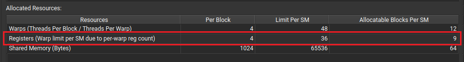{ width="900" }

这里还存在两个不同的粒度：**寄存器分配粒度**决定一个 Warp 实际占多少寄存器；截图中的 **Warp Allocation Granularity** 再对可分配的 Warp 容量取整。图中的 Calculator 将这个容量按四个 Warp 为粒度向下取整。

对于 51 个寄存器，$65536/1792\approx36.57$，按四个 Warp 向下取整仍为 36；对于 90 个寄存器，$65536/3072\approx21.33$，取整后为 20。随后再按每 Block 四个 Warp，得到九个、五个 Block。

**这不是把每个 Block 的实际 Warp 数一律改成四个**，而是 Calculator 对寄存器可容纳 Warp 容量的资源规则。其他架构或其他 Block 形状要使用对应的参数，不能只复制这里的最终数字。

若每线程改为 90 个寄存器，一个 Warp 的需求为 $90\times32=2880$，取整后为 3072；每 Block 需要 12288 个寄存器，只能驻留五个 Block，即 20 个 Warp，Occupancy 降为 $20/48\approx41.67\%$。

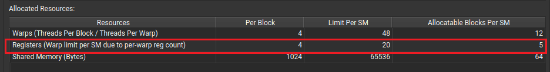{ width="900" }

不能只算 $65536/3072\approx21.33$，就认为能驻留 21 个 Warp：本例中每个 Block 有四个 Warp，**剩余寄存器不足以容纳下一个完整 Block**。

**Shared Memory 按 Block 分配**。另一个例子设置每 Block 使用 5000 B，共享内存容量为 32 KiB；Calculator 还计入每 Block 的 1024 B 保留量，并按 128 B 粒度取整：

$$
\left\lceil \frac{5000+1024}{128}\right\rceil\times128
=6144\ \mathrm{B/Block}.
$$

此时最多驻留五个 Block；若每 Block 为 128 个线程，同样得到 20 个 Warp、41.67% 的 Occupancy。这里的 5000 B 是**每 Block 的用量**，保留量和取整规则对应这组 Calculator 设置。

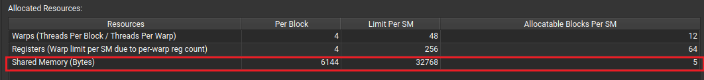{ width="900" }

Shared Memory 的计算也包含**实际占用量与配置容量**两侧。`__shared__` 的静态数组、启动时指定的动态共享内存、分配取整与保留空间，都会影响占用量；SM 的共享内存配置则决定有多少空间可分给驻留 Block。

增加 Shared Memory 并不只影响一个 Block 能缓存多少数据，还可能减少并行驻留的 Block。比如 SGEMM 增大 tile 能提高输入复用，但同时增加共享内存和寄存器需求；要观察它是否在减少 Global 流量的同时，压低了可用的 Warp 并行度。

线程数、Block 数、寄存器和 Shared Memory 都会限制驻留量，**最终由最先用尽的资源决定**。比如增加线程内工作量，能减少内存指令，却也可能让寄存器占用上升、驻留 Block 数下降。

## 理论与实际 Occupancy

**Theoretical Occupancy** 是启动配置和资源限制允许的上限；**Achieved Occupancy** 是按报告指标的周期口径测得的平均驻留比例。同一 SM 上的 Warp 提前退出、后续 Block 未及时补入等情况，都可能让实际值低于理论值。Grid 太小或最后一批 Block 未填满，还可能让部分 SM 完全空闲，需要结合全卡的工作分布分析。

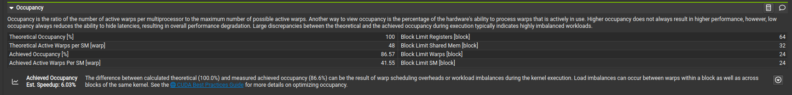{ width="950" }

这份报告的理论 Active Warp 为 48，实际为 41.55，对应 $41.55/48\approx86.56\%$，与显示的 86.57% 接近。Calculator 只给出配置允许的上限，运行时是否一直有足够的 Block、各 Warp 何时退出，还需要从实际执行中测量。

**Wave** 可以理解为当前资源限制下，所有 SM 一起能够同时驻留的一批 Block。设 GPU 有 S 个 SM，每 SM 最多驻留 B 个 Block，一批的容量为 $S\times B$；Grid 有 G 个 Block 时，可用 $G/(S\times B)$ 估计它相当于多少轮容量。

硬件不是等一整轮结束才启动下一轮：某个 Block 提前退出，新的 Block 就能补进来。这个“轮数”模型用于理解任务规模与尾部效应，尤其是在 Block 耗时近似一致时。

例如四个 SM、每 SM 两个 Block，Grid 一共十个 Block。选择每 Block 768 个线程、寄存器和共享内存足够小，那么每个 Block 有 24 个 Warp，两个 Block 恰好填满 48 个 Warp。

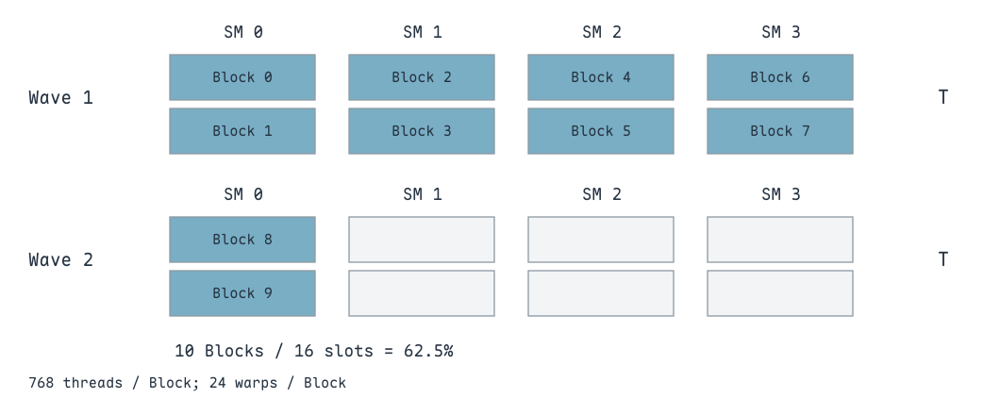{ width="900" }

假设每个 Block 都执行 T 时间，第一轮八个 Block 占满 GPU，第二轮只剩两个。两轮共有 16 个 Block 容量，实际只使用十个；**以全卡四个 SM、完整 2T 时间区间为分母**，Warp 容量利用率为 $10/16=62.5\%$。尾轮未填满，留下了空闲的 SM。

这个比例不能直接当作 NCU 的 Achieved Occupancy。`pct_of_peak_sustained_active` 等指标按单元的**活跃周期**归一化，而不是把全卡所有空闲时间都算进去。图中尾轮的两个 Block 都放在 SM 0，它仍驻留 48 个 Warp，其他三个 SM 已无工作；活跃 SM 上的 Occupancy 可以仍很高，但全卡利用率已经下降。分析尾部效应时，要把 Occupancy 与 Waves per SM、SM 活跃周期分布和总时间一起看。

此外，同一个 Block 内不同 Warp 的完成时间不一致，也会让平均 Active 数下降；不同 Block 的耗时差异则可能让某些 SM 先空下来。要结合 Grid 大小和具体工作量判断，而不能把计算吞吐、内存吞吐两个百分比不同直接叫作“负载不均衡”。

但提高 Occupancy 并不自动提高性能。已经有足够的 Warp 掩盖延迟时，继续增加 Warp 可能没有收益；为了提高 Occupancy 强行减少寄存器，还可能产生 spill 和额外 Local Memory 访问。**接下来要看这些驻留 Warp 是否能持续发射指令。**

提高 Occupancy 的意义是给调度器更多可选的 Warp。但**线程级并行性与指令级并行性也能共同掩盖延迟**：多个 Warp 交错执行属于前者，一个线程提前发出多个独立操作属于后者。

如果为了降低寄存器数，把原本可并行保留的中间值改成反复加载，或者触发 spill，可能得到更高的 Occupancy，却产生更多依赖和访存。优化时要看新增的驻留 Warp 是否真的弥补了这些代价。

## Warp Scheduler：Active、Eligible、Issued

Ada 的一个 SM 有四个 Warp Scheduler，48 个 Warp 的容量对应每个 Scheduler 最多 12 个 Warp slot。**Slot 表示可管理的驻留 Warp 数量，不能把 12 个 slot 理解成每周期发射 12 个 Warp。**

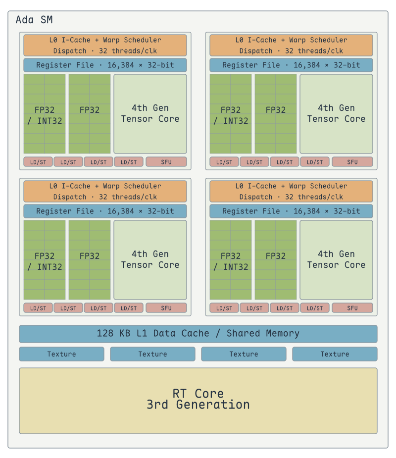{ width="620" }

架构图中的每个子分区有自己的 Warp Scheduler、Dispatch 和 16384 个 32-bit 寄存器，四份合计就是前面使用的 65536 个寄存器。图中 Dispatch 的 `32 threads/clk` 描述线程通道宽度，不是每周期发射 32 个 Warp。指令发射后进入对应的 FP32、INT32、LD/ST、SFU 等执行资源；**调度器的 Warp slot 数与执行单元数是两个不同的容量**。

- **Active**：驻留在调度器中的 Warp，包括等待中的 Warp。
- **Eligible**：下一条指令已经具备发射条件的 Active Warp。
- **Issued / Selected**：调度器从 Eligible 集合中选出并发射指令的 Warp。

**发射的是 Warp 的下一条指令，不是把整个 Warp 的全部程序一次执行完**。Selected 之后，Warp 仍留在自己的 slot 中；当下一条指令满足条件时，再参与调度。

同一周期多个 Warp 可能都 Eligible，但受发射能力限制，只能选出其中一部分；某个 Warp 没被选中，不一定在等待内存。反过来，slot 中有很多 Active Warp，也不保证它们已经具备发射条件。

当某个 Warp 在等待取指、数据依赖、执行管线或 barrier 时，它暂时不 Eligible。**Selected 也属于 Eligible**，下图只是用另一种颜色突出本周期被选中的 Warp。

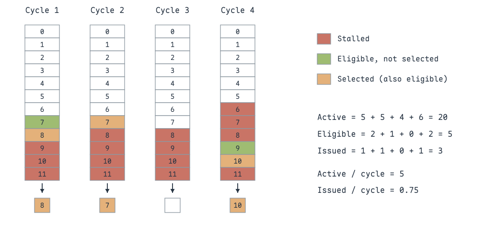{ width="900" }

四个周期的 Active 数分别为 5、5、4、6，平均每周期五个；相对于 12 个 slot，实际 Occupancy 为 $5/12\approx41.67\%$。Eligible 数包含本周期选中的 Warp，分别为 2、1、0、2，总计五个。

四个周期只有三次发射，平均每周期发射 0.75 个 Warp。第 3 个周期虽然仍有四个 Active Warp，但全部在等待，发射槽空闲。**驻留量足够，仍可能因没有 Eligible Warp 而无法掩盖延迟。**

## 用 NCU 定位 Warp 为什么等待

先看 **Scheduler Statistics**：Active Warps 说明驻留量，Eligible Warps 说明准备程度，Issued Warps 和 Issue Slot Utilization 说明发射是否连续。

这次数组加法测试中，理论 Occupancy 为 100%，实际约 43.2%；每个 Scheduler 平均有 5.15 个 Active Warp，却只有约 0.04 个 Eligible Warp，平均每 23.9 个周期才发射一次。问题已经从“能放多少 Warp”转为“这些 Warp 在等什么”。

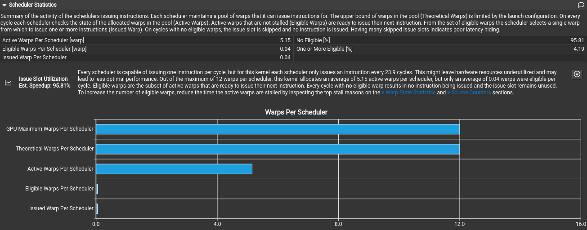{ width="950" }

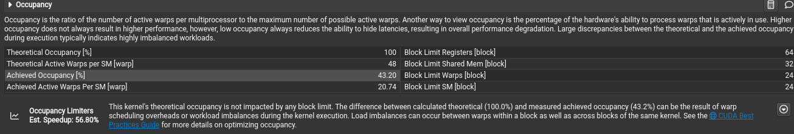{ width="950" }

这份报告的实际 Active Warp 为每 SM 20.74 个，$20.74/48\approx43.2\%$。按四个 Scheduler 粗略平分为 5.19 个，与 Scheduler 表中的 5.15 接近。两处指标的采样单元与活跃周期分母可能不同，应按各自定义读取，不要求相乘后严格相等。

还要区分 **Issued Warps per Scheduler** 与 **Instructions per Active Issue Slot**。后者只统计已经发生发射的槽位；即使这个值为 1，也可能有大量周期根本没有发射。每 23.9 个周期才发射一次，相当于平均每周期约 $1/23.9\approx0.0418$ 次，不能把“发射时能发一条”理解成“每周期都在发一条”。

再看 **Warp State Statistics** 中主要的等待原因。这里的条形图按其标注单位解读；每指令等待周期、采样数量、占比是不同指标，不能直接混在一起比较。

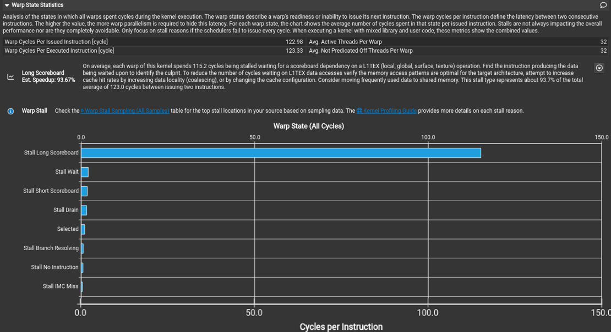{ width="900" }

本例中，两次连续指令之间平均间隔约 123.0 个周期，其中 Long Scoreboard 约 115.2 个周期，占 93.7%。**主要等待发生在依赖 L1TEX 的结果上**，因此先追踪 load 的地址模式和后续消费关系，而不是先调整数学指令。

常见的几类原因：

- **Long Scoreboard**：等待 L1TEX 路径的结果依赖，常见于 Global / Local load。它说明消费指令在等数据，不代表一定访问了 DRAM，也不等于显存带宽已打满。
- **Short Scoreboard**：等待 MIO 路径的结果依赖，常见于 Shared Memory，也可能涉及特殊数学指令或动态分支。
- **LG Throttle**：Local / Global 内存指令队列满，当前指令无法进入队列。可检查重复访存、窄指令过多，以及寄存器 spill。
- **MIO Throttle**：MIO 指令队列压力，涉及 Shared Memory、特殊数学和动态分支等路径；分散访问引发的额外内部操作也可能增加压力。
- **Drain**：Warp 已执行 EXIT，仍在等待未完成的内存操作，以便释放资源；大量末尾写回和尾部效应都可能体现为 Drain。

还有几类经常在图中出现的状态，也应按其含义判断：

- **Math Pipe Throttle**：下一条数学指令要用的执行管线暂时没有容量。可能需要改变指令混合或减少特定管线的压力。
- **Wait**：等待固定延迟的执行依赖。例如连续的乘加存在结果依赖，能否插入独立工作影响等待是否暴露。
- **Barrier**：等待同一 Block 中其他 Warp 到达同步点。要看是否有耗时不均、是否能减少不必要的 Block 级同步。
- **Not Selected**：Warp 已准备好，但调度器本周期选了别的 Warp。它常说明仍有就绪工作，不能作为需要消除的内存瓶颈。

Long / Short Scoreboard 的名字描述的是**依赖来自哪条路径**，不是“延迟超过某个固定阈值就叫 Long”。LG / MIO Throttle 则是提交队列没有空位，和已经提交后等待结果不同。

Warp 状态列表中还有以下几类等待：

- **No Instructions**：下一条指令尚未取得，可能涉及 instruction cache miss，或很短 Kernel 的取指开销。
- **IMC Miss**：等待 immediate constant cache 的数据。Warp 中不同线程若使用不同的常量地址，访问还可能需要串行处理。
- **Branch Resolving**：等待分支目标与下一条 PC 确定。
- **Dispatch Stall**：指令等待分发阶段可用，属于分发阶段的资源限制。
- **Membar**：等待内存顺序屏障完成；与 Barrier 等待其他 Warp 到达 Block 同步点不同。
- **Tex Throttle**：纹理指令队列满，无法继续提交纹理操作。
- **Sleeping**：执行睡眠操作，如 `__nanosleep()` 后，Warp 暂时不可调度。
- **Misc**：归入其他原因的等待，需要继续结合具体指令分析。

图中 **Selected** 是已被选中发射的状态，**Not Selected** 是已经就绪但本周期没有被选中，二者都不能解释成访存阻塞。

### 依赖式读取：Long Scoreboard

指针追逐的核心是让下一次读取的地址依赖前一次读取的结果：

```cuda
int idx = laneid;
#pragma unroll
for (int i = 0; i < 1000; i++)
    idx = dramptr[idx];  // 上一次 load 返回后，才能确定下一次 load 的地址
```

循环展开只减少循环控制，无法解除这一串地址依赖。即便数组命中缓存，消费指令仍要等待 L1TEX 返回结果；Long Scoreboard 并不专指 DRAM miss。

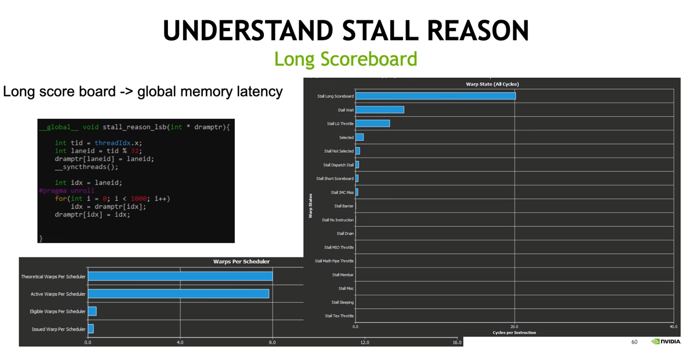{ width="950" }

这张图中 Active Warp 接近理论上限，但 Eligible 和 Issued 很低，Long Scoreboard 约为每指令 20 个周期。**有足够多的驻留 Warp，仍然可能同时等待同类结果**。它与前面 115.2 个周期的数组加法是两个不同案例，不能按数值大小直接比较访存延迟。

要增加可重叠的工作，可以在等待期间安排不依赖这次结果的操作，或让更多独立 Warp 交错执行；单纯给同一条指针链增加更多迭代，不会增加独立 load。

### 密集的窄访问：LG Throttle

另一个案例使用 `int8_t` 数组，在展开的循环里不断复制单个字节。下面只保留其访问模式，每线程的独立区间由 `offset` 指定：

```cuda
#pragma unroll
for (int i = 0; i < 2000; i++)
    dst[offset + i] = src[offset + i];  // 大量窄 load/store 持续占用 LG 指令队列
```

它与指针追逐不同：后一次 load 的地址不需要等待前一次返回，但**提交的内存指令太密集，队列处理不过来**，新的指令因 LG Throttle 等待。

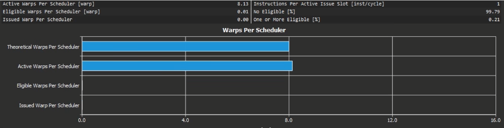{ width="950" }

图中每个 Scheduler 平均有 8.13 个 Active Warp，却只有 0.01 个 Eligible Warp；99.79% 的周期没有就绪 Warp。这里优先考虑减少内存指令数量：满足对齐与布局条件时，用更宽的访问合并多条窄 load / store，并在内存操作之间穿插独立计算。

**减少指令数与改善合并访存不是同一件事**。向量指令让一个线程一次搬更多连续字节；Warp 的地址集合是否紧凑，仍要重新核对 sector。

**Scoreboard 关注结果是否到达，Throttle 关注下一条指令能否进入队列**。减少访问的 sector 数、减少内存指令数、增加独立指令和增加驻留 Warp，对应的是不同的限制。

### Stall 指标的分母

Warp State 图使用 **Cycles per Instruction** 时，数值表示一个 Warp 在两次连续发射之间，平均在某状态等待多少周期。例如总间隔为 123.0 周期，其中 Long Scoreboard 为 115.2，才可计算 $115.2/123.0\approx93.7\%$。

另一组比较使用的指标名形如 `smsp_average_warps_issue_stalled_long_scoreboard_per_issue_active.ratio`。其中 `per_issue_active` 以活跃发射周期归一化，`.ratio` 表示比值；它描述这种等待状态的平均 Warp 数，**不是直接给出 Kernel 时间的百分比**。读取柱状图前，先在 Metrics Details 中确认指标的单位和分母。

**Stall 的比例、每指令等待周期和 Kernel 总时间是不同量**。某种 Stall 的占比上升，可能因为其他等待减少了；每个 Warp 的等待周期上升，也可能与每线程工作量增加、总 Warp 数减少同时发生。

因此先确认发射是否有空洞，再判断哪个等待挡住了就绪指令。如果其他 Warp 能持续发射，当前 Warp 的等待已经被隐藏，就不必为了降低这根柱子而引入更昂贵的改动。

最后进入 **Source Counters**，把主要等待原因定位到源代码和 SASS。PC Sampling 可能标在消费 load 结果的指令上，因此还要向前追踪：它在等待哪条指令产生的数据？

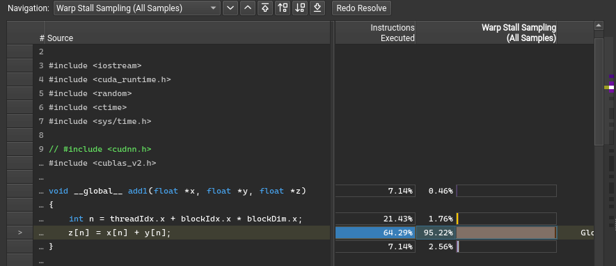{ width="900" }

Source Counters 中的 Warp Stall Sampling 在运行期间定期采样，描述被采样 Warp 当时的状态；**采样数量不是这条源码实际执行的次数**。一条消费指令可能因为同一次 load 等待很久，在多个采样点反复出现。

这份报告的 Source Counters 中，多条 SASS 的执行次数都为 262144，恰好对应这次启动的 Warp 数；但 Stall Sampling 大多集中在一个位置，达到 20949 个样本。**执行次数相近的指令，等待时间可以相差很大**。

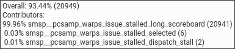{ width="650" }

这个位置的提示显示 `Overall 93.44% (20949)`：它占该报告整体采样的 93.44%；位置内部的 20941 个 Long Scoreboard 样本，则占该位置 20949 个样本的 99.96%。前者问“等待集中在哪”，后者问“这里主要在等什么”，两个百分比的分母不同。

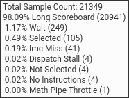{ width="420" }

另一张提示列出总计 21349 个样本，其中 Long Scoreboard 20941 个、98.09%，Wait 249 个、1.17%，Selected 105 个、0.49%。这张整体提示与上一张位置提示的总体分母并不一致，应分别按各自截图解读，不能把 20949 除以 21349 来还原 93.44%。

对照 `Most Instructions Executed` 和 `Warp Stall Sampling` 时，前者定位执行工作，后者定位等待热点。确定热点后还要回到相邻 SASS：哪条指令产生依赖，哪些指令可以独立执行，等待是否有机会被重排或被其他 Warp 隐藏。

Source Counters 顶部还会显示 **Branch Instructions Ratio** 和 **Branch Efficiency**。前者是分支指令占执行指令的比例，后者关注 Warp 内线程的分支目标是否一致；执行了分支指令，不等于发生 Warp divergence。截图中分支指令比例为 0.07%，应结合 uniform / divergent branch 计数判断，不能用它解释主要的 Long Scoreboard 等待。

只有当发射槽经常空闲、吞吐受到影响时，主要 Stall 才是优先优化的对象。某个 Warp 在等待，其他 Warp 仍可能持续发射，不能只凭一根 Stall 柱较长就判断 Kernel 性能差。

> 参考：[Ada Tuning Guide：Occupancy](https://docs.nvidia.com/cuda/ada-tuning-guide/index.html#occupancy)、[NCU Scheduler Statistics 与 Warp Stall Reasons](https://docs.nvidia.com/nsight-compute/ProfilingGuide/index.html)、[Occupancy Calculator](https://zhuanlan.zhihu.com/p/657005697)、[NVIDIA GPU 架构与 CUDA 算力](https://cuiyuhao.com/posts/8a630bae/)、[Warp Scheduler 状态解释](https://blog.csdn.net/feng__shuai/article/details/125665305)、[Occupancy Calculator 分配公式](https://blog.csdn.net/wd1603926823/article/details/108871290)。
