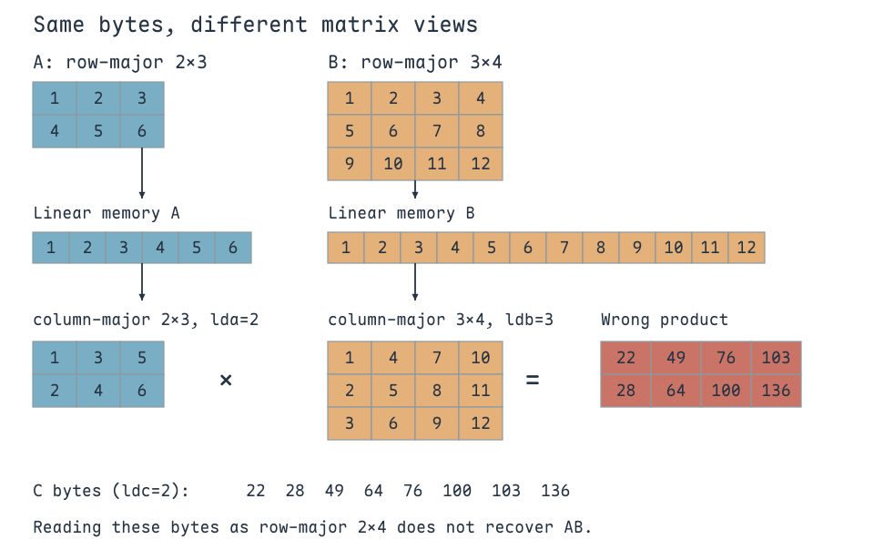
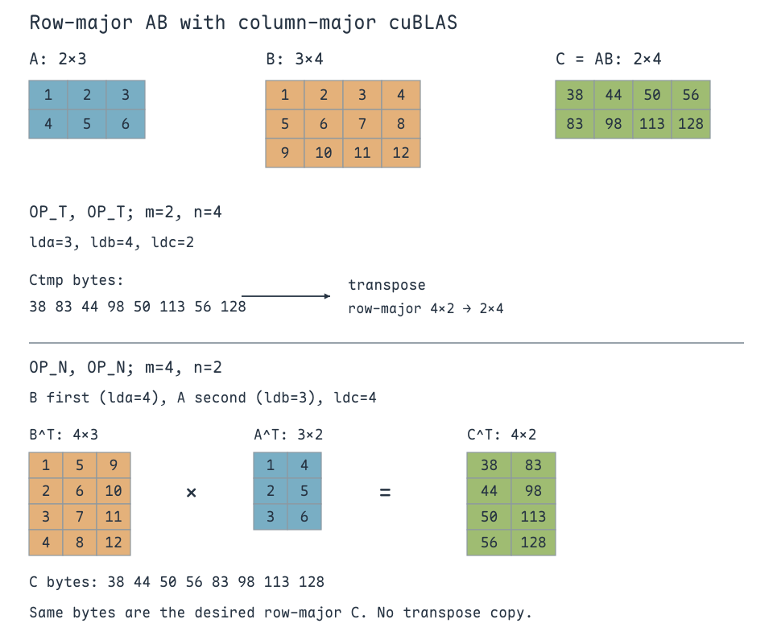
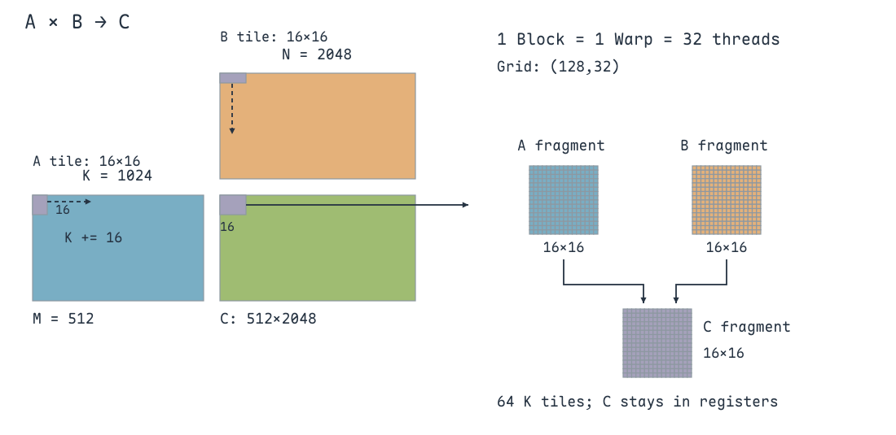
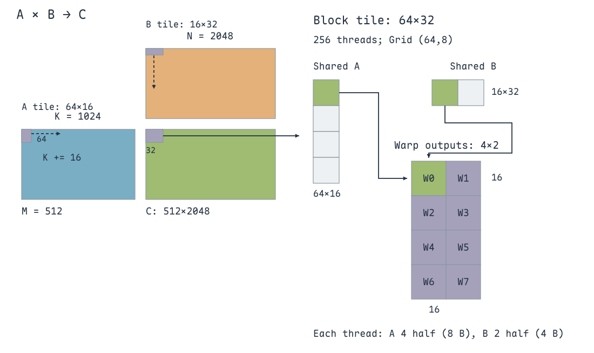
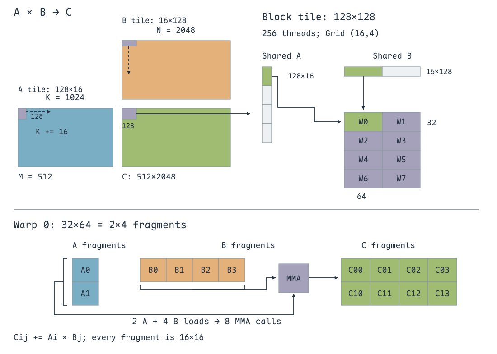
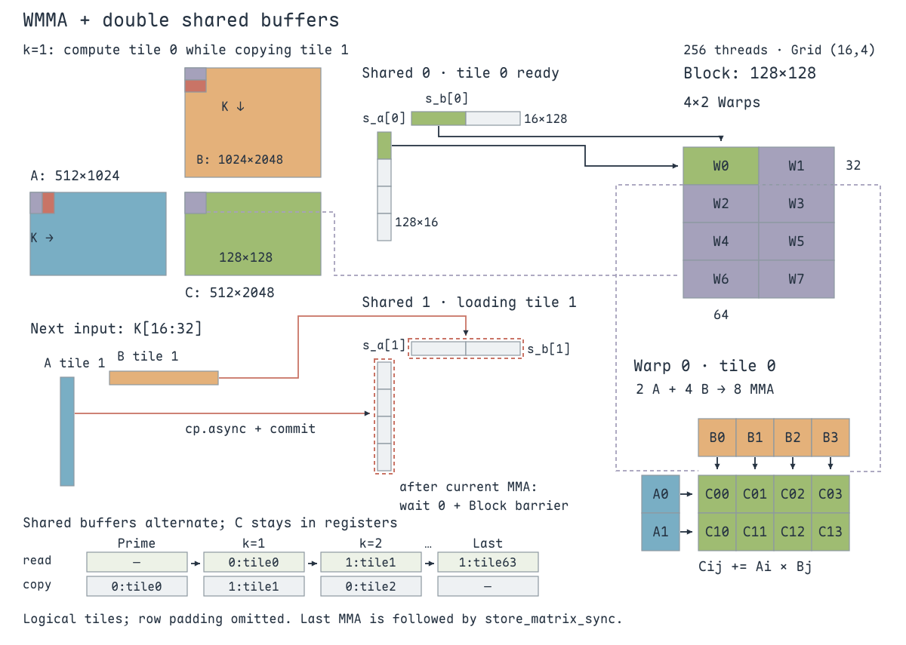

HGEMM（Half-precision General Matrix Multiplication）用半精度数据计算矩阵乘法。这里仍然实现 $C=AB$：$A$ 为 $M\times K$，$B$ 为 $K\times N$，$C$ 为 $M\times N$，三个矩阵都按**行主序** 存储。

前面的 SGEMM 用线程寄存器中的标量乘加计算输出；Tensor Core 则提供矩阵乘加能力。WMMA（Warp Matrix Multiply-Accumulate）把这项能力暴露为 **Warp 级接口** ：一个 Warp 的 32 个线程协作完成一个矩阵 tile 的乘加，再通过分块与数据复用扩大计算范围。

以下使用固定尺寸：$M=512$、$N=2048$、$K=1024$，每次 WMMA 操作的形状为 $16\times16\times16$。先用 cuBLAS 建立结果基准，再从一个 Warp 计算一个 tile，逐步加入 Shared Memory、Warp 内 fragment 复用与异步双缓冲。

## cuBLAS 的行主序矩阵乘法

`cublasGemmEx` 计算：

$$
C=\alpha\,\operatorname{op}(A)\operatorname{op}(B)+\beta C.
$$

`m,n,k` 描述的是**执行 op 之后** 的乘法形状：$\operatorname{op}(A)$ 为 $m\times k$，$\operatorname{op}(B)$ 为 $k\times n$，输出为 $m\times n$。这里取 $\alpha=1$、$\beta=0$。

传统 cuBLAS GEMM 接口按**列主序** 解释矩阵。C++ 连续二维数组常按行主序存储，直接把指针和原来的 $M,N,K$ 传进去，得到的矩阵含义可能已经变了。

### Leading dimension 描述物理跨度

`lda`、`ldb`、`ldc` 的单位是**元素** 。对于列主序，它们表示相邻两列起点之间的跨度；对于行主序，同类的 stride 表示相邻两行的跨度。它们由实际存储形状决定，不能只看乘法中的逻辑行数。

无 Padding 时，行主序 $A[M,K]$ 的地址为 `A[m*K+k]`，列主序 $X[R,S]$ 的地址为 `X[r+s*ldx]`。因此，把同一份行主序 $A[M,K]$ 内存看成列主序 $A^T[K,M]$ 时，leading dimension 是 $K$。

例如：

$$
A=\begin{bmatrix}1&2&3\\4&5&6\end{bmatrix},\qquad
B=\begin{bmatrix}1&2&3&4\\5&6&7&8\\9&10&11&12\end{bmatrix}.
$$

正确结果为：

$$
AB=\begin{bmatrix}38&44&50&56\\83&98&113&128\end{bmatrix}.
$$

若沿用 `OP_N, OP_N, m=2, n=4, k=3`，同时设置 `lda=2, ldb=3, ldc=2`，cuBLAS 会把输入解释为：

$$
\widetilde A=\begin{bmatrix}1&3&5\\2&4&6\end{bmatrix},\qquad
\widetilde B=\begin{bmatrix}1&4&7&10\\2&5&8&11\\3&6&9&12\end{bmatrix}.
$$

它算出的乘积为：

$$
\widetilde A\widetilde B=\begin{bmatrix}22&49&76&103\\28&64&100&136\end{bmatrix}.
$$

按列写入内存后是 `[22,28,49,64,76,100,103,136]`。再按原来的行主序 $2\times4$ 输出查看，就变成：

$$
C_{\mathrm{wrong}}=\begin{bmatrix}22&28&49&64\\76&100&103&136\end{bmatrix}.
$$

**输入解释和输出布局都必须匹配** ，不能只检查矩阵乘法的维度能否对上。

{ width="960" }

### 使用 OP_T 后还要处理输出布局

行主序 A、B 的内存可以分别看成列主序的 $A^T$、$B^T$。设置 `OP_T, OP_T`，用 `m=M,n=N,k=K,lda=K,ldb=N,ldc=M`，就能恢复正确的数学乘积 $AB$。

但输出仍按列主序存储。上例的结果内存为 `[38,83,44,98,50,113,56,128]`，把它当作行主序 $N\times M$ 矩阵看，得到的是 $C^T$。需要再把这个临时矩阵转置，才能得到目标行主序 $C[M,N]$。

`OP_T` 指定的是运算中的转置解释，不要求先额外生成一份转置输入；**它也不会把输出自动改成行主序** 。

### 交换 A、B 与 M、N

利用：

$$
C^T=(AB)^T=B^T A^T,
$$

让 cuBLAS 计算列主序的 $C^T[N,M]$。其线性内存恰好就是目标行主序 $C[M,N]$，于是可以省掉上面的临时输出与转置步骤：

| cuBLAS 参数 | 本例传入值 | 列主序解释 |
| --- | --- | --- |
| 第一个乘数、`lda` | `B`、`N` | $B^T$，形状 $N\times K$ |
| 第二个乘数、`ldb` | `A`、`K` | $A^T$，形状 $K\times M$ |
| `m,n,k` | `N,M,K` | 输出 $N\times M$ |
| 输出、`ldc` | `C`、`N` | 列主序 $C^T$，与行主序 C 共用同一布局 |
| `transa,transb` | `OP_N,OP_N` | 两个乘数按上述列主序视图直接参与运算 |

{ width="960" }

完整调用如下。`A`、`B`、`C` 是已经分配好的设备内存，`handle` 已创建；标量采用默认的 Host pointer mode。

```cuda
#include <cuda_fp16.h>
#include <cublas_v2.h>

const half alpha = __float2half(1.0f);
const half beta  = __float2half(0.0f);
cublasStatus_t status = cublasGemmEx(
    handle,
    CUBLAS_OP_N, CUBLAS_OP_N,
    N, M, K,
    &alpha,
    B, CUDA_R_16F, N,
    A, CUDA_R_16F, K,
    &beta,
    C, CUDA_R_16F, N,
    CUBLAS_COMPUTE_16F,
    CUBLAS_GEMM_DEFAULT_TENSOR_OP);
```

上面的 cuBLAS 基准选择 `CUBLAS_COMPUTE_16F`，下面四版 WMMA 的 accumulator 也声明为 `half`。**输出类型与累加类型要分开看** ：输出是 `half`，并不意味着必须使用半精度 accumulator；WMMA 也支持 A、B 为 `half`、accumulator 为 `float`。若切换到 cuBLAS 的 `CUBLAS_COMPUTE_32F`，`alpha`、`beta` 也要改成 `float`，比较结果时应采用一致的精度配置与合理的误差容限。

这里的 compute mode 允许至少半精度的计算及中间存储，不能据此要求 cuBLAS 与 WMMA 的每个中间舍入或最终结果逐位相同。`CUBLAS_GEMM_DEFAULT_TENSOR_OP` 表达算法选择意图，实际是否采用 Tensor Core 还取决于 GPU、数据类型、尺寸与库版本。

## WMMA：一个 Warp 协作计算一个矩阵 tile

cuBLAS 封装了整次 GEMM 的执行；WMMA 允许在自己的 Kernel 中安排矩阵加载、乘加与输出。这里的基本操作是：

$$
D_{16\times16}=A_{16\times16}B_{16\times16}+C_{16\times16}.
$$

把 D 和 C 使用同一个 accumulator，就是 `C_frag += A_frag * B_frag`。沿 K 维重复这个操作，完成输出 tile 的累加。基础半精度 WMMA 需要计算能力 7.0 或更高的 GPU；后面的 `cp.async` 版本需要计算能力 8.0 或更高。

### Fragment 的角色、形状与布局

```cuda
wmma::fragment<Use, m, n, k, T, Layout> frag;
```

`m,n,k` 是这次乘加的三个维度。A、B、accumulator 的实际形状分别为 $m\times k$、$k\times n$、$m\times n$。

| `Use` | 含义 | `Layout` |
| --- | --- | --- |
| `wmma::matrix_a` | 左乘数 A | 指定 `row_major` 或 `col_major` |
| `wmma::matrix_b` | 右乘数 B | 指定 `row_major` 或 `col_major` |
| `wmma::accumulator` | 累加器 C / 输出 D | 保留默认 `void`；加载、存储时指定内存布局 |

**Fragment 是分布在 Warp 各线程寄存器中的矩阵片段** 。源码中的一个 `A_frag` 声明由每个线程执行，各线程持有其局部存储；一个 Warp 的这些局部存储共同表达一个 A tile。它不等同于 `__shared__` 数组，也不是每个线程都保存一份完整矩阵。

WMMA 不公开矩阵元素到 lane、寄存器的固定映射。`frag.x[i]` 表示该线程的局部 fragment 存储，不能把它直接当成固定的矩阵行列索引。图中的 tile 表达的是 Warp 共同计算的逻辑矩阵。

WMMA 的合法形状与类型组合如下，具体支持还需满足目标架构与 CUDA 版本要求：

| Matrix A / B 类型 | Accumulator 类型 | `m×n×k` |
| --- | --- | --- |
| `half` / `half` | `float` 或 `half` | `16×16×16`、`32×8×16`、`8×32×16` |
| `__nv_bfloat16` / `__nv_bfloat16` | `float` | `16×16×16`、`32×8×16`、`8×32×16` |
| `signed char` / `signed char` | `int` | `16×16×16`、`32×8×16`、`8×32×16` |
| `unsigned char` / `unsigned char` | `int` | `16×16×16`、`32×8×16`、`8×32×16` |
| `wmma::precision::tf32` / 同类型 | `float` | `16×16×8` |
| `double` / `double` | `double` | `8×8×4` |
| `wmma::experimental::precision::u4` 或 `s4` / 同类型 | `int` | `8×8×32` |
| `wmma::experimental::precision::b1` / 同类型 | `int` | `8×8×128` |

最后两行属于实验性的低比特接口，`b1` 使用位运算累加接口，不能直接套用本节的半精度乘法代码。TF32 也需要对应的数据转换。**形状表与内存 stride 的对齐规则是两件事** ，不能因为 stride 是 8 的倍数，就任意声明一个 `8×8×8` fragment。

### 加载、填充、乘加与存储

```cuda
wmma::fragment<wmma::matrix_a, 16, 16, 16, half, wmma::row_major> A_frag;
wmma::fragment<wmma::matrix_b, 16, 16, 16, half, wmma::row_major> B_frag;
wmma::fragment<wmma::accumulator, 16, 16, 16, half> C_frag;

wmma::fill_fragment(C_frag, __float2half(0.0f));
wmma::load_matrix_sync(A_frag, A_tile_ptr, K);
wmma::load_matrix_sync(B_frag, B_tile_ptr, N);
wmma::mma_sync(C_frag, A_frag, B_frag, C_frag);
wmma::store_matrix_sync(C_tile_ptr, C_frag, N, wmma::mem_row_major);
```

`fill_fragment` 初始化 accumulator，`load_matrix_sync` 从 Global / Shared Memory 加载操作数，`mma_sync` 计算矩阵乘加，`store_matrix_sync` 按指定布局写回。`mma_sync` 的最后一个可选参数 `satf` 默认为 `false`；开启时会把正、负无穷大分别饱和到正、负的有限最大幅值，并把 NaN 变为正零，本节保持默认行为。

如果 accumulator 的初值来自内存，`load_matrix_sync` 还提供带布局参数的重载：

```cuda
wmma::load_matrix_sync(C_frag, C_tile_ptr, N, wmma::mem_row_major);
```

这里计算 $C=AB$，累加初值为零，因此使用 `fill_fragment`，无需读取旧的输出矩阵。

`load_matrix_sync` 与 `store_matrix_sync` 需要同时满足：

- 矩阵 tile 起始指针按 **256 bit，也就是 32 B** 对齐。分配基地址对齐，不代表任意偏移后的子矩阵指针仍然对齐。
- `ldm` 是相邻行 / 列的**元素跨度** ；`half` 要求 8 的倍数，`float` 要求 4 的倍数，两者都对应 16 B 的跨度倍数。
- 同一个 Warp 的 32 个线程都调用接口，且指针、`ldm`、布局与模板参数一致。不能只让 `lane_id == 0` 的线程调用，也不能让半个 Warp 进入这个操作。

这些规则也意味着：控制流判断必须在 Warp 内一致。不同 Warp 可以处理不同 tile，但每个 Warp 内的线程要共同执行同一操作。WMMA 名字中的 `sync` 负责 Warp 级协作，**不替代跨 Warp 使用 Shared Memory 时的 Block 同步** 。

下面的代码使用这些公共定义。向量读写宏每次搬运 4 / 8 / 16 B 的半精度数据；`float2`、`float4` 只是按位搬运的载体，**不会把 half 数值转换成 float** 。

```cuda
#include <cassert>
#include <cstdint>
#include <cuda_runtime.h>
#include <cuda_fp16.h>
#include <mma.h>

using namespace nvcuda;

constexpr int WARP_SIZE = 32;
inline int div_ceil(int a, int b) { return (a + b - 1) / b; }
#define LDST32BITS(value)  (reinterpret_cast<half2 *>(&(value))[0])
#define LDST64BITS(value)  (reinterpret_cast<float2 *>(&(value))[0])
#define LDST128BITS(value) (reinterpret_cast<float4 *>(&(value))[0])
```

四版只处理**完整分块** ：V1 要求 M、N 是 16 的倍数；V2 要求 M 是 64、N 是 32 的倍数；V3 / V4 要求 M、N 是 128 的倍数；所有版本都要求 $K>0$ 且 K 是 16 的倍数。设备指针与向量访问也要满足相应对齐，本例的连续分配与尺寸满足这些条件。Host wrapper 的 `assert` 用于表达前提，发布构建也应由调用方保证前提。

共享数组显式按 32 B 对齐。边界判断在 Block 内一致；这只能拒绝整个越界 Block，**不能处理不足一个 tile 的尾块** 。原代码中的 `div_ceil` 不等于已经具备补零或带掩码的加载。

### 一个 Warp 沿 K 维累加

第一版一个 Block 只有一个 Warp，每个 Warp 负责 $16\times16$ 输出。Grid 为 `(128,32)`，分别由 `N/16`、`M/16` 得到，共有 4096 个 Block。

输出块的左上角为 `m0=blockIdx.y*16`、`n0=blockIdx.x*16`。第 t 个 K tile 加载：

$$
A[m_0:m_0+16,\ 16t:16t+16],\qquad
B[16t:16t+16,\ n_0:n_0+16].
$$

A 的起点地址是 `A+m0*K+t*16`，行跨度是 K；B 的起点是 `B+t*16*N+n0`，行跨度是 N。`load_matrix_sync` 从 Global Memory 直接加载 fragment，然后执行乘加；$1024/16=64$ 轮后写回 C。

{ width="1100" }

**C fragment 只在循环前清零一次** ，随后每一轮都在旧值上累加。A、B fragment 在各轮被重新加载，不需要填零。原版 K 循环内有 `__syncthreads()`，这里一个 Block 只有一个 Warp，且没有 Shared Memory 的跨线程生产与消费，因此省去这个额外的 Block barrier。


=== "核心修改"

    ```cuda
    wmma::fill_fragment(C_frag, __float2half(0.0f));
    for (int t = 0; t < K / 16; ++t) {
        wmma::load_matrix_sync(A_frag, A + m0 * K + t * 16, K);
        wmma::load_matrix_sync(B_frag, B + t * 16 * N + n0, N);
        wmma::mma_sync(C_frag, A_frag, B_frag, C_frag);
    }
    wmma::store_matrix_sync(C + m0 * N + n0, C_frag, N,
                            wmma::mem_row_major);
    ```

=== "完整 Kernel"

    ```cuda
    template <const int WMMA_M = 16, const int WMMA_N = 16, const int WMMA_K = 16>
    __global__ void hgemm_wmma_m16n16k16_naive_kernel(half *A, half *B, half *C,
                                                      int M, int N, int K)
    {
        static_assert(WMMA_M == 16 && WMMA_N == 16 && WMMA_K == 16, "use m16n16k16");
        const int NUM_K_TILES = K / WMMA_K;
        const int load_gmem_a_m = blockIdx.y * WMMA_M;
        const int load_gmem_b_n = blockIdx.x * WMMA_N;
        if (load_gmem_a_m >= M || load_gmem_b_n >= N)
            return;

        wmma::fragment<wmma::accumulator, WMMA_M, WMMA_N, WMMA_K, half> C_frag;
        wmma::fill_fragment(C_frag, __float2half(0.0f));

        wmma::fragment<wmma::matrix_a, WMMA_M, WMMA_N, WMMA_K, half, wmma::row_major> A_frag;
        wmma::fragment<wmma::matrix_b, WMMA_M, WMMA_N, WMMA_K, half, wmma::row_major> B_frag;
    #pragma unroll
        for (int k = 0; k < NUM_K_TILES; ++k)
        {
            wmma::load_matrix_sync(A_frag, A + load_gmem_a_m * K + k * WMMA_K, K);
            wmma::load_matrix_sync(B_frag, B + (k * WMMA_K) * N + load_gmem_b_n, N);

            wmma::mma_sync(C_frag, A_frag, B_frag, C_frag);

        }
        wmma::store_matrix_sync(C + load_gmem_a_m * N + load_gmem_b_n, C_frag, N,
                                wmma::mem_row_major);
    }

    void hgemm_wmma_m16n16k16_naive(half *A, half *B, half *C, int M, int N, int K)
    {
        assert(M > 0 && N > 0 && K > 0 && M % 16 == 0 && N % 16 == 0 && K % 16 == 0);
        constexpr int WMMA_M = 16;
        constexpr int WMMA_N = 16;
        constexpr int WMMA_K = 16;
        dim3 block(32);
        dim3 grid(div_ceil(N, WMMA_N), div_ceil(M, WMMA_M));

        hgemm_wmma_m16n16k16_naive_kernel<WMMA_M, WMMA_N, WMMA_K><<<grid, block>>>(A, B, C, M, N, K);
    }
    ```


## 优化技巧1：Shared Memory 与 4×2 个 Warp

第一版相邻输出 tile 会重复加载相同的 A 行块或 B 列块。第二版把输出范围扩大为 $64\times32$，由一个 Block 的 8 个 Warp 合作完成；先把输入放进 Shared Memory，让多个 Warp 复用。

### Block 分块与 Warp 映射

Block 使用 256 个线程，8 个 Warp 按 $4\times2$ 排列：

```cuda
const int warp_id = threadIdx.x / 32;
const int warp_m = warp_id / 2;  // 0,1,2,3
const int warp_n = warp_id % 2;  // 0,1
```

每个 Warp 仍然只计算一个 $16\times16$ fragment，所以 Block 输出的行数是 $4\times16=64$，列数是 $2\times16=32$。Grid 为 `(64,8)`，分别由 `N/32`、`M/64` 得到。

每个 K tile 需要加载 Shared A 的 $64\times16$ 与 Shared B 的 $16\times32$，占用：

$$
(64\times16+16\times32)\times2=3072\ \mathrm{B}=3\ \mathrm{KiB}.
$$

图中绿色区域标出了 Warp 0 使用的共享输入与对应输出。

{ width="1100" }

### 256 个线程合作加载

A 共 1024 个 `half`，每线程加载 4 个，即 8 B；B 共 512 个 `half`，每线程加载 2 个，即 4 B：

| 输入 | 线程 tid 的起始位置 | 一次加载范围 |
| --- | --- | --- |
| Shared A | 行 `tid/4`，列 `(tid%4)*4` | 同一行连续 4 个 half |
| Shared B | 行 `tid/16`，列 `(tid%16)*2` | 同一行连续 2 个 half |

A 每行由 4 个线程覆盖，B 每行由 16 个线程覆盖，256 个线程恰好覆盖两份 tile。**合作加载的线程分工与 Warp 的输出分工不同** ：加载看 tid，计算看 `warp_m,warp_n`。

所有线程写完 Shared Memory 后，先 `__syncthreads()`。各 Warp 再加载 `s_a[warp_m*16][0]` 与 `s_b[0][warp_n*16]`，分别使用 `ldm=16` 与 `ldm=32`；执行乘加后再做一次 Block 同步，保证下一轮覆盖共享数组时，其他 Warp 已经完成本轮读取。

同一 A tile 被同一 Warp 行的两个 Warp 复用，同一 B tile 被同一 Warp 列的四个 Warp 复用。若独立计算这 8 个输出 tile，每轮共需加载 $8(16^2+16^2)=4096$ 个 half；合作加载只需 1536 个。**减少的是代码层面重复加载的输入** ，实际 DRAM 流量还受缓存影响。

虽然源码只声明了一个 `C_frag`，但一个 Block 中有 8 个 Warp，每个 Warp 都有自己的分布式 accumulator，因此合起来是 8 个输出 fragment。


=== "核心修改"

    ```cuda
    // A、B 分别按每线程 8 B、4 B 合作搬运。
    LDST64BITS(s_a[tid / 4][(tid % 4) * 4]) = LDST64BITS(A[a_addr]);
    LDST32BITS(s_b[tid / 16][(tid % 16) * 2]) = LDST32BITS(B[b_addr]);
    __syncthreads();

    wmma::load_matrix_sync(A_frag, &s_a[warp_m * 16][0], 16);
    wmma::load_matrix_sync(B_frag, &s_b[0][warp_n * 16], 32);
    wmma::mma_sync(C_frag, A_frag, B_frag, C_frag);
    __syncthreads();  // 共享输入读完后才可覆盖。
    ```

=== "完整 Kernel"

    ```cuda
    template <const int WMMA_M = 16, const int WMMA_N = 16, const int WMMA_K = 16,
              const int WMMA_TILE_M = 4, const int WMMA_TILE_N = 2>
    __global__ void hgemm_wmma_m16n16k16_mma4x2_kernel(
        half *A, half *B, half *C, int M, int N, int K)
    {
        static_assert(WMMA_M == 16 && WMMA_N == 16 && WMMA_K == 16, "use m16n16k16");
        static_assert(WMMA_TILE_M == 4 && WMMA_TILE_N == 2, "use 4x2 warps");

        const int bx = blockIdx.x;
        const int by = blockIdx.y;
        const int NUM_K_TILES = K / WMMA_K;
        constexpr int BM = WMMA_M * WMMA_TILE_M;
        constexpr int BN = WMMA_N * WMMA_TILE_N;
        constexpr int BK = WMMA_K;
        __shared__ __align__(32) half s_a[BM][BK];
        __shared__ __align__(32) half s_b[BK][BN];

        const int tid = threadIdx.y * blockDim.x + threadIdx.x;
        const int warp_id = tid / WARP_SIZE;

        const int warp_m = warp_id / 2;
        const int warp_n = warp_id % 2;

        const int load_smem_a_m = tid / 4;
        const int load_smem_a_k = (tid % 4) * 4;

        const int load_smem_b_k = tid / 16;
        const int load_smem_b_n = (tid % 16) * 2;
        const int load_gmem_a_m = by * BM + load_smem_a_m;
        const int load_gmem_b_n = bx * BN + load_smem_b_n;

        if (by * BM >= M || bx * BN >= N)
            return;

        wmma::fragment<wmma::accumulator, WMMA_M, WMMA_N, WMMA_K, half> C_frag;
        wmma::fill_fragment(C_frag, __float2half(0.0f));

        wmma::fragment<wmma::matrix_a, WMMA_M, WMMA_N, WMMA_K, half, wmma::row_major> A_frag;
        wmma::fragment<wmma::matrix_b, WMMA_M, WMMA_N, WMMA_K, half, wmma::row_major> B_frag;

    #pragma unroll
        for (int k = 0; k < NUM_K_TILES; ++k)
        {
            int load_gmem_a_k = k * WMMA_K + load_smem_a_k;
            int load_gmem_a_addr = load_gmem_a_m * K + load_gmem_a_k;
            int load_gmem_b_k = k * WMMA_K + load_smem_b_k;
            int load_gmem_b_addr = load_gmem_b_k * N + load_gmem_b_n;

            LDST64BITS(s_a[load_smem_a_m][load_smem_a_k]) = (LDST64BITS(A[load_gmem_a_addr]));

            LDST32BITS(s_b[load_smem_b_k][load_smem_b_n]) = (LDST32BITS(B[load_gmem_b_addr]));
            __syncthreads();

            wmma::load_matrix_sync(A_frag, &s_a[warp_m * WMMA_M][0], BK);
            wmma::load_matrix_sync(B_frag, &s_b[0][warp_n * WMMA_N], BN);

            wmma::mma_sync(C_frag, A_frag, B_frag, C_frag);

            __syncthreads();
        }

        const int store_gmem_a_m = by * BM + warp_m * WMMA_M;
        const int store_gmem_a_n = bx * BN + warp_n * WMMA_N;
        wmma::store_matrix_sync(C + store_gmem_a_m * N + store_gmem_a_n, C_frag, N,
                                wmma::mem_row_major);
    }

    void hgemm_wmma_m16n16k16_mma4x2(half *A, half *B, half *C, int M, int N, int K)
    {
        assert(M > 0 && N > 0 && K > 0 && M % 64 == 0 && N % 32 == 0 && K % 16 == 0);
        constexpr int WMMA_M = 16;
        constexpr int WMMA_N = 16;
        constexpr int WMMA_K = 16;
        constexpr int WMMA_TILE_M = 4;
        constexpr int WMMA_TILE_N = 2;
        dim3 block(256);
        dim3 grid(div_ceil(N, WMMA_N * WMMA_TILE_N), div_ceil(M, WMMA_M * WMMA_TILE_M));

        hgemm_wmma_m16n16k16_mma4x2_kernel<WMMA_M, WMMA_N, WMMA_K, WMMA_TILE_M, WMMA_TILE_N><<<grid, block>>>(A, B, C, M, N, K);
    }
    ```


## 优化技巧2：每个 Warp 计算 2×4 个 fragment

第二版每个 Warp 每轮只做一次 WMMA。第三版保留 $4\times2$ 的 Warp 阵列，让一个 Warp 计算 $2\times4$ 个 $16\times16$ 输出 fragment，也就是 $32\times64$ 的区域。于是整个 Block 输出变为：

$$
BM=4\times2\times16=128,\qquad
BN=2\times4\times16=128.
$$

Block 仍是 256 个线程，Grid 缩小为 `(16,4)`，分别由 `N/128`、`M/128` 得到。**4×2 是 Block 中的 Warp 排列，2×4 是一个 Warp 内的 fragment 排列** ；源码名称中的两个分块参数分别对应这两层。

### 两个 A fragment 与四个 B fragment 复用

每轮加载 Shared A 的 $128\times16$ 与 Shared B 的 $16\times128$，总共 8 KiB。两份 tile 各有 2048 个 half，每个线程分别搬 8 个 half，即 A、B 各 16 B。

A 加载位置是 `tid/2, (tid%2)*8`，B 加载位置是 `tid/16, (tid%16)*8`。向量化改变的是每次搬运宽度，算子的数据类型仍为 half。

一个 Warp 的输入由两个 A fragment 与四个 B fragment 组成，输出保存为 `C_frag[2][4]`：

$$
C_{i,j}\mathrel{+}=A_i B_j,\qquad i\in\{0,1\},\ j\in\{0,1,2,3\}.
$$

每个 A fragment 用于四个 C，每个 B fragment 用于两个 C。**6 次 fragment 加载支撑 8 次 WMMA 调用** 。如果 8 个输出各自加载 A、B，则要做 16 次 fragment 加载；这里利用寄存器中的操作数复用减少 Shared Memory 到 fragment 的加载。

{ width="1100" }

Shared A 的行起点为 `warp_m*32+i*16`；Shared B 的列起点为 `warp_n*64+j*16`。输出 C 的同一行列位置再加 Block 的全局起点，即：

$$
\begin{aligned}
m&=128\,\mathrm{blockIdx.y}+32\,\mathrm{warp_m}+16i,\\
n&=128\,\mathrm{blockIdx.x}+64\,\mathrm{warp_n}+16j.
\end{aligned}
$$

这里每个 fragment 的形状仍然是 $16\times16\times16$，扩大的是**一个 Warp 调用 WMMA 的次数与保存的输出数** 。不能把 fragment 模板直接改成 `32×64×16`。

更大的 Block tile 也扩大了 Block 内的输入复用范围：每个 A fragment 所在的共享数据可被两个 Warp 列使用，每个 B fragment 所在的共享数据可被四个 Warp 行使用。代价是每个 Warp 需要长期保存 8 个 C fragment，并持有更多 A、B fragment，寄存器占用与共享内存占用都会增大。


=== "核心修改"

    ```cuda
    // C_frag[2][4] 在 K 循环前清零，并跨轮保留。
    for (int i = 0; i < 2; ++i)
        wmma::load_matrix_sync(A_frag[i], &s_a[warp_m * 32 + i * 16][0], 16);
    for (int j = 0; j < 4; ++j)
        wmma::load_matrix_sync(B_frag[j], &s_b[0][warp_n * 64 + j * 16], 128);
    for (int i = 0; i < 2; ++i)
        for (int j = 0; j < 4; ++j)
            wmma::mma_sync(C_frag[i][j], A_frag[i], B_frag[j], C_frag[i][j]);
    ```

=== "完整 Kernel"

    ```cuda
    template <const int WMMA_M = 16, const int WMMA_N = 16, const int WMMA_K = 16,
              const int WMMA_TILE_M = 4, const int WMMA_TILE_N = 2,
              const int WARP_TILE_M = 2, const int WARP_TILE_N = 4>
    __global__ void hgemm_wmma_m16n16k16_mma4x2_warp2x4_kernel(
        half *A, half *B, half *C, int M, int N, int K)
    {
        static_assert(WMMA_M == 16 && WMMA_N == 16 && WMMA_K == 16, "use m16n16k16");
        static_assert(WMMA_TILE_M == 4 && WMMA_TILE_N == 2, "use 4x2 warps");
        static_assert(WARP_TILE_M == 2 && WARP_TILE_N == 4, "use 2x4 fragments per warp");

        const int bx = blockIdx.x;
        const int by = blockIdx.y;
        const int NUM_K_TILES = K / WMMA_K;
        constexpr int BM = WMMA_M * WMMA_TILE_M * WARP_TILE_M;
        constexpr int BN = WMMA_N * WMMA_TILE_N * WARP_TILE_N;
        constexpr int BK = WMMA_K;
        __shared__ __align__(32) half s_a[BM][BK];
        __shared__ __align__(32) half s_b[BK][BN];

        const int tid = threadIdx.y * blockDim.x + threadIdx.x;
        const int warp_id = tid / WARP_SIZE;

        const int warp_m = warp_id / 2;
        const int warp_n = warp_id % 2;

        int load_smem_a_m = tid / 2;
        int load_smem_a_k = (tid % 2 == 0) ? 0 : 8;

        int load_smem_b_k = tid / 16;
        int load_smem_b_n = (tid % 16) * 8;

        int load_gmem_a_m = by * BM + load_smem_a_m;
        int load_gmem_b_n = bx * BN + load_smem_b_n;
        if (by * BM >= M || bx * BN >= N)
            return;

        wmma::fragment<wmma::accumulator,
                       WMMA_M, WMMA_N, WMMA_K,
                       half>
            C_frag[WARP_TILE_M][WARP_TILE_N];

        wmma::fragment<wmma::matrix_a, WMMA_M, WMMA_N, WMMA_K, half,
                       wmma::row_major>
            A_frag[WARP_TILE_M];
        wmma::fragment<wmma::matrix_b, WMMA_M, WMMA_N, WMMA_K, half,
                       wmma::row_major>
            B_frag[WARP_TILE_N];

    #pragma unroll
        for (int i = 0; i < WARP_TILE_M; ++i)
        {
    #pragma unroll
            for (int j = 0; j < WARP_TILE_N; ++j)
            {
                wmma::fill_fragment(C_frag[i][j], __float2half(0.0f));
            }
        }

    #pragma unroll
        for (int k = 0; k < NUM_K_TILES; ++k)
        {

            int load_gmem_a_k = k * WMMA_K + load_smem_a_k;
            int load_gmem_a_addr = load_gmem_a_m * K + load_gmem_a_k;
            int load_gmem_b_k = k * WMMA_K + load_smem_b_k;
            int load_gmem_b_addr = load_gmem_b_k * N + load_gmem_b_n;
            LDST128BITS(s_b[load_smem_b_k][load_smem_b_n]) = (LDST128BITS(B[load_gmem_b_addr]));
            LDST128BITS(s_a[load_smem_a_m][load_smem_a_k]) = (LDST128BITS(A[load_gmem_a_addr]));
            __syncthreads();

    #pragma unroll
            for (int i = 0; i < WARP_TILE_M; ++i)
            {

                const int warp_smem_a_m = warp_m * (WMMA_M * WARP_TILE_M) + i * WMMA_M;
                wmma::load_matrix_sync(A_frag[i], &s_a[warp_smem_a_m][0], BK);
            }

    #pragma unroll
            for (int j = 0; j < WARP_TILE_N; ++j)
            {

                const int warp_smem_b_n = warp_n * (WMMA_N * WARP_TILE_N) + j * WMMA_N;
                wmma::load_matrix_sync(B_frag[j], &s_b[0][warp_smem_b_n], BN);
            }

    #pragma unroll
            for (int i = 0; i < WARP_TILE_M; ++i)
            {
    #pragma unroll
                for (int j = 0; j < WARP_TILE_N; ++j)
                {
                    wmma::mma_sync(C_frag[i][j], A_frag[i], B_frag[j], C_frag[i][j]);
                }
            }
            __syncthreads();
        }

    #pragma unroll
        for (int i = 0; i < WARP_TILE_M; ++i)
        {
    #pragma unroll
            for (int j = 0; j < WARP_TILE_N; ++j)
            {
                const int store_gmem_a_m = by * BM + warp_m * (WMMA_M * WARP_TILE_M) + i * WMMA_M;
                const int store_gmem_a_n = bx * BN + warp_n * (WMMA_N * WARP_TILE_N) + j * WMMA_N;
                wmma::store_matrix_sync(C + store_gmem_a_m * N + store_gmem_a_n, C_frag[i][j], N,
                                        wmma::mem_row_major);
            }
        }
    }

    void hgemm_wmma_m16n16k16_mma4x2_warp2x4(half *A, half *B, half *C, int M, int N, int K)
    {
        assert(M > 0 && N > 0 && K > 0 && M % 128 == 0 && N % 128 == 0 && K % 16 == 0);
        constexpr int WMMA_M = 16;
        constexpr int WMMA_N = 16;
        constexpr int WMMA_K = 16;
        constexpr int WMMA_TILE_M = 4;
        constexpr int WMMA_TILE_N = 2;

        constexpr int WARP_TILE_M = 2;
        constexpr int WARP_TILE_N = 4;

        dim3 block(256);
        dim3 grid(div_ceil(N, WMMA_N * WMMA_TILE_N * WARP_TILE_N), div_ceil(M, WMMA_M * WMMA_TILE_M * WARP_TILE_M));

        hgemm_wmma_m16n16k16_mma4x2_warp2x4_kernel<WMMA_M, WMMA_N, WMMA_K, WMMA_TILE_M, WMMA_TILE_N, WARP_TILE_M, WARP_TILE_N><<<grid, block>>>(A, B, C, M, N, K);
    }
    ```


## 优化技巧3：cp.async 与双缓冲

第三版每个 K tile 都是“加载输入 → Block 同步 → 加载 fragment → 乘加 → Block 同步”。计算等待当前输入就绪，计算期间也还没有准备下一份输入。

第四版保持 $128\times128$ 的 Block 输出、$4\times2$ 的 Warp 阵列与每 Warp $2\times4$ 个输出 fragment，改为两组 Shared Memory：**读取当前 buffer 计算，同时向另一组 buffer 异步搬运下一块输入** 。

### Global Memory 到 Shared Memory 的异步搬运

这里使用三条 PTX 指令：

```cuda
#define CP_ASYNC_CG(dst, src, bytes) \
    asm volatile("cp.async.cg.shared.global.L2::128B [%0], [%1], %2;" \
                 :: "r"(dst), "l"(src), "n"(bytes) : "memory")
#define CP_ASYNC_COMMIT_GROUP() \
    asm volatile("cp.async.commit_group;" ::: "memory")
#define CP_ASYNC_WAIT_GROUP(n) \
    asm volatile("cp.async.wait_group %0;" :: "n"(n) : "memory")
```

`asm volatile` 内嵌 PTX；`%0,%1,%2` 对应目标地址、源地址、拷贝字节数。`"r"` 传入 32 bit shared 地址，`"l"` 传入 64 bit global 地址，`"n"` 要求编译期常量；`"memory"` clobber 表达对内存的影响，不能替代设备上的等待或同步。

```cuda
uint32_t shared_addr = static_cast<uint32_t>(
    __cvta_generic_to_shared(&s_a[buffer][row][col]));
CP_ASYNC_CG(shared_addr, &A[global_addr], 16);
```

`__cvta_generic_to_shared` 把通用指针转换成 shared 地址空间中的地址表示，供 PTX 使用。它改变地址的表达方式，不搬运数据。

本版每次拷贝 16 B，源地址与目标地址都必须按 16 B 对齐。每线程搬运连续 8 个 half，Padding 后的共享行跨度分别是 48 B 与 272 B，仍满足这个对齐条件；地址转换本身不会修正未对齐的地址。

| 指令部分 | 本版含义 |
| --- | --- |
| `cp.async` | 异步从 Global Memory 拷贝到 Shared Memory |
| `.cg` | 使用全局层级的缓存策略，主要在 L2 缓存，绕过 L1 |
| `.L2::128B` | 给出 128 B 的 L2 预取提示；不改变实际拷贝字节数 |
| 最后一个参数 `16` | 本线程本次实际拷贝 16 B，即 8 个 half；此 `.cg` 形式使用 16 B 拷贝 |
| `commit_group` | 把本线程此前尚未分组的异步拷贝组成一个 group，供后续等待 |
| `wait_group 0` | 等待本线程此前提交的所有 group 完成 |

**`commit_group` 是分组操作，不是“调用后拷贝才开始执行”的开关** 。因此不能用 commit 的位置推断此前的 `cp.async` 完全没有执行。这里在发出 A、B 拷贝后立即分组，使下一块输入的生产过程与当前块的计算结构清楚对应。

**`wait_group 0` 不是 Block barrier** 。每个线程等待自己的拷贝完成后，还需要 `__syncthreads()`，才能让所有 Warp 安全消费由整个 Block 合作生产的共享输入；单独一个 `__syncthreads()` 也不能替代异步拷贝的完成等待。

普通赋值路径会经由线程的数据寄存器把 global 数据写到 shared；`cp.async` 提供 global → shared 的搬运路径，避免这一步的数据寄存器中转。**Shared Memory → WMMA fragment 的加载仍然存在** ，也仍然需要等待操作数可用。异步拷贝不自动消除 WMMA 加载的 Bank Conflict。

### 预加载、交替计算与最后一块

设 $T=K/16$。第 t 块输入写入 `buffer=t&1`，第四版分成三段：

1. **预加载** ：把 tile 0 搬入 buffer 0，`commit → wait 0 → __syncthreads()`，确保第一份输入完整可用。
2. **稳态循环** ：`k=1...T-1`，整个 Block 合作异步加载 tile k 到 `k&1`，同时从 `(k-1)&1` 读取 tile k−1。每个 Warp 加载 2 个 A 与 4 个 B fragment，执行 8 次 WMMA；8 个 Warp 合计执行 64 次 WMMA。末尾 `wait 0 → __syncthreads()`，再交换两组 buffer 的角色。
3. **收尾** ：循环结束时 tile T−1 已加载却还没有计算，从 `(T-1)&1` 读出并执行最后一轮 WMMA；每个 Warp 写回自己保存的 8 个 C fragment，8 个 Warp 共同完成整个 Block 的输出。

{ width="1120" }

图中展示 `k=1` 的状态：Shared 0 中的 tile 0 已可读取，tile 1 正在写入 Shared 1。右上角保留 $4\times2$ 个 Warp 的 Block 分块，右下角展开 Warp 0 的 $2\times4$ 个输出 fragment；这里只画有效输入，行末 Padding 未画出。**双缓冲改变的是输入的准备时机，WMMA 的计算分块保持不变** 。下方的 `read` / `copy` 状态表示共享缓冲区编号与对应 tile，未画出的中间迭代同样交替使用两组 buffer。

循环末尾的 Block barrier 同时建立两个条件：**下一块输入已就绪，当前块共享数据已被所有 Warp 读完** 。下次迭代才可覆盖旧 buffer，避免快的 Warp 覆盖慢的 Warp 尚未读取的数据。

| 循环位置 | 正在计算 | 异步加载 | 迭代结束后的状态 |
| --- | --- | --- | --- |
| 预加载 | 暂无 | tile 0 → buffer 0 | tile 0 可读 |
| `k=1` | tile 0，buffer 0 | tile 1 → buffer 1 | tile 1 可读，buffer 0 可复用 |
| `k=2` | tile 1，buffer 1 | tile 2 → buffer 0 | tile 2 可读，buffer 1 可复用 |
| `k=T-1` | tile T−2 | tile T−1 | 最后一块已加载 |
| 收尾 | tile T−1 | 无 | 写回 C |

本例 $T=64$，最后一块是 tile 63，位于 buffer 1。**原源码收尾固定读 buffer 1，只适用于 T 为偶数** ；正文代码改用 `(NUM_K_TILES-1)&1`，T 为奇数时选择 buffer 0，T=1 时也可以直接执行预加载与收尾。

### Padding 与资源占用

源码模板的 `OFFSET` 默认值是 0，但实际启动使用 `OFFSET=8`，因此物理数组为：

```cuda
half s_a[2][128][16 + 8];
half s_b[2][16][128 + 8];
```

Padding 只改变每行的物理跨度，逻辑输入仍然是 $128\times16$ 与 $16\times128$。WMMA 加载必须使用 `ldm=24` 与 `ldm=136`，不能继续使用未 Padding 的 16 与 128；两个 half stride 都满足 8 的倍数要求。Padding 的字节保持不用，不参与矩阵乘法。

实际共享内存占用为：

$$
2\left[128(16+8)+16(128+8)\right]\times2
=20992\ \mathrm{B}=20.5\ \mathrm{KiB}.
$$

不带 Padding 的双缓冲是 16 KiB，第三版单缓冲是 8 KiB。Padding 用来调整共享内存布局，具体冲突程度需要结合 WMMA 的访问方式确认，不能只凭“加了 8”就认定所有 Bank Conflict 消失。

双缓冲提供访存与计算重叠的机会，但要付出更大的共享内存占用、初始化与收尾成本。只有当前 tile 的计算能覆盖下一块的一部分搬运时间，稳态阶段的等待才会缩短；如果资源占用限制驻留 Block 数，或实际瓶颈在其他路径，版本号更高也不保证更快。


=== "核心修改"

    ```cuda
    // 已在循环前完成 tile 0 → buffer 0，并 wait + Block barrier。
    for (int k = 1; k < NUM_K_TILES; ++k) {
        const int current = (k - 1) & 1;
        const int next = k & 1;
        const uint32_t dst_a = static_cast<uint32_t>(__cvta_generic_to_shared(
            &s_a[next][load_smem_a_m][load_smem_a_k]));
        const uint32_t dst_b = static_cast<uint32_t>(__cvta_generic_to_shared(
            &s_b[next][load_smem_b_k][load_smem_b_n]));
        CP_ASYNC_CG(dst_a, A + load_gmem_a_m * K + k * 16 + load_smem_a_k, 16);
        CP_ASYNC_CG(dst_b, B + (k * 16 + load_smem_b_k) * N + load_gmem_b_n, 16);
        CP_ASYNC_COMMIT_GROUP();

        // 当前 buffer → fragment → 8 个 C fragment，与下一块拷贝重叠。
        for (int i = 0; i < 2; ++i)
            wmma::load_matrix_sync(A_frag[i], &s_a[current][warp_m*32+i*16][0], 24);
        for (int j = 0; j < 4; ++j)
            wmma::load_matrix_sync(B_frag[j], &s_b[current][0][warp_n*64+j*16], 136);
        for (int i = 0; i < 2; ++i)
            for (int j = 0; j < 4; ++j)
                wmma::mma_sync(C_frag[i][j], A_frag[i], B_frag[j], C_frag[i][j]);

        CP_ASYNC_WAIT_GROUP(0);
        __syncthreads();
    }
    const int last_sel = (NUM_K_TILES - 1) & 1;
    // 从 last_sel 执行最后一次 fragment 加载与乘加，再写回 C。
    ```

=== "完整 Kernel"

    ```cuda
    template <const int WMMA_M = 16, const int WMMA_N = 16, const int WMMA_K = 16,
              const int WMMA_TILE_M = 4, const int WMMA_TILE_N = 2,
              const int WARP_TILE_M = 2, const int WARP_TILE_N = 4,
              const int OFFSET = 0>
    __global__ void hgemm_wmma_m16n16k16_mma4x2_warp2x4_dbuf_async_kernel(
        half *A, half *B, half *C, int M, int N, int K)
    {
        static_assert(WMMA_M == 16 && WMMA_N == 16 && WMMA_K == 16, "use m16n16k16");
        static_assert(WMMA_TILE_M == 4 && WMMA_TILE_N == 2, "use 4x2 warps");
        static_assert(WARP_TILE_M == 2 && WARP_TILE_N == 4, "use 2x4 fragments per warp");
        static_assert(OFFSET >= 0 && OFFSET % 8 == 0, "half stride must be a multiple of 8");

        const int bx = blockIdx.x;
        const int by = blockIdx.y;
        const int NUM_K_TILES = K / WMMA_K;
        constexpr int BM = WMMA_M * WMMA_TILE_M * WARP_TILE_M;
        constexpr int BN = WMMA_N * WMMA_TILE_N * WARP_TILE_N;
        constexpr int BK = WMMA_K;

        __shared__ __align__(32) half s_a[2][BM][BK + OFFSET];
        __shared__ __align__(32) half s_b[2][BK][BN + OFFSET];

        const int tid = threadIdx.y * blockDim.x + threadIdx.x;
        const int warp_id = tid / WARP_SIZE;

        const int warp_m = warp_id / 2;
        const int warp_n = warp_id % 2;

        int load_smem_a_m = tid / 2;
        int load_smem_a_k = (tid % 2 == 0) ? 0 : 8;

        int load_smem_b_k = tid / 16;
        int load_smem_b_n = (tid % 16) * 8;

        int load_gmem_a_m = by * BM + load_smem_a_m;
        int load_gmem_b_n = bx * BN + load_smem_b_n;
        if (by * BM >= M || bx * BN >= N)
            return;

        wmma::fragment<wmma::accumulator,
                       WMMA_M, WMMA_N, WMMA_K,
                       half>
            C_frag[WARP_TILE_M][WARP_TILE_N];

        wmma::fragment<wmma::matrix_a, WMMA_M, WMMA_N, WMMA_K, half,
                       wmma::row_major>
            A_frag[WARP_TILE_M];
        wmma::fragment<wmma::matrix_b, WMMA_M, WMMA_N, WMMA_K, half,
                       wmma::row_major>
            B_frag[WARP_TILE_N];

    #pragma unroll
        for (int i = 0; i < WARP_TILE_M; ++i)
        {
    #pragma unroll
            for (int j = 0; j < WARP_TILE_N; ++j)
            {
                wmma::fill_fragment(C_frag[i][j], __float2half(0.0f));
            }
        }

        {
            int load_gmem_a_k = load_smem_a_k;
            int load_gmem_a_addr = load_gmem_a_m * K + load_gmem_a_k;
            int load_gmem_b_k = load_smem_b_k;
            int load_gmem_b_addr = load_gmem_b_k * N + load_gmem_b_n;

            uint32_t load_smem_a_ptr = __cvta_generic_to_shared(
                &s_a[0][load_smem_a_m][load_smem_a_k]);
            CP_ASYNC_CG(load_smem_a_ptr, &A[load_gmem_a_addr], 16);

            uint32_t load_smem_b_ptr = __cvta_generic_to_shared(
                &s_b[0][load_smem_b_k][load_smem_b_n]);
            CP_ASYNC_CG(load_smem_b_ptr, &B[load_gmem_b_addr], 16);
            CP_ASYNC_COMMIT_GROUP();
            CP_ASYNC_WAIT_GROUP(0);
        }
        __syncthreads();

    #pragma unroll
        for (int k = 1; k < NUM_K_TILES; ++k)
        {
            int smem_sel = (k - 1) & 1;
            int smem_sel_next = k & 1;

            int load_gmem_a_k = k * WMMA_K + load_smem_a_k;
            int load_gmem_a_addr = load_gmem_a_m * K + load_gmem_a_k;
            int load_gmem_b_k = k * WMMA_K + load_smem_b_k;
            int load_gmem_b_addr = load_gmem_b_k * N + load_gmem_b_n;

            uint32_t load_smem_a_ptr = __cvta_generic_to_shared(
                &s_a[smem_sel_next][load_smem_a_m][load_smem_a_k]);
            CP_ASYNC_CG(load_smem_a_ptr, &A[load_gmem_a_addr], 16);

            uint32_t load_smem_b_ptr = __cvta_generic_to_shared(
                &s_b[smem_sel_next][load_smem_b_k][load_smem_b_n]);
            CP_ASYNC_CG(load_smem_b_ptr, &B[load_gmem_b_addr], 16);
            CP_ASYNC_COMMIT_GROUP();
    #pragma unroll
            for (int i = 0; i < WARP_TILE_M; ++i)
            {

                const int warp_smem_a_m = warp_m * (WMMA_M * WARP_TILE_M) + i * WMMA_M;
                wmma::load_matrix_sync(A_frag[i], &s_a[smem_sel][warp_smem_a_m][0], BK + OFFSET);
            }

    #pragma unroll
            for (int j = 0; j < WARP_TILE_N; ++j)
            {

                const int warp_smem_b_n = warp_n * (WMMA_N * WARP_TILE_N) + j * WMMA_N;
                wmma::load_matrix_sync(B_frag[j], &s_b[smem_sel][0][warp_smem_b_n], BN + OFFSET);
            }

    #pragma unroll
            for (int i = 0; i < WARP_TILE_M; ++i)
            {
    #pragma unroll
                for (int j = 0; j < WARP_TILE_N; ++j)
                {
                    wmma::mma_sync(C_frag[i][j], A_frag[i], B_frag[j], C_frag[i][j]);
                }
            }

            CP_ASYNC_WAIT_GROUP(0);

            __syncthreads();
        }

        {
            const int last_sel = (NUM_K_TILES - 1) & 1;
            wmma::fragment<wmma::matrix_a, WMMA_M, WMMA_N, WMMA_K, half,
                           wmma::row_major>
                A_frag[WARP_TILE_M];
            wmma::fragment<wmma::matrix_b, WMMA_M, WMMA_N, WMMA_K, half,
                           wmma::row_major>
                B_frag[WARP_TILE_N];

    #pragma unroll
            for (int i = 0; i < WARP_TILE_M; ++i)
            {

                const int warp_smem_a_m = warp_m * (WMMA_M * WARP_TILE_M) + i * WMMA_M;
                wmma::load_matrix_sync(A_frag[i], &s_a[last_sel][warp_smem_a_m][0], BK + OFFSET);
            }

    #pragma unroll
            for (int j = 0; j < WARP_TILE_N; ++j)
            {

                const int warp_smem_b_n = warp_n * (WMMA_N * WARP_TILE_N) + j * WMMA_N;
                wmma::load_matrix_sync(B_frag[j], &s_b[last_sel][0][warp_smem_b_n], BN + OFFSET);
            }

    #pragma unroll
            for (int i = 0; i < WARP_TILE_M; ++i)
            {
    #pragma unroll
                for (int j = 0; j < WARP_TILE_N; ++j)
                {
                    wmma::mma_sync(C_frag[i][j], A_frag[i], B_frag[j], C_frag[i][j]);
                }
            }
        }

    #pragma unroll
        for (int i = 0; i < WARP_TILE_M; ++i)
        {
    #pragma unroll
            for (int j = 0; j < WARP_TILE_N; ++j)
            {
                const int store_gmem_a_m = by * BM + warp_m * (WMMA_M * WARP_TILE_M) + i * WMMA_M;
                const int store_gmem_a_n = bx * BN + warp_n * (WMMA_N * WARP_TILE_N) + j * WMMA_N;
                wmma::store_matrix_sync(C + store_gmem_a_m * N + store_gmem_a_n, C_frag[i][j], N,
                                        wmma::mem_row_major);
            }
        }
    }

    void hgemm_wmma_m16n16k16_mma4x2_warp2x4_dbuf_async(half *A, half *B, half *C, int M, int N, int K)
    {
        assert(M > 0 && N > 0 && K > 0 && M % 128 == 0 && N % 128 == 0 && K % 16 == 0);
        constexpr int WMMA_M = 16;
        constexpr int WMMA_N = 16;
        constexpr int WMMA_K = 16;
        constexpr int WMMA_TILE_M = 4;
        constexpr int WMMA_TILE_N = 2;

        constexpr int WARP_TILE_M = 2;
        constexpr int WARP_TILE_N = 4;

        dim3 block(256);
        dim3 grid(div_ceil(N, WMMA_N * WMMA_TILE_N * WARP_TILE_N), div_ceil(M, WMMA_M * WMMA_TILE_M * WARP_TILE_M));

        hgemm_wmma_m16n16k16_mma4x2_warp2x4_dbuf_async_kernel<WMMA_M, WMMA_N, WMMA_K, WMMA_TILE_M, WMMA_TILE_N, WARP_TILE_M, WARP_TILE_N, 8><<<grid, block>>>(A, B, C, M, N, K);
    }
    ```


## 四版的分块与数据复用

| 版本 | Block 线程数 / Warp 数 | Block 输出 | 每 Warp 输出 fragment | 每 K tile 的有效输入量 | 每 Block 共享内存 |
| --- | --- | --- | --- | --- | --- |
| V1 | 32 / 1 | `16×16` | 1 个 | 512 half，从 global 直接加载 | 0 |
| V2 | 256 / 8 | `64×32` | 1 个 | 1536 half，合作加载 | 3 KiB |
| V3 | 256 / 8 | `128×128` | `2×4` 个 | 4096 half，合作加载 | 8 KiB |
| V4 | 256 / 8 | `128×128` | `2×4` 个 | 4096 half，异步合作加载 | 20.5 KiB（`OFFSET=8`） |

“每 K tile 的输入量”是**一个 Block 的代码层面有效输入量** ；Block 输出越大，绝对输入量可以增大，但每个输出分摊的加载量会减少。对完整矩阵，忽略缓存、Padding 与指令拆分，仅按源码请求的有效元素计算，输入读取量为：

$$
\frac{M}{BM}\frac{N}{BN}\frac{K}{16}(BM\times16+16\times BN)
=MNK\left(\frac{1}{BM}+\frac{1}{BN}\right).
$$

本例 V1、V2、V3 / V4 分别为 256 MiB、96 MiB、32 MiB 的 half 输入，输出写回均为 2 MiB。V3 与 V4 的有效输入量相同，**第四版改善的是搬运与计算的组织方式** ；这些代码计数不等于实测 DRAM Bytes。

比较执行时间时，计算量仍约为 $2MNK$；例如用 $t$ 秒计时，吞吐为 $2MNK/(t\times10^{12})$ TFLOP/s。必须保持相同矩阵、精度与正确性要求，才有可比性。本节依据源码分析分块与资源成本，不把理论复用率换算成未经测量的加速倍数。

> 官方依据：[cuBLAS 数据布局](https://docs.nvidia.com/cuda/cublas/index.html#data-layout)、[cublasGemmEx](https://docs.nvidia.com/cuda/cublas/index.html#cublasgemmex)、[CUDA WMMA 接口与类型约束](https://docs.nvidia.com/cuda/archive/12.6.3/cuda-c-programming-guide/index.html#wmma)、[PTX cp.async、commit_group 与 wait_group](https://docs.nvidia.com/cuda/parallel-thread-execution/index.html#data-movement-and-conversion-instructions-cp-async)。
