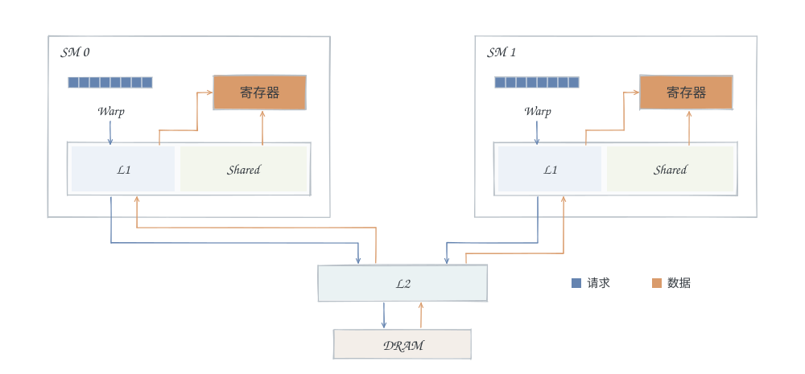
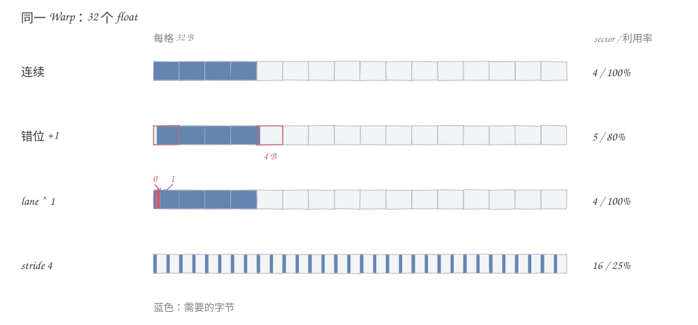
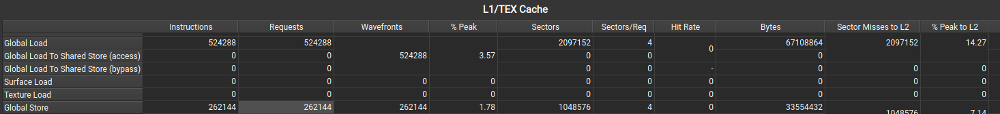
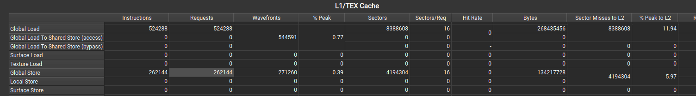
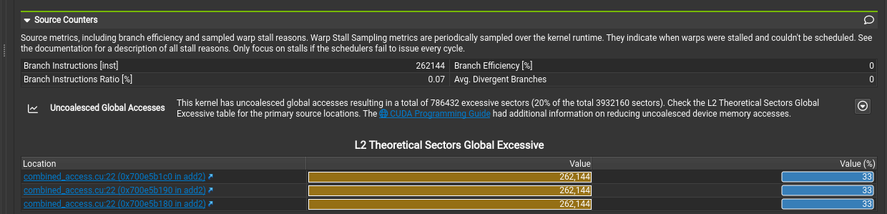
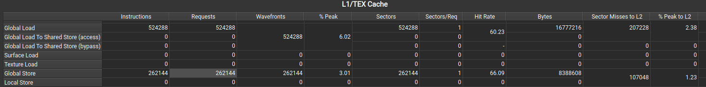
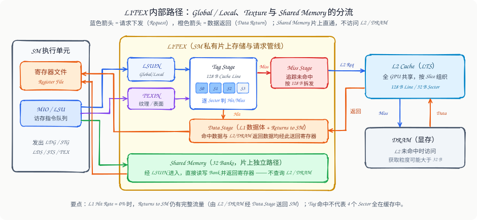
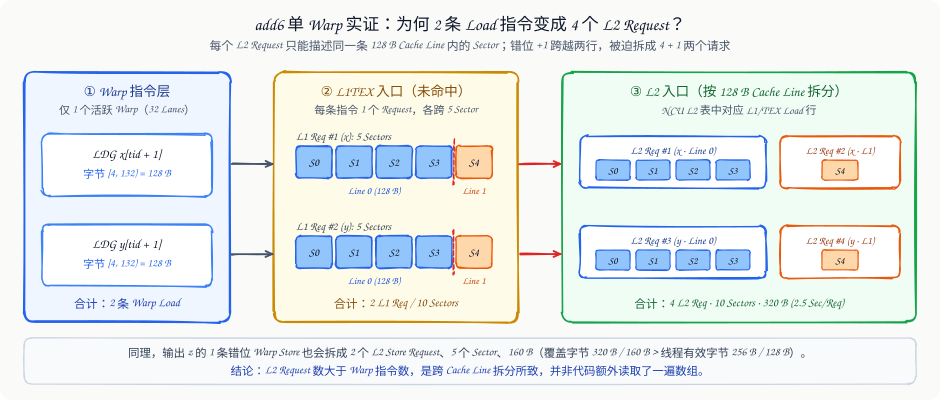
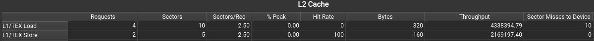
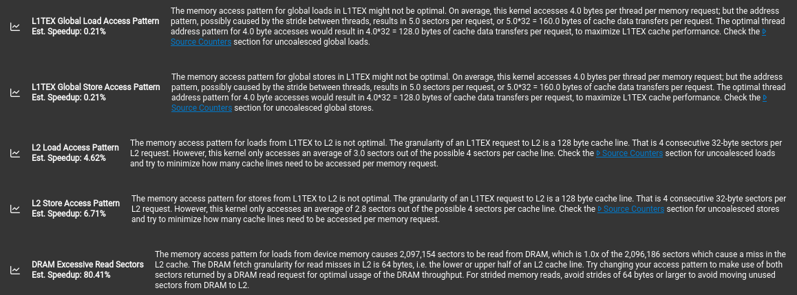

# 合并访存与缓存

Global Memory 的访问由 Warp 中参与当前指令的线程共同组成。**合并访存关注的是这条指令覆盖了哪些地址，以及这些地址需要多少个内存传输单元**，并不要求 lane 0、lane 1 必须按地址顺序访问。

以 32 个活跃线程各读取一个 `float` 为例，整条 Warp 一共需要 128 B 数据。在 NCU 的访存模型中，一个 **Sector** 是对齐的 32 B 区域；若这 128 B 正好落在 4 个 Sector 中，便能充分利用本次访问覆盖的字节。

??? info "实验口径与系列定位"

    - 本文属于 **NCU 性能分析与 Kernel 调优** 系列第 1 篇，聚焦 Warp 访存地址模式与 L1TEX / L2 / DRAM 计数链路；后续衔接 [Occupancy 与 Warp 调度](Occupancy与Warp调度.md)、[矩阵转置与访存优化](矩阵转置与访存优化.md) 与 [NCU 性能分析与 Roofline](NCU性能分析与Roofline.md)。
    - 文中 `add1`～`add6` 案例与 NCU 截图来自配套数组加法测试（数组分配长度 32M，实际启动 `Grid = N / 256`、`Block = 64`，即 8M 活跃线程、262,144 个 Warp）。

!!! abstract "读懂内存报告前，先区分三个字节量"

    1. **线程在代码中需要的字节数**：算法有效数据量（如 32 线程各读 1 个 `float` = 128 B）。
    2. **缓存管线处理的 Sector 覆盖字节数**：`Sectors × 32 B`，决定片上访存效率，由地址合并程度主导。
    3. **DRAM 实际物理传输字节数**：经 L1、L2 过滤和硬件获取粒度放大后的显存流量，由缓存命中与数据复用主导。

    **合并访存优化第 1 项与第 2 项的比值；缓存复用与局部性进一步影响第 2 项与第 3 项的比值。**

---

## 1. 地址空间与访问层级

`Global Memory` 首先描述的是程序可访问的逻辑地址空间。Kernel 中的 `x[n]` 指向这个地址空间里的元素，但读取它时，数据不一定真的来自显存芯片——访问可能由 L1 或 L2 缓存直接满足。

**请求向下传递，数据向上返回**：SM 发出 load，请求进入 L1TEX；L1 未命中时查询 L2，L2 仍未命中时再访问 DRAM。返回的数据最终进入线程寄存器，后续加法消费的是寄存器中的值。Store 则携带待写数据沿存储路径处理，不应把 load 的数据返回方向与请求下发方向混为一谈。

[{ width="800" }](../../assets/cuda/memory/memory-sm-cache-hierarchy.svg)

!!! note "SM 私有片上存储 vs 全卡共享 L2"

    - **不同 SM 的 L1 不是同一份缓存**：同一份输入在多个 SM 上使用时，可能在各自 L1 中保留副本；汇入 L2 后才进入整块 GPU 共享的缓存体系。
    - **L1 与 Shared Memory 共享片上容量，但管理方式截然不同**：L1 由硬件自动决定缓存哪些 Global 数据，Shared Memory 的排布与读写时机则由 Kernel 显式掌控。调大 Shared Memory 配置既影响 Block 驻留上限，也会压缩留给 L1 的可用空间。

---

## 2. 连续、错位、置换与跨步：Warp 的 Sector 覆盖

仅观察单个 Warp 的一次访问，可以按覆盖的有效字节定义 **Sector 利用率**：

$$
\eta_{\mathrm{sector}}
=\frac{\text{线程需要的不同字节数}}{\text{覆盖的 Sector 数}\times 32\ \mathrm{B}}.
$$

对于 32 条 lane 各读不同 `float` 的场景，分子固定为 128 B。下面 4 种常见地址模式直观展示了同一份 128 B 数据如何映射出截然不同的 Sector 覆盖：

| 测试 Kernel | 地址模式 | 单次 Warp Load 覆盖范围 | Sector 数（`Sectors/Req`） | $\eta_{\mathrm{sector}}$ | 核心结论 |
| --- | --- | --- | --- | --- | --- |
| `add1` | 对齐连续访问（`n`） | `[0, 128)`，4 个对齐 Sector | `4` | **100%** | 理想合并基准 |
| `add2` | 整体错位 +1（`n + 1`） | `[4, 132)`，首尾各浪费 4 B / 28 B | `5` | **80%** | 连续但未对齐，多跨 1 个 Sector |
| `add3` | 交换相邻 lane（`tid ^ 1`） | 与 `add1` 相同的 `[0, 128)` 地址集合 | `4` | **100%** | **线程顺序改变不破坏合并** |
| `add5` | 跨步 ×4（`n * 4`） | 相邻 lane 隔 16 B，每 Sector 仅用 8 B | `16` | **25%** | 浪费 75% 覆盖字节 |

[{ width="800" }](../../assets/cuda/memory/memory-warp-sector-access.svg)

=== "add1 对齐访问"

    ```cuda
    void __global__ add1(float *x, float *y, float *z)
    {
        // 相邻 lane 读取相邻 float，覆盖四个对齐 sector
        int n = threadIdx.x + blockIdx.x * blockDim.x;
        z[n] = x[n] + y[n];
    }
    ```

=== "add2 错位 +1"

    ```cuda
    void __global__ add2(float *x, float *y, float *z)
    {
        // 起始地址偏移一个 float，连续访问跨五个 sector
        int n = threadIdx.x + blockIdx.x * blockDim.x + 1;
        z[n] = x[n] + y[n];
    }
    ```

=== "add3 交换相邻 lane"

    ```cuda
    void __global__ add3(float *x, float *y, float *z)
    {
        // 只交换线程与地址的对应关系，覆盖的地址集合不变
        int tid_permuted = threadIdx.x ^ 0x1;
        int n = tid_permuted + blockIdx.x * blockDim.x;
        z[n] = x[n] + y[n];
    }
    ```

=== "add5 跨步访问"

    ```cuda
    void __global__ add5(float *x, float *y, float *z)
    {
        // 相邻 lane 间隔四个 float，单条访问覆盖十六个 sector
        int n = (threadIdx.x + blockIdx.x * blockDim.x) * 4;
        z[n] = x[n] + y[n];
    }
    ```

!!! warning "四个常见理解误区"

    1. **对照目的不同**：`add1`、`add2`、`add3`、`add5` 用于对照访存模式，并非处理相同数据规模的等价优化版（`add2` 末尾需预留 1 元素，`add5` 需分配足够跨步空间）。
    2. **“单条指令多一个 Sector” ≠ “DRAM 多读 32 B”**：上面分析的是单条 Warp 指令的覆盖范围；相邻 Warp 可能重叠访问同一个边界 Sector，缓存会复用先前取回的数据。
    3. **子指针仍会破坏对齐**：`cudaMalloc` 保证首地址充分对齐，但派生出的子指针（如 `ptr + 1`）或未对齐的二维矩阵行跨度，都会让整个 Warp 整体错位。
    4. **区分元素自然对齐与 Sector 边界**：`float4` 要求 16 B 自然对齐，而整个 Warp 恰好落入 4 或 16 个 Sector 还依赖 32 B Sector 边界与全部 32 条 lane 的地址集合。

---

## 3. 从 Kernel 指令到 Request、Sector 与 Wavefront

一条源码语句 `z[n] = x[n] + y[n]` 包含两次读取和一次写入。编译后，Warp 的每条内存指令按活跃线程的地址生成 **Request**，再拆解为覆盖的 **Sector** 与片上处理批次 **Wavefront**。

!!! example "手算闭合：从 8M 线程推导出 L1TEX 表格里的精确数字"

    配套测试数组分配了 $32\times 1024\times 1024$ 个元素，实际启动 $8\times 1024\times 1024$ 个活跃线程（每线程处理 1 个元素），因此总 Warp 数为：

    $$
    N_{\mathrm{warp}} = \frac{8\times 1024\times 1024}{32} = 262{,}144.
    $$

    每个 Warp 执行 2 条标量 Global load 与 1 条 Global store，即 **Load 指令 524,288 次、Store 指令 262,144 次**（总计 786,432 次 Warp 内存指令，而非线程维度的 8M 次加法）。在 L1TEX 入口，每条 Warp Global/Local 指令形成 1 个 Request，对齐版本 `add1` 由此得到：

    - **Global Load**：$524{,}288 \times 4 = 2{,}097{,}152$ 个 Sector，对应 **64 MiB** 覆盖字节；
    - **Global Store**：$262{,}144 \times 4 = 1{,}048{,}576$ 个 Sector，对应 **32 MiB** 覆盖字节。

### 3.1 对照 `add1`、`add2`、`add5` 的 L1TEX 报告

在 NCU 的 **Memory Workload Analysis → L1/TEX Cache** 表中，可以直接核对 `Requests`、`Sectors` 与 `Sectors/Req`（`add1` 为 4、`add2` 为 5、`add5` 为 16）：

[{ width="800" }](../../assets/cuda/memory/ncu-memory-aligned-l1tex.png)

[{ width="800" }](../../assets/cuda/memory/ncu-memory-offset-l1tex.png)

[{ width="800" }](../../assets/cuda/memory/ncu-memory-stride4-l1tex.png)

| L1/TEX 表格列 | 回答的问题 |
| --- | --- |
| **Instructions / Requests** | 执行了多少条 Warp 内存指令、向 L1TEX 提交了多少个请求 |
| **Sectors / Sectors per Request** | 地址覆盖有多分散（**必须结合每线程字节数判断**：`float` 理想为 4，`float4` 理想为 16） |
| **Wavefronts** | 请求在 L1TEX 管线内被拆成多少个片上处理批次 |
| **Hit Rate / Sector Misses to L2** | 有多少 Sector 由 L1 满足，多少继续向下查询 L2 |
| **Bytes / Throughput** | 所选层级按 `Sectors × 32 B` 统计的覆盖字节量及吞吐 |

对于错位版 `add2`，指令数和 Request 数并未变化，仅 `Sectors/Req` 从 4 升至 5，片上覆盖总量由 96 MiB 增至 120 MiB（**这是片上覆盖量的增加，不等于 DRAM 流量增加 24 MiB**）。

截图中 `add2` 的 Global Load 共有 2,621,440 个 Sector，L1 命中率约 13.36%——正是相邻 Warp 在边界 Sector 重叠带来的缓存复用。在同一层、同一种访问类型下，可用命中率反推缺失量：

$$
S_{\mathrm{miss}} = S_{\mathrm{total}}\times(1 - h) \approx 2{,}621{,}440 \times (1 - 0.1336) \approx 2{,}271{,}216,
$$

与表中 **Sector Misses to L2** 的 `2,271,436` 吻合（显示命中率经取整，精确值直接看缺失计数；另一轮测试命中率为 16.53%，说明复用程度随调度状态波动）。需注意：**L1 命中只减少向下查询 L2 的量，不会把上游 Request 从 5 个 Sector 改回 4 个。**

### 3.2 Excessive Sectors 与同址广播（`add4`）

NCU 的 **Source Counters** 会用 **Excessive Sectors** 将超出理想覆盖的 Sector 直接定位到源码行：

[{ width="800" }](../../assets/cuda/memory/ncu-memory-excessive-sectors.png)

以 `add5` 为例，两次 load 和一次 store 均从 4 个 Sector 涨到 16 个，总理论 Sector 数为 $262{,}144\times 3\times 16 = 12{,}582{,}912$，理想对齐值为 $262{,}144\times 3\times 4 = 3{,}145{,}728$，多余的 $9{,}437{,}184$ 个 Sector 占实际理论覆盖量的 **75%**——正好对应截图中 **L2 Theoretical Sectors Global Excessive**。该比例刻画地址浪费程度，**不是修改代码后必然获得 75% 加速的承诺**。

另一个极端是整条 Warp 读取完全相同的地址（`add4`）：硬件可以通过**广播（Broadcast）** 用单个 Sector 服务全部 32 条 lane：

```cuda
void __global__ add4(float *x, float *y, float *z)
{
    int n = threadIdx.x + blockIdx.x * blockDim.x;
    int warp_idx = n / 32;
    // 同一个 Warp 的所有 lane 访问同一个数组元素
    z[warp_idx] = x[warp_idx] + y[warp_idx];
}
```

[{ width="800" }](../../assets/cuda/memory/ncu-memory-broadcast-l1tex.png)

!!! warning "关于 `add4` 广播的两个陷阱"

    1. **不存在“400% 利用率”**：32 条 lane 只需同一份 4 B 数值，1 个 32 B Sector 已是最小传输粒度，不能拿 $32\times 4 / 32$ 误算成 400%。
    2. **存在写竞争**：`add4` 让整条 Warp 写回同一个 `z[warp_idx]`，存在多线程写同址竞争，仅用于演示广播地址模式，不能当作正确的数组加法实现或耗时对照。

### 3.3 Request vs Wavefront，以及 `% Peak` 的口径陷阱

在 NCU 的 L1TEX 模型中，**Sector 描述覆盖了多少 32 B 区域，Wavefront 描述这些区域需要拆成多少批内部管线操作**。因此，同样请求 4 个 Sector，若分散在不同 Cache Line 或触发内部限制，就可能需要 2 个以上的 Wavefront——这也是 [矩阵转置与访存优化](矩阵转置与访存优化.md) 中“同 Sector 数却有不同延迟”的关键伏笔（Shared Memory 的 Bank Conflict 也会拆分 Wavefront，但不能把所有 Global 额外 Wavefront 都叫作 Bank Conflict）。

!!! warning "读懂 Bytes、Throughput 与 `% Peak` 的四条铁律"

    1. **先确认 Bytes 对应哪条路径**：`Bytes = Sectors × 32 B`（如 `add2` 的 Global Load 为 80 MiB、Store 为 40 MiB），Throughput 是该路径字节量除以执行时间，必须分清统计的是请求覆盖量、返回量还是 DRAM 物理传输量。
    2. **`% Peak` 的分母各自独立**：L1TEX Wavefront `% Peak`、L2 Sector `% Peak` 与 DRAM 带宽 `% Peak` 分属不同硬件单元；L1 某一行只有 2.4%，绝不意味着显存带宽只用了 2.4%。NCU 综合的 Memory Throughput 百分比取各子管线利用率的最大值而非求和。
    3. **不同硬件单元不在同一时钟域**：SM、L2、DRAM 各自拥有独立时钟频率，只有同域才能用 $t = \mathrm{Cycles} / f$ 换算，各单元活动周期不可直接相加。
    4. **Returns to SM 不是 L1 命中次数**：即便 L1 Hit Rate 为 0%，从 L2 或 DRAM 取回的数据仍要经返回路径送回 SM，因此 Returns to SM 依然有流量。

---

## 4. L1TEX 与 L2 的访存流程及单 Warp 请求拆分

Global / Local 访问经 SM 的 MIO 路径进入 L1TEX：命中时直接返回，未命中时由 Miss Stage 发往 L2（按 Slice 组织，NCU 中记作 **LTS**）；L2 仍未命中才访问 DRAM。Shared Memory 复用 L1TEX 中的部分片上路径，但**绝不会作为 Global load 去查询 L2 或 DRAM**。

[{ width="800" }](../../assets/cuda/memory/memory-l1tex-pipeline.svg)

| L1TEX 关键阶段 | 职责与易错点 |
| --- | --- |
| **LSUIN / TEXIN** | LSUIN 接收 Global / Local / Shared 请求；TEXIN 接收纹理与表面请求（未用到纹理/原子时对应行为 0 属正常） |
| **Tag Stage** | 查询 128 B Cache Line（由 4 个 32 B Sector 组成）标签及对应 Sector 是否有效——**Tag 命中不代表 4 个 Sector 都在缓存中** |
| **Miss Stage** | 管理未命中的 Sector 请求并下发至 L2；跨越 128 B Cache Line 边界时会拆成多个 L2 Request |
| **Data Stage** | 将命中的数据或下级返回的数据送回使用它的执行单元 |

### 4.1 单 Warp 实证：为什么 2 条 Load 指令变成 4 个 L2 Request？

`add6` 只让 Block 0 的前 32 个线程执行错位 +1 的加法，把整个过程压缩到单个 Warp 来观察：

```cuda
void __global__ add6(float *x, float *y, float *z)
{
    if (blockIdx.x == 0 && threadIdx.x < 32)
    {
        // 只观察一个 Warp：每个数组的访问跨两个 cache line
        int n = threadIdx.x + blockIdx.x * blockDim.x + 1;
        z[n] = x[n] + y[n];
    }
}
```

[{ width="800" }](../../assets/cuda/memory/memory-add6-request-pipeline.svg)

[{ width="800" }](../../assets/cuda/memory/ncu-memory-single-warp-l2.png)

!!! example "手算闭合：L2 表中 `Requests = 4, Sectors = 10, Sectors/Req = 2.5` 的由来"

    1. **Warp 指令层**：只有 1 个活跃 Warp，对 `x`、`y` 各发 1 条 load（共 2 条）、对 `z` 发 1 条 store。
    2. **L1TEX 入口**：每条错位 +1 的 load 覆盖 5 个 Sector（第一条 128 B Cache Line 内的 Sector 0～3，加第二条 Cache Line 内的 Sector 4）。
    3. **L2 入口**：每个 L2 Request 只能描述**同一条 Cache Line 内**的 Sector（而非每个 Sector 单独发请求），因此未命中后每条 load 拆成 2 个 L2 Request（分别携带 4 个与 1 个 Sector）。`x` 与 `y` 合计 **4 个 L2 Load Request、10 个 Sector、320 B**（`Sectors/Req = 10 / 4 = 2.5`）；`z` 对应 **2 个 L2 Store Request、5 个 Sector、160 B**（表中行名 `L1/TEX Load/Store` 表示请求来源，并非代码多读了一遍数组）。

---

## 5. 从缓存计数追到 DRAM 与 L2 逐出策略

沿着 L1 的 **Sector Misses to L2** 进入 L2，只有 L2 未命中的读取才会继续访问 DRAM。且由于中间会发生请求拆分、合并与硬件粒度对齐，相邻两级的 Request 数和字节数不必相等。

[{ width="800" }](../../assets/cuda/memory/ncu-memory-access-pattern-warnings.png)

如图中提示，在该次测试对应的 GPU 路径上，L2 读未命中的 DRAM 获取粒度为 **64 B（两个 32 B Sector）**——若程序跨步访问只用到其中 1 个 Sector，另一个 Sector 也会被顺带拉回，导致 **DRAM 获取量大于 L2 真正缺失的 Sector 量**（具体粒度因架构与路径而异，不能推广为所有 GPU 固定 64 B）。

!!! warning "写路径的两个反直觉现象：100% L2 Store Hit Rate 与 DRAM 写回不相等"

    1. **L2 Store Hit Rate = 100% 不代表之前读过输出数组**：`z` 与 `x/y` 完全独立，Store 的分配、查找与合并机制同样会使 L2 Store Hit Rate 显示为 100%。Global Store 的跨 SM 一致性由 L2 承担（PTX 默认 `st.wb` 写回一致缓存层），SM 私有 L1 不能作为跨 SM 通信保证。
    2. **L2 接收 32 MiB ≠ 采样期内 DRAM 必须写回 32 MiB**：脏数据可暂留 L2 待后续逐出写回，且 DRAM 计数受物理事务与压缩影响，两者不相等并不意味着输出数据丢失。

为减少流式大数组冲刷缓存，NCU 的 **L2 Cache Eviction Policies** 还记录了访问使用的逐出提示（提示而非强制锁定，也不改变读取顺序）：

| 逐出策略 | 含义 | 适用数据 |
| --- | --- | --- |
| `evict_first` | 缓存需腾空间时最先逐出 | 仅扫描一两次的流式数据，避免污染 L2 |
| `evict_normal` | 普通替换优先级 | 常规访存 |
| `evict_last` | 尽量晚于其他优先级逐出 | 希望反复复用的权重或热点输入 |

---

## 6. `.ca` 与 `.cg`：控制 Global Load 的缓存策略

编译期可通过 `nvcc` 控制 Global / Generic load 的默认缓存修饰符：

```bash
# .cg (cache at global level)：只在 L2 及下级缓存，绕过 L1 数据缓存
nvcc -Xptxas -dlcm=cg ...

# .ca (cache at all levels)：在包含 L1、L2 的各级缓存
nvcc -Xptxas -dlcm=ca ...
```

!!! tip "验证 `-dlcm` 与区分两个优化维度"

    - `-dlcm` 只改变 **load 的默认缓存策略**，既不会关闭整个 L1TEX，也不会改变 Shared Memory 容量；即便绕过 L1 数据缓存，NCU 仍会记录 L1TEX 的指令、Request 与管线工作。验证时应先核对 PTX/SASS 指令修饰符，再对照同一访问的 L1 Hit、Sector Misses to L2 与耗时。
    - **合并访存 ≠ 缓存策略**：前者让单条 Warp 指令覆盖更少无用字节（**绕过 L1 不会把错位的 5 个 Sector 变成 4 个**），后者决定数据在哪一级保留与复用；而 Shared Memory 则由程序员显式组织 Block 内复用。在下一篇 [Occupancy 与 Warp 调度](Occupancy与Warp调度.md) 中，我们将继续看这些访存延迟如何与 Warp 调度交织在一起。

> 参考：[NVIDIA Nsight Compute Profiling Guide](https://docs.nvidia.com/nsight-compute/ProfilingGuide/index.html#metrics-guide)、[CUDA Best Practices：Coalesced Access](https://docs.nvidia.com/cuda/cuda-c-best-practices-guide/index.html#coalesced-access-to-global-memory)、[PTX Cache Operators](https://docs.nvidia.com/cuda/parallel-thread-execution/index.html#cache-operators)、[NVCC 默认 load 缓存修饰符](https://docs.nvidia.com/cuda/cuda-compiler-driver-nvcc/index.html#def-load-cache-dlcm)、[合并访存](https://zhuanlan.zhihu.com/p/641639133)、[缓存与访存流程](https://zhuanlan.zhihu.com/p/632244210)。
