Global Memory 的访问由 Warp 中参与当前指令的线程共同组成。**合并访存关注的是这条指令覆盖了哪些地址，以及这些地址需要多少个内存传输单元**，并不要求 lane 0、lane 1 必须按地址顺序访问。

以 32 个活跃线程各读取一个 `float` 为例，线程一共需要 128 B 数据。在下面的 NCU 访存模型中，一个 sector 是对齐的 32 B 区域；若这 128 B 正好落在四个 sector 中，便能充分利用本次访问覆盖的字节。

## 地址空间与访问层级

`Global Memory` 首先描述的是程序可访问的地址空间。Kernel 中的 `x[n]` 指向这个地址空间里的元素，但读取它时，数据不一定真的来自显存芯片：访问可能由 L1 或 L2 缓存满足。

**请求向下传递，数据向上返回**：SM 发出 load，请求进入 L1TEX；L1 未命中时查询 L2，L2 仍未命中时再访问 DRAM。返回的数据最后进入线程寄存器，后续加法使用的是寄存器中的值。Store 则携带待写的数据沿存储路径处理，不应把 load 的返回方向和请求方向混为一谈。

所以需要同时区分三个量：**线程在代码中访问了多少字节、缓存管线处理了多少 sector、DRAM 实际传输了多少字节**。访存合并首先优化前两者之间的关系；缓存复用进一步影响后两者之间的关系。

L1 / Shared Memory 的片上资源属于各自的 SM，L2 则由整块 GPU 的 SM 共享。**不同 SM 的 L1 不是同一份缓存**：同一个输入在多个 SM 上使用，可能在各自 L1 中保留副本；访问共享的 L2 时，则汇入同一层缓存体系。

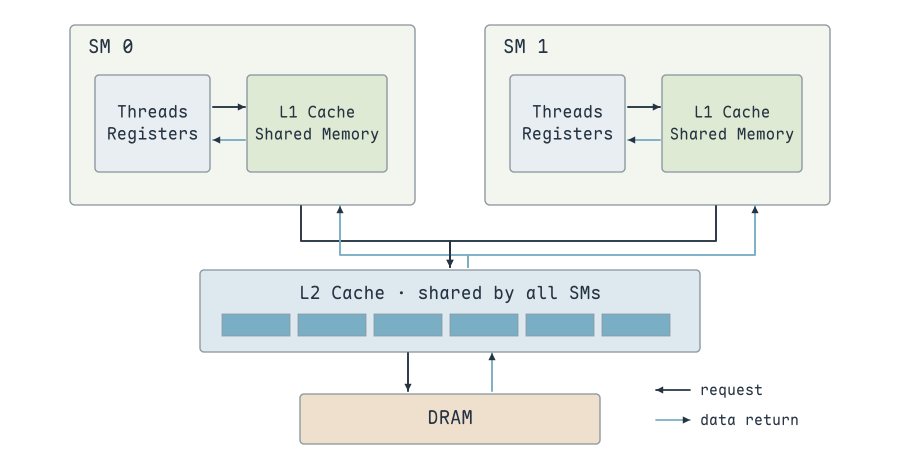{ width="850" }

L1 与 Shared Memory 在这类架构中共享片上容量，但使用方式不同：L1 由硬件决定缓存哪些 Global 数据，Shared Memory 的位置和访问时机由 Kernel 显式管理。调整 Shared Memory 的容量配置，既影响 Block 驻留，也会影响留给 L1 的空间。

## 连续地址、错位与跨步访问

**对齐的连续访问**：相邻线程读取相邻 `float`，第一个地址按 128 B 对齐时，整个 Warp 覆盖四个 sector。

**错位一个元素**：索引整体加 1，读取范围由字节 `[0,128)` 变成 `[4,132)`。线程仍然读取连续地址，但跨过第五个 sector，按 sector 覆盖字节计算的利用率变为 $128 / 160 = 80\%$。

**交换相邻线程的地址**：`threadIdx.x ^ 1` 将 lane 0、1 的地址交换，lane 2、3 的地址交换……地址集合没有变化，因此仍然只覆盖四个 sector。**线程访问的顺序改变，不等于访存失去合并。**

**每个线程间隔四个元素**：索引乘 4，相邻线程的地址间隔 16 B。一个 Warp 覆盖 16 个 sector，却只用到其中 128 B 数据，利用率为 $128 / 512 = 25\%$。

只看一个 Warp 的一次访问，可以按覆盖的不同字节定义 sector 利用率：

$$
\eta_{\mathrm{sector}}
=\frac{\text{线程需要的不同字节数}}{\text{覆盖的 sector 数}\times32\ \mathrm{B}}.
$$

对于每线程读取不同 `float` 的情况，分子是 128 B。错位访问的第一个 sector 浪费开头 4 B，最后一个 sector只使用 4 B，合计多覆盖 32 B。跨步访问则在每个 sector 内只使用两个 `float`，浪费其中 24 B。

**这里分析的是同一条 Warp 指令的覆盖范围**。不同 Warp 之间可能访问同一个 sector，缓存能复用先前取回的数据，因此“这条请求多一个 sector”不一定等价于“DRAM 多读取 32 B”。

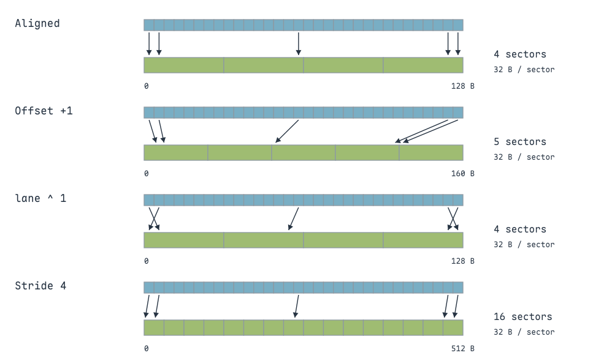{ width="900" }

=== "add1 对齐访问"

    ```cuda
    void __global__ add1(float *x, float *y, float *z)
    {
        // 相邻 lane 读取相邻 float，覆盖四个对齐 sector
        int n = threadIdx.x + blockIdx.x * blockDim.x;
        z[n] = x[n] + y[n];
    }
    ```

=== "add2 错位 +1"

    ```cuda
    void __global__ add2(float *x, float *y, float *z)
    {
        // 起始地址偏移一个 float，连续访问跨五个 sector
        int n = threadIdx.x + blockIdx.x * blockDim.x + 1;
        z[n] = x[n] + y[n];
    }
    ```

=== "add3 交换相邻 lane"

    ```cuda
    void __global__ add3(float *x, float *y, float *z)
    {
        // 只交换线程与地址的对应关系，覆盖的地址集合不变
        int tid_permuted = threadIdx.x ^ 0x1;
        int n = tid_permuted + blockIdx.x * blockDim.x;
        z[n] = x[n] + y[n];
    }
    ```

=== "add5 跨步访问"

    ```cuda
    void __global__ add5(float *x, float *y, float *z)
    {
        // 相邻 lane 间隔四个 float，单条访问覆盖十六个 sector
        int n = (threadIdx.x + blockIdx.x * blockDim.x) * 4;
        z[n] = x[n] + y[n];
    }
    ```

这些 Kernel 用来对照访问模式，**不是四个完成相同数据规模的优化版本**。`add2` 的末尾要预留一个元素，`add5` 需要为跨步后的索引分配足够空间。配套 `main` 的数组长度是 32M，但 Grid 为 `N/256`、Block 为 64，实际启动的是 8M 个线程；统计源代码访问次数时应按实际线程数计算。

`cudaMalloc` 返回的起始地址具有足够的对齐，但**从这个地址派生出的子指针仍可能失去对齐**。例如起始地址加一个 `float` 后，Warp 的访问就整体错位；二维矩阵还要检查行跨度，不能只检查矩阵第一个元素。

标量访问、向量访问的对齐要求也要分开：`float4` 通常需要 16 B 自然对齐，而“一个 Warp 正好覆盖对齐的四个或十六个 sector”还涉及 32 B sector 边界和整个 Warp 的地址集合。

## 从 Kernel 指令到 Request、Sector

一条源代码 `z[n] = x[n] + y[n]` 包含两个读取和一个写入。编译后，Warp 的每条内存指令按活跃线程的地址生成请求，再按覆盖的 sector 处理。**源码中的元素数、Warp 指令数、Request 数和 Sector 数是不同的计数。**

示例数组分配了 $32\times1024\times1024$ 个元素，实际只启动 $8\times1024\times1024$ 个线程。设这些线程全部活跃，每个线程处理一个元素，则实际 Warp 数为：

$$
N_{\mathrm{warp}}=8\times1024\times1024/32=262144.
$$

每个 Warp 执行两个标量 load、一个 store，因此 Global load 指令合计 524288 次，Global store 合计 262144 次，总计 786432 次。**这里数的是 Warp 执行的指令实例，并非线程层面的 8M 次加法。**

在 L1TEX 入口，一个 Warp 的一条 Global / Local 内存指令形成一个 request；后续每个 request 覆盖几个 sector，由地址模式决定。对齐版本因此得到：

- Load：$524288\times4=2097152$ 个 sector，对应 64 MiB 覆盖字节。
- Store：$262144\times4=1048576$ 个 sector，对应 32 MiB 覆盖字节。

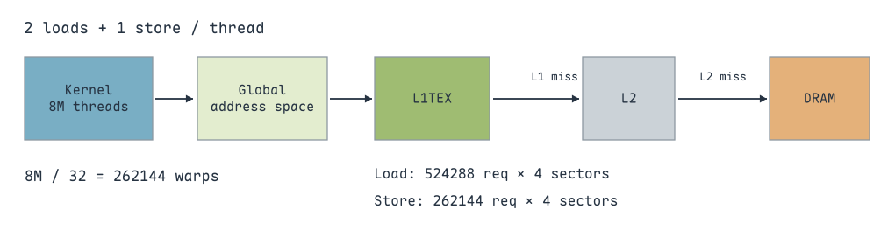{ width="950" }

对于 `add1`，每个 Warp 的一次标量 load 请求四个 sector；`add2` 请求五个；`add5` 请求十六个。NCU 的 **L1/TEX Cache** 表中可以直接对照 `Requests`、`Sectors` 和 `Sectors/Req`：

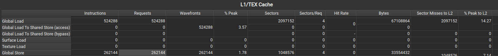{ width="950" }

{ width="950" }

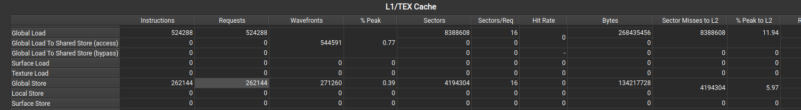{ width="950" }

截图中的几列各自回答不同的问题：

- **Instructions / Requests**：执行了多少条相关 Warp 指令、提交了多少个请求。
- **Sectors / Sectors per Request**：这些请求的地址覆盖有多分散。
- **Wavefronts**：请求被拆成多少个片上处理批次。
- **Hit Rate / Sector Misses to L2**：有多少访问由 L1 满足，多少需要继续查询 L2。
- **Bytes / Throughput**：所选层级搬运了多少数据，以及按时间计算的吞吐。

对于 `add2`，load 和 store 的指令数没有增加，只是每个 request 从四个 sector 变为五个。按 L1 请求覆盖量计算，总量由 96 MiB 变为 120 MiB；这是**片上请求覆盖量的增加**，不能直接当作 DRAM 实际流量增加了 24 MiB。

错位版本截图的 Global Load 共有 2621440 个 sector，L1 命中率约 13.36%。相邻 Warp 的读取范围在边界 sector 上重叠：前一个 Warp 已经取回的数据，有机会被后一个 Warp 复用。**每条指令仍覆盖五个 sector，命中只减少继续向下查询的量**，不会把上游 request 改成四个 sector。

在同一层、同一种访问类型下，可以用 sector 命中率估算缺失量：

$$
S_{\mathrm{miss}}=S_{\mathrm{total}}\times(1-h).
$$

例如 $2621440\times(1-0.1336)\approx2271216$ 个 sector，与图中 **Sector Misses to L2** 的 2271436 接近。命中率显示值经过取整，精确数量直接看缺失计数。另一轮错位测试的命中率为 16.53%，也说明缓存复用的实际程度会随调度和缓存状态变化。

`Sectors/Req` 要结合**每个活跃线程访问的字节数**解释：32 个 lane 各读一个 `float`，四个 sector 是理想覆盖；各读一个 `float4` 时，Warp 需要 512 B 数据，理想覆盖就是十六个 sector。不能仅凭数值较大判断合并程度差。

`Source Counters` 中的 **Excessive Sectors** 会把超出理想覆盖的 sector 定位到源代码行。它衡量这条访问指令多覆盖了多少 sector，不代表这些字节全部到达 DRAM。

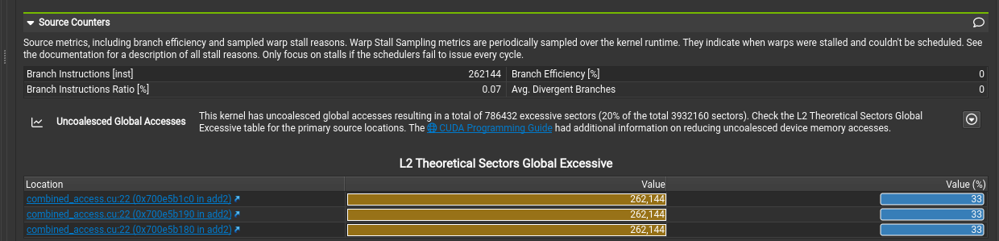{ width="900" }

以 `add5` 为例，两个 load 和一个 store 都从四个 sector 增加到十六个。三个访问合计的理论 sector 数为：

$$
262144\times3\times16=12582912.
$$

若相同字节能按对齐连续方式覆盖，理想值是 $262144\times3\times4=3145728$。多出的 sector 为 9437184，占实际理论覆盖量的 75%，对应截图中的 **L2 Theoretical Sectors Global Excessive**。这个百分比说明地址模式的浪费，不是 Kernel 可以直接获得 75% 加速的承诺。

还有一种情况是整个 Warp 读取同一个地址：**同址读取可以广播，一份数据服务多个线程**。配套 `add4` 使用 `n/32` 演示这种地址模式，但同时让所有 lane 写入同一个 `z[warp_idx]`，存在多线程写同址的竞争，不能作为正确的数组加法优化实现。

配套的同址访问代码如下：

```cuda
void __global__ add4(float *x, float *y, float *z)
{
    int n = threadIdx.x + blockIdx.x * blockDim.x;
    int warp_idx = n / 32;
    // 同一个 Warp 的所有 lane 访问同一个数组元素
    z[warp_idx] = x[warp_idx] + y[warp_idx];
}
```

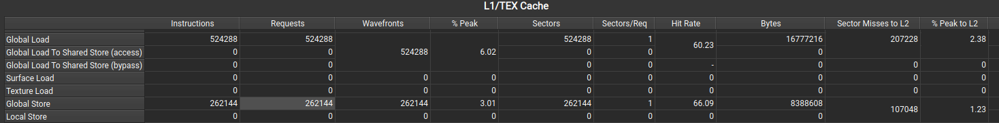{ width="950" }

它仍可能执行与其他示例相同数量的 Warp load 指令，但每条指令只请求一个 sector，整个 Warp 读取同一个 `float`。这展示了**指令数与不同数据量可以相差很大**：32 个线程需要同一份值，并不是需要 32 份不同的值。

对于广播，不能把每线程 4 B 简单乘 32，再除以 32 B，称为“400% 利用率”。一个 sector 已经是满足同址请求的最小覆盖范围；同时，这段代码的同址写入仍有竞争，测得时间也不能拿来表示处理了同样多的独立数组元素。

## Bytes、Throughput 与管线利用率

在 sector 计数对应的表中，**Bytes = Sectors × 32 B**。例如错位访问的 Global Load 是 80 MiB、Global Store 是 40 MiB；这与源码需要的 64 MiB 读取、32 MiB 写入不同，多出的部分来自请求覆盖了未使用的字节。

Throughput 用该指标统计的字节量除以执行时间。若一条路径记录 64 MiB、Kernel 耗时 100 μs，吞吐便是约 671 GB/s。不同表格可能统计请求覆盖、数据返回或实际 DRAM 传输，必须先确认 **Bytes 计量的是哪条路径**。

**`% Peak` 是对应管线相对于自身峰值的利用率**。L1TEX 处理 Wavefront 的 `% Peak`、L2 sector 管线的 `% Peak` 与 DRAM 吞吐百分比，分母分别属于不同硬件单元；L1 某一行只有 2.4%，不能据此认定显存只用了 2.4%。

NCU 的综合 Throughput 百分比通常取组成它的计数器中**最大的峰值利用率**，而不是把各路径百分比相加。例如某个内存指令管线接近满载，Memory Throughput 的综合值可以很高，但 DRAM 带宽仍有余量；展开组成指标，才能区分指令提交能力、缓存处理能力与数据传输能力。

Cycles 同样要看时钟域：SM、L2、DRAM 的周期并非同一个时钟。只有周期和频率属于同一域，才能用 $t=\mathrm{Cycles}/f$ 换算；各单元的活动周期也不能简单相加作为 Kernel 时间。

Memory Workload 总览中的 **Returns to SM** 是返回给 SM 的数据流。即使 L1 Hit Rate 为零，L2 或 DRAM 取回的数据也会经过返回路径，所以这里仍然有数据。它不是“L1 命中多少次”的另一个名字。

## Request 与 Wavefront

一个 request 可以覆盖多个 sector，还可能拆成多个 **Wavefront**。在 NCU 的 L1TEX 模型中，Wavefront 是某个管线阶段可以一次处理的工作包；一个请求的地址太分散，无法在同一个工作包内处理时，便拆成多个 Wavefront，依次经过管线。

**Sector 描述覆盖了多少内存区域，Wavefront 描述这些区域需要多少批内部处理。** 因此，请求四个 sector 可能只需要一个 Wavefront，也可能因为 cache line 分布或内部限制需要两个以上。

这正是后面转置案例的重要线索：两种 Block 形状都可能有相同的 sector 数，却需要不同的片上处理工作；只数 sector，无法解释所有的延迟差异。Shared Memory 的 bank conflict 也会把一条请求拆成多个 Wavefront，但不能把所有 Global 访问的额外 Wavefront 都称为 bank conflict。

## L1TEX 与 L2 的访存流程

Global / Local 访问经 SM 的 MIO 路径进入 L1TEX，先查询对应的 cache tag。命中的 sector 直接返回；未命中的 sector 由 Miss Stage 向 L2 请求。Shared Memory 也使用 L1TEX 中的部分资源，但走独立的数据路径，**不会作为 Global load 去查询 L2 或 DRAM**。

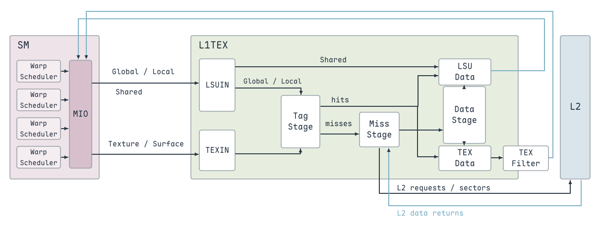{ width="950" }

L2 按 slice 组织，NCU 的硬件模型中记作 LTS。L2 再判断请求是否命中：命中时返回缓存数据，未命中时向显存请求。**一次 Global 访问可能由 L1 或 L2 满足，实际 DRAM 流量取决于缓存状态。**

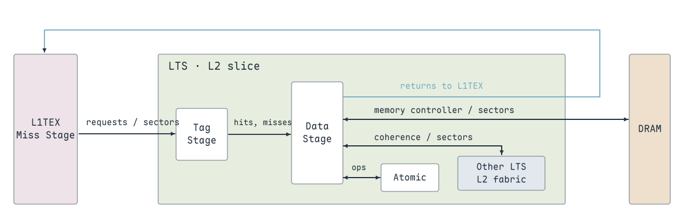{ width="900" }

在这个模型中，L1、L2 的 cache line 为 128 B，由四个 32 B sector 组成。一个 L2 request 可以携带同一 cache line 内的多个 sector；访问跨越 cache line 时，会拆成多个 request。**Cache line 是组织边界，不表示每次请求都必须读取完整的 128 B。**

L1TEX 图中的几条路径要分别理解：**LSUIN** 接收 Global / Local / Shared 请求，**TEXIN** 接收纹理与表面请求；**Tag Stage** 判断缓存标签和对应 sector 数据是否存在；**Miss Stage** 管理未命中的请求；**Data Stage** 及返回路径把数据送回使用它的单元。

Tag 命中还要区分 sector 数据是否真的在缓存中：同一 cache line 的标签已经存在，不代表它的四个 sector 都已取回。因此 NCU 的 sector hit / miss 不能只用“这一行以前访问过”来判断。

**未使用的访问类型显示为零，通常只是这段 Kernel 没有执行对应指令**。数组加法没有纹理指令、Shared Memory 或原子操作，不需要为了让这些行有数据而调整代码。

## 单个 Warp 的 L2 请求拆分

`add6` 只保留 Block 0 的前 32 个线程，且读取地址整体偏移一个 `float`。对 x 的一次 Warp load 覆盖五个 sector，跨两个 128 B cache line；对 y 也是如此。若对应数据未在 L1 中命中，这两个 load 请求就会拆成四个 L2 load request。

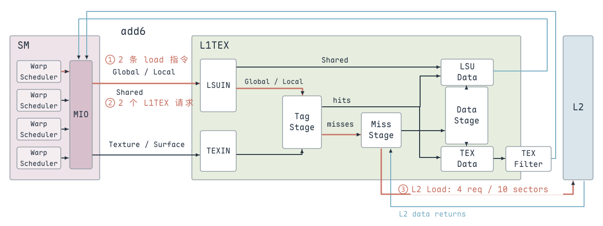{ width="950" }

- **① Warp 指令**：x、y 各执行一条 load，共两条；只有一个 Warp 参与。
- **② L1TEX 入口**：每条 Warp load 形成一个 request，共两个；每个覆盖五个 sector。
- **③ L2 入口**：同一数组的五个 sector 跨两条 cache line，未命中后拆成两个 request；两个数组合计四个 L2 load request、十个 sector。

```cuda
void __global__ add6(float *x, float *y, float *z)
{
    if (blockIdx.x == 0 && threadIdx.x < 32)
    {
        // 只观察一个 Warp：每个数组的访问跨两个 cache line
        int n = threadIdx.x + blockIdx.x * blockDim.x + 1;
        z[n] = x[n] + y[n];
    }
}
```

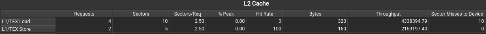{ width="900" }

截图的 **L1/TEX Load** 行因此是 Requests = 4、Sectors = 10、Sectors/Req = 2.5、Bytes = $10\times32=320$ B；它记录的是到达 L2 的请求，行名中的 L1/TEX 表示请求来源。不是两条 load 指令变成了四条指令，而是请求在 cache line 边界拆分了。

输出 z 只有一条 Warp store，同样覆盖五个 sector、跨两条 cache line，所以 **L1/TEX Store** 行是两个 L2 request、五个 sector、160 B。这里的 320 B / 160 B 是 sector 覆盖量，线程实际读取 x、y 共 256 B，写入 z 为 128 B。

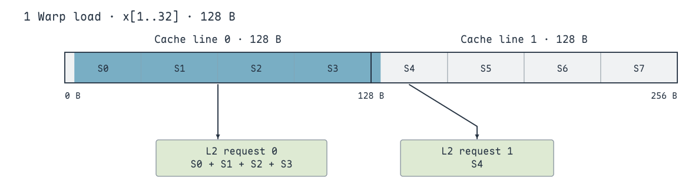{ width="850" }

上图只跟踪 x 的一次 load：第一条 cache line 内需要 sector 0～3，第二条需要 sector 4。每个 L2 request 只能描述同一 cache line 中的 sector，因此分别形成携带四个和一个 sector 的请求；**不是每个 sector 都单独形成一次 request**。y 的访问重复相同过程。

因此，**L2 的 Request 数比 Warp load 指令数多，并不意味着代码额外读取了一遍数组**，而可能是一个上游请求跨多个 cache line。继续分析带宽时，要分别查看 L1/L2 命中率、sector 数和 DRAM 读写字节，不能把某一级的请求量直接当成显存流量。

## 从缓存计数继续追到 DRAM

读取 L2 表时，先看 L1 的 **Sector Misses to L2**，再看 L2 的 request、sector、命中率；L2 未命中的读取才继续产生 DRAM 访问。中间可能发生请求拆分或合并，所以相邻两级的 Request 数不必相等。

图中的 NCU 提示指出，在该次测试对应的路径上，L2 读未命中的 DRAM 获取粒度为 64 B，也就是两个 32 B sector。假如程序只使用其中一个 sector，另一个 sector 也可能被带回，**DRAM 获取量便可能大于 L2 真正缺失的 sector 量**。

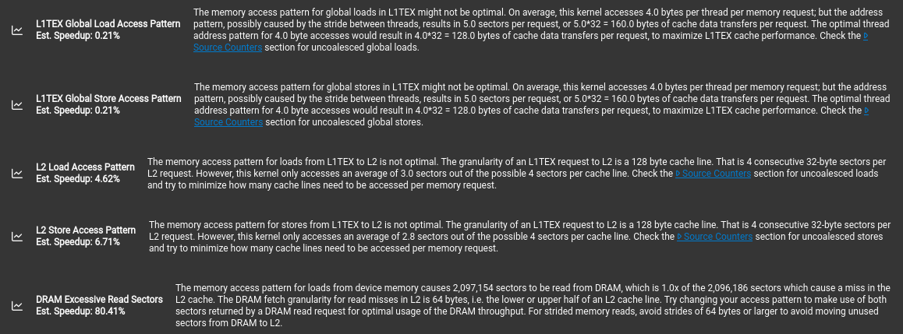{ width="950" }

这条建议与截图对应的 GPU 和访问路径有关，不能写成所有架构的 DRAM 访问都固定为 64 B。它想强调的是：**请求经过每一级时，传输和处理粒度都可能变化**；优化跨步访问时，要沿着整条路径检查真正浪费在哪里。

## 写入统计与 L2 逐出策略

数组加法的 load 从 x、y 取数，store 向 z 写入，三者是不同的数组。**L2 Store Hit Rate 为 100%，不能解释成之前读取过同一份输出数据**；store 的查找、分配与合并也会影响这一统计。

Global store 会经过 L1TEX 的请求处理资源，但不能照 load 路径理解成“先把输出缓存在 L1，再写到 L2”。PTX 默认的 `st.wb` 在一致的缓存层级进行 write-back；Global 数据的一致性由 L2 层级承担，SM 私有 L1 不能充当跨 SM 的通信保证。

L2 接收 32 MiB 输出，也不意味着报告采样期间 DRAM 必须恰好写回 32 MiB。脏数据可以先留在 L2，随后因逐出而写回；DRAM 计数记录的是采集区间里的物理传输，还受到实际事务和压缩的影响。**L2 store 字节与 DRAM write 字节描述不同位置、不同阶段的工作**，两者不相等不表示输出缺失。

NCU 的 **L2 Cache Eviction Policies** 进一步说明访问使用的逐出优先级：

- **evict_first**：缓存需要腾出空间时优先逐出，适合只使用一两次的流式数据。
- **evict_normal**：普通优先级。
- **evict_last**：尽量晚于其他优先级的数据逐出，适合希望反复复用的数据。

这些是缓存替换的提示，不是读取顺序，也不保证把数据永久锁在 L2。流式大数组若占满缓存，会挤掉后续还要复用的输入；优先逐出流式数据，目的就是减少这种缓存污染。表里的 Hit / Miss 及相应策略，仍要按所选访问类型分别解读。

## `.ca` 与 `.cg`：控制 Global Load 的缓存策略

以下编译选项设置 Global / Generic load 的默认缓存修饰符：

```bash
# 只在 L2 及下级缓存，绕过 L1 数据缓存
nvcc -Xptxas -dlcm=cg ...

# 在包含 L1、L2 的各级缓存
nvcc -Xptxas -dlcm=ca ...
```

`.ca` 对应 cache at all levels，`.cg` 对应 cache at global level。`-dlcm` 设置的是 **load 的默认策略**，不是关闭整个 L1TEX，也不等于改变 Shared Memory 的容量。即使 load 绕过 L1 数据缓存，NCU 仍可以记录 L1TEX 的指令、request 和内部管线工作。

验证时先查看该条 load 生成的 PTX / SASS，再对照相同访问的 L1 hit、Sector Misses to L2 和耗时。判断选项是否生效，应看目标指令的策略与数据路径，不能只看报告里是否还有 L1 表格。

合并访存与缓存策略处理的是两个问题：前者让一次 Warp 访问覆盖更少的无用区域，后者决定访问在哪一级保留和复用。**绕过 L1 不会把错位的五个 sector 变成四个**，也不能替代合并访存。

最后，把 **地址局部性、缓存命中与数据复用** 分开：连续地址让一次请求更紧凑；重复访问同一数据给缓存复用机会；Shared Memory 则由程序显式组织 Block 内的复用。数组加法主要受前两者影响，而 SGEMM 和转置会进一步主动安排片上数据布局。

> 参考：[NVIDIA Nsight Compute Profiling Guide](https://docs.nvidia.com/nsight-compute/ProfilingGuide/index.html#metrics-guide)、[CUDA Best Practices：Coalesced Access](https://docs.nvidia.com/cuda/cuda-c-best-practices-guide/index.html#coalesced-access-to-global-memory)、[PTX Cache Operators](https://docs.nvidia.com/cuda/parallel-thread-execution/index.html#cache-operators)、[NVCC 默认 load 缓存修饰符](https://docs.nvidia.com/cuda/cuda-compiler-driver-nvcc/index.html#def-load-cache-dlcm)、[合并访存](https://zhuanlan.zhihu.com/p/641639133)、[缓存与访存流程](https://zhuanlan.zhihu.com/p/632244210)。
