# 矩阵转置与访存优化

矩阵转置把行优先存储的 $A[M, N]$ 写成行优先的 $B[N, M]$，满足 $B[x, y] = A[y, x]$。它几乎没有浮点计算量，核心挑战在于**读写方向天然正交**：输入里横向相邻的元素，转置后变成输出里纵向跨行的元素。若不加设计，相邻线程连续读取输入时，写回输出就会彻底打散成跨行访存。

优化矩阵转置的主线因此非常清晰：**同时让 Global 读写两端尽量合并，在向量指令宽度、每线程工作量与片上资源（寄存器 / Shared Memory / Bank Conflict）之间取得最佳平衡**。

??? info "实验口径与系列定位"

    - 本文属于 **NCU 性能分析与 Kernel 调优** 系列第 3 篇，把前两篇 [合并访存与缓存](合并访存与缓存.md)（Sector / Wavefront）和 [Occupancy 与 Warp 调度](Occupancy与Warp调度.md)（Active / Eligible / Drain / Throttle）投入完整算子实战。
    - 文中标量与向量版对照均以同一 $2048\times 512$ `float` 矩阵（读 4 MiB + 写 4 MiB = 有效总搬运 8 MiB，标量版 1,048,576 线程 / 32,768 Warp）在 **RTX 4060 Laptop GPU** 上采集；标量/向量版默认矩阵尺寸按各自 Block 范围与 `float2`/`float4` 对齐，Shared Memory 两版包含完整边界判断。

!!! abstract "四轮渐进优化路线"

    1. **调整 Block 形状（`32×8 → 16×16 → 8×32`）**：不改代码逻辑，仅改变 Warp 覆盖的行数，将写入 Sector 利用率从 12.5% 提到 50%，耗时从 `115.87 μs` 降至 `24.93 μs`。
    2. **`float4` 4×4 寄存器转置**：每线程一次吞吐 16 元素，实现读写两端 100% 合并并将内存指令砍至 1/4。
    3. **`float2` 2×2 / 1×2 权衡并行度**：在保持紧凑向量写回的同时拉高活跃 Warp 数，本轮对照下将耗时进一步压至 `19.46 μs`。
    4. **Shared Memory + Padding 与残缺边界推导**：借助片上共享内存让 Global 读写双端连续，并用 16×16 实测拆解 Padding 残余冲突及 `18×18 / 19×19 / 2300×1500` 的精确 Request 账目。

---

## 1. 朴素转置与 Block 形状重排

最直接的实现是每线程负责一个元素：`x` 沿输入列、`y` 沿输入行，读取 `y * N + x` 并写回 `x * M + y`。改变 Block 形状时，有效总搬运量始终是 `4 MiB 读 + 4 MiB 写 = 8 MiB`（有效带宽应按 `8 MiB / 时间` 计算，不同于包含冗余覆盖的某条缓存管线吞吐），变化的是 **同一个 Warp 内的 32 个线程能把多少写入地址拼进同一个 32 B Sector**。

=== "核心修改"

    ```cuda
    int idx = y * N + x;
    int trans_idx = x * M + y;
    output[trans_idx] = input[idx];
    ```

=== "完整 Kernel"

    ```cuda
    __global__ void transpose_naive(float *input, float *output, const int M, const int N)
    {
        int x = blockIdx.x * blockDim.x + threadIdx.x;
        int y = blockIdx.y * blockDim.y + threadIdx.y;

        int idx = y * N + x;
        // 输入的列 x 变成输出的行，输出行跨度为 M
        int trans_idx = x * M + y;
        output[trans_idx] = input[idx];
    }
    ```

CUDA 的二维 Block 按 `threadIdx.x` 优先组成 Warp。保持每 Block 256 个线程不变，将形状由 `32×8` 依次改为 `16×16`、`8×32` 与 `4×64`（对齐前提下）：

| Block 形状 (`x×y`) | 单 Warp 覆盖输入行数 | Load Sectors | Store Sectors（覆盖字节） | 写入利用率 | RTX 4060 Laptop 实测 |
| --- | --- | --- | --- | --- | --- |
| `32×8` | 1 行 × 32 列 | `4`（100%） | `32`（1024 B，落 32 行） | **12.5%** | `115.87 μs` |
| `16×16` | 2 行 × 16 列 | `4`（100%） | `16`（512 B，落 16 行） | **25.0%** | `41.79 μs` |
| **`8×32`** | **4 行 × 8 列** | **`4`（100%）** | **`8`（256 B，落 8 行）** | **50.0%** | **`24.93 μs`（4.6× 提速）** |
| `4×64`（推演） | 8 行 × 4 列 | `8`（50%） | `4`（128 B，落 4 行） | 100%（但读端劣化） | 读端开始反拖后腿 |

[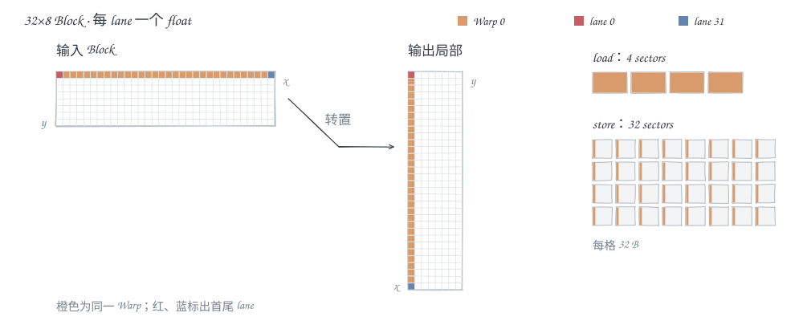{ width="800" }](../../assets/cuda/transpose/transpose-scalar-block-32x8.svg)

[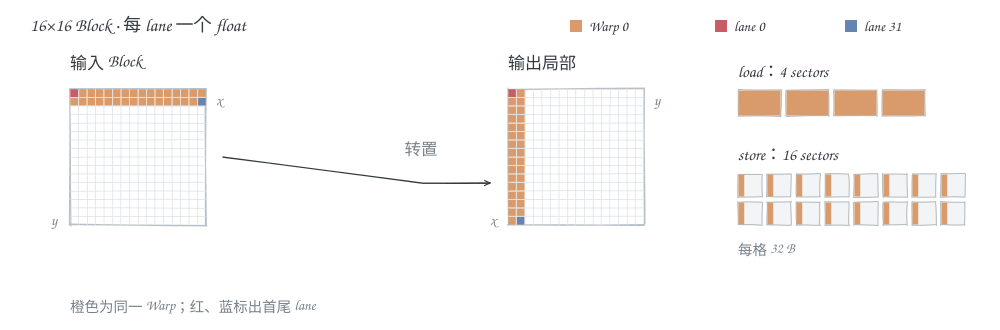{ width="800" }](../../assets/cuda/transpose/transpose-scalar-block-16x16.svg)

[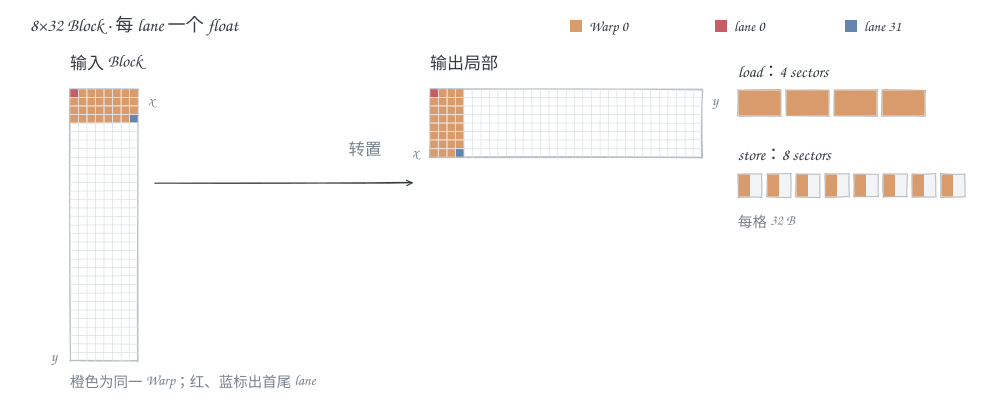{ width="800" }](../../assets/cuda/transpose/transpose-scalar-block-8x32.svg)

!!! note "仅靠二维线程重排无法兼得读写两端 4 Sector"

    把 `x` 维继续缩到 `4×64` 虽然能让写回缩到 4 个 Sector，但读端立刻跨 8 行、每行仅 4 个 `float`（半个 Sector），退化到 8 个 Sector。另外，即便 `32×8`、`16×16`、`8×32` 的读端同为 4 个 Sector，它们跨越的 Cache Line 数不同，L1TEX 拆出的 Wavefront 数量也可能不同。

### 1.1 用 NCU 解释 `8×32` 为何快 4.6 倍

[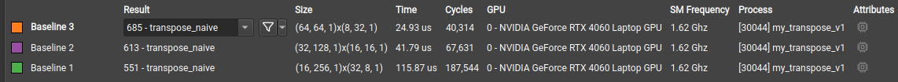{ width="800" }](../../assets/cuda/transpose/ncu-transpose-block-timing.png)

[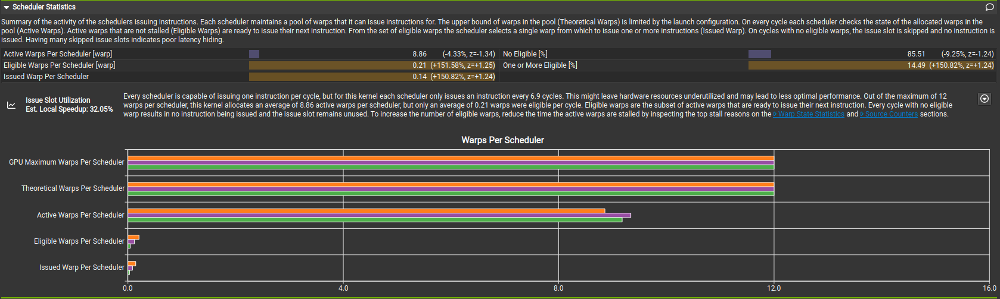{ width="800" }](../../assets/cuda/transpose/ncu-transpose-scalar-scheduler.png)

[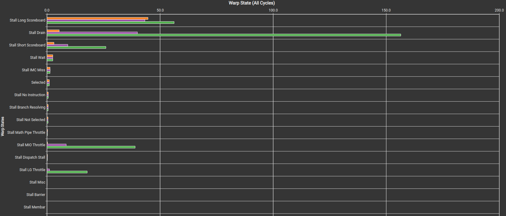{ width="800" }](../../assets/cuda/transpose/ncu-transpose-scalar-stalls.png)

结合 [Occupancy 与 Warp 调度](Occupancy与Warp调度.md) 拆解这三张 NCU 报告：

- **Scheduler Statistics**：`16×16` 的 Active Warp 反而比 `8×32` 略高，却不是最快的；**Eligible 与 Issued 才与真实耗时排序一致**。最快的 `8×32` 每 Scheduler 平均 8.86 个 Active Warp、0.21 个 Eligible Warp，平均每 6.9 周期发射一次（`1 / 6.9 ≈ 14.49%` 周期有就绪 Warp，仍有 85.51% 空转）。
- **Warp State Statistics**：差距最悬殊的是 **Drain**——`32×8` 超过每指令 150 周期（每条 Warp store 撒向 32 个输出行，退出前在途写回排长队），到 `8×32` 缩减到 8 行后 Drain 柱断崖式缩短，LG / MIO Throttle 也同步回落。

!!! warning "归因纪律：不要看见 Short Scoreboard 就喊 Bank Conflict"

    这一版完全没有声明 `__shared__` 数组，因此图中的 Short Scoreboard / MIO Throttle 绝不能盲目归因于 Shared Memory Bank Conflict，而要回到具体指令与管线核对；同样，单凭某一条 Stall 柱不足以证明全部时间差都来自单一队列。

---

## 2. `float4`：在寄存器内转置 4×4 小块

标量版本无论怎么调整 Block 形状，写端最多也只有 50% 利用率。让每个线程负责一个 **$4\times 4$ 子块**（共 16 元素），按 4 次 `float4` 读入 4 行、在**寄存器内**重组列为行（无需任何跨线程同步），再按 4 次 `float4` 写回，就能在 `16×16` 与 `8×32` 布局下同时做到**读写双端 100% 合并**。

[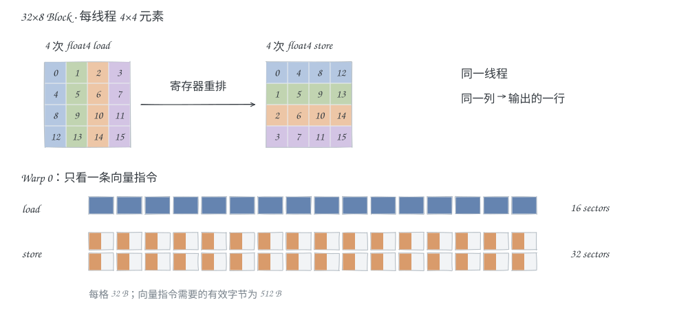{ width="800" }](../../assets/cuda/transpose/transpose-float4-block-32x8.svg)

[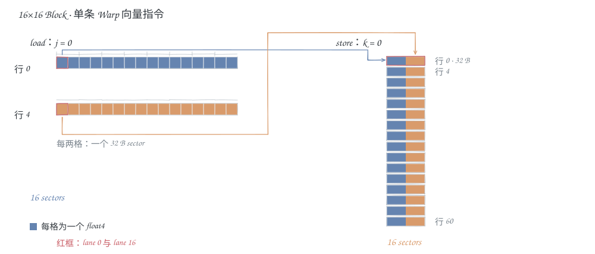{ width="800" }](../../assets/cuda/transpose/transpose-float4-block-16x16.svg)

- **`32×8` 线程块**：单条 `float4` load 读 $32\times 16 = 512$ B（理想 16 Sector），但 store 仍写向 32 个不同行（32 Sector，覆盖 8 MiB，浪费一半）。
- **`16×16` 线程块**：1 个 Warp 覆盖两行线程，每输出行由 2 个线程各写 1 个相邻 `float4` = 正好 32 B（1 Sector），**单条 load 与 store 均为 16 Sector（100% 合并）**。
- **`8×32` 线程块**：读端 4 组 × 8 线程（每组 4 Sector = 16 Sector），写端 8 行 × 4 线程（每行 64 B = 2 Sector，合计 16 Sector），同样两端 100% 合并（但 Cache Line 分布与调度细节仍有差异）。

=== "核心修改"

    ```cuda
    // 每个线程负责 4×4 元素，四次向量读入
    for (int i = 0; i < 4; i++)
        FETCH_FLOAT4(src_transpose[i]) =
            FETCH_FLOAT4(input_start[(threadIdx.y * 4 + i) * N + threadIdx.x * 4]);

    // 原输入的一列拼成转置后的一个 float4
    FETCH_FLOAT4(dst_transpose[0]) = make_float4(
        src_transpose[0][0], src_transpose[1][0],
        src_transpose[2][0], src_transpose[3][0]);
    // 其余三列同样重排，见完整 Kernel

    for (int i = 0; i < 4; i++)
        FETCH_FLOAT4(output_start[(i + threadIdx.x * 4) * M + threadIdx.y * 4]) =
            FETCH_FLOAT4(dst_transpose[i][0]);
    ```

=== "完整 Kernel"

    ```cuda
    #define FETCH_FLOAT4(pointer) (reinterpret_cast<float4 *>(&(pointer))[0])

    template <
        const int THREAD_SIZE_Y,
        const int THREAD_SIZE_X>
    __global__ void transpose_float4_inner_4x4(float *input,
                                               float *output, const int M, const int N)
    {
        float src_transpose[4][4];
        float dst_transpose[4][4];
        float *input_start = input + N * blockIdx.y * THREAD_SIZE_Y + blockIdx.x * THREAD_SIZE_X;
        // 每线程加载四行，每行用 float4 搬运四个元素
        for (int i = 0; i < 4; i++)
        {
            FETCH_FLOAT4(src_transpose[i]) = FETCH_FLOAT4(input_start[(threadIdx.y * 4 + i) * N + threadIdx.x * 4]);
        }

        // 寄存器中把输入的列重新组成输出的连续行
        FETCH_FLOAT4(dst_transpose[0]) = make_float4(src_transpose[0][0], src_transpose[1][0], src_transpose[2][0], src_transpose[3][0]);
        FETCH_FLOAT4(dst_transpose[1]) = make_float4(src_transpose[0][1], src_transpose[1][1], src_transpose[2][1], src_transpose[3][1]);
        FETCH_FLOAT4(dst_transpose[2]) = make_float4(src_transpose[0][2], src_transpose[1][2], src_transpose[2][2], src_transpose[3][2]);
        FETCH_FLOAT4(dst_transpose[3]) = make_float4(src_transpose[0][3], src_transpose[1][3], src_transpose[2][3], src_transpose[3][3]);

        float *output_start = output + M * blockIdx.x * THREAD_SIZE_X + blockIdx.y * THREAD_SIZE_Y;
        for (int i = 0; i < 4; i++)
        {
            FETCH_FLOAT4(output_start[(i + threadIdx.x * 4) * M + threadIdx.y * 4]) = FETCH_FLOAT4(dst_transpose[i][0]);
        }
    }
    ```

`THREAD_SIZE_Y` / `THREAD_SIZE_X` 是整个 Block 覆盖的元素高宽：例如 `16×16` 线程块覆盖 `64×64` 元素（Grid 从 `32×128` 缩为 `8×32`）；`32×8` 线程块覆盖 `32 行 × 128 列`（Grid 从 `16×256` 缩为 `4×64`）。注意 4 条向量 load 分别访问 4 个输入行片段，每条独立形成一个 Request。

### 2.1 NCU 对照：指令减至 1/4，但 Stall 形态彻底变了

[{ width="800" }](../../assets/cuda/transpose/ncu-transpose-vector-comparison.png)

[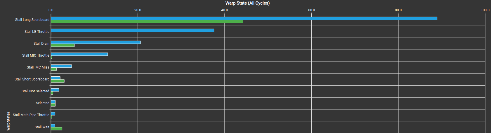{ width="800" }](../../assets/cuda/transpose/ncu-transpose-vector-warp-states.png)

[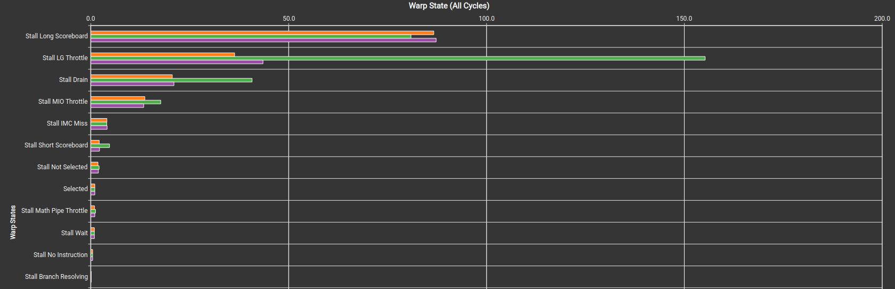{ width="800" }](../../assets/cuda/transpose/ncu-transpose-float4-stalls.png)

[{ width="800" }](../../assets/cuda/transpose/ncu-transpose-float4-block-timing.png)

[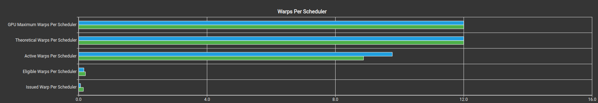{ width="800" }](../../assets/cuda/transpose/ncu-transpose-scalar-float4-scheduler.png)

实测 `float4` 三种布局耗时分别为 `32×8: 39.10 μs`、`16×16: 22.34 μs`、`8×32: 22.08 μs`。对照标量版能看到两条非常经典的 NCU 读图规律：

!!! warning "两条极易误判的 NCU 现象"

    1. **瓶颈会发生迁移**：标量 `32×8` 的头号瓶颈是 **Drain**，换成 `float4 32×8` 后变成 **LG Throttle**——指令总数降为 1/4 后，每条分散向量写仍携带大量内部工作，队头拥塞成了新瓶颈。
    2. **每指令 Stall 变长、Eligible/Issued 变少，但总时间反而更短**：如 `8×32` 对照中总耗时从 `24.38 μs` 降到 `21.34 μs`，蓝色（`float4`）的 Eligible/Issued 反而低于绿色（标量 Baseline）且部分每指令等待周期更高——这是因为总 Warp 数缩至 1/16、每方向内存指令缩至 1/4。**永远以总执行时间和总工作量为准，不要为了压低单个 Stall 柱而倒退回标量版。**

---

## 3. `float2`：在指令数与 Warp 并行度之间找甜点

`float4`（4×4）把同一矩阵的总 Warp 数从 32,768 猛压到 2,048，寄存器占用上升、可调度的 Block 数变少。配套代码进一步尝试了 **`float2` 2×2** 与 **`float2` 1×2** 两个中间态：

| 版本（$2048\times 512$，`8×32`） | 每线程元素 | 总线程 / 总 Warp | Load / Store 指令实例 | 单条 Load / Store Sectors | 实测耗时（同轮对照） |
| --- | --- | --- | --- | --- | --- |
| 标量 `naive` | `1` | `1,048,576` / `32,768` | `32,768` / `32,768` | `4` / `8`（写 50%） | `25.22 μs` |
| `float4`（`4×4`） | `16` | `65,536` / `2,048` | `8,192` / `8,192` | `16` / `16`（双端 100%） | `21.76 μs` |
| **`float2`（`2×2`）** | **`4`** | **`262,144` / `8,192`** | **`16,384` / `16,384`** | **`8` / `8`（双端 100%）** | **`19.46 μs`（本轮最快）** |
| `float2`（`1×2`） | `2` | `524,288` / `16,384` | `32,768`（标量）/ `16,384` | `4` / `8`（双端 100%） | 线程翻倍，但读端退回标量 |

### 3.1 `float2` 2×2：兼顾两端合并与更高并行度

=== "核心修改（2×2）"

    ```cuda
    for (int i = 0; i < 2; i++)
        FETCH_FLOAT2(src_transpose[i]) =
            FETCH_FLOAT2(input_start[(threadIdx.y * 2 + i) * N + threadIdx.x * 2]);

    FETCH_FLOAT2(dst_transpose[0]) = make_float2(src_transpose[0][0], src_transpose[1][0]);
    FETCH_FLOAT2(dst_transpose[1]) = make_float2(src_transpose[0][1], src_transpose[1][1]);

    for (int i = 0; i < 2; i++)
        FETCH_FLOAT2(output_start[(i + threadIdx.x * 2) * M + threadIdx.y * 2]) =
            FETCH_FLOAT2(dst_transpose[i][0]);
    ```

=== "完整 Kernel（2×2）"

    ```cuda
    #define FETCH_FLOAT2(pointer) (reinterpret_cast<float2 *>(&(pointer))[0])

    template <
        const int THREAD_SIZE_Y,
        const int THREAD_SIZE_X>
    __global__ void transpose_float2_inner_2x2(float *input,
                                               float *output, const int M, const int N)
    {
        float src_transpose[2][2];
        float dst_transpose[2][2];
        float *input_start = input + N * blockIdx.y * THREAD_SIZE_Y + blockIdx.x * THREAD_SIZE_X;
        // 用 2×2 替代 4×4，保留向量读写并减小线程内工作量
        for (int i = 0; i < 2; i++)
        {
            FETCH_FLOAT2(src_transpose[i]) = FETCH_FLOAT2(input_start[(threadIdx.y * 2 + i) * N + threadIdx.x * 2]);
        }

        FETCH_FLOAT2(dst_transpose[0]) = make_float2(src_transpose[0][0], src_transpose[1][0]);
        FETCH_FLOAT2(dst_transpose[1]) = make_float2(src_transpose[0][1], src_transpose[1][1]);

        float *output_start = output + M * blockIdx.x * THREAD_SIZE_X + blockIdx.y * THREAD_SIZE_Y;
        for (int i = 0; i < 2; i++)
        {
            FETCH_FLOAT2(output_start[(i + threadIdx.x * 2) * M + threadIdx.y * 2]) = FETCH_FLOAT2(dst_transpose[i][0]);
        }
    }
    ```

2×2 版本中，`32×8`、`16×16`、`8×32` 的 Block 数据范围翻倍（Grid 对应 `8×128`、`16×64`、`32×32`，均 1,024 Block），单条 `float2` Warp 访问需求 256 B（理想 8 Sector）。`8×32` 下写端 4 组线程向 8 个输出行各写 4 个相邻 `float2`（每行恰好 32 B = 1 Sector），读写两端覆盖均为 $16{,}384\times 8\times 32 = 4$ MiB。

[{ width="800" }](../../assets/cuda/transpose/ncu-transpose-float2-timing.png)

[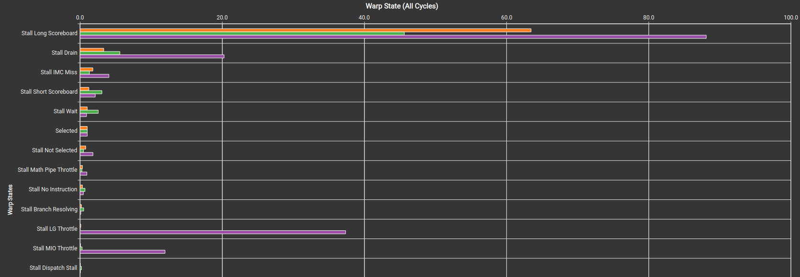{ width="800" }](../../assets/cuda/transpose/ncu-transpose-float2-stalls.png)

!!! tip "别被 Baseline 里的“命中率 +138%”误导"

    另一组 Baseline 对照中，标量版的 L1 命中率反而高于向量版——因为相邻指令/Warp 重复扫到同一 Sector 靠缓存救回了一部分浪费，所以 Sector 浪费降为 1/4 不等于时间缩为 1/4。同时 Baseline 显示的“+138%”是**相对变化比例**而非增加 138 个百分点，务必结合原始命中率、DRAM 字节与实际耗时判断。

### 3.2 `float2` 1×2：沿列标量读、沿行向量写

[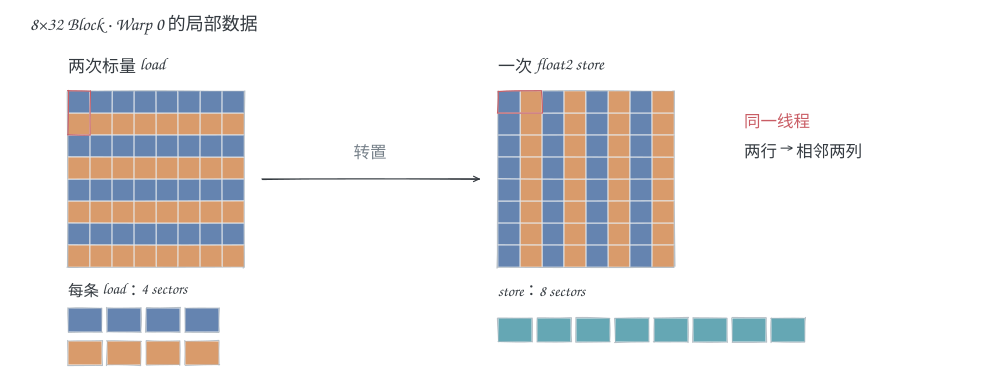{ width="800" }](../../assets/cuda/transpose/transpose-float2-1x2.svg)

=== "核心修改（1×2）"

    ```cuda
    src_transpose[0] = input_start[2 * threadIdx.y * N + threadIdx.x];
    src_transpose[1] = input_start[(2 * threadIdx.y + 1) * N + threadIdx.x];
    FETCH_FLOAT2(dst_transpose[0]) = make_float2(src_transpose[0], src_transpose[1]);
    FETCH_FLOAT2(output_start[threadIdx.x * M + threadIdx.y * 2]) =
        FETCH_FLOAT2(dst_transpose[0]);
    ```

=== "完整 Kernel（1×2）"

    ```cuda
    #define FETCH_FLOAT2(pointer) (reinterpret_cast<float2 *>(&(pointer))[0])

    template <
        const int THREAD_SIZE_Y,
        const int THREAD_SIZE_X>
    __global__ void transpose_float2_inner_1x2(float *input,
                                               float *output, const int M, const int N)
    {
        float src_transpose[2];
        float dst_transpose[2];
        float *input_start = input + N * blockIdx.y * THREAD_SIZE_Y + blockIdx.x * THREAD_SIZE_X;

        // 输入同一列的两行，转置后变成输出同行的两个相邻元素
        src_transpose[0] = input_start[2 * threadIdx.y * N + threadIdx.x];
        src_transpose[1] = input_start[(2 * threadIdx.y + 1) * N + threadIdx.x];

        FETCH_FLOAT2(dst_transpose[0]) = make_float2(src_transpose[0], src_transpose[1]);

        float *output_start = output + M * blockIdx.x * THREAD_SIZE_X + blockIdx.y * THREAD_SIZE_Y;

        FETCH_FLOAT2(output_start[threadIdx.x * M + threadIdx.y * 2]) = FETCH_FLOAT2(dst_transpose[0]);
    }
    ```

需看清它的访存本质：两次读取位于输入同一列的相邻两行（地址差 $N$ 个 `float`），是 **2 条标量 load**（`8×32` 下分别访问行 0,2,4,6 与行 1,3,5,7，每条覆盖 4 Sector），只有写回才是 **1 条 `float2` store**（8 Sector）。相比 2×2，Grid 翻倍到 `64×32`、线程翻倍，但代价是读端回到标量指令数。

---

## 4. Shared Memory 转置：让 Global 读写双端连续

如果希望摆脱寄存器小块与向量对齐限制、且自然支持任意非对齐矩阵尺寸，标准解法是**用 Shared Memory 在 Block 内部交换读写方向**：加载时按行连续读 Global 写入 `sdata[tx][ty]`，`__syncthreads()` 后交换 Block 坐标，再按行连续读 `sdata[ty][tx]` 写回 Global。

[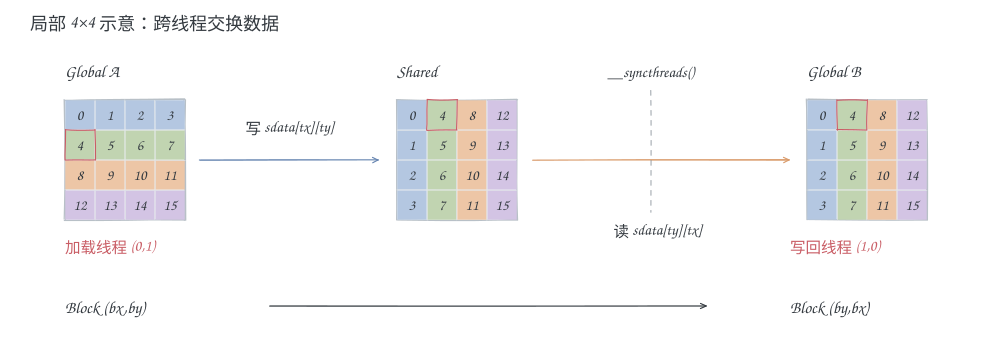{ width="800" }](../../assets/cuda/transpose/transpose-shared-memory-dataflow.svg)

=== "核心修改"

    ```cuda
    __shared__ float sdata[BLOCK_SZ][BLOCK_SZ];
    if (y < M && x < N)
        sdata[tx][ty] = input_start[ty * N + tx];
    __syncthreads();

    // 交换 Block 坐标，使输出仍由相邻线程沿行写入
    x = blockDim.y * blockIdx.y + tx;
    y = blockDim.x * blockIdx.x + ty;
    float *output_start = output + M * blockIdx.x * BLOCK_SZ + blockIdx.y * BLOCK_SZ;
    if (y < N && x < M)
        output_start[ty * M + tx] = sdata[ty][tx];
    ```

=== "完整 Kernel"

    ```cuda
    template <int BLOCK_SZ>
    __global__ void mat_transpose_kernel_v5(float *input, float *output, int M, int N)
    {
        const int tx = threadIdx.x;
        const int ty = threadIdx.y;
        int x = blockDim.x * blockIdx.x + tx;
        int y = blockDim.y * blockIdx.y + ty;
        float *input_start = input + N * blockIdx.y * BLOCK_SZ + blockIdx.x * BLOCK_SZ;
        __shared__ float sdata[BLOCK_SZ][BLOCK_SZ];

        if (y < M && x < N)
        {
            // 连续读入 Global Memory，交换索引存入 Shared Memory
            sdata[tx][ty] = input_start[ty * N + tx];
        }
        __syncthreads();  // 其他线程加载的数据就绪后，才能换方向读取
        x = blockDim.y * blockIdx.y + tx;
        y = blockDim.x * blockIdx.x + ty;
        float *output_start = output + M * blockIdx.x * BLOCK_SZ + blockIdx.y * BLOCK_SZ;
        if (y < N && x < M)
        {
            output_start[ty * M + tx] = sdata[ty][tx];
        }
    }
    ```

[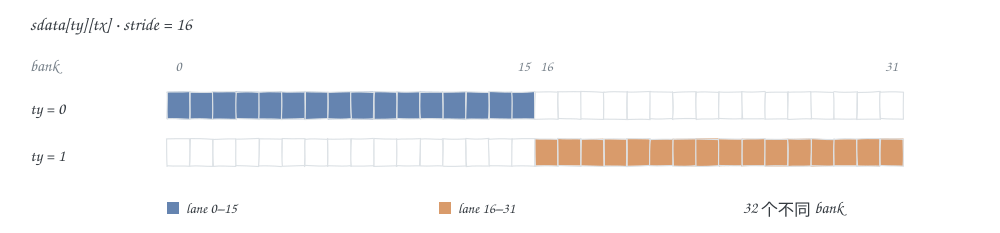{ width="800" }](../../assets/cuda/transpose/transpose-shared-load-mapping.svg)

!!! warning "Shared Memory 转置的两条铁律"

    1. **必须同时交换 Block 坐标与 Block 内索引**：输入 Block `(bx, by)` 落到输出 `(by, bx)` 后，输出元素 `(bx·B + ty, by·B + tx)` 正好对应原输入的 `(by·B + tx, bx·B + ty)`；只交换其一会导致错位，且写回有效坐标天然对应加载有效坐标，不会读到未初始化槽位。
    2. **`__syncthreads()` 绝不能放进 `if (y < M && x < N)` 内部**：边界 Block 中未执行加载的线程也必须到达屏障，否则同 Block 其余线程会永久死锁。

---

## 5. Padding：压低 16×16 分块的 Shared Memory Bank Conflict

Global 两端合并之后，瓶颈转入片上共享内存。32 个 Bank、每个 `float` 占 4 B 时，Bank 编号为线性下标对 32 取模。

在 `BLOCK_SZ = 16` 的正方形分块下，一个 Warp 覆盖 `ty = 0` 和 `ty = 1` 两行：

- **无 Padding（`sdata[16][16]`，1024 B）**：
  - 写入 `sdata[tx][ty]` 地址为 $16\cdot tx + ty$：固定 `ty`，偶数 `tx` 全撞同一 Bank、奇数 `tx` 全撞另一 Bank → **每条 Shared Store 形成 8 路 Bank Conflict**！8 个 Warp（8 Request）需 64 个 Wavefront，多出 **56** 个。
  - 读取 `sdata[ty][tx]` 时，两行连续覆盖 32 个不同 Bank → **0 冲突**。
- **加一列 Padding（`sdata[16][17]`，1088 B）**：
  - 写入地址变为 $17\cdot tx + ty$：同 `ty` 内 16 个线程落入不同 Bank，但两行合在同一个 Warp 内仍有交叠 → 从 8 路降为 **2 路冲突**（8 Request 需 16 Wavefront，多出 **8** 个）。
  - 读取 `sdata[ty][tx]` 起点变为 0 和 17，覆盖 `[0, 15]` 与 `[17, 32]`，元素 0 与 32 同落 Bank 0 → 读端从 0 冲突变为 **2 路冲突**（多出 **8** 个）。

| 16×16 完整 Block（8 Warp） | Shared Store 冲突（额外 Wavefront） | Shared Load 冲突（额外 Wavefront） | 合计额外 Wavefront | 共享内存用量 |
| --- | --- | --- | --- | --- |
| `sdata[16][16]`（无 Padding） | 8 路冲突（`64 - 8 = 56`） | 无冲突（`0`） | **`56`** | `1,024 B` |
| **`sdata[16][17]`（+1 Padding）** | **2 路冲突（`16 - 8 = 8`）** | **2 路冲突（`16 - 8 = 8`）** | **`16`（下降 71%）** | `1,088 B` |

[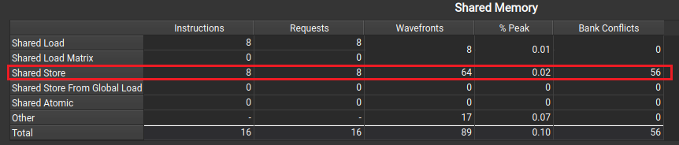{ width="800" }](../../assets/cuda/transpose/ncu-transpose-shared-bank-conflicts.png)

[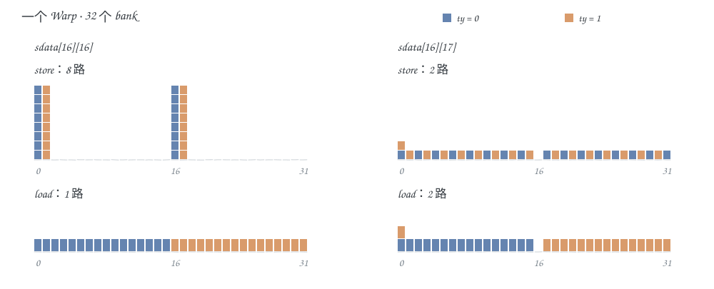{ width="800" }](../../assets/cuda/transpose/transpose-shared-bank-padding.svg)

=== "核心修改"

    ```cuda
    // 核心修改只在 Shared Memory 的物理行跨度
    __shared__ float sdata[BLOCK_SZ][BLOCK_SZ + 1];
    ```

=== "完整 Kernel"

    ```cuda
    template <int BLOCK_SZ>
    __global__ void mat_transpose_kernel_v6(float *input, float *output, int M, int N)
    {
        const int tx = threadIdx.x;
        const int ty = threadIdx.y;
        int x = blockDim.x * blockIdx.x + tx;
        int y = blockDim.y * blockIdx.y + ty;
        float *input_start = input + N * blockIdx.y * BLOCK_SZ + blockIdx.x * BLOCK_SZ;
        // 行跨度增加一列，打散原来的 bank 映射
        __shared__ float sdata[BLOCK_SZ][BLOCK_SZ + 1];

        if (y < M && x < N)
        {
            sdata[tx][ty] = input_start[ty * N + tx];
        }
        __syncthreads();  // 保证换方向读取前，整个 tile 已加载完成
        x = blockDim.y * blockIdx.y + tx;
        y = blockDim.x * blockIdx.x + ty;
        float *output_start = output + M * blockIdx.x * BLOCK_SZ + blockIdx.y * BLOCK_SZ;
        if (y < N && x < M)
        {
            output_start[ty * M + tx] = sdata[ty][tx];
        }
    }
    ```

[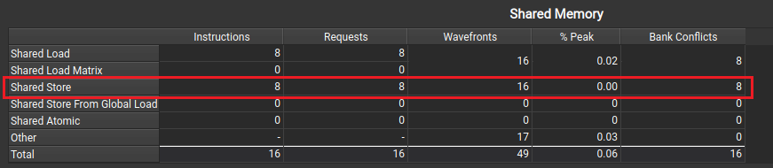{ width="800" }](../../assets/cuda/transpose/ncu-transpose-shared-padding.png)

!!! note "经典 32×32 的“+1 清零”结论不能直接照搬到 16×16"

    Bank Conflict 取决于**同一条 Warp 指令中全部 32 条 lane 的完整地址集合**。在 32×32 Tile 中一条 Warp 恰好是一整行/一整列，加一列可以彻底清零；而在 16×16 Tile 中一条 Warp 跨两行，加一列会把写端从 8 路降到 2 路、同时让读端从 0 变成 2 路，总额外处理量由 56 降到 16，依然净赚，但并未彻底归零。

---

## 6. 残缺边界与大矩阵的精确 Request 账目

边界判断 `if (y < M && x < N)` 只会屏蔽越界 lane，**绝不会把活跃线程重新压缩成新 Warp**——依然按 `threadIdx.x + 16 * threadIdx.y` 划 Warp，仅由参与当前指令的活跃 lane 决定是否冲突。

### 6.1 `18×18` vs `19×19`：只多一行一列，冲突为何非线性跳涨？

以 16×16 无 Padding 分块切分 `18×18`（余 2 行 2 列）与 `19×19`（余 3 行 3 列，3 行跨 2 个 Warp），4 个分块 `A / B / C / D` 的 Shared Store 统计精确闭合如下：

| 区块 | `18×18`（有效尺寸 → Req / WF / 冲突） | `19×19`（有效尺寸 → Req / WF / 冲突） | 差异原因 |
| --- | --- | --- | --- |
| **A** | `16×16` → `8 / 64 / 56` | `16×16` → `8 / 64 / 56` | 完整分块，8 路冲突 |
| **B** | `16×2` → `8 / 8 / 0`（每 Warp 4 lane 落不同 Bank） | `16×3` → `8 / 16 / 8`（`tx=0, 2` 同 Bank，2 路冲突） | 第 3 列触发 2 路冲突 |
| **C** | `2×16` → `1 / 8 / 7`（1 个完整 Warp，8 路冲突） | `3×16` → `2 / 16 / 14`（跨 2 个 Warp，各 8 路冲突） | 第 3 行多激活 1 个半活跃 Warp |
| **D** | `2×2` → `1 / 1 / 0` | `3×3` → `2 / 4 / 2`（2 个 Warp 各 2 路冲突） | 活跃 Warp 与 Bank 重叠同增 |
| **合计** | **`18 Req / 81 WF / 63 冲突`** | **`20 Req / 100 WF / 80 冲突`** | 不能按元素比例线性放大 |

[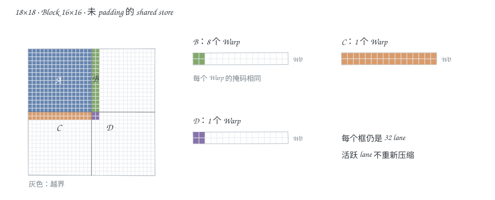{ width="800" }](../../assets/cuda/transpose/transpose-boundary-18x18.svg)

[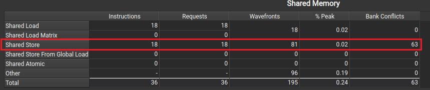{ width="800" }](../../assets/cuda/transpose/ncu-transpose-boundary18.png)

[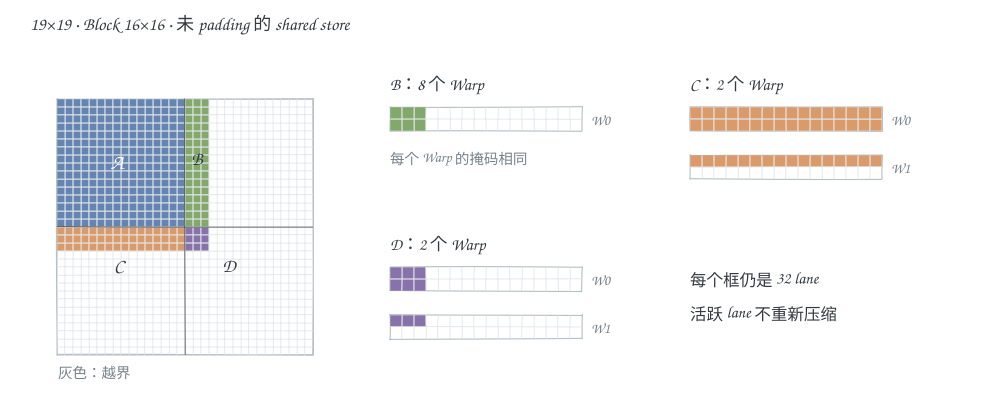{ width="800" }](../../assets/cuda/transpose/transpose-boundary-19x19.svg)

[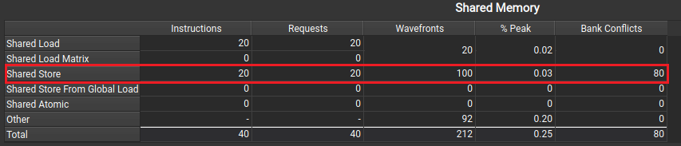{ width="800" }](../../assets/cuda/transpose/ncu-transpose-boundary19.png)

Shared Load 阶段因转置交换了 B、C 的 Warp 数（`18×18` 为 `8+1+8+1 = 18`，`19×19` 为 `8+2+8+2 = 20`），无 Padding 时均无冲突。

!!! warning "什么时候不能用 `Wavefronts - Requests` 算 Bank Conflict？"

    仅当单条指令理想只需 1 个 Wavefront（如 4 B 标量 Shared Store）时，差值才等于额外冲突。若使用每 lane 16 B 的向量 Shared 指令（整条 Warp 512 B），硬件理想批次为 128 B/次，即使 0 冲突也至少需要 4 个 Wavefront——必须对照 **Wavefronts 与 Ideal Wavefronts**。

### 6.2 大矩阵 `2300×1500`：Shared Store 与 Shared Load 的 Request 数为何不等？

[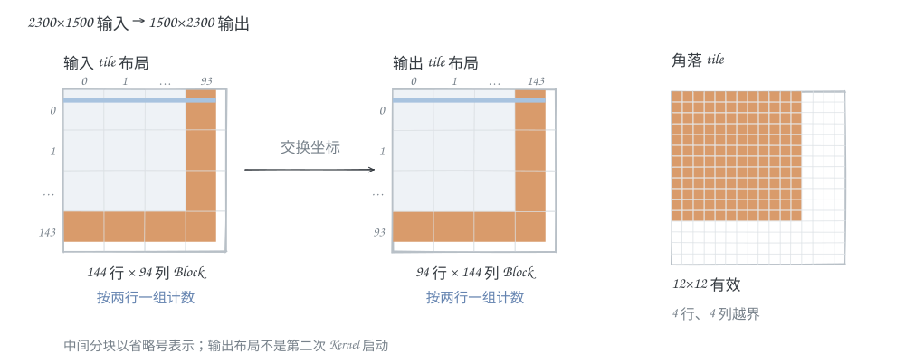{ width="800" }](../../assets/cuda/transpose/transpose-boundary-large-matrix.svg)

[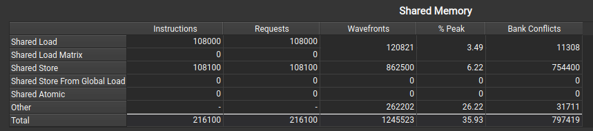{ width="800" }](../../assets/cuda/transpose/ncu-transpose-large-matrix-shared.png)

!!! example "手算闭合：搬运同样多元素，为何 Store = `108,100` 而 Load = `108,000`？"

    取 $M = 2300, N = 1500, \text{BLOCK\_SZ} = 16$，启动 `Grid(ceil(1500/16), ceil(2300/16)) = Grid(94, 144)`（覆盖 `2304×1504`，右下角 Block 仅 `12×12` 有效；输出端是在同一 Kernel 内交换坐标变为 `144 列 × 94 行` tile）：

    - **Shared Store（输入阶段）**：每个 Warp 覆 2 行，`2300 / 2 = 1150` 组行，每组跨 94 个列 Block（最右列虽仅 12 有效列，Warp 仍执行指令）→ $94 \times 1150 = \mathbf{108{,}100}$ Request。
    - **Shared Load（输出阶段）**：转置后 1500 行对应 `1500 / 2 = 750` 组行，每组跨 144 个列 Block → $144 \times 750 = \mathbf{108{,}000}$ Request。

    **统计指令数必须按实际执行的活跃 Warp 计数，绝不能用有效元素总数直接除以 32。**

---

## 7. 多元素搬运写法对比与边界分支优化

同样是“每线程搬 4 个元素”，下面两种写法对应的访存合并属性完全不同：

```cuda
// 标量指令循环：同一轮中相邻线程读取相邻列，同一线程的 4 个数据相隔多行
for (int j = 0; j < 4; j++)
    value[j] = input[(row + j * blockDim.y) * N + col];

// 向量指令：单个线程一次读取 4 个连续且 16 B 对齐的列元素
float4 value4 = reinterpret_cast<const float4*>(input + row * N)[col4];
```

“每线程搬 4 个数”本身无法判断是否合并，仍要回到**同一条指令下全部 32 条 lane 的地址集合**。

对于大矩阵的边界判断，可以把完整 tile 与残缺 tile 拆成快慢两条路径：在 `2300×1500`、16×16 分块中，13,536 个 Block 里有 **13,299 个（98.2%）是完整 Block**，残缺边界仅 237 个。把判断提到循环外，就能省掉绝大部分 Block 内部的重复分支。

最后一篇 [NCU 性能分析与 Roofline](NCU性能分析与Roofline.md) 将把这三篇的指标方法论收束成完整的 NCU 采集工作流与 Roofline 瓶颈判断框架。

> 参考：[矩阵转置与合并访存](https://zhuanlan.zhihu.com/p/702516288)、[矩阵转置算子优化](https://blog.csdn.net/LostUnravel/article/details/137613493)、[CUDA Best Practices：Shared Memory in Matrix Transpose](https://docs.nvidia.com/cuda/cuda-c-best-practices-guide/index.html#shared-memory-in-matrix-multiplication-c-aat)。
