矩阵转置将行优先的 $A[M,N]$ 写成行优先的 $B[N,M]$，满足 $B[x,y]=A[y,x]$。计算几乎只有索引变换，优化的核心是**让读取和写入都充分合并，同时控制每线程工作量与片上资源占用**。

每个线程转置一个元素：`x` 沿输入列方向、`y` 沿输入行方向。读地址为 `y*N+x`，写地址为 `x*M+y`。**输入中横向相邻的元素，转置后变成输出中纵向相邻的元素**；相邻线程连续读取时，写入地址就可能跨行。

下面的标量与向量版本沿用配套代码，矩阵尺寸按各自 Block 数据范围对齐；向量访问还需要满足 `float2` / `float4` 对齐。Shared Memory 两版则包含边界判断，可以处理不完整分块。

=== "核心修改"

    ```cuda
    int idx = y * N + x;
    int trans_idx = x * M + y;
    output[trans_idx] = input[idx];
    ```

=== "完整 Kernel"

    ```cuda
    __global__ void transpose_naive(float *input, float *output, const int M, const int N)
    {
        int x = blockIdx.x * blockDim.x + threadIdx.x;
        int y = blockIdx.y * blockDim.y + threadIdx.y;

        int idx = y * N + x;
        // 输入的列 x 变成输出的行，输出行跨度为 M
        int trans_idx = x * M + y;
        output[trans_idx] = input[idx];
    }
    ```

对于同一个 $2048\times512$ 矩阵，标量版本共有 1048576 个线程、32768 个 Warp。读取和写入的有效字节都是 4 MiB。改变 Block 的形状时，这些总工作量保持不变，变化的是**每个 Warp 内哪些地址可以合在同一个 sector 中**。

有效带宽可以按读取加写回共 8 MiB 除以时间计算；它不等于 NCU 里某条缓存管线的全部传输字节除以时间，因为缓存管线还会处理没有被利用的覆盖字节。

## 调整 Block 的形状

CUDA 的二维线程按 x 维优先组成 Warp。保持每 Block 256 个线程，将形状由 `32×8` 改为 `16×16`、`8×32`，会改变一个 Warp 覆盖的行数。

**Block 为 32×8**：一个 Warp 读取输入同一行的 32 个 `float`，只需四个 sector；转置后写入 32 个不同输出行，对齐情况下需要 32 个 sector。

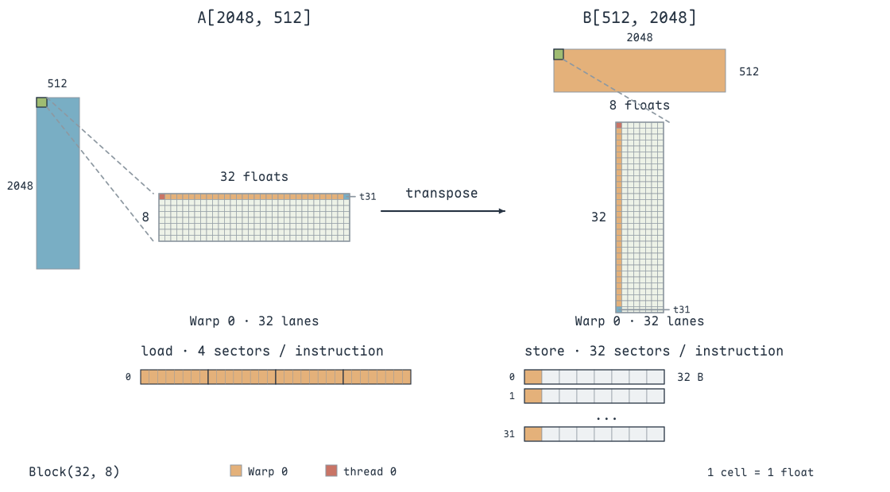{ width="800" }

**Block 为 16×16**：一个 Warp 覆盖输入两行，每行 16 个线程。读取仍是四个 sector；写入每个输出行的两个相邻元素，32 个线程分布到 16 个输出行，需要 16 个 sector。

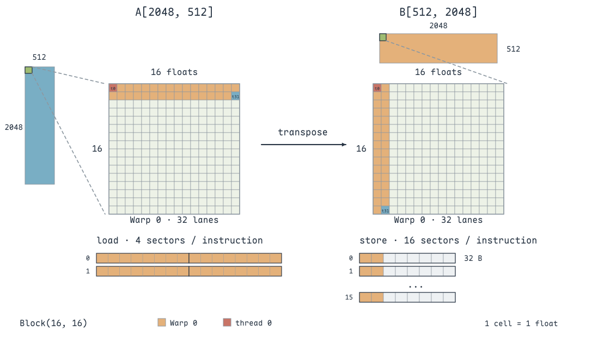{ width="800" }

**Block 为 8×32**：一个 Warp 覆盖输入四行，每行八个线程。读取四个 sector；写入每个输出行的四个相邻元素，只需八个 sector。按有效写入字节计算，写入利用率由 12.5% 提高到 50%。

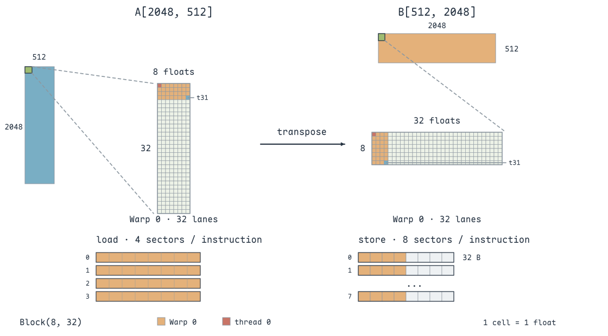{ width="800" }

这里的 sector 数按 32 个活跃线程、行首和访问片段对齐来计算。**调整 Block 形状没有减少转置的元素数，而是把输出端分散的写入组织得更紧凑。**

按一次标量 Warp store 的覆盖来比较，三种形状都写入 128 B 有效数据，但需要覆盖的字节分别是 1024 B、512 B、256 B。因此利用率是 12.5%、25%、50%。

继续把 x 维缩到 4，采用 `4×64` 时，一个 Warp 覆盖输入八行、每行四个 `float`。读取需要八个 sector，只有一半覆盖字节被使用；写入则有四行、每行八个元素，能覆盖四个 sector。**继续改善写入，会开始牺牲读取端的合并程度**。仅改变每线程一个元素的二维线程排布，无法在这组跨行转置中同时得到两端的四个 sector。

读取端都只覆盖四个 sector，并不意味着片上处理完全相同：`32×8` 的 Warp 读同一行，`16×16` 分布两行，`8×32` 分布四行。**相同 sector 数可以位于不同 cache line，Request 被拆成的 Wavefront 也可能不同。**

在 RTX 4060 Laptop GPU 上对同一个 $2048\times512$ 矩阵进行对照：`32×8` 约为 **115.87 μs**，`16×16` 约为 **41.79 μs**，`8×32` 约为 **24.93 μs**。这组测试中，输出端越紧凑，总时间越短；接下来通过调度和 Stall 指标，观察哪些等待随布局改善而减少。

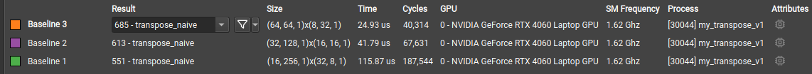{ width="800" }

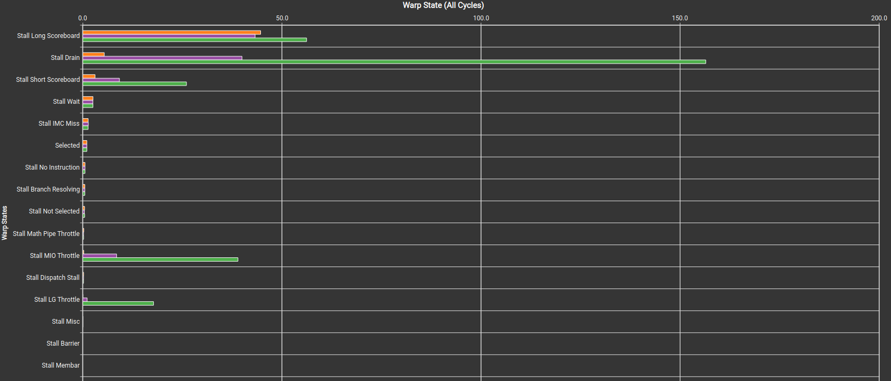{ width="800" }

结合 [Warp 调度](Occupancy与Warp调度.md) 中的指标，继续区分 Long Scoreboard、Drain、LG/MIO Throttle。这一版尚未使用 Shared Memory，不能仅凭出现 Short Scoreboard 就归因于 Shared Memory bank conflict。

先看 Scheduler Statistics，而不是只看谁的 Active 柱更高。这组三个配置的 Warp slot 都没有填满；`16×16` 的驻留 Warp 较多，却没有成为最快版本。相比之下，**Eligible 和 Issued 更接近本次时间排序**：配置能容纳的 Warp，只有准备好发射时才有助于隐藏延迟。

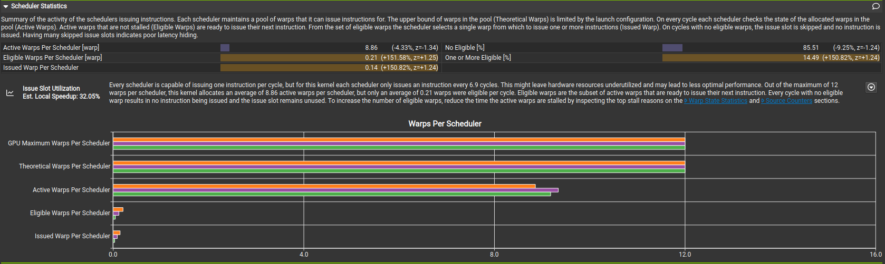{ width="800" }

最快的 `8×32` 在这份报告中，每个 Scheduler 平均有 8.86 个 Active Warp、0.21 个 Eligible Warp，平均每 6.9 个周期发射一次。Issued 约为 $1/6.9\approx0.145$，与 14.49% 的有就绪 Warp 周期相吻合；即使它已比其他布局更快，仍有 85.51% 的周期没有 Eligible Warp。

再逐项读 Warp State：

- **Long Scoreboard** 对应 load 之后的结果依赖。连续读取不代表所有读取都立即返回，还受到命中、片上请求处理和并行程度影响。
- **Drain** 对应末尾 store 尚未完成，Warp 资源不能马上释放。转置几乎所有线程最后都要写回，输出地址的分散程度会影响写回路径。
- **LG Throttle** 表示 local/global 指令队列压力。相同指令数可以因每条指令的内部处理工作不同而出现不同压力。
- **Short Scoreboard / MIO Throttle** 需要继续检查具体指令与管线。这一版没有 `__shared__` 数组，不能直接把这两项归因为 Shared Memory bank conflict。

其中最明显的差别是 **Drain**：`32×8` 的绿色柱超过每指令 150 个周期，`8×32` 的橙色柱已经很短。前者每次 Warp store 分散到 32 个输出行，后者只分布到八行；写回组织改善后，退出前等待未完成内存操作的开销明显减少。图中 LG / MIO Throttle 也随布局改善而下降。

这些柱状图是**定位原因的线索**，不足以仅凭一项计数就证明全部时间差来自某一个硬件队列。分析相同工作量时，先比较发射状态，再追踪访问与依赖，而不是按 sector 数给版本排性能名次。

## float4：在线程内转置 4×4 小块

标量版本的输出写入仍不够紧凑，可以让每个线程负责输入的一个 $4\times4$ 子块：**按四次 float4 读取四行，在寄存器中转置，再按四次 float4 写回**。每线程处理的是 16 个元素。

把输入的四行分别加载到 `src_transpose[0..3]` 后，输入小块的第一列是 `src[0][0]、src[1][0]、src[2][0]、src[3][0]`。这四个值在转置输出中属于同一行，因此可以通过 `make_float4` 拼成一个连续写入的向量；其余三列同理。

**线程内的转置只重新排列寄存器中的值**，不需要跨线程同步。Global 输入没有真的被修改，输出的行列关系由 `output_start` 和写回索引共同确定。

`THREAD_SIZE_Y`、`THREAD_SIZE_X` 表示整个 Block 覆盖的数据高度和宽度。Block 为 `16×16` 个线程时，两者均为 64；线程内部的行列偏移再乘 4，定位各自的 4×4 子块。

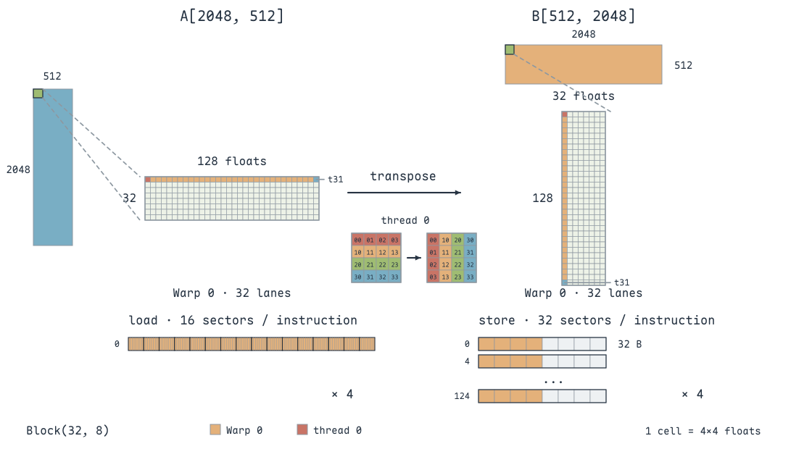{ width="800" }

Block 为 `32×8` 时，一条 Warp 向量 load 读取 $32\times16=512$ B，理想覆盖十六个 sector；向量 store 的 32 个线程仍写到 32 个不同行，需要 32 个 sector。

改为 `16×16` 后，一个 Warp 覆盖两行线程，输出每行由两个线程写入相邻的 `float4`，刚好组成一个 32 B sector。**单条向量 load 和 store 都覆盖十六个 sector，读写两端都能充分合并**。

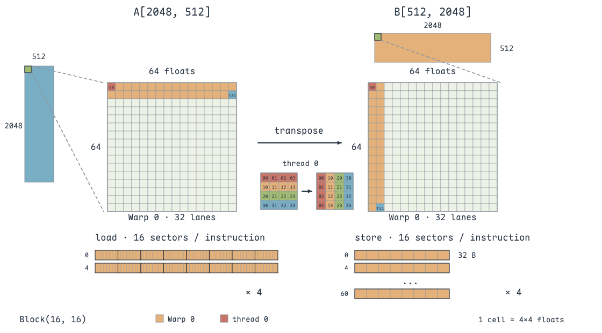{ width="800" }

`8×32` 也能做到两端合并：一次 load 的四组八个线程，各读取连续 32 个 `float`，每组四个 sector，合计十六个；一次 store 写入八个输出行，每行由四个线程各写一个 `float4`，共 64 B、两个 sector，仍合计十六个。**两种布局都没有浪费 sector，但地址分布到的行与 cache line 不同**，片上处理和调度表现仍可能不同。

=== "核心修改"

    ```cuda
    // 每个线程负责 4×4 元素，四次向量读入
    for (int i = 0; i < 4; i++)
        FETCH_FLOAT4(src_transpose[i]) =
            FETCH_FLOAT4(input_start[(threadIdx.y * 4 + i) * N + threadIdx.x * 4]);

    // 原输入的一列拼成转置后的一个 float4
    FETCH_FLOAT4(dst_transpose[0]) = make_float4(
        src_transpose[0][0], src_transpose[1][0],
        src_transpose[2][0], src_transpose[3][0]);
    // 其余三列同样重排，见完整 Kernel

    for (int i = 0; i < 4; i++)
        FETCH_FLOAT4(output_start[(i + threadIdx.x * 4) * M + threadIdx.y * 4]) =
            FETCH_FLOAT4(dst_transpose[i][0]);
    ```

=== "完整 Kernel"

    ```cuda
    #define FETCH_FLOAT4(pointer) (reinterpret_cast<float4 *>(&(pointer))[0])

    template <
        const int THREAD_SIZE_Y,
        const int THREAD_SIZE_X>
    __global__ void transpose_float4_inner_4x4(float *input,
                                               float *output, const int M, const int N)
    {
        float src_transpose[4][4];
        float dst_transpose[4][4];
        float *input_start = input + N * blockIdx.y * THREAD_SIZE_Y + blockIdx.x * THREAD_SIZE_X;
        // 每线程加载四行，每行用 float4 搬运四个元素
        for (int i = 0; i < 4; i++)
        {
            FETCH_FLOAT4(src_transpose[i]) = FETCH_FLOAT4(input_start[(threadIdx.y * 4 + i) * N + threadIdx.x * 4]);
        }

        // 寄存器中把输入的列重新组成输出的连续行
        FETCH_FLOAT4(dst_transpose[0]) = make_float4(src_transpose[0][0], src_transpose[1][0], src_transpose[2][0], src_transpose[3][0]);
        FETCH_FLOAT4(dst_transpose[1]) = make_float4(src_transpose[0][1], src_transpose[1][1], src_transpose[2][1], src_transpose[3][1]);
        FETCH_FLOAT4(dst_transpose[2]) = make_float4(src_transpose[0][2], src_transpose[1][2], src_transpose[2][2], src_transpose[3][2]);
        FETCH_FLOAT4(dst_transpose[3]) = make_float4(src_transpose[0][3], src_transpose[1][3], src_transpose[2][3], src_transpose[3][3]);

        float *output_start = output + M * blockIdx.x * THREAD_SIZE_X + blockIdx.y * THREAD_SIZE_Y;
        for (int i = 0; i < 4; i++)
        {
            FETCH_FLOAT4(output_start[(i + threadIdx.x * 4) * M + threadIdx.y * 4]) = FETCH_FLOAT4(dst_transpose[i][0]);
        }
    }
    ```

启动配置也要按数据块重新计算。对 $2048\times512$ 输入，`32×8` 标量 Block 的 Grid 是 `16×256`；每线程负责 4×4 后，同样的线程 Block 覆盖 **128 列、32 行**，Grid 改为 `4×64`。`16×16` 线程 Block 则覆盖 64×64 元素，Grid 为 `8×32`。

每个 Warp 虽然只执行四条向量 load，但四条指令分别读取四个输入行片段，不能把它们当成一个覆盖全部 4×4 小块的 request。若把 `float4` 改成四个标量 load，覆盖的元素总数相同，**各条指令的地址集合和指令数量都会改变**，需要逐指令分析。

**向量化主要减少内存指令数，并没有减少要搬运的元素数**。每线程工作量变为原来的 16 倍，同一矩阵所需的线程和 Block 更少，寄存器占用也可能增加；因此要同时观察实际 Occupancy 和 Eligible Warp。

{ width="800" }

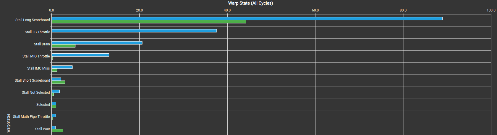{ width="800" }

可以进一步按同一矩阵计算指令总量。标量版本每线程一个元素，两个内存指令实例分别为 32768 次 Warp load 和 32768 次 Warp store。

4×4 版本每线程 16 个元素，所需线程数变为 65536、Warp 数变为 2048；每个 Warp 四次 load、四次 store，分别为 8192 次。**每个方向的内存指令数降为标量版的四分之一，但有效读取和写入字节仍然各是 4 MiB。**

在 `16×16` 线程布局下，每次向量访问十六个 sector，整个矩阵每个方向覆盖 $8192\times16\times32=4$ MiB，正好对应有效字节。`32×8` 版本的 store 每次覆盖 32 个 sector，则覆盖字节为 8 MiB，其中一半没有被当前访问利用。

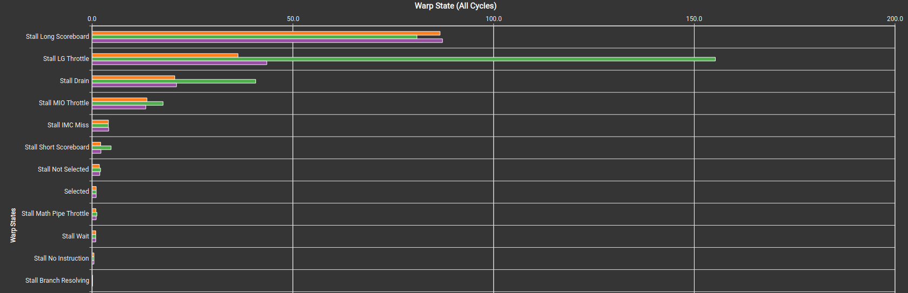{ width="800" }

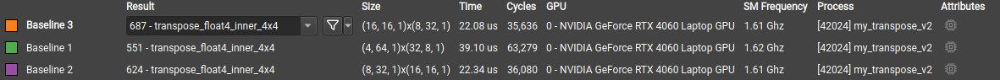{ width="800" }

这次测试中，`32×8`、`16×16`、`8×32` 的 float4 版本分别约为 39.10、22.34、22.08 μs。完全合并的 `16×16` 与 `8×32` 很接近，而分散写入的 `32×8` 较慢；不同布局仍会在 Long Scoreboard、Drain、LG/MIO Throttle 上表现不同。

和标量版的图对照，最慢布局的主要等待已经变化：标量 `32×8` 突出的是 **Drain**，float4 `32×8` 突出的是 **LG Throttle**。一次向量访问减少了指令总数，但每条请求仍有分散写入的内部处理工作；前一项瓶颈减轻后，队列压力可能成为更显眼的限制。

标量与 float4 的另一组对照中，总时间由约 24.38 μs 降到 21.34 μs，但 float4 的某些“每指令等待周期”反而更高。**减少总指令数、减少总 Warp 数与单个 Warp 等得更久可以同时发生**，因此不能为了降低每指令 Stall 指标而直接退回标量访问。

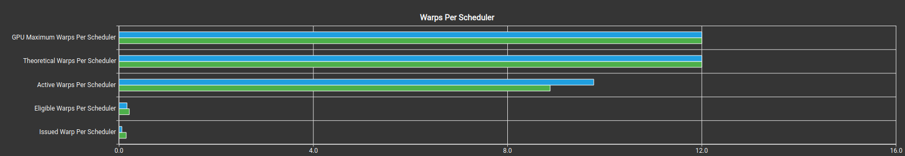{ width="800" }

这张图中的蓝色是当前 float4，绿色是标量 Baseline。float4 的 Active 更多，但 Eligible 和 Issued 反而较少；它仍凭借更少的总指令、更紧凑的写入缩短了总时间。**单个调度指标的升降，不能替代整个工作量和执行时间的比较**。

## float2：减小每线程工作量

为了保留较宽的读写，又让同一矩阵有更多线程参与，配套代码继续尝试 **2×2 寄存器小块**：每线程两次 `float2` 读取、两次 `float2` 写入。相比 4×4，线程内临时数据更少，Grid 也更大。

=== "核心修改"

    ```cuda
    for (int i = 0; i < 2; i++)
        FETCH_FLOAT2(src_transpose[i]) =
            FETCH_FLOAT2(input_start[(threadIdx.y * 2 + i) * N + threadIdx.x * 2]);

    FETCH_FLOAT2(dst_transpose[0]) = make_float2(src_transpose[0][0], src_transpose[1][0]);
    FETCH_FLOAT2(dst_transpose[1]) = make_float2(src_transpose[0][1], src_transpose[1][1]);

    for (int i = 0; i < 2; i++)
        FETCH_FLOAT2(output_start[(i + threadIdx.x * 2) * M + threadIdx.y * 2]) =
            FETCH_FLOAT2(dst_transpose[i][0]);
    ```

=== "完整 Kernel"

    ```cuda
    #define FETCH_FLOAT2(pointer) (reinterpret_cast<float2 *>(&(pointer))[0])

    template <
        const int THREAD_SIZE_Y,
        const int THREAD_SIZE_X>
    __global__ void transpose_float2_inner_2x2(float *input,
                                               float *output, const int M, const int N)
    {
        float src_transpose[2][2];
        float dst_transpose[2][2];
        float *input_start = input + N * blockIdx.y * THREAD_SIZE_Y + blockIdx.x * THREAD_SIZE_X;
        // 用 2×2 替代 4×4，保留向量读写并减小线程内工作量
        for (int i = 0; i < 2; i++)
        {
            FETCH_FLOAT2(src_transpose[i]) = FETCH_FLOAT2(input_start[(threadIdx.y * 2 + i) * N + threadIdx.x * 2]);
        }

        FETCH_FLOAT2(dst_transpose[0]) = make_float2(src_transpose[0][0], src_transpose[1][0]);
        FETCH_FLOAT2(dst_transpose[1]) = make_float2(src_transpose[0][1], src_transpose[1][1]);

        float *output_start = output + M * blockIdx.x * THREAD_SIZE_X + blockIdx.y * THREAD_SIZE_Y;
        for (int i = 0; i < 2; i++)
        {
            FETCH_FLOAT2(output_start[(i + threadIdx.x * 2) * M + threadIdx.y * 2]) = FETCH_FLOAT2(dst_transpose[i][0]);
        }
    }
    ```

对同一矩阵，2×2 版本有 262144 个线程、8192 个 Warp，每个 Warp 两次 load 和两次 store，各 16384 次内存指令实例。它位于标量和 4×4 之间：**比标量减少指令，又比 4×4 保留更多可参与调度的线程和 Block**。

每线程处理两行、两列，所以 Block 数据范围为线程形状的两倍。对 $2048\times512$ 输入，`32×8`、`16×16`、`8×32` 分别覆盖 16 行×64 列、32 行×32 列、64 行×16 列，Grid 分别为 `8×128`、`16×64`、`32×32`，总共都是 1024 个 Block。

一次 `float2` Warp load 需要 256 B，理想覆盖八个 sector。这三种布局的读取都覆盖八个 sector，store 则分别覆盖 32、16、八个。以 `8×32` 为例，一个 Warp 的四组线程向八个输出行各写入四个相邻 `float2`，每行正好填满一个 sector；因此两个方向的总覆盖量都是 $16384\times8\times32=4$ MiB。**2×2 的优势来自兼顾紧凑访问与更多 Warp，而不是减少有效数据量。**

{ width="800" }

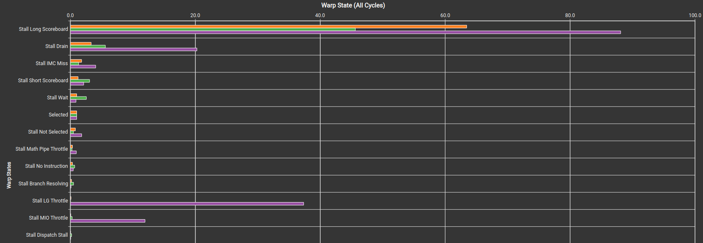{ width="800" }

在这次对照中，标量约 25.22 μs、float4 约 21.76 μs、float2 约 19.46 μs。对相同矩阵和同一轮对照，float2 改善了总时间；其意义在于找到访存指令与 Warp 并行度之间更合适的分工，而不是向量越窄越快。

另一组 Baseline 比较中，标量版的 L1 命中率比向量版高。相邻指令和 Warp 可能重复覆盖同一 sector，缓存复用会减少下游流量，所以 sector 浪费减少四倍，并不意味着总时间也减少四倍。Baseline 显示的命中率“增加 138%”还是相对变化，不是增加 138 个百分点；先看各版本的原始命中率，再与 DRAM 字节和时间对照。

另一个版本进一步改为**沿输入行方向取两个元素，再组成一个 float2 写回**。一个线程读取输入中同一列的两行，转置后这两个元素在输出中相邻。

采用 `8×32` 的线程 Block，覆盖输入的 64 行、8 列；一个 Warp 的四组八个线程，向输出每行写入四个相邻 `float2`，合起来正好是 32 B。这样一条 Warp store 覆盖八个 sector，而不再让每线程承担 4×4 子块。

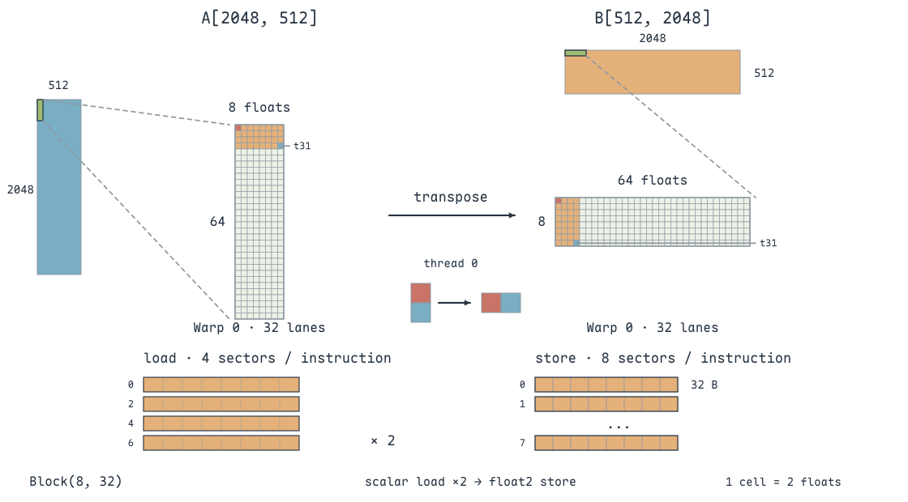{ width="800" }

=== "核心修改"

    ```cuda
    src_transpose[0] = input_start[2 * threadIdx.y * N + threadIdx.x];
    src_transpose[1] = input_start[(2 * threadIdx.y + 1) * N + threadIdx.x];
    FETCH_FLOAT2(dst_transpose[0]) = make_float2(src_transpose[0], src_transpose[1]);
    FETCH_FLOAT2(output_start[threadIdx.x * M + threadIdx.y * 2]) =
        FETCH_FLOAT2(dst_transpose[0]);
    ```

=== "完整 Kernel"

    ```cuda
    #define FETCH_FLOAT2(pointer) (reinterpret_cast<float2 *>(&(pointer))[0])

    template <
        const int THREAD_SIZE_Y,
        const int THREAD_SIZE_X>
    __global__ void transpose_float2_inner_1x2(float *input,
                                               float *output, const int M, const int N)
    {
        float src_transpose[2];
        float dst_transpose[2];
        float *input_start = input + N * blockIdx.y * THREAD_SIZE_Y + blockIdx.x * THREAD_SIZE_X;

        // 输入同一列的两行，转置后变成输出同行的两个相邻元素
        src_transpose[0] = input_start[2 * threadIdx.y * N + threadIdx.x];
        src_transpose[1] = input_start[(2 * threadIdx.y + 1) * N + threadIdx.x];

        FETCH_FLOAT2(dst_transpose[0]) = make_float2(src_transpose[0], src_transpose[1]);

        float *output_start = output + M * blockIdx.x * THREAD_SIZE_X + blockIdx.y * THREAD_SIZE_Y;

        FETCH_FLOAT2(output_start[threadIdx.x * M + threadIdx.y * 2]) = FETCH_FLOAT2(dst_transpose[0]);
    }
    ```

这里的两次输入读取是 **标量 load**，并不是一次 `float2` load：两个元素位于同一列、相邻两行，内存地址相差 N 个 `float`，并不连续。只有转置后的两个输出元素相邻，才组成一个 `float2` store。

按图中的 `8×32` 线程 Block，每条 load 覆盖四行、每行八个相邻元素，共四个 sector；每个线程分两次读取两个输入行片段，所以每 Warp 是 **两次 load request、一次 store request**。其中一次 load 访问输入行 0、2、4、6，另一次访问 1、3、5、7。

同一矩阵因此需要 524288 个线程、16384 个 Warp；load 指令合计 32768 次，与标量版相同，store 则降为 16384 次。Block 覆盖 64 行、8 列，Grid 为 `64×32`。相比 2×2 版，线程数翻倍，但读取端也回到了标量指令；这就是增加 Warp 并行度需要付出的指令代价。

这几版围绕的是同一组取舍：**访存合并程度、内存指令数、每线程工作量，以及可参与调度的 Warp 数量**。需要沿着具体的 NCU 证据判断哪一项成为瓶颈，而不是把 `float4`、`float2` 当成固定的性能排序。

## Shared Memory：在 Block 内交换读写方向

让每个线程连续读取输入，先存入共享内存；同步后，用交换行列的索引读取共享数据，再连续写入输出。**跨线程的数据重排在 Shared Memory 中完成，Global Memory 的两端都按行访问**。

配套代码加载时写 `sdata[tx][ty]`，输出时读 `sdata[ty][tx]`；同时交换 Block 的行列位置。写回阶段的线程读取的是别的线程加载的元素，`__syncthreads()` 必须放在所有线程都会执行的位置。

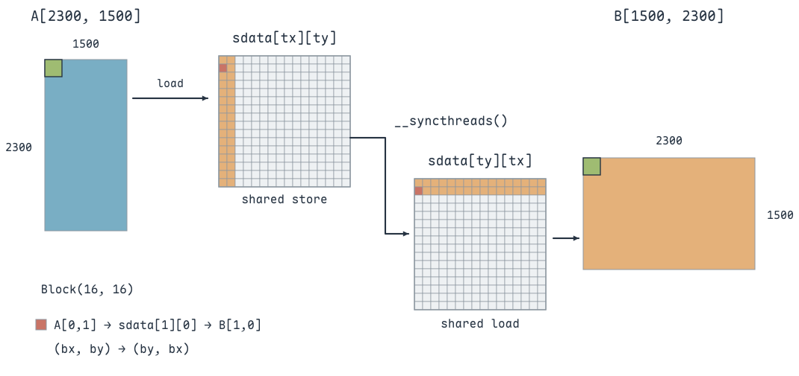{ width="800" }

=== "核心修改"

    ```cuda
    __shared__ float sdata[BLOCK_SZ][BLOCK_SZ];
    if (y < M && x < N)
        sdata[tx][ty] = input_start[ty * N + tx];
    __syncthreads();

    // 交换 Block 坐标，使输出仍由相邻线程沿行写入
    x = blockDim.y * blockIdx.y + tx;
    y = blockDim.x * blockIdx.x + ty;
    float *output_start = output + M * blockIdx.x * BLOCK_SZ + blockIdx.y * BLOCK_SZ;
    if (y < N && x < M)
        output_start[ty * M + tx] = sdata[ty][tx];
    ```

=== "完整 Kernel"

    ```cuda
    template <int BLOCK_SZ>
    __global__ void mat_transpose_kernel_v5(float *input, float *output, int M, int N)
    {
        const int tx = threadIdx.x;
        const int ty = threadIdx.y;
        int x = blockDim.x * blockIdx.x + tx;
        int y = blockDim.y * blockIdx.y + ty;
        float *input_start = input + N * blockIdx.y * BLOCK_SZ + blockIdx.x * BLOCK_SZ;
        __shared__ float sdata[BLOCK_SZ][BLOCK_SZ];

        if (y < M && x < N)
        {
            // 连续读入 Global Memory，交换索引存入 Shared Memory
            sdata[tx][ty] = input_start[ty * N + tx];
        }
        __syncthreads();  // 其他线程加载的数据就绪后，才能换方向读取
        x = blockDim.y * blockIdx.y + tx;
        y = blockDim.x * blockIdx.x + ty;
        float *output_start = output + M * blockIdx.x * BLOCK_SZ + blockIdx.y * BLOCK_SZ;
        if (y < N && x < M)
        {
            output_start[ty * M + tx] = sdata[ty][tx];
        }
    }
    ```

加载阶段当前线程读 `input[y,x]`，存到 `sdata[tx][ty]`；写回阶段读取 `sdata[ty][tx]`，也就是加载阶段局部坐标交换后的线程提供的数据。

假设当前输入 Block 坐标为 `(bx,by)`，写回后它位于输出的 `(by,bx)`。输出元素的行是 $bx\times B+ty$，列是 $by\times B+tx$，这恰好对应原输入中行 $by\times B+tx$、列 $bx\times B+ty$ 的元素。**既要交换 Block 位置，也要交换 Block 内的数据索引**，只做其中一个不能得到完整转置。

同步不能放到边界判断里面：边界处部分线程没有加载任务，但仍要参加 `__syncthreads()`；否则同一 Block 的其他线程可能等待不到完整的同步参与者。

这一版的线程 Block 为 `BLOCK_SZ×BLOCK_SZ`，Grid 为 `ceil(N/BLOCK_SZ)×ceil(M/BLOCK_SZ)`。写回有效的输出坐标总能对应到加载阶段有效的输入坐标，边界处不会读取尚未初始化的共享元素。

输出端读 Shared Memory 时，对固定的 `ty`，`sdata[ty][tx]` 的 tx 连续。无 padding 的 16×16 布局下，一个 Warp 两行线程分别读取两个连续的 16 元素片段，共覆盖 32 个不同 bank，**shared load 本身没有 bank conflict**。

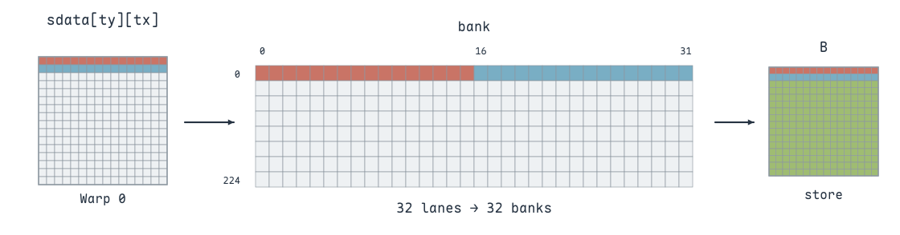{ width="800" }

这解释了截图中可能出现的非对称结果：shared store 有很多冲突，而 shared load 没有。**Bank conflict 由具体指令的地址集合决定，不是一个数组声明了 Shared Memory 就整体“有冲突”。**

## Padding：减少 Shared Memory 的 Bank Conflict

Global 访存改善后，继续观察 `sdata[tx][ty]` 的共享内存写入。32 个 bank、每个 `float` 为 4 B 时，bank 编号为元素线性索引对 32 取模。

对于 16×16 的线程 Block，一个 Warp 覆盖 `ty=0` 和 `ty=1` 两行。无 padding 时，地址为 $16tx+ty$；固定 ty，偶数 tx 都落入一个 bank，奇数 tx 落入另一个 bank。因此**一条 Warp shared store 会形成八路 bank conflict**。

一个完整 Block 有八个 Warp，也就是八个 shared store request。每个 request 需要八个 wavefront，合计 64 个；相对八个理想 wavefront，多出 $64-8=56$ 个，与图中的统计一致。

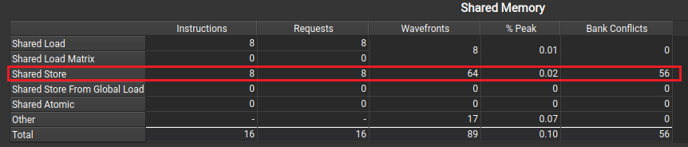{ width="800" }

把共享数组改为 `[16][17]`，地址变成 $17tx+ty$。同一 ty 内的 16 个线程能落到不同 bank，但两行线程合在一个 Warp 后仍会有 bank 重叠，**从八路冲突降为两路，并没有完全消除冲突**。

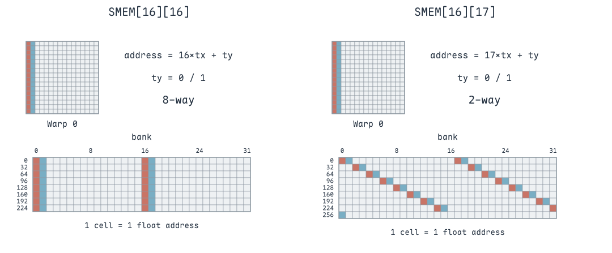{ width="800" }

=== "核心修改"

    ```cuda
    // 核心修改只在 Shared Memory 的物理行跨度
    __shared__ float sdata[BLOCK_SZ][BLOCK_SZ + 1];
    ```

=== "完整 Kernel"

    ```cuda
    template <int BLOCK_SZ>
    __global__ void mat_transpose_kernel_v6(float *input, float *output, int M, int N)
    {
        const int tx = threadIdx.x;
        const int ty = threadIdx.y;
        int x = blockDim.x * blockIdx.x + tx;
        int y = blockDim.y * blockIdx.y + ty;
        float *input_start = input + N * blockIdx.y * BLOCK_SZ + blockIdx.x * BLOCK_SZ;
        // 行跨度增加一列，打散原来的 bank 映射
        __shared__ float sdata[BLOCK_SZ][BLOCK_SZ + 1];

        if (y < M && x < N)
        {
            sdata[tx][ty] = input_start[ty * N + tx];
        }
        __syncthreads();  // 保证换方向读取前，整个 tile 已加载完成
        x = blockDim.y * blockIdx.y + tx;
        y = blockDim.x * blockIdx.x + ty;
        float *output_start = output + M * blockIdx.x * BLOCK_SZ + blockIdx.y * BLOCK_SZ;
        if (y < N && x < M)
        {
            output_start[ty * M + tx] = sdata[ty][tx];
        }
    }
    ```

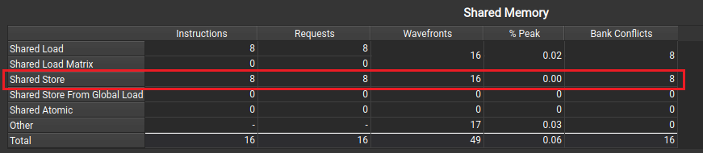{ width="800" }

Padding 后，八个 shared store request 合计需要十六个 wavefront，额外冲突为 $16-8=8$。经典 32×32 tile 加一列能消除列访问冲突，但本例是 16×16 的线程分组，**要按同一条 Warp 指令的完整地址集合分析，不能直接套用 32×32 的结论**。

Padding 后的 shared load 也要重新分析。`sdata[ty][tx]` 的两行起点分别为 0 和 17，一个 Warp 访问 `[0,15]`、`[17,32]`，元素 0 与 32 落在同一 bank。因此，**加一列不仅改善写入，也改变了读取的 bank 映射**；本例的读取端也可能变为两路冲突。

把一次完整 Block 的两阶段统计合起来看，无 padding 时 shared store 多出 56 个 wavefront、shared load 多出零个；padding 后两者各多出八个。**额外处理量从 56 降到 16**，所以整体冲突减少，即使读取端从无冲突变成了两路冲突。

这次数组容量也从 $16\times16\times4=1024$ B 增加到 $16\times17\times4=1088$ B。增加的是物理行跨度，逻辑上仍只存 16×16 个有效 `float`，额外一列只用于打散 bank 映射。

## 边界 Block：18×18 与 19×19

边界判断会关闭部分 lane，但不会重新把余下的活跃线程压缩成新的 Warp。仍然按 `threadIdx.x + 16*threadIdx.y` 分组，**只有参加当前 shared 指令的 lane 才进入冲突计算**。

18×18 矩阵用 16×16 的 Block，得到四块 A、B、C、D。A 完整，B 只剩两列，C 只剩两行，D 只有 2×2。以下先分析未 padding 的 `sdata[tx][ty]` 写入：

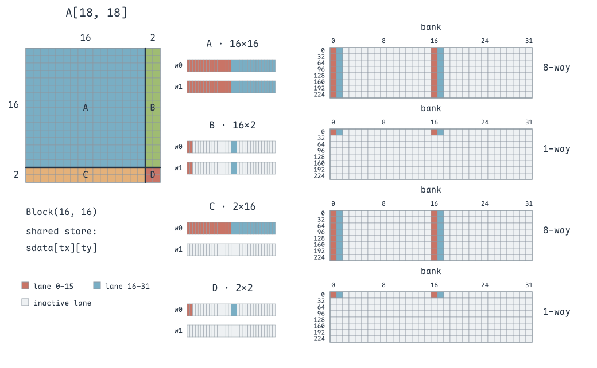{ width="800" }

- **A：16×16**。八个 Warp 各执行一次 shared store，每条都是八路冲突：八个 request、64 个 wavefront，额外冲突 56。
- **B：16×2**。八个 Warp 仍都执行 store，但每个 Warp 只有两行、每行两个活跃 lane；四个元素落在不同 bank，没有冲突：八个 request、八个 wavefront。
- **C：2×16**。只有一个完整 Warp 参与，它仍按列存入 Shared Memory，形成八路冲突：一个 request、八个 wavefront，额外冲突七。
- **D：2×2**。一个 Warp 里只有四个活跃 lane，访问不同 bank：一个 request、一个 wavefront。

所以 shared store 合计为 18 个 request、81 个 wavefront、63 个额外冲突，与截图一致。

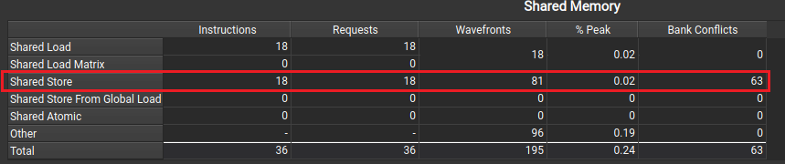{ width="800" }

19×19 的余数是**三行、三列**。三行线程跨两个 Warp，对应四行线程容量，但只有三行有效；应按各 Warp 的有效 lane 分析：

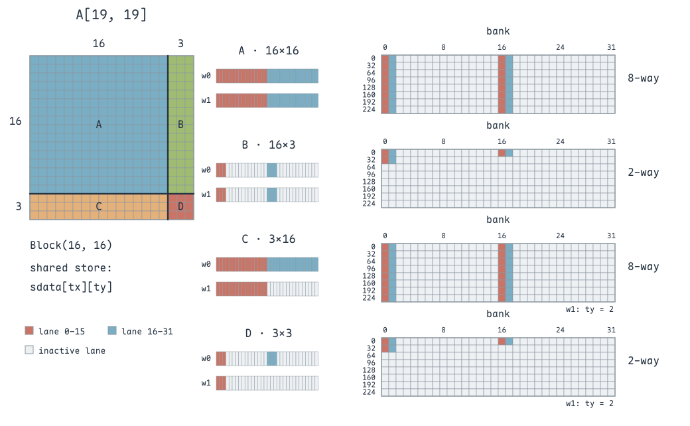{ width="800" }

- **A：16×16**。仍是八个 request、64 个 wavefront、56 个额外冲突。
- **B：16×3**。每个 Warp 有两行、每行三个活跃 lane。tx 为 0 和 2 的元素在同一 bank，形成两路冲突：八个 request、16 个 wavefront、八个额外冲突。
- **C：3×16**。三行线程跨两个原有 Warp，第二个 Warp 只有半 Warp 活跃；两条指令仍各需八个 wavefront：两个 request、16 个 wavefront、14 个额外冲突。
- **D：3×3**。有效线程分散在两个原有 Warp 中，两条指令各有两路冲突：两个 request、四个 wavefront、两个额外冲突。

合计 20 个 request、100 个 wavefront、80 个额外冲突。**只增加一行、一列，既改变了活跃 Warp 数，也改变了每条请求内的 bank 重叠情况**，不能按元素数比例直接放大统计值。

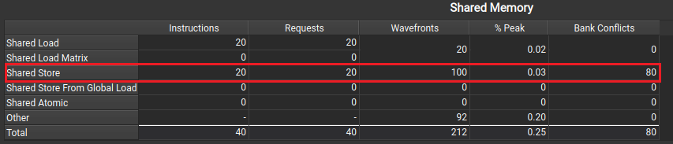{ width="800" }

shared load 阶段对应的有效输出区域已转置，所以 B、C 的 Warp 数要交换：18×18 时 A、B、C、D 分别为 8、1、8、1 个 request，合计仍为 18；19×19 时分别为 8、2、8、2，合计 20。无 padding 时，这些读取在各 Warp 内访问不同 bank，因此都没有额外冲突。

在这些单一的标量 shared store 示例中，每个 request 理想只需一个 wavefront，所以可以用 `Wavefronts - Requests` 计算额外串行工作。对于更复杂的指令或报告中的 `Other` 行，应先确认请求的理想处理量和统计范围，不能一律把差值都叫作同一类 bank conflict。

例如一条每 lane 搬运 16 B 的 Shared 指令，整个 Warp 共 512 B；若硬件一个理想处理批次搬运 128 B，即使完全无 bank conflict，也至少需要四个批次。此时应对照 **Wavefronts 与 Ideal Wavefronts**，不能减去一个 request 就把其余三个批次全部称为冲突。

## 大矩阵中的边界请求数

取 $M=2300$、$N=1500$，分块大小为 16。`grid.x = ceil(N/16) = 94`，`grid.y = ceil(M/16) = 144`，即启动 `Grid(94,144)`。它覆盖 2304 行×1504 列，但真正有效的数据仍是 2300 行×1500 列。

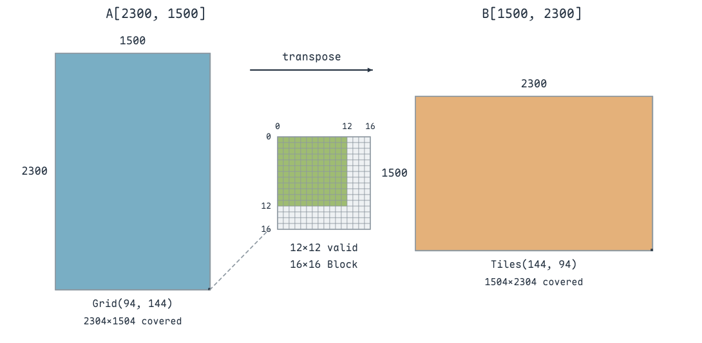{ width="800" }

两个维度除以 16 的余数都是 12，因此右下角 Block 有 12 行×12 列有效元素，另有四行、四列越界。输出的 tile 排列变为 144 列×94 行，这是同一次 Kernel 内交换 Block 坐标后的布局，并没有再启动一个输出 Grid。

**Shared store 对应加载输入阶段**。每个 Warp 覆盖两行线程；2300 行恰好有 1150 组，每组跨 94 个列 Block。最右侧虽然只有 12 个有效列，Warp 仍会执行 shared store，所以请求数为：

$$
94\times2300/2=108100.
$$

**Shared load 对应写回输出阶段**。转置后有 1500 行，每组两行跨 144 个列 Block；最右侧只有四个有效列，但仍产生请求，因此请求数为：

$$
144\times1500/2=108000.
$$

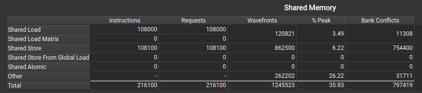{ width="800" }

两阶段各自搬运相同数量的有效元素，但它们的**Warp 分组方向和边界活跃 lane 分布不同**，Request 数因而不同。统计访问次数时，要数实际执行了这条指令的 Warp，而不是直接用有效元素数除以 32。

## 多元素搬运与边界分支

“每线程搬四个元素”有两种常见写法，它们的访存组织不同：

```cuda
// 标量指令：同一轮的相邻线程，分别读取相邻列
for (int j = 0; j < 4; j++)
    value[j] = input[(row + j * blockDim.y) * N + col];

// 向量指令：一个线程一次读取四个连续列元素
float4 value4 = reinterpret_cast<const float4*>(input + row * N)[col4];
```

前者每轮让 Warp 的列地址连续，同一线程的四个数据可以相隔多行；后者要求同一线程的四个元素连续且对齐。**“一个线程处理四个数”本身不能说明是否合并，需要看同一条指令中所有 lane 的地址**。

边界判断也可以从每次循环中提出来：完整 tile 走无需逐元素判断的路径，只有右侧和底部的残缺 tile 检查坐标。对于 2300×1500、16×16 分块，Grid 共 $144\times94=13536$ 个 Block，其中 $143\times93=13299$ 个完整，边界只有 237 个。这样可把绝大部分 Block 的重复判断集中到一次完整性检查上，同时保留边界处的安全访问。

> 参考：[矩阵转置与合并访存](https://zhuanlan.zhihu.com/p/702516288)、[矩阵转置算子优化](https://blog.csdn.net/LostUnravel/article/details/137613493)、[CUDA Best Practices：Shared Memory in Matrix Transpose](https://docs.nvidia.com/cuda/cuda-c-best-practices-guide/index.html#shared-memory-in-matrix-multiplication-c-aat)。
