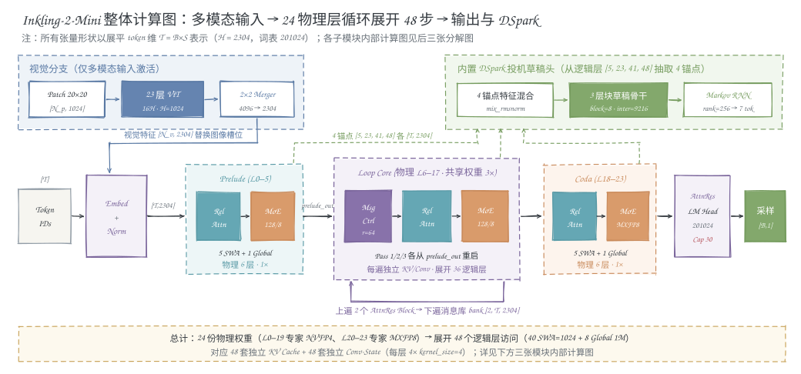
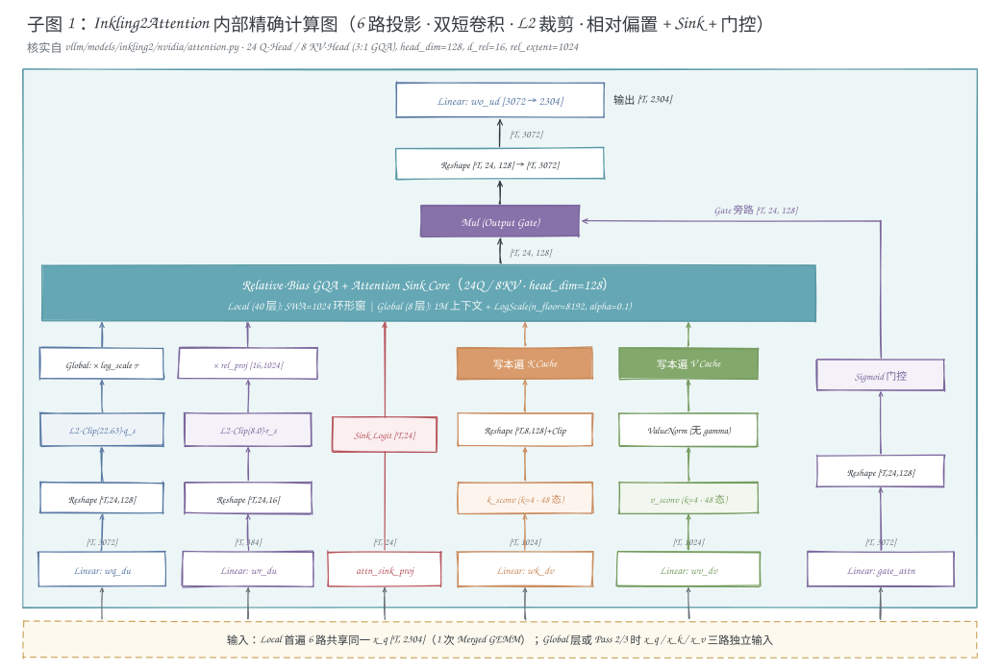
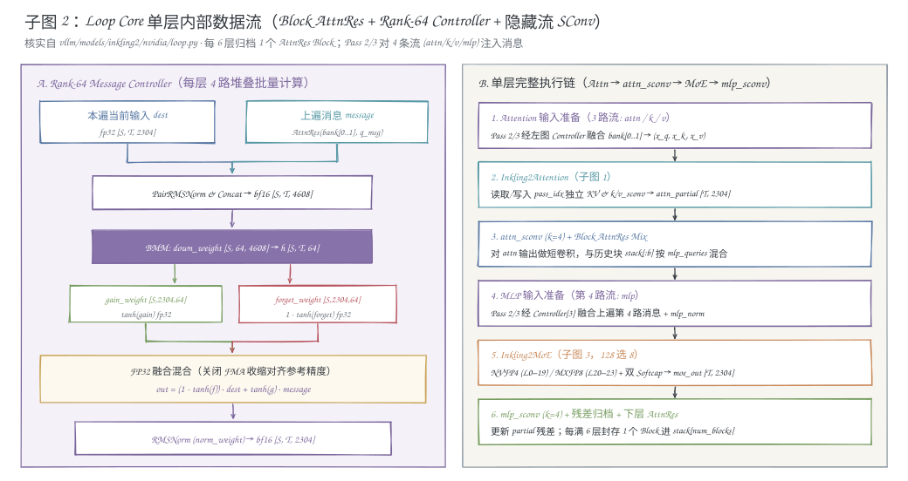
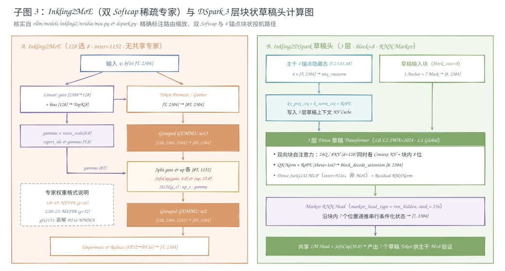
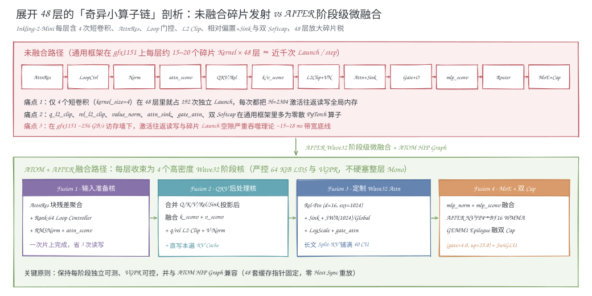
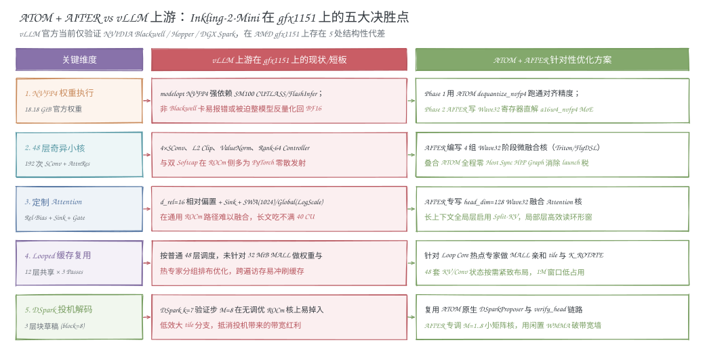
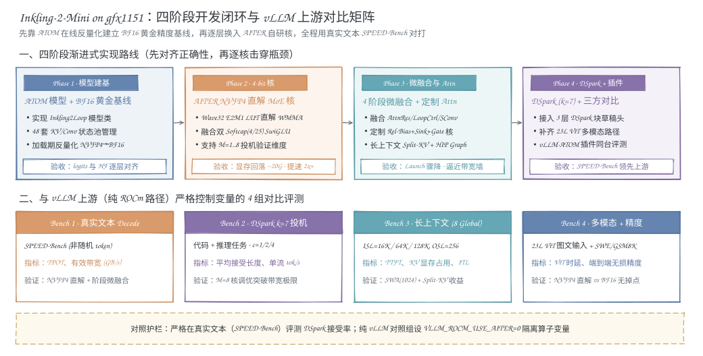

# gfx1151 上的 ATOM + AITER 优化 Inkling-2-Mini 设计笔记

2026 年 11 月 20 日，Thinking Machines Lab 开源了 [**`thinkingmachines/Inkling-2-Mini`**](https://huggingface.co/thinkingmachines/Inkling-2-Mini)——一个单文件仅 **18.18 GiB**（26.4B 总参 / 5.4B 等效激活）、支持 **1M 上下文**、原生多模态且内置 **DSpark 块状投机头** 的 **Looped Sparse MoE Transformer**。官方面向的本地硬件主力是 NVIDIA DGX Spark（GB10，128 GB UMA）与 Apple Silicon；而 **vLLM 官方配方**（[`recipes.vllm.ai/thinkingmachines/Inkling-2-Mini`](https://recipes.vllm.ai/thinkingmachines/Inkling-2-Mini)）目前仅验证了 NVIDIA Blackwell / Hopper / DGX Spark，**在 AMD ROCm 尤其是对标 DGX Spark 的 `gfx1151`（AMD Strix Halo，64–128 GB UMA LPDDR5X，~256 GB/s）上几乎是一片空白**。

更关键的是，`Inkling-2-Mini` 的架构极具工程挑战性：中间 12 层共享权重循环执行 3 遍（展开为 **48 个逻辑层**），每层串联着 **4 次短因果卷积、块级 Attention-Residual、Rank-64 Loop 门控、Q/Rel L2 Clip、无 gamma Value Norm、相对位置偏置 + Sink + Output Gate 注意力以及双 Softcap MoE**。在通用推理框架的 ROCm 路径下，这套架构极易退化为每步近千次碎片 Kernel Launch 与低效权重回退——这恰恰是 **ATOM（轻量引擎 + 原生 DSpark）+ AITER（自研 Wave32 Kernel 与微融合）** 最能与 vLLM 上游拉开代差的理想战场。

??? info "核对来源、硬件前提与文档边界"

    - **模型配置来源**：全部架构参数、层数、缓存与权重命名均核实自 HuggingFace 官方仓库 [`thinkingmachines/Inkling-2-Mini`](https://huggingface.co/thinkingmachines/Inkling-2-Mini) 的 `config.json`、`README.md` 与 `model.safetensors.index.json`（总权重 `19,525,870,752` B ≈ `18.18 GiB`）。
    - **软件对照基线**：ATOM 源码参考本地 `ROCm/ATOM`（commit `f3d0b30fb`），vLLM 侧参考官方配方 `recipes.vllm.ai/thinkingmachines/Inkling-2-Mini`（要求 vLLM nightly / >= 0.35.0）。
    - **目标硬件**：AMD Radeon 8060S / Strix Halo（`gfx1151`，RDNA 3.5，20 WGP / 40 CU，Wave32，64 KiB LDS/WGP，32 MiB MALL，64–128 GB UMA LPDDR5X，~256 GB/s；原生支持 BF16/FP16 WMMA，无 NVIDIA Blackwell NVFP4 硬件指令）。
    - **文档定位**：本文为面向实机开发的架构拆解笔记与实验设计手册；文中访存带宽与延迟下界为理论估算，实测数字待实机跑通后填入第五节实验记录本。

---

## 一、模型解剖：整体计算图与四大核心模块内部拆解

直接锚定官方 `config.json`、`safetensors` 权重表与 `vllm/models/inkling2/nvidia/{loop,attention,moe,dspark}.py` 参考实现，先看 `Inkling-2-Mini` 的**整体宏观计算图**，再分三张子图把 Attention、Loop Core 控制器、MoE 与 DSpark 内部的每一个算子和张量形状展开。

### 1. 整体计算图：24 物理层 → 48 逻辑层循环与 48 套独立缓存

[{ width="960" }](../../assets/experiments/inkling2-atom-gfx1151/inkling2-arch-overview.svg)

整机前向按三段展开：输入经过 201K 词嵌入（多模态场景混入 23 层 ViT + 2×2 Merger 输出）后，先跑 1 遍 **Prelude（物理层 0–5）**，再以 `prelude_out` 为统一起点把 **Loop Core（物理层 6–17）共享权重循环执行 3 遍**（每遍维护独立的 KV Cache 与短卷积状态池），最后过 1 遍 **Coda（物理层 18–23）**、输出 AttnRes 与 `SoftCap(30.0)` LM Head；同时在逻辑访问步 `[5, 23, 41, 48]` 抽取 4 份锚点隐藏态送入内置 3 层 **DSpark** 草稿头。

### 2. 三大核心模块内部计算图

#### 子图 1：`Inkling2Attention`（6 路投影 · 双短卷积 · 相对偏置 + Sink + 输出门控）

`Inkling2Attention` 是整机与标准 GQA 差异最大的模块：Local 层首遍把 6 路投影合并为 1 次 `MergedColumnParallelLinear`（总输出维 `3072 + 384 + 3072 + 24 + 1024 + 1024 = 8576`），而 Global 层或 Loop Core Pass 2/3 因 Q/K/V 接收不同的跨遍消息而拆成三路输入（`x_q / x_k / x_v`）：

[{ width="960" }](../../assets/experiments/inkling2-atom-gfx1151/inkling2-attention-detail.svg)

#### 子图 2：Loop Core 单层数据流（Block AttnRes + Rank-64 Controller + 隐藏流短卷积）

每 6 个逻辑层封存为 1 个 **Block Attention Residual**（`n_layers_per_attn_res_block = 6`）。Pass 2 和 Pass 3 启动时，每层的 4 条子流（`attn / k / v / mlp`）都会通过 `message_queries` 读取上一遍的 2 个 Block，再经 **Rank-64 Message Controller** 在 FP32 中做门控融合，而每次 Attention 和 MoE 的输出都要再经过隐藏流短卷积（`attn_sconv` / `mlp_sconv`，`kernel_size = 4`）：

[{ width="960" }](../../assets/experiments/inkling2-atom-gfx1151/inkling2-loop-layer-detail.svg)

#### 子图 3：`Inkling2MoE`（双 Softcap 稀疏专家）与 `Inkling2DSpark` 3 层块状草稿头

MoE 层不含共享专家（`128 选 8`，`intermediate_size = 1152`），L0–19 专家权重为 NVFP4（`group_size = 16`）、L20–23 为 MXFP8（`group_size = 32`），在 SwiGLU 前对 `gate` 和 `up` 分别施加 `4.0` 与 `25.0` 的双 Softcap；右侧的 3 层 DSpark 草稿头则通过 `mix_rmsnorm` 汇总 4 锚点特征，以双向块自注意力（`block_size = 8`）+ `rank = 256` Markov RNN 一次产出 7 个草稿 token：

[{ width="960" }](../../assets/experiments/inkling2-atom-gfx1151/inkling2-moe-dspark-detail.svg)

### 3. 关键架构参数账本

| 模块 | 精确配置（核实自 `config.json`） | 对 `gfx1151` 推理引擎的设计含义 |
| --- | --- | --- |
| **Looped 拓扑** | 物理 24 层：`Prelude(0..5)` + `Loop Core(6..17) × 3 Passes` + `Coda(18..23)` = **48 逻辑层** | 物理权重仅 24 份，但每遍循环需维护独立 KV/Conv 状态，共计 **48 套缓存池** |
| **跨遍消息与残差** | `n_layers_per_attn_res_block = 6`、`attn_res_normalize_values = true`、`gate_rank = 64` | Pass 2/3 从 Prelude 输出重新起步，每层经 Rank-64 门控控制器（`controllers.{attn,k,...}`）融合上遍 2 个 AttnRes 块消息 |
| **混合局部/全局 Attention** | `H = 2304`，`24Q / 8KV`（3:1 GQA），`head_dim = 128`；20 个局部层（`SWA = 1024`）+ 4 个全局层（物理层 `5, 11, 17, 23`） | 展开 48 层中 **40 层为 1024 局部环形窗**，仅 **8 个逻辑层**（`5`×1、`11`×3、`17`×3、`23`×1）需存全长全局 KV |
| **定制 Attention 特性** | `d_rel = 16`、`rel_extent = 1024`、`attn_sink_proj`、`gate_attn`、`qk_l2_clip = 22.63`、`rel_l2_clip = 8.0`、`use_value_norm_no_gamma = true`、`log_scaling(n_floor=8192, alpha=0.1)` | 无法直接套用标准 FlashAttention，必须在 AITER 侧提供定制融合核 |
| **短因果卷积** | 每层 4 组 `sconv_kernel_size = 4`（`attn_sconv`、`k_sconv`、`v_sconv`、`mlp_sconv`） | 48 逻辑层合计 **192 次短卷积**，每遍维护独立 conv state |
| **稀疏 MoE FFN** | `n_routed_experts = 128`，`top_k = 8`，`n_shared_experts = 0`，`intermediate_size = 1152`；`mlp_gate_softcap = 4.0`、`mlp_up_softcap = 25.0`、`route_scale = 8.0` | 官方权重采用 `modelopt` 混合 **NVFP4 + MXFP8**（带 `weight_scale` / `amax` / `outer_scale_denominator`），需在 `gfx1151` 做软件直解到 BF16 WMMA |
| **LM Head 与词表** | `vocab_size = 201024`（`unpadded = 200058`），`final_logit_softcapping = 30.0` | 201K 词表线性层约 ~926 MB（BF16）或 ~463 MB（8-bit），需做 Split-K GEMV 与 Softcap 融合 |
| **内置 DSpark 草稿头** | 3 层草稿骨干（`local_layer_ids = [0, 2]`、`SWA = 1024`、`intermediate = 9216`），`block_size = 8`，`markov_rank = 256`（`rnn_hidden`），锚点 `target_layer_ids = [5, 23, 41, 48]` | 单次验证并行核验 **8 个 token**（`num_speculative_tokens = 7`），与 ATOM 原生 DSpark 机制高度同源 |
| **视觉编码塔** | 23 层 ViT（`H = 1024`、`16 heads`、`native_patch_size = 20`、`adapter_merge_size = 2`、`projection_hidden_dim = 4096`） | 视觉输入投影进 2304 维共享隐空间，与语言骨干联合前向 |

### 4. `gfx1151` 理论访存与缓存账本（闭合估算）

在 64–128 GB UMA 的 `gfx1151` 上，**18.18 GiB** 的官方模型权重可以毫无压力地全量常驻，无需任何 SSD 卸载。我们来估算单流自回归（`bs=1`）每步需要扫描的有效权重字节数：

1. **48 逻辑层 Top-8 路由专家（NVFP4 打包）**：单专家参数为 `3 × 2304 × 1152 = 7.96M`；按 NVFP4（每 16 个 4-bit 权值占 8 B + 1 B FP8 scale ≈ `0.5625 B/param`）计，单专家约 `4.48 MB`，每层 Top-8 约 `35.8 MB`。48 逻辑层累计约 **1.72 GB**（且由于 Pass 1/2/3 共享 L6–17 的 12 层物理权重，热点专家在 32 MiB MALL 中的复用率显著高于普通 48 层模型）。
2. **48 逻辑层 Attention / SConv / Loop Controller + 201K LM Head**：按混合 8-bit/BF16 估算，合计约 **1.3–1.8 GB**。
3. **总计每步权重访存约 $W_{\text{step}} \approx 3.0\text{–}3.5\text{ GB}$**：按 `gfx1151` 有效 LPDDR5X 带宽 $B_{\text{eff}} \approx 200\text{ GB/s}$ 估算，纯权重访存理论时间下界为：

$$
T_{\text{mem}} \approx \frac{W_{\text{step}}}{B_{\text{eff}}} \approx \frac{3.25\text{ GB}}{200\text{ GB/s}} \approx 16.3\text{ ms/token}\;(\sim 61\text{ tok/s})
$$

4. **极省显存的 1M 上下文 KV 布局**：展开 48 层中只有 **8 个逻辑全局层**随序列长度线性增长，其余 40 层被 `SWA = 1024` 封顶！每新增 1 个 token 的全局 BF16 KV 增量仅 `2 × 8 × 8 × 128 × 2 B = 32 KiB/token`——即便是 **128K 长上下文**，全局 KV 也仅占 **4.0 GiB**，在 64–128 GB UMA 上极易支撑多会话并发。

### 5. `gfx1151` Roofline 理论建模（拐点与三类工况落点）

为了避免“凭直觉写 Kernel”，我们先交代硬件假设，把 `gfx1151`（RDNA 3.5）的 Roofline 拐点与 `Inkling-2-Mini` 在 Decode、DSpark 投机验证、Prefill 三类工况下的算术强度算到闭合。

- **硬件参数假设**：`gfx1151` 具备 $N_{\text{CU}} = 40\text{ CU}$（20 WGP），每 CU 每周期可通过双 SIMD32 BF16/FP16 WMMA 管线完成 $1024\text{ FLOPs}$；按典型峰值频率 $f \approx 2.9\text{ GHz}$ 与 256-bit LPDDR5X-8000 理论带宽 $B_{\text{peak}} = 256\text{ GB/s}$（工程可持续有效带宽取 $B_{\text{eff}} \approx 200\text{ GB/s}$）计算：

$$
\begin{aligned}
P_{\text{peak}} &= 40 \times 1024 \times 2.9\text{ GHz} \approx 118.8\text{ TFLOPS} \\
I_{\text{ridge}} &= \frac{P_{\text{peak}}}{B_{\text{peak}}} = \frac{118.8 \times 10^{12}}{256 \times 10^{9}} \approx 464\text{ FLOP/B}
\end{aligned}
$$

对任意线性层或专家矩阵乘 $Y = X W^T$（批次 token 数为 $M$，每权值平均占用 $b_w$ 字节，忽略极小激活读写），其算术强度近似为：

$$
I(M, b_w) = \frac{2 M N K}{b_w N K} = \frac{2 M}{b_w}\;\text{FLOP/B}
$$

将 `Inkling-2-Mini` 的真实参数代入上式，立刻得到三类工况的明确 Roofline 落点：

| 工况与代表算子 | 每权值字节 $b_w$ | 算术强度 $I$（FLOP/B） | 与 $I_{\text{ridge}} \approx 464$ 对比 | 主导瓶颈与 Kernel 优化抓手 |
| --- | --- | --- | --- | --- |
| **自回归 Decode（$M=1$）**· NVFP4 专家 | $0.5625\text{ B}$ | $3.56$ | 远小于拐点（算力占比 $<1\%$） | **极端访存受限**：10.8 GFLOP 纯算力仅需 0.09 ms，读 3.25 GB 权重需 ~16.3 ms（差 ~180×）；重点压榨宽向量访存与消碎片 Launch |
| **自回归 Decode（$M=1$）**· BF16/MXFP8 投影 | $1.0\text{–}2.0\text{ B}$ | $1.0\text{–}2.0$ | 远小于拐点 | **极端访存受限**：合并 QKV/Rel/Sink 投影 + Split-K 宽向量 GEMV |
| **DSpark 验证（$M=8$）**· Dense / LM Head | $1.0\text{–}2.0\text{ B}$ | $8.0\text{–}16.0$ | 仍远小于拐点 | **100% 权重复用**：验证 8 token 几乎不增带宽消耗，白嫖闲置 WMMA 算力 |
| **DSpark 验证（$M=8$）**· 128 选 8 MoE | $0.5625\text{ B}$ | 依赖专家并集数 $E_{\text{union}}$ | 仍属访存受限 | **需核算专家并集访存膨胀**（见下文闭合推导），并靠 32 MiB MALL 缓存热专家 |
| **长文本 Prefill**· BF16 线性层（$M \ge 464$） | $2.0\text{ B}$ | $\ge 464$ | 跨过拐点 | **算力受限**：切大 Tile BF16 WMMA + 64 KiB LDS 双缓冲 |
| **长文本 Prefill**· NVFP4 MoE（$M_{\text{total}} \ge 2096$） | $0.5625\text{ B}$ | 单专家 $M_e \ge 131 \Rightarrow I \ge 466$ | 跨过拐点 | **算力受限**：避免寄存器反量化成为 ALU 瓶颈，优先位运算/LUT 与 WMMA 流水隐藏 |

!!! example "闭合推导：DSpark（$M=8$）在 128 选 8 MoE 上的「专家并集访存膨胀」账"

    对 Dense / Attention / LM Head 权重（约 1.53 GB），并行验证 $M=8$ 个 token 时权重 100% 复用，访存量不变。但对每层 128 选 8 的稀疏 MoE，8 个 token 可能路由到不同专家：

    - 若 8 个 token 独立均匀随机选专家，单层期望激活的不重复专家数上界为：

    $$
    E_{\text{union}}^{\text{rand}} = 128 \times \left(1 - \left(\frac{120}{128}\right)^8\right) \approx 51.6\;\text{个专家}
    $$

    - 在真实连贯文本（如代码、对话）中，相邻 8 个 token 具有显著的路由局部性，实际并集通常落在 $E_{\text{union}} \approx 20\text{–}35$ 个专家。按单专家 NVFP4 体积 `4.48 MB` 计，48 层专家访存会从 $M=1$ 时的 `1.72 GB`（8 专家）膨胀至约 `4.3–7.5 GB`（对应单步验证总访存 `~5.8–9.0 GB`，约 `29–45 ms`）。
    - 因此，DSpark 能否在 `gfx1151` 上拿到净收益，取决于平均接受长度 $\bar{\tau}$ 是否显著大于访存膨胀倍数（约 `1.8×–2.8×`）——这也是本设计特别强调 **把 Loop Core 12 层热点专家常驻 32 MiB MALL 复用** 以及 **专项调优 $M \in [1, 8]$ 小矩阵内核** 的根本数学依据。

---

## 二、ATOM 引擎侧接入设计：以最小侵入跑通 Looped 48 层与 DSpark

核查本地 `ROCm/ATOM`（`f3d0b30fb`），ATOM 已经具备了接入 `Inkling-2-Mini` 所需的全部核心底座（`atom/models/deepseek_v4_dspark.py` 的 DSpark 投机路径、`atom/quantization/quark/utils.py` 中的 `dequantize_nvfp4`、`atom/models/qwen3_5_vl.py` 的原生多模态 ViT 接入模式）。在 ATOM 中新增 `atom/models/inkling2_loop.py` 需要精准处理 **4 处机制设计**：

### 1. 24 物理层共享权重 + 48 逻辑层独立缓存索引

在 `Inkling2LoopModel.forward()` 中，必须严格区分 **物理层索引 `phys_idx ∈ [0..23]`**（定位权重模块 `self.layers[phys_idx]`）与 **逻辑步索引 `logical_idx ∈ [0..47]`**（定位 `ForwardContext.kv_cache_data[f"layer_{logical_idx}"]` 中的独立 KV Cache 与 4×SConv State 槽位）：

```python
# atom/models/inkling2_loop.py（Looped 48 步展开逻辑骨架）
def _build_execution_schedule(loop_cfg) -> list[tuple[int, int, int]]:
    """返回 (logical_idx, phys_idx, pass_id) 列表，共 48 步。"""
    schedule = []
    lid = 0
    # 1. Prelude: phys 0..5 (pass_id = 0)
    for p in range(0, loop_cfg.core_start):
        schedule.append((lid, p, 0)); lid += 1
    # 2. Loop Core: phys 6..17 循环 3 遍 (pass_id = 0, 1, 2)
    for pass_id in range(loop_cfg.num_passes):
        for p in range(loop_cfg.core_start, loop_cfg.core_end):
            schedule.append((lid, p, pass_id)); lid += 1
    # 3. Coda: phys 18..23 (pass_id = 0)
    for p in range(loop_cfg.core_end, 24):
        schedule.append((lid, p, 0)); lid += 1
    return schedule
```

- **AttnRes 块残差与跨遍消息**：每 6 个逻辑层组成一个 Attention-Residual Block（`n_layers_per_attn_res_block = 6`）。进入 Pass 2（`pass_id = 1`）与 Pass 3（`pass_id = 2`）时，每遍重新以 `prelude_out` 为初始隐藏态，把上一遍刚生成的 2 个 AttnRes 块摘要喂给 `self.layers[phys_idx].controllers.{attn,k,v,mlp}`（Rank-64 `down / forget / gain` 门控）与当前子层输入融合。
- **双轨缓存池分配**：向 ATOM `BlockManager` 注册 48 个逻辑层的 KV 规格——其中 40 个 `SWA = 1024` 局部层采用固定块数环形窗，8 个全局层按标准 Paged KV 分配；同时为每个逻辑层注册 4 组 `kernel_size = 4` 的 `sconv_state`（固定环形槽位，随请求分配/释放，零动态显存分配以保证 HIP Graph 兼容）。

### 2. 两阶段权重加载策略：先靠 `dequantize_nvfp4` 建精度基线，再切 AITER 4-bit 直解

官方权重以 `modelopt` 混合 **NVFP4 + MXFP8** 存储（见 `w13_weight`、`w13_weight_scale`、`w13_weight_amax`、`w13_weight_outer_scale_denominator`），而 `gfx1151` 无 Blackwell NVFP4 硬件指令。因此加载器设计为双模式开关：

- **Mode 1（Phase 1 黄金精度基线）**：直接复用 ATOM 现成的 `dequantize_nvfp4`（`atom/quantization/quark/utils.py`），加载期把 NVFP4 / MXFP8 权重反量化为 BF16 常驻 128 GB UMA（总重约 ~52 GB，单卡完全放得下），第一时间与 HuggingFace / vLLM 参考输出完成逐层 logits 对齐；
- **Mode 2（Phase 2 生产高性能路径）**：保持原始 18.18 GiB 4-bit 权重不展开，交由自研 AITER Wave32 `moe_gemm_a16w4_nvfp4` 在寄存器内直解到 BF16 WMMA，把带宽消耗压回理论最低点。

### 3. 复用 ATOM 原生 DSpark 机制接入内置 3 层块状草稿头

`Inkling-2-Mini` 的 `mtp_config` 定义了 3 层草稿骨干（`block_size = 8`, `markov_rank = 256`, `markov_head_type = "rnn_hidden"`），并在主干展开 48 层的 4 个固定锚点 `target_layer_ids = [5, 23, 41, 48]` 采集隐藏态。这与 ATOM 已经跑通的 `DSparkProposer`（`atom/models/deepseek_v4_dspark.py`）高度一致——只需在 `Inkling2LoopModel.forward()` 走到逻辑层 `5 / 23 / 41 / 48`（1-based 对应 `Prelude` 尾、`Pass 1` 尾、`Pass 2` 尾、`Coda` 尾）时缓存这 4 份隐藏态交给 `Inkling2DSparkProposer`，即可一步启用 `num_speculative_tokens = 7` 的块状投机采样，同时在拒绝回滚时同步回退 48 套 SConv 状态与 KV 写指针。

---

## 三、AITER `gfx1151` 专用 Kernel 设计：击穿 48 层奇异小算子链

如果直接把 `Inkling-2-Mini` 的 48 层按 PyTorch 算子逐个拆开执行，每层会产生 15–20 次独立 GPU Kernel Launch（单步 Decode 合计接近 **800–1000 次 Launch**！），大量中间激活在 LPDDR5X 上反复落盘，实测性能会被碎片开销严重拖垮。

针对 `gfx1151`（Wave32，40 CU / 20 WGP，64 KiB LDS/WGP，32 MiB MALL），我们在 AITER 中把每一层收束为 **4 组高密度 Wave32 阶段级微融合核**（严控寄存器与 LDS，拒绝硬塞整层 Mono Kernel）：

[{ width="960" }](../../assets/experiments/inkling2-atom-gfx1151/inkling2-layer-micro-ops-fusion.svg)

### 1. Fusion 1：输入准备核（`AttnRes + Rank-64 Loop Controller + RMSNorm + attn_sconv`）

- **痛点**：这 4 个操作全都是对 `[M, 2304]` 隐藏态的逐元素/小矩阵轻算子，拆开跑会产生 4 次完整隐状态往返全局内存与 4 次 Launch。
- **AITER 设计**：写一个 Triton / FlyDSL Wave32 融合核：每个 Workgroup 负责 1 个 token 的 `H = 2304` 向量，在片上寄存器/LDS 内完成块级注意力残差加权聚合 → Pass 2/3 的 Rank-64 门控融合 → RMSNorm → 更新 4-tap `attn_sconv` 环形状态并直接输出归一化卷积后的特征，**4 次全局读写压缩为 1 次**。

### 2. Fusion 2：QKV 后处理核（`k_sconv + v_sconv + q/rel L2-Clip + Value Norm + KV Write`）

- **痛点**：投影层（可合并 `wq_du / wk_dv / wv_dv / wr_du / attn_sink_proj / gate_attn` 为一次大线性投影）之后，K/V 还要过 4-tap 短卷积，Q 与 Rel 要做 L2 范数裁剪（阈值 `22.63` 和 `8.0`），V 要做无 gamma RMSNorm，最后写入本遍独立的 KV Cache。
- **AITER 设计**：单个 Wave32 融合核按 `(token, head)` 网格并行，每个 Wave 刚好处理 1 个 `head_dim = 128`（每 lane 4 个元素），在寄存器内用 `ds_bpermute` / warp reduce 算完 L2 范数与 Value Norm，更新 `k_sconv` / `v_sconv` 状态并直接写入目标 KV 槽位。

### 3. Fusion 3：定制 Wave32 Attention 核（`Rel-Pos + Sink + SWA(1024)/Global(LogScale) + Output Gate`）

- **痛点**：`Inkling-2-Mini` 的 Attention 同时叠加了 4 个非标特性：

    1. 相对位置 logits 偏置（`d_rel = 16`, `rel_extent = 1024`，通过 `rel_logits_proj` 作用到注意力分数上）；
    2. 可学习的 **Attention Sink** 虚拟 token（`attn_sink_proj` 参与 Softmax 分母但不贡献普通 V）；
    3. 40 个逻辑层走 `sliding_window_size = 1024` 局部窗，8 个逻辑全局层走 1M 上下文并附带对数温度缩放（当序列长超过 `log_scaling_n_floor = 8192` 时按 `alpha = 0.1` 缩放 QK 分数）；
    4. 注意力输出再乘以 `sigmoid(gate_attn)` 门控。

- **AITER 设计**：在 AITER 中基于 Triton / FlyDSL 针对 `head_dim = 128`（24Q / 8KV）定制统一 Wave32 Attention 核：

    - **Decode 与短 $Q$ 切块 Prefill**：对 8 个全局层启用 **Split-KV 并行**铺满全部 40 CU，把 Attention Sink 与 Log-Scaling 直接内联进在线 Softmax 归约，并在最终写回时融合 `gate_attn`；
    - **40 个 SWA 局部层**：只需扫描最近 1024 个槽位（单头 KV 仅 256 KiB，完全命中 32 MiB MALL！），用轻量定长循环极速收尾。

### 4. Fusion 4：NVFP4 寄存器直解 + 双 Softcap MoE 核（`moe_gemm_a16w4_nvfp4`）

- **核心突破**：针对 `128 选 8`、`intermediate_size = 1152` 的 NVFP4 路由专家，在 AITER 编写 Wave32 软件反量化 MoE 核：

    - **宽向量读 + 16 项 E2M1 寄存器直解**：用 `global_load_dwordx4` 一次载入 32 个 4-bit E2M1 权重，在寄存器内按 16 项 LUT/位运算反量化并乘上 `weight_scale`（FP8）与 `outer_scale_denominator`，直接喂给 `v_wmma_f32_16x16x16_bf16`；
    - **GEMM1 Epilogue 融合双 Softcap SwiGLU**：在 GEMM1 写回前直接在寄存器中计算 `softcap(gate, 4.0)` 与 `softcap(up, 25.0)` 并完成 `SiLU(gate_cap) * up_cap`，免去中间 `[M*8, 2304]` 激活张量落盘；
    - **专项覆盖 $M \in [1, 8]$ 小矩阵**：让普通 `bs=1` 与 DSpark `block_size = 8` 投机验证共享高带宽 Split-K GEMV/小 GEMM 路径，避免 $M=8$ 跳入低效大 tile Prefill 配置；同时针对 Loop Core 12 层 3 遍共享权重配合 `K_ROTATE` 缓解 32 MiB MALL 通道冲突。

---

## 四、ATOM + AITER vs vLLM 上游：五大决胜点与评测设计

对照 `recipes.vllm.ai/thinkingmachines/Inkling-2-Mini`，把 vLLM 上游在 `gfx1151` 上的结构性短板与我们的优化方案逐一拉齐：

[{ width="960" }](../../assets/experiments/inkling2-atom-gfx1151/inkling2-gfx1151-vs-vllm-path.svg)

为了保证每一步收益都可归因、可复现，整个开发与对比评测按 **四阶段实现 + 四组对照 Benchmark** 推进：

[{ width="960" }](../../assets/experiments/inkling2-atom-gfx1151/inkling2-atom-bringup-and-eval.svg)

### 严格控制变量的对比协议

1. **三方同台对照（同一 `gfx1151` 主机、同一份 HF Checkpoint）**：

    - **Baseline（vLLM 上游最小去 CUDA 化 ROCm 路径）**：截至 `vllm-project/vllm` 最新主线（`01eb54eeb`），`vllm/models/inkling2/` 实现位于 `nvidia/` 且 ROCm 仅 `#67685` 在推进 Inkling 2 Small，尚无 `gfx11` 现成支持；对照时先在 vLLM 侧剥离 CUDA PTX / `launch_pdl` / FlashInfer 跑通最小 Eager ROCm 基线（设 `VLLM_ROCM_USE_AITER=0` 隔离算子），同时辅以 `llama.cpp` GGUF 作为端侧参考线；
    - **ATOM 原生（`AITER gfx1151` 专用核）**：逐阶段消融记录 `Phase 1 (BF16 基线)` → `Phase 2 (+NVFP4 直解 MoE)` → `Phase 3 (+4 阶段微融合 & 定制 Attn)` → `Phase 4 (+DSpark k=7)`；
    - **vLLM-ATOM 插件模式（验收合流）**：将优化后的 `Inkling2Loop` 与 AITER 核通过 `atom/plugin/vllm/` 接入 vLLM，证明同一套底层优化可直接赋能上游 vLLM 生态。

2. **避开 Random-Token 评测陷阱**：
   官方配方明确指出，DSpark 投机接受率强依赖真实语言分布——随机 token 压测的接受率接近于 0。因此 Decode 与 DSpark 对比统一采用 **`SPEED-Bench`**（`throughput_1k`）及真实代码/问答负载，通过 `/v1/chat/completions` 接口走完整 chat template 与 `inkling` reasoning parser：

    ```bash
    # 对照基准命令（与官方 vLLM recipe 口径完全对齐）
    vllm bench serve \
      --backend openai-chat --endpoint /v1/chat/completions \
      --model thinkingmachines/Inkling-2-Mini \
      --dataset-name speed_bench --speed-bench-dataset-subset throughput_1k \
      --speed-bench-output-len 1024 --max-concurrency 1 --num-prompts 32
    ```

3. **DSpark 端到端加速比量化公式**：
   单次验证并行计算 $M = 8$ 个 token（`k = 7` 草稿 + 1 个确认），在 `gfx1151` ~256 GB/s 访存受限下，若 48 层验证耗时接近单步 Decode 且 3 层草稿头开销极低，端到端单流提速由平均接受长度 $\bar{\tau}$ 决定：

$$
\text{Speedup}_{\text{DSpark}} \approx \frac{\bar{\tau} \cdot T_{\text{target}}(M=1)}{T_{\text{draft\_3L}} + T_{\text{target}}(M=8)}
$$

   通过 AITER 专项调优 $M = 8$ 下的 `moe_gemm_a16w4_nvfp4` 与合并投影核，目标是将 $T_{\text{target}}(M=8) / T_{\text{target}}(M=1)$ 压在 `1.25×` 以内，从而在真实文本 $\bar{\tau} \approx 3.0\text{–}4.5$ 时把 `gfx1151` 单流输出推高至纯自回归理论带宽上限的 **2× 以上**。

---

## 五、实机实验记录本（待实测回填）

每完成一个阶段或新增一个 AITER 融合核，用 `python3 tools/parse_trace.py` 导出 `decode_breakdown.xlsx` 并将实测数据直接回填至下表：

| 实验编号 | 阶段 / 方案（Commit） | 负载与长度（并发） | TTFT (ms) | TPOT (ms) | 单流 / 总吞吐 (tok/s) | DSpark 平均接受 $\bar{\tau}$ | 显存峰值 (GiB) | 精度对齐（Logits / GSM8K） | 热点与结论 |
| --- | --- | --- | --- | --- | --- | --- | --- | --- | --- |
| Bench-0 | vLLM 上游（纯 ROCm） | SPEED-Bench 1K (`c=1,4`) | — | — | — | — | — | — | 基线摸底（核对 NVFP4 回退与 Launch 税） |
| Bench-1 | ATOM Phase 1（BF16 黄金基线） | SPEED-Bench 1K (`c=1`) | — | — | — | — | — | — | 逐层 logits 对齐 HF 参考输出 |
| Bench-2 | ATOM Phase 2（+AITER NVFP4 直解 MoE） | SPEED-Bench 1K (`c=1,4`) | — | — | — | — | — | — | 显存回落 ~20 GiB，核对带宽利用率 |
| Bench-3 | ATOM Phase 3（+4 阶段微融合 & 定制 Attn） | SPEED-Bench 1K / 16K–128K | — | — | — | — | — | — | `parse_trace.py` 核对 Launch 降幅 |
| Bench-4 | ATOM Phase 4（+DSpark `k=7`） | SPEED-Bench 1K (`c=1,2`) | — | — | — | — | — | — | 验证 $M=8$ 突破纯带宽天花板 |
| Bench-5 | ATOM Phase 4（23L ViT 图文） | 单图 / 多图 VLM (`c=1`) | — | — | — | — | — | — | 记录 ViT 编码耗时与多模态精度 |
| Bench-6 | `vLLM-ATOM` 插件合流对照 | SPEED-Bench 1K (`c=1,4,8`) | — | — | — | — | — | — | 同环境对比纯 vLLM vs 插件 vs ATOM 原生 |
