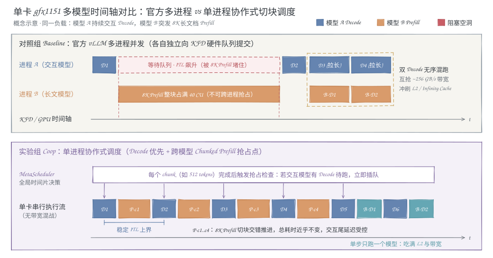
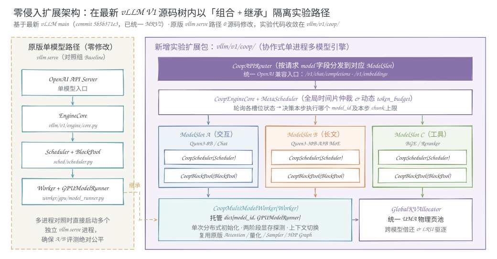
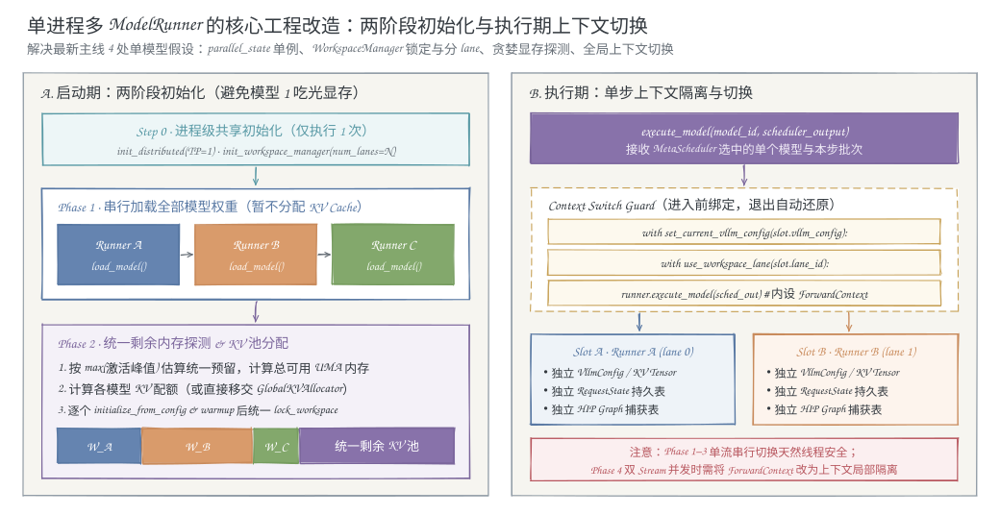
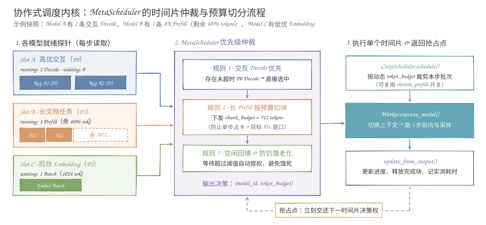
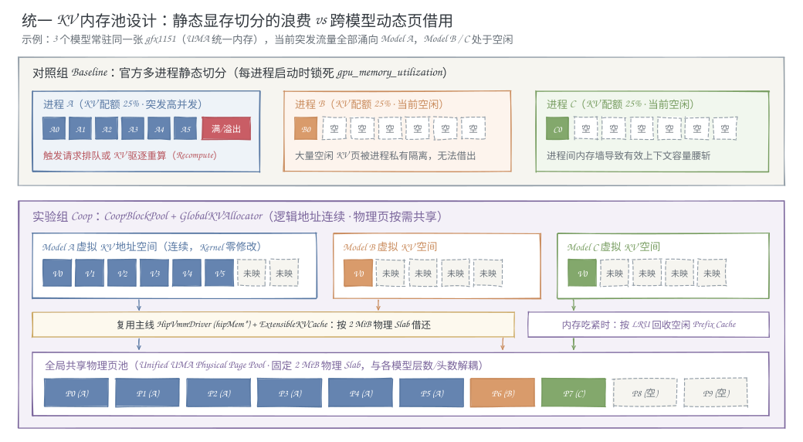
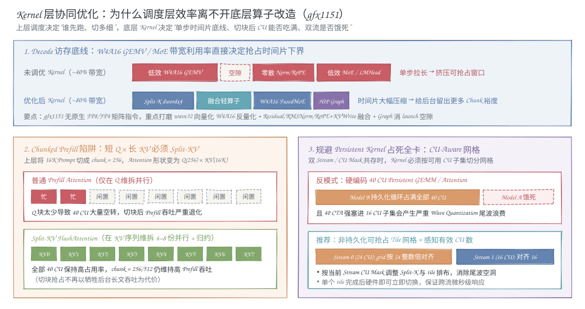
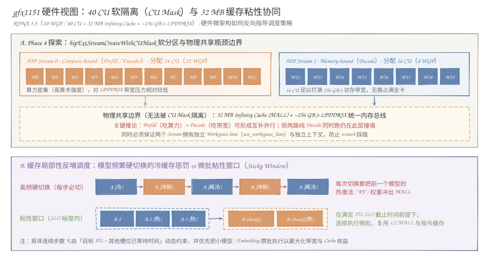
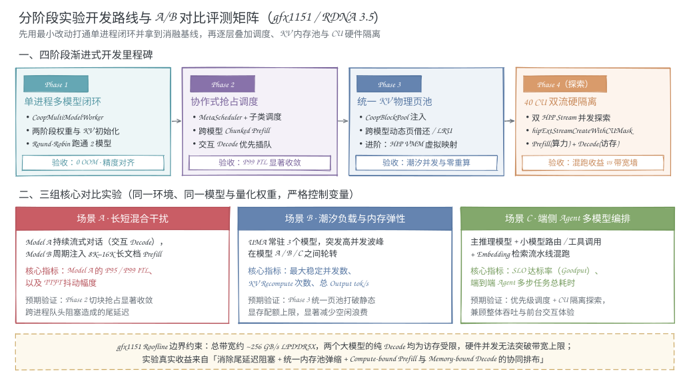

# vLLM 单卡协作式多模型并发调度实验设计

在 64–128 GB 统一内存（Unified Memory Architecture, UMA）的端侧设备（如 AMD Ryzen AI Max / Strix Halo，`gfx1151`，RDNA 3.5）上，单台机器不再受限于传统独立显卡 16–24 GB 的显存墙，能够同时常驻多个不同分工的模型——例如一个低延迟前台交互模型、一个处理长文档的 MoE 模型，以及一个负责检索或路由的 Embedding / 小模型。然而，目前在单张 GPU 上并发服务多个模型，主流做法依然是启动多个独立的 `vllm serve` 进程，由操作系统与 ROCm KFD 硬件队列各自为政地争抢计算单元与内存。

这份开发设计文档围绕一个明确的工程目标展开：**在不修改 vLLM 原生单模型代码路径的前提下，在最新 vLLM V1 源码树内新建 `vllm/v1/coop/` 实验扩展包，通过「组合 + 继承」构建单进程协作式多模型推理引擎，并自上而下打通「协作调度层 → 统一 KV 物理页池 → Kernel 与硬件运行时层」三层协同优化，最终与官方多进程并发方案在同一台 `gfx1151` 上完成严格控制变量的 A/B 对比评测。**

??? info "设计依据、vLLM 源码基线与文档边界"

    - **vLLM 源码基线**：本文核对的全部文件路径、类名、方法签名与行号均基于 `vllm-project/vllm` 最新 `main` 分支（commit [`5b5b371e3`](https://github.com/vllm-project/vllm/tree/5b5b371e3217550c79da02b8dd8bd3f1e3859324)）。该版本已完成 Model Runner V2 的统一（唯一 GPU Runner 为 `vllm/v1/worker/gpu/model_runner.py`），并原生提供了多 lane `WorkspaceManager`、`StartupPlan` 以及基于 VMM 的 `ExtensibleKVCache` / `HipVmmDriver`。
    - **目标硬件规格**：AMD Strix Halo（RDNA 3.5 架构，编译目标 `gfx1151`，20 WGP / 40 CU，wave32，32 MB Infinity Cache / MALL，64–128 GB UMA LPDDR5X，理论峰值带宽约 ~256 GB/s）。RDNA 3.5 缺乏原生 FP8/FP4 矩阵指令，端侧大语言模型以 W4A16 / INT4 与 BF16 / FP16 为主力精度。
    - **证据边界声明**：本文为**开发级实验设计文档（Engineering RFC）**。文中给出的内存占用、单步访存下界与 Chunk 大小反推均为基于硬件规格的理论估算；所有机制图均为概念示意，不冒充 GPU 实测结果。实测延迟、吞吐与 `rocprofv3` 轨迹将在各阶段代码落地后补充。

---

## 一、问题定义与 `gfx1151` 量化建模

在动笔写任何调度器代码之前，先用一个贯穿全文的 3 模型端侧配置把内存账和带宽账算到闭合，明确瓶颈究竟在哪里。

### 1. 贯穿基准场景与理论账本

假设一台 128 GB UMA（分配给 GPU 可用约 96 GB）的 `gfx1151` 主机同时常驻 3 个端侧高频模型：

| 槽位 | 代表模型（精度） | 权重常驻内存 | 单步激活权重访存（$bs=1$） | 理论最小 Decode 耗时（按 200 GB/s 有效带宽计） | 业务角色与延迟诉求 |
| --- | --- | --- | --- | --- | --- |
| **Slot A** | `Qwen3-8B`（W4A16 / INT4） | ~5.0 GB | ~4.5 GB | $\approx 22.5\text{ ms}$ | 前台流式对话（P0，要求平稳 ITL < 45 ms） |
| **Slot B** | `Qwen3-30B-A3B` MoE（W4A16） | ~16.5 GB | ~2.0 GB（激活 ~3B） | $\approx 10.0\text{ ms}$ | 后台长文档分析（P1，突发 8K–16K Prefill） |
| **Slot C** | `BGE-M3`（FP16 Encoder） | ~1.2 GB | ~1.2 GB | —（纯 Prefill / 编码） | 检索与 Agent 路由（P2，可容忍百毫秒级排队） |

!!! example "闭合估算：为什么多进程下 8K Prefill 会直接击穿前台 ITL？"

    按上表规格：三个模型权重总计仅约 **22.7 GB**，在 96 GB 可用 UMA 下还剩余约 **73 GB** 可用于激活缓冲与 KV Cache。

    - **问题 1（时间轴队头阻塞）**：当 Slot A 正在以 ~22–30 ms/token 流畅输出时，若独立进程 B 收到一条 8192-token 的长文档 Prefill，其前向计算（线性投影 + 8K Attention）会一次性向 KFD 队列提交一整串算力密集型 kernel，在 40 CU 上持续占卡数百毫秒（按有效 FP16 WMMA 算力与访存折算，通常在 250–600 ms 量级）。由于独立进程无法在层间或 chunk 间让出硬件队列，Slot A 的下一帧 Decode 被硬堵住，P99 ITL 直接从 ~30 ms 恶化 10 倍以上。
    - **问题 2（双 Decode 带宽混战）**：一旦 Slot A 与 Slot B 同时进入 Decode，两个进程并发提交访存密集型 GEMV / MoE kernel。~256 GB/s 的 LPDDR5X 总线与 32 MB Infinity Cache 被两路访存平分并互相冲刷，两路单步耗时同时拉长近 2 倍，总生成吞吐却几乎零增长。
    - **问题 3（静态显存割裂）**：官方多进程启动时必须静态锁定每个进程的 `--gpu-memory-utilization`（例如各分 0.25，对应单进程可用 ~24 GB）。当全部突发长上下文请求集中涌向 Slot A 时，进程 A 只能用自己的 KV 配额，很快打满触发排队或驱逐重算（Recompute），而进程 B、C 合计闲置的数十 GB KV 内存完全无法跨进程借用。

下图用同一组并发负载直观对照了「官方多进程抢占」与「单进程协作式切块调度」的时间轴表现：

[{ width="960" }](../../assets/experiments/vllm-coop-multi-model/multiprocess-vs-coop-timeline.svg)

!!! warning "先立好 Roofline 护栏：明确哪些收益成立，哪些不成立"

    在 `gfx1151` 上开展多模型并发实验，必须牢记一个硬件前提：**~256 GB/s LPDDR5X 决定了两个大模型的纯 Decode 并发不可能突破带宽上限。** 本设计的真实工程收益来自四个可验证维度：

    1. **时间维度（调度层）**：用跨模型 Chunked Prefill 抢占点把长 Prefill 拆碎，换取前台交互模型数量级收敛的 P95 / P99 ITL；
    2. **空间维度（内存层）**：用统一物理 KV 页池打破进程显存墙，提升潮汐负载下的最大并发与零 Recompute 容量；
    3. **单步效率与切块效率（Kernel 层）**：通过高带宽利用率 W4A16 GEMV/MoE 压缩单个时间片底线，通过 Split-KV FlashAttention 保住小 chunk 下的 40 CU 吞吐，并通过 HIP Graph 与微批粘性减少切换开销；
    4. **算力/访存互补（探索层）**：仅在 Compute-bound（Prefill / Encoder）与 Memory-bound（Decode）或小模型吃不满 40 CU 时，评估双 Stream + CU Mask 的硬件并行增益。

---

## 二、总体零侵入架构与目录规划

### 1. 为什么在最新 vLLM 源码树内以「组合 + 继承」实验？

对比基于 ROCm/ATOM 改造与直接在 vLLM V1 扩展：ATOM 强绑定 AITER 算子库，两者目前均未适配 `gfx1151` 且偏向数据中心 FP8/MXFP4 生成模型；而最新 vLLM V1 原生覆盖 `gfx1151` 通用 ROCm 路径、W4A16/INT4 量化与 Embedding/MoE 模型生态，更关键的是——**同一份代码库既能跑原版 `vllm serve` 多进程对照组，又能跑实验组 `vllm/v1/coop/`，算子、采样、量化完全同源，收益归因 100% 干净。**

### 2. 零侵入扩展拓扑

整个实验代码严格收敛在新增目录 `vllm/v1/coop/` 下，不修改原版 `EngineCore`、`Scheduler`、`BlockPool`、`Worker` 的默认单模型执行逻辑：

[{ width="960" }](../../assets/experiments/vllm-coop-multi-model/zero-invasion-architecture.svg)

左侧虚线框内是完全未改动的原版单模型路径；右侧 `vllm/v1/coop/` 通过**组合多个 `ModelSlot`**（每个槽位封装独立模型的配置、调度子类、KV 池子类与 `GPUModelRunner`）和**继承 `Worker` / `Scheduler` / `BlockPool`** 复用原版全部核心能力。

建议源码目录划分如下：

```text
vllm/v1/coop/
├── __init__.py
├── config.py          # MultiModelCoopConfig、SlotSpec（优先级、SLO、chunk 约束）
├── slot.py            # ModelSlot 数据结构与 SlotDemand 状态快照
├── worker.py          # CoopMultiModelWorker(Worker)：两阶段初始化、多 lane、成对前向/采样
├── scheduler.py       # CoopScheduler(Scheduler) + MetaScheduler 仲裁器 + 在线耗时估计器
├── kv_pool.py         # CoopBlockPool(BlockPool) + GlobalKVAllocator（HipVmmDriver / 降级适配器）
├── engine_core.py     # CoopEngineCore：单进程多模型主循环、请求路由、超时/取消与指标打点
├── kernel_hooks.py    # gfx1151 Kernel 选路开关（Split-KV / W4A16 / CU Mask / Sticky 统计）
└── entrypoint.py      # 统一多模型 OpenAI API Server 入口（不影响原版 vllm serve）
```

---

## 三、多 `GPUModelRunner` 单进程托管详细设计

最新 vLLM `main`（`5b5b371e3`）已彻底移除旧版 `gpu_model_runner.py`，统一收敛为 Model Runner V2（[`vllm/v1/worker/gpu/model_runner.py:209`](https://github.com/vllm-project/vllm/blob/5b5b371e3217550c79da02b8dd8bd3f1e3859324/vllm/v1/worker/gpu/model_runner.py#L209)），并在 `Worker` 基类中显式预留了可供子类重写的 `_make_model_runner()` 钩子（[`vllm/v1/worker/gpu_worker.py:637`](https://github.com/vllm-project/vllm/blob/5b5b371e3217550c79da02b8dd8bd3f1e3859324/vllm/v1/worker/gpu_worker.py#L637)）。但在同一个进程内实例化并驱动多个 `GPUModelRunner`，必须精确处理 **4 处源码级单模型假设**：

[{ width="960" }](../../assets/experiments/vllm-coop-multi-model/two-phase-init-and-context-switch.svg)

### 1. 核心数据对象：`ModelSlot`

每个共驻模型在引擎与 Worker 侧通过 `model_id` 对应唯一的 `ModelSlot`，明确隔离每模型私有状态与共享资源句柄：

```python
# vllm/v1/coop/slot.py（核心字段定义）
@dataclass
class SlotSpec:
    model_id: str
    vllm_config: VllmConfig
    priority: int                  # 0=高优交互, 1=中优后台, 2=低优批处理/Embedding
    target_itl_ms: float | None    # Decode 目标帧间延迟上界，如 45.0 ms
    min_chunk_tokens: int = 128    # Prefill 最小切块下限（防过碎导致算子效率崩塌）
    max_chunk_tokens: int = 1024   # Prefill 单步最大切块上限
    max_sticky_steps: int = 3      # 缓存粘性窗口最大连续步数

@dataclass
class WorkerModelSlot:
    spec: SlotSpec
    lane_id: int                   # 绑定到 WorkspaceManager 的独立 lane 编号
    model_runner: GPUModelRunner   # 复用最新 MRV2 GPUModelRunner
    kv_cache_config: KVCacheConfig | None = None
    peak_activation_bytes: int = 0
    hip_stream: torch.cuda.Stream | None = None  # Phase 4 CU Mask 扩展用
```

### 2. 启动期：两阶段初始化与 `WorkspaceManager` 多 lane 治理

核对 [`vllm/v1/worker/gpu_worker.py`](https://github.com/vllm-project/vllm/blob/5b5b371e3217550c79da02b8dd8bd3f1e3859324/vllm/v1/worker/gpu_worker.py) 与 [`vllm/v1/worker/workspace.py`](https://github.com/vllm-project/vllm/blob/5b5b371e3217550c79da02b8dd8bd3f1e3859324/vllm/v1/worker/workspace.py)，单进程多模型启动必须打破原版“单模型加载即占满显存并立即锁死 workspace”的串行逻辑，按以下 4 步执行：

1. **Step 0（进程级单例初始化，仅一次）**：

    - 设置目标 ROCm 设备，执行一次单卡（TP=1）`init_distributed_environment()` 与 `initialize_model_parallel(1, 1)`，所有后续 `ModelSlot` 跳过重复分布式初始化。
    - **利用最新主线的多 lane `WorkspaceManager`**：调用一次 `init_workspace_manager(self.device, num_ubatches=1, num_lanes=len(slot_specs))`（[`workspace.py:322`](https://github.com/vllm-project/vllm/blob/5b5b371e3217550c79da02b8dd8bd3f1e3859324/vllm/v1/worker/workspace.py#L322)）。每个模型独占一个 `lane_id`，其临时 scratch 与 `get_persistent_resource()` 持久化缓冲完全物理隔离，互不覆盖。

2. **Phase 1（全量权重装载，暂不建 KV Cache）**：

    - 遍历 `slot_specs`，在 `with set_current_vllm_config(spec.vllm_config), use_workspace_lane(lane_id):` 保护下构造 `GPUModelRunner` 并调用 `runner.load_model()`（[`model_runner.py:407`](https://github.com/vllm-project/vllm/blob/5b5b371e3217550c79da02b8dd8bd3f1e3859324/vllm/v1/worker/gpu/model_runner.py#L407)）。
    - 记录所有权重加载完成后的基准已用显存 $M_{\text{weights}}$。
3. **Phase 2（统一峰值探测与安全 KV 预算计算）**：对每个模型在对应 `vllm_config` + `lane_id` 上下文中执行 `runner.profile_run()`（[`model_runner.py:1100`](https://github.com/vllm-project/vllm/blob/5b5b371e3217550c79da02b8dd8bd3f1e3859324/vllm/v1/worker/gpu/model_runner.py#L1100)），记录各自峰值激活增量 $\text{peak}_i$，再统一核算可用于 KV Cache 的总物理预算 $M_{\text{kv}}$（Phase 1/2 按比例静态切分，Phase 3 整体移交 `GlobalKVAllocator` 托管）。
4. **Step 3（KV 初始化、逐模型 Warmup 与延迟锁定 Workspace）**：依次为每个模型调用 `runner.initialize_kv_cache(...)` 与 `runner.capture_model()`（[`model_runner.py:1172`](https://github.com/vllm-project/vllm/blob/5b5b371e3217550c79da02b8dd8bd3f1e3859324/vllm/v1/worker/gpu/model_runner.py#L1172)）。原版单模型在 warmup 后会调用 `lock_workspace()` 禁止 workspace 扩容，多模型下必须覆盖该时机，等**全部槽位**完成 `capture_model()` 后再统一调用一次 `lock_workspace()`。

上述 Phase 2 核算全卡可用 KV 总物理预算的公式为：

$$
\begin{aligned}
M_{\text{kv}} &= \lfloor M_{\text{total}} \cdot u_{\text{global}} \rfloor - M_{\text{weights}} \\
&\quad - \max_i(\text{peak}_i) - M_{\text{graph}} - M_{\text{margin}}
\end{aligned}
$$

其中激活峰值取 $\max_i(\text{peak}_i)$ 而非 $\sum_i \text{peak}_i$（Phase 1–3 单流串行执行同一时刻只有一个模型处于激活峰值；若 Phase 4 开启双流并发，则改为并发对的 $\text{peak}_A + \text{peak}_B$）。同时参照 [`extensible_kv_cache.py:59`](https://github.com/vllm-project/vllm/blob/5b5b371e3217550c79da02b8dd8bd3f1e3859324/vllm/v1/worker/extensible_kv_cache.py#L59) 的 ROCm 经验，额外保留 $M_{\text{margin}}$（用于 ROCr kernel scratch、延迟加载 code object 与缓存分配器碎片）。

### 3. 执行期：两段式前向/采样成对契约

核对最新 [`vllm/v1/engine/core.py:722-735`](https://github.com/vllm-project/vllm/blob/5b5b371e3217550c79da02b8dd8bd3f1e3859324/vllm/v1/engine/core.py#L722-L735) 与 [`vllm/v1/worker/gpu/model_runner.py:1865,2279`](https://github.com/vllm-project/vllm/blob/5b5b371e3217550c79da02b8dd8bd3f1e3859324/vllm/v1/worker/gpu/model_runner.py#L1865)，vLLM V1 每一步并不是单一的 `execute_model()`，而是拆成两段调用：`execute_model(scheduler_output)` 在需要 grammar bitmask 或 MRV2 分离采样时会把中间状态保存在 `runner.execute_model_state`（[`ExecuteModelState`](https://github.com/vllm-project/vllm/blob/5b5b371e3217550c79da02b8dd8bd3f1e3859324/vllm/v1/worker/gpu/model_runner.py#L2637)）并返回 `None`，紧接着由上层调用 `sample_tokens(grammar_output)` 完成采样并返回 `ModelRunnerOutput`。

因此 `CoopMultiModelWorker` 必须提供**成对绑定 `model_id` 的执行接口**，并在同一个时间片内原子完成“前向 → 采样”闭合，避免跨模型覆盖上下文或采样错位：

```python
# vllm/v1/coop/worker.py（核心执行骨架，省略统计与错误处理）
class CoopMultiModelWorker(Worker):
    def run_slot_step(
        self,
        model_id: str,
        scheduler_output: SchedulerOutput,
        grammar_output: GrammarOutput | None,
    ) -> ModelRunnerOutput:
        slot = self.slots[model_id]
        with (
            set_current_vllm_config(slot.spec.vllm_config),
            use_workspace_lane(slot.lane_id),
        ):
            # 1. 前向执行：内部会基于当前 VllmConfig 调用 set_forward_context(...)
            output = slot.model_runner.execute_model(scheduler_output)
            # 2. 若返回 None（MRV2 分离采样或结构化输出），立即在同一上下文完成采样
            if output is None:
                output = slot.model_runner.sample_tokens(grammar_output)
            return output
```

!!! note "为什么 Phase 1–2 建议先关闭 Async Scheduling？"

    vLLM V1 的 Async Scheduling（`step_with_batch_queue`，[`core.py:771`](https://github.com/vllm-project/vllm/blob/5b5b371e3217550c79da02b8dd8bd3f1e3859324/vllm/v1/engine/core.py#L771)）会在当前步 GPU 还在执行时提前准备下一步的 batch，目的是隐藏 CPU 调度开销。但在多模型协作抢占下，如果在 GPU 刚启动一个 512-token Prefill chunk 时就提前把**下一个 chunk** 塞进 `batch_queue`，期间新到达的 P0 Decode 请求就要多等一个 chunk 才能插队。

    因此设计约定：**Phase 1–2 阶段固定单步同步抢占边界（`async_scheduling=False`）**，保证每个 chunk 结束瞬间都能立即感知最新到达的高优请求；后续可在同一槽位处于粘性窗口（Sticky Window）连续执行时，再评估局部启用异步预准备。

---

## 四、协作式调度器详细设计：`CoopScheduler` 与 `MetaScheduler`

解决了单进程托管，接下来要解决的核心问题是：**怎么用最小改动让原版 `Scheduler` 听从全局 `MetaScheduler` 的预算指挥，并且不会踩进原版单模型调度的边界陷阱？**

我们沿着下图的具体快照（Slot A 有 2 条交互 Decode，Slot B 有 1 条剩余 4096 tokens 的长 Prefill，Slot C 有 1 个 Embedding 批次）拆解每一处实现细节：

[{ width="960" }](../../assets/experiments/vllm-coop-multi-model/meta-scheduler-state-machine.svg)

### 1. 源码核实出的关键陷阱：单请求长 Prefill 绕过 `long_prefill_token_threshold`

阅读最新 [`vllm/v1/core/sched/scheduler.py:789-795`](https://github.com/vllm-project/vllm/blob/5b5b371e3217550c79da02b8dd8bd3f1e3859324/vllm/v1/core/sched/scheduler.py#L789-L795) 可以发现一个极容易踩坑的逻辑：

```python
# vllm/v1/core/sched/scheduler.py:789-795（commit 5b5b371e3 原文摘录）
num_running, num_waiting = self.get_request_counts()
num_eligible_reqs = num_running + num_waiting
long_prefill_token_threshold = (
    self.scheduler_config.long_prefill_token_threshold
    if self.scheduler_config.enable_chunked_prefill and num_eligible_reqs > 1
    else 0
)
```

在单模型视角里，当 Model B 队列里**只有 1 条 8K 长 Prefill 请求**（`num_eligible_reqs == 1`）时，原版 `Scheduler` 会认为“当前没有其他请求会被饿死”，于是把 `long_prefill_token_threshold` 直接归零，一次性把全部 8K tokens 塞进 `SchedulerOutput`！然而在多模型场景下，被饿死的是**另一个槽位 Model A 的 Decode**。

**正确解法**：`CoopScheduler(Scheduler)` 不能指望配置 `long_prefill_token_threshold`，而必须重写轻量封装方法 `schedule_with_budget()`，在调用 `super().schedule()` 之前**同时临时收紧 `self.max_num_scheduled_tokens` 与 `self.scheduler_config.max_num_batched_tokens`**（即源码第 756 行 `token_budget` 和第 759 行 `input_budget` 的直接来源），调用结束后在 `finally` 中原样恢复：

```python
# vllm/v1/coop/scheduler.py（CoopScheduler 核心实现）
class CoopScheduler(Scheduler):
    def peek_demand(self, now_ms: float) -> SlotDemand:
        """零拷贝探针：微秒级读取当前槽位的 Decode / Prefill 需求。"""
        decode_reqs = 0
        prefill_tokens = 0
        oldest_wait_ms = 0.0
        for req in self.running:
            rem = req.num_tokens_with_spec - req.num_computed_tokens
            if rem <= 1 and not req.is_prefill_chunk:
                decode_reqs += 1
            else:
                prefill_tokens += max(rem, 0)
        for req in self.waiting:
            prefill_tokens += max(req.num_tokens - req.num_computed_tokens, 0)
            oldest_wait_ms = max(oldest_wait_ms, now_ms - req.arrival_time * 1000.0)
        return SlotDemand(
            has_decode=decode_reqs > 0,
            decode_reqs=decode_reqs,
            has_prefill=prefill_tokens > 0,
            prefill_tokens=prefill_tokens,
            oldest_wait_ms=oldest_wait_ms,
        )

    def schedule_with_budget(
        self,
        token_budget: int,
        throttle_prefills: bool = False,
    ) -> SchedulerOutput:
        orig_sched_cap = self.max_num_scheduled_tokens
        orig_batch_cap = self.scheduler_config.max_num_batched_tokens
        try:
            self.max_num_scheduled_tokens = min(orig_sched_cap, token_budget)
            self.scheduler_config.max_num_batched_tokens = min(orig_batch_cap, token_budget)
            return super().schedule(throttle_prefills=throttle_prefills)
        finally:
            self.max_num_scheduled_tokens = orig_sched_cap
            self.scheduler_config.max_num_batched_tokens = orig_batch_cap
```

### 2. `MetaScheduler` 仲裁算法与动态 $B_{\text{chunk}}$ 闭环

`MetaScheduler` 在每次抢占点结合**在线延迟建模**与**四级优先级仲裁**决定下一个 GPU 时间片。

**在线延迟建模与安全切块反推**：每次 `run_slot_step()` 返回后，记录该槽位本次实际 GPU 耗时 $\Delta t$ 与处理 token 数，通过 EMA 滑动平均维护交互槽位单步 Decode 耗时估计 $\hat{T}_{\text{decode}}(m)$，以及后台槽位单位 Prefill 块耗时斜率 $\hat{\alpha}$ 与固定启动开销 $\hat{\beta}$。设当前活跃交互模型 $A$ 的目标帧间延迟上界为 $\text{SLO}_{\text{ITL}}(A)$（例如 45 ms），预留 4 ms 系统抖动余量，则允许插入后台模型 $B$ 的最大时间预算 $T_{\text{budget}}(B)$ 与安全切块 token 数 $B_{\text{chunk}}(B)$ 为：

$$
\begin{aligned}
T_{\text{budget}}(B) &= \max\big(T_{\min},\; \text{SLO}_{\text{ITL}}(A) - \hat{T}_{\text{decode}}(A) - 4\text{ ms}\big) \\
B_{\text{chunk}}(B) &= \text{clip}\!\left(\left\lfloor \frac{T_{\text{budget}}(B) - \hat{\beta}}{\hat{\alpha}} \right\rfloor,\; B_{\min},\; B_{\max}\right)
\end{aligned}
$$

其中 $[B_{\min}, B_{\max}]$（如 $[128, 1024]$）用于防止切块过碎拖垮算子效率或单块过大击穿前台延迟。

**四级确定性仲裁优先级**：

- **L0（防饥饿强提权）**：若某低优槽位有待处理请求且连续被抢占等待时长超过老化阈值 $W_{\text{starve}}$（如 250 ms），强制分配 1 个最小安全 chunk（$B_{\min}$）执行一次，清零老化计时器。
- **L1（交互 Decode 到点插队）**：在所有存在 `has_decode=True` 的 P0 槽位中，计算距离上次 Decode 完成的已流逝时间 $e_m = t_{\text{now}} - t_{\text{last\_decode}}(m)$；若有槽位满足 $e_m + \hat{T}_{\text{decode}}(m) \ge 0.7 \cdot \text{SLO}_{\text{ITL}}(m)$，或无后台任务在跑，立即选中紧迫度最高者，传 `throttle_prefills=True` 跑纯 Decode。
- **L2（微批粘性窗口 Sticky Window）**：若刚刚运行的槽位仍有工作，且其余 P0 槽位的剩余截止裕度足以再容纳一次该槽位的短步（且连续运行步数 `< max_sticky_steps`），继续运行当前槽位以复用 32 MB Infinity Cache 中的热状态，避免无谓的来回切换。
- **L3（后台 Prefill / Embedding 回填）**：按优先级与加权轮询挑选有 `has_prefill=True` 的槽位，下发由上式算出的动态 $B_{\text{chunk}}$。

---

## 五、统一 KV 内存池详细设计：`CoopBlockPool` 与 `GlobalKVAllocator`

### 1. 为什么用固定 2 MiB 物理 Slab 解耦异构模型？

不同模型的单 KV Block（设每块 16 tokens，FP16/BF16 KV Cache）字节数差异极大。以本实验的 3 模型场景做闭合换算：

$$
\begin{aligned}
\text{Bytes/Block} &= 2\;(K,V) \times L \times H_{\text{kv}} \\
&\quad \times D \times B_{\text{tok}} \times \text{sizeof}(\text{dtype})
\end{aligned}
$$

- **Slot A（`Qwen3-8B` 典型 GQA：$L=36,\; H_{\text{kv}}=8,\; D=128,\; B_{\text{tok}}=16$，2 B）**：单块大小为 `2 × 36 × 8 × 128 × 16 × 2 = 2,359,296 B = 2.25 MiB`。若改为 8-token 块或 FP8 KV，则单块为 1.125 MiB；按设备 VMM 最小映射粒度 $G = 2\text{ MiB}$（或按 $9\times 2\text{ MiB} = 18\text{ MiB}$ 对应 8 个完整块）对齐后，只需按整数个物理 Slab 借还。
- **Slot B（`Qwen3-30B-A3B` MoE：$L=48,\; H_{\text{kv}}=4,\; D=128,\; B_{\text{tok}}=16$，2 B）**：单块大小为 `2 × 48 × 4 × 128 × 16 × 2 = 1,572,864 B = 1.5 MiB`。每借入 3 个 2 MiB Slab（6 MiB）恰好映射 4 个完整逻辑 KV Block。

由此可见，**物理层只认统一粒度的 Slab（与模型层数/头数彻底解耦），逻辑层由各模型自己的 `CoopBlockPool` 负责把连续虚拟地址段切分成自身需要的 `KVCacheBlock`**：

[{ width="960" }](../../assets/experiments/vllm-coop-multi-model/unified-kv-memory-pool.svg)

### 2. 逻辑层注入：`CoopBlockPool(BlockPool)` 与 Prefix Cache 一致性

最新 vLLM 中 `KVCacheManager` 持有 `BlockPool`（[`vllm/v1/core/block_pool.py:107`](https://github.com/vllm-project/vllm/blob/5b5b371e3217550c79da02b8dd8bd3f1e3859324/vllm/v1/core/block_pool.py#L107)），其内部维护：

- `free_block_queue`（按 LRU 顺序存放引用计数为 0 的空闲/前缀缓存块）；
- `cached_block_hash_to_block`（`BlockHashToBlockMap`，[`block_pool.py:38`](https://github.com/vllm-project/vllm/blob/5b5b371e3217550c79da02b8dd8bd3f1e3859324/vllm/v1/core/block_pool.py#L38)）。

`CoopBlockPool(BlockPool)` 继承原版后，只扩展两个核心流程：

1. **按需扩容借页（`get_new_blocks(num_blocks)`）**：

    - 优先消耗本槽位已映射且未占用的本地空闲块；
    - 若本地可用块不足，则向 `GlobalKVAllocator.borrow_slabs(model_id, needed_slabs)` 申请新物理 Slab，将其映射至本模型虚拟 KV 地址空间的高水位尾部，并在 `self.blocks` 与 `free_block_queue` 中激活对应区间的 `KVCacheBlock` ID。

2. **跨模型回收与安全同步栅栏（`reclaim_tail_slabs(num_slabs)`）**：

    - 当全局物理池耗尽时，`GlobalKVAllocator` 挑选空闲时间最长、且拥有未引用（`ref_cnt == 0`）尾部块段的受害槽位（Victim Slot）；
    - 受害槽位先从 `cached_block_hash_to_block` 中**同步移除**对应块的哈希索引（保证后续 Prefix Cache 查找绝不会命中已解除映射的幽灵块），并从 `free_block_queue` 摘除这些块；
    - **关键同步栅栏**：在调用 `hipMemUnmap` 解除物理映射前，必须等待受害槽位上一次前向对应的 HIP Event 完成（`victim_last_step_event.synchronize()`），彻底杜绝异步 kernel 仍在读取旧页时物理页已被转借覆盖的数据竞争！

### 3. 物理层双模适配：主线 `HipVmmDriver` + 旧驱动降级方案

最新 vLLM 已经原生提供了 [`vllm/utils/vmm_driver.py`](https://github.com/vllm-project/vllm/blob/5b5b371e3217550c79da02b8dd8bd3f1e3859324/vllm/utils/vmm_driver.py)（`HipVmmDriver`）与 [`vllm/v1/worker/extensible_kv_cache.py`](https://github.com/vllm-project/vllm/blob/5b5b371e3217550c79da02b8dd8bd3f1e3859324/vllm/v1/worker/extensible_kv_cache.py)（`ExtensibleKVCache`）。`GlobalKVAllocator` 采用**启动时自动探测 + 双模后端**：

- **Mode A（首选：HIP VMM 动态映射）**：复用 `HipVmmDriver` 的 `reserve / create / map / set_access / unmap`。各模型启动时用 `hipMemAddressReserve` 预留足够大的连续虚拟地址空间，所有 Attention Kernel 和已捕获的 HIP Graph 看到的基址指针与步长完全固定、**零代码修改**；运行时通过 `map / unmap` 动态调拨 2 MiB 物理句柄。
- **Mode B（降级兜底：UMA 逻辑配额 + 整槽弹性休眠释放）**：若启动探针 `_set_access_fails_within_reservation()` 检测到当前 `gfx1151` 的 ROCm 版本尚未包含 `ROCm/rocm-systems#2451` 修复（见 [`vmm_driver.py`](https://github.com/vllm-project/vllm/blob/5b5b371e3217550c79da02b8dd8bd3f1e3859324/vllm/utils/vmm_driver.py) 关于 `ROCm/rocm-systems#2516` 的注释），自动切换至 Mode B——借助 `Worker.sleep(level=1)` 仅释放空闲模型 `kv_cache` 内存池的思路，在空闲槽位无活跃请求且高优槽位告急时整块回收/重建 KV Tensor，保证实验链路不被驱动版本阻塞。

---

## 六、Kernel 层与底层运行时协同优化（`gfx1151` 专项）

只改上层调度器而不看底层 Kernel，往往会出现“调度算法很漂亮，实测吞吐和延迟却卡在半山腰”的问题。**上层调度负责排班，底层 Kernel 决定了每个时间片有多短、切块后算力吃不吃得满、以及双流共存时会不会互相掐死。**

在 `gfx1151`（RDNA 3.5，40 CU，wave32，32 MB Infinity Cache，~256 GB/s LPDDR5X）上，Kernel 层和运行时层有 5 个直接服务于多模型并发的优化抓手：

[{ width="960" }](../../assets/experiments/vllm-coop-multi-model/kernel-layer-coop-optimization.svg)

### 1. 压低 Decode 时间片底线：W4A16 向量化 GEMV、MoE 与轻算子融合

由第四章的延迟公式 $\text{ITL}_{\text{worst}} \approx \hat{T}_{\text{decode}}(A) + T_{\text{chunk}}(B, B_{\text{chunk}})$ 可知：如果模型 A 自身单步 Decode 的带宽利用率只有 40%（单步拖到 45 ms），那么还没插任何后台任务就已经触碰 SLO 红线，上层调度器根本没有给模型 B 切分时间片的腾挪空间！

针对 RDNA 3.5 无原生 FP8/FP4 矩阵指令的特点，Kernel 层的第一优先级是把 W4A16（INT4 权重 + FP16/BF16 激活）的 LPDDR5X 带宽打满：

- **W4A16 Split-K 向量化 GEMV（$M \in [1, 8]$）**：在 wave32 下采用 `global_load_dwordx4`（128-bit 宽向量合并访存）读取打包后的 INT4 权重，在寄存器内直接完成位运算反量化到 `half2` / `bfloat162`，对小 $M$ 维度做 Split-K 并行以铺满 40 CU（避免仅靠 $N$ 维并行导致小输出投影吃不满 CU）。
- **W4A16 FusedMoE（面向 `Qwen3-30B-A3B` 等端侧大 MoE）**：将路由后的 Top-K 专家权重读取与反量化融合进单个 Triton / HIP kernel，减少 `bs=1~4` 时对稀疏激活专家的零散启动与中间张量落盘。
- **轻算子融合消掉带宽与 Launch 税**：对 `Residual Add + RMSNorm`、`RoPE + KV Cache 写入`、`SiLU * Mul` 启用融合 kernel（优先复用或微调 vLLM / Triton ROCm 融合路径），把原本每层十余次小算子往返全局内存压缩到最低，直接缩短 $\hat{T}_{\text{decode}}$。

### 2. Chunked Prefill 下的短 $Q$ × 长 $KV$ 陷阱：必须启用 Split-KV FlashAttention

这是协作式调度与 Kernel 层最直接的耦合点：上层为了保护前台 Decode，把后台 16K 长文档的 Prefill 切成了 $B_{\text{chunk}} = 256$ 或 $512$ tokens。当算到后半段时，Attention 的真实形状变成了 **短 Query（$N_q = 256$）× 长 Key/Value（$N_{kv} = 16384$）**！

- **如果沿用普通 Prefill FlashAttention（只在 Query 块维和 Head 维展开 Grid）**：假设 $B_r = 64$，每个 Head 只有 $256 / 64 = 4$ 个 Q 块；对 GQA 模型，总并行块数经常不足以在 40 CU 上形成充足的 Wave 占用率，导致大量 CU 空转，Prefill 吞吐直接腰斩！
- **Kernel 层解法（Split-KV / FlashDecoding 扩展到短块 Prefill）**：当满足 $N_q \le 512$ 且 $N_{kv} / N_q \ge 4$ 时，在 Attention backend 选路中自动将短块 Prefill 路由到 **Split-KV FlashAttention**（把 16K KV 沿序列维再拆成 4–8 个并行分段铺满全部 40 CU，最后做一次轻量 LogSumExp 归约）。这样上层可以放心把 $B_{\text{chunk}}$ 切细到 256 tokens，而不必担心拖垮后台吞吐。

### 3. 规避 Persistent Kernel 反模式与 CU-Aware 网格设计

数据中心 GPU（如 MI355X / H100）为了极致单模型性能，经常把 GEMM / Attention 写成 **Persistent Kernel**（发射恰好等于全卡 CU 数的线程块，每个线程块内部 `while` 循环抢 tile 直到整张矩阵算完）。但在单卡多模型（尤其 Phase 4 开启双 HIP Stream 并发）场景下，Persistent Kernel 是**硬件抢占的天敌**：

- 一旦 Model B 的 Prefill 启动了占满 40 CU 的 Persistent Kernel，即使 Model A 提交在另一条高优先级 HIP Stream 上，也因为所有 CU 槽位被长期霸占而根本插不进去，彻底饿死；
- 即使配合 `hipExtStreamCreateWithCUMask` 把 Stream 0 限制在 24 CU、Stream 1 限制在 16 CU，如果内核内部仍按 `hipDeviceAttributeMultiprocessorCount = 40` 硬编码 Grid 大小，40 个 CTA 塞进 16 个 CU 会被迫拆成 3 波执行（$16 + 16 + 8$），最后一波有一半 CU 空转，产生严重的 **Wave Quantization 尾波浪费**。

因此，参与 Phase 4 双流并发的 Triton / HIP 算子应遵循两条 **CU-Aware 设计准则**：

1. 禁用跨整层的大持久化循环，采用**非持久化 Tile Grid**（每个 CTA 只算 1 个 tile 即退出，硬件调度器可在微秒级 tile 边界插入另一条流的 wave）；
2. 将当前 Stream 的有效 CU 数（24 或 16）作为编译/启动参数传入 Split-K 与 tile 排布逻辑，让 Grid 大小对齐到有效 CU 数的整数倍。

### 4. HIP Graph 与多模型 Launch 开销治理

在端侧单进程里频繁在模型 A、B、C 之间切换，如果 Decode 走 Eager 模式，Python 侧的 `VllmConfig` 切换 + `ForwardContext` 构造 + 逐层发射数十个小 kernel，很容易吃掉每步 3–5 ms 的 CPU 发射间隙。

结合第三章的多 lane `WorkspaceManager`，我们可以为每个模型的常见 Decode Batch Size（如 `bs = 1, 2, 4, 8`）各自独立捕获 **HIP Graph**（依托 `ExtensibleKVCache` / 固定虚拟地址，KV 指针在 Graph 捕获后保持不变）：

- 单步执行时，Python 侧只需切一次 `VllmConfig` + `lane_id`，更新少量输入元数据和 block table，直接 `graph.replay()` 一次提交整张图，把端侧 Decode 的 CPU 调度与 launch 税压到亚毫秒级；
- 注意避开 ROCm 上 HIP Graph 捕获中隐含的 host-device 同步点（如采样器里的同步拷贝或动态 shape 触发的重新分配），先在 Phase 1 `enforce_eager=True` 跑通精度对齐，再逐模型放开 Graph 捕获。

### 5. `gfx1151` 40 CU 软隔离与 32 MB Infinity Cache 粘性协同

最后把视角拉回到 `gfx1151` 的芯片物理拓扑：20 个 WGP（40 CU）共享 **32 MB Infinity Cache（MALL）** 和 **~256 GB/s LPDDR5X 内存总线**。硬件微架构的共享边界直接决定了两项跨层协同策略：

[{ width="960" }](../../assets/experiments/vllm-coop-multi-model/cu-mask-and-cache-affinity.svg)

1. **CU Mask 仅在算力/访存互补时开启**：通过 ROCm 扩展接口 `hipExtStreamCreateWithCUMask` 把 40 CU 划分为 24 CU（Stream 0，跑 Compute-bound 的 Prefill / Encoder）与 16 CU（Stream 1，跑 Memory-bound 的 Decode——16 CU 足以打满 256 GB/s 带宽）。但两条流会在 32 MB MALL 和内存控制器汇合，因此仅允许 **「Prefill + Decode」或「小模型 + 大模型」** 并发提交，**严格禁止两路大模型纯 Decode 同时双流下发**。
2. **用微批粘性窗口（Sticky Window）对冲冷缓存惩罚**：模型 A（例如小模型或 MoE 热点专家、KV 块与指令缓存）刚把 32 MB MALL 预热，如果每跑 1 步就硬切去跑模型 B，下一次切回模型 A 又要全量冷启动重新从 LPDDR5X 拉数。在 `MetaScheduler` 中引入受 SLO 截止时间约束的粘性窗口（连续跑 $K \in [1, 3]$ 步后再切换，小模型 / Embedding 优先攒批），本质上就是**用底层 Cache 局部性反哺上层调度策略**。

---

## 七、工程风险、高危边界与防御清单

将开发阶段最容易导致崩溃、静默算错或性能反退的 7 类边界条件提前整理为防御清单：

| 风险点 | 触发条件与源码根因 | 工程防御手段 |
| --- | --- | --- |
| **`_forward_context` 非线程安全** | [`vllm/forward_context.py:194`](https://github.com/vllm-project/vllm/blob/5b5b371e3217550c79da02b8dd8bd3f1e3859324/vllm/forward_context.py#L194) 当前为模块级全局变量 | Phase 1–3 严格单线程串行切换；Phase 4 开启双 Stream 前，在 `coop` 侧将其封装升级为 `ContextVar` 或单线程顺序异步 launch |
| **单请求长 Prefill 不切块** | [`scheduler.py:789`](https://github.com/vllm-project/vllm/blob/5b5b371e3217550c79da02b8dd8bd3f1e3859324/vllm/v1/core/sched/scheduler.py#L789) 在 `num_eligible_reqs == 1` 时将 `long_prefill_token_threshold` 归零 | `CoopScheduler.schedule_with_budget()` 直接临时覆盖 `max_num_scheduled_tokens` 与 `max_num_batched_tokens` |
| **Workspace 提前锁定报错** | `WorkspaceManager.lock()` 后任何新 lane 扩容触发 `AssertionError` | `CoopMultiModelWorker` 延迟到全部槽位完成 `capture_model()` 后统一调用 `lock_workspace()` |
| **`StartupPlan` 显存基线污染** | [`startup_plan.py`](https://github.com/vllm-project/vllm/blob/5b5b371e3217550c79da02b8dd8bd3f1e3859324/vllm/v1/worker/startup_plan.py) 会复用单模型历史探测的 KV 字节数 | 实验启动脚本强制导出 `VLLM_ENABLE_STARTUP_PLAN=0` |
| **旧版 HIP 驱动 VMM 失败** | `ROCm/rocm-systems#2516` 导致子区间二次 `hipMemSetAccess` 报错 | 启动时运行 `vmm_driver._set_access_fails_within_reservation()` 探针，失败自动降级至 Mode B 弹性释放 |
| **跨模型页回收数据竞争** | 受害槽位异步 GPU kernel 尚未读完，物理 Slab 已被 `unmap` 转借 | 每次 `reclaim_tail_slabs()` 强制等待受害槽位 `last_step_event.synchronize()`，并先清 `BlockHashToBlockMap` |
| **ROCm 后端变量干扰对照** | `vllm` 原生 ROCm 路径会自动探测环境中的 AITER 或改变 Attention 选路 | A/B 对比组统一锁定相同环境变量（如明确指定 `VLLM_ROCM_USE_AITER` 与 Attention 后端） |

---

## 八、分阶段开发路线、A/B 对比评测与 Profiling 归因

整个实验按 **4 个渐进里程碑 + 5 组消融对照 + 3 类真实端侧 Workload** 推进，确保每新增一层复杂度都有清晰可量化的收益验证：

[{ width="960" }](../../assets/experiments/vllm-coop-multi-model/phased-roadmap-and-eval-matrix.svg)

### 1. 四阶段开发里程碑与准出标准

| 阶段 | 核心交付模块 | 准出验证标准（Exit Gate） |
| --- | --- | --- |
| **Phase 1：单进程多模型闭环** | `config.py`、`slot.py`、`worker.py`（两阶段初始化 + 多 lane）、`engine_core.py`（Round-Robin） | 在 `gfx1151` 上单进程稳定常驻 2 个模型（`Qwen3-8B` + `Qwen3-30B-A3B`），0 OOM；贪婪解码（`temperature=0`）逐 token 输出与原版单模型 `vllm serve` 100% 一致；完成 Eager 与 HIP Graph 两种模式冒烟 |
| **Phase 2：协作式抢占调度** | `scheduler.py`（`CoopScheduler` + `MetaScheduler` 动态预算切块 + 老化 + Sticky Window） | 场景 A 下，模型 A 的 P95 / P99 ITL 相比官方多进程显著收敛；扫参 $B_{\text{chunk}} \in \{128, 256, 512, 1024\}$ 绘出延迟–吞吐 Pareto 曲线 |
| **Phase 3：统一 KV 物理页池** | `kv_pool.py`（`CoopBlockPool` + `GlobalKVAllocator`，支持 VMM / Mode B 自动探测） | 单元测试覆盖借还、LRU 驱逐、`BlockHashToBlockMap` 同步清理与不串页校验；场景 B 潮汐负载下最大无排队并发数显著提升、Recompute 次数大幅下降 |
| **Phase 4：Kernel 与 40 CU 协同（探索）** | `kernel_hooks.py`（Split-KV 短块 Prefill 路由、W4A16 带宽调优对比、双 HIP Stream + `hipExtStreamCreateWithCUMask`） | 量化 Split-KV 对 $B_{\text{chunk}}=256$ Prefill 吞吐的挽回幅度；量化 24+16 CU 双流混跑「Prefill + Decode」与「双 Decode」的正/负收益拐点 |

### 2. 严格控制变量的 5 组消融实验矩阵

所有组均运行在同一台 `gfx1151`、同一 ROCm / PyTorch / vLLM `5b5b371e3` 代码树、同一份量化权重下，通过统一回放压测客户端按相同随机种子发送完全一致的到达时间戳序列：

| 对比组 | 启动形态 | 开启特性 | 消融归因目的 |
| --- | --- | --- | --- |
| **Baseline-MP** | $K$ 个原版 `vllm serve` + 轻量路由代理 | 原版静态 `--gpu-memory-utilization` 切分 | 工业界官方多进程基准线 |
| **Coop-RR** | 单进程 `vllm/v1/coop` | 仅 Phase 1 单进程托管 + 简单轮询 | 剥离“减少多进程/上下文开销”本身的收益 |
| **Coop-Sched** | 单进程 `vllm/v1/coop` | Phase 1 + Phase 2 协作抢占与动态切块 | 量化纯调度层对 P95 / P99 ITL 的贡献 |
| **Coop-Full** | 单进程 `vllm/v1/coop` | Phase 1 + Phase 2 + Phase 3 统一 KV 页池 | 量化跨模型内存池对潮汐并发与零 Recompute 的贡献 |
| **Coop-Full+Kernel** | 单进程 `vllm/v1/coop` | 叠加 Phase 4（Split-KV / W4A16 调优 / CU Mask 消融） | 量化 Kernel 层与硬件分区协同带来的上限提升 |

### 3. 三组端侧核心 Workload 与微观 Profiling 归因

| 场景 | 模型组合 | 流量模式 | 核心评价指标 |
| --- | --- | --- | --- |
| **场景 A：长短混合干扰** | Slot A（8B W4A16）+ Slot B（30B-A3B W4A16） | Slot A 持续 1–4 路对话；Slot B 每 5 s 注入 1 条 8K–16K Prompt | Slot A **P50 / P95 / P99 ITL**、TTFT；Slot B TTFT 与总吞吐 |
| **场景 B：潮汐负载与内存弹性** | 3 个生成模型常驻 UMA | 总并发恒定，每 60 s 将 90% 流量切换至下一个热点模型（含 8K+ 上下文与共享前缀） | **最大无排队并发**、**Recompute 次数**、Prefix 命中率、总 Output tok/s |
| **场景 C：端侧 Agent 多模型编排** | 主推理模型 + 小模型路由 + `BGE-M3` Embedding | 多会话并发执行 `Embed → 路由 → 主模型多轮生成` 流水线 | **SLO 达标率（Goodput）**、端到端 Agent 任务 P90 完成时间 |

!!! tip "微观验证闭环：用 `rocprofv3` + ROCprof Compute Viewer 核验每一层假设"

    宏观压测数字之外，建议在场景 A 与 Phase 4 中各抓一段 2 秒的硬件时间轴轨迹（方法参考本仓库 [ROCprof Compute Viewer 笔记](../rocm/GPU线程追踪（一）：ROCprof Compute Viewer.md)），直接核对四项微观指标：

    1. **硬件阻塞消除**：对比 Baseline-MP 与 Coop-Sched 的 GPU 时间轴，确认长 Prefill 是否真正被切成等宽短 chunk 并让 Decode 及时插队；
    2. **Kernel 有效带宽与 CU 占用率**：核对 W4A16 Decode kernel 的 LPDDR5X 实际带宽占比，以及 $B_{\text{chunk}}=256$ 下开启 Split-KV 前后的 40 CU 活跃度差异；
    3. **切换税与 Cache 命中率**：统计 `CoopMultiModelWorker.run_slot_step()` 的 Python 切换开销（目标 < 0.5 ms），并对比开启 Sticky Window 前后的 L2 / MALL 命中率；
    4. **CU Mask 双流拐点**：观察 24 CU + 16 CU 双流并发时，算力单元与内存控制器之间是否存在带宽反噬，用实测曲线决定 Phase 4 是默认开启还是仅作消融结论保留。

