# GEMM CUDA Core 优化：从 Naive 到接近 cuBLAS

!!! note "阅读说明"
    本文以 Simon Boehm 的 CUDA SGEMM 优化工作日志为主线，对原文进行中文整理与扩展。优化顺序、核心实现和 A6000 性能数据来自原博客及其配套仓库；正文补充了 Roofline 推导、线程映射、尾块处理、图片解读和双缓冲分析，并吸收了 Hamza Elshafie 的 H100 GEMM 工作日志中与 CUDA Core 通用优化有关的解释。

    为保持正文连续，完整 Kernel 已移到独立的 [源码目录](gemm-kernels/README.md)。正文只保留解释机制所需的关键片段。

    本文的核心范围是 **使用 FP32 CUDA Core 实现和优化 GEMM**。Tensor Core、WMMA、WGMMA、TMA Tensor Map 和混合精度路径不在本文讨论范围内。

本文要解决的问题并不是重新实现一个通用的 cuBLAS，而是借助 SGEMM 逐层理解 GPU 性能：一个数学上正确的矩阵乘法，为什么只能发挥 GPU 百分之一的算力；线程映射、内存层级、寄存器复用和 Warp 调度又如何把它推到接近 cuBLAS。

我们计算

$$
C=\alpha AB+\beta C,
\qquad
A\in\mathbb{R}^{M\times K},
B\in\mathbb{R}^{K\times N},
C\in\mathbb{R}^{M\times N}.
$$

一个 $M\times N$ 输出矩阵包含 $MN$ 个长度为 $K$ 的点积。忽略最后的缩放操作，计算量近似为

$$
2MNK\ \text{FLOPs},
$$

因为一次 FMA 同时完成乘法和加法，按两个浮点操作计数。若 Kernel 执行时间为 $t$，则

$$
\text{GFLOP/s}=\frac{2MNK}{t\times10^9}.
$$

## 一、优化路线与性能口径

配套仓库在 NVIDIA RTX A6000 上测试 FP32、`M=N=K=4096`，结果如下：

| Kernel | 关键变化 | GFLOP/s | 相对 cuBLAS |
| --- | --- | ---: | ---: |
| 1 | Naive：一个线程计算一个输出 | 309.0 | 1.3% |
| 2 | Global Memory 合并访存 | 1986.5 | 8.5% |
| 3 | Shared Memory Cache Blocking | 2980.3 | 12.8% |
| 4 | 一维 Thread Tiling | 8474.7 | 36.5% |
| 5 | 二维 Thread Tiling | 15971.7 | 68.7% |
| 7 | 线性化布局减少 Bank Conflict | 16213.4 | 69.7% |
| 8 | Padding 改变 Bank 映射 | 16459.2 | 70.8% |
| 11 | 手工双缓冲 | 17278.3 | 74.3% |
| 6 | 向量化 Shared/Global Memory 访问 | 18237.3 | 78.4% |
| 9 | Autotuning | 19721.0 | 84.8% |
| 10 | Warp Tiling | 21779.3 | 93.7% |
| cuBLAS | FP32 SGEMM | 23249.6 | 100% |

表格按性能排序时，Kernel 编号并不单调：Kernel 7、8 和 11 是有价值但没有胜过基线的实验。优化不是不断叠加技巧，而是提出瓶颈假设、修改数据流、重新测量，再决定保留还是撤销。

原博客早期正文和部分截图使用 `4092³`，配套仓库后来使用 `4096³` 重新生成了上表。因此阅读图片时应关注趋势和机制，不要把图片上的旧数值与上表当作同一次测量。

### 实测上限不是固定常数

厂商标注的峰值吞吐通常按最高时钟和理想指令组合计算。实际 Kernel 的可达上限还会受到持续时钟、功耗、温度和指令混合影响，甚至输入数据的位翻转密度也可能改变动态功耗与降频行为。因此比较两个 Kernel 时应固定：

- GPU 与功耗配置；
- 矩阵形状、精度和输入分布；
- 编译器版本与编译参数；
- warmup、重复次数和计时方法。

Roofline 中的水平线更适合作为分析方向的上界，而不是每次运行都能精确达到的承诺值。

## 二、先用 Roofline 判断优化方向

### 计算上限与带宽上限

Roofline 模型用两个硬件上限约束 Kernel 性能：

$$
P\leq\min(P_{\text{peak}},\ I\times BW),
$$

其中：

- $P_{\text{peak}}$ 是峰值计算吞吐；
- $BW$ 是 Global Memory 带宽；
- $I$ 是算术强度，即每搬运一个字节能够完成多少 FLOP。

A6000 的 FP32 峰值约为 30 TFLOP/s，显存带宽约为 768 GB/s。两条 Roofline 相交时的算术强度约为

$$
I_{\text{ridge}}
=\frac{30\times10^{12}}{768\times10^9}
\approx39\ \text{FLOP/Byte}.
$$

如果实际算术强度低于这个值，Kernel 更容易受显存带宽限制；高于这个值以后，继续减少 HBM 流量的边际收益下降，计算指令、Shared Memory、寄存器和调度开始成为重点。

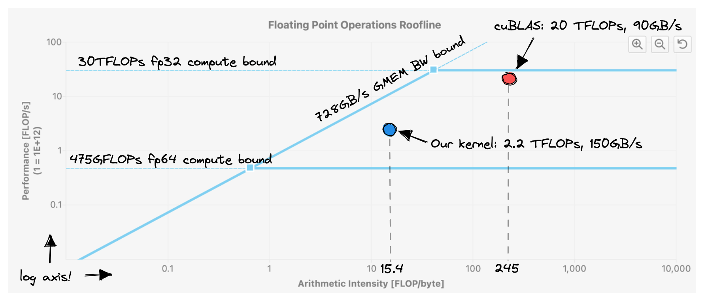{ width="96%" }

图的横轴是算术强度，纵轴是 FLOP/s，二者都使用对数尺度。斜线表示 `带宽 × 算术强度` 给出的带宽上限，横线表示 FP32 计算上限。蓝点是当时的 Kernel 3，算术强度约为 15.4 FLOP/Byte，仍落在斜线一侧；红点是 cuBLAS，算术强度约为 245 FLOP/Byte，已经进入计算受限区域。

图片记录的是博客早期约 2.2 TFLOP/s 的测量，而最终仓库表格中的 Kernel 3 为 2.98 TFLOP/s。数值虽然更新，判断没有改变：Kernel 3 的数据复用仍远远不够。

### 理论最小流量不等于实际流量

理想情况下，A、B 各读取一次，C 读取并写回一次。FP32 的理论最小 Global Memory 流量约为

$$
4(MK+KN+2MN)\ \text{Bytes}.
$$

对于方阵 $M=N=K=L$，理想算术强度约为

$$
I_{\text{ideal}}
=\frac{2L^3}{16L^2}
=\frac{L}{8}.
$$

当 $L=4096$ 时，这个理论值为 512 FLOP/Byte，足以跨过 Roofline 拐点。但 Naive Kernel 会为不同输出重复读取相同的 A、B 元素，实际流量远高于理论下限。后续优化的核心，就是逐层把这种重复搬运变成片上复用。

## 三、Kernel 1：Naive 实现

CUDA 用 Grid、Thread Block 和 Thread 描述并行层级。Thread Block 会被分配到某个 SM 上执行，同一 Block 内的线程可以通过 Shared Memory 交换数据。

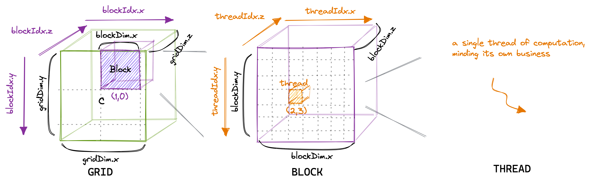{ width="96%" }

Naive 实现让一个线程负责一个输出元素：

~~~cuda
const uint x = blockIdx.x * blockDim.x + threadIdx.x;
const uint y = blockIdx.y * blockDim.y + threadIdx.y;

if (x < M && y < N) {
  float tmp = 0.0f;
  for (int k = 0; k < K; ++k) {
    tmp += A[x * K + k] * B[k * N + y];
  }
  C[x * N + y] = alpha * tmp + beta * C[x * N + y];
}
~~~

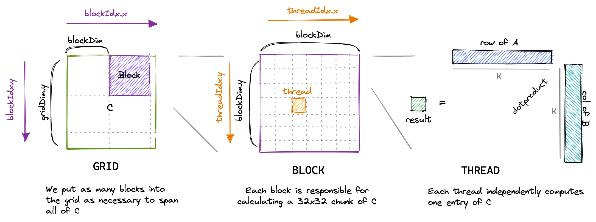{ width="94%" }

图中每个小方格代表一个输出元素，每种颜色代表一个 Thread Block。映射很直观，但“每个线程做对一个元素”并不代表 Warp 的访存方向正确。

### Warp 如何形成

GPU 不会独立调度每个线程，而是把 32 个连续线性线程组成一个 Warp。三维线程坐标会先线性化：

$$
\text{tid}
=threadIdx.x
+blockDim.x\cdot threadIdx.y
+blockDim.x\cdot blockDim.y\cdot threadIdx.z.
$$

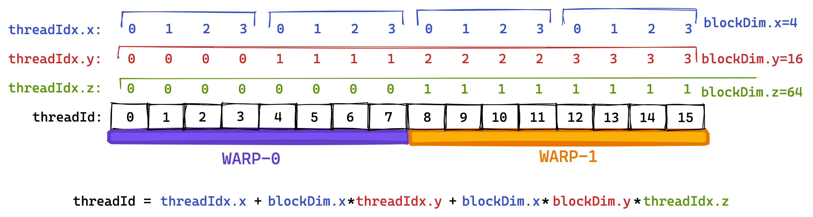{ width="94%" }

`threadIdx.x` 变化最快。如果把 x 映射到矩阵行，那么同一 Warp 的相邻 Lane 就会落在不同行上。固定 $k$ 时，它们访问

~~~text
A[(x + lane) * K + k]
~~~

相邻地址相差 K 个 FP32，形成跨行的大步长读取。

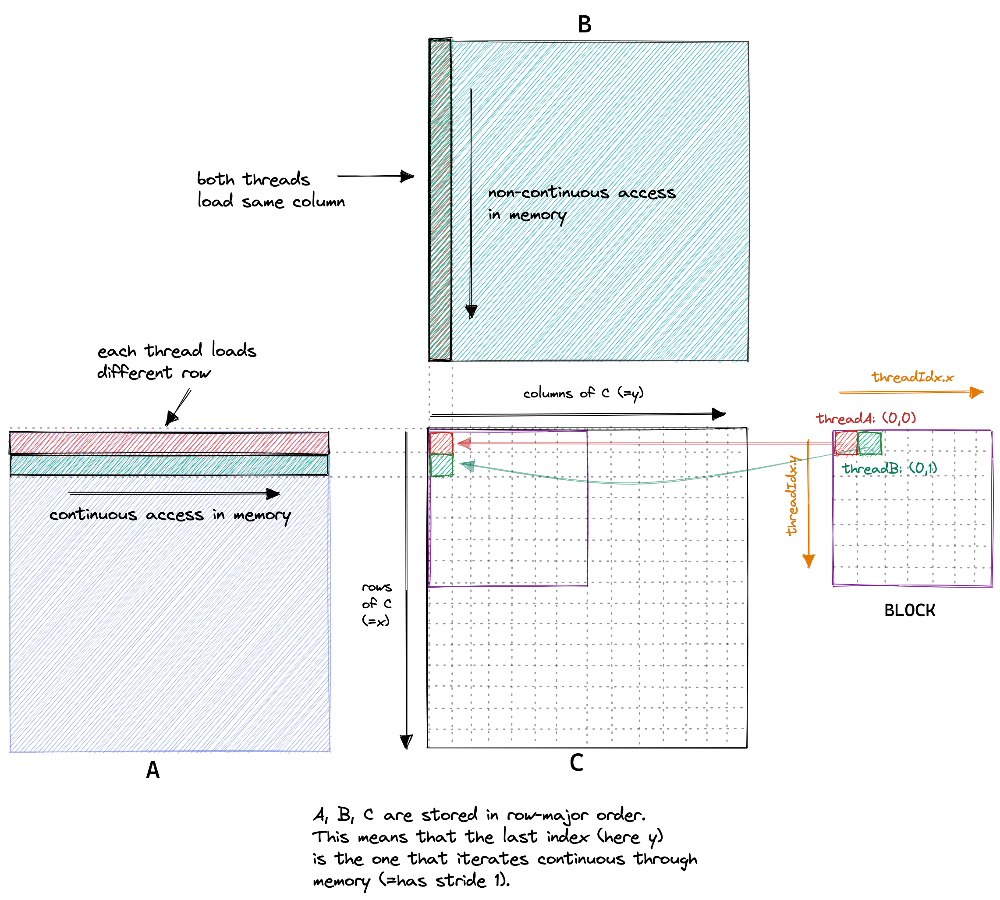{ width="86%" }

红色和绿色线程读取 A 的不同行，却读取 B 的同一个元素。缓存可能合并一部分重复读取，但无法把离散的 A 地址变成连续事务。A6000 上这一版只有 309.0 GFLOP/s。

### Tile Quantization 与边界线程

矩阵尺寸不能整除 Block 尺寸时，Grid 必须向上取整，最后一批 Block 中会有线程落在矩阵范围之外。

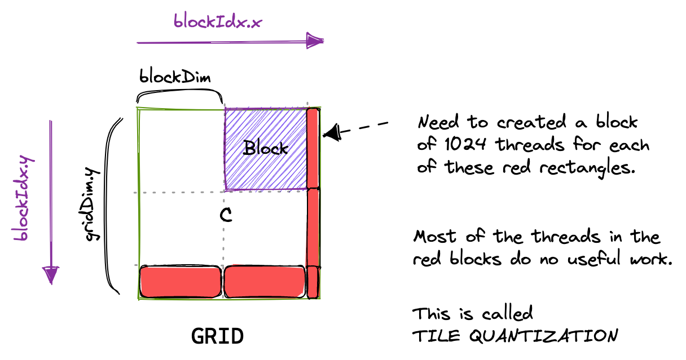{ width="78%" }

图中只有左上角的完整 Block 能使用全部线程，边缘 Block 的一部分线程会被边界判断屏蔽。这称为 Tile Quantization。它首先是正确性问题，同时也会影响小矩阵和不规则形状的利用率。

[查看 Kernel 1 完整实现](gemm-kernels/1_naive.cuh)

## 四、Kernel 2：Global Memory 合并访存

Global Memory 合并访存发生在 Warp 层面。一个 Warp 的 32 个 Lane 若读取连续且对齐的 FP32，硬件可以用较少的内存事务覆盖这些地址；若地址散落在多个内存段中，同样的 32 次读取会产生更多事务和无效字节。

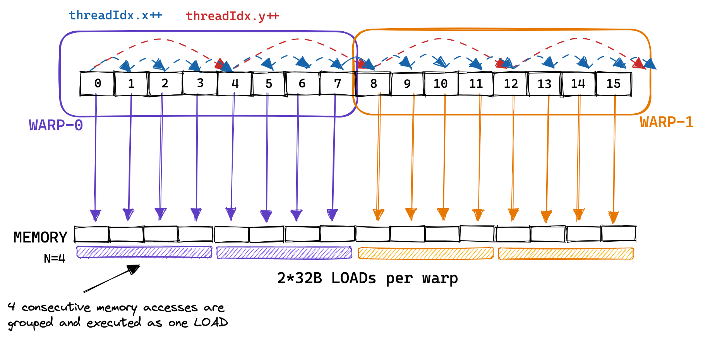{ width="92%" }

图中横向相邻的线程访问连续内存段。合并访存关注的是一个 Warp 最终产生的地址集合，不要求各 Lane 按某种时间顺序发出请求。

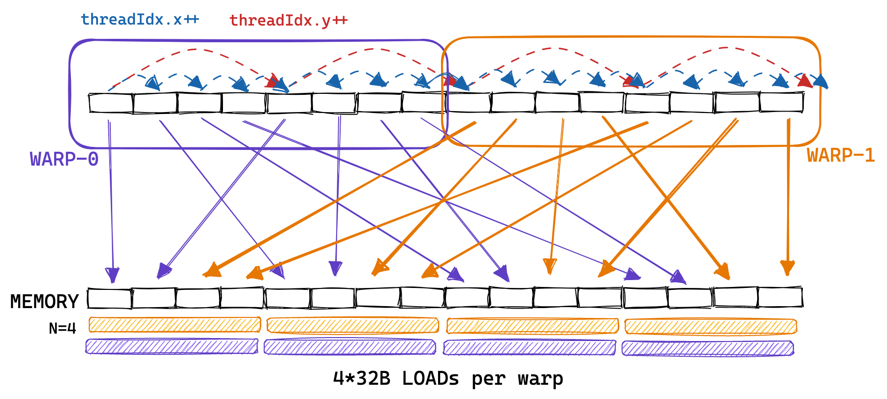{ width="92%" }

Kernel 2 不修改点积，只重新定义线性线程号到 C 的映射：

~~~cuda
const int cRow = blockIdx.x * BLOCKSIZE + threadIdx.x / BLOCKSIZE;
const int cCol = blockIdx.y * BLOCKSIZE + threadIdx.x % BLOCKSIZE;
~~~

当 `BLOCKSIZE=32` 时，同一 Warp 具有相同的 `cRow` 和连续的 `cCol`：

- A 的地址相同，可以广播或命中缓存；
- B 的地址连续，可以合并读取；
- C 的地址连续，可以合并写回。

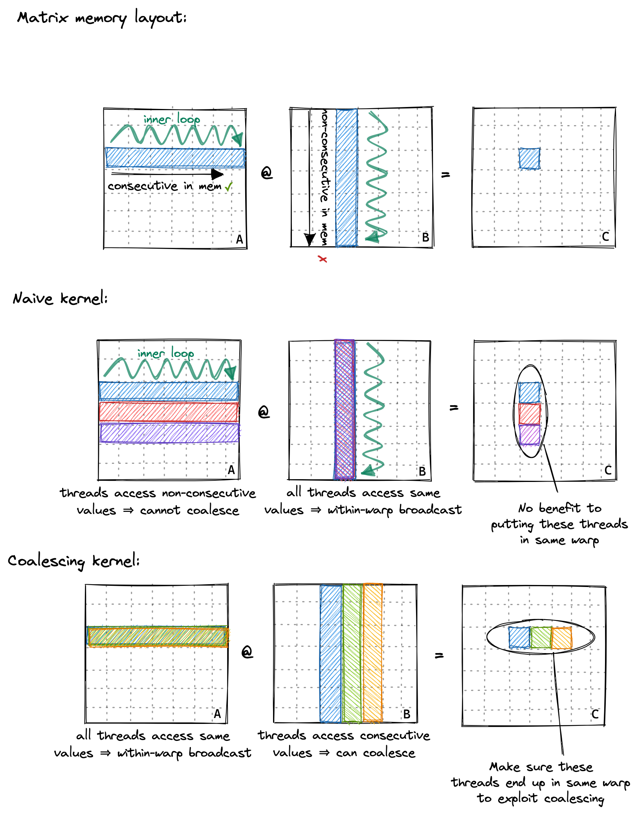{ width="80%" }

这一版的数学计算和主要浮点指令几乎没有变化，仅仅改变运行时地址，就把性能从 309.0 提升到 1986.5 GFLOP/s。这说明优化 CUDA Kernel 时，线程编号本身不重要，重要的是同一 Warp 的 Lane 最终访问哪些地址。

这里还要排除一个常见误解：**合并访存不是由一维或二维 Block 形式决定的**。二维 Block 也会按 `threadIdx.x` 最快变化的顺序线性化，只要同一 Warp 最终访问连续地址，同样可以合并；一维 Block 加 `%`、`/` 重映射也不会自动变快。Kernel 2 的收益来自地址模式被修正，而不是语法上把二维 Block 改成了一维 Block。

[查看 Kernel 2 完整实现](gemm-kernels/2_kernel_global_mem_coalesce.cuh)

## 五、Kernel 3：Shared Memory Cache Blocking

Kernel 2 已经形成良好的 Warp 地址，但每个线程仍然在整个 K 循环中直接读取 Global Memory。不同线程计算相邻输出时会反复使用相同的 A、B 数据，因此下一步把一个 $BM\times BN$ 的 C tile 交给一个 Thread Block，并沿 K 维分段：

$$
A_{tile}\in\mathbb{R}^{BM\times BK},
\qquad
B_{tile}\in\mathbb{R}^{BK\times BN}.
$$

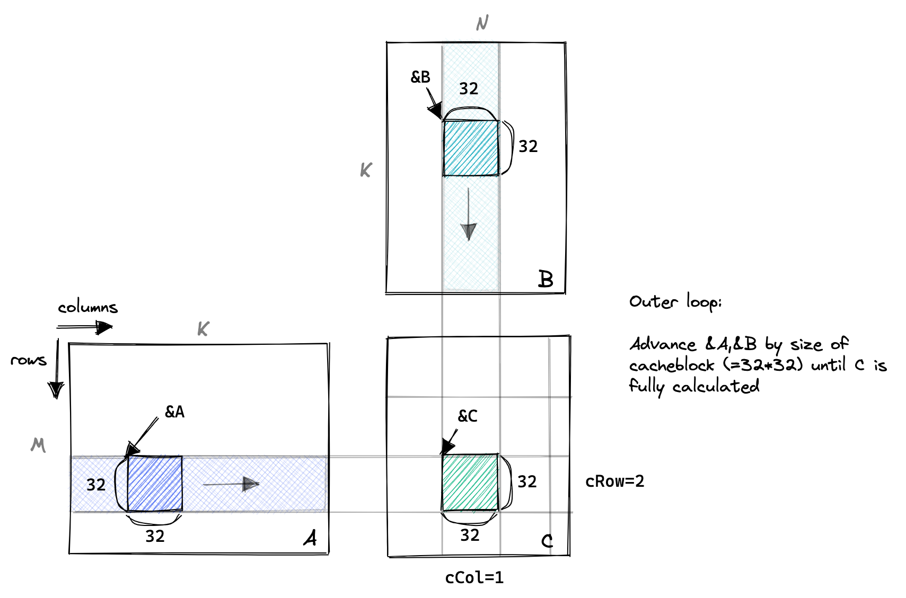{ width="82%" }

蓝色横块是 A tile，青色竖块是 B tile，绿色方块是正在累加的 C tile。每一轮只替换 A、B 的 K 切片，C 的局部和继续保存在寄存器中。

核心循环有两个同步点：

~~~cuda
As[threadRow * BLOCKSIZE + threadCol] =
    A[threadRow * K + threadCol];
Bs[threadRow * BLOCKSIZE + threadCol] =
    B[threadRow * N + threadCol];
__syncthreads();

for (int dotIdx = 0; dotIdx < BLOCKSIZE; ++dotIdx) {
  tmp += As[threadRow * BLOCKSIZE + dotIdx] *
         Bs[dotIdx * BLOCKSIZE + threadCol];
}
__syncthreads();
~~~

第一次同步保证 tile 已经完整装入 Shared Memory；第二次同步防止较快线程提前覆盖仍被其他线程读取的数据。

### 分块为什么提高算术强度

一个 Block 在一轮中从 Global Memory 读取

$$
4(BM\cdot BK+BK\cdot BN)\ \text{Bytes},
$$

完成

$$
2BM\cdot BN\cdot BK\ \text{FLOPs}.
$$

忽略 C 流量和跨 Block 的缓存复用，Block 局部算术强度为

$$
I_{\text{GMEM}}
=\frac{BM\cdot BN}{2(BM+BN)}.
$$

若 `BM=BN=T`，则为 `T/4 FLOP/Byte`。tile 越大，A、B 从 Global Memory 加载一次后服务的 FMA 越多。但 tile 也会消耗更多 Shared Memory、寄存器和线程，不能无限增大。

### 支持任意尺寸的教学写法

原博客的性能实现为了突出数据流，Kernel 3 之后通常假设维度能够被 tile 整除。更完整的教学实现可以对尾块补零：

~~~cuda
if (row < M && t * TILE + threadIdx.x < K)
  As[threadIdx.y][threadIdx.x] =
      A[row * K + t * TILE + threadIdx.x];
else
  As[threadIdx.y][threadIdx.x] = 0.0f;

if (col < N && t * TILE + threadIdx.y < K)
  Bs[threadIdx.y][threadIdx.x] =
      B[(t * TILE + threadIdx.y) * N + col];
else
  Bs[threadIdx.y][threadIdx.x] = 0.0f;
~~~

补零不会改变 Shared Memory Cache Blocking 的优化层级，只是补全任意 `M/N/K` 下的正确性。性能版本往往通过专门的尾块 Kernel、predication 或形状分派减少这些判断的开销。

### 为什么 Occupancy 不是答案

`BLOCKSIZE=32` 时，一个 Block 有 1024 个线程，约使用 8 KiB Shared Memory。A6000 上线程数和寄存器限制使每个 SM 只能驻留一个 Block，即 32 个活跃 Warp，相对最多 48 个 Warp，Occupancy 约为 66%。

66% 并不算低。Occupancy 只表示有多少 Warp 可用于隐藏延迟，并不等于执行管线已经得到充分利用。

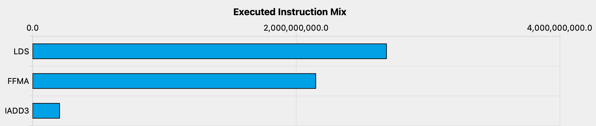{ width="90%" }

图中 LDS 是 Shared Memory load，FFMA 是 FP32 FMA，IADD3 主要用于地址计算。LDS 数量高于 FFMA，说明大量发射机会花在 Shared Memory 搬运，而不是浮点计算。

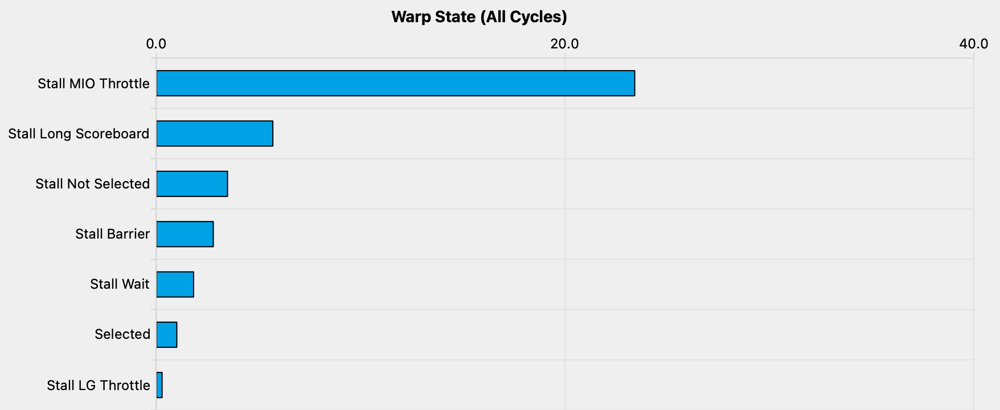{ width="90%" }

最高的 MIO Throttle 表示 MIO 指令队列拥堵，Shared Memory 指令也经过这条路径。问题不是“再多放几个 Warp 就一定会快”，而是每个输出需要执行太多 Shared Memory load。Kernel 3 最终达到 2980.3 GFLOP/s，下一步必须让每次加载服务更多结果。

[查看 Kernel 3 完整实现](gemm-kernels/3_kernel_shared_mem_blocking.cuh)

## 六、Kernel 4：一维 Thread Tiling

Kernel 3 中每个线程只计算一个输出。固定 `dotIdx` 时，线程从 As、Bs 各加载一个值，只执行一次 FMA。Kernel 4 让一个线程沿 M 方向计算 `TM=8` 个结果：

1. 从 Bs 读取一个 `tmpB`；
2. 从 As 读取 TM 个 A；
3. 用同一个 `tmpB` 更新 TM 个寄存器累加器。

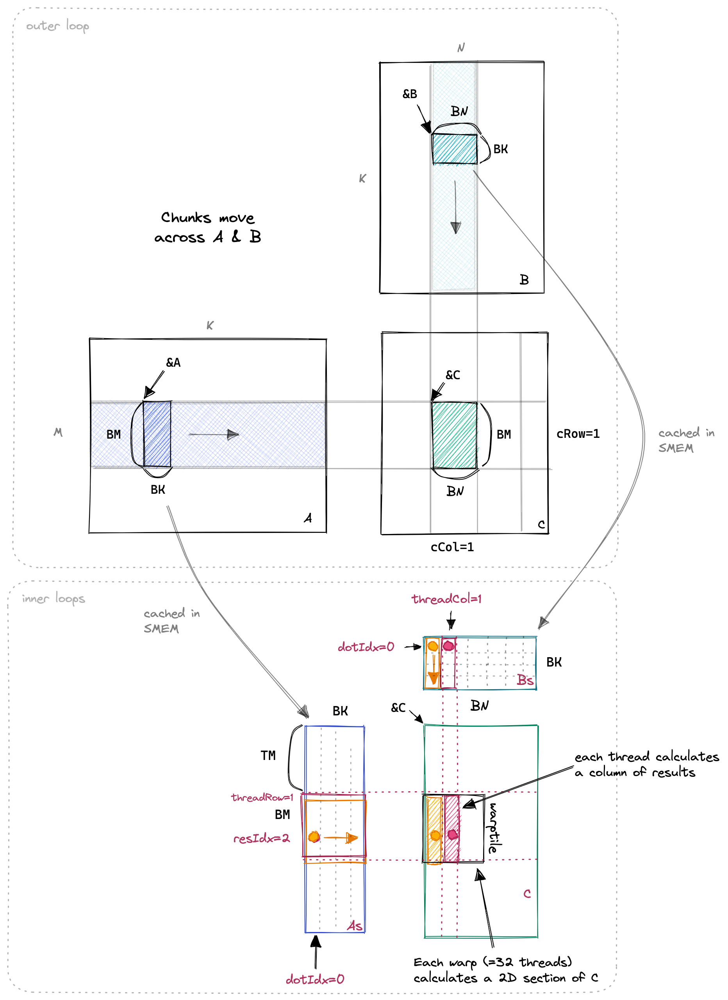{ width="76%" }

图的下半部分放大一个线程。`threadCol` 决定输出列，`threadRow` 决定纵向起点，`resIdx` 遍历该线程负责的 TM 个结果。

~~~cuda
for (uint dotIdx = 0; dotIdx < BK; ++dotIdx) {
  const float tmpB = Bs[dotIdx * BN + threadCol];
  for (uint resIdx = 0; resIdx < TM; ++resIdx) {
    threadResults[resIdx] +=
        As[(threadRow * TM + resIdx) * BK + dotIdx] * tmpB;
  }
}
~~~

Kernel 3 每个结果大约需要 `2K` 次 Shared Memory load；当 `TM=8` 时，Kernel 4 每次读取一个 B 就能更新 8 个输出，每个结果的平均加载量降为 `9K/8`。这提升的是 Shared Memory 到寄存器的复用，不能简单理解为 HBM 流量也按相同比例下降。

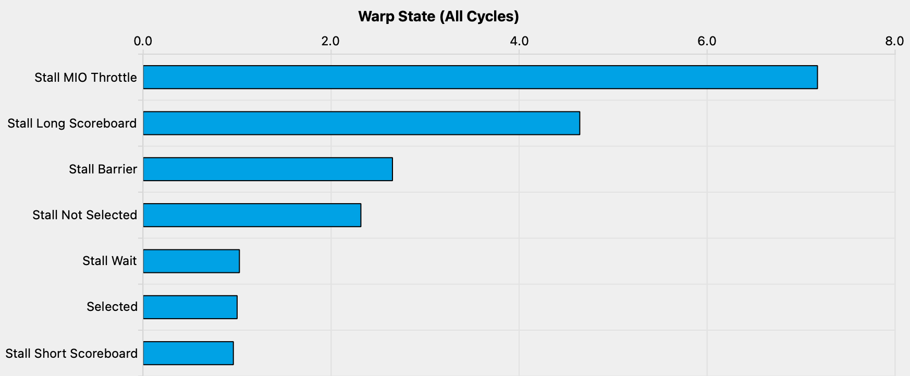{ width="90%" }

MIO Throttle 已明显降低，说明 Thread Tiling 的方向正确，但内存指令压力仍未完全消失。参数 `BM=BN=64、BK=8、TM=8` 时，性能达到 8474.7 GFLOP/s。

[查看 Kernel 4 完整实现](gemm-kernels/4_kernel_1D_blocktiling.cuh)

## 七、Kernel 5：二维 Thread Tiling 与寄存器外积

Kernel 4 只复用了 B。Kernel 5 让每个线程计算 `TM×TN=8×8=64` 个输出，使 A、B 两边都能在寄存器中复用。

固定一个 `dotIdx`，线程只需从 Shared Memory 读取：

$$
regM\in\mathbb{R}^{TM},
\qquad
regN\in\mathbb{R}^{TN},
$$

随后计算二者的外积并累加到 `TM×TN` 个寄存器结果中。

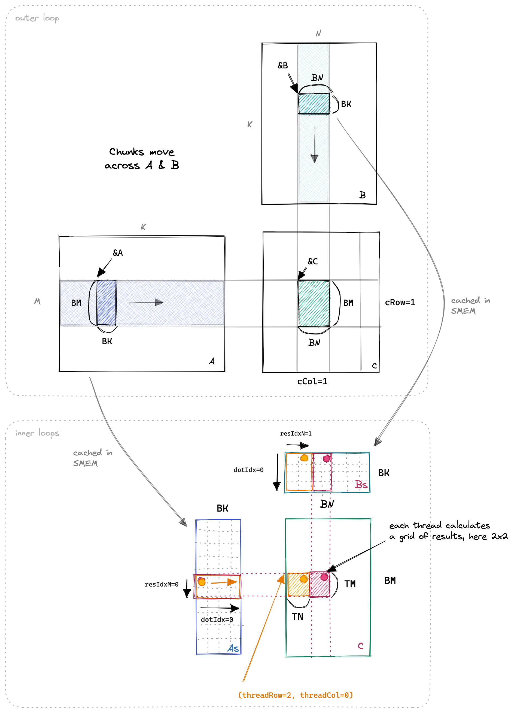{ width="76%" }

黄色区域表示一个线程持有的输出块。同一个 `regM[i]` 会与 TN 个 B 值相乘，同一个 `regN[j]` 会与 TM 个 A 值相乘。

~~~cuda
for (uint dotIdx = 0; dotIdx < BK; ++dotIdx) {
  for (uint i = 0; i < TM; ++i)
    regM[i] = As[(threadRow * TM + i) * BK + dotIdx];
  for (uint j = 0; j < TN; ++j)
    regN[j] = Bs[dotIdx * BN + threadCol * TN + j];

  for (uint i = 0; i < TM; ++i)
    for (uint j = 0; j < TN; ++j)
      threadResults[i * TN + j] += regM[i] * regN[j];
}
~~~

### 256 个线程如何装入整个 tile

参数 `BM=BN=128、BK=8、TM=TN=8` 时，一个 Block 只有

$$
\frac{128\times128}{8\times8}=256
$$

个线程，但 A、B tile 共包含 2048 个元素。每个线程必须按步长加载多个元素：

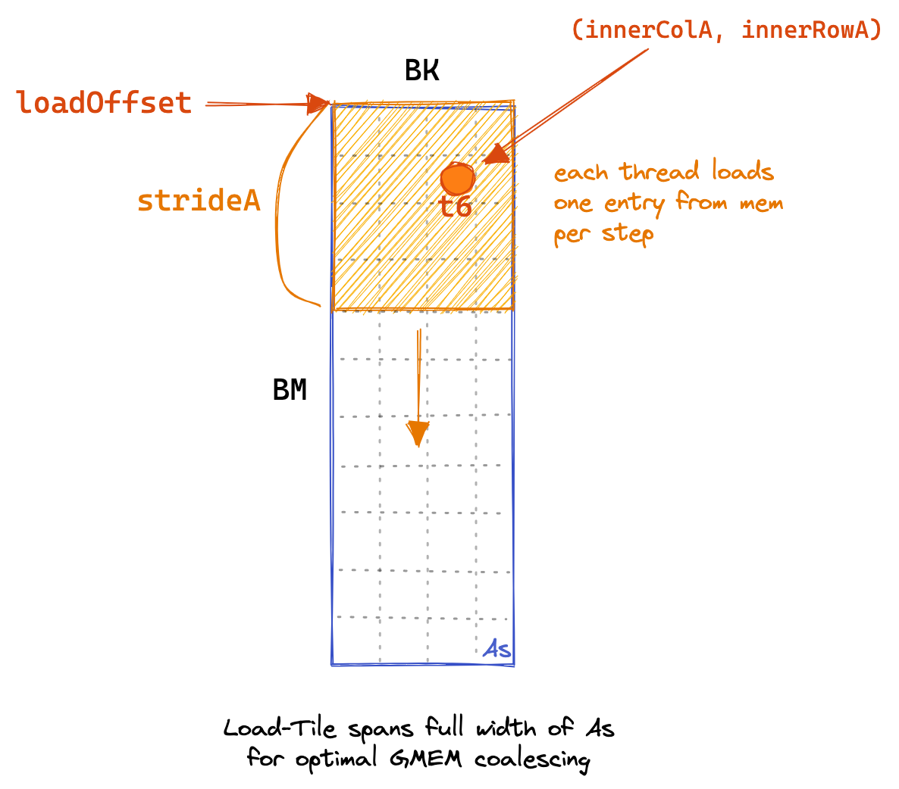{ width="62%" }

图中同一种颜色表示同一线程在多次迭代中负责的位置。加载步长由线程数和 tile 的列宽共同决定，既要覆盖全部元素，也要让同一 Warp 的地址保持连续。

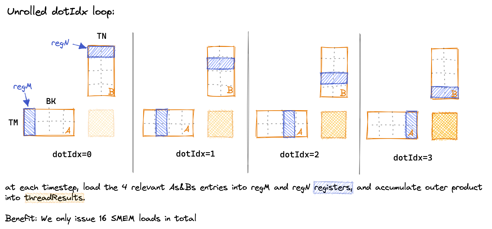{ width="95%" }

图从左到右表示 `dotIdx` 推进。蓝色 A fragment、青色 B fragment 每步更新一次，黄色区域是持续累加的线程结果。每个结果对应的 Shared Memory load 约降到 `K/4`，性能达到 15971.7 GFLOP/s。

这一步的代价是寄存器数量快速增长。`TM×TN` 太大时，寄存器压力会降低可驻留 Warp 数，甚至发生 register spilling，把数据重新溢出到 Local Memory。

[查看 Kernel 5 完整实现](gemm-kernels/5_kernel_2D_blocktiling.cuh)

## 八、Kernel 6：向量化 Shared/Global Memory 访问

Kernel 5 已经减少了 Shared Memory load 次数，Kernel 6 继续减少每次搬运需要的指令数，包含两个变化：

1. 转置 As 的 Shared Memory 布局，使 A fragment 连续；
2. 使用 `float4` 让 A、B、C 的 Global Memory load/store 变成 128 bit。

### 转置 As

Kernel 5 按 `[BM, BK]` 存储 As。线程固定 `dotIdx`、沿 M 方向读取 TM 个元素时，地址之间相隔 BK。Kernel 6 在写入 Shared Memory 时完成转置，使 As 的逻辑布局变为 `[BK, BM]`：

~~~cuda
As[(innerColA * 4 + 0) * BM + innerRowA] = tmp.x;
As[(innerColA * 4 + 1) * BM + innerRowA] = tmp.y;
As[(innerColA * 4 + 2) * BM + innerRowA] = tmp.z;
As[(innerColA * 4 + 3) * BM + innerRowA] = tmp.w;
~~~

计算阶段可以连续读取：

~~~cuda
regM[i] = As[dotIdx * BM + threadRow * TM + i];
~~~

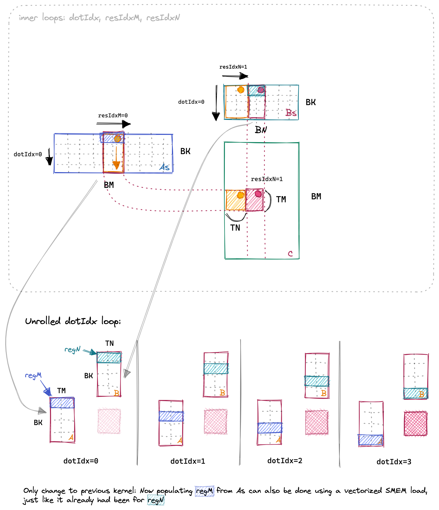{ width="78%" }

图上方展示转置后的 As，下方表示 `dotIdx` 推进时 A、B fragment 如何形成寄存器外积。连续地址让编译器更容易生成宽 Shared Memory load。

### `float4` 与 Warp 合并访存是两层机制

~~~cuda
const float4 tmp = reinterpret_cast<const float4 *>(
    &A[innerRowA * K + innerColA * 4])[0];
~~~

`float4` 向编译器表达 16 字节对齐和一次搬运四个 FP32 的意图，可以把标量 load/store 合并为 128-bit 指令。但它不能修复离散的 Warp 地址：

- Warp coalescing 减少多个 Lane 共同产生的内存事务；
- vectorized load/store 减少单个线程执行的内存指令数；
- 两者需要同时满足，才可能得到理想效果。

更准确地说，这里有两个不同的计数对象：

1. **Memory instruction**：Warp Scheduler 需要发射多少条 load/store 指令；
2. **Memory transaction**：内存系统为了覆盖整个 Warp 的地址，需要执行多少次实际事务。

合并访存主要减少第二项。即使 32 个 Lane 的地址能够合并，每个线程在循环里执行四次标量 load，Scheduler 和 LSU 仍然要处理四轮指令。`float4` 则把四个标量请求表达成一次 128-bit load，从前端减少指令压力。检查 SASS 时，Global Memory 常见目标是 `LDG.E.128`，Shared Memory 则可能出现 `LDS.128` 或同类宽指令。

这一版达到 18237.3 GFLOP/s。向量化地址必须满足 16 字节对齐，tile 参数和矩阵尺寸也需要满足相应整除条件。

[查看 Kernel 6 完整实现](gemm-kernels/6_kernel_vectorize.cuh)

## 九、Kernel 7 与 8：Bank Conflict 的负结果

Shared Memory 被划分为 32 个 Bank。一个 Warp 在同一条指令中访问同一 Bank 的不同地址时，请求可能被拆分为多次事务。Kernel 7、8 尝试改变 Bs 的地址映射：

对于 4 字节 bank width 和 FP32 元素，可以用下面的简化关系理解 Bank 映射：

$$
\text{bank}(i)=i\bmod32.
$$

也就是说，线性元素 0、32、64 会落入 Bank 0，元素 1、33、65 会落入 Bank 1。

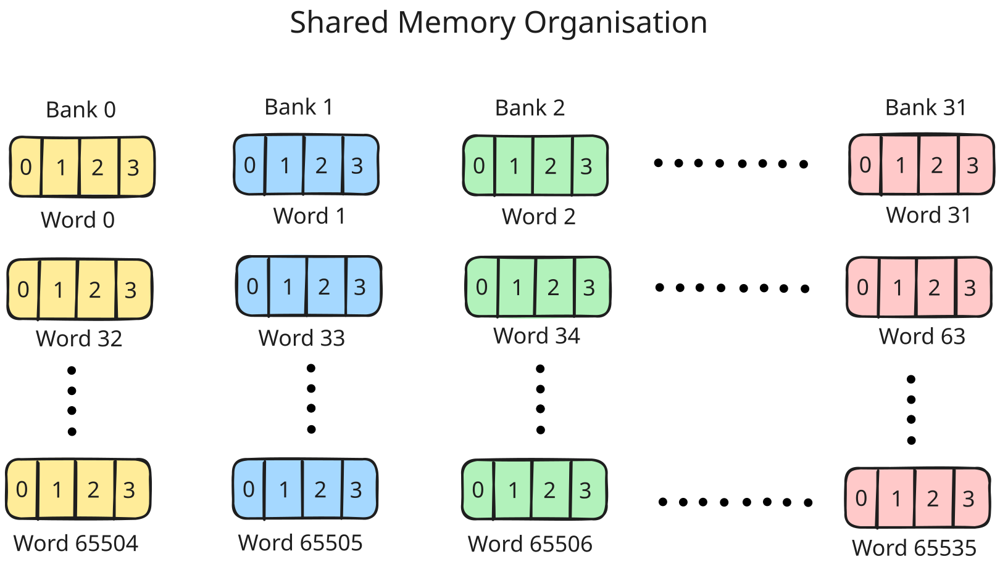{ width="82%" }

图中每一列是一个 Bank，连续的 4 字节 word 横向分布到不同 Bank，超过 32 个 word 后重新循环。同一个 Warp 若访问横向连续的 32 个 FP32，通常可以由 32 个 Bank 并行服务。

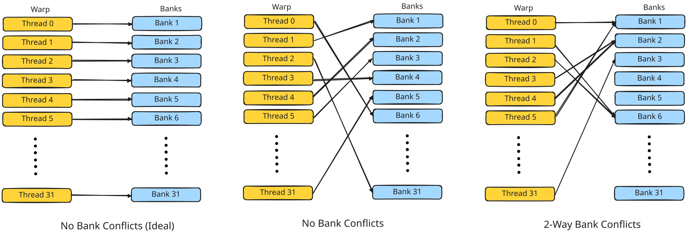{ width="96%" }

上半部分表示各 Lane 落在不同 Bank，可以并行完成；中间表示多个 Lane 读取完全相同的地址，此时硬件可以广播，并不构成冲突；下半部分表示多个 Lane 访问同一 Bank 中的不同地址，请求必须拆成多个 wavefront 串行处理，这才是 Bank Conflict。

Profiler 中的 `wavefronts per request` 可以帮助判断一次 Shared Memory 请求被拆成了多少轮，但它仍然只是局部证据。减少 wavefront 的同时，也可能引入更复杂的索引和更多指令。

- Kernel 7 将 Bs 线性化到新的布局；
- Kernel 8 在每行添加额外列，用 Padding 错开相邻行的 Bank 起点。

它们确实减少了目标 Bank Conflict，却分别只有 16213.4 和 16459.2 GFLOP/s，低于 Kernel 6 的 18237.3 GFLOP/s。原因在于新布局增加了索引计算、Shared Memory 占用或对齐复杂度。

这个结果很重要：Profiler 指标是定位问题的证据，不是优化目标。减少某个计数器并不保证端到端时间下降，最终仍要比较完整 Kernel 的运行时间。

- [查看 Kernel 7 完整实现](gemm-kernels/7_kernel_resolve_bank_conflicts.cuh)
- [查看 Kernel 8 完整实现](gemm-kernels/8_kernel_bank_extra_col.cuh)

## 十、Kernel 9：Autotuning

到 Kernel 6，主要参数包括：

| 参数 | 含义 |
| --- | --- |
| BM | Block tile 在 M 维的尺寸 |
| BN | Block tile 在 N 维的尺寸 |
| BK | 每轮处理的 K 维宽度 |
| TM | 每线程结果块的 M 维尺寸 |
| TN | 每线程结果块的 N 维尺寸 |

参数不能任意组合。它们同时受到以下条件约束：

- Block 线程数不能超过硬件限制；
- A、B tile 必须能由线程完整加载；
- `float4` 访问要求地址和元素数满足对齐；
- Thread tile、Warp tile 与 Block tile 需要整除；
- Shared Memory 和寄存器用量不能超过资源上限。

分析负责缩小合法搜索空间，Autotuning 再处理寄存器分配、指令调度、缓存行为和 Bank 映射之间难以手工建模的组合效应。

A6000 上，`BM=BN=128、BK=16、TM=TN=8` 将性能从 18237.3 提升到 19721.0 GFLOP/s。最佳参数依赖 GPU 型号、矩阵尺寸、数据类型和编译器版本，因此高性能库通常需要多组特化实现和运行时分派。

[查看 Kernel 9 完整实现](gemm-kernels/9_kernel_autotuned.cuh)

## 十一、Kernel 10：Warp Tiling

前面的实现已经包含 Block tile 和 Thread tile，但 Warp 在工作划分中仍是隐式的。实际 GPU 以 Warp 为调度单位，Shared Memory Bank Conflict 也发生在同一 Warp 内，因此加入中间层：

~~~text
Block tile
  └── Warp tile
        └── Thread tile
~~~

{ width="72%" }

这张图从外到内展示 K 维 Block tile、Warp 子块迭代以及线程寄存器外积。Warp tile 不是额外的数学运算，而是把已有的输出块按硬件调度单位重新组织。

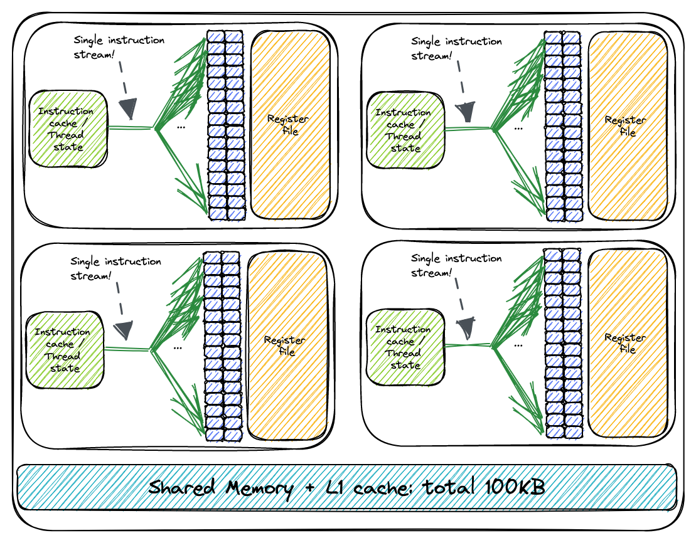{ width="68%" }

A6000 的每个 SM 有多个 Warp Scheduler。显式 Warp Tiling 让同一 Warp 读取更集中的 Shared Memory 区域，并让寄存器结果布局与最终写回位置保持一致。

假设参数为：

~~~text
NUM_THREADS = 128
BM = BN = 128
BK = 16
WM = 64
WN = 32
WNITER = 2
TM = TN = 4
~~~

128 个线程对应 4 个 Warp。每个 Warp 负责 `WM×WN=64×32` 的输出区域，再拆成多个 Warp subtile；每个线程最终维护若干个 `TM×TN` 寄存器块。

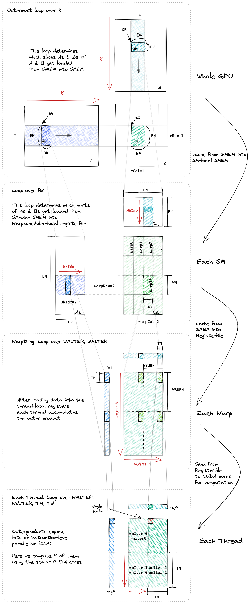{ width="70%" }

图中最外层矩形是 Block tile，中间色块是不同 Warp 的输出区域，最小网格是线程持有的寄存器结果。相同颜色在各层保持同一数据身份，可以沿图追踪一个线程结果属于哪个 Warp 和 Block。

Warp Tiling 不减少数学 FLOP，也不会直接提高 HBM 算术强度。它主要改善同一 Warp 内 Shared Memory 和寄存器访问的局部性，并让执行结构更贴合调度器。A6000 上性能达到 21779.3 GFLOP/s，为 cuBLAS 的 93.7%。

还可以从寄存器局部性理解这一步：一个 Warp 长时间处理固定输出子块，内层循环会反复使用相近的一组操作数和累加器。实际寄存器文件存在分 Bank 和操作数收集过程，但公开 Profiler 很难直接证明寄存器 Bank Conflict 是否改善，因此这里应把“寄存器局部性更好”视为合理机制解释，而不是单独归因的实测结论。

[查看 Kernel 10 完整实现](gemm-kernels/10_kernel_warptiling.cuh)

## 十二、Kernel 11 与 12：双缓冲实验

### 为什么需要双缓冲

前面的主循环按顺序执行：

~~~text
加载 tile 0 → 计算 tile 0 → 加载 tile 1 → 计算 tile 1
~~~

若使用两组 Shared Memory 缓冲区，可以在计算 front buffer 时准备 back buffer：

~~~text
预取 tile 0
计算 tile 0 || 加载 tile 1
计算 tile 1 || 加载 tile 2
计算 tile 2 || 加载 tile 3
~~~

理论上，总时间可以从每轮的 `Tload + Tcompute` 接近 `max(Tload, Tcompute)`。但这要求搬运和计算能够真正并行，还要考虑额外 Shared Memory、同步、寄存器和线程分工带来的成本。

### Kernel 11：线程分组的手工双缓冲

Kernel 11 准备两组 As/Bs，并把线程分成两半：一组负责加载，一组负责计算，之后交换角色和缓冲区。它在 A6000 上只有 17278.3 GFLOP/s，明显低于 Kernel 10。

这个负结果可能来自多个方面：

- 双倍 Shared Memory 降低资源余量；
- 256 个线程和额外同步改变了 Warp 调度；
- 加载线程与计算线程的工作量难以完全平衡；
- 原实现已有较高 L2 命中率，能够被隐藏的 Global Memory 延迟有限。

[查看 Kernel 11 完整实现](gemm-kernels/11_kernel_double_buffering.cuh)

### Kernel 12：`cuda::memcpy_async` 与 Barrier

配套仓库还提供了使用 `cuda::memcpy_async` 的实验版本。它不再固定用一半线程加载，而是通过前后台两组 `cuda::barrier` 管理异步拷贝：

1. 向 back buffer 发起下一块异步复制；
2. 等待 front barrier，确保当前块就绪；
3. 计算 front buffer；
4. 交换 buffer 下标与 barrier；
5. 单独处理最后一个 tile。

这版实现没有进入统一性能表，因此不能把它描述为已验证的提速。它还要求目标架构和 CUDA 工具链支持异步拷贝，并正确处理拷贝对齐、首块预取、末块排空和 Barrier 生命周期。

更一般的多阶段流水线通常会为每个 stage 维护两种状态：`empty` 表示该缓冲区可以被生产者覆盖，`full` 表示数据已经到达、消费者可以读取。生产者和消费者只有在状态交接正确时才能真正重叠；Barrier 数量或 buffer 数量增加，并不自动意味着流水线已经形成。

[查看 Kernel 12 完整实现](gemm-kernels/12_kernel_double_buffering.cuh)

## 十三、把整个优化链串起来

~~~text
Kernel 1：一个线程计算一个输出
  ↓ 检查同一 Warp 的实际地址
Kernel 2：重排线程映射，形成合并访存
  ↓ 不同线程仍重复从 Global Memory 读取输入
Kernel 3：Block 协作缓存 A/B tile
  ↓ Shared Memory load 指令过多
Kernel 4：每线程计算一列中的多个输出，复用 B
  ↓ A 仍缺少线程内复用
Kernel 5：二维 Thread Tiling，用寄存器外积同时复用 A/B
  ↓ 剩余搬运仍以较窄指令完成
Kernel 6：转置 As，并使用 128-bit load/store
  ↓ 参数与硬件资源之间存在复杂组合
Kernel 9：在合法参数空间内 Autotuning
  ↓ 工作划分还没有显式对应 Warp 调度层级
Kernel 10：Block → Warp → Thread 三级分块
  ↓ 尝试隐藏下一块数据的搬运延迟
Kernel 11/12：手工双缓冲与异步拷贝实验
~~~

这条路线背后有一个稳定的方法：

1. 先用 Roofline 和 Profiler 判断瓶颈属于哪一级数据搬运或执行资源；
2. 修改与该层对应的工作划分，而不是盲目增加技巧；
3. 在相同硬件、形状、精度和计时方法下重新测量；
4. 即使某项指标改善，只要端到端性能下降，就把它记录为负结果。

## 十四、实现边界

这些 Kernel 适合学习 FP32 CUDA Core SGEMM 的优化过程，但还不是通用 GEMM 库：

- Kernel 3 之后通常没有完整处理任意 `M/N/K` 尾块；
- `float4` 需要 16 字节对齐和相应的整除条件；
- 参数针对 A6000 和大方阵调优，不保证适合其他 GPU 或形状；
- 没有 Tensor Core、TF32、FP16/BF16、Split-K 和小矩阵专用路径；
- cuBLAS 会根据 GPU、形状、精度和转置方式，从大量内部 Kernel 中选择实现；
- 双缓冲是否有收益取决于实际延迟能否被计算覆盖，不能仅凭代码中存在两个 buffer 判断。

真正接近生产级 GEMM，需要将本文的单条优化链扩展为“多组特化 Kernel + Autotuning/Heuristic + 运行时分派”。但作为学习路径，这组实现已经完整展示了 GPU 优化最重要的转变：从让线程做计算，逐步走向让数据在正确的层级被复用，并让工作划分与硬件调度结构一致。
