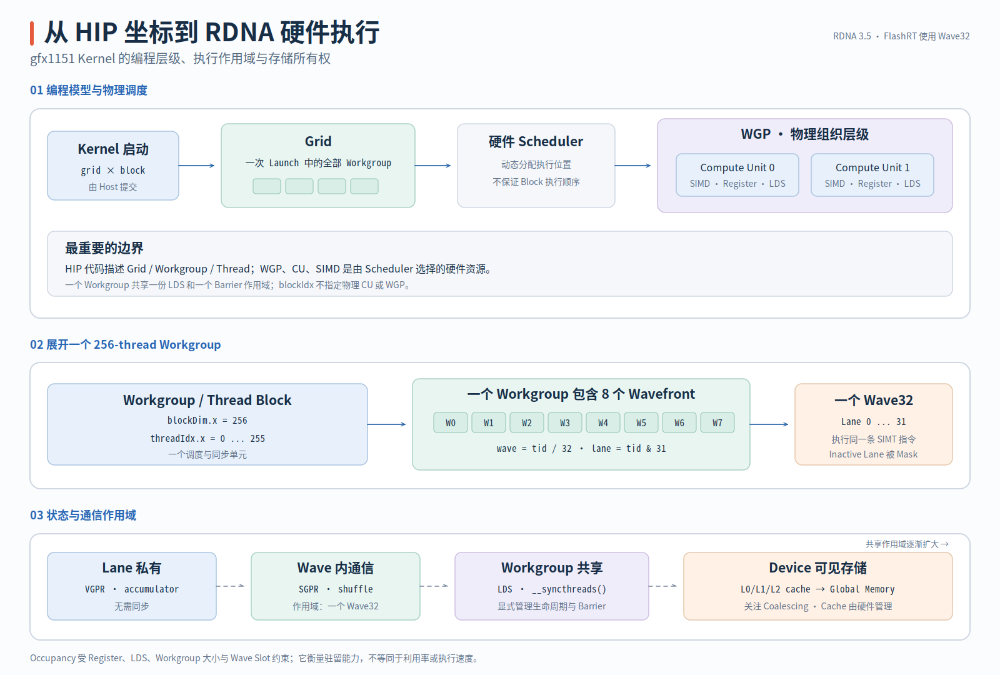

# AMD GPU 硬件模型与 Kernel 阅读术语

阅读 AMD GPU Kernel 时，最容易混淆的不是某条指令，而是同一个对象在不同层级有不同名字：HIP 代码写的是 `Grid`、`Workgroup` 和 `Thread`，硬件文档讨论的却是 `WGP`、`CU`、`SIMD`、`Wavefront` 与 `Lane`；局部变量可能进入 `VGPR`，`__shared__` 数组进入 `LDS`，而 Tensor Pointer 最终访问的是 `Global Memory`。

这篇只建立后续源码反复使用的硬件模型。目标是看到 `blockDim.x=256`、`threadIdx.x/32`、`__syncthreads()` 或 WMMA Intrinsic 时，能够立刻判断执行范围、数据归属和同步边界，而不是把它们记成互不相关的缩写。

> 图中的硬件结构是面向 Kernel 阅读的概念模型，不是 gfx1151 Floorplan。不同 AMD Architecture 的 CU 内部资源数量、Cache 容量和 Wave Mode 可以不同；本系列后续代码明确固定为 Wave32。

## 从 HIP 坐标映射到 RDNA 执行实体

先把程序可见的层级与硬件实体分开。HIP Kernel Launch 定义的是逻辑工作量，硬件 Scheduler 再把 Workgroup 动态放到可用的 Compute Resource 上：

| 层级 | HIP/源码中的名字 | AMD 硬件术语 | 本系列阅读时的含义 |
| --- | --- | --- | --- |
| 一次 Kernel Launch | `Grid` | 整个 GPU 上的一批 Workgroup | 所有 Workgroup 执行同一 Kernel，但执行先后没有保证 |
| 协作与同步单元 | `Block` / `Workgroup` | 被调度到 Compute Unit 的一组 Wave | 共享 LDS，可执行 Workgroup Barrier |
| Lockstep 执行组 | `Warp` / `Wavefront` | Wave32 | 32 个 Lane 执行同一条指令，Shuffle 只能在此范围通信 |
| 逻辑执行者 | `Thread` / `Work-item` | Lane | 拥有 `threadIdx` 和 Lane-private Register State |
| 计算资源 | 无法由 Kernel 直接编号 | `CU`、`SIMD`、`VALU/SALU` | Scheduler 选择实际执行位置，Kernel 不能指定“运行在 CU 3” |

HIP 文档把 `Thread Block` 称为可以共享 LDS、执行 Barrier 的线程集合；AMD ISA 习惯把最紧密的执行组称为 `Wavefront`。`WGP`（Workgroup Processor）则是 RDNA 硬件图中位于 CU 之上的物理组织层级，可以把多个 CU 及相关 Frontend Resource 组织在一起。它不是 HIP Launch Dimension，源码也没有 `wgpIdx` 或 `cuIdx`；更底层的组成与指令定义可在 [RDNA 3.5 ISA Reference](https://docs.amd.com/v/u/en-US/rdna35_instruction_set_architecture) 中核对。

{ width="98%" }

因此，下面三句话要始终分开理解：

- `blockIdx.x` 选择的是**逻辑 Workgroup**，不是某个固定 CU。
- 一个 Workgroup 内的 Thread 可以通过 LDS 和 Barrier 协作，但不同 Workgroup 不能假设同时驻留或按 `blockIdx` 顺序执行。
- Thread 是编程模型提供的逻辑执行者，不等于一个长期独占的物理 ALU Core；真正被硬件共同 Issue 的单位是 Wavefront。

gfx1151 的官方 Hardware Specification 将 Wavefront Size 列为 32 或 64，但 FlashRT 的 `_rdna` Source Set 明确选择 Wave32：[`common_hip_rdna.h`](https://github.com/flashrt-project/FlashRT/blob/e2cf5d1fe7209e3f4fbf212c5b6321467e8f4874/csrc/amd/kernels/common_hip_rdna.h#L1-L19) 固定 `FLASHRT_RDNA_WAVE_SIZE=32`，[`csrc/amd/CMakeLists.txt`](https://github.com/flashrt-project/FlashRT/blob/e2cf5d1fe7209e3f4fbf212c5b6321467e8f4874/csrc/amd/CMakeLists.txt#L66-L80) 也让 gfx1151 只编译 `_rdna` Kernel，而不编译另一套 Wave64/MFMA Source。

于是本系列中的一维 Thread Index 可以稳定拆成：

```cpp
constexpr int kWaveSize = 32;
const int tid = threadIdx.x;       // Workgroup 内的 Thread Index
const int wave = tid / kWaveSize; // 当前 Thread 属于第几个 Wave
const int lane = tid & 31;        // 当前 Thread 在 Wave32 内的 Lane ID
```

`blockDim.x=64/128/256` 因而分别表示每个 Workgroup 包含 2/4/8 个 Wave。它只描述这个 Workgroup 的 Wave 数，不代表整个 GPU 此刻只有这些 Wave，也不代表它们各自占用一个 CU。

## Wavefront、SIMD 与 Register State

GPU 编程模型采用 SIMT（Single Instruction, Multiple Threads）：源码看起来像每个 Thread 独立执行，硬件却以 Wavefront 为单位向 SIMD Pipeline 发射指令。一个 Wave32 含 32 个 Lane；对 Vector Instruction，可以把它理解为“同一条指令作用于 32 份 Lane-local Data”。

这里有三个需要区分的概念：

| 术语 | 表示什么 | 不应误解成什么 |
| --- | --- | --- |
| `Wavefront` | 同步取指和执行的一组 Work-item | 32 个完全独立调度的 CPU Thread |
| `SIMD32` | 执行 Wave32 Vector Instruction 的硬件 Datapath | 一个 C++ `Thread` 对应一个永久独占 Core |
| `Lane` | Wave 中的逻辑位置，Wave32 下为 0–31 | Tensor Element；它具体拥有哪个数据由 Index Formula 决定 |

CU 内还会看到 `VALU` 与 `SALU`：VALU（Vector ALU）执行 Lane-varying Vector Instruction，通常读写 VGPR；SALU（Scalar ALU）处理 Wave-uniform Scalar/Control Work，通常读写 SGPR。C++ 源码不会直接为每个表达式指定 VALU 或 SALU，Compiler 会根据 Uniformity、Instruction Type 与 Target ISA 完成 Lowering。

当 32 个 Lane 执行同一路径时，SIMD Datapath 能同时处理 32 份数据。遇到 Lane-dependent Branch 时，硬件使用 Active Lane Mask（AMD ISA 中通常由 `EXEC` State 表示）屏蔽当前路径不活跃的 Lane，再执行另一条路径。这就是 Divergence：结果仍可正确，但多个分支路径可能被分时执行。

```cpp
if (lane < 16) {
  // 只有前 16 个 Lane Active；后 16 个 Lane 在这条路径上被 Mask。
  value = first_path(value);
} else {
  // 随后切换 Active Lane，执行另一个分支路径。
  value = second_path(value);
}
```

这不表示所有 `if` 都很慢。若条件对整个 Wave 一致，例如所有 Lane 都看到同一个 `wave==0`，硬件不需要将 Wave 拆成两组 Lane Path。阅读 Kernel 时真正要检查的是 Branch Condition 是否随 Lane 改变，以及两条路径之间是否包含 WMMA、Loop 或大量 Memory Access。

Register 也有不同作用域：

- **VGPR（Vector General-Purpose Register）：** 每个 Lane 都可以保存不同值。`local_sum`、`accumulator[8]`、Thread-private Array 等通常需要 VGPR Capacity。
- **SGPR（Scalar General-Purpose Register）：** 保存整个 Wave 一致的 Scalar State，例如部分 Pointer Base、Loop Bound 或 Uniform Parameter。是否进入 SGPR 由 Compiler 与 ISA Lowering 决定，不能只凭 C++ 的 `const` 判断。
- **Spill/Scratch：** 当 Register Allocation 无法容纳 Local State 时，Compiler 可能把值 Spill 到更慢的 Memory。源码仍写成 Local Variable，并不保证所有元素最终都物理驻留 VGPR。

Shuffle 不是读取 SGPR，而是让 Lane 直接交换 Register Value。下面的 Reduction 在一个 Wave32 内执行 Offset 16、8、4、2、1；它不能跨 Wave，也不能替代 Workgroup Barrier：

```cpp
for (int offset = 16; offset > 0; offset >>= 1) {
  // Lane i 从同一 Wave 的 Lane i+offset 读取一份 Register Value。
  value += __shfl_down(value, offset, 32);
}
```

WMMA 同样是 Wave-level Collective Instruction。本系列使用的 `__builtin_amdgcn_wmma_f32_16x16x16_bf16_w32` 不是“每个 Lane 各算一个 `16×16` Matrix”，而是整个 Wave32 共同消费 Operand Fragment、共同产生一个 Matrix Tile。每个 Lane 只持有 Fragment 的一部分；如果只有部分 Lane 进入 WMMA，便破坏了 Collective Execution Contract。

## Register、LDS、Cache 与 Global Memory

Kernel 中的数据放在哪里，首先取决于需要被谁看到：只被当前 Lane 使用的值留在 Register；需要跨 Wave 共享的 Tile 或 Partial State 放进 LDS；需要跨 Workgroup、跨 Kernel 或长期保存的 Tensor 放进 Global Memory。

| Storage | 典型源码形式 | 可见范围 | 管理方式 | 本系列中的例子 |
| --- | --- | --- | --- | --- |
| VGPR/SGPR | Local Variable、Accumulator、Pointer State | Lane 或 Wave | Compiler 分配 | Norm Local Sum、Attention Online-softmax State、WMMA Accumulator |
| LDS | `__shared__` Array | 一个 Workgroup | Kernel 显式定义 Layout 与 Barrier | Wave Partial、V Tile、Probability、Split-K Partial |
| L0/L1/L2 Cache | 源码通常不可直接指定 | 对应 Hardware Scope | Hardware-managed | 重复读取 Weight、K/V 或 Tensor Row 时可能命中 |
| Global Memory | Device Pointer、Tensor Storage | 全部 Workgroup 与 Kernel | 程序分配，Cache 自动参与 | Input/Output Tensor、K/V Cache、Weight |
| Scratch/Spill | 源码 Local State 的 Lowering 结果 | 当前 Thread | Compiler 产生 | Register Pressure 过高时的潜在退化路径 |

在 Ryzen AI Max 这类 Integrated GPU 上，Global Memory 的物理后端可以是 CPU/GPU 共享的 System DRAM，而不是独立显卡上的专用 VRAM；[ROCm 的 RDNA 3.5 System Optimization 文档](https://rocm.docs.amd.com/en/latest/how-to/system-optimization/rdna3-5.html) 也明确讨论了这种 Unified Memory 与 GTT-backed Allocation。对 Kernel 阅读而言，Global Address Space、Cache、Coalescing 与 Workgroup 间可见性的逻辑角色仍然成立。因此本文优先使用 `Global Memory`，不把它机械等同于某一种物理显存封装。

LDS 是 Programmer-managed On-chip Storage。它的优势不是“自动比一切都快”，而是能明确完成两件事：跨 Thread/Wave 交换数据，以及让同一 Workgroup 重用已经从 Global Memory 搬入的数据。代价是需要设计 Layout、插入正确 Barrier，并消耗每个 CU 上有限的 LDS Capacity。

```cpp
__shared__ float partial[8];

if (lane == 0) {
  partial[wave] = wave_sum; // 每个 Wave 的 Producer 发布一份 Partial。
}
__syncthreads();            // Workgroup Barrier，同时建立 LDS 可见性。

float block_input = lane < 8 ? partial[lane] : 0.0f;
```

`__syncthreads()` 的 Scope 是整个 Workgroup。所有仍然存活的 Thread 必须以一致的控制流到达它；某些 Tail Thread 若提前 `return`，其他 Thread 随后进入 Barrier，就可能让 Workgroup 无法完成同步。相反，纯 Elementwise Kernel 没有 Block Barrier，越界 Thread 才可以在 Tail Guard 中直接退出。

还要把两类“地址连续”问题分开：

- **Global Memory Coalescing：** 相邻 Lane 访问相邻且对齐的地址时，Hardware 更容易合并 Memory Transaction。Packed C++ Type 只改变单个 Thread 的 Load Width，不能单独证明整个 Wave 的访问已经 Coalesced。
- **LDS Bank Conflict：** RDNA LDS 由多个 Bank 组成；同一 Wave 的多个 Lane 若以不合适的 Stride 命中同一 Bank 的不同地址，访问可能被拆分。Encoder Attention 的 Pitch 20、Small-M GEMM 的 Stride 68 都是在数学 Tile 宽度之外增加 Padding，以改变 Bank Mapping。

Cache 与 LDS 也不能混用。Cache 是 Hardware 根据访问自动保留的数据副本，Kernel 通常不能依赖“这次必然命中”；LDS 则是 Kernel 明确拥有的 Workspace，只有在正确的 Producer/Consumer Barrier 之后才能读取。

## Occupancy、WMMA 与源码阅读落点

一个 CU 能同时驻留多少 Workgroup/Wave，取决于多个有限资源：Workgroup Size、Wave Slot、VGPR、SGPR、LDS 以及 Architecture Limit。Occupancy 描述的是“相对于硬件上限，有多少 Wave 可以同时 Resident”，它不是下面这些概念的同义词：

- 不是 Grid 中总共有多少 Wave；Grid 可以远大于一次能够驻留的 Wave 数。
- 不是 ALU Utilization；Resident Wave 可能正在等待 Memory。
- 不是性能分数；更高 Occupancy 有助于隐藏 Latency，但 Register Reuse、LDS Reuse 和 Instruction-level Parallelism 也可能更重要。

例如 Fixed-width RMSNorm 让每个 Thread 保存 16 个 BF16 Pair，可以减少 Global Memory 重读，但会提高 VGPR Pressure；Generic Norm 保存更少 Thread-private State，却需要重新读取 Input。两条路径是在 Data Reuse 与 Residency 之间取舍，不能简单总结成“Register 越多越好”或“Occupancy 越高越好”。

`__launch_bounds__` 是源码向 Compiler 描述预期 Block Size 和 Residency Constraint 的 Hint，常用于约束 Register Allocation。它不会在运行时替代 `<<<grid,block>>>`，也不会保证某个 Occupancy 数字：

```cpp
template <int Threads>
__global__ __launch_bounds__(Threads)
void kernel(...) {
  // Compiler 已知预期 Block Size，可据此参与 Register Allocation 决策。
}
```

本系列还会频繁出现 `WMMA`、`Fragment` 与 `Tile`：

| 术语 | 阅读时的准确含义 |
| --- | --- |
| `Tile` | 从完整 Tensor/Matrix 中切出的逻辑子区域，例如 `16×16` QK Tile |
| `Fragment` | 某个 Lane 持有的 WMMA Operand/Accumulator 局部表示，不等于连续 Matrix Row |
| `WMMA` | Wave32 Collective Matrix Instruction，BF16 Operand、FP32 Accumulator |
| `MFMA` | AMD 另一类 Matrix Fused Multiply-Add ISA/Intrinsic；本 gfx1151 `_rdna` Source Set 不使用 Wave64/MFMA Kernel |
| `Occupancy` | CU 上的 Resident Wave 比例，受 Register/LDS/Block Resource 限制 |
| `Residency` | 某一时刻实际装入 CU Resource 的 Workgroup/Wave State |
| `Coalescing` | 多个 Lane 的 Global Memory Request 被合并为较少 Transaction |
| `Bank Conflict` | 同一 Wave 的 LDS Access 在 Bank 上发生冲突并需要拆分服务 |

把这些术语放回现有代码，后续章节的执行单位就会变得具体：Activation 是 One Thread/One Packed Item；Norm 是 One Workgroup/One Row；Encoder Attention 是 One Wave Pair/One Query Tile；Decoder 是 8 Waves/Split KV Rows；Small-M GEMM 则让一个 Wave 或多个 Split-K Wave 共同拥有一个 WMMA Output Tile。

本文的硬件术语以 [HIP Programming Model](https://rocm.docs.amd.com/projects/HIP/en/latest/understand/programming_model.html)、[ROCm GPU Hardware Specifications](https://rocm.docs.amd.com/en/latest/reference/gpu-arch-specs.html)、[RDNA 3.5 ISA Reference](https://docs.amd.com/v/u/en-US/rdna35_instruction_set_architecture) 与 [AMD GPUOpen RDNA Performance Guide](https://gpuopen.com/learn/rdna-performance-guide/) 为主要外部依据；FlashRT-specific 的 Wave Size、Source Selection 与 Synchronization Convention 则固定到提交 `e2cf5d1`。
