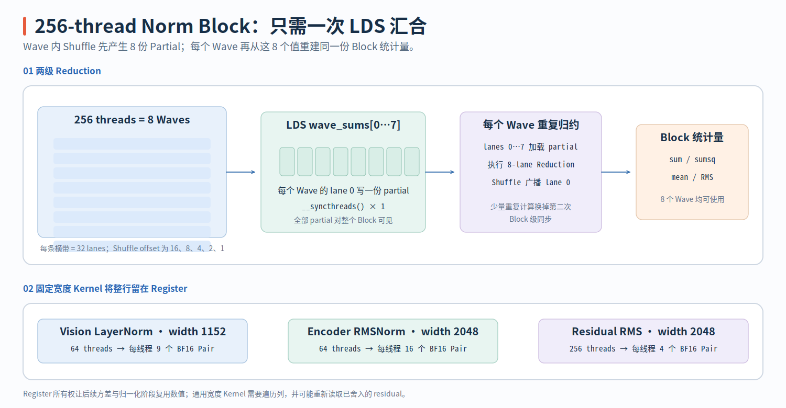

# HIP 执行模型与 Wave32 归约

PR #213 的 Activation、Norm、RoPE、Attention 和 GEMM Kernel 看起来差异很大，但阅读方法是相通的：先从 Host Launch 确定并行层级，再判断每个 Thread 或 Wave 拥有哪些数据，最后沿着 Register、LDS 和 Global Memory 追踪数据生命周期。在第 00 章建立的 AMD GPU 硬件模型之上，这一篇进一步把 HIP 坐标落实到源码阅读方法，并用 256-thread Norm Block 讲清 Wave32 Reduction。

> 代码块中的中文注释由本文补充，用来标出索引单位、Ownership 和同步边界，不属于上游源码原注释。

本章不负责拆解某一个业务 Kernel，而是阅读后续 24 个 Kernel 时共同使用的源码入口：

| 源码入口 | 本章读取的内容 | 后续用途 |
| --- | --- | --- |
| `common_hip_rdna.h` 的 `rdna_to_f32/rdna_from_f32` | BF16/FP16 与 FP32 的转换边界 | 判断 Fusion 是否改变数值语义 |
| `rdna_wave_reduce_sum/max` | Wave32 内通过 Shuffle 归约 | Norm、Decoder Attention |
| `rdna_block_reduce_sum/max` | Wave Partial 经 LDS 合并为 Block Result | Generic Norm、Row-owned Decoder Attention |
| 各 `.hip` 文件末尾的 Host Launcher | Grid、Block、Template 和 Fallback 选择 | 把 Device Index 还原为实际 Tensor Ownership |

推荐的源码阅读顺序是 **Host Launcher → Kernel Index → Memory Access → Synchronization → Epilogue**。先从 Launch Shape 确定有多少执行者，再追每个执行者读写的数据；若一开始便逐行阅读算术表达式，很容易看懂公式却误判 Thread Ownership。

## Kernel Launch 如何定义 Ownership

HIP Kernel 由 Host 侧用下面的形式启动：

```cpp
kernel<<<grid, block, dynamic_lds_bytes, stream>>>(arguments...);
```

这四个 Launch 参数分别决定 Workgroup 数量、每个 Workgroup 的 Thread 数、Dynamic LDS 容量以及提交 Kernel 的 Stream。进入 Device 代码后，`blockIdx` 和 `threadIdx` 只是执行坐标；它们代表 Element、Row、Head 还是 Matrix Tile，完全由 Kernel 的索引公式决定。

```cpp
// global_thread 是整个 Grid 中的一维 Thread 编号，具体映射到什么数据由 Kernel 决定。
const int global_thread = blockIdx.x * blockDim.x + threadIdx.x;
// RDNA 路径固定使用 Wave32；wave/lane 都是 Workgroup 内坐标。
const int wave = threadIdx.x / 32;
const int lane = threadIdx.x & 31;
```

以一维 Elementwise Kernel 为例，若 `size=1000`、`blockDim.x=256`，Host 会启动

$$
grid.x=\left\lceil\frac{1000}{256}\right\rceil=4.
$$

前三个 Workgroup 各覆盖 256 个 Element；最后一个 Workgroup 的 Thread 0–231 对应 Element 768–999，Thread 232–255 没有合法数据。于是下面的 `index<size` 不只是普通条件分支，而是整个向上取整 Launch 的 Coverage 保证：

```cpp
const int index = blockIdx.x * blockDim.x + threadIdx.x;
// Grid 向上取整后，只有 Tail Workgroup 可能出现 index >= size。
if (index < size) {
  output[index] = ...;
}
```

不要只看 Device 端这一段，还要立刻翻到文件末尾找 Launcher。以 [`gelu_rdna`](https://github.com/flashrt-project/FlashRT/blob/e2cf5d1fe7209e3f4fbf212c5b6321467e8f4874/csrc/amd/kernels/activation_rdna.hip#L167-L181) 为例，源码完整展示了“同一公开操作如何产生两套逻辑 Grid”：

```cpp
void gelu_rdna(const __hip_bfloat16 *input, __hip_bfloat16 *output, int size,
               hipStream_t stream) {
  constexpr int threads = 256;
  if ((size & 1) == 0) {
    // Packed 路径以 BF16x2 Pair 为逻辑 Item，Grid 也必须按 pairs 计算。
    const int pairs = size / 2;
    gelu_packed_rdna_kernel<<<(pairs + threads - 1) / threads, threads, 0,
                              stream>>>(
        reinterpret_cast<const __hip_bfloat162 *>(input),
        reinterpret_cast<__hip_bfloat162 *>(output), pairs);
    return;
  }
  // 奇数 size 无法完整组成 Pair，整次操作退回 Scalar Coverage。
  gelu_rdna_kernel<<<(size + threads - 1) / threads, threads, 0, stream>>>(
      input, output, size);
}
```

这段代码要从内向外读：Packed Kernel 接收的是 `pairs`，所以 `grid.x` 覆盖的是 BF16x2 Item；Scalar Kernel 接收的是 `size`，所以同一公式覆盖的是单个 BF16 Element。`threads=256` 没有变化，但一个 Thread 的数据所有权变了，因此 Grid 数量也随之改变。

PR 中主要有五种 Ownership。读到 `blockIdx.x` 时不能直接把它理解为 Row，必须把 Device 索引与 Host Launch 一起看：

| Ownership | 代表 Kernel | 坐标的实际含义 |
| --- | --- | --- |
| One Thread → One Scalar | `gelu_rdna_kernel` | `global_thread` 是 BF16 Element Index |
| One Thread → One Packed Item | `gelu_packed_rdna_kernel` | `global_thread` 是 BF16x2 Pair Index |
| One Workgroup → One Row | Norm Kernel | `blockIdx.x` 选择 Row，Thread 跨步遍历 Column |
| One Workgroup → One Query/Head | Decoder Attention | 二维 `blockIdx` 选择 Head 与 Query Row，8 Waves 分摊 KV Row |
| One Wave/Pair → One Matrix Tile | WMMA GEMM / Encoder Attention | Lane 持有 Fragment，Wave 协作产生 Tile |

这里还要区分 Workgroup 与 Wave：Workgroup 是可共享 LDS、可执行 `__syncthreads()` 的同步范围；Wave 是硬件以 Lockstep 方式执行的一组 Lane。RDNA 路径使用 Wave32，因此 256-thread Workgroup 包含 8 个 Wave，但这 8 个 Wave 不能直接通过 Shuffle 交换数据。

## Packed Access 改变的是逻辑 Item 和访存宽度

公开 Tensor 大多以 BF16 存储，而 Activation、Norm 等计算通常先用 `__bfloat162float` 提升到 FP32，完成运算后再用 `__float2bfloat16` 舍入。[`common_hip_rdna.h`](https://github.com/flashrt-project/FlashRT/blob/e2cf5d1fe7209e3f4fbf212c5b6321467e8f4874/csrc/amd/kernels/common_hip_rdna.h#L19-L46) 统一封装了这组转换，但“在哪一步转回 BF16”仍属于具体 Kernel 的数值语义：Residual-Norm 必须保留 Residual Sum 的 BF16 Rounding Point，RoPE 也需要在旋转结果写回时舍入。

源码并没有用一个包含运行时 Dtype 判断的通用函数，而是用 Template Specialization 在编译期选择转换指令：

```cpp
template <typename T> __device__ __forceinline__ float rdna_to_f32(T value);

template <> __device__ __forceinline__ float rdna_to_f32<__half>(__half value) {
  return __half2float(value);
}

template <>
__device__ __forceinline__ float
rdna_to_f32<__hip_bfloat16>(__hip_bfloat16 value) {
  return __bfloat162float(value);
}

template <typename T> __device__ __forceinline__ T rdna_from_f32(float value);

template <>
__device__ __forceinline__ __hip_bfloat16
rdna_from_f32<__hip_bfloat16>(float value) {
  // 这里才发生 FP32 -> BF16 舍入；调用位置决定可观察的数值边界。
  return __float2bfloat16(value);
}
```

因此 `rdna_to_f32<T>` 只是统一了源码写法，并没有在 Kernel 热路径中引入 Dtype Branch。真正需要追踪的是 `rdna_from_f32` 出现的位置：它决定 FP32 中间结果在哪一步失去精度。

Packed Type 不会改变数学上的 Element 数量，它只是让一个 Thread 用更宽的类型搬运多个连续 Value：

| Type | 一个逻辑 Item 的 Payload | PR 中的用途 |
| --- | ---: | --- |
| `__hip_bfloat162` | 2 BF16 = 4 bytes | GELU/SiLU、Residual、Fixed-width Norm |
| `RdnaBf16x4` | 4 BF16 = 8 bytes | Separate GeGLU 的 Gate、Up 与 Output |
| `uint4` | 16 bytes | Small-M GEMM 从 GMEM 搬运 8 个 BF16 到 LDS |
| `Bf16x16Rdna` | 16 BF16 = 32 bytes | Wave32 WMMA Operand Fragment |

例如 1024 个 BF16 在 Scalar Path 中对应 1024 个 Thread Item，在 BF16x2 Path 中对应 512 个 Pair Item。计算仍然执行 1024 次 Activation，但源码层面的 Load/Store、索引和 Tail 判断都以 Pair 为单位。是否最终合并成怎样的 Memory Transaction 还取决于地址、Lane 合并访问和 Compiler Codegen，不能只凭 C++ Type 推断实际指令数量。

`reinterpret_cast` 只改变 Pointer 的类型解释，并不会修复以下两个问题：

- **Coverage：** Element Count 必须能被 Pack Width 整除，否则最后一个 Packed Item 会越过 Tensor 边界。
- **Alignment：** Pointer Base Address 必须满足 Packed Type 的对齐要求；`size % 2 == 0` 或 `size % 4 == 0` 本身不能证明地址对齐。

本 PR 的 Host Launcher 用偶数 Width/Size 保证完整遍历，Tensor Allocator 和调用方负责提供对齐的 Base Pointer；Python Provider 还会在部分路径检查 Contiguous Layout。这里体现的是分层契约，而不是 Kernel 自己能够验证所有条件。

不同 Memory Space 的选择则由数据是否需要共享决定。Activation、Residual 和 RoPE 的输出都有唯一 Thread Owner，中间值留在 Register 即可；Norm 要把各 Wave 的 Partial Sum 放进 LDS；Encoder Attention 用 LDS 在 Wave 之间共享 V Tile、Probability 和 Softmax Correction；Split-K GEMM 用 LDS 合并多个 Wave 对同一 Output Tile 的 Partial Accumulator。`__restrict__` 进一步声明 Pointer 不会 Alias，允许 Compiler 更积极地安排访存，但它同样不提供运行时检查。

## Wave32 如何完成一次 Block Reduction

Wave Shuffle 只能在一个 Wave 的 32 个 Lane 之间传值。`rdna_wave_reduce_sum` 使用 16、8、4、2、1 五个 Offset：

```cpp
__device__ __forceinline__ float rdna_wave_reduce_sum(float value) {
#pragma unroll
  for (int offset = FLASHRT_RDNA_WAVE_SIZE / 2; offset > 0; offset >>= 1) {
    // Shuffle 只在当前 Wave32 内通信；循环结束后 Lane 0 持有完整 Wave Sum。
    value += __shfl_down(value, offset, FLASHRT_RDNA_WAVE_SIZE);
  }
  return value;
}
```

`__shfl_down(value,16,32)` 让 Lane $i$ 读取 Lane $i+16$ 的值。继续执行 Offset 8 后，Lane 0 已覆盖原始 Lane $\{0,8,16,24\}$；再经过 4、2、1，Lane 0 最终得到 32 个 Lane 的总和。此时其他 Lane 只持有各自起点对应的 Partial Result，因此需要用 `__shfl(value,0,32)` 才能把 Lane 0 的结果广播给整个 Wave。

一个 256-thread Norm Workgroup 包含 8 个 Wave。设它们的局部结果为 $s_0,\ldots,s_7$，Block Reduction 分两级完成：

1. 每个 Wave 先在 Register 中归约，只有 Lane 0 把 $s_w$ 写入 `wave_sums[w]`。
2. `__syncthreads()` 保证 8 次 LDS Store 对整个 Workgroup 可见。
3. 每个 Wave 的 Lane 0–7 分别读取 $s_0,\ldots,s_7$，其余 Lane 以 0 作为 Sum Identity。
4. `rdna_wave_reduce_sum_8` 用 Offset 4、2、1 得到 $s_0+\cdots+s_7$，再从 Lane 0 广播。

下面是 [`rdna_block_reduce_sum`](https://github.com/flashrt-project/FlashRT/blob/e2cf5d1fe7209e3f4fbf212c5b6321467e8f4874/csrc/amd/kernels/common_hip_rdna.h#L84-L103) 的完整实现，正好对应这四步：

```cpp
__device__ __forceinline__ float rdna_block_reduce_sum(float value,
                                                       float *wave_sums) {
  const int lane = threadIdx.x & (FLASHRT_RDNA_WAVE_SIZE - 1);
  const int wave = threadIdx.x / FLASHRT_RDNA_WAVE_SIZE;
  const int wave_count =
      (blockDim.x + FLASHRT_RDNA_WAVE_SIZE - 1) / FLASHRT_RDNA_WAVE_SIZE;

  // 第一级：各 Wave 在 Register 中独立归约。
  value = rdna_wave_reduce_sum(value);
  if (wave_count == 1) {
    return __shfl(value, 0, FLASHRT_RDNA_WAVE_SIZE);
  }
  // 每个 Wave 只有 Lane 0 将 Partial 发布到 LDS。
  if (lane == 0) {
    wave_sums[wave] = value;
  }
  // Producer -> Consumer Barrier：之后所有 Wave 才能读取完整的 Partial Array。
  __syncthreads();

  // 第二级：Lane 0..wave_count-1 读取各 Wave Partial，其余 Lane 使用加法单位元 0。
  float partial = lane < wave_count ? wave_sums[lane] : 0.0f;
  partial = rdna_wave_reduce_sum_8(partial);
  // 每个 Wave 都重复这次小归约，并把 Lane 0 的 Block Result 广播给全部 Lane。
  return __shfl(partial, 0, FLASHRT_RDNA_WAVE_SIZE);
}
```

逐段看这段代码：`wave_count` 由实际 `blockDim.x` 推导，所以 64-thread Fixed-width Norm 得到 2，256-thread Generic Norm 得到 8；单 Wave 时直接广播，不访问 LDS；多 Wave 时只有 Lane 0 写 `wave_sums`，但 Barrier 之后每个 Wave 都读取同一组 Partial 并独立完成最后一级归约。函数返回时，Block Result 已经出现在每个 Thread 中，调用者可以直接继续计算，而不需要再读一个共享标量。

{ width="95%" }

第 3–4 步会在 8 个 Wave 中重复同一个很小的 Reduction，看似多做了一点工作，却省掉了“Wave 0 写最终值 → 第二次 Block Barrier → 其他 Wave 重读”的同步阶段。因此 [`rdna_block_reduce_sum/max`](https://github.com/flashrt-project/FlashRT/blob/e2cf5d1fe7209e3f4fbf212c5b6321467e8f4874/csrc/amd/kernels/common_hip_rdna.h#L84-L128) 的准确特征是“每个 Wave 重复最终归约，只需要一次 Block Barrier”，而不是“没有同步”。Max Reduction 使用相同结构，只把无效 Lane 的 Identity 从 0 换成 `-INFINITY`。

## 用四个不变量检查 Kernel 正确性

读一个 HIP Kernel 时，可以先验证四个不变量，再进入指令和性能细节。

| 不变量 | 要回答的问题 | 常见错误 |
| --- | --- | --- |
| Ownership | 每个 Output 由哪个 Thread/Wave/Workgroup 写入？ | 重复 Writer、遗漏 Tile、错误理解二维 Grid |
| Coverage | Tail Thread、Partial Tile、奇数 Width 如何处理？ | Packed Load 越界、最后一行/列未写 |
| Visibility | Writer 与 Reader 位于同一 Wave 还是不同 Wave？ | 缺少 Barrier、把 Shuffle 当成跨 Wave 通信 |
| Numerical order | 在哪里转 FP32、归约、舍入回 BF16？ | Fusion 改变 Rounding Point 或统计量 |

然后再检查两层调用契约：Host Launcher 是否用正确的 Grid/Block、Dynamic LDS 和 Template Specialization；Python Provider 是否已经限制 Dtype、Shape、Layout 与 Feature Flag。Native Kernel 能处理某个 Shape，不等于当前生产 Pipeline 一定会把这个 Shape 路由给它。

Barrier 是最需要单独检查的控制流边界。只要 Workgroup 中仍有 Thread 会执行 `__syncthreads()`，其他 Thread 就不能因为“自己没有合法 Column”提前返回，否则整个 Workgroup 无法一致到达 Barrier。于是带 LDS 的 Reduction Kernel 通常让越界 Thread 用 0 或 `-INFINITY` 参与，并只对最终 Store 加 Predicate；没有 Block Barrier 的纯 Elementwise Kernel 才能直接在 Tail Guard 处 `return`。
