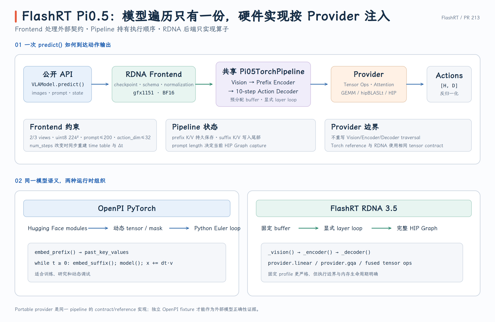
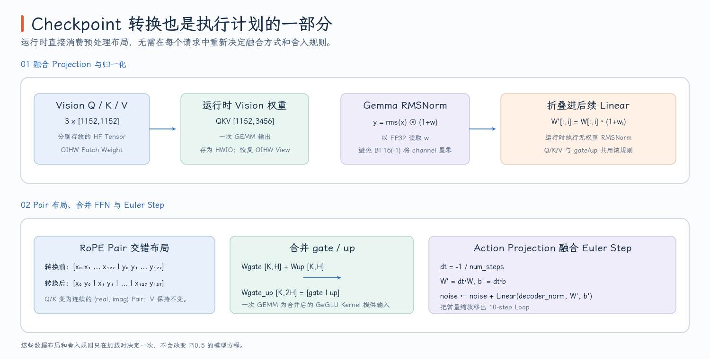
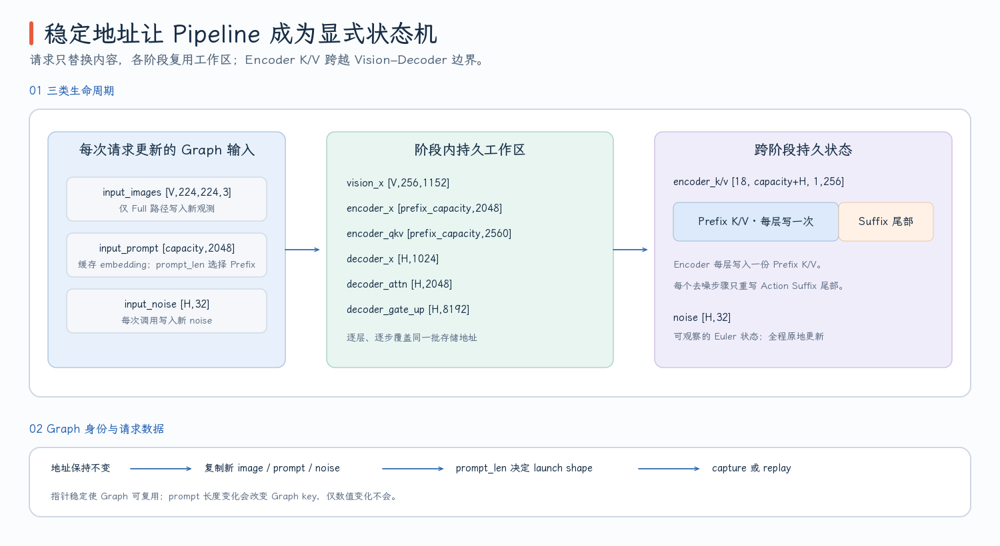

# FlashRT PR #213：Pi0.5 Frontend 与 Pipeline

OpenPI 的 PyTorch 实现以 Hugging Face module 为中心：模型结构、KV Cache 和去噪循环都由动态 Python 对象组织。FlashRT PR #213 没有再写一套“RDNA 版 Pi0.5 模型”，而是把同一套推理语义拆成三层：

```text
用户 API / Frontend
  负责输入 schema、checkpoint 转换、prompt 缓存与输出反归一化

Pi05TorchPipeline
  负责 Vision → Prefix Encoder → Action Decoder 的唯一模型遍历

Ops / GEMM / Attention providers
  负责某个具体操作用 HIP、hipBLASLt 还是 PyTorch 完成
```

这个分层是本 PR 最重要的架构约束：**模型的 layer loop、KV 状态变化与 Euler 去噪循环只保留一份；硬件后端只能替换操作，不能复制 forward。**

- PR：[#213 Add AMD RDNA 3.5 BF16 backend for Pi0.5](https://github.com/flashrt-project/FlashRT/pull/213)
- 固定源码版本：[`e2cf5d1`](https://github.com/flashrt-project/FlashRT/commit/e2cf5d1fe7209e3f4fbf212c5b6321467e8f4874)
- 共享执行主干：[`Pi05TorchPipeline`](https://github.com/flashrt-project/FlashRT/blob/e2cf5d1fe7209e3f4fbf212c5b6321467e8f4874/flash_rt/models/pi05/torch_pipeline.py#L1-L61)
- RDNA frontend：[`Pi05TorchFrontendAmdRdna35`](https://github.com/flashrt-project/FlashRT/blob/e2cf5d1fe7209e3f4fbf212c5b6321467e8f4874/flash_rt/amd/frontends/torch/pi05_rdna35.py#L66-L112)

## 1. `predict()` 如何把用户输入变成固定计算图

公开入口仍然是 `flash_rt.load_model()` 返回的 `VLAModel.predict()`。这一层不知道 GQA 用了哪个 HIP kernel，它只处理三件事：

1. 首次调用必须有 prompt，后续可以复用；prompt 或 state 改变时才重新调用 `set_prompt()`。
2. 把图像 list 和具名字段的 dict 统一为 observation，同时保留 `image` / `wrist_image` / `wrist_image_right` 兼容字段。
3. 调用 frontend `infer()`，只向上返回 `actions`。

这条路径可在 [`VLAModel.predict`](https://github.com/flashrt-project/FlashRT/blob/e2cf5d1fe7209e3f4fbf212c5b6321467e8f4874/flash_rt/api.py#L88-L165) 中直接读出。其中 state 值的快照也被缓存，因为 Pi0.5 会把 state 格式化进语言 prompt；即使文本不变，state 变化也可能导致 token 内容乃至 token 长度改变。

RDNA frontend 随后把输入约束收紧为一个可预分配的 profile：

| 对象 | 约束 | 为什么需要在 frontend 拒绝 |
| --- | --- | --- |
| PyTorch runtime | ROCm build 且 GPU 可见 | CUDA 字符串 API 在 ROCm PyTorch 中仍使用，但执行后端必须是 HIP |
| 运行设备 | `gfx1151` | kernel 的 wave32、WMMA 和 tuning 不是通用 ROCm 承诺 |
| 扩展构建 | backend=`rdna35`、wave size=32、build/device 均为 `gfx1151` | 防止误加载 CDNA wave64 或其他 ISA 的二进制 |
| 精度 | BF16 | 本 PR 没有为 FP16/FP32 建立完整 kernel contract |
| 视角 | 2 或 3 张 | buffer 大小与 prefix capacity 在构造时固定 |
| 图像 | `uint8 [224,224,3]` | patch 数与 Vision buffer 均是静态 shape |
| action schema | 显式 `action_dim` 或 `config.json.output_action_dim` | 常数通道可能是真实关节，不能从 quantile 猜 padding |

平台 gate 见 [`Pi05TorchFrontendAmdRdna35.__init__`](https://github.com/flashrt-project/FlashRT/blob/e2cf5d1fe7209e3f4fbf212c5b6321467e8f4874/flash_rt/amd/frontends/torch/pi05_rdna35.py#L71-L120)，action schema 的解析见 [`_resolve_action_dim`](https://github.com/flashrt-project/FlashRT/blob/e2cf5d1fe7209e3f4fbf212c5b6321467e8f4874/flash_rt/amd/frontends/torch/pi05_rdna35.py#L221-L249)。图像则先转 FP32 并执行

$$
x_{norm}=\frac{x_{uint8}}{127.5}-1,
$$

再转 BF16 写入持久 `_image_buf`，而不是在每一层临时处理输入，见 [`_gather_view_images` 与 `_fill_images`](https://github.com/flashrt-project/FlashRT/blob/e2cf5d1fe7209e3f4fbf212c5b6321467e8f4874/flash_rt/amd/frontends/torch/pi05_rdna35.py#L266-L296)。

{ width="95%" }

## 2. Checkpoint 转换不是换名，而是提前确定算子边界

`convert_pi05_safetensors()` 将 Hugging Face/OpenPI 权重转为 shared pipeline 直接消费的 row-major 字典。这里有四类会改变运行时数据流的转换，不能把它理解为普通的 key rename。

**Vision Q/K/V 预先合并。** Hugging Face 中三个 `[1152,1152]` 投影被拼成 pipeline 需要的 `[1152,3456]`，一次 GEMM 产生 fused QKV。Patch embedding 先从 OIHW 转为 HWIO，因为共享 checkpoint 格式也要被其他 backend 使用；RDNA Torch frontend 在调用 `F.conv2d` 前又显式转回 OIHW。这是“持久权重布局”和“当前 operator API 布局”之间的转换，不是数学上做了两次无意义转置。对应代码见 [Vision 权重转换](https://github.com/flashrt-project/FlashRT/blob/e2cf5d1fe7209e3f4fbf212c5b6321467e8f4874/flash_rt/frontends/torch/pi05_checkpoint.py#L67-L127) 与 [frontend 布局恢复](https://github.com/flashrt-project/FlashRT/blob/e2cf5d1fe7209e3f4fbf212c5b6321467e8f4874/flash_rt/amd/frontends/torch/pi05_rdna35.py#L156-L165)。

**Encoder RMSNorm 被折叠进线性层。** Gemma RMSNorm 的可观察输出是

$$
y=\operatorname{rms}(x)\odot(1+w).
$$

若后面紧接 $yW$，可以把 $(1+w)$ 沿输入维乘进 $W$，从而运行时只做无权 RMSNorm。但折叠必须在 FP32 中完成：某个 BF16 norm weight 如果被舍入到 `-1`，先转 BF16 再计算 `1+w` 会把整个通道错误变成 0。因此 Q/K/V 与 gate/up 先用 `g_raw(...).float()` 读取、折叠，最后才转 BF16，见 [Encoder 折叠实现](https://github.com/flashrt-project/FlashRT/blob/e2cf5d1fe7209e3f4fbf212c5b6321467e8f4874/flash_rt/frontends/torch/pi05_checkpoint.py#L129-L167)。

**Q/K 根据 fused RoPE 的 pair 布局重排。** `_interleave_qk()` 把每个 head 的连续维度重排为 `(real,imag)` pair 可直接读取的布局。Encoder 在重排后再做 norm fold；Decoder 也重排 Q/K，但不能折叠 AdaRMS，因为它的 scale/shift/gate 随 denoise step 在运行时变化。见 [`_interleave_qk`](https://github.com/flashrt-project/FlashRT/blob/e2cf5d1fe7209e3f4fbf212c5b6321467e8f4874/flash_rt/frontends/torch/pi05_checkpoint.py#L20-L29) 和 [Decoder 转换](https://github.com/flashrt-project/FlashRT/blob/e2cf5d1fe7209e3f4fbf212c5b6321467e8f4874/flash_rt/frontends/torch/pi05_checkpoint.py#L169-L211)。

**Frontend 继续完成与实际 profile 相关的准备。** `num_steps` 变化时重建整张 time embedding，不是截断默认 10-step 表；action output 的 W/b 预乘 $-1/num\_steps$；Encoder 与 Decoder 的 gate/up 合并为 `[K,2H]`；`[1024,32]` action output weight 还会预制专用 small-M 转置。这一段装配代码见 [frontend 权重准备](https://github.com/flashrt-project/FlashRT/blob/e2cf5d1fe7209e3f4fbf212c5b6321467e8f4874/flash_rt/amd/frontends/torch/pi05_rdna35.py#L152-L200)。

因此 checkpoint conversion 的结果已经隐含了运行时计划：哪些 Linear 合并、哪些 Norm 消失、RoPE 如何读取连续 pair，以及 Euler 步长在哪个算子中生效。

{ width="95%" }

## 3. Shared Pipeline 用固定 Buffer 表达整个状态机

`Pi05TorchPipeline` 不在 layer loop 中不断创建新 tensor，而是按最大 profile 一次分配工作区。关键常量为：

```python
VIS_L, VIS_D, VIS_H, VIS_NH, VIS_HD = 27, 1152, 4304, 16, 72
ENC_L, ENC_D, ENC_H, ENC_NH, ENC_HD = 18, 2048, 16384, 8, 256
DEC_L, DEC_D, DEC_H, DEC_NH, DEC_HD = 18, 1024, 4096, 8, 256
PATCHES_PER_VIEW = 256
ACTION_DIM = 32
```

设定 `num_views=2`、`max_prompt_len=200`、`chunk_size=10`，则

$$
prefix\_capacity=2\times256+200=712.
$$

核心 buffer 就可以完整写出：

| Buffer | Shape | 生命周期与用途 |
| --- | --- | --- |
| `input_images` | `[2,224,224,3]` | graph 输入的稳定地址 |
| `vision_x` | `[2,256,1152]` | 27 层 Vision residual stream，原地更新 |
| `encoder_x` | `[712,2048]` | image projection 与 prompt embedding 拼成的 Prefix |
| `encoder_qkv` | `[712,2560]` | `8×256` Q 与共享 `1×256` K/V 的 fused 工作区 |
| `encoder_k/v` | `[18,722,1,256]` | 18 层 Prefix K/V，尾部 10 行供 Action Suffix 写入 |
| `decoder_x` | `[10,1024]` | 当前 denoise step 的 Action Expert residual stream |
| `decoder_attn` | `[10,2048]` | 8 个 256-d head 拼接的 attention context，O projection 后才回到 1024 |
| `decoder_gate_up` | `[10,8192]` | merged gate/up GEMM 输出 |
| `noise` | `[10,32]` | Euler 积分的可观察状态，每步原地更新 |

完整列表见 [`_allocate_buffers`](https://github.com/flashrt-project/FlashRT/blob/e2cf5d1fe7209e3f4fbf212c5b6321467e8f4874/flash_rt/models/pi05/torch_pipeline.py#L117-L156)。`encoder_gate_up` 和 `decoder_gate_up` 值得特别注意：即使 provider 选择 split gate/up GEMM，也是直接写入同一块 merged workspace 的两个 strided view，因此切换 provider 不需要另外分配一套 gate 和 up buffer。

假设实际 prompt 长度是 47，则有：

```text
image_tokens = 2 × 256 = 512
valid_prefix = 512 + 47 = 559
chunk        = 10
```

`compact_encoder=True` 时，Encoder 只遍历前 559 行，Action Suffix 写入 KV 的 `[559,569)`。`compact_encoder=False` 时，Encoder 保留 712 行静态 shape，prompt 后的 `[559,712)` 先清零，Suffix 改为写入 `[712,722)`。两种布局的有效逻辑区间分别是：

```text
compact: [0,559) Prefix | [559,569) Suffix
padded : [0,559) Prefix | [559,712) masked gap | [712,722) Suffix
```

这也解释了 attention API 为什么同时接收 `valid_prefix` 和 `prefix_capacity`：前者是数学上可见的 Prefix 边界，后者决定 padded 布局中 Suffix 的物理起点。相关 slice 建立在 [`_encoder`](https://github.com/flashrt-project/FlashRT/blob/e2cf5d1fe7209e3f4fbf212c5b6321467e8f4874/flash_rt/models/pi05/torch_pipeline.py#L251-L278) 和 [`_decoder`](https://github.com/flashrt-project/FlashRT/blob/e2cf5d1fe7209e3f4fbf212c5b6321467e8f4874/flash_rt/models/pi05/torch_pipeline.py#L346-L360) 中。

{ width="95%" }

Pipeline 还可在构造期预计算每个 denoise step 的 AdaRMS modulation：

$$
[num\_steps,\ 2\times18+1,\ 3\times1024].
$$

18 层每层有 pre-attention 和 pre-FFN 两组 modulation，最后再有一组 final norm；每组 3072 元素按 `[scale|shift|gate]` 布局。因为离散时间表在构造时已知，这些结果可以在请求外计算，实现见 [`Pi05TorchPipeline.__init__`](https://github.com/flashrt-project/FlashRT/blob/e2cf5d1fe7209e3f4fbf212c5b6321467e8f4874/flash_rt/models/pi05/torch_pipeline.py#L21-L110)。

## 4. 一次请求如何穿过 Vision、Encoder 和 10 步 Decoder

Frontend 对 prompt 和每帧输入的处理频率不同。`set_prompt()` 负责 tokenization 与 embedding，语言 embedding 按 OpenPI 语义乘 $\sqrt{2048}$ 后缓存到 `_prompt_buf`，见 [`_embed_prompt`](https://github.com/flashrt-project/FlashRT/blob/e2cf5d1fe7209e3f4fbf212c5b6321467e8f4874/flash_rt/frontends/torch/pi05_checkpoint.py#L248-L286) 和 [`set_prompt`](https://github.com/flashrt-project/FlashRT/blob/e2cf5d1fe7209e3f4fbf212c5b6321467e8f4874/flash_rt/amd/frontends/torch/pi05_rdna35.py#L251-L264)。`infer()` 则在每次请求中更新图像与 noise：

```python
self._fill_images(observation)
if noise is None:
    self._noise_buf.normal_()
else:
    self._noise_buf.copy_(value.to(self.dtype))
raw = self.forward_with_fixed_noise(self._image_buf, self._noise_buf)[0]
```

固定 noise 不只是测试便利；它把随机数源移到 pipeline 外，使 eager/graph、optimized/reference 可以在相同初始状态下对比。

Pipeline 的 `_run_static()` 本身只有四行：

```python
self.buf["noise"].copy_(self.buf["input_noise"])
self._vision(self.buf["input_images"])
valid_prefix = self._encoder(self.buf["input_prompt"][:prompt_len], prompt_len)
self._decoder(valid_prefix)
```

但它接管了完整的状态变化：

```text
input_images
  → patch conv + 27-layer Vision
  → 1152→2048 projector

projected image tokens + cached prompt embeddings
  → 18-layer Prefix Encoder
  → per-layer Prefix K/V

input_noise → noise
  → 10 个 denoise steps
  → 每步 32→1024 action projection
  → 18-layer Action Expert，读 Prefix K/V 并写 Suffix K/V
  → 1024→32 action projection
  → noise += 已预乘 dt 的 velocity
```

Encoder 的最后一层是一个容易忽略的优化。Decoder 需要每个 Prefix layer 的 K/V，但不会消费 Encoder 第 18 层 attention 之后的 hidden state。因此 index=17 时 QKV/RoPE 完成后直接 `break`，不再运行没有消费者的 attention output、O projection 和 FFN，见 [Encoder layer loop](https://github.com/flashrt-project/FlashRT/blob/e2cf5d1fe7209e3f4fbf212c5b6321467e8f4874/flash_rt/models/pi05/torch_pipeline.py#L279-L344)。

Decoder 每步末尾也有一个跨算子优化边界。Action output W/b 已经预乘 $dt=-1/num\_steps$，所以 GEMM 结果不再是原始 $v_t$，而是 $dt\,v_t$。RDNA GEMM provider 的主路径用 `linear_residual()` 直接完成

$$
noise\leftarrow noise+dt\,v_t.
$$

这一融合把 small-M projection 和 Euler residual 保留在同一个算子边界，调用点见 [`_decoder` 末尾](https://github.com/flashrt-project/FlashRT/blob/e2cf5d1fe7209e3f4fbf212c5b6321467e8f4874/flash_rt/models/pi05/torch_pipeline.py#L516-L529)。

Pipeline 提供完整 HIP Graph capture，其 key 是 `prompt_len`。图像内容与 noise 可以改变，因为它们在 replay 前 copy 进相同地址；prompt 长度改变会改变 Encoder row count 和部分 launch shape，因此需要 3 次 warmup 并重新 capture，见 [`record_graph` 与 `forward_with_inputs`](https://github.com/flashrt-project/FlashRT/blob/e2cf5d1fe7209e3f4fbf212c5b6321467e8f4874/flash_rt/models/pi05/torch_pipeline.py#L537-L616)。需要精确区分：这个固定提交已实现 `use_graph=True` 路径，但 frontend 的普通 `infer()` 调用没有传入该开关，因此不应把“支持 capture”写成“默认每次 infer 都 replay graph”。

## 5. Provider 隔离、Fallback 与正确性证据

Shared pipeline 只持有 `ops`、`gemm`、`attn` 三类对象，调用的是语义接口：

```text
ops  : layer_norm / rms_norm / adarms / residual / qkv_rope / activation
gemm : linear / linear_residual
attn : vision / gqa
```

`Pi05PipelineRdna35` 仅在构造时注入 `Rdna35TensorOps`、RDNA GEMM 和 Attention provider，自身没有 `for` / `while` 或任何新的模型遍历，见 [RDNA binding 全文](https://github.com/flashrt-project/FlashRT/blob/e2cf5d1fe7209e3f4fbf212c5b6321467e8f4874/flash_rt/amd/models/pi05_rdna35/pipeline.py#L1-L25)。单测还直接检查：

```python
assert Pi05PipelineRdna35._vision is Pi05TorchPipeline._vision
assert Pi05PipelineRdna35._encoder is Pi05TorchPipeline._encoder
assert Pi05PipelineRdna35._decoder is Pi05TorchPipeline._decoder
```

并对 binding 做 AST 扫描，确保没有循环潜回硬件层，见 [`test_rdna_binding_has_no_model_traversal`](https://github.com/flashrt-project/FlashRT/blob/e2cf5d1fe7209e3f4fbf212c5b6321467e8f4874/tests/test_pi05_torch_pipeline.py#L77-L87)。这个测试保护的不是代码风格，而是正确性边界：如果两个 backend 各自持有一套 layer loop，任何 mask、舍入点或最后一层特例的修改都可能只落在其中一份。

Provider 内部可以再做粒度更小的 fallback。例如 RDNA tensor provider 只对已验证的 width 调 HIP kernel，其他 shape 用 ATen；Attention 只在 mask/layout 满足约束时调原生 GQA，否则用 SDPA；GEMM 也可在 small-M 与 hipBLASLt 之间选择。这些 fallback 更换的是“如何执行一个操作”，不是“执行哪一层”。

Decoder 末尾同样保留语义等价的降级路径：若 `linear_residual()` 不接受当前 shape 或 prepared weight，Pipeline 先用普通 `linear()` 写入 action buffer，再执行 `noise.add_(action)`。因此主路径中的融合不是模型语义的必要条件，provider 可以放弃这一融合边界而不复制 Decoder loop。

正确性证据要分成两类：

- **同一 pipeline 中 optimized provider 对 ATen/SDPA provider**：可及时发现某个 kernel、layout 或 fusion 偏离，但两者共享相同的模型遍历，所以只是 regression check。对应组合对比见 [`test_optimized_path_matches_aten_fallback`](https://github.com/flashrt-project/FlashRT/blob/e2cf5d1fe7209e3f4fbf212c5b6321467e8f4874/tests/test_amd_rdna35_model.py#L83-L135)。
- **独立 OpenPI fixture**：NPZ metadata 必须声明 producer=`openpi`，并核对 producer revision、checkpoint SHA256、`num_steps`、`action_dim` 和 horizon，然后对 `raw_actions` 与反归一化后 `actions` 分别检查 BF16 容差与 cosine。这才是跨实现的外部 oracle，见 [`test_independent_reference_fixture`](https://github.com/flashrt-project/FlashRT/blob/e2cf5d1fe7209e3f4fbf212c5b6321467e8f4874/tests/test_amd_rdna35_model.py#L172-L205)。

从这个角度看，PR #213 并不只是“加了几个 AMD kernel”。它首先用 frontend 锁定 profile，用 checkpoint conversion 预编排布局与融合边界，再用共享 pipeline 固定状态变化，最后才让 RDNA provider 在不改模型语义的前提下替换具体算子。
