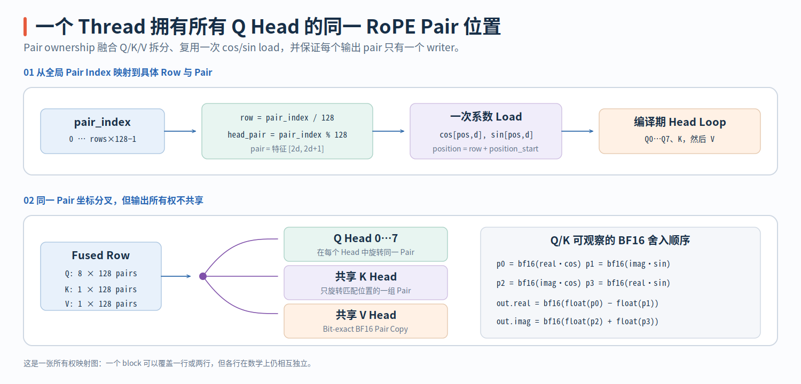

# QKV Split 与 RoPE Kernel

`qkv_rope_rdna_kernel` 将两个原本可能分开的阶段合并在一次 Launch 中：先从 Fused QKV GEMM 的 `[Q | K | V]` 输出中拆出三类 Tensor，再对 Q/K 应用 RoPE，V 则直接 Copy。它没有 Reduction 和 Thread 间数据依赖，难点全部集中在“一个 Thread 应该拥有什么”和“为什么要保留特定 BF16 Rounding Point”。

> 代码块中的中文注释由本文补充，重点标出 Pair Ownership、Pointer 单位、Coefficient 复用与 BF16 Rounding Point，不属于上游源码原注释。

实现只有一个 `__global__` Function，位于 [`rope_rdna.hip`](https://github.com/flashrt-project/FlashRT/blob/e2cf5d1fe7209e3f4fbf212c5b6321467e8f4874/csrc/amd/kernels/rope_rdna.hip#L25-L103)。

| 源码对象 | 负责的工作 | 阅读入口 |
| --- | --- | --- |
| `qkv_rope_rdna_kernel` | Split 8Q/1K/1V，对 Q/K 做 RoPE，Copy V | 从 `pair_index` 推导 Row 与 Head Pair |
| `qkv_rope_rdna` | 根据 Rows 选择 128/256 Threads 并 Launch | 检查 `pairs=rows*128` 是否完整覆盖 |
| `Rdna35TensorOps.qkv_rope` | 传递 Pointer、Position Offset 与 Stream | 确认固定 Pi0.5 Layout 由上层保证 |

阅读这一个 Kernel 时，不需要从旋转公式开始。先把所有 Pointer 都换算成 BF16x2 Pair 单位，画出单行的 Q/K/V Pair Range；再跟踪一个 `pair_index` 会读哪一组 Cos/Sin、写哪 8 个 Q Pair 和哪个 K/V Pair；最后检查乘法与 Add/Sub 之间的 BF16 Cast。这样能同时验证地址和数值语义。

## 从 `[rows,2560]` 到 128 个 Complex Pair

Pi0.5 的 Fused QKV Row 布局被编译期常量固定：

```text
qkv[row, 2560]
  ├─ Q: 8 heads × 256 dims = 2048 BF16
  ├─ K: 1 head  × 256 dims =  256 BF16
  └─ V: 1 head  × 256 dims =  256 BF16
```

RoPE 将每个 Head 的相邻两个维度 `(2d,2d+1)` 视为一个 Complex Pair。Head Dim 是 256，因此一个 Head 有 128 Pairs。Kernel 不是为整个 QKV Row 启动一个 Thread，而是为每个 `(row,head_pair)` 启动一个 Thread：

```cpp
__global__ void qkv_rope_rdna_kernel(
    const __hip_bfloat16 *__restrict__ qkv,
    const __hip_bfloat16 *__restrict__ rope_cos,
    const __hip_bfloat16 *__restrict__ rope_sin,
    __hip_bfloat16 *__restrict__ q_out,
    __hip_bfloat16 *__restrict__ k_out,
    __hip_bfloat16 *__restrict__ v_out,
    int rows, int position_start) {
  // 一个 Thread 拥有一个 (row, head_pair)；head_pair 是相邻两个 BF16 Dimension。
  const int pair_index = blockIdx.x * blockDim.x + threadIdx.x;
  const int pair_count = rows * kHeadPairs;
  if (pair_index >= pair_count) {
    return;
  }

  const int row = pair_index / kHeadPairs;
  const int head_pair = pair_index - row * kHeadPairs;
  // 从这里起 qkv2/q_out2 的下标单位都是 BF16x2 Pair，不是 Scalar BF16。
  const auto *qkv2 = reinterpret_cast<const __hip_bfloat162 *>(qkv);
  // Cos/Sin 只依赖 Position 与 Pair，不依赖 Q Head；当前 Thread 可复用给 8Q+1K。
  const int rope_index = (row + position_start) * kHeadPairs + head_pair;
  const float cosine = __bfloat162float(rope_cos[rope_index]);
  const float sine = __bfloat162float(rope_sin[rope_index]);
  const size_t input_base = static_cast<size_t>(row) * kQkvPairs;
  auto *q_out2 = reinterpret_cast<__hip_bfloat162 *>(q_out);

  // Q/K rotation and V copy continue below.
}
```

这里的 `pair_count=rows*128` 明确说明 Grid 只沿 Row 与 Pair 展开，Q Head 不属于 Grid 维度，而是在同一个 Thread 内循环。`input_base` 的单位已经是 BF16 Pair，因此一行的跨度是 `kQkvPairs=1280`，不是 2560。

以 `rows=10` 为例，总共需要 `10×128=1280` 个 Thread Item。`pair_index=389` 对应：

$$
row=\lfloor389/128\rfloor=3,
\qquad head\_pair=389-3\times128=5.
$$

这个 Thread 将处理第 3 行、每个 Q Head 以及共享 K/V Head 中的维度 Pair `(10,11)`。它不会与其他 Thread 写入同一个 Output Pair，所以不需要 LDS、Barrier 或 Atomic。

## 一个 Thread 如何复用 Cos/Sin 处理 8Q、1K 和 1V

Thread 首先定位本行的 RoPE Coefficient：

```cpp
const int rope_index = (row + position_start) * 128 + head_pair;
const float cosine = __bfloat162float(rope_cos[rope_index]);
const float sine = __bfloat162float(rope_sin[rope_index]);
```

`position_start` 让同一 Kernel 同时支持 Prefix 和从某个 Sequence Position 开始的 Suffix。对当前 `(position,head_pair)`，Cos/Sin 与 Query Head 无关，因此只需各读一次，然后在编译期展开的 8-head Loop 中复用：

```cpp
#pragma unroll
for (int head = 0; head < kQHeads; ++head) {
  // Q Head 不进入 Grid；同一 Thread 串行处理 8 个 Head 的同一个 Complex Pair。
  const __hip_bfloat162 value =
      qkv2[input_base + head * kHeadPairs + head_pair];
  const float real = __bfloat162float(value.x);
  const float imaginary = __bfloat162float(value.y);
  // 每个乘积先舍入 BF16，再转回 FP32 做 Add/Sub，复现 Unfused 数值边界。
  const float real_cos = __bfloat162float(__float2bfloat16(real * cosine));
  const float imaginary_sin =
      __bfloat162float(__float2bfloat16(imaginary * sine));
  const float imaginary_cos =
      __bfloat162float(__float2bfloat16(imaginary * cosine));
  const float real_sin = __bfloat162float(__float2bfloat16(real * sine));
  q_out2[static_cast<size_t>(row) * kQPairs +
         head * kHeadPairs + head_pair] =
      __hip_bfloat162(__float2bfloat16(real_cos - imaginary_sin),
                      __float2bfloat16(imaginary_cos + real_sin));
}
```

这一段没有调用独立 `rotate()` Helper，四次 Multiply、四次 BF16 Round 和最终 Add/Sub 都直接展开在 Loop 中。`#pragma unroll` 使 8 个 Q Head 成为编译期固定工作量，而不是运行时动态 Head Loop。

`qkv2` 是将 BF16 Pointer 重解释成 `__hip_bfloat162*`，所以下标的单位是 Pair，不再是 Scalar BF16。每行共有 1280 Pairs：

```text
Q pair range: [0, 1024)
K pair range: [1024, 1152)
V pair range: [1152, 1280)
```

因此当前 Thread 的 K/V 读取位置是：

```cpp
const __hip_bfloat162 key_value =
    qkv2[input_base + kQPairs + head_pair];
// K 位于 Q 的 1024 个 Pair 之后，并复用当前 Thread 已加载的 Cos/Sin。
const float key_real = __bfloat162float(key_value.x);
const float key_imaginary = __bfloat162float(key_value.y);
auto *k_out2 = reinterpret_cast<__hip_bfloat162 *>(k_out);
k_out2[static_cast<size_t>(row) * kKvPairs + head_pair] = __hip_bfloat162(
    __float2bfloat16(
        __bfloat162float(__float2bfloat16(key_real * cosine)) -
        __bfloat162float(__float2bfloat16(key_imaginary * sine))),
    __float2bfloat16(
        __bfloat162float(__float2bfloat16(key_imaginary * cosine)) +
        __bfloat162float(__float2bfloat16(key_real * sine))));

auto *v_out2 = reinterpret_cast<__hip_bfloat162 *>(v_out);
// V 不参与 RoPE；保持 BF16x2 Bit Pattern 直接 Copy。
v_out2[static_cast<size_t>(row) * kKvPairs + head_pair] =
    qkv2[input_base + kQPairs + kKvPairs + head_pair];
```

K 使用同一组 Cos/Sin 做 Rotation，V 不参与 RoPE，直接将 BF16x2 Pair 写入 `v_out`。这一 Ownership 同时消除了独立 Q/K/V Split Kernel，并避免 8 个 Q Head 重复读取同一个 Coefficient。

{ width="95%" }

## RoPE 中的 BF16 Rounding Point 为什么不能合并

从实数代数看，Complex Rotation 是：

$$
real'=real\cdot cos-imag\cdot sin,
\qquad
imag'=imag\cdot cos+real\cdot sin.
$$

但 Kernel 的目标不只是实数域中代数等价，还要复现参考路径可观察的 BF16 舍入顺序。源码先分别舍入四个乘积，再做 Add/Sub：

$$
\begin{aligned}
p_0&=\operatorname{bf16}(real\cdot cos), &
p_1&=\operatorname{bf16}(imag\cdot sin),\\
p_2&=\operatorname{bf16}(imag\cdot cos), &
p_3&=\operatorname{bf16}(real\cdot sin),\\
real'&=\operatorname{bf16}(\operatorname{float}(p_0)-\operatorname{float}(p_1)),\\
imag'&=\operatorname{bf16}(\operatorname{float}(p_2)+\operatorname{float}(p_3)).
\end{aligned}
$$

如果将它改成一次 FP32 FMA 后再舍入，数学公式仍然是 RoPE，但中间结果不再经历同样的 BF16 Quantization，最后 Bit Pattern 可能不同。Q 和 K 都保留这个顺序，V 则是 Bit-exact Pair Copy，对应源码为 [`Q/K rotation and V copy`](https://github.com/flashrt-project/FlashRT/blob/e2cf5d1fe7209e3f4fbf212c5b6321467e8f4874/csrc/amd/kernels/rope_rdna.hip#L58-L89)。

这也是阅读低精度 Fused Kernel 的一个通用方法：先写出 Unfused Graph 中每个可见 Tensor 的 Dtype，再检查 Fusion 是否跳过了原本的 Cast/Store/Reload 边界。省掉 GMEM Round Trip 是优化，但如果连舍入语义也一起改了，就需要单独证明它符合所需的数值容差。

## Host Launch 为什么根据 Rows 选择 128/256 Threads

Host Function 的 Launch 逻辑只有三行：

```cpp
void qkv_rope_rdna(const __hip_bfloat16 *qkv,
                   const __hip_bfloat16 *rope_cos,
                   const __hip_bfloat16 *rope_sin,
                   __hip_bfloat16 *q_out,
                   __hip_bfloat16 *k_out,
                   __hip_bfloat16 *v_out,
                   int rows, int position_start, hipStream_t stream) {
  // Short Rows 用较大 Block 合并多个 Row 的 Pair；Long Rows 用 128 Threads 对齐一行 Pair。
  const int threads = rows <= 16 ? 256 : 128;
  // Launch Coverage 的单位是 Complex Pair：每行固定 128 个。
  const int pairs = rows * kHeadPairs;
  qkv_rope_rdna_kernel<<<(pairs + threads - 1) / threads,
                          threads, 0, stream>>>(
      qkv, rope_cos, rope_sin, q_out, k_out, v_out, rows, position_start);
}
```

对 Decoder 的 `rows=10`，`pairs=1280`，使用 256 Threads 得到 5 Blocks，每个完整 Block 覆盖 2 Rows。对 Encoder 的长序列，使用 128 Threads 时一个完整 Block 恰好覆盖 1 Row。这只是 Launch Granularity 与 Occupancy 的选择，不会使同一 Block 中的两个 Decoder Row 产生数学关系。

Python Provider 并不重新推导 Head 数和 Head Dim，而是由 Pi0.5 Pipeline 向该固定 Kernel 传入已经约定的 QKV Layout。[`Rdna35TensorOps.qkv_rope`](https://github.com/flashrt-project/FlashRT/blob/e2cf5d1fe7209e3f4fbf212c5b6321467e8f4874/flash_rt/amd/hardware/rdna35/ops.py#L30-L36) 只负责传递 Pointer、Rows、Position Start 和当前 Stream。这意味着 `qkv_rope_rdna_kernel` 是 Pi0.5-specific Kernel，不是可以接受任意 Q Head/KV Head/Head Dim 的通用 RoPE API。

测试不仅要比较 Q/K 的数值容差，还应单独确认 V 是 Bit-exact Copy、`position_start` 正确偏移 Coefficient，以及 Short/Long Rows 分别触发 256/128-thread Launch。PR 的 Operator Test 同时覆盖 `rows=15` 与 `rows=559`，并将 Fused 结果与 PyTorch Split + RoPE 路径对比，对应用例见 [`test_hip_qkv_rope_matches_aten`](https://github.com/flashrt-project/FlashRT/blob/e2cf5d1fe7209e3f4fbf212c5b6321467e8f4874/tests/test_amd_rdna35_ops.py#L285-L318)。
