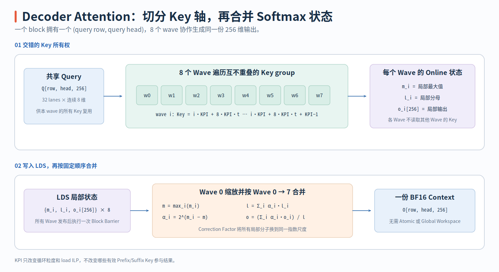

# Decoder GQA Kernel

Decoder Attention 的 Query 只有 1–16 Rows，但每个 Query 需要读取整个 Prefix 与当前 Action Suffix 的 K/V。如果仍主要沿 Query 分块，并行度会很小。PR #213 因此实现了两个物理组织完全不同的 Decoder Kernel：生产路径使用 8-wave Split-key Online Softmax，另一条 Row-owned Kernel 物化 Score Vector，作为独立 Native 实现和可选对照路径。

> 代码块中的中文注释由本文补充，重点标出 Split-key Ownership、Clamp/Predicate、局部 Softmax State、LDS Merge 与阶段切换，不属于上游源码原注释。

两个 Kernel 位于 [`decoder_flash_rdna.hip`](https://github.com/flashrt-project/FlashRT/blob/e2cf5d1fe7209e3f4fbf212c5b6321467e8f4874/csrc/amd/attention/decoder_flash_rdna.hip#L1-L374)。

| `__global__` Kernel | KV Ownership | 中间状态 | 适用上限 |
| --- | --- | --- | ---: |
| `attention_decoder_gqa_splitkey_rdna_kernel<KeysPerIteration>` | 8 Waves 各遍历不相交的 KV Row | 每个 Wave 保存 Local Online-softmax State，最后通过 LDS 合并 | `Skv<=2048` |
| `attention_decoder_gqa_rdna_kernel` | Thread `t` 遍历 `t,t+256,...` 的 KV Row | 在 LDS 中物化完整 Score Vector，再做 Block Reduction | `Skv<=1024` |

两者应在相同的 Grid 与 Mask Contract 下对照阅读。先确认一个 Workgroup 都只输出一个 `(Query Row, Query Head)`；然后比较“KV Row 分给 Wave”与“KV Row 分给 Thread”带来的状态差异；最后检查 Host/Provider 如何在 Split-key、Row-owned 和 SDPA 之间分派。这样才能看清它们是两套完整实现，而不是同一 Kernel 的前后两个阶段。

## 一个 Workgroup 只负责一个 `(Query Row, Query Head)`

Tensor Contract 为：

```text
Q : [Sq,  Hq, 256] BF16, Sq <= 16, Hq <= 16
K : [Skv, 1,  256] BF16
V : [Skv, 1,  256] BF16
O : [Sq,  Hq, 256] BF16
```

Grid 直接将 Head 和 Query Row 映射到两个维度：

```cpp
dim3 grid(query_heads, query_rows);
// Grid X/Y 直接选择唯一的 Output Head/Row；Block 内不需要再判断归属。
head      = blockIdx.x;
query_row = blockIdx.y;
```

因此每个 Workgroup 只产生一个 256-dimensional Output Row，不需要跨 Workgroup Reduction。K/V 是 GQA 中的单一共享 Head，但不同 Query Head 的 Block 仍独立计算 Score 和 Softmax。

Decoder K/V Buffer 可以是 Compact Layout，也可以在 Prefix Capacity 与 Suffix 之间保留 Padding Hole。Kernel 使用统一 Mask Contract：

$$
valid(j)=(j<valid\_prefix)\lor(j\ge suffix\_start).
$$

```text
compact: [ valid prefix | suffix ]
         suffix_start = valid_prefix

padded : [ valid prefix | invalid hole | suffix ]
                              suffix_start = prefix_capacity
```

这个 Mask 必须在 Softmax 前应用，不能先计算包含 Padding 的 Denominator 再把输出清零。Python Provider 在调用 Native Kernel 前将 Compact/Padded 两种布局转换成 `valid_prefix + suffix_start`，见 [`Rdna35AttentionBackend.gqa`](https://github.com/flashrt-project/FlashRT/blob/e2cf5d1fe7209e3f4fbf212c5b6321467e8f4874/flash_rt/amd/hardware/rdna35/attention.py#L61-L147)。

## Split-key Kernel：8 Waves 交错遍历 KV Row

`attention_decoder_gqa_splitkey_rdna_kernel<KeysPerIteration>` 固定使用 256 Threads，即 8 Waves。每个 Lane 读取 Query 的连续 8 个 Dimension：

```cpp
template <int KeysPerIteration>
__global__
__launch_bounds__(kSplitKeyWaves * FLASHRT_RDNA_WAVE_SIZE)
void attention_decoder_gqa_splitkey_rdna_kernel(
    const __hip_bfloat16 *__restrict__ query,
    const __hip_bfloat16 *__restrict__ key,
    const __hip_bfloat16 *__restrict__ value,
    __hip_bfloat16 *__restrict__ output, int query_rows, int kv_rows,
    int query_heads, int valid_prefix, int suffix_start, float scale_log2) {
  const int head = blockIdx.x;
  const int query_row = blockIdx.y;
  const int wave = threadIdx.x / FLASHRT_RDNA_WAVE_SIZE;
  const int lane = threadIdx.x & (FLASHRT_RDNA_WAVE_SIZE - 1);

  // 8 个 Wave 重复读取同一 Query；每个 Lane 固定拥有连续 8 个 Dimension。
  const FloatVec8Rdna query_values = load_bf16x8_rdna(
      query +
      (static_cast<size_t>(query_row) * query_heads + head) *
              kAttentionDim +
          lane * 8);
  FloatVec8Rdna output_values = {0.0f, 0.0f, 0.0f, 0.0f,
                                 0.0f, 0.0f, 0.0f, 0.0f};
  // 这三个对象是当前 Wave 的局部 Online-softmax State，暂存在 Register。
  float running_max = -FLT_MAX / 4.0f;
  float running_sum = 0.0f;
  // KV traversal continues below.
}
```

`wave` 没有参与 Query Address，所以 8 个 Wave 读取完全相同的 Query；`lane*8` 才决定一个 Lane 拥有的连续 Dim Slice。相反，后面的 KV 起点包含 `wave`，因此 Query 是复制的，Key Range 是分片的。

一个 Wave 的 32 Lanes 恰好覆盖 $32\times8=256$ 维。8 个 Wave 会重复读取同一条 Query，代价是 8 份 Query Traffic；收益是每个 Wave 可以在不将 Query 写入 LDS 的情况下独立处理一部分 KV Row。对 Short Query/Long KV 负载，KV 才是主要数据量。

KV Ownership 由两层步长定义：

```cpp
constexpr int key_stride = kSplitKeyWaves * KeysPerIteration;
// Wave w 每轮拥有连续 KeysPerIteration 行，下一轮跨过全部 8 个 Wave 的份额。
for (int key_start = wave * KeysPerIteration;
     key_start < kv_rows;
     key_start += key_stride) {
  FloatVec8Rdna key_values[KeysPerIteration];
  FloatVec8Rdna value_values[KeysPerIteration];
#pragma unroll
  for (int item = 0; item < KeysPerIteration; ++item) {
    const int key_row = key_start + item;
    // Clamp 仅保证 Unrolled Tail Load 地址合法；它不代表该 Row 可进入 Softmax。
    const int clamped_row = key_row < kv_rows ? key_row : kv_rows - 1;
    const size_t offset =
        static_cast<size_t>(clamped_row) * kAttentionDim + lane * 8;
    key_values[item] = load_bf16x8_rdna(key + offset);
    value_values[item] = load_bf16x8_rdna(value + offset);
  }

#pragma unroll
  for (int item = 0; item < KeysPerIteration; ++item) {
    const int key_row = key_start + item;
    // Predicate 同时处理物理 Tail 与 Prefix/Suffix Padding Hole。
    const bool valid = key_row < kv_rows &&
                       (key_row < valid_prefix || key_row >= suffix_start);
    float score = 0.0f;
#pragma unroll
    for (int dim = 0; dim < 8; ++dim) {
      score = fmaf(query_values[dim], key_values[item][dim], score);
    }
    // Wave32 合并 32 个 8-dim Partial Dot，所有 Lane 得到同一完整 Score。
    score = attention_wave_sum_rdna(score) * scale_log2;
    const float masked_score = valid ? score : -FLT_MAX / 4.0f;
    const float next_max = fmaxf(running_max, masked_score);
    const float correction = exp2f(running_max - next_max);
    const float probability = valid ? exp2f(score - next_max) : 0.0f;
    running_sum = fmaf(running_sum, correction, probability);
#pragma unroll
    for (int dim = 0; dim < 8; ++dim) {
      // correction 将旧 Numerator 改写到 next_max 的指数基准，再加入当前 P*V。
      output_values[dim] = fmaf(output_values[dim], correction,
                                probability * value_values[item][dim]);
    }
    running_max = next_max;
  }
}
```

两个 Inner Loop 被刻意分开：第一个先把 `KeysPerIteration` 组 K/V Load 到 Register Array，第二个再消费它们。这给 Compiler 暴露了 Load 与 Compute 的重叠空间。Clamp 只保证地址合法，`valid` 才决定该 Row 是否进入 Softmax。

例如 `KeysPerIteration=4`：

```text
wave 0: keys  0..3, 32..35, 64..67, ...
wave 1: keys  4..7, 36..39, 68..71, ...
...
wave 7: keys 28..31,60..63, 92..95, ...
```

对每个 Key，Lane 只计算自己 8 Dims 的 Partial Dot：

$$
p_{lane}=\sum_{d=8lane}^{8lane+7}q_dk_d.
$$

`attention_wave_sum_rdna` 通过 XOR Shuffle 汇总 32 份 Partial，让每个 Lane 都得到完整 $q\cdot k$。因此每个 Lane 可以立即用同一 Probability 更新自己拥有的 8 个 V Dimension，不需要物化 Score 或在 Wave 内交换 Output Vector。此过程见 [`split-key traversal`](https://github.com/flashrt-project/FlashRT/blob/e2cf5d1fe7209e3f4fbf212c5b6321467e8f4874/csrc/amd/attention/decoder_flash_rdna.hip#L87-L147)。

Tail KV 使用 Clamp + Predicate：读取地址将越界 `key_row` Clamp 到 `kv_rows-1`，而 `valid` 同时检查 `key_row<kv_rows` 与 Prefix/Suffix Mask。这样 Unrolled `KeysPerIteration` 可以保持固定 Load/Compute 结构，越界 Item 的 Probability 仍为 0。

## 局部 Online Softmax 如何合并成全局结果

每个 Wave 在自己的 KV 子序列上独立维护：

```text
running_max   : 1 FP32 / wave
running_sum   : 1 FP32 / wave
output_values : 8 FP32 / lane = 256 FP32 / wave
```

对新 Score $s$，更新公式为：

$$
m'=\max(m,s),\qquad
c=2^{m-m'},\qquad
p=2^{s-m'},
$$

$$
l'=cl+p,qquad o'=co+pv.
$$

因为使用 `exp2f`，Host 传入的 `scale_log2=scale×log2(e)`。无效 Key 的 `masked_score` 为足够小的负数，且 Probability 显式为 0，所以 Padding Hole 既不改变 Max，也不进入 Denominator 或 P×V。

8 个 Wave 完成后，将三类 Partial State 写入 LDS：

```cpp
__shared__ float maxima[kSplitKeyWaves];
__shared__ float denominators[kSplitKeyWaves];
__shared__ float partial_output[kSplitKeyWaves][kAttentionDim];
// Lane 0 发布每个 Wave 的 Scalar State；全部 Lane 发布各自的 8-dim Numerator Slice。
if (lane == 0) {
  maxima[wave] = running_max;
  denominators[wave] = running_sum;
}
#pragma unroll
for (int dim = 0; dim < 8; ++dim) {
  partial_output[wave][lane * 8 + dim] = output_values[dim];
}
// Producer -> Consumer Barrier：Wave 0 必须看到 8 个 Wave 的完整 Partial State。
__syncthreads();
```

一次 `__syncthreads()` 后，Wave 1–7 直接 Return，Wave 0 的 32 Lanes 每个仍拥有 8 Output Dims。设第 $i$ 个 Wave 的状态是 $(m_i,l_i,o_i)$，Wave 0 按固定的 0→7 顺序合并：

$$
m=\max_i m_i,
$$

$$
l=\sum_i l_i2^{m_i-m},
\qquad
o=\sum_i o_i2^{m_i-m}.
$$

最后才写出 $o/l$。`o_i` 是以本地 Max 为基准的 Numerator，而不是已经除以 $l_i$ 的局部 Attention Output；若先归一化再直接求和，就会丢失各 KV 分区的相对权重。合并源码见 [`split-key merge`](https://github.com/flashrt-project/FlashRT/blob/e2cf5d1fe7209e3f4fbf212c5b6321467e8f4874/csrc/amd/attention/decoder_flash_rdna.hip#L149-L190)。

```cpp
if (wave != 0) {
  // 后续已无 Block Barrier，非 Leader Wave 可以在发布 Partial 后安全退出。
  return;
}
float maximum = maxima[0];
#pragma unroll
for (int other_wave = 1; other_wave < kSplitKeyWaves; ++other_wave) {
  maximum = fmaxf(maximum, maxima[other_wave]);
}
float denominator = 0.0f;
FloatVec8Rdna accumulated = {0.0f, 0.0f, 0.0f, 0.0f,
                             0.0f, 0.0f, 0.0f, 0.0f};
#pragma unroll
for (int other_wave = 0; other_wave < kSplitKeyWaves; ++other_wave) {
  // 先把局部 Numerator/Denominator 对齐到全局 maximum，再按固定 Wave 顺序合并。
  const float correction = exp2f(maxima[other_wave] - maximum);
  denominator =
      fmaf(denominators[other_wave], correction, denominator);
#pragma unroll
  for (int dim = 0; dim < 8; ++dim) {
    accumulated[dim] =
        fmaf(partial_output[other_wave][lane * 8 + dim],
             correction, accumulated[dim]);
  }
}
const float inverse_denominator = 1.0f / denominator;
__hip_bfloat16 *destination =
    output +
    (static_cast<size_t>(query_row) * query_heads + head) *
            kAttentionDim +
        lane * 8;
#pragma unroll
for (int dim = 0; dim < 8; ++dim) {
  destination[dim] =
      __float2bfloat16(accumulated[dim] * inverse_denominator);
}
```

Barrier 之后让 Wave 1–7 Return 是安全的，因为后续没有 Block Barrier；Wave 0 独占最终 Merge 和 Store。`lane*8+dim` 在 LDS 与 Output 中保持同一个 Dimension Ownership，所以 Merge 不需要 Transpose。

{ width="95%" }

`KeysPerIteration` 可取 1、2、4、8。它改变每个 Wave 一次预取的 K/V Row 数和外层循环次数，但不改变 Key Ownership 的完整性、Online Softmax 公式或最终合并顺序。它在 Provider 创建时从 `FLASHRT_RDNA35_HIP_GQA_KEYS` 读取，再由 Host Switch 选择 Template Specialization，见 [`split-key launcher`](https://github.com/flashrt-project/FlashRT/blob/e2cf5d1fe7209e3f4fbf212c5b6321467e8f4874/csrc/amd/attention/decoder_flash_rdna.hip#L337-L373)。

```cpp
#define FLASHRT_LAUNCH_SPLITKEY(keys)                                  \
  /* Host Switch 选择 keys，进入 Device 后它已是编译期常量。 */        \
  attention_decoder_gqa_splitkey_rdna_kernel<keys>                     \
      <<<grid, kSplitKeyWaves * FLASHRT_RDNA_WAVE_SIZE, 0, stream>>>(  \
          query, key, value, output, query_rows, kv_rows, query_heads, \
          valid_prefix, suffix_start, scale_log2)

switch (keys_per_iteration) {
case 1:
  FLASHRT_LAUNCH_SPLITKEY(1);
  break;
case 2:
  FLASHRT_LAUNCH_SPLITKEY(2);
  break;
case 4:
  FLASHRT_LAUNCH_SPLITKEY(4);
  break;
case 8:
  FLASHRT_LAUNCH_SPLITKEY(8);
  break;
default:
  throw std::runtime_error(
      "attention_decoder_gqa_splitkey_rdna: keys/iteration must be 1/2/4/8");
}
```

`KeysPerIteration` 因而是 Host Runtime Choice，但进入 Device 后已经成为 Compile-time Constant，数组长度与 Inner Loop 都可以完全展开。

## Row-owned Kernel 为什么物化 Score Vector

`attention_decoder_gqa_rdna_kernel` 也使用 256 Threads 和相同 Grid，但不再以 Wave 拆分 KV。它的三个阶段是：

1. 256 Threads 各将 Query 的一个 Dimension 写入 `query_lds[256]`。
2. Thread `tid` 负责 KV Row `tid,tid+256,...`，对每个 Row 读完 256 维 K，计算完整 Dot Product，再把 Score 写入 `scores[kv_row]`。
3. Block Reduction 求 Global Max 与 Denominator；最后 Thread `tid` 固定负责 Output Dimension `tid`，遍历全部 KV Row 累加 `probability[key] * V[key,tid]`。

这条路径的 Ownership 在不同 Phase 发生了改变：Q 阶段是 One Thread/Dimension，QK 阶段是 One Thread/Key Row，P×V 阶段又是 One Thread/Output Dimension。LDS `query_lds` 和 `scores` 是这三种 Ownership 之间的交接面，因此需要多次 Block Barrier。完整代码见 [`attention_decoder_gqa_rdna_kernel`](https://github.com/flashrt-project/FlashRT/blob/e2cf5d1fe7209e3f4fbf212c5b6321467e8f4874/csrc/amd/attention/decoder_flash_rdna.hip#L193-L310)。

Q Staging 和 QK 阶段的实际代码如下。每个 Thread 在 QK 阶段拥有一整条 Key Row，所以它需要串行读取 32 个 `Bf16x8Rdna` Packet：

```cpp
__global__
__launch_bounds__(kAttentionThreads)
void attention_decoder_gqa_rdna_kernel(
    const __hip_bfloat16 *__restrict__ query,
    const __hip_bfloat16 *__restrict__ key,
    const __hip_bfloat16 *__restrict__ value,
    __hip_bfloat16 *__restrict__ output, int query_rows, int kv_rows,
    int query_heads, int valid_prefix, int suffix_start, float scale) {
const int head = blockIdx.x;
const int query_row = blockIdx.y;
const int tid = threadIdx.x;

__shared__ float query_lds[kAttentionDim];
// scores 先保存 Raw Score，随后原地覆盖为 Probability。
__shared__ float scores[kAttentionRowMaxKv];
__shared__ float wave_values[kAttentionMaxWaves];

query_lds[tid] = __bfloat162float(
    query[(static_cast<size_t>(query_row) * query_heads + head) *
              kAttentionDim +
          tid]);
// Phase 1 -> Phase 2：发布完整 256-dim Query 给所有 KV-row Owner。
__syncthreads();

constexpr int packets = kAttentionDim / 8;
for (int kv_row = tid; kv_row < kv_rows; kv_row += kAttentionThreads) {
  // 此阶段 Thread t 拥有 KV Row t,t+256,...，不再拥有单一 Query Dimension。
  const bool valid = kv_row < valid_prefix || kv_row >= suffix_start;
  float score = -FLT_MAX;
  if (valid) {
    const Bf16x8Rdna *key_row = reinterpret_cast<const Bf16x8Rdna *>(
        key + static_cast<size_t>(kv_row) * kAttentionDim);
    float acc0 = 0.0f, acc1 = 0.0f, acc2 = 0.0f, acc3 = 0.0f;
    float acc4 = 0.0f, acc5 = 0.0f, acc6 = 0.0f, acc7 = 0.0f;
#pragma unroll 4
    for (int packet = 0; packet < packets; ++packet) {
      const Bf16x8Rdna keys = key_row[packet];
      const float4 *queries =
          reinterpret_cast<const float4 *>(query_lds + packet * 8);
      const float4 query_lo = queries[0];
      const float4 query_hi = queries[1];
      acc0 = fmaf(__bfloat162float(keys.p0.x), query_lo.x, acc0);
      acc1 = fmaf(__bfloat162float(keys.p0.y), query_lo.y, acc1);
      acc2 = fmaf(__bfloat162float(keys.p1.x), query_lo.z, acc2);
      acc3 = fmaf(__bfloat162float(keys.p1.y), query_lo.w, acc3);
      acc4 = fmaf(__bfloat162float(keys.p2.x), query_hi.x, acc4);
      acc5 = fmaf(__bfloat162float(keys.p2.y), query_hi.y, acc5);
      acc6 = fmaf(__bfloat162float(keys.p3.x), query_hi.z, acc6);
      acc7 = fmaf(__bfloat162float(keys.p3.y), query_hi.w, acc7);
    }
    score = (((acc0 + acc1) + (acc2 + acc3)) +
             ((acc4 + acc5) + (acc6 + acc7))) * scale;
  }
  scores[kv_row] = score;
}
// Phase 2 -> Phase 3：全部 Raw Score 写完后才能开始 Block-wide Softmax。
__syncthreads();

// Softmax and P×V continue in the next excerpt.
}
```

随后 `scores` 从 Raw Score Buffer 原地变成 Probability Buffer，再由每个 Thread 固定消费一个 V Column：

```cpp
float local_maximum = -FLT_MAX;
// 第一次 Block Reduction 建立全局 Softmax Max。
for (int kv_row = tid; kv_row < kv_rows; kv_row += kAttentionThreads) {
  local_maximum = fmaxf(local_maximum, scores[kv_row]);
}
const float maximum = rdna_block_reduce_max(local_maximum, wave_values);

float local_sum = 0.0f;
for (int kv_row = tid; kv_row < kv_rows; kv_row += kAttentionThreads) {
  const float probability = __expf(scores[kv_row] - maximum);
  // 同一 LDS Buffer 从 Score 生命周期切换到 Probability 生命周期。
  scores[kv_row] = probability;
  local_sum += probability;
}
// Helper 内部的 Workgroup Barrier 也保证 Probability Store 对后续 P×V 可见。
const float denominator = rdna_block_reduce_sum(local_sum, wave_values);
const float inverse_denominator = 1.0f / denominator;

float acc0 = 0.0f, acc1 = 0.0f, acc2 = 0.0f, acc3 = 0.0f;
// 最终阶段 Thread tid 固定拥有 Output Dimension tid，并遍历全部 KV Row。
int kv_row = 0;
for (; kv_row + 3 < kv_rows; kv_row += 4) {
  const float p0 = scores[kv_row];
  const float p1 = scores[kv_row + 1];
  const float p2 = scores[kv_row + 2];
  const float p3 = scores[kv_row + 3];
  acc0 = fmaf(p0, __bfloat162float(
      value[static_cast<size_t>(kv_row) * kAttentionDim + tid]), acc0);
  acc1 = fmaf(p1, __bfloat162float(
      value[static_cast<size_t>(kv_row + 1) * kAttentionDim + tid]), acc1);
  acc2 = fmaf(p2, __bfloat162float(
      value[static_cast<size_t>(kv_row + 2) * kAttentionDim + tid]), acc2);
  acc3 = fmaf(p3, __bfloat162float(
      value[static_cast<size_t>(kv_row + 3) * kAttentionDim + tid]), acc3);
}
for (; kv_row < kv_rows; ++kv_row) {
  acc0 = fmaf(scores[kv_row], __bfloat162float(
      value[static_cast<size_t>(kv_row) * kAttentionDim + tid]), acc0);
}
output[(static_cast<size_t>(query_row) * query_heads + head) *
           kAttentionDim +
       tid] =
    __float2bfloat16(((acc0 + acc1) + (acc2 + acc3)) * inverse_denominator);
```

这一实现把 `scores` 当成可变 Workspace：QK 后保存 Score，Exponent 后覆盖为 Probability。这样节省了一份 LDS，但也使 QK、Softmax、P×V 三个阶段必须严格按 Barrier 和 Reduction 顺序执行。

`scores` 固定分配 1024 FP32，所以 Row-owned Host API 限制 `Skv<=1024`。Split-key 不物化 Score Vector，只需要 `8×256` FP32 Partial Output，因此支持 `Skv<=2048`。两者是独立实现，Row-owned 不是 Split-key 的第一阶段。

Provider 在 `Sq<=16`、`Skv<=2048`、Q/K/V/Output Contiguous 时才进入 Native Decoder Path。默认启用 Split-key；关闭它时，只有 `Skv<=1024` 能使用 Row-owned，更长 KV 会回退到 PyTorch SDPA。Fallback 使用与 Native Kernel 相同的 Prefix/Suffix Boolean Mask，所以两条路径的逻辑 Contract 一致。

测试分别覆盖 Compact/Padded KV 与长度边界、四种 `KeysPerIteration`，以及 HIP Graph Replay，见 [`test_hip_decoder_gqa_matches_sdpa`](https://github.com/flashrt-project/FlashRT/blob/e2cf5d1fe7209e3f4fbf212c5b6321467e8f4874/tests/test_amd_rdna35_ops.py#L427-L474)、[`test_hip_decoder_gqa_splitkey_variants`](https://github.com/flashrt-project/FlashRT/blob/e2cf5d1fe7209e3f4fbf212c5b6321467e8f4874/tests/test_amd_rdna35_ops.py#L614-L640) 和 [Decoder Graph Test](https://github.com/flashrt-project/FlashRT/blob/e2cf5d1fe7209e3f4fbf212c5b6321467e8f4874/tests/test_amd_rdna35_ops.py#L682-L737)。两个 Native Kernel 的 Reduction Order 都是固定的，但因为 `exp2f`、BF16 和 SDPA 内部算法不同，验证使用数值容差，不要把 Deterministic Reduction Structure 误解为与 SDPA Bitwise Identical。
