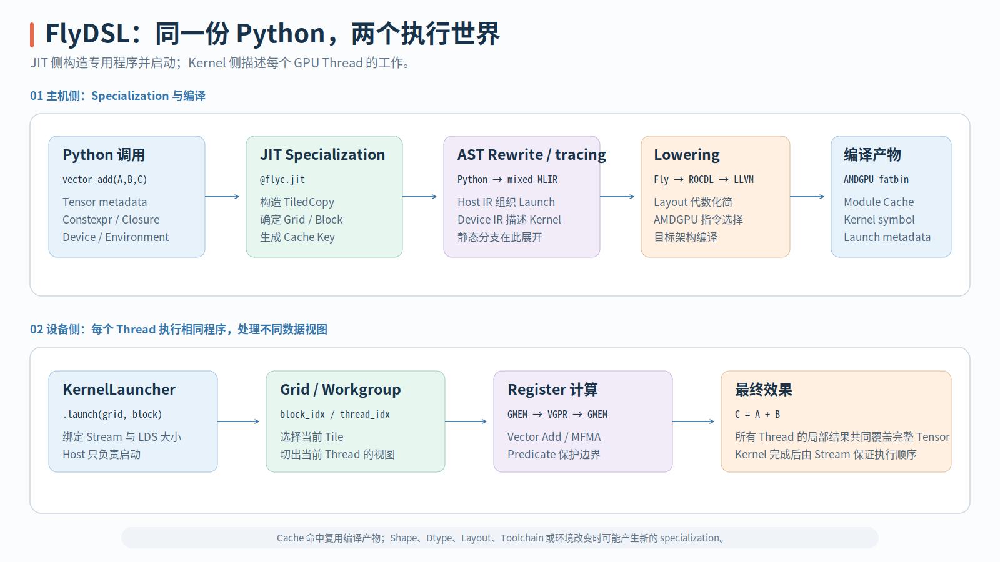

# FlyDSL 编程模型与编译流程

FlyDSL 是 AMD ROCm 生态中的 Python GPU Kernel DSL。它不是用一个高层 Tensor Operator 隐藏 GPU 执行细节，而是让开发者直接描述 Tile、Thread/Value 映射、GMEM/LDS/VGPR 之间的 Copy 以及 MFMA，再把这些对象 Lower 成 MLIR、LLVM IR 和 AMDGPU Code Object。

问题在于，`@flyc.jit` 和 `@flyc.kernel` 都写在 Python 文件中，但它们并不在同一时间、同一处理器上执行。要读懂一个 FlyDSL Kernel，关键不是先背 API，而是能够沿着一次函数调用追踪：哪些信息在 Host 侧决定，哪些计算进入 Device Kernel，以及第一次调用为什么会编译、后续调用又如何复用产物。

{ width="96%" }

## GPU Kernel 需要补齐的执行信息

数学式 $C=A+B$ 只说明了每个元素要做什么，却没有说明 GPU 如何完成这个计算。一个可执行的 Kernel 至少还要回答四个问题：

1. 完整 Tensor 被切成多大的 Tile，每个 Workgroup 处理哪一块。
2. 一个 Workgroup 含有多少 Thread，每个 Thread 拥有 Tile 中的哪些 Value。
3. Value 如何在 GMEM、LDS 和 VGPR 之间移动，一次 Copy 处理多少 bit。
4. Shape 不能被 Tile 整除时，哪些 Load/Store 需要 Predicate。

FlyDSL 的主要抽象与这些问题一一对应：

| 要表达的信息 | FlyDSL 对象 | 核心含义 |
| --- | --- | --- |
| 逻辑坐标如何得到线性索引 | `Layout` | 定义 `coord → index` |
| 数据位于哪个 Storage | `Tensor` / iterator | 把 Iterator、Address Space 与 Layout 绑定 |
| Tile 如何分给 Thread | Thread/Value Layout | 定义 `(thread_id, value_id) → tile_coord` |
| 一次使用什么指令移动数据 | `CopyAtom` / `TiledCopy` | 绑定 Copy 指令、线程分区与 Tile |
| Matrix Instruction 的 Lane 如何协作 | `MmaAtom` / `TiledMma` | 绑定 MFMA 与 Operand 分布 |

在硬件上，Grid 由多个 Workgroup 组成；Workgroup 内的 Thread 可以通过 LDS 共享数据，并用 Barrier 建立同步点；Thread 则以 Wave 为调度单位。在常见的 CDNA Wave64 配置中，256 Threads 是 4 Waves，但 Wave Size 是 Backend Target 的属性，不应被写成所有 AMDGPU 的固定常量。

存储层级可以先压缩为三层：GMEM 容量大、对全设备可见；LDS 由一个 Workgroup 共享，适合复用和重排；VGPR 由单个 Thread 持有，直接供 ALU/MFMA 消费。FlyDSL 中的 `Tensor` 因此不等于“一块新分配的连续内存”，它更接近 `Storage Iterator + Layout`：Iterator 说明从哪里开始，Layout 说明坐标如何转成相对偏移。多个 Tensor View 可以指向同一份 Storage，View 的变化本身不会搬运数据。

## 一次调用中的 Host 与 Device 边界

以官方 [`01-vectorAdd.py`](https://github.com/ROCm/FlyDSL/blob/1941889400621f1fc3d8f03bada1a4e7380cdf7e/examples/01-vectorAdd.py#L23-L87) 的结构为例，Host Launcher 和 Device Kernel 分别由两个 Decorator 定义：

```python
@flyc.kernel
def vector_add_kernel(A: fx.Tensor, B: fx.Tensor, C: fx.Tensor, tiled_copy: fx.TiledCopy):
    tid = fx.thread_idx.x
    bid_x, bid_y = fx.block_idx.x, fx.block_idx.y
    # 分区、Load、Add 与 Store


@flyc.jit
def vector_add(A: fx.Tensor, B: fx.Tensor, C: fx.Tensor,
               stream: fx.Stream = fx.Stream(None)):
    tiled_copy = ...
    grid_m, grid_n = ...
    vector_add_kernel(A, B, C, tiled_copy).launch(
        grid=(grid_m, grid_n, 1),
        block=(128, 1, 1),
        stream=stream,
    )
```

`@flyc.jit` 修饰的是 Host 侧入口。它接收 PyTorch/DLPack Tensor 和 Stream，根据参数 metadata 构造 `TiledCopy`，计算 Grid/Block，并生成 Kernel Launch。`@flyc.kernel` 修饰的是 Device 程序：其中的 `thread_idx`、`block_idx`、Load/Store 和 Arithmetic 最终进入 `gpu.func` 的设备侧 IR。

这个边界有一个容易忽略的中间对象：调用 `vector_add_kernel(...)` 时并不会立即启动 GPU，而是返回 `KernelLauncher`。只有后续 `.launch(...)` 提供 Grid、Block、Dynamic LDS 和 Stream 等信息后，它才能生成专用的 `gpu.func` 和对应的 `gpu.launch_func`。这一延迟实体化机制由 [`KernelLauncher`](https://github.com/ROCm/FlyDSL/blob/1941889400621f1fc3d8f03bada1a4e7380cdf7e/python/flydsl/compiler/kernel_function.py#L264-L445) 实现。

FlyDSL 不仅区分 Host/Device 函数，还区分了“用于生成 Kernel 的信息”和“每次 Launch 才提供的值”：

| 参数 | 在编译中的角色 | 对 Specialization 的影响 |
| --- | --- | --- |
| `fx.Constexpr[T]` | 编译期常量，可用于 Tile Size、Stage 数和静态分支 | 值直接进入 Cache Key，不同值产生不同 Specialization |
| `fx.Int32` / `fx.Float32` | 运行期 Scalar，在 IR 中是 SSA Value | 通常按类型复用同一份代码，值在 Launch 时传入 |
| `fx.Tensor` | 转成 MemRef 描述和 C ABI 参数 | Dtype、Alignment、Rank 和 Layout 的动静态约束等构成 Cache Signature |
| `fx.Stream` | 选择异步执行队列 | 影响本次 Launch，不是 Kernel 数学的一部分 |

对 Tensor 的 Specialization 要特别谨慎。固定版本中 `TorchTensorJitArg` 默认使用 `dynamic_layout=True`：Cache Signature 会保留 Tensor Adapter 类型、Dtype、Alignment、Rank 及 Layout 约束，但 Shape 默认被动态化，非连续轴的 Stride 通常也用动态占位表示，只保留连续轴等必要布局信息。因此不能笼统地说“每一组 Shape/Stride 都会编译一个新 Kernel”；具体规则取决于 [`MemRefJitArg.__cache_signature__`](https://github.com/ROCm/FlyDSL/blob/1941889400621f1fc3d8f03bada1a4e7380cdf7e/python/flydsl/compiler/jit_argument.py#L319-L334) 和 Tensor Adapter 的 Layout 动态配置。

## 从 Cache Key 到 fatbin 的完整生命周期

当 Python 执行 `vector_add(A, B, C, stream)` 时，第一次调用可以按下面的顺序理解：

```text
Python call
    ↓ bind arguments + build JitArgument cache signatures
Cache lookup
    ↓ miss
trace @flyc.jit host launcher
    ↓ call @flyc.kernel → KernelLauncher → .launch()
host func + gpu.module / gpu.func + gpu.launch_func
    ↓ MLIR pass pipeline
ROCDL / GPU / SCF / Vector / Arith
    ↓ LLVM lowering + AMDGPU code generation
CompiledArtifact / ExecutionEngine / fatbin
    ↓ fill runtime arguments
launch on the selected Stream
```

1. `JitFunction` 先绑定实参和默认参数，把普通 Python/PyTorch 对象转成 `JitArgument`，然后组合参数 Signature、`Constexpr` 值、Backend Target、Compile Hint、会影响编译的环境变量以及稳定 Global/Closure 依赖，得到 Cache Key。这一过程位于 [`_resolve_and_make_cache_key`](https://github.com/ROCm/FlyDSL/blob/1941889400621f1fc3d8f03bada1a4e7380cdf7e/python/flydsl/compiler/jit_function.py#L1337-L1423)。
2. Runtime 首先查找已构建的 `CallState`，再查找进程内 Cache 和可选 Disk Cache。只有在没有可用产物时，才进入 tracing 与编译路径。
3. Tracing 创建 Host `func.func` 和 `gpu.module`，用 C ABI 描述运行期参数，并实际执行经 AST Rewrite 的 JIT Launcher，从而记录 `fx.*` 操作。调用 Kernel Launcher 时，会在 GPU Module 内生成专用 Device Function 及 Host Launch Op。
4. `MlirCompiler.compile()` 运行 Pass Pipeline：先将 Fly Layout、Copy 和 MMA 语义化简为索引算术与 ROCDL/GPU 操作，再 Lower `scf`、`vector`、`arith`、`gpu` 和函数边界，最后生成 AMDGPU Code Object 并封装为可执行产物。Tracing 与 Compile 主路径可见 [`_trace_and_compile`](https://github.com/ROCm/FlyDSL/blob/1941889400621f1fc3d8f03bada1a4e7380cdf7e/python/flydsl/compiler/jit_function.py#L1430-L1508)。
5. `CompiledArtifact` 持有编译模块和可执行入口。Runtime 构建 `CallState`，在每次调用时填充 Tensor Pointer、动态 Shape/Stride 和 Stream，然后进入 Execution Engine 发起 Launch。

同一 Specialization 的第二次调用并不再走完整 Pipeline。若 `_call_state_cache` 命中，它可以直接填充当前参数并 Launch；若只命中进程内或 Disk Cache，则先为已有产物构建 `CallState`。完整的 Fast Path、Memory/Disk Cache 和 Compile Lock 顺序见 [`JitFunction._compile_or_execute`](https://github.com/ROCm/FlyDSL/blob/1941889400621f1fc3d8f03bada1a4e7380cdf7e/python/flydsl/compiler/jit_function.py#L1517-L1660)。

Layout 之所以能同时提供高层组合性和底层控制力，正是因为它只在上层 IR 中保留为 Shape/Stride 代数。进入最终 ISA 时，抽象 `Layout` 已经被化简为 Offset、Vector Address、Buffer Load/Store 和 Lane 所需的数据排列，运行时不会查询一张庞大的坐标映射表。

## 控制流、Specialization 与故障定位

“Python 只 trace 一次”不等于“Kernel 中不能写 Python `if/for/while`”。固定版本的 `ASTRewriter` 会分辨编译期条件与 DSL Runtime Value，并对后者生成 SCF 控制流：

| Python 写法 | 条件/边界 | 生成结果 |
| --- | --- | --- |
| `if fx.const_expr(flag): ...` | `flag` 在编译期已知 | tracing 时只保留选中分支 |
| `if tid < n: ...` | 条件是 DSL Runtime Value | AST Rewrite 生成 `scf.if`，GPU Thread 在运行时选择分支 |
| `for i in range(n): ...` | `n` 是可 Lower 的动态边界 | AST Rewrite 生成 `scf.for` |
| `for i in fx.range_constexpr(k): ...` | `k` 是编译期常量 | tracing 时展开循环 |

动态控制流不是没有约束的 Python 执行。如果某个变量在分支或循环中被修改，它需要在进入控制流前成为当前作用域的 Local Variable；各条路径产生的 Carried State 必须保持相同结构和 IR Type，才能通过 `scf.yield` 合并。动态 `if` 的 Dispatch 和结果合并见 [`ast_rewriter.py`](https://github.com/ROCm/FlyDSL/blob/1941889400621f1fc3d8f03bada1a4e7380cdf7e/python/flydsl/compiler/ast_rewriter.py#L589-L790)。

Specialization 的目的是让静态信息参与 Layout 化简、Loop Unroll 和 Dead Code Elimination，但过度静态化会扩大 Cache 数量。因此可以用一个简单原则区分参数：“会改变 IR 结构或 Layout 的配置”适合做 `Constexpr`；“只改变本次计算数值”应尽量作为 Runtime Value。

调试时则应先判断故障发生在生命周期的哪一层：

| 可见现象 | 更可能的层次 | 优先检查 |
| --- | --- | --- |
| Python 参数、Annotation 或 Decorator 错误 | Argument Binding / tracing | JIT/Kernel 边界、参数标注、`Constexpr` 使用 |
| MLIR Verification、Dominance 或 Region Result 错误 | IR 构造 / SCF | 分支结果类型、Loop-carried Value、变量作用域 |
| 越界、错位或结果错误 | Layout / Predicate / Synchronization | Thread/Value 映射、Address Unit、边界 Predicate、Barrier |
| 结果正确但生成指令不符合预期 | Lowering / codegen | Layout 化简后的 IR、Vector Width、Buffer/Flat Memory Op |

`FLYDSL_DUMP_IR=1` 可以让“Python 代码表面上写了什么”与“Compiler 实际生成了什么”对齐。如果错误在 tracing 前就发生，应先检查 Python API、Native Binding 与源码版本；如果已经生成 MLIR，再沿 Host Launch、`gpu.func`、Layout Lowering 和最终 Memory Op 逐层收缩问题范围。
