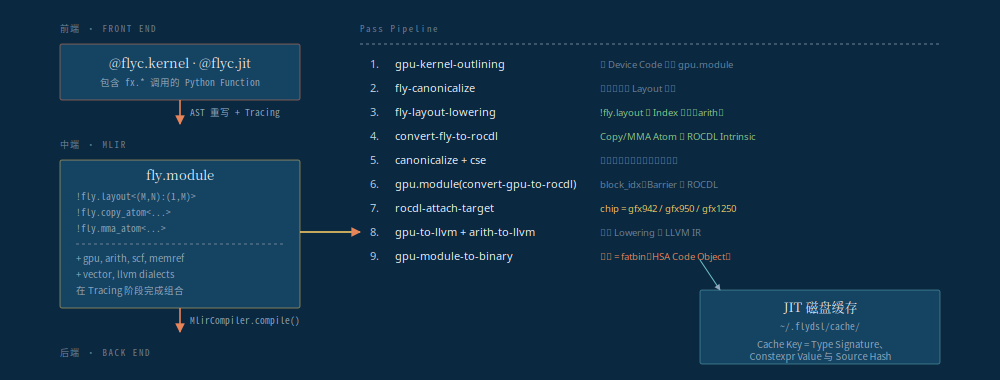
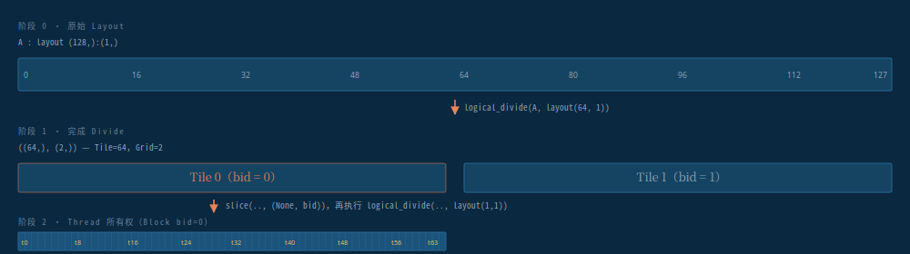
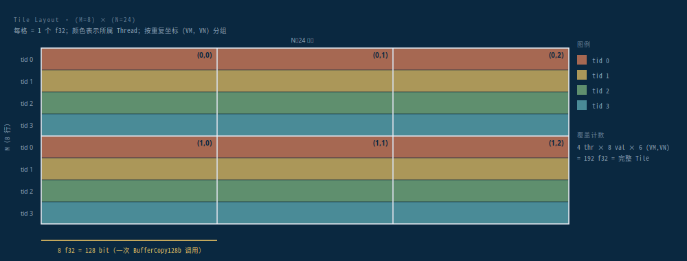
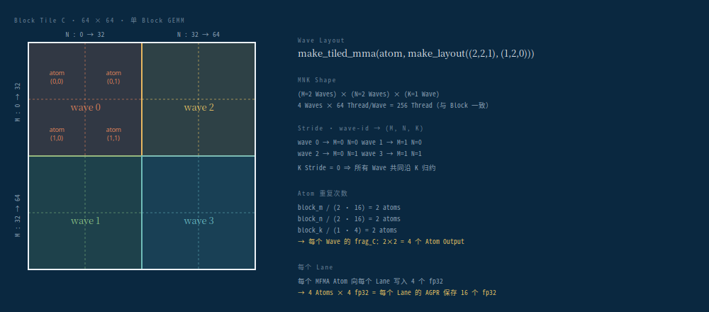
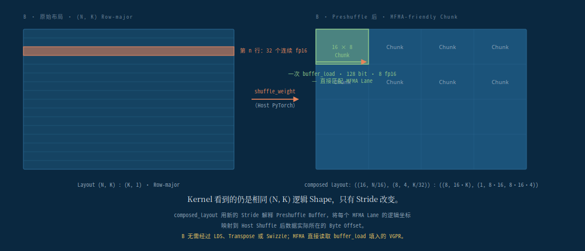
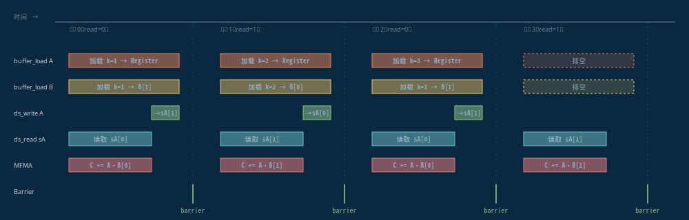

# FlyDSL — 一次源码精读

> 经作者授权转载。原文：[FlyDSL — 一次源码精读](https://www.jinnpan.com/sources/flydsl.html)；固定源码：[jhinpan/jinnpan.com@f1054a2](https://github.com/jhinpan/jinnpan.com/blob/f1054a225ef7861efe99b60748a3697c40500d8c/public/sources/flydsl.html)。原仓库采用 [MIT License](https://github.com/jhinpan/jinnpan.com/blob/f1054a225ef7861efe99b60748a3697c40500d8c/LICENSE)，Copyright © 2024 Trevor Lee。下文仅将原博客的中文正文、代码、表格和插图转换为本站 Markdown 排版，未改写内容。

用 `examples/` 下面的 4 个例子读 AMD 的 layout 代数 DSL —— *logical_divide*、 *tiled_copy*、 *MFMA atom* 和一个带 preshuffle B 与手写指令调度的 production GEMM, 如何组装成一个 MLIR 撑骨架的 Python 栈。

| 项目 | 原文信息 |
| --- | --- |
| 编号与日期 | FILE № 006 · 2026.05.26 · gfx942 / gfx950 / MLIR |
| 例子数量 | 4 · 递进阶梯 |
| 实测 GPU | MI350X · gfx950 |
| 最大 GEMM | 4096³ FP16 |
| 阅读时长 | ~4 小时, 细读 |

## § 00 · 画蓝图的那只蝇 序言

读一个现代 GPU kernel 会有一种特殊的眩晕感: 你会意识到这段代码大部分不是算术, 是 layout。 一个 4096 立方的 FP16 GEMM, 逐行看下来, 绝大部分是簿记 —— 哪个 thread 加载哪 8 个元素、 共享内存里它们落在哪、 MFMA 指令以什么顺序消费它们、 下一个 K 块的 prefetch 在当前 MFMA 的尾巴上以多大比例重叠。 真正的乘法是两行。 其余全是 layout。

FlyDSL —— Fly dialect 加上它的 Python 前端 —— 是对这个观察的一种回应。 它是 AMD [ROCm 组](https://github.com/ROCm/FlyDSL)用来写 GPU kernel 的 Python DSL + MLIR-native 编译器栈, kernel 中 layout 和 tiling 都是显式的。 名字展开就是 *Flexible Layout pYthon DSL*。 设计明显继承自 [NVIDIA CuTe](https://github.com/NVIDIA/cutlass): layout = (shape, stride), composition / divide / product, thread-value layout, tiled copy, MMA atom。 FlyDSL 多加的是 MLIR 那一层 —— 一个真实的 `!fly.layout` 类型、 一整套把 layout 代数 lower 到地址算术、 把 copy atom lower 到 ROCDL buffer 指令、 把 MMA atom lower 到 MFMA 的 pass 流水线 —— 再加上 Python tracing 层, 让你不用离开编辑器就能写完这些。

这一篇通过 `examples/` 目录来读 FlyDSL —— 四个文件构成一条严格的教学阶梯。 例 01 是向量加。 例 02 引入 tiled copy。 例 03 接好一个单 block 的 MFMA GEMM。 例 04 是生产级的 preshuffle GEMM, 带双 buffer 的 LDS、 两阶段软件流水线、 手写指令调度。 四个加起来演示了真实 FlyDSL kernel 用到的全部机械; `kernels/` 目录里所有东西 —— paged attention、 MoE GEMM、 flash attention —— 都是同一批零件的重新组合。

!!! warning "推荐阅读顺序"

    如果你只有一小时, 读 **§ M1** (layout 代数) 和 **§ M3** (tiledCopy) 这两节, 它们覆盖了 FlyDSL 的心智模型。 再加 **§ M5** (preshuffle GEMM) 就能看到生产 pattern。 如果你已经知道为什么要打开这个文件, 跳过这段序言就行。

这篇文章不是什么: 它不是编译指南 (这事 `FlyDSL-lab/README.md` 已经管了), 也不是 API 手册 (`docs/layout_system_guide.md` 有完整的 Quick Reference 表)。 它是一份读者报告 —— 每个例子教了什么, 抽象在哪里赚回了它的复杂度, 接缝在哪里能看出来。

## M0 · 四例阶梯 四个例子的罗盘

repo 里 `kernels/` 下面有数千行 production kernel, `tests/` 下面有详尽的测试套件, 但它的教学核心只有 `examples/` 下面 4 个文件。 每一个都比上一个多引入恰好一个新概念, 按顺序读它们是吃透 FlyDSL 最快的路径。

| 文件 | 行数 | 新概念 | 展示什么 |
| --- | --- | --- | --- |
| 01-vectorAdd.py | 137 | `@flyc.kernel` + `logical_divide` + `copy_atom_call` | 最小可用的 FlyDSL kernel: trace、 编译、 launch、 被 CUDA Graph 捕获。 |
| 02-tiledCopy.py | 69 | `make_layout_tv` + `partition_S/D` + `BufferCopy128b` | 用 thread / value layout 把一个 tile 向量化地分发给一个 wavefront。 |
| 03-tiledMma.py | 95 | `MFMA` atom + `make_tiled_copy_A/B/C` + `retile` | copy layout 从 MMA atom 反推; 同一段寄存器两种视角。 |
| 04-preshuffle_gemm.py | 211 | preshuffle B + LDS swizzle + 两阶段流水 + `sched_*` | 一个真实的 GEMM: 4096³ FP16, 带手调指令调度。 |

阶梯最后一级很陡。 例 04 大致是 CDNA3 / CDNA4 上把一个 30% kernel 拉到 95% 所有优化的并集: preshuffle 过的权重 layout 让 MFMA 不需要 LDS 转置、 XOR swizzle 让 LDS 读均匀打到 32 个 bank、 两阶段 ping-pong 让 K 块 *n+1* 的 prefetch 与 K 块 *n* 的 MFMA 重叠、 一段 scheduler 告诉 LLVM AMDGPU backend 在 hot loop 里如何精确交错 `v_mfma`、 `ds_read`、 `buffer_load`、 `ds_write`。 这些 01–03 都没有。 按顺序读才能保持认知负担在可控范围。

{ width="100%" }

> FlyDSL 是一次纵向下降, 穿过三层。 Python tracer 产出一个 MLIR module, 把 `fly` dialect 和官方的 `gpu` / `arith` / `scf` / `memref` 混在一起。 一个九阶段的 pass 流水线把 layout 代数渐进 lower 到地址算术、 把 copy / MMA atom 渐进 lower 到 ROCDL intrinsic, 之后标准的 MLIR ROCDL 路径产出 HSA fatbin。 第 9 阶段以后的东西全部落盘缓存, 缓存 key 由类型签名 + Constexpr 值 + 源码 hash 组成 —— 改一个 `Constexpr[int]` 的值就会生成新的 cache key。

## M1 · 读 kernel 之前的语法 十分钟 layout 代数

每一行 FlyDSL kernel 都建立在同样的五个词上: *shape*、 *stride*、 *layout*、 *divide*、 *slice*。 函数名会越长 (`zipped_divide`、 `logical_product`、 `raked_product`、 `composition`) 但它们都装饰同一个原始概念 —— layout 是一个从坐标 tuple 到线性 index 的函数, layout 上的代数就是这些函数上的代数。 把这个原始概念吃透, 剩下的就是词汇练习。

### 原子 · *Shape, Stride, Layout*

一个 `!fly.layout` 是两个整数 tuple 的对: shape 和 stride。 给定坐标 <code>(c<sub>0</sub>, c<sub>1</sub>, ..., c<sub>n-1</sub>)</code>, layout 这样计算线性 index:

```python
# for layout ((8, 16), (1, 8)):
index((c0, c1)) = c0 * 1 + c1 * 8     # column-major 8x16
# for layout ((8, 16), (16, 1)):
index((c0, c1)) = c0 * 16 + c1 * 1    # row-major 8x16
```

stride 和 shape 是独立的, 这正是关键。 一个逻辑上 8×16 的矩阵可以是列主 `(1, 8)`、 行主 `(16, 1)`、 padded 的 `(1, 9)`、 swizzled、 转置、 或行广播 —— 这些都是同一个 shape 上的不同 stride。 FlyDSL kernel 从来不手算地址; 它们构造 layout、 切分组合 layout, 然后对一个持有 `(memory, layout)` 对的 fragment 调用 `copy` 或 `gemm`。

关于 shape 有三点要记住:

- **shape 可以嵌套。** `fx.make_shape(9, (4, 8))` 是一个 rank-2 的 shape, 其第二维本身又是 rank-2 的 tuple。 嵌套 shape 是分层 tiling (block → warp → thread → instruction) 不用索引爆炸就能表达的关键。
- **静态值和动态值可以自由混用。** shape 的某一维可以是 Python int (编译期折掉) 或 SSA 值 (运行期 `fx.Int32`)。 MLIR 类型系统会追踪哪个是哪个。
- **"Layout" 也是这个 primitive 类型的名字。** `!fly.layout<(8,16):(1,8)>` 是一个真实的 MLIR 类型 —— 各 op 消费和产出这个类型的值。 这正是把 FlyDSL 和"模板字符串拼接 layout 库"区分开的关键: layout 代数是 typed 一等公民 IR, 不是 build-time 字符串替换。

### 你实际会用的两个操作

Quick Reference 表里列了 14 个 product / divide 变体。 在 `examples/` 里实际出现的只有 3 个: `logical_divide`、 `zipped_divide`、 `flat_divide`。 三个都是把一个 layout 切成"tile"和"剩余网格"两部分 —— 只是结果的形状不同。

```python
# Input: 1-D layout (128,):(1,)
A = ...
tA = fx.logical_divide(A, fx.make_layout(64, 1))
# Result shape: ((64,), (2,))   — tile is 64, grid is 2 tiles
# Input: 2-D layout (24, 120):(1, 24)
bA = fx.zipped_divide(A, (8, 24))
# Result shape: ((8, 24), (3, 5))   — tile is 8x24, grid is 3x5
# Same but with the grid flattened into outer modes
gA = fx.flat_divide(A, (128, 64))
# Result shape: (128, 64, m, k)   — grid is two trailing modes
```

divide 之后用 `fx.slice` 选 tile —— 想保留的维度传 `None`, 想折掉的维度传 index:

```python
bA = fx.zipped_divide(A, (BM, BN))   # ((BM, BN), (m, n))
bA = fx.slice(bA, (None, bid))   # pick block bid, keep (BM, BN)
# equivalent shorthand:
bA = bA[None, bid]            # same as above
gA_k = fx.flat_divide(A, (BM, BK))[None, None, bid_x, None]
#   keep BM, BK; collapse bid_x; keep all of k
```

这四行就是 FlyDSL 里"把这个 block 的 tile 给我"的全部语法。 repo 里每个 kernel 都从这种 pattern 开始。 任何 kernel 的前半页都是 layout 构造; 后半页才是实际的 load、 MFMA、 store。

### Thread × value · layout 之上的 layout

一个 tile 是一坨数据。 要在 GPU 上执行, 你需要第二个 layout, 把每对 *(thread, value-index)* 映射到 tile 内的一个坐标。 这就是 *thread / value* (TV) layout, 也是 FlyDSL 把数据分发给一个 wavefront 的核心抽象。

```python
# 4 threads laid out along M, each thread handles 1×8 values:
thr_layout = fx.make_layout((4, 1), (1, 1))
val_layout = fx.make_layout((1, 8), (1, 1))

tile_mn, tv_layout = fx.make_layout_tv(thr_layout, val_layout)
# tv_layout : (T, V) → tile coordinate (M, N)
# tile_mn  : the tile shape covered by one execution
```

TV layout 是关键。 有了它之后, 在一个 thread slice 上调 `partition_S(tensor)`, 你拿到的就是这个 thread 要碰的那块 `tensor` —— 形状已经是 `(V, VM, VN)`, 正确的索引算术已经折进去了。 你看不到地址算术, 编译器在背后做。 流水线第 3 阶段的 `fly-layout-lowering` pass 把这一切物化成具体的 index 表达式。

!!! info "视角重置"

    layout 不是对内存的描述, 是一个函数。 `make_layout(shape, stride)` 定义了一个映射 *coord ↦ index*。 `composition`、 `divide`、 `product` 是这个映射上的函数组合。 一旦你用这个视角去读 FlyDSL, "代码说什么"和"kernel 在做什么"之间的距离会瞬间缩小一个数量级。

layout API 里所有其他东西 —— `composition`、 `complement`、 `coalesce`、 `right_inverse`、 `raked_product`、 `tiled_product` —— 都是从这些 primitive 构造出来的。 CuTe 的[范畴论基础那篇文章](https://arxiv.org/abs/2601.05972)把这套形式化推出来了; 读 kernel 的话上面这四张图就够。

## M2 · 两行的程序 01 · *vectorAdd*

第一个例子计算长度为 128 的 FP32 向量 `C = A + B`。 这是最小可用的 FlyDSL kernel —— 小到整条流水线能一次性放在脑子里, 又大到把必需的机械全部用一遍。 一共两个函数:

```python
@flyc.kernel
def vectorAddKernel(
    A: fx.Tensor, B: fx.Tensor, C: fx.Tensor,
    block_dim: fx.Constexpr[int],
):
    bid = fx.block_idx.x
    tid = fx.thread_idx.x
    A = fx.rocdl.make_buffer_tensor(A)

    # two-stage divide: tile_per_block, then tile_per_thread
    tA = fx.logical_divide(A, fx.make_layout(block_dim, 1))
    tA = fx.slice(tA, (None, bid))
    tA = fx.logical_divide(tA, fx.make_layout(1, 1))
    # ... same for tB, tC ...

    copyAtomBuf = fx.make_copy_atom(fx.rocdl.BufferCopy32b(), fx.Float32)
    copyAtom    = fx.make_copy_atom(fx.UniversalCopy32b(),    fx.Float32)

    rA = fx.make_rmem_tensor(fx.make_layout(1, 1), fx.Float32)
    rB = fx.make_rmem_tensor(fx.make_layout(1, 1), fx.Float32)
    rC = fx.make_rmem_tensor(fx.make_layout(1, 1), fx.Float32)

    fx.copy_atom_call(copyAtomBuf, fx.slice(tA, (None, tid)), rA)
    fx.copy_atom_call(copyAtom,    fx.slice(tB, (None, tid)), rB)
    vC = fx.arith.addf(fx.memref_load_vec(rA), fx.memref_load_vec(rB))
    fx.memref_store_vec(vC, rC)
    fx.copy_atom_call(copyAtom, rC, fx.slice(tC, (None, tid)))
```

所有 FlyDSL kernel 都共用的结构在这里以最小规模呈现。 三个阶段: 构造 layout、 拷入、 计算 + 拷出。 阶段一建立数据的 per-thread 视图; 阶段二把数据从 global 搬到 register fragment; 阶段三跑算术然后写回。 看到这个骨架, `kernels/` 里每个 kernel 都变成它的变体 —— 更大的计算阶段、 更复杂的 copy、 阶段二和三之间多一层 LDS staging buffer, 但是同一个三阶段结构。

{ width="100%" }

> vectorAdd kernel 做了两次切分。 第一次把全局向量切成 per-block tile —— `logical_divide(A, layout(64,1))` 产出 `((64,), (2,))`, 第一维是"一个 block 装得下多少", 第二维是"一共多少 block"。 然后 `slice(.., (None, bid))` 把第二维折成当前 block。 第二次切分把 per-block tile 切成 per-thread 槽位; divisor 取 `1`, 每个 thread 拿一个元素。 这种级联在每个 kernel 里都出现 —— 差别只是 divisor 多大、 叠几层。

### 两种 copy atom · BufferCopy 与 UniversalCopy

看这个 kernel 里 FlyDSL 构造的两个 atom。 它们不一样:

```python
copyAtomBuf = fx.make_copy_atom(fx.rocdl.BufferCopy32b(), fx.Float32)
copyAtom    = fx.make_copy_atom(fx.UniversalCopy32b(),    fx.Float32)

fx.copy_atom_call(copyAtomBuf, fx.slice(tA, (None, tid)), rA)  # A uses buffer
fx.copy_atom_call(copyAtom,    fx.slice(tB, (None, tid)), rB)  # B uses universal
```

`UniversalCopy32b` 会 lower 成普通的 `flat_load_dword` —— 指针 + offset, 没多余东西。 `BufferCopy32b` 会 lower 成 `buffer_load_dword`, 它用一个由四个 SGPR 组成的 *buffer resource descriptor*, 这个 descriptor 在前面 `make_buffer_tensor` 时已经建好。 descriptor 里有 `num_records` 字段, AMD GPU 硬件每次访问都对它检查: 越界 load 返回 0 而不触发 page fault, 越界 store 静默丢弃。 这正是 [gcnasm](https://www.jinnpan.com/sources/gcnasm.html) vector_add kernel 中作为核心的"OOB-by-SRD"技巧。

这个例子故意两种都用 —— A 走 buffer、 B 走 universal —— 把对比露出来。 生产代码里两者都会用 BufferCopy: 发射成本一样, 但能免费拿到无分支的边界处理。

### 启动包装器 · *@flyc.jit*

```python
@flyc.jit
def vectorAdd(
    A: fx.Tensor, B: fx.Tensor, C,
    n: fx.Int32,                  # runtime int (no cache effect)
    const_n: fx.Constexpr[int],     # compile-time int (affects cache key)
    stream: fx.Stream = fx.Stream(None),
):
    block_dim = 64
    grid_x = (n + block_dim - 1) // block_dim
    vectorAddKernel(A, B, C, block_dim).launch(
        grid=(grid_x, 1, 1), block=[block_dim, 1, 1], stream=stream,
    )
```

`vectorAdd` 上的类型注解告诉编译器每个参数怎么处理: `fx.Int32` 是动态的 (会变成 kernel 实参), `fx.Constexpr[int]` 是静态的 (会被烤进去, 同时参与 JIT cache key)。 改一个 `Constexpr` 值会触发重编, 改动态值则复用缓存。 这是 Triton 风格的 autotune 模型, 只是 `tl.constexpr` 的活由类型注解来干。

!!! info "CUDA Graph 兼容"

    这个例子的第二个测试把 kernel capture 进 `torch.cuda.CUDAGraph` 然后 replay。 能跑通是因为 FlyDSL 的启动路径过的是 *fly-gpu-stream-inject* —— 一个把用户传入的 stream 直接编进 launch 的 pass, 不依赖 TLS 变量。 对把 kernel 批量塞进 captured graph 做回放的推理引擎 (vLLM、 SGLang), 这就是"FlyDSL kernel 能用"和"FlyDSL kernel 需要特殊处理"的区别。

在 MI350X 上跑:

```console
$ python examples/01-vectorAdd.py
[Eager] Result correct: True
[Graph Capture] Result correct: True
All passed: True
```

## M3 · 把一个 tile 扇到一群 thread 02 · *tiledCopy*

例 02 是 repo 里最小的 kernel (69 行), 也是理解 FlyDSL 核心抽象最有用的一个。 它用 `(8, 24)` 的 block tile 把 24×120 的 FP32 矩阵从 `A` 拷到 `B`, 每个 block 只有 4 个 thread。 thread 数故意做这么小 —— 小到完整的 thread-value layout 可以画在一张纸上, 用手验它确实覆盖了整个 tile。

```python
@flyc.kernel
def copy_kernel(A: fx.Tensor, B: fx.Tensor):
    tid = fx.thread_idx.x
    bid = fx.block_idx.x
    block_m, block_n = 8, 24

    A = fx.rocdl.make_buffer_tensor(A)
    B = fx.rocdl.make_buffer_tensor(B)

    bA = fx.zipped_divide(A, (block_m, block_n))   # ((8,24), (3,5))
    bB = fx.zipped_divide(B, (block_m, block_n))
    bA = fx.slice(bA, (None, bid))                  # (8, 24)
    bB = fx.slice(bB, (None, bid))

    thr_layout = fx.make_layout((4, 1), (1, 1))
    val_layout = fx.make_layout((1, 8), (1, 1))
    copy_atom  = fx.make_copy_atom(fx.rocdl.BufferCopy128b(), fx.Float32)

    tile_mn, tv_layout = fx.make_layout_tv(thr_layout, val_layout)
    tiled_copy = fx.make_tiled_copy(copy_atom, tv_layout, tile_mn)
    thr_copy   = tiled_copy.get_slice(tid)

    partition_src = thr_copy.partition_S(bA)
    partition_dst = thr_copy.partition_D(bB)
    frag = fx.make_fragment_like(partition_src)

    fx.copy(copy_atom, partition_src, frag)
    fx.copy(copy_atom, frag, partition_dst)
```

### TV layout 的算账

一个 (8, 24) tile 有 192 个元素。 4 个 thread 每次发 128-bit (= 8 × FP32) load, 一轮能搬 32 个, 所以这个 tile 需要 6 轮才搬完。 TV layout 说的就是这 6 轮如何在 (8, 24) 平面上铺开:

- **thr_layout = ((4,1), (1,1))** —— 4 个 thread, 沿 M 排 4 个、 沿 N 排 1 个。
- **val_layout = ((1,8), (1,1))** —— 每个 thread 一次读 1×8 个值。
- **一次执行覆盖 tile 里 `(4×1) × (1×8) = (4, 8)`**。
- **tile 是 (8, 24), 所以执行重复 `(8/4, 24/8) = (2, 3)` 次** —— 这就是 `partition_S` 返回值里的 *(VM, VN)* 形状。

{ width="100%" }

> 每个有色单元是一个 FP32, 颜色表示拥有它的 thread。 tiled copy 的一次执行发射 4 条 `BufferCopy128b` 指令 —— 每个 thread 一条, 各取自己连续的 8 个 FP32。 外层 (VM=2, VN=3) 的索引意味着执行要重复六次才能覆盖整个 (8, 24) tile, 让每个 thread 拿到形状为 (V=8, VM=2, VN=3) = 48 个值的 fragment。 `partition_S` 直接把这个 fragment 形状给你 —— 没有地址算术, 只有一个可索引的 tensor。

### partition_S, partition_D, fragment · 三个关键调用

三个方法调用做完了原本需要一整页地址算术才能完成的事:

| 调用 | 返回 | 用途 |
| --- | --- | --- |
| `thr_copy.partition_S(bA)` | source 的 per-thread 视图, 形状 `(V, VM, VN)` | load 从哪里读 |
| `thr_copy.partition_D(bB)` | destination 的 per-thread 视图, 同形状 | load 写到哪里 |
| `fx.make_fragment_like(part)` | 同逻辑形状的寄存器 tensor | 寄存器里的暂存区 |

然后 `fx.copy(atom, src, dst)` 发射真正的指令, 沿外层 `(VM, VN)` 维走一遍, 每个 (VM, VN) 坐标发一次 atom 调用。 6 次迭代, 每次一条 BufferCopy128b, 4 个 thread 并行, 共 192 个元素 —— 正好是上图。

!!! info "对比例 01"

    在 01-vectorAdd 里, partition 是用两次 `logical_divide` + `slice` 手写的。 这里则交给 `tiled_copy` + `partition_S/D`。 当 thread 数不再是 trivial 的几个、 又要做向量化时, 这个新抽象就赚回了它的复杂度: 256 个 thread 每个手算 128-bit 对齐的 load 偏移会很烦, `make_layout_tv` + `partition_S` 编出来正是这个 —— 而你从头到尾没写过一行字节偏移算术。

跑一下:

```console
$ python examples/02-tiledCopy.py
Result correct: True
```

## M4 · 第一次接触 MFMA 03 · *tiledMma* 与 MFMA

例 03 是第一个真正做乘法的 kernel。 它在 FP32 上计算 `C(64, 64) = A(64, 8) · B(64, 8)ᵀ`, 单 block 256 thread (4 个 wavefront), 全程在寄存器里 —— 没有 LDS、 没有 K-loop、 没有软件流水。 目的是介绍 MFMA atom 以及 copy layout 如何从一个 tiled MMA 反推, 还不引入例 04 的那些优化机械。

```python
block_m, block_n, block_k = 64, 64, 8
@flyc.kernel
def gemm_kernel(A: fx.Tensor, B: fx.Tensor, C: fx.Tensor):
    tid = fx.thread_idx.x
    bid = fx.block_idx.x

    A = fx.rocdl.make_buffer_tensor(A)
    B = fx.rocdl.make_buffer_tensor(B)
    C = fx.rocdl.make_buffer_tensor(C)

    bA = fx.zipped_divide(A, (block_m, block_k))
    bB = fx.zipped_divide(B, (block_n, block_k))
    bC = fx.zipped_divide(C, (block_m, block_n))
    bA = fx.slice(bA, (None, bid))
    bB = fx.slice(bB, (None, bid))
    bC = fx.slice(bC, (None, bid))

    mma_atom  = fx.make_mma_atom(fx.rocdl.MFMA(16, 16, 4, fx.Float32))
    tiled_mma = fx.make_tiled_mma(mma_atom, fx.make_layout((2,2,1), (1,2,0)))
    thr_mma   = tiled_mma.thr_slice(tid)
```

### MFMA atom · 一条指令一个矩阵乘

CDNA matrix core 执行 Matrix Fused Multiply-Add 指令 —— 这里是 `v_mfma_f32_16x16x4f32`。 一条指令, 64 个 lane, 按硬件固定的 lane 分布 pattern 计算 `C(16, 16) += A(16, 4) · B(4, 16)`。 构造参数 `MFMA(16, 16, 4, fx.Float32)` 选出这个具体变体; FlyDSL 知道这条指令要求的 lane layout, 通过 `mma_atom.tv_layout_A/B/C` 暴露出来。

`make_tiled_mma(atom, layout((2, 2, 1), (1, 2, 0)))` 表示: 把这个 atom 用 4 个 wavefront 按 M 方向 2 个、 N 方向 2 个、 K 方向 1 个 平铺。 stride `(1, 2, 0)` 把 wave id 映射到 (M, N, K) 索引 —— wave 0 → (M=0, N=0), wave 1 → (M=1, N=0), wave 2 → (M=0, N=1), wave 3 → (M=1, N=1)。 4 个 wave 在 K 维上一起 reduce (stride 0 表示 K 在 wave 间广播)。

{ width="100%" }

> (2, 2, 1) 这个 wave layout 把 4 个 wavefront 平铺到 64×64 C tile 的 M、 N 方向, 4 个 wave 在 K 维一起 reduce。 每个 wave 内, 32×32 子 tile 由 2×2 个 MFMA-16×16 atom 输出覆盖 —— 每个 wave 的每个 lane 最终有 4 × 4 = 16 个 FP32 在 AGPR 里。 wave-id 到位置的映射就是 stride `(1, 2, 0)`: `wave 0 → (0,0)`, `wave 1 → (1,0)`, `wave 2 → (0,1)`, `wave 3 → (1,1)`。 这个 wave layout 习语可以扩展: 例 04 用 `(1, 4, 1)`, 配合一个大得多的 atom permutation。

### make_tiled_copy_A · 从 MMA 反推 copy layout

MFMA 指令对 A 和 B 输入、 以及 C 输出, 都要求特定的 lane-to-element layout。 写错的话, 你会把正确的数据装到错误的 lane —— kernel 不崩溃, 但产出噪声。 常规修法是去读 MFMA 文档, 手写匹配的 copy layout。 FlyDSL 把这个方向反过来:

```python
# instead of writing the A-copy layout from scratch:
copy_atom    = fx.make_copy_atom(fx.rocdl.BufferCopy32b(), fx.Float32)
tiled_copy_A = fx.make_tiled_copy_A(copy_atom, tiled_mma)
tiled_copy_B = fx.make_tiled_copy_B(copy_atom, tiled_mma)
tiled_copy_C = fx.make_tiled_copy_C(copy_atom, tiled_mma)

thr_copy_A = tiled_copy_A.get_slice(tid)
copy_src_A = thr_copy_A.partition_S(bA)   # MMA-correct partition of A
```

`make_tiled_copy_A` 读 MMA atom 的 `tv_layout_A`, 构造一个 copy, 它的 per-thread fragment 形状正好是 MFMA 要消费的。 编译器保证 lane 正确, 你完全不必推哪个 lane 拿哪个元素。 同样的把戏给你 `tiled_copy_B` 用于第二个操作数, `tiled_copy_C` 用于累加器写回。

### retile · 一段寄存器, 两种视角

同一段 register fragment 被两个消费者读: copy 指令 (想要它是"向量 load"的形状), 以及 MFMA 指令 (想要它是"lane 分配"的形状)。 两种形状同构 —— 总字节数相同、 寄存器数相同 —— 只是索引方式不同。 `retile` 给你第二个视角而不需要重新分配:

```python
frag_A      = thr_mma.make_fragment_A(bA)        # MMA view
copy_frag_A = thr_copy_A.retile(frag_A)        # same memory, copy view
# Load into the copy view, then operate on the MMA view:
fx.copy(copy_atom, copy_src_A, copy_frag_A, pred=None)
fx.gemm(mma_atom, frag_C, frag_A, frag_B, frag_C)
```

!!! info "retile 为什么重要"

    没有 `retile` 你要分配一个 "load 完之后"用的 fragment, 再发 copy 指令搬到第二个 "给 MMA 用"的 fragment —— 白白挪寄存器。 `retile` 是 FlyDSL 对一个事实的承认: 寄存器里的数据可以用两种方式寻址, 零成本。 MLIR pass 流水线把两个视角折叠成同一份 VGPR 分配; IR 层只有一个类型重新解释。

跑一下:

```console
$ python examples/03-tiledMma.py
Result correct: True
```

例 03 是第一个抽象与机制比例显著的例子。 不到 80 行 layout 代码产出一个可跑的 tiled MFMA —— 等价的手写 ROCDL 要 300+ 行寄存器周旋, 而 lane 正确性还得用一个 FP32 全 1 的 tensor 对照已知好的参考来验。 这些抽象不仅是方便, 它们让 kernel 看一眼就能验证正确性。

## M5 · 生产 kernel 04 · *preshuffle GEMM*

第四个例子已经不是 tutorial 了。 211 行, 4096³ FP16 GEMM, BLOCK = (128, 128, 64), 两阶段 LDS 双缓冲 + XOR swizzle、 寄存器里双 buffer B、 hot loop 里手写的指令调度器, 还有一个 host 端权重预洗, 把 MFMA 特有的 lane 布局摊平到 global 内存中的连续 pattern。 production CDNA GEMM 用到的每一项优化都以紧凑形式出现在这里。 它当之无愧地坐在阶梯顶端。

### 让 GEMM 跑快的四件套

| 优化 | 代价 | 收益 |
| --- | --- | --- |
| Preshuffle B (host 端) | 加载时一次内存 reshape | MFMA 直接从原始 `buffer_load_dwordx4` 拿到 lane-correct 数据 —— 不用 LDS 转置 |
| LDS A 的 XOR swizzle | 一个 `fly.composed_layout` 包装 | 64 lane `ds_read` 的 bank conflict 从 8× 降到 1× |
| 两阶段软件流水线 | A 的 LDS 翻倍, B 的寄存器翻倍 | 下一个 K 块的 `buffer_load` 与当前 MFMA 重叠 |
| 显式指令调度 | 大约 30 行的 `fx.rocdl.sched_*` | 填满 issue slot, 峰值 FLOPs 提升约 30% |

{ width="100%" }

> FP16 的 MFMA-16×16×16 对 B 操作数要求一个特定的 lane-to-element 布局。 标准做法是把 B 正常 load, 通过 LDS 转置加 swizzle。 preshuffle 这条路换成在 host 端做一次重排 (`tests/utils.py` 里的 `shuffle_weight`), 让一条普通的 `buffer_load_dwordx4` 从 global B 加载出来就已经是 MFMA lane-correct 的 VGPR 数据。 kernel 然后构造一个 composed `!fly.layout`, 它的 stride 描述这种 chunked 物理布局 —— 同样的逻辑 `(N, K)` shape, 不同的 stride 算术。 对推理时不变的权重, 这个 trade 省掉 B 的整个 LDS 来回。

### LDS · XOR swizzle 与双缓冲

```python
# composed_layout_A wraps a swizzle around an ordered layout
composed_layout_A = fx.make_composed_layout(
    fx.static(fx.SwizzleType.get(3, 3, 3)),
    fx.make_ordered_layout((BLOCK_M, BLOCK_K, STAGES_A), (1, 0, 2)),
)
sA = fx.make_view(fx.get_dyn_shared(fx.Float16), composed_layout_A)
# sA : (BM, BK, 2 stages) — two-deep ping-pong
```

XOR swizzle `(3, 3, 3)` 是 CuTe 里"LDS 无 bank conflict 访问"的惯例 —— 把 3 位高位地址 XOR 到 3 位低位地址, 三位一组。 有了它, 64 lane 的 `ds_read_b128` 正好命中 32 个 LDS bank 各 2 次, 而不是全部撞在 1 个 bank 上。 没有 swizzle 的话, 同样的访问 pattern 会被串行化成 8 周期, 而不是 1 周期完成。

尾维 `STAGES_A = 2` 就是双缓冲 —— LDS 一半装当前被 MFMA 消费的 K 块, 另一半装下一轮 `buffer_load → ds_write` 正在填的 K 块。 两半用同一个 swizzle 寻址, 这意味着一个 composed layout 就能服务整个 ping-pong, 不需要按 stage 算 stride。

### 流水线 · *read stage, write stage, ping-pong*

{ width="100%" }

> K-loop 的每次迭代跑两个阶段 —— read-stage 0 然后 read-stage 1 —— 在两半 LDS 之间轮换被 MFMA 消费和被写入的角色。 橙色和黄色轨道是全局 `buffer_load`, 它们在轨道 5 上的 MFMA 还在嗑 K 块 *n* 的时候预取 K 块 *n+1*。 轨道 3 的 `ds_write` 把预取的 A 写到另一半 LDS stage (write = read ^ 1)。 barrier 把迭代分开, 因为本迭代的 `ds_write` 必须在下一迭代的 `ds_read` 开始前完成。 B 操作数完全驻留在寄存器中, 两个 stage —— 没有 `ds_write B` 轨道, 因为 preshuffle 已经把 B 的 LDS 来回完全消掉了。

```python
def run_pipeline_stage(read_stage, next_k, read_next=True):
    write_stage = read_stage ^ 1
if fx.const_expr(read_next):
        fx.copy(buffer_copy_128b, thr_gA_k[None,None,None,0], copy_frag_A,
                soffset=next_k * gA_k_stride)
        fx.copy(buffer_copy_128b, thr_gB_k[None,None,None,0],
                mma_frag_B_retile[None,None,None,write_stage],
                soffset=next_k * gB_k_stride)

    for block_k_iter in fx.range_constexpr(BLOCK_K // 32):
        fx.copy(uni_copy_128b,
                thr_sA_s2r[None,None,block_k_iter,read_stage],
                mma_frag_A_retile[None,None,block_k_iter])
        fx.gemm(tiled_mma, mma_frag_C,
                mma_frag_A[None,None,(None,block_k_iter)],
                mma_frag_B[None,None,(None,block_k_iter),read_stage],
                mma_frag_C,
                traversal_order=fx.GemmTraversalOrder.KNM)

    fx.copy(uni_copy_128b, copy_frag_A, thr_sA[None,None,None,write_stage])
    fx.gpu.barrier()
    hot_loop_scheduler()
```

`soffset=next_k * gA_k_stride` 这个参数值得停一下。 它不是全局指针的字节算术 —— 它是 ROCDL `buffer_load` 指令的 *scalar offset* 字段。 buffer resource descriptor 在 kernel 入口建一次; 后续从不同 K 位置 load 只是变 SGPR 里的 scalar offset。 没有 per-lane 在 VGPR 地址上做 `v_add`, 没有 per-thread 索引计算。 [gcnasm](https://www.jinnpan.com/sources/gcnasm.html) 的 vector_add 就吃这个机制。

### hot_loop_scheduler · 告诉 backend 每条指令放哪里

最后这块对 Triton 或 CUDA C 出身的人最陌生。 在 `run_pipeline_stage` 的算法主体后面, kernel 调 `hot_loop_scheduler()`, 它发出一序列 `fx.rocdl.sched_*` intrinsic:

```python
def hot_loop_scheduler():
    fx.rocdl.sched_dsrd(2); fx.rocdl.sched_mfma(2)
    fx.rocdl.sched_dsrd(1); fx.rocdl.sched_mfma(1)
    fx.rocdl.sched_dsrd(1); fx.rocdl.sched_mfma(2)

    def sched_main_iter(with_vmem=False, with_dswr=False):
        if with_vmem: fx.rocdl.sched_vmem(1)
        fx.rocdl.sched_mfma(2)
        fx.rocdl.sched_dsrd(1)
        fx.rocdl.sched_mfma(2)
        if with_dswr: fx.rocdl.sched_dswr(1)

    for _ in fx.range_constexpr(8): sched_main_iter(with_vmem=True)
    sched_main_iter()
    for _ in fx.range_constexpr(7): sched_main_iter(with_dswr=True)

    fx.rocdl.sched_barrier(0)
```

这些不是真实指令。 它们是 调度提示, LLVM AMDGPU backend 会尊重它们: `sched_mfma(2)` 说"在调度的这个位置, 在已经放在这里的指令之外, 再放正好 2 条 MFMA 指令"。 编译器自己挑哪些MFMA (从周围代码里挑) 放在这里, 但数量和顺序是钉死的。

为什么重要: CDNA matrix core 的延迟很长。 一条 MFMA 退役要 16–32 周期, wave 在等待期间可以发其他指令 —— `ds_read`、 `buffer_load`、 `ds_write`。 不给提示, LLVM scheduler 会干得还行, 但倾向于把同类指令聚在一起。 给提示之后, 你可以把它们交错排开, 让 MFMA 延迟期间每个 issue slot 都装着有用的东西。 开头 8 次 `sched_main_iter(with_vmem=True)` 把 `buffer_load` 均匀撒在 hot loop 前段; 末尾 7 次 `with_dswr=True` 把 `ds_write` 撒在 hot loop 后段。 真实 kernel 上, 这个 pattern 就是 60% 和 90%+ MFMA peak 的差距。

!!! warning "一个警告"

    scheduler 很脆弱。 改 `BLOCK_K`、 换 MFMA 形状、 甚至在 hot loop 里多加一条指令, 都可能让数量假设失效、 性能暴跌。 production 的 `kernels/preshuffle_gemm.py` 给每个 (BM, BN, BK, MFMA-shape) 元组各用一份 scheduler, 通常用 ATT trace 分析器 (`capture-kernel-trace`) 调出来的。 写新 GEMM 的第一遍, 先不放 scheduler, 等 profile 完再加。

跑一下:

```console
$ PYTHONPATH=/sgl-workspace/FlyDSL-lab python examples/04-preshuffle_gemm.py
Result correct: True
```

kernel 跑通了, 结果正确。 要看它离 peak 多近, 把这个例子换成 production 的 `kernels/preshuffle_gemm.py`, 用 `tests/kernels/test_preshuffle_gemm.py` 当 harness —— 这是 AMD 团队调优时走的路径。

## M6 · @ 装饰器之下 编译流水线 · *Python → fatbin*

你写的 Python 被 trace 成 MLIR。 接下来发生的事值得大概知道, 因为 FlyDSL 大部分调试都发生在 IR 层 —— kernel 出 NaN 或者数算错时, 第一步是 `FLYDSL_DUMP_IR=1`, 然后读 `module-after-fly-layout-lowering.mlir`。

### Tracing · @flyc.kernel

`@flyc.kernel` 装饰器把 Python 函数包进一个 tracer。 第一次以某个类型签名调用时, tracer 改写函数的 AST 来拦截每个 `fx.*` 调用, 然后在一个特殊上下文里执行函数 —— 每个操作发射 MLIR op 而不是计算具体值。 trace 结束时你得到一个 `gpu.module`, 里面有一个 `gpu.func` kernel, 用 `fly`、 `gpu`、 `arith`、 `scf`、 `memref`、 `vector` dialect 的混合体表达。

tracing 有两件事对 kernel 作者很关键:

- **对 traced 值用 Python `if` 不合法。** trace 只跑一次。 如果分支依赖一个 kernel-time 值 (比如 `tid`), 没办法把两条分支都物化。 编译期条件用 `fx.const_expr(cond)`; 必须运行期的话用 `scf.if` (FlyDSL 的 `if_else`)。
- **Python `for` 遍历一个列表会展开。** 完全展开的编译期循环用 `fx.range_constexpr(n)`; 带循环携带值的 `scf.for` 用 `range(start, stop, step, init=[acc])`。

### Pass 流水线 · 三段式, 一份 fatbin

Pass pipeline 在 `python/flydsl/compiler/backends/rocm.py` 里的 `RocmBackend._pipeline_parts()` 构建, 切成三段。 切点是有意义的: 配 `FLYDSL_COMPILE_LLVM_DIR` 时, FlyDSL 可以只跑到 Stage A, dump 出 IR, 交给外部 `mlir-opt` + `llc` 工具链接着跑。

| # | Pass | 把什么变成什么 |
| --- | --- | --- |
| **Stage A · `pre_binary_fragments` —— Fly → ROCDL** |  |  |
| 1 | `fly-rewrite-func-signature` | 把 DSL 类型 (`IntTuple`、 `Layout`、 `ComposedLayout`、 `CoordTensor`、 `MemRef`) 在函数和 SCF 边界处 lower 成打包好的 LLVM struct |
| 2 | `fly-canonicalize` | 静态 shape 时, 在编译期折叠 `!fly.layout` 代数 |
| 3 | `fly-layout-lowering` | 把 `fly.crd2idx`、 partition、 divide 变成具体的 `arith` + `vector` op |
| 4 | `fly-int-swizzle-simplify` | 代数地化简 `applySwizzle` 发出的 swizzle 形态的 arith 序列 |
| 5 | `canonicalize` | 标准 MLIR canonicalization (常量折叠等) |
| 6 | `fly-convert-atom-call-to-ssa-form` | 把 `copy_atom_call` / `mma_atom_call` 提升成对应的 SSA 形式; 寄存器 tensor 变成 vector SSA 值 |
| 7 | `fly-promote-regmem-to-vectorssa` | 把 `fly.make_ptr(register)` 的 memory 语义升级成 vector SSA (依赖 pass 6) |
| 8 | `convert-fly-to-rocdl` | copy atom 变成 `rocdl.buffer_load / store`; MMA atom 变成 `rocdl.mfma.*` |
| 9 | `canonicalize` | ROCDL lower 之后的第二轮 canonicalize |
| 10 | `gpu.module(convert-scf-to-cf, cse, convert-gpu-to-rocdl{chipset=gfxNNN ...}, fly-rocdl-cluster-attr)` | 在 `gpu.module` 里面: SCF → CF、 CSE、 GPU intrinsic → ROCDL, 然后把 `amdgpu-cluster-dims` 注入到 `llvm.func` 的 passthrough |
| **Stage B · `binary_prep_fragments` —— → LLVM** |  |  |
| 11 | `rocdl-attach-target {chip=gfxNNN ...}` | 给 module 打上目标芯片标签, 外加 `fast` / `unsafe-math` / `wave64` 等选项 |
| 12-13 | `convert-scf-to-cf` → `convert-cf-to-llvm` | host 侧 SCF → CF → LLVM |
| 14 | `gpu-to-llvm{use-bare-pointers-...=true}` | GPU 类型和 host launcher → LLVM dialect |
| 15-17 | `convert-vector/arith/func-to-llvm` | 把剩下的 vector / arith / func op 终极 lower 到 LLVM IR |
| 18 | `reconcile-unrealized-casts` (+ optional `ensure-debug-info-scope-on-llvm-func`) | 最后一轮 cast 清理; `FLYDSL_DEBUG_ENABLE_DEBUG_INFO=1` 时顺手插入 debug info scope |
| **Stage C · `binary_fragment`** |  |  |
| 19 | `gpu-module-to-binary {format=fatbin opts="..."}` | 调 LLVM AMDGPU backend → HSA fatbin |

`fly-layout-lowering` 是大部分 kernel 级 bug 浮出水面的地方。 如果 `partition_S` 产出的 fragment 形状不对, 是因为 layout 代数简化成了你预期之外的东西。 dump 这个 pass 之后的 IR, 看 FlyDSL 实际认为索引是什么。 `FLYDSL_DEBUG_PRINT_AFTER_ALL=1` 每个 pass 后都 dump; `FLYDSL_DUMP_DIR=./ir` 把它们写到一个目录, 方便 grep。

顺带说一下流水线里没有的东西: `gpu-kernel-outlining` 不在了。 outlining 现在发生在 Python tracing 阶段 —— `@flyc.kernel` 直接把 `gpu.func` 发到 `gpu.container_module` 里, 所以等 `MlirCompiler.compile()` 拿到 module 时, kernel 已经 outline 过了。

### JIT 缓存

编译出的 fatbin 用类型签名 + Constexpr 值 + kernel 函数 (含 closure) 的源码 hash 作为 key。 落在 `~/.flydsl/cache/` 下面。 修改 kernel 函数本身的源码会让缓存失效, 但修改 C++ pass 或不属于 traced closure 的 helper module不会。 所以:

```text
# After editing a C++ pass or a helper that lives outside the closure:
$ rm -rf ~/.flydsl/cache
$ # or, for a single run:
$ FLYDSL_RUNTIME_ENABLE_CACHE=0 python my_kernel.py
```

## § R · 真实调试踩过的六个坑 暗礁

FlyDSL 容易出问题的 pattern, 能逃过 review 的失误, 要花三天才能想到的解法。

1. **1 · 分支限定值破坏 MLIR dominance。**

    在 Python `if` 的一个分支里定义一个值, 在 if 之后再用 —— 这是最常见的编译期失败。 IR 里两个分支的定义没有汇合点, 所以你拿到 dominance 错误。 把这个值提到分支之前定义, 或者显式作为合并后的返回值。
2. **2 · *SmemPtr._view_cache* 跨 scf.for 残留。**

    如果共享内存的 view 在 `scf.for` 里构造, 在循环外消费, 缓存里的 view 指向一个不 dominate 消费者的 SSA 值。 退出循环时清掉: `SmemPtr._view_cache = None`。
3. **3 · closure 值不触发缓存失效。**

    JIT 缓存 hash 的是 kernel 函数和它的 closure。 如果你改一个 kernel 之外的 Python 常量, 而 kernel 没有通过 closure 引用它, 缓存不会失效。 要么把这个值作为 `Constexpr` 参数传进去, 要么手动清缓存。
4. **4 · *BufferCopy soffset* 单位是 element, 不是 byte。**

    `fx.copy` 配 BufferCopy atom 时, `soffset` 参数的单位是 atom dtype 的元素数, 不是字节。 例 04 里 `soffset=next_k * gA_k_stride` 是 K-iter 乘上一个已经把元素大小算进去的 stride。 排查地址 off-by-1 时多查几遍这点。
5. **5 · *MFMA traversal order* 影响寄存器压力。**

    `fx.gemm` 的 `traversal_order` 参数决定 (M-atom, N-atom, K-atom) 三层内嵌循环的顺序。 `KNM` 通常最小化 A 的 fragment 寄存器压力; `MNK` 最小化累加器压力。 选错会 spill VGPR, 性能崩盘。
6. **6 · 改 tile 之后 scheduler 悄悄失效。**

    为 (BM=128, BN=128, BK=64) 调过的 `hot_loop_scheduler`, 在你改了 tile 之后会悄悄失效 —— 性能掉, kernel 数还是对的。 任何 tile 改动之后, 都用 kernel trace analyzer profile 一下再假设 scheduler 还合身。

## § A · 这件事对 AMD 工作意味着什么 AMD 相关说明

2026 年, 在 AMD CDNA 上写高性能 kernel, FlyDSL 是最干净的抽象层。 Triton-ROCm 也存在, 也能产出正确 kernel, 但它的调度模型不透明 —— 你没法像 `fx.rocdl.sched_*` 那样钉死"两条 MFMA 然后一条 ds_read 再两条 MFMA"。 Composable Kernel (CK) 给你这个控制权, 但写在编译 30 分钟的 C++ 模板里。 FlyDSL 处在中间: Python 人体工学、 MLIR 骨架、 AMD 专属调度 primitive。

值得带走的三条观察:

1. **layout API 是 AMD 这边特有的贡献。** CuTe 把 layout 代数带给世界; FlyDSL 给它一个 typed MLIR 之家, 加一整套 lower 它的 pass。 `!fly.layout` 是一等公民类型这件事意味着, 任何 MLIR-aware 工具 (verifier、 autotuner、 优化 pass) 都可以在 IR 里对 layout 进行推理, 而不是只能消费字符串。
2. **Preshuffle 是反复出现的思路, 不是一次性技巧。** 例 04 的 `shuffle_weight` —— host 端 reshape, kernel 就不需要转置 —— 在 production kernel 里, 对每一个 layout 比计算 pattern 更受限的权重 tensor 都出现。 MoE GEMM、 blockscale GEMM、 INT4 GEMM 都用它。 写新 AMD GEMM 又不 preshuffle 的话, 问问自己为什么。
3. **调度才是 peak FLOPs 藏的地方。** 没有 `sched_*` 提示的 FlyDSL kernel 大概能跑到 60–70% peak; 有调好的 scheduler 能跑到 90%+。 这段差距纯粹是 hot loop 内的指令编排, 事后调 LLVM flag 救不回来。 这个 repo 里 production kernel 把 `hot_loop_scheduler` 当作 kernel 的一件独立 *artifact*, 用 `capture-kernel-trace` 出来的 ATT trace 调, 独立于算法主体 review。

!!! info "一套可操作的工作流"

    写一个新的 CDNA3 / CDNA4 kernel: (1) 从一个 example 起步, (2) 先做正确, (3) 用 `capture-kernel-trace` + `kernel-trace-analysis` profile, (4) 找到 top stall —— 通常是 `ds_read` 上的 `lgkmcnt` 等待, 或 `buffer_load` 上的 `vmcnt` 等待 —— (5) 加对应优化 (前者上 LDS swizzle, 后者上 prefetch + scheduler), (6) 重新 profile, 重复。 这个 repo 里的 Skills (`gemm-optimization`、 `lds-optimization`、 `prefetch-data-load`) 是这些步骤各自的捷径。

## § ∞ · 四个例子教了什么 尾声

这四个例子的形状就是每个 FlyDSL kernel 的形状。 构造 layout。 切到当前 block。 把切片再分给当前 thread。 分配 register fragment。 发 copy。 可能过一层 LDS。 发 compute。 可能与 prefetch 重叠。 写回。 这套词汇从一个 16 行的向量加到 1500 行的 production paged attention kernel, 形状从不变。

真正让我惊讶的事 —— 也是看完四个例子之后我继续读这个 repo 的原因 —— 是"GPU kernel 优化"绝大部分其实是同一套优化在不同 layout 上重复。 Preshuffle B 让 MFMA 友好加载。 LDS 上 swizzle A 拿到无 bank conflict 的 `ds_read`。 给所有东西做双缓冲, 让 memory 和 compute 重叠。 钉死指令调度, 让 matrix core 不空转。 我在 `kernels/` 里读过的每个 kernel 都用了这套的某个子集。 变化在几何上 —— tile 大小、 MFMA 形状、 atom permutation —— 但优化的词汇是不变的。

FlyDSL 抓住的就是这种不变性。 把 layout 代数做成 typed primitive、 把 copy / MMA atom 做成可组合代数, 它把"GPU kernel 优化"从一份技巧清单变成一套可推理、 可变换、 可验证的演算。 这套演算是不是下一代 AMD 硅 (CDNA5、 统一 RDNA / CDNA 路线) 的正确抽象, 这是个开放问题 —— 但对今天跑在 MI300 / MI350 / MI450 上的东西, 这是我用过最干净的工具。

系列下一篇大概率写 [aiter](https://github.com/ROCm/aiter) —— FlyDSL kernel 瞄准的那个 production kernel 库, 也是 repo 这边借用的测试基础设施。 只读 FlyDSL 你拿到的是语言, 读 aiter 才看到字典。

## § 参考资料 · 与这篇并读 参考资料

1. ***FlyDSL* · [github.com/ROCm/FlyDSL](https://github.com/ROCm/FlyDSL)**

    源代码。 `docs/layout_system_guide.md` 有 layout 代数完整 Quick Reference; `docs/kernel_authoring_guide.md` 是实战 pattern; `kernels/` 是 production 参考实现。
2. ***CuTe* · [NVIDIA CUTLASS · cute/](https://github.com/NVIDIA/cutlass/tree/main/include/cute)**

    思想上的母本。 layout 代数、 copy / MMA atom 设计、 `partition_S/D` idiom 都是 CuTe 的概念。 CuTe 文档和 FlyDSL 对照着读, 可以看清哪些选择是通用的、 哪些是 AMD 特有的。
3. ***Categorical Foundations for CuTe Layouts* · [arxiv 2601.05972](https://arxiv.org/abs/2601.05972)**

    Colfax Research 把 layout 代数当作一个 category 来形式化。 足够推出 FlyDSL 依赖的所有代数恒等式; 想扩展代数 (比如自定义 `product` 变体) 该读这本。
4. ***AMD CDNA3 ISA Reference* · [amd.com · CDNA3 ISA](https://www.amd.com/content/dam/amd/en/documents/instinct-tech-docs/instruction-set-architectures/amd-instinct-mi300-cdna3-instruction-set-architecture.pdf)**

    FlyDSL lowering 流水线发出的每条指令的权威手册。 § 8 (MUBUF) 对应 `buffer_load`, § 10 (MFMA) 对应 matrix core, § 6 (`s_waitcnt`) 对应 scheduling 控制的 vmcnt / lgkmcnt。
5. ***MLIR documentation* · [mlir.llvm.org](https://mlir.llvm.org/)**

    读 `FLYDSL_DUMP_IR` 输出和理解 FlyDSL 组合用的 `gpu`、 `arith`、 `scf`、 `memref`、 `vector`、 `rocdl` dialect 时用。
6. ***FlyDSL Tile Programming* · repo 内 skill**

    如果在这个 repo 里用 Claude Code 工作, `flydsl-tile-programming` 和 `flydsl-kernel-authoring` 这两个 skill 是 kernel 构造 pattern 的精调参考。 从头推 idiom 之前先用它们。
