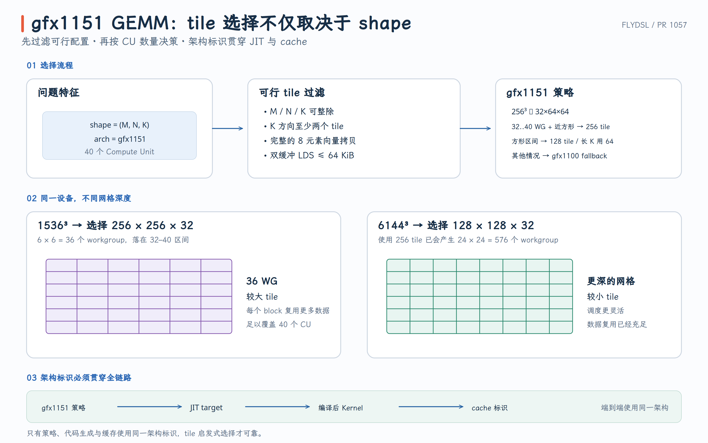

# FlyDSL PR #1057：为 gfx1151 选择合适的 GEMM Tile

同一个 GEMM kernel 可以由多种 tile 配置实例化。tile 太小，工作组数量多但复用不足；tile 太大，单个工作组工作更重，却可能只生成少量 workgroup，无法填满 GPU。

PR #1057 没有重写 RDNA3 WMMA GEMM 的数学或流水线，而是给 `gfx1151` 增加独立的 shape-based tile policy，并把真实 device architecture 一直传到 JIT target 与 cache key，避免沿用为 96 CU `gfx1100` 调出的阈值。

- PR：[#1057 Add gfx1151 tile selection for RDNA3 GEMM](https://github.com/ROCm/FlyDSL/pull/1057)
- 本文对应源码：[`ddd2040`](https://github.com/ROCm/FlyDSL/commit/ddd20408baba52462c488d50c2a048754458d518)
- 选择策略：[`rdna3_f16_gemm_autotune.py`](https://github.com/ROCm/FlyDSL/blob/ddd20408baba52462c488d50c2a048754458d518/kernels/gemm/rdna3_f16_gemm_autotune.py)

{ width="95%" }

## 1. Tile 参数与合法性过滤

策略返回五元组：

```text
(reg_m, reg_n, reg_k, waves_m, waves_n)
```

底层 WMMA 原子为 `16 × 16 × 16`，所以一个 workgroup 的逻辑 tile 为：

$$
B_M=16\times reg_m\times waves_m,
$$

$$
B_N=16\times reg_n\times waves_n,
$$

$$
B_K=16\times reg_k.
$$

例如 `TILE_128x128x32 = (4,4,2,2,2)`：

```text
BM = 16 × 4 × 2 = 128
BN = 16 × 4 × 2 = 128
BK = 16 × 2     = 32
waves = 2 × 2   = 4
threads = 4 × 32 = 128
```

因此 tile tuple 同时决定：

- 一个 workgroup 覆盖的 M/N/K 范围；
- wave 网格和线程数；
- accumulator 数量；
- global-to-LDS copy 的线程几何；
- LDS 占用和全设备 workgroup 数量。

候选 tile 与常量定义见 [lines 24–56](https://github.com/ROCm/FlyDSL/blob/ddd20408baba52462c488d50c2a048754458d518/kernels/gemm/rdna3_f16_gemm_autotune.py#L24-L56)。

`feasible_tiles` 先排除不能正确或合理构建的候选：

1. M/N/K 必须被 block tile 整除；
2. K 至少包含两个 block-K tile，以满足预取 pipeline；
3. A/B tile 的元素数必须能被线程按完整 8-element vector 分配；
4. 双 buffer 的 LDS 总量不能超过 64 KiB。

相关计算见 [`_tile_workgroups`](https://github.com/ROCm/FlyDSL/blob/ddd20408baba52462c488d50c2a048754458d518/kernels/gemm/rdna3_f16_gemm_autotune.py#L59-L90)。

通过这些条件只表示“这个 tile 能用”，并不表示“它最快”。真正的 policy 随后根据 shape、workgroup 数量与 architecture 从可行集合中选择。

## 2. 为什么 gfx1151 需要独立 policy

原 gfx1100 policy 使用 `NUM_CU = 96`，按候选 tile 能产生多少 workgroup 来判断是否应该扩大或缩小 tile。例如：

```text
256×256×32 workgroups >= 5 × 96 -> choose 256×256×32
128×128×32 workgroups >= 2.5 × 96 -> choose 128×128×32
```

这些阈值描述的是“相对于整台 GPU 的并行深度”，不是只与矩阵形状有关的数学常数。

`gfx1151` 在这次测试设备上有 40 个物理 CU。如果仍用 96-CU 阈值，相同 shape 会被判定为并行度不足或过深，进而选择错误的 tile。简单把所有数字乘以 `40/96` 也不可靠，因为 tile 的 LDS、wave 数、复用和单 workgroup 执行时间并非线性缩放。

最终 `_pick_tile_gfx1151` 可以按四步理解，源码见 [lines 118–152](https://github.com/ROCm/FlyDSL/blob/ddd20408baba52462c488d50c2a048754458d518/kernels/gemm/rdna3_f16_gemm_autotune.py#L118-L152)。首先特判 256-square：

```text
M = N = K = 256 -> 32×64×64
```

这个 shape 总工作量小。较小的 M tile 能提供更多 workgroup，减少设备空闲。

设 `wgs_128` 为 `128×128×32` 的 workgroup 数。策略定义：

```text
one_wave: 0.9 × 40 <= wgs_128 <= 1.6 × 40
deep_grid: wgs_128 >= 2.5 × 40
```

这里的 `one_wave` 是“一轮接近每 CU 一个 workgroup”的 occupancy 区间，不是一个硬件 wavefront。

只有同时满足：

```text
shape is near-square: max(M,N) <= 2 × min(M,N)
32 <= wgs_256 <= 40
```

才选择 `256×256×32`。这个 tile 单 workgroup 复用高，但网格过浅时会让部分 CU 无工作；网格太深时，较小 tile 通常能提供更好的调度与并行度。它还使用 `kblock` LDS layout 才能控制在 64 KiB 预算内。

对命中 policy 区间的 square shape，一般选择 `128×128×32`。`1024×1024` 且长 K 时保留 `64×64×64`。不在这组经过测量的范围内时，回退到原 gfx1100 heuristic，而不是把新规则扩张到所有矩形 shape。

这是一种有意收敛的策略：只覆盖有 benchmark 证据的 shape family。

## 3. 两个 shape 展示的 workgroup 深度

对 `1536 × 1536 × 1536`，使用 `256×256` tile：

$$
\frac{1536}{256}\times\frac{1536}{256}=6\times6=36\ \text{workgroups}.
$$

36 落在 `[32,40]`，又是 square，因此选择 `256×256×32`。这让 40-CU GPU 获得接近一轮的 workgroup，同时尽量提高 tile 内复用。

对 `6144 × 6144 × 6144`，若继续使用 `256×256` tile：

$$
24\times24=576\ \text{workgroups}.
$$

此时不再处于 32–40 的窄区间，策略选择 `128×128×32`。更小 tile 带来的网格深度与调度灵活性，在实测中优于继续使用最大 tile。

这两个例子说明：**最大 tile 不是单调更快，tile 选择是在局部复用与全设备并行之间取平衡。**

## 4. 设备架构如何贯穿 policy、JIT 与 cache

多 GPU 进程中，当前全局 device 不一定等于输入 tensor 所在 device。因此 dispatch 使用：

```python
torch.cuda.get_device_properties(A.device.index).gcnArchName
```

并去掉 `:sramecc-:xnack+` 等 feature suffix，得到稳定的 `gfx1151`。实现见 [`_device_arch`](https://github.com/ROCm/FlyDSL/blob/ddd20408baba52462c488d50c2a048754458d518/kernels/gemm/rdna3_f16_gemm_autotune.py#L155-L157)。

这个 arch 会进入：

- tile policy；
- `_build` 的缓存参数；
- resolved launcher signature；
- JIT backend target；
- 最终 code object 的编译目标。

如果只让 policy 看见 arch，而 JIT 仍按进程中的另一个默认 device 编译，就可能出现“按 gfx1151 选 tile、却生成 gfx1100 code object”的语义断裂。

PR 为 `@flyc.jit` 增加可选 `arch=` 参数。GEMM module 使用 `@flyc.jit(arch=gpu_arch)`，见 [`create_wmma_gemm_module`](https://github.com/ROCm/FlyDSL/blob/ddd20408baba52462c488d50c2a048754458d518/kernels/gemm/rdna3_f16_gemm.py#L102-L142) 与 [launcher declaration](https://github.com/ROCm/FlyDSL/blob/ddd20408baba52462c488d50c2a048754458d518/kernels/gemm/rdna3_f16_gemm.py#L528-L545)。

JIT 初始化时据此解析 backend target，cache key 原本就包含 `_target_`，因此相同 shape、相同 tile、不同 architecture 不会错误复用同一 artifact。JIT 改动见 [`JitFunction`](https://github.com/ROCm/FlyDSL/blob/ddd20408baba52462c488d50c2a048754458d518/python/flydsl/compiler/jit_function.py#L1131-L1161) 与 [target resolution](https://github.com/ROCm/FlyDSL/blob/ddd20408baba52462c488d50c2a048754458d518/python/flydsl/compiler/jit_function.py#L1225-L1235)。

这部分不是附属清理，而是 device-specific policy 正确成立的必要条件。

## 5. 性能证据与适用边界

PR 在 Radeon 8060S（`gfx1151`，40 CU）、ROCm 7.14 上，以相同 kernel 和 per-tile options 比较新旧 policy。10 个发生 tile 变化的 shape 上：

```text
BF16 geometric mean: 1.199×
FP16 geometric mean: 1.164×
```

代表性结果：

| M × N × K | Baseline tile | gfx1151 tile | BF16 | FP16 |
| --- | --- | --- | ---: | ---: |
| 256³ | 64×64×64 | 32×64×64 | 1.158× | 1.048× |
| 896³ | 128×64×32 | 128×128×32 | 1.545× | 1.423× |
| 1536³ | 64×64×64 | 256×256×32 | 1.115× | 1.121× |
| 6144³ | 256×256×32 | 128×128×32 | 1.216× | 1.210× |

这些结果证明的是指定硬件与 shape 集上的 policy 改善，不是新 tile 在所有 RDNA3/3.5 设备上普遍更快。测试覆盖 measured shapes、边界、held-out shapes、tile buildability、device arch 解析与 arch-specific build cache，见 [tile-policy tests](https://github.com/ROCm/FlyDSL/blob/ddd20408baba52462c488d50c2a048754458d518/tests/kernels/test_rdna_gemm.py#L404-L574)。

一句话概括：**PR #1057 把 tile 选择从“默认套用 gfx1100 的 96-CU 经验”改为“依据输入设备的 architecture 选择经测量的 gfx1151 policy，并让同一个 arch 贯穿选择、编译和缓存”。**
