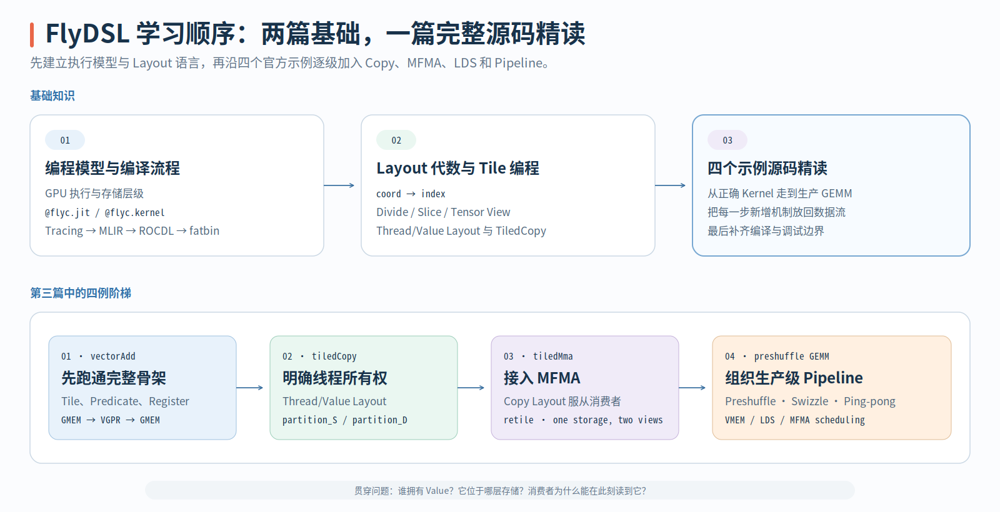

# FlyDSL：从编程模型到四个官方示例

FlyDSL 是面向 AMD GPU Kernel 的 Python DSL。它把逻辑坐标、Thread/Value 所有权、GMEM/LDS/VGPR 数据移动和 MFMA Operand Layout 组织成可以组合、可以在 MLIR 中 Lower 的编程模型。

当前笔记收缩为三篇。前两篇负责建立阅读前置，第三篇沿 JinnPan 的《FlyDSL — 一次源码精读》完整整理四个官方示例：

1. [FlyDSL 编程模型与编译流程](01-FlyDSL编程模型与编译流程.md)：从 GPU 执行层级出发，解释 `@flyc.jit`、`@flyc.kernel`、参数 specialization、MLIR Lowering 与 JIT Cache。
2. [Layout 代数与 Tile 编程](02-Layout代数与Tile编程.md)：系统讲解 `Layout=(Shape,Stride)`、Divide、Slice、Tensor View、Thread/Value Layout 和 Tiled Copy。
3. [FlyDSL — 一次源码精读](03-四个示例读懂FlyDSL.md)：经作者授权迁移 JinnPan 的原博客，沿 Vector Add、Tiled Copy、TiledMma 和 Preshuffle GEMM 四个示例阅读完整实现，并保留原文插图。

{ width="96%" }

前两篇以 FlyDSL `1941889400621f1fc3d8f03bada1a4e7380cdf7e` 为固定版本进行源码核对；第三篇来自 JinnPan 博客源码提交 `f1054a225ef7861efe99b60748a3697c40500d8c`，只转换中文正文、代码、表格与插图的排版，不改写原文内容。阅读时始终追踪三条线：逻辑坐标如何映射到地址、一个 Thread/Wave 实际持有哪些 Value、数据何时位于 GMEM、LDS 或 VGPR。
