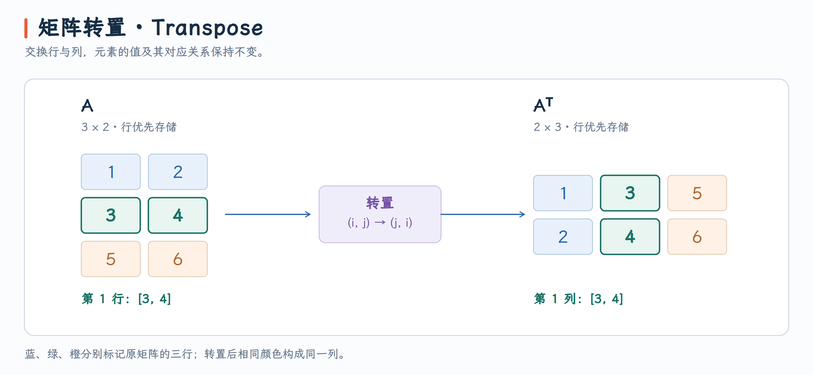

# Matrix Transpose：矩阵转置

## 题目

编写一个 GPU 程序，对包含 32 位浮点数（FP32）的矩阵进行转置，即交换矩阵的行与列。给定形状为 $\mathrm{rows} \times \mathrm{cols}$ 的矩阵 $A$，得到形状为 $\mathrm{cols} \times \mathrm{rows}$ 的转置矩阵 $A^T$。所有矩阵均按行优先存储。

{ width="50%" }

## 实现
