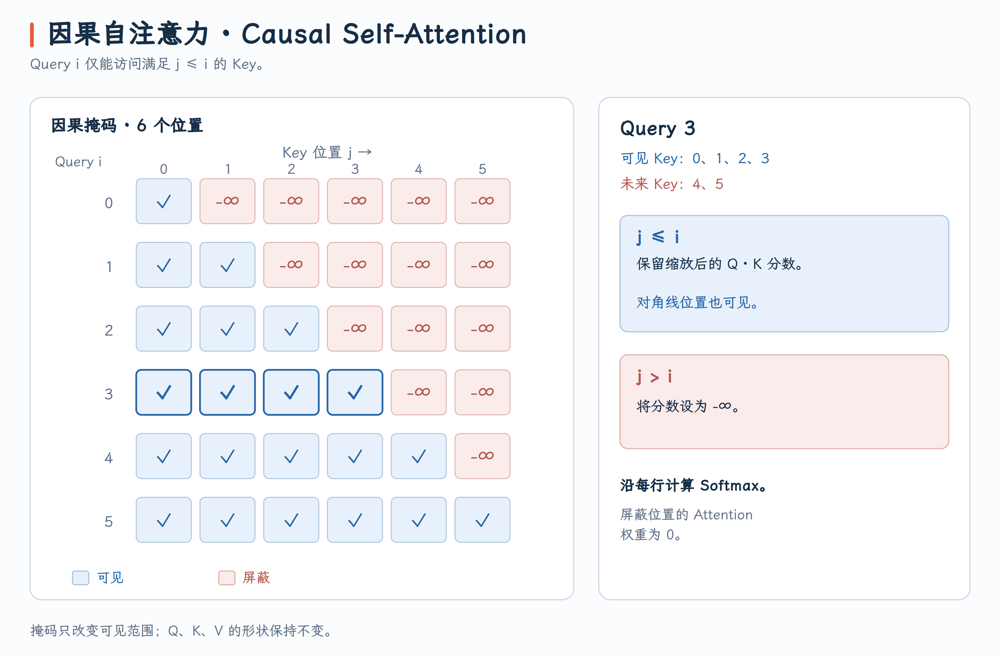

# Causal Self-Attention：因果自注意力

## 题目

编写一个 GPU 程序，计算带因果掩码的自注意力。给定形状均为 $M \times d$ 的查询矩阵 $Q$、键矩阵 $K$ 和值矩阵 $V$，按下式计算输出矩阵：

$$
\text{Attention}_{\text{causal}}(Q, K, V) = \text{softmax}\Bigl(\text{masked}\Bigl( \frac{QK^T}{\sqrt{d}} \Bigr)\Bigr)V
$$

因果掩码将当前 Query 之后的 Key 位置对应的分数设为 $-\infty$。对于 Query 位置 $i$ 和 Key 位置 $j$：

$$
\text{masked}(a_{ij}) =
  \begin{cases}
  a_{ij}, & j \le i \\
  -\infty, & j > i
  \end{cases}
$$

Softmax 逐行计算。$Q$、$K$、$V$ 和输出均为 FP32，$M$ 和 $d$ 为 INT32。

{ width="50%" }

## 实现
