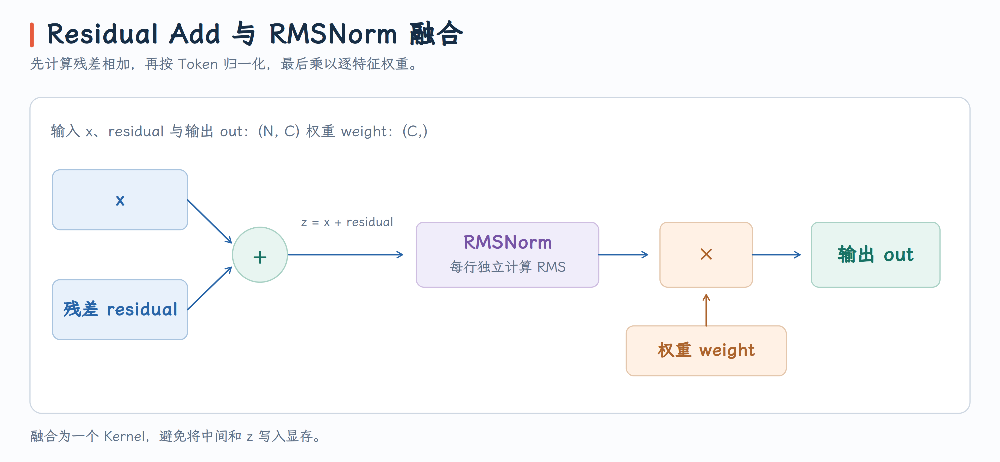

# Fused Residual Add and RMS Norm

## 题目

编写一个 GPU 融合算子，将输入张量 $x$ 与残差张量 $\mathrm{residual}$ 相加，再对结果进行 RMSNorm，并按特征乘以可学习的权重向量 $\mathrm{weight}$。输入均为 FP32：$x$ 和 $\mathrm{residual}$ 的形状为 $(N,C)$，$N$ 为 Token 数，$C$ 为隐藏维度，$\mathrm{weight}$ 的形状为 $(C,)$。

将加法与归一化融合到同一个 Kernel，相比两个独立算子可以省去一次完整的数据读写。

{ width="50%" }

对每一行 $i$（一个 Token），计算：

$$
z_i = x_i + \text{residual}_i, \quad
    \text{rms}_i = \sqrt{\frac{1}{C}\sum_{j=0}^{C-1} z_{i,j}^2 + \varepsilon}, \quad
    \text{out}_{i,j} = \frac{z_{i,j}}{\text{rms}_i} \cdot \text{weight}_j
$$

每行独立计算 RMS。加法与归一化在同一个 Kernel 中完成，避免将中间和 $z$ 写入显存。

## 实现
