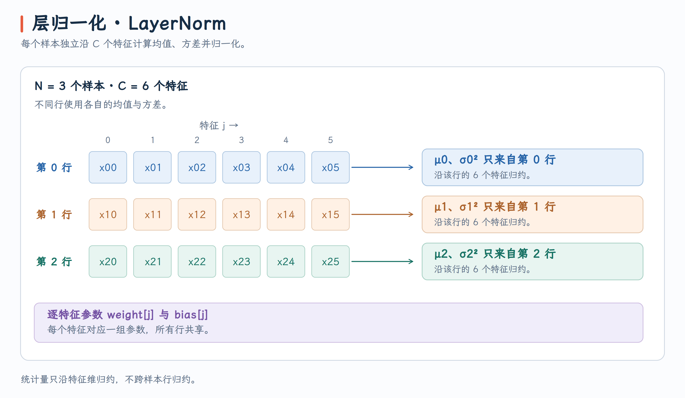

# Layer Normalization：层归一化

## 题目

编写一个 GPU 程序，实现二维输入张量的 LayerNorm 前向计算。输入 $x$ 的形状为 $[N,C]$，其中 $N$ 为 Batch Size，$C$ 为特征数；对每个样本独立沿 $C$ 个特征归一化，再应用可学习的缩放参数 $\mathrm{weight}$ 和平移参数 $\mathrm{bias}$。

对于每个样本 $i$，计算：

$$
\begin{align}
  \mu_i &= \frac{1}{C} \sum_{j=0}^{C-1} x_{i,j} \\
  \sigma_i^2 &= \frac{1}{C} \sum_{j=0}^{C-1} (x_{i,j} - \mu_i)^2 \\
  y_{i,j} &= \text{weight}_j \cdot \frac{x_{i,j} - \mu_i}{\sqrt{\sigma_i^2 + \varepsilon}} + \text{bias}_j
  \end{align}
$$

{ width="50%" }

## 实现
