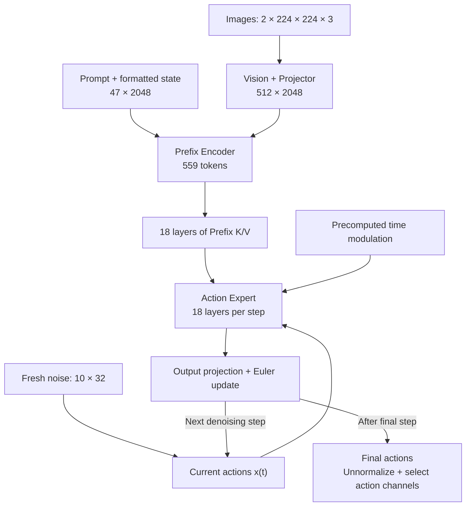

# FlashRT 开源贡献：Pi0.5 推理 Pipeline 面试问题与回答

先完整介绍个人工作，再沿 Pi0.5 从图像、指令到动作的过程展开优化与追问。正文直接展示，每一阶段先交代输入、重复频率与成本，再说明设计；性能实测与更细的 kernel 推导见 [FlashRT PR 深入材料](FlashRT-PR.md)和 [RDNA 3.5 实现笔记](rdna35/index.md)。

## 面试内容概览 {#overview}

共 40 个问题，按下面 8 个主题定位。主线是初始化准备 → 每帧建立 Prefix → 多步动作去噪 → 执行复用 → 跨帧条件复用，点击主题或具体追问即可跳转。

| 复习主题 | 问题范围 | 主要内容与直接跳转 |
| --- | --- | --- |
| [项目介绍与完整 Pipeline](#project-introduction) | 1–4 | 完整贡献口述、[各阶段执行频率](#q2)、frontend/pipeline/provider 调用链、优化优先级 |
| [初始化与输入准备](#prepare) | 5–10 | 权重合并、[静态 RMSNorm 折叠](#q6)、AdaRMS 与 [time modulation 预计算](#q8)、prompt/state 缓存、权重布局准备 |
| [Vision 与 Prefix KV](#prefix) | 11–17 | Vision 执行、固定宽度 Norm、compact rows、逐层 KV、[最后一层提前停止](#q15)、QKV/RoPE 融合、Encoder FlashAttention |
| [动作层结构与算子融合](#decoder) | 18–22 | 与 LLM Decode 的区别、[Action Expert 调用链](#q19)、residual-AdaRMS、[BF16 舍入边界](#q21)、gate/up 与 GeGLU |
| [Decoder Attention 与 softmax](#q23) | 23–25 | padded Prefix 空洞、动作 Suffix 可见性、[split-key 并行](#q24)、[online-softmax 合并](#q25) |
| [small-M 投影与动作更新](#q26) | 26–29 | WMMA 与组内 Split-K、转置权重与 tile 尾部、[Euler epilogue](#q28)、去噪步数、horizon 与 action_dim |
| [工作区、GEMM 计划与 Graph](#execution) | 30–33 | buffer 预分配、hipBLASLt 算法复用、[HIP Graph 的作用与开关](#q32)、输入和 shape 变化时的有效性 |
| [Temporal KV 跨帧复用](#temporal) | 34–40 | 与步内复用的区别、[decoder-only 调用链](#q35)、刷新周期、[失败与失效](#q37)、Graph 复用、条件滞后与质量取舍 |

贡献对应 [PR #213：RDNA 3.5 BF16 后端](https://github.com/flashrt-project/FlashRT/pull/213)与 [PR #215：Temporal KV](https://github.com/flashrt-project/FlashRT/pull/215)。前者按固定提交 `e2cf5d1` 核对，后者按 `839b159` 核对。下面的尺寸例子使用两相机、47-token prompt、horizon 10、10 步去噪。
{.interview-source}

图中 Prefix 在一次完整推理中计算一次，Action Expert 随去噪步重复。Temporal KV 进一步允许后续调用复用已提交的 Prefix K/V。

## 一、完整介绍：从模型依赖确定优化位置 {#project-introduction}

Pi0.5 每次 full 调用建立一次视觉语言条件，每个去噪步重复动作计算。初始化准备、层内算子和跨帧条件复用分别作用于不同频率的工作，共享 Pipeline 保持这些优化沿同一模型语义执行。

### 1. 请完整介绍一下你在 FlashRT 中做的 Pi0.5 推理优化。 {#q1}

**项目背景：Pi0.5 的条件阶段与动作阶段**

我在 FlashRT 的工作是 **为 Pi0.5 建立 AMD RDNA 3.5 的完整 BF16 推理后端，并沿它的推理 pipeline 做优化** 。Pi0.5 是视觉、语言与动作模型，输入多相机图像、语言指令和机器人状态，输出整段连续机器人动作。

它先由视觉编码器和 Prefix Encoder 建立条件，再从随机动作噪声出发，多次运行 Action Expert 预测更新方向，通过 flow-matching 积分得到动作。条件阶段每帧只算一次，动作阶段却在每个去噪步重复整套网络，这种执行频率差异决定了优化优先级。

**后端接入：共享 Pipeline 与 RDNA providers**

**第一项贡献是把完整模型执行接到 FlashRT 的共享 Pipeline 与 RDNA providers** 。

Frontend 负责 checkpoint、图像和 prompt/state 适配、设备 profile 以及动作反归一化；`Pi05TorchPipeline` 保留唯一的 Vision、Prefix、Action Expert 遍历和 Euler 更新；硬件层只替换具体 ops、GEMM 与 Attention。

这样每个 backend 都沿同一份模型语义推进，某个原生 kernel 不适用时也可以局部 fallback，不必复制模型 forward。

**依赖优化：把固定工作移出热路径**

确定数据流后，我先把 **只依赖固定权重与时间表的工作移出热路径** ：合并 QKV 与 gate/up、按 RoPE 配对准备 Q/K、把 Encoder 静态 RMSNorm 仿射折进后续 Linear，并预计算每个去噪 step 的 AdaRMS modulation。

Action output 的 W/b 提前乘 dt，后续投影可以直接生成 Euler 增量。Prefix 本来就只需在一次去噪前建立，我还按有效长度采用 compact rows，并在最后一层写完 K/V 后停止不再被消费的 Attention 和 FFN。这些优化都来自对依赖和消费者的分析。

**算子优化：按实际 shape 与重复频率组织执行**

接着针对 **实际 shape 与重复频率** 优化硬件执行。

Norm 使用固定宽度和 wave32 归约，residual 与下一 Norm/AdaRMS 融合；QKV Split、RoPE 和 KV 写入放到一次 launch；Encoder 用 Query tile 的 FlashAttention，Action Decoder 因 Query 短、Prefix KV 长，使用组内 split-key online softmax。

动作输出投影的行数和输出宽度很小，我准备专用转置权重，用 WMMA 沿输入维度分摊工作，并在输出写回时完成 residual 更新。常规大 GEMM 复用 hipBLASLt，Vision Attention 复用 SDPA，原生算子接管适合的热点形状。

融合中最需要注意的是参考实现的 BF16 舍入、mask 和位置语义，这些条件决定优化后是否仍在计算同一个模型。

**Temporal KV：缓存提交与条件刷新取舍**

**第二项 PR 是 Temporal Prefix KV 复用** 。连续帧场景允许显式降低视觉条件刷新频率：full 帧写出逐层 Prefix K/V，后续帧跳过 Vision/Encoder，但仍用新 noise 跑完整动作去噪。

为此我补 decoder-only 入口、刷新周期、prompt/state 失效，以及失败后的 full 重试；K/V 刷新开始先撤销有效性，整个调用成功后才推进周期。它减少的是条件阶段的执行，代价是复用帧忽略当前图像、使用最近 full 帧的上下文。

因此这项工作包含两类取舍：前面的工程优化保持既定计算流程，跨帧复用则需要结合动作效果选择刷新频率。执行层还提供可选的 HIP Graph，以减少反复提交 kernel 的开销。

完整介绍可以沿[阶段执行频率](#q2)展开，再分别进入[固定工作预计算](#q5)、[动作层的重复成本](#q19)和[跨帧条件复用](#q34)。

### 2. Pi0.5 的完整推理 pipeline 是什么？每个阶段算几次？ {#q2}

完整推理中，不同阶段的重复频率不同：

| 阶段 | 输入 → 输出 | 执行次数 |
| --- | --- | --- |
| SigLIP Vision + projector | 两张图像 → 512 个 2048 维 embedding | 每次 full 调用一次 |
| Prefix Encoder | 图像加 47 个文本 embedding → 559-token Prefix 的 18 层 K/V | 每次 full 调用一次 |
| Action Expert | 新 noise `[10,32]` 与时间条件 → velocity | 每个去噪步执行 18 层，共 10 步 |
| Euler 与输出处理 | 更新动作，最终反归一化 | 每步更新，最后输出整段动作 |

**Prefix K/V 在同一次去噪中复用，Suffix K/V 每步重写** 。

### 3. FlashRT 的 frontend、pipeline 和 provider 各自负责什么？调用链怎么讲？ {#q3}

公开入口为 `load_model → VLAModel.predict → frontend.infer`：

| 层次 | 职责 |
| --- | --- |
| Frontend | 设备与输入 profile、checkpoint 转换、prompt/state、动作反归一化 |
| `Pi05TorchPipeline` | 唯一的 `_vision → _encoder → _decoder` 遍历、K/V 写入、去噪状态更新 |
| ops/gemm/attention provider | 为具体操作选择 HIP、hipBLASLt 或 PyTorch |

同一个模型数学只保留一份，fallback 替换单个操作。**共享 layer loop** 可避免不同后端的 mask、时间表和数值修复分叉。

见[共享 Pipeline 的职责](https://github.com/flashrt-project/FlashRT/blob/e2cf5d1fe7209e3f4fbf212c5b6321467e8f4874/flash_rt/models/pi05/torch_pipeline.py#L1-L61)与[RDNA binding](https://github.com/flashrt-project/FlashRT/blob/e2cf5d1fe7209e3f4fbf212c5b6321467e8f4874/flash_rt/amd/models/pi05_rdna35/pipeline.py#L1-L25)。
{.interview-source}

### 4. 你如何决定优化优先级？为什么不能只盯着一个 GEMM 的速度？ {#q4}

我先按 **Vision、Prefix Encoder、单步 Decoder、整个去噪循环和输入输出** 拆成本，再看算子的形状、调用频率与 CPU/GPU trace。

- 初始化只做一次的工作、每帧只做一次的工作、每步每层重复的工作，收益放大方式不同。比如 time modulation 可以预计算，residual/Norm 的小开销会反复出现，而 Temporal KV 跳过整个条件阶段。

- 优化一个算子后还要看端到端瓶颈是否转移，并统一计时边界。**算子加速比例不能直接当成整条 pipeline 的加速比例** ，图像处理、拷贝与同步是否计入也要说明。

[返回面试内容概览](#overview)

## 二、初始化准备：哪些工作不必跟着每帧重复 {#prepare}

模型权重、时间表和不变 prompt 是三类可提前准备的对象。静态 Norm 参数可以折叠，时间 modulation 需要逐 step 预计算，prompt/state 缓存则随内容更新；它们省去的是不同重复工作。

深入分析见[Frontend 与 Pipeline](rdna35/01-Pi05-Frontend与Pipeline.md)。
{.interview-source}

### 5. 初始化和 checkpoint 转换阶段有哪些优化？为什么这些工作适合提前做？ {#q5}

加载和初始化阶段提前准备三类对象：

- **固定权重** ：合并 QKV 与 gate/up，规范矩阵布局，按 RoPE 配对重排 Q/K，折叠 Encoder 静态 RMSNorm 参数。
- **固定时间表** ：按去噪步数生成 t 与 modulation，把 action output 的 W/b 预乘 dt。
- **执行布局** ：准备 small-M 所需转置权重。

这些工作只依赖权重或已知 profile，提前做可减少 layer loop 内的拼接、转置与常数乘法。

Decoder AdaRMS 随时间变化，不能折成一份静态参数，**需要逐 step 准备** 。

### 6. RMSNorm 参数怎么折叠进 Linear？为什么一定要在 FP32 中处理？ {#q6}

Encoder 的 Gemma RMSNorm 是 **`rms(x) × (1+w)`** 。

- 若后面是 row-vector Linear `yW`，可以沿 W 的输入轴乘入 `1+w`，得到 `W'=diag(1+w)W`，运行时仍做 RMS 归一化，只省去静态仿射乘法。

- 转换在 FP32 中算完再转 BF16，因为接近 -1 的 w 若先舍入为 BF16 的 -1，`1+w` 就会错误变成 0。这里 **折叠的是静态参数，不是删除归一化统计量** ，代数关系和低精度转换顺序都要核对。

见[Encoder FP32 参数折叠](https://github.com/flashrt-project/FlashRT/blob/e2cf5d1fe7209e3f4fbf212c5b6321467e8f4874/flash_rt/frontends/torch/pi05_checkpoint.py#L129-L167)。
{.interview-source}

静态参数能折叠，时间条件却不能折成一份权重；这一差别引出[AdaRMS](#q7)与[逐步 modulation 表](#q8)。

### 7. AdaRMS 是什么？为什么不能像 Encoder RMSNorm 一样折叠成一份固定权重？ {#q7}

AdaRMS 先算 RMS 归一化，再用 **时间条件产生的 scale/shift** 做 `rms(x)×(1+scale)+shift`；同一组 modulation 的 gate 交给后续 residual，控制子层 update。

- Scale、shift、gate 随去噪时间变化，不能折进一份静态 Linear。这里每步每层的值虽不同，却只依赖固定时间表与权重，所以可以 **预计算整张 modulation 表，运行时按 step/layer 取值** 。

- 它保留了动态条件的数学作用，只把重复生成这些条件的工作移出请求。

### 8. 预计算 time modulation 具体省掉了什么？改变去噪步数后要做什么？ {#q8}

初始化对每个已知 t 运行 time MLP，计算各层 pre-attention、pre-FFN 和 final norm 的 modulation：

`组数 = 2 × 18 + 1 = 37`

`表形状 = [num_steps, 37, 3072]`

每组存 scale、shift、gate。请求中按 step/layer 索引，省掉每步重复的 time MLP 和 modulation 投影。

改变去噪步数时，要同步更新：

1. **时间表** ：两步应取 t=1、0.5，不能截取十步表的 1、0.9。
2. **modulation 表** ：按新的时间点重新预计算。
3. **输出投影缩放** ：W/b 的 dt 缩放也要匹配。

跨请求复用的前提是时间条件和权重固定。

见[modulation 预计算](https://github.com/flashrt-project/FlashRT/blob/e2cf5d1fe7209e3f4fbf212c5b6321467e8f4874/flash_rt/models/pi05/torch_pipeline.py#L62-L110)。
{.interview-source}

### 9. prompt embedding 能缓存吗？robot state 在 Pi0.5 中走哪条路径？ {#q9}

Tokenization、embedding lookup 和模型要求的尺度处理可以在 **prompt/state 不变时缓存** ，无需每帧重做。

- 这里文本 embedding 要乘 `sqrt(2048)`；Pi0.5 的 robot state 被格式化进语言 prompt，通常不作为独立 Suffix state token。

- 因此用户指令字符串没变，也不能推出 Prefix 没变，state 更新同样可能改变 token 内容或长度。`predict` 对 prompt/state 的变化调用 `set_prompt`，Temporal KV 也要随之失效。

- **输入预处理缓存与逐层 Prefix KV 缓存是不同对象** ，后者还包括图像条件。

### 10. 权重提前转置与 Q/K interleave 优化了什么？是否给所有权重复制一份就行？ {#q10}

提前准备让 **运行时读取布局直接匹配 kernel 消费方式** 。

- Q/K interleave 把 RoPE 配对维度放成可连续读取的 pair；动作输出投影从 `[K,N]` 准备为 `[N,K]`，让每个输出通道的 K fragment 连续。

- 不是所有矩阵都需要第二份布局，额外副本有内存成本，库 GEMM 也有自己的契约。这个固定版本的 Python small-M provider **只为 `(K,N)=(1024,32)` 的动作输出权重准备转置** ，其他 GEMM 主要走 hipBLASLt，不能把 native kernel 的支持范围等同于 pipeline 已启用范围。

见[small-M 权重准备](https://github.com/flashrt-project/FlashRT/blob/e2cf5d1fe7209e3f4fbf212c5b6321467e8f4874/flash_rt/amd/hardware/rdna35/gemm.py#L40-L63)。
{.interview-source}

[返回面试内容概览](#overview)

## 三、Vision 到 Prefix KV：先看数据的消费者 {#prefix}

当前图像经过 Vision 成为 Prefix，后者按层生成 K/V。有效 token 数决定实际计算行数，下一层是否还消费 hidden 决定能否提前停止，QKV/RoPE 与 Attention kernel 再优化留下的读写和计算。

深入分析见[模型结构](rdna35/02-Pi05模型结构与推理流程.md)、[Norm](rdna35/03-Normalization-Kernel.md)和[Encoder Attention](rdna35/05-Encoder-FlashAttention-Kernel.md)。
{.interview-source}

### 11. Vision 阶段具体算什么？你的后端是否把它的所有算子都写成了 HIP？ {#q11}

每张 `224×224` 图像经 patch size 14 的 embedding 得到 **256 个 1152 维 token** ，再过 27 层 SigLIP 和 projector。

- 两视角在 Vision 中作为独立 batch，进入 Prefix 后才与文本共同交互。我为热点 LayerNorm、GELU 和 residual 等提供 HIP 路径，QKV 使用预合并权重，矩阵乘复用 hipBLASLt；**Vision Attention 在该版本仍调用 PyTorch SDPA** 。

- 因此应把贡献说成完整后端适配和热点算子组合，而不能说整个 Vision 的每一个算子都从零实现了。

见[Vision SDPA 路径](https://github.com/flashrt-project/FlashRT/blob/e2cf5d1fe7209e3f4fbf212c5b6321467e8f4874/flash_rt/amd/hardware/rdna35/attention.py#L40-L58)。
{.interview-source}

### 12. 固定宽度 Norm 为什么有优化空间？wave32 归约怎么做？ {#q12}

Pi0.5 的热点宽度已知，可以让线程把自己负责的输入片段 **保留在寄存器** ，统计量归约后直接生成输出，减少重新读 global memory。

- LayerNorm 求均值和中心化方差，RMSNorm 求平方均值，都用 FP32 统计量。Wave32 内用 shuffle 合并 partial，跨 wave 再经 LDS 与 workgroup barrier 合并；wave shuffle 不能替代跨 wave 同步。

- 寄存器保留也会增加 VGPR 压力，可能降低 occupancy 或 spill，所以 **只对核对过的固定宽度采用专门路径** ，不能认为寄存器越多越好。

### 13. compact Encoder 优化什么？valid_prefix 和 prefix_capacity 为什么不能合并成一个长度？ {#q13}

以两相机、47-token prompt 为例，有效长度 559；最大 prompt 200 时预留容量 712：

| 布局 | Encoder 计算行数 | Suffix 的物理起点 | Prefix 空洞 |
| --- | --- | --- | --- |
| compact | 559 | 559 | 无 |
| padded | 712 | 712 | 559～711 |

`valid_prefix` 描述数学上可见的条件；`prefix_capacity` 描述预留布局，不能互换。

compact 减少无效行的 GEMM/Norm；padded 保留较固定的 shape，但要在 softmax 前屏蔽空洞。**清零 padding embedding 不会自动消除它对分母的贡献** 。

### 14. Prefix Encoder 留给 Decoder 的到底是什么？为何两个 hidden width 不同也能 Attention？ {#q14}

Encoder 保存 **每一层自己的 Prefix K/V** 。两条 residual stream 可以宽度不同，只要 Q/K/V 的连接维度满足模型定义：

| 维度 | Prefix Encoder | Action Expert |
| --- | --- | --- |
| residual width | 2048 | 1024 |
| Q heads / KV heads | 8 / 1 | 8 / 1 |
| head dim | 256 | 256 |

Decoder Q 与对应层 Prefix K 做 dot，8-head context 为 2048 维，再由 O projection 回到 1024。

因此接口依据是 **投影后的 head 维度与逐层依赖** ，而不是 residual width 必须相同。

每层都有自己的 Prefix K/V，因此[最后一层哪些计算还能省](#q15)必须按消费者判断，而不是简单删掉整个层。

### 15. 为什么最后一层 Prefix Encoder 可以提前结束？究竟省掉了哪些工作？ {#q15}

第 i 层 Action Expert 需要第 i 层 Prefix K/V，Encoder 的下一层则依赖当前层 Attention/FFN 更新后的 hidden。

- 到了最后一层，**K/V 必须写出，但后续 Prefix hidden 已没有消费者** ，所以 QKV/RoPE 完成后直接停止，省掉 Attention、O projection、FFN 和相关 residual/Norm。

- 不能说整个最后一层都没算，因为 fused QKV 仍生成了 Q/K/V，其中 Q 在这里没有被消费。这个优化来自 **分析输出消费者和依赖关系** ，不是随意减少模型层数。

见[最后一层的停止位置](https://github.com/flashrt-project/FlashRT/blob/e2cf5d1fe7209e3f4fbf212c5b6321467e8f4874/flash_rt/models/pi05/torch_pipeline.py#L279-L315)。
{.interview-source}

### 16. QKV Split 与 RoPE 融合为什么有效？怎样直接写入 KV cache？ {#q16}

Fused QKV GEMM 产生每行 **`[8Q|1K|1V]` 共 2560 个 BF16 值** 。

- 原生 kernel 在一次 launch 中拆分它们，对 Q/K 旋转，V 直接复制，K/V 输出指针指向当前层 cache 的对应 slice，减少独立算子与中间物化。

- 每个线程负责一个 row/pair，可复用同一组 cos/sin 处理 8 个 Q head 和 K；`position_start` 决定系数位置，Suffix 的逻辑起点要按有效 Prefix，而不能拿 padded 物理起点替代。**地址布局、RoPE 配对和参考舍入顺序必须同时对齐** 。

见[融合 RoPE 与直接写缓存](https://github.com/flashrt-project/FlashRT/blob/e2cf5d1fe7209e3f4fbf212c5b6321467e8f4874/flash_rt/models/pi05/torch_pipeline.py#L282-L310)。
{.interview-source}

### 17. Prefix Encoder FlashAttention 怎样减少成本？GQA 是否能共享 softmax？ {#q17}

Prefix 有数百个 Query，适合 **按 Query tile 并行、分块读取 K/V，并在线更新 softmax** ，避免把完整 S×S score 矩阵写到 global memory。

- 该 HIP 路径以 wave pair 协作一组 Query，leader 计算 QK 与概率，两波分别生成 Value 输出的不同维度，LDS staging 与 barrier 保护数据共享。

- GQA 的 8 个 Q head 共用 K/V 表示，但 Q 各不相同，**score、softmax 和输出仍按 head 独立** 。

- 原生路径还受 shape/layout 分发限制，其他情况可回到 SDPA。

[返回面试内容概览](#overview)

## 四、动作去噪：把重复的层内成本逐项拆开 {#decoder}

Prefix K/V 建立后，每步都要重新计算整个动作 horizon。Residual/Norm、FFN、短 Query Attention 和输出更新依次处理不同中间量，优化必须保留它们之间的依赖与 BF16 舍入边界。

深入分析见[动作层结构](rdna35/02-Pi05模型结构与推理流程.md)、[Decoder GQA](rdna35/06-Decoder-GQA-Kernel.md)和[small-M WMMA](rdna35/07-SmallM-WMMA-GEMM-Kernel.md)。
{.interview-source}

### 18. Pi0.5 的 Decoder 与 LLM 逐 token Decode 有什么不同？ {#q18}

LLM 的普通 Decode 按自回归顺序推进 token，而 Pi0.5 的 Action Expert 在每个去噪步 **联合更新整个动作 horizon** 。

- 当前动作 noise 投影为动作 hidden，结合时间 modulation 和 Prefix 条件预测 velocity，所有 horizon 位置一起更新。

- 动作 Suffix 在同一 Attention block 内互相可见，可以读 Prefix 和全部当前 Suffix，不是左到右 causal 生成。

- 优化时看到的 M 是 horizon 行数，**不能直接套用 batch=1、Query=1 的 LLM 解码假设** ，也不能把上一步 Suffix KV 原封不动当成本步结果。

### 19. 一个 Action Expert layer 的调用链是什么？哪些操作会在去噪循环里反复出现？ {#q19}

每个去噪步重复下面的动作层路径：

1. **步输入** ：action input projection，首层 AdaRMS。
2. **Attention 子层** ：QKV/RoPE → Prefix+Suffix GQA → O projection。
3. **FFN 子层** ：gated residual + pre-FFN AdaRMS → gate/up → GeGLU → down projection。
4. **层间衔接** ：与下一层 pre-attention AdaRMS 融合；最后一层接 final norm。
5. **步更新** ：输出投影 + Euler 更新，再进入下一步。

每步有 18 层，小算子的 launch 与中间读写会累积。**modulation 可预计算，动作 hidden、Attention、FFN 和 Suffix KV 仍依赖本步 noise** 。

见[Decoder 层循环](https://github.com/flashrt-project/FlashRT/blob/e2cf5d1fe7209e3f4fbf212c5b6321467e8f4874/flash_rt/models/pi05/torch_pipeline.py#L386-L514)。
{.interview-source}

这条层内路径有三个深入入口：[residual-AdaRMS](#q20)、[短 Query 的 Attention](#q24)和[动作输出投影](#q26)。

### 20. residual-AdaRMS 融合具体做什么？为什么它有两个输出，还要传 gate？ {#q20}

残差与下一次归一化通过以下顺序衔接：

`s = BF16(residual + u × old_gate)`

1. 用前一子层的 gate 调制 update u，写回 residual stream。
2. 对已舍入的 s 计算下一子层 AdaRMS，得到 normalized tensor。
3. 下一组 modulation 的 gate 留给后续 residual 更新。

| 参数 | 控制哪一段计算 |
| --- | --- |
| 旧 gate | 前一子层产生的 update |
| 新 scale/shift | 下一子层的 normalized 输入 |
| 新 gate | 下一次 residual 更新 |

融合有 residual 与 normalized 两个输出，省去独立 residual launch；固定宽度 residual-RMS 还可把舍入后的 s 留在寄存器，避免二次 global read。

### 21. Norm、残差或 Linear 融合时，为什么不能只在最后转 BF16？ {#q21}

参考实现中的 **中间 BF16 舍入是可观察的数值边界** 。

- 例如 residual 原先先写 BF16，再被 Norm 读取，融合也要用已舍入的 sum 求统计量；动作投影原先输出 BF16，再与 noise 相加，epilogue 也先舍入 projection 再加 residual。

- RoPE 还有自己的乘法舍入顺序。实数公式相同不保证低精度操作顺序相同，所以要逐个融合核对 reference，而不能统一改成一路 FP32、最后 cast。

- **减少物化与 launch 可以保留原有舍入，不必把两者绑定** 。

### 22. gate/up 合并与 GeGLU 融合分别减少什么成本？它和 SwiGLU 一样吗？ {#q22}

Gate/up 共享同一输入，把两份权重合为 `[K,2H]` 可用一次 GEMM 产生 **`[gate|up]` 的 merged 输出** ，减少两次独立提交。

- GeGLU kernel 再直接按行 stride 读取两半，计算 `GELU(gate)×up`，避免独立 GELU 中间 tensor 及额外布局物化。

- 这里 gate/up 切片本身可能只是 view，不能把 view 都说成拷贝；真正省的是多算子数据流和对应读写。**该 FFN 用 GELU 门控，SwiGLU 用 SiLU** ，time MLP 的 SiLU 是另一处计算，不要混淆。

### 23. Decoder 怎么屏蔽 padded Prefix 的空洞？为什么不用 causal mask？ {#q23}

在合法 KV 物理范围内，可见条件是：

`j < valid_prefix OR j >= suffix_start`

| 区域 | 是否参与 Attention |
| --- | --- |
| 真实 Prefix | 可见 |
| padded Prefix 空洞 | 在 softmax 前屏蔽 |
| 当前整个动作 Suffix | 所有 horizon 位置互相可见 |

compact 的 suffix_start 为 559，padded 为 712；读取地址另按真实容量保护。

**物理空洞与模型依赖是两层 mask** 。动作联合去噪不使用 LLM 左到右三角 causal mask，归一化后再屏蔽也无法补救。

可见范围明确后，Attention 的剩余成本在长 Key 读取与归约，[split-key](#q24)和[online-softmax 合并](#q25)一起解决这两件事。

### 24. 短 Query、长 KV 的 Action Attention 为什么适合 split-key？ {#q24}

Action Query 只有 horizon 那么多行，却要读数百个 Prefix Key 加当前 Suffix。

- 该实现让 **一个 workgroup 拥有一个 Query/head，八条 wave 分摊不相交的 Key 集合** ，各自维护 online-softmax 状态，最后经 LDS 合并。

- 每 lane 负责连续 8 个 head 维度，wave32 合成 256 维 dot，再用共同概率更新各自 Value 分量。这增加了组内沿 KV 的并行度，不需要 global score workspace、额外归约 kernel 或跨 workgroup atomic。

- **它与 Encoder 按大量 Query tile 并行的组织不同** ，原因是两阶段的 shape 不同。

见[split-key kernel](https://github.com/flashrt-project/FlashRT/blob/e2cf5d1fe7209e3f4fbf212c5b6321467e8f4874/csrc/amd/attention/decoder_flash_rdna.hip#L91-L211)。
{.interview-source}

### 25. split-key 的多个 softmax 结果怎么合并？为什么不能直接平均各 wave 输出？ {#q25}

每个分区保留局部最大 score m、相对 m 的指数和 l、同尺度的 Value 加权分子 a。合并分成三步：

1. 取共同最大值 `m = max(m_i)`。
2. 用 `exp(m_i-m)` 重缩放各分区的 l/a，代码使用等价的 exp2。
3. 合并分子与分母，计算 `O = sum(a) / sum(l)`。

以全部 score 为 0 为例：

| 分区 | Value | 局部均值 | 参与全局平均的元素数 |
| --- | --- | --- | --- |
| A | 1、3 | 2 | 2 |
| B | 10 | 10 | 1 |

正确结果为 `14/3`，局部均值直接平均却是 6。**需要合并概率质量，不能直接平均归一化输出** 。

### 26. small-M WMMA 优化了哪个投影？Split-K 怎么组织？ {#q26}

Pipeline 实际准备的动作输出投影为：

`M=10，K=1024，N=32`

组内 Split-K 的分工是：

1. 一个 workgroup 拥有一个 16×16 输出 tile。
2. 多条 wave 分摊 K，用 wave32 BF16 WMMA、FP32 accumulator 求 partial。
3. partial 经 LDS，由 wave 0 合并。

四波配置中，每波处理 K=256，两个列 tile 共两组 workgroup。这增加 **组内 K 并行** ，不使用 global workspace 或原子归约，也没有把该投影均匀铺满全部 CU。

更宽 N 的 native tiled 路径另看 dispatch，不能当成所有层已启用。

### 27. 为什么小 M 要准备转置权重？horizon 不满 WMMA tile 时怎么办？ {#q27}

转置为 **`W_nt[N,K]`** 后，一个输出通道沿 K 连续，适合加载 WMMA fragment；普通 `[K,N]` 布局的同一列则跨行 stride。

- M=10 小于 tile 的 16，不能让越界行对应的 lane 提前退出而破坏 wave 协作：direct 路径用合法行 clamp 保护读取，tiled 路径填零，写回再用真实行 predicate 过滤。

- **安全读取、完整执行 WMMA 和有效输出写回分别判断** 。这个 provider 还检查 prepared weight 的对象身份，避免仅凭被 allocator 复用的指针命中旧转置。

小投影的输出直接进入动作状态，所以它还能与[Euler 更新](#q28)融合；这与[减少去噪步数](#q29)有不同的语义边界。

### 28. Euler 更新怎样与输出 GEMM 融合？dt 为什么是负数？ {#q28}

flow-matching 从 t=1 的 noise 向 t=0 积分：

`dt = -1 / num_steps`

`x ← x + dt × v(x,t)`

输出融合分成两步：

1. **Frontend 准备** ：W/b 预乘 dt，最后 Linear 直接输出 velocity 的缩放增量。
2. **small-M epilogue** ：`linear_residual` 将增量加进原 noise，省掉运行时常数乘法和独立 residual。

融合保留 projection 的 BF16 舍入；provider 不接受时回到 Linear + residual。**dt 只乘一次，输出不是直接替换整段动作** 。

见[输出投影与 residual fallback](https://github.com/flashrt-project/FlashRT/blob/e2cf5d1fe7209e3f4fbf212c5b6321467e8f4874/flash_rt/models/pi05/torch_pipeline.py#L516-L529)。
{.interview-source}

### 29. 减少去噪步数是否也是等价的工程优化？action_dim 与 horizon 怎样区分？ {#q29}

减少步数会改变 **数值积分的离散过程** ，可能影响动作质量；它与保持既定流程的融合、预计算有不同语义。

| 参数 | 含义 |
| --- | --- |
| horizon | 一次联合生成的动作时刻数，即 `[horizon,32]` 的行数 |
| 内部宽度 32 | 模型的动作通道数 |
| 对外 action_dim | 机器人 schema 的有效通道，例如 DROID 的输出接口 |

输出还需反归一化并选择有效通道。不能从恒定通道猜它是 padding，也不能把 horizon 当动作维度。

[返回面试内容概览](#overview)

## 五、执行开销：工作区与计划怎样跨调用复用 {#execution}

执行层还存在分配、算法搜索与 CPU 提交成本。Buffer 保存数值，GEMM plan 保存执行选择，graph 保存操作和指针关系；复用条件相互关联，内容有效性与计划有效性仍需分别管理。

### 30. 预分配 buffer 有什么价值？哪些 buffer 会跨阶段或跨去噪步复用？ {#q30}

已知视角数、最大 prompt、horizon 和宽度后，Pipeline 预分配 Vision/Encoder/Decoder 工作区、noise、逐层 KV 和 merged gate/up 输出：

| 对象 | 复用方式 |
| --- | --- |
| Prefix K/V | 同一次推理的全部去噪步读取 |
| Suffix K/V | 每步重写 |
| noise | 动作状态原地更新 |
| 层内工作区 | 消费者结束后交给后续操作 |

预分配减少热路径分配与不必要物化，也为 Graph 提供稳定地址。

仍需按依赖检查 alias：residual 尚有消费者时不能覆盖。**预分配不会自动减少数学计算或消除全部临时 tensor** 。

见[持久工作区](https://github.com/flashrt-project/FlashRT/blob/e2cf5d1fe7209e3f4fbf212c5b6321467e8f4874/flash_rt/models/pi05/torch_pipeline.py#L117-L156)。
{.interview-source}

### 31. 为什么保留 hipBLASLt？算法选择应在什么阶段发生？ {#q31}

常规大 GEMM 已有成熟库实现，**手写 small-M kernel 只接管已准备且适合的热点形状** ，其余交给 hipBLASLt。

- 库算法选择也要匹配 M/N/K、布局、dtype 与工作区，provider 支持 lazy autotune，并在重复调用中复用 runner 的计划。

- 候选搜索与首次初始化成本要在稳定性能计时前处理；graph capture 也应在所需准备完成后进行。是否启用某个优化，应看端到端负载而不只看热缓存 microbenchmark，**“支持某算法”与“本轮实际命中它”需要分开核对** 。

### 32. HIP Graph 优化什么？支持 graph 是否意味着普通 infer 默认启用了它？ {#q32}

HIP Graph 录制固定 GPU 操作与地址关系，replay 减少反复从 CPU 提交 kernel 的开销；它 **不减少模型层数或 Attention 的数学工作量** 。

- Pipeline 先 warmup，再 capture，可以记录完整流程或 decoder-only。这个固定版本提供显式 `use_graph=True` 路径，但普通 frontend `infer` 没有默认传它；Temporal decoder-only graph 也是可选，不能把能力当默认性能来源。

- ROCm PyTorch 仍使用 **`torch.cuda` 的 API 名称** ，实际 GPU 执行是 HIP，不能凭名称推断设备是 NVIDIA。

见[完整 graph 与显式开关](https://github.com/flashrt-project/FlashRT/blob/e2cf5d1fe7209e3f4fbf212c5b6321467e8f4874/flash_rt/models/pi05/torch_pipeline.py#L537-L616)。
{.interview-source}

### 33. graph 会冻结输入值吗？prompt 内容或长度变化时为什么处理不同？ {#q33}

Graph 固定执行操作、指针和 shape 参数，replay 前可以把新数值复制到原地址：

| 变化 | 当前 Pipeline 的处理 |
| --- | --- |
| 图像/noise 内容变化 | 通常无需 recapture |
| 同长度新 prompt、刷新后的 KV | 地址与 shape 契约一致时可继续 replay，读取新值 |
| prompt length 变化 | 影响 Encoder rows、Suffix 布局和 launch，重新 warmup/capture |

graph key 使用 prompt length。**执行计划有效与 KV 内容有效是两个条件** ，state 更新仍要使旧 Prefix 失效。

[返回面试内容概览](#overview)

## 六、Temporal KV：从步内复用扩展到跨帧条件 {#temporal}

同一次去噪中的 Prefix 本来不变，跨帧图像却可能变化。Decoder-only 保留最近 full 的条件、重新生成动作；刷新和成功提交保证缓存可用，条件滞后则需要结合任务效果评估。

深入分析见[Temporal KV](rdna35/06-Temporal-KV跨帧复用.md)。
{.interview-source}

### 34. Temporal KV 这个 PR 新增了什么？与同一次推理中复用 Prefix 有何区别？ {#q34}

同一次 flow-matching 推理中，**Prefix 不依赖去噪步，计算一次再复用本来就符合模型依赖** ，OpenPI 也已有这种做法。

- 我的 #215 将复用扩展到多次成功调用：保留最近 full 帧提交的 18 层 Prefix K/V，新增 `forward_decode_only` 和刷新调度，跳过后续帧的 Vision/Encoder。

- Action Expert 仍从新 noise 执行完整去噪。**跨帧图像可能变化，因此它改变条件刷新频率，是显式近似** ，不能与同一次请求内的等价 KV 复用混为一谈。

跨帧复用能否安全使用，继续看[decode-only 消费什么](#q35)、[何时刷新](#q36)和[失败后怎样重建](#q37)。

### 35. decoder-only 的调用链是什么？它是否复用了上一帧动作或 Suffix KV？ {#q35}

Frontend 在复用帧调用 **`pipeline.forward_decode_only(noise)`** ，检查已有有效 Prefix，复制新 noise，再进入原来的 `_decoder(valid_prefix)`，没有第二套动作层循环。

- 缓存对象是每层 Prefix K/V；Suffix K/V 在每个去噪步由当前 hidden 重写，最终动作也重新生成。它既不是回放旧动作，也不是默认以上一帧动作作 warm start。

- **当前图像和 prompt embedding 在这条入口不被消费** ，所以解释复用收益时必须同时说明当前动作依据的是最近 full 帧条件。

见[decoder-only 入口](https://github.com/flashrt-project/FlashRT/blob/839b15977f0ddf4e525e3511ec3b67b157b25acf/flash_rt/models/pi05/torch_pipeline.py#L658-L713)。
{.interview-source}

### 36. cache_frames 怎样调度？prompt 或 state 每帧变化还能复用吗？ {#q36}

Frontend 根据刷新周期、成功帧计数和 cache valid 决定执行入口：

| 条件 | 执行路径 |
| --- | --- |
| 周期 ≤ 1、到刷新点、cache 无效 | full |
| 未到刷新点且 cache 有效 | decoder-only |
| prompt/state 更新 | `set_prompt` 使缓存失效、计数归零，下一次 full |

`cache_frames=3` 的成功序列为：

`F → D → D → F → D → D`

默认 1 每帧 full。若应用每帧更新 state，且改变了 prompt 条件，也会每帧刷新。**配置周期不等于实际命中复用，要看输入更新频率和执行路径** 。

见[调度与成功计数](https://github.com/flashrt-project/FlashRT/blob/839b15977f0ddf4e525e3511ec3b67b157b25acf/flash_rt/amd/frontends/torch/pi05_rdna35.py#L334-L392)。
{.interview-source}

### 37. 为什么 full 刷新开始就要失效缓存？失败后怎样处理？ {#q37}

持久 Prefix KV 可能在 full 失败后留下新旧层混合的内容，所以有效性按提交过程管理：

1. **开始刷新** ：先撤销 cache valid，阻止读取部分更新内容。
2. **Pipeline 成功** ：完整执行后提交新的 Prefix。
3. **Frontend 成功** ：同步、CPU copy 和反归一化也成功返回后，才推进帧计数。
4. **异常恢复** ：失效缓存、重置周期，重试强制 full。

失效不需要清零全部 GPU 字节，核心是 **阻止读取未完成内容** 。低层 decoder-only 没有重建所需图像，cache 无效时明确报错。

见[缓存标记与 full 提交](https://github.com/flashrt-project/FlashRT/blob/839b15977f0ddf4e525e3511ec3b67b157b25acf/flash_rt/models/pi05/torch_pipeline.py#L606-L656)。
{.interview-source}

### 38. KV 失效为什么保留 decoder-only graph？怎样避免 graph 读旧上下文？ {#q38}

Invalidation 撤销的是 **当前 K/V 内容可用性** ，graph 描述的是某个 shape 的执行计划。

- 新 full 把 K/V 写回相同地址后，只要 prompt length 等契约不变，就可保留 plan，replay 读取更新后的值；长度变化再 recapture。

- 验证应分别覆盖 **同长度 state 更新后复用 plan** 和 **不同长度 prompt 更新后重建 plan** ，使用相同 noise 对比新的 full 与 decoder-only 输出。

- 不能用“graph object 没变”推断上下文没变，也不能因地址没变就忽略 cache commit 状态。

### 39. Temporal KV 的收益为什么有上限？可以根据画面变化自适应刷新吗？ {#q39}

设 full 成本为 F，decoder-only 为 D，周期为 c，理想稳态平均成本是：

`平均成本 ≈ [F + (c-1)D] / c`

- **成本下限** ：周期增大只能摊薄 Vision/Encoder，完整 Decoder 仍保留，成本趋向 D。
- **条件滞后** ：周期越大，上下文可能越旧，刷新帧与复用帧的延迟也不同。
- **实现范围** ：该 PR 使用固定周期，按图像变化或动作风险自适应刷新属于后续设计。

选择周期需结合场景变化、state 更新和轨迹评测，平均耗时不能单独说明控制效果或尾延迟。

### 40. 怎样区分等价执行优化与 Temporal KV 的质量取舍？什么对照能说明问题？ {#q40}

算子融合、布局转换和预计算需要在既定输入与模型流程下对齐 reference；共享 Pipeline 内的 fallback 对照能定位 kernel 偏差，但还应有 **独立 OpenPI 的固定输入、checkpoint、noise 和时间表对照** ，避免两路径共享同一个模型遍历错误。

- Temporal 则先用相同 Prefix/noise 对比 full 与 decoder-only，证明缓存入口正确；当前图像改变时复用旧条件，**这类差异要由轨迹与任务质量评测判断可接受性** 。

- 固定输入数值对齐不能证明任意跨帧复用都不影响机器人动作质量。

[返回面试内容概览](#overview)

