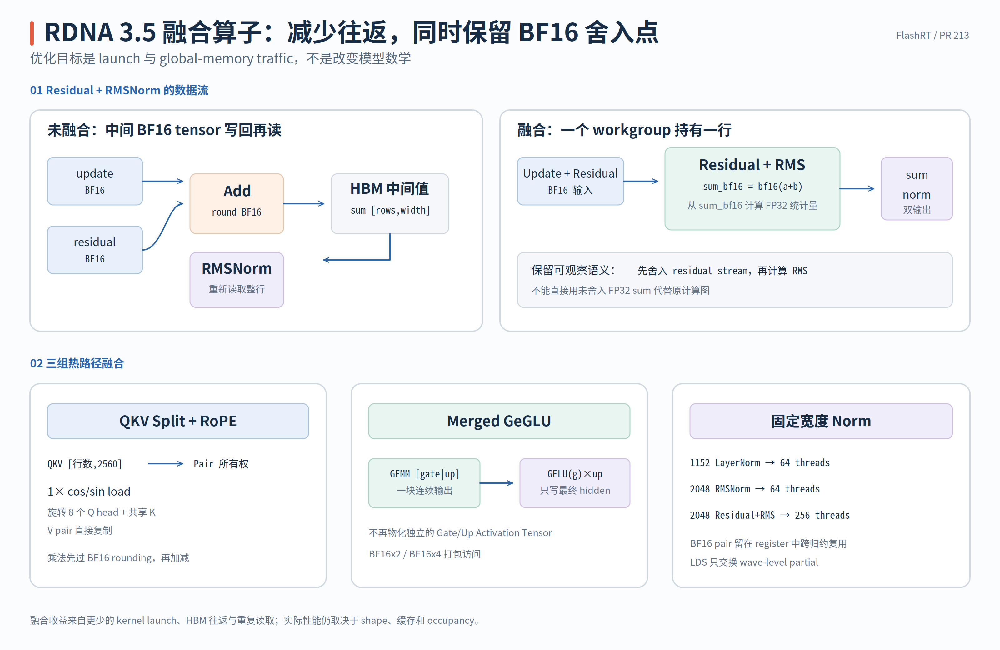

# Activation 与 Residual：从 Scalar 语义到 Packed 数据路径

PR #213 为 Activation 定义了 8 个 Kernel body，为 Residual 定义了 2 个 Kernel body。它们没有 LDS、Atomic 或 Block Barrier：每个 Output 位置只有一个 Thread Writer，Thread 读取输入、在 FP32 中计算，再把结果舍入为 BF16。真正需要讲清的不是公式本身，而是实现怎样逐层加入 Vectorized Access、Operation Fusion 和 Compile-time Specialization，同时保留 Scalar Fallback 的完整语义。

> 代码块中的中文注释由本文补充，用来强调 Scalar/Packed 索引单位、Tail Guard 和 BF16 Rounding Point，不属于上游源码原注释。

实现分别位于 [`activation_rdna.hip`](https://github.com/flashrt-project/FlashRT/blob/e2cf5d1fe7209e3f4fbf212c5b6321467e8f4874/csrc/amd/kernels/activation_rdna.hip#L1-L231) 与 [`elementwise_rdna.hip`](https://github.com/flashrt-project/FlashRT/blob/e2cf5d1fe7209e3f4fbf212c5b6321467e8f4874/csrc/amd/kernels/elementwise_rdna.hip#L1-L96)。本章覆盖的 Kernel 与阅读抓手如下：

| 实现族 | `__global__` Kernel | 首先观察什么 |
| --- | --- | --- |
| GELU | `gelu_rdna_kernel`、`gelu_packed_rdna_kernel` | Scalar Index 如何变成 BF16x2 Pair Index |
| SiLU | `silu_rdna_kernel`、`silu_packed_rdna_kernel` | 与 GELU 相同的 Ownership 如何复用不同 Element Function |
| Separate GeGLU | `gelu_mul_rdna_kernel`、`gelu_mul_packed_rdna_kernel` | Gate/Up 在同一 Thread 中融合，BF16x4 如何覆盖 Tail |
| Merged GeGLU | `gelu_mul_merged_rdna_kernel`、`gelu_mul_merged_packed_rdna_kernel` | 二维 Grid 如何解释 Row-major `[gate | up]` |
| Residual | `residual_scalar_rdna_kernel`、`residual_rdna_kernel<HasGate>` | `gate[index % width]` 如何变成 Pair 索引，Template 如何删除无 Gate 路径 |

阅读时先从文件末尾的 Host Launcher 找到 Packed/Scalar 分派条件，再回到对应 Kernel 核对 Index、Load Width 和 Rounding Point，最后到 Python Provider 判断它是否真的处于生产路径。这样能够把“Kernel 自己支持什么”和“模型当前会调用什么”分开。

## GELU 与 SiLU 如何从 Scalar 扩展到 BF16x2

`gelu_rdna_kernel` 是最小的 Scalar 实现；紧随其后的 Packed Kernel 保留相同的数学顺序，只改变 Pointer Type 与 Thread Ownership。两个 Kernel 的源码可以直接并排阅读：

```cpp
__global__ void gelu_rdna_kernel(const __hip_bfloat16 *__restrict__ input,
                                 __hip_bfloat16 *__restrict__ output,
                                 int size) {
  // Scalar Path：index 的单位是单个 BF16 Element。
  const int index = blockIdx.x * blockDim.x + threadIdx.x;
  if (index < size) {
    output[index] =
        __float2bfloat16(gelu_tanh_rdna(__bfloat162float(input[index])));
  }
}

__global__ void
gelu_packed_rdna_kernel(const __hip_bfloat162 *__restrict__ input,
                        __hip_bfloat162 *__restrict__ output, int pairs) {
  // Packed Path：pair 的单位是 BF16x2；Pointer Arithmetic 已自动跨过两个 Element。
  const int pair = blockIdx.x * blockDim.x + threadIdx.x;
  if (pair < pairs) {
    const __hip_bfloat162 value = input[pair];
    output[pair] = __hip_bfloat162(
        __float2bfloat16(gelu_tanh_rdna(__bfloat162float(value.x))),
        __float2bfloat16(gelu_tanh_rdna(__bfloat162float(value.y))));
  }
}
```

Scalar Path 的 `index` 是 BF16 下标；Packed Path 的 `pair` 是 `__hip_bfloat162` 下标。Packed Kernel 没有在内部再乘 2，因为 Pointer Arithmetic 已经自动以 4 bytes 为单位前进。两条路径都在每个 Element 完成 GELU 后立即转回 BF16，因此只有访存粒度不同，Rounding Point 相同。

它使用的 Tanh Approximation 与 PyTorch `approximate="tanh"` 代数等价。若记

$$
a=\sqrt{\frac{2}{\pi}}x(1+0.044715x^2),
$$

则

$$
\frac{x}{2}(1+\tanh a)
=\frac{x}{1+e^{-2a}}
=\frac{x}{1+\exp\left(-1.5957691216057308x(1+0.044715x^2)\right)}.
$$

因此 [`gelu_tanh_rdna`](https://github.com/flashrt-project/FlashRT/blob/e2cf5d1fe7209e3f4fbf212c5b6321467e8f4874/csrc/amd/kernels/activation_rdna.hip#L30-L40) 不是更换 GELU 定义，而是把 Tanh 形式改写为 `__expf` 形式。

```cpp
__device__ __forceinline__ float gelu_tanh_rdna(float value) {
  const float exponent =
      -1.5957691216057308f * value *
      (1.0f + 0.044715f * value * value);
  // Helper 保持 FP32；是否以及何时舍入 BF16 由调用它的 Kernel 决定。
  return value / (1.0f + __expf(exponent));
}
```

Helper 返回 FP32，调用者负责决定何时 `__float2bfloat16`。这使同一个 Helper 能被普通 GELU 和 GeGLU 共用，而不会在 Multiply 之前多插入一次 BF16 Round。

`gelu_packed_rdna_kernel` 将同一语义复制到 BF16x2：Thread `pair` 一次读取相邻的 $x_{2p}$ 与 $x_{2p+1}$，分别转为 FP32 计算，再合成一个 `__hip_bfloat162` 写回。以 `size=1024` 为例，Scalar Path 的逻辑范围是 1024 个 Item，Packed Path 的范围是 512 个 Pair；数学计算量没有减半，变化的是每个 Thread 的 Ownership 与 Load/Store 宽度。

SiLU 的两条路径复用同一组索引与分派规则，只将 Element Function 换为

$$
\operatorname{SiLU}(x)=\frac{x}{1+e^{-x}}.
$$

源码中 Scalar 与 Packed 的区别同样直接体现在 Load 和 Store 上：

```cpp
__global__ void silu_rdna_kernel(const __hip_bfloat16 *__restrict__ input,
                                 __hip_bfloat16 *__restrict__ output,
                                 int size) {
  // 每个 Thread 独占一个 Output Element，Tail Thread 可以直接不写回。
  const int index = blockIdx.x * blockDim.x + threadIdx.x;
  if (index < size) {
    const float value = __bfloat162float(input[index]);
    output[index] = __float2bfloat16(value / (1.0f + __expf(-value)));
  }
}

__global__ void
silu_packed_rdna_kernel(const __hip_bfloat162 *__restrict__ input,
                        __hip_bfloat162 *__restrict__ output, int pairs) {
  // 一个 Thread 在 Register 中独立计算相邻两个 Channel。
  const int pair = blockIdx.x * blockDim.x + threadIdx.x;
  if (pair < pairs) {
    const __hip_bfloat162 packed = input[pair];
    const float first = __bfloat162float(packed.x);
    const float second = __bfloat162float(packed.y);
    output[pair] =
        __hip_bfloat162(__float2bfloat16(first / (1.0f + __expf(-first))),
                        __float2bfloat16(second / (1.0f + __expf(-second))));
  }
}
```

GELU/SiLU Launcher 都使用 256 Threads。`size` 为偶数时启动 BF16x2 Kernel，为奇数时让整个 Tensor 回到 Scalar Kernel，而不是额外启动一个 Kernel 单独处理 Tail。对应 Host Dispatch 见 [`gelu_rdna` 与 `silu_rdna`](https://github.com/flashrt-project/FlashRT/blob/e2cf5d1fe7209e3f4fbf212c5b6321467e8f4874/csrc/amd/kernels/activation_rdna.hip#L167-L230)。

## GeGLU Fusion 如何消除中间 Tensor 和 Layout 转换

Separate GeGLU 接收两个独立 Tensor，并计算

$$
y_i=\operatorname{bf16}\left(
\operatorname{GELU}(\operatorname{float}(gate_i))
\times\operatorname{float}(up_i)
\right).
$$

`gelu_mul_rdna_kernel` 让同一个 Thread 读取 `gate[index]` 与 `up[index]`，先做 GELU、再做 Multiply，最后写一次 Output。相比“GELU Kernel 写中间结果，再由 Multiply Kernel 读回”，这里消除的是一次 Intermediate Tensor Materialization；GELU 与 Multiply 仍保持原来的数学顺序，并在乘法后统一舍入 BF16。

Packed 版本用 `alignas(8)` 的 `RdnaBf16x4` 让一个 Thread 处理四个连续 Channel：

```cpp
struct alignas(8) RdnaBf16x4 {
  // 一个 Packed Item = 4 个连续 BF16，整体占 8 bytes。
  __hip_bfloat162 lo;
  __hip_bfloat162 hi;
};
```

两个 Separate GeGLU Kernel 的核心实现如下。Packed 版本较长，但它所做的事情只是把四个互不依赖的 Scalar Operation 手工展开：

```cpp
__global__ void gelu_mul_rdna_kernel(const __hip_bfloat16 *__restrict__ gate,
                                     const __hip_bfloat16 *__restrict__ up,
                                     __hip_bfloat16 *__restrict__ output,
                                     int size) {
  // 同一 Thread 同时拥有 gate[index]、up[index] 与 output[index]。
  const int index = blockIdx.x * blockDim.x + threadIdx.x;
  if (index < size) {
    const float activated = gelu_tanh_rdna(__bfloat162float(gate[index]));
    output[index] = __float2bfloat16(activated * __bfloat162float(up[index]));
  }
}

__global__ void gelu_mul_packed_rdna_kernel(
    const RdnaBf16x4 *__restrict__ gate,
    const RdnaBf16x4 *__restrict__ up,
    RdnaBf16x4 *__restrict__ output, int items) {
  // item 是 BF16x4 Index，不是 Scalar Channel Index。
  const int item = blockIdx.x * blockDim.x + threadIdx.x;
  // 本 Kernel 无 Block Barrier，因此越界 Thread 可以安全提前退出。
  if (item >= items) {
    return;
  }
  const RdnaBf16x4 gate_value = gate[item];
  const RdnaBf16x4 up_value = up[item];
  // 三个 Local Object 均为 Thread-private；不存在跨 Thread 拼装 Packed Value。
  RdnaBf16x4 result;
  result.lo = __hip_bfloat162(
      __float2bfloat16(gelu_tanh_rdna(__bfloat162float(gate_value.lo.x)) *
                       __bfloat162float(up_value.lo.x)),
      __float2bfloat16(gelu_tanh_rdna(__bfloat162float(gate_value.lo.y)) *
                       __bfloat162float(up_value.lo.y)));
  result.hi = __hip_bfloat162(
      __float2bfloat16(gelu_tanh_rdna(__bfloat162float(gate_value.hi.x)) *
                       __bfloat162float(up_value.hi.x)),
      __float2bfloat16(gelu_tanh_rdna(__bfloat162float(gate_value.hi.y)) *
                       __bfloat162float(up_value.hi.y)));
  output[item] = result;
}
```

注意 `gate_value`、`up_value` 和 `result` 都是 Thread-private Local Variable，通常驻留在 Register；不存在四个 Thread 共同拼装 `RdnaBf16x4` 的过程。`item>=items` 可以直接返回，是因为本实现没有任何 Block Barrier。

一个 Thread 的完整数据流是“读取 4 个 Gate + 4 个 Up → 解包为 8 个 FP32 Operand → 执行 4 组 GELU 与 Multiply → 舍入并写回 4 个 BF16”。Host 只在 `size % 4 == 0` 时选择这条路径，因此 Kernel 接收的 `items=size/4` 全部是完整 Item；其他 Shape 使用 Tail-safe Scalar Kernel。源码与分派见 [`gelu_mul_*`](https://github.com/flashrt-project/FlashRT/blob/e2cf5d1fe7209e3f4fbf212c5b6321467e8f4874/csrc/amd/kernels/activation_rdna.hip#L66-L100) 和 [`gelu_mul_rdna`](https://github.com/flashrt-project/FlashRT/blob/e2cf5d1fe7209e3f4fbf212c5b6321467e8f4874/csrc/amd/kernels/activation_rdna.hip#L186-L200)。

Merged GeGLU 处理的是一次 GEMM 直接生成的 Row-major `[gate | up]`：

```text
gate_up[row] = [g0 g1 ... g(W-1) | u0 u1 ... u(W-1)]
```

以 `rows=2,width=4` 为例，Flattened Storage 为：

```text
row 0: g0 g1 g2 g3 u0 u1 u2 u3
row 1: g4 g5 g6 g7 u4 u5 u6 u7
```

Scalar Kernel 用 `base=row*(2*width)+column` 定位 Gate，再用 `base+width` 定位同一 Row、同一 Channel 的 Up。二维 Grid 中 `blockIdx.y` 选择 Row，`blockIdx.x*blockDim.x+threadIdx.x` 选择 Channel，所以无需先对 GEMM Output 执行 `chunk()` 或 Copy。Packed Kernel 把 `width` 换成 `width_pairs=width/2`，一个 Thread 同时产生相邻两个 Channel；`width` 为奇数时整次 Launch 回到 Scalar Path。完整索引见 [`gelu_mul_merged_*`](https://github.com/flashrt-project/FlashRT/blob/e2cf5d1fe7209e3f4fbf212c5b6321467e8f4874/csrc/amd/kernels/activation_rdna.hip#L103-L137)。

这组地址关系在源码中没有额外封装，直接写在两个 Kernel body 内：

```cpp
__global__ void gelu_mul_merged_rdna_kernel(
    const __hip_bfloat16 *__restrict__ gate_up,
    __hip_bfloat16 *__restrict__ output, int rows, int width) {
  // Grid Y 拥有 Row，Grid X/Thread X 拥有该 Row 内的 Scalar Column。
  const int row = blockIdx.y;
  const int column = blockIdx.x * blockDim.x + threadIdx.x;
  if (row < rows && column < width) {
    // base 以 Scalar BF16 为单位，先定位本行 Gate，再用 +width 定位同 Channel 的 Up。
    const size_t base = static_cast<size_t>(row) * 2 * width + column;
    const float gate = __bfloat162float(gate_up[base]);
    const float up = __bfloat162float(gate_up[base + width]);
    output[static_cast<size_t>(row) * width + column] =
        __float2bfloat16(gelu_tanh_rdna(gate) * up);
  }
}

__global__ void gelu_mul_merged_packed_rdna_kernel(
    const __hip_bfloat162 *__restrict__ gate_up,
    __hip_bfloat162 *__restrict__ output, int rows, int width_pairs) {
  // Packed 版本的所有宽度和下标都以 BF16x2 Pair 为单位。
  const int row = blockIdx.y;
  const int column_pair = blockIdx.x * blockDim.x + threadIdx.x;
  if (row < rows && column_pair < width_pairs) {
    // base 指向本行 Pair Storage 起点；第二个 width_pairs 跨到 Up Half。
    const size_t base = static_cast<size_t>(row) * 2 * width_pairs;
    const __hip_bfloat162 gate = gate_up[base + column_pair];
    const __hip_bfloat162 up = gate_up[base + width_pairs + column_pair];
    output[static_cast<size_t>(row) * width_pairs + column_pair] =
        __hip_bfloat162(
            __float2bfloat16(gelu_tanh_rdna(__bfloat162float(gate.x)) *
                             __bfloat162float(up.x)),
            __float2bfloat16(gelu_tanh_rdna(__bfloat162float(gate.y)) *
                             __bfloat162float(up.y)));
  }
}
```

Scalar 版本把 `column` 加进 `base`，Packed 版本则让 `base` 指向一行 Pair Storage 的起点，再分别加 `column_pair` 和 `width_pairs+column_pair`。这是因为 Packed 版本的每次加 1 已经跨过两个 BF16。

{ width="95%" }

## Residual 如何用 Template 固化可选 Gate

Residual 的两种公开语义是：

$$
out_i=\operatorname{bf16}\left(
\operatorname{float}(residual_i)+\operatorname{float}(update_i)
\right),
$$

$$
out_{r,c}=\operatorname{bf16}\left(
\operatorname{float}(residual_{r,c})+
\operatorname{float}(update_{r,c})\operatorname{float}(gate_c)
\right).
$$

Scalar Kernel 将 Tensor Flatten 后，用 `gate[index % width]` 恢复 Column，因此一个长度为 `width` 的 Gate Row 可以复用于所有 Residual Row。计算顺序是 BF16 Load → FP32 Gate Multiply → FP32 Residual Add → BF16 Round；这个 Rounding Point 也定义了后续 Residual-Norm Fusion 必须保持的数值边界。

Scalar Fallback 的完整主体很短，可以直接看到 Gate Pointer 允许为 `nullptr`：

```cpp
__global__ void residual_scalar_rdna_kernel(
    const __hip_bfloat16 *__restrict__ update,
    const __hip_bfloat16 *__restrict__ residual,
    const __hip_bfloat16 *__restrict__ gate,
    __hip_bfloat16 *__restrict__ output, int size, int width) {
  // Flattened index 通过 % width 恢复 Column，从而跨 Row 复用同一 Gate。
  const int index = blockIdx.x * blockDim.x + threadIdx.x;
  if (index >= size) {
    return;
  }
  float value = __bfloat162float(update[index]);
  if (gate != nullptr) {
    value *= __bfloat162float(gate[index % width]);
  }
  // Residual Add 在 FP32 中完成，Store 前统一舍入为 BF16。
  output[index] = __float2bfloat16(
      value + __bfloat162float(residual[index]));
}
```

Packed Kernel `residual_rdna_kernel<HasGate>` 每个 Thread 读取一个 `update` Pair 和一个 `residual` Pair。因为每行 Width 是偶数，`pair % width_pairs` 与 Scalar 路径的两个相邻 `index % width` 精确对应：同一个 Gate Pair 被复用于各 Row 的相同两个 Channel。

```cpp
template <bool HasGate>
__global__ void residual_rdna_kernel(
    const __hip_bfloat162 *__restrict__ update,
    const __hip_bfloat162 *__restrict__ residual,
    const __hip_bfloat162 *__restrict__ gate,
    __hip_bfloat162 *__restrict__ output, int pairs, int width_pairs) {
  // pair/width_pairs 都是 BF16x2 单位；模运算定位当前 Row 中的 Gate Pair。
  const int pair = blockIdx.x * blockDim.x + threadIdx.x;
  if (pair >= pairs) {
    return;
  }
  const __hip_bfloat162 update_value = update[pair];
  const __hip_bfloat162 residual_value = residual[pair];
  float first = __bfloat162float(update_value.x);
  float second = __bfloat162float(update_value.y);
  // if constexpr 在编译期删除 HasGate=false 路径中的 Load、Modulo 与 Multiply。
  if constexpr (HasGate) {
    const __hip_bfloat162 gate_value = gate[pair % width_pairs];
    first *= __bfloat162float(gate_value.x);
    second *= __bfloat162float(gate_value.y);
  }
  first += __bfloat162float(residual_value.x);
  second += __bfloat162float(residual_value.y);
  output[pair] = __hip_bfloat162(
      __float2bfloat16(first), __float2bfloat16(second));
}
```

`HasGate` 是 Compile-time Template Parameter，不是每个 Thread 独立判断的 Runtime Flag。Host 根据 `gate==nullptr` 启动 `<false>` 或 `<true>` Specialization；在 `<false>` 生成的 Machine Code 中，Gate Load、Modulo 和相关 Branch 都不存在。若 `size` 或 `width` 为奇数，Packed Pair 无法完整覆盖 Tensor 或 Row，Host 会改用 `residual_scalar_rdna_kernel`。实现见 [`elementwise_rdna.hip`](https://github.com/flashrt-project/FlashRT/blob/e2cf5d1fe7209e3f4fbf212c5b6321467e8f4874/csrc/amd/kernels/elementwise_rdna.hip#L23-L96)。

## Native Dispatch 与 Python Provider 的边界

Native Launcher 负责在 Packed 与 Scalar Kernel 之间选择，Python Provider 再决定当前模型路径是否调用这些 Native Entry：

Residual Launcher 把这两层之前的 Native 选择完整写了出来：先判断 Pair Coverage，再选择 Gate Template Specialization。

```cpp
void residual_rdna(const __hip_bfloat16 *update,
                   const __hip_bfloat16 *residual,
                   const __hip_bfloat16 *gate,
                   __hip_bfloat16 *output, int size, int width,
                   hipStream_t stream) {
  constexpr int threads = 256;
  // 任一维度为奇数都会破坏 Pair Coverage，因此统一退回 Scalar Kernel。
  if ((size & 1) != 0 || (width & 1) != 0) {
    residual_scalar_rdna_kernel
        <<<(size + threads - 1) / threads, threads, 0, stream>>>(
            update, residual, gate, output, size, width);
    return;
  }
  const int pairs = size / 2;
  const int width_pairs = width / 2;
  const auto *update2 = reinterpret_cast<const __hip_bfloat162 *>(update);
  const auto *residual2 = reinterpret_cast<const __hip_bfloat162 *>(residual);
  const auto *gate2 = reinterpret_cast<const __hip_bfloat162 *>(gate);
  auto *output2 = reinterpret_cast<__hip_bfloat162 *>(output);
  // Host Runtime Choice -> Device Compile-time Specialization。
  if (gate == nullptr) {
    residual_rdna_kernel<false>
        <<<(pairs + threads - 1) / threads, threads, 0, stream>>>(
            update2, residual2, gate2, output2, pairs, width_pairs);
  } else {
    residual_rdna_kernel<true>
        <<<(pairs + threads - 1) / threads, threads, 0, stream>>>(
            update2, residual2, gate2, output2, pairs, width_pairs);
  }
}
```

| 公开操作 | Native 优先路径 | Native Scalar Fallback | 当前 Provider 进入 HIP 的主要条件 |
| --- | --- | --- | --- |
| GELU | BF16x2，`size % 2 == 0` | 任意 `size` | `fused_large_ops && width==4304` |
| SiLU | BF16x2，`size % 2 == 0` | 任意 `size` | `fused_decoder_ops && width==1024` |
| Separate GeGLU | BF16x4，`size % 4 == 0` | 任意 `size` | `fused_decoder_ops && width==4096`，Gate/Up Contiguous |
| Merged GeGLU | BF16x2，`width % 2 == 0` | 任意 `width` | Merged Decoder/Encoder FFN Feature Flag |
| Residual | BF16x2，`size` 与 `width` 均为偶数 | 任意 `size/width` | Decoder `width==1024`，或无 Gate 的 Large Path `width∈{1152,2048}` |

这两层不能混为一个结论。Native Scalar Fallback 说明 Raw Pointer API 对奇数 Shape 仍有正确实现；Provider 的固定 Width 与 Feature Flag 才描述 Pi0.5 Pipeline 当前实际采用的路径。反过来，Native 侧的整除判断只解决 Packed Item 的 Coverage，Pointer Base Alignment 与有效 Contiguous Layout 仍由 Caller Contract 保证。

从这组 Kernel 可以看到三层逐步叠加、但彼此独立的优化：Packed Access 扩大单 Thread 的数据粒度，GeGLU/Residual Fusion 删除中间 Tensor 或独立 Launch，Template Specialization 删除无 Gate 路径不需要的工作。三者都没有改变最终数学语义；正确性最终落在相同的 FP32 Operation Order、BF16 Rounding Point 和 Shape-specific Dispatch 上。Python 路由可在 [`Rdna35TensorOps`](https://github.com/flashrt-project/FlashRT/blob/e2cf5d1fe7209e3f4fbf212c5b6321467e8f4874/flash_rt/amd/hardware/rdna35/ops.py#L88-L142) 中核对。
