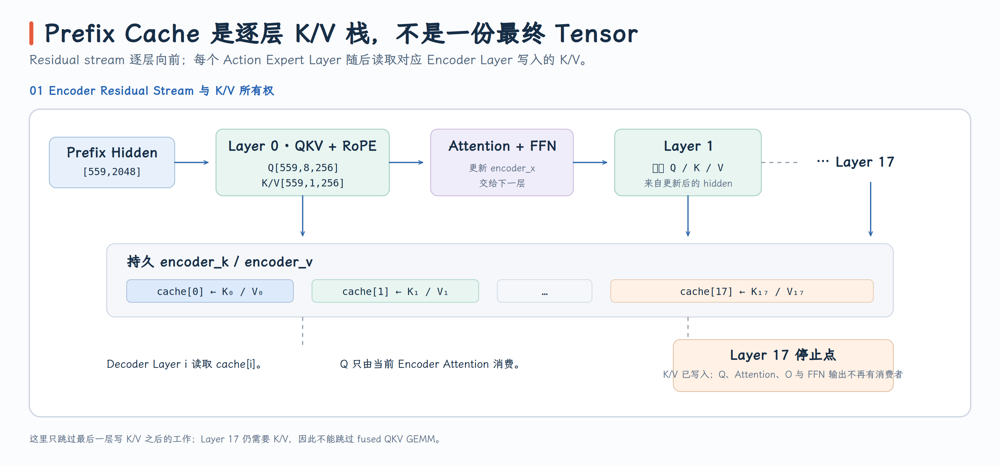
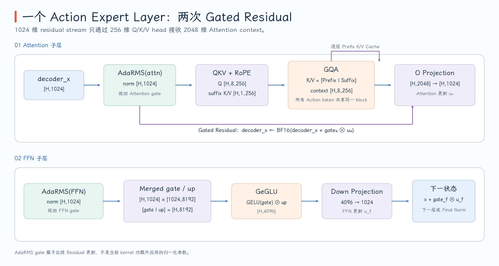

# Pi0.5 模型结构与推理流程

Pi0.5 是 Vision-Language-Action（VLA）模型。图像和自然语言先被编码成 Prefix 条件，Action Expert 再从一段随机噪声出发，反复预测 velocity field 并做 Euler 积分，最后得到整段连续机器人动作。它不是像语言模型那样逐 token 生成，而是每个 denoise step 同时更新整个 action horizon。

FlashRT PR #213 固定了三组模型宽度：

| 模块 | 层数 | Hidden | FFN | Attention |
| --- | ---: | ---: | ---: | --- |
| SigLIP Vision | 27 | 1152 | 4304 | 16 heads × 72 |
| Gemma-2B Prefix Encoder | 18 | 2048 | 16384 | 8 Q heads / 1 KV head × 256 |
| Gemma-300M Action Expert | 18 | 1024 | 4096 | 8 Q heads / 1 KV head × 256 |

对应常量位于 [`torch_pipeline.py`](https://github.com/flashrt-project/FlashRT/blob/e2cf5d1fe7209e3f4fbf212c5b6321467e8f4874/flash_rt/models/pi05/torch_pipeline.py#L14-L18)。本文用一个具体 profile 贯穿整章：2 个视角、47 个 prompt token、10 个 action token、10 步去噪。

## 1. 从两张图像到 559 个 Prefix Token

每个相机视角输入 `224×224×3`。SigLIP patch embedding 使用 `14×14`、stride 14 的 convolution，因此空间网格为

$$
\frac{224}{14}\times\frac{224}{14}=16\times16=256.
$$

两个视角得到 `vision_x [2,256,1152]`，三个视角则是 `[3,256,1152]`。Pipeline 先用 `F.conv2d` 生成 NCHW patch map，再通过

```python
patch.flatten(2).transpose(1, 2)
```

把它变为 `[view,256,1152]`，并加上 256 个位置向量。这里的 transpose 是 view/layout 变换，不是模型中的一次新线性变换。实现见 [`_patch_position` 与 `_vision`](https://github.com/flashrt-project/FlashRT/blob/e2cf5d1fe7209e3f4fbf212c5b6321467e8f4874/flash_rt/models/pi05/torch_pipeline.py#L112-L232)。

Vision 每层保留标准 Pre-Norm Transformer 数据流：

```text
vision_x [V,256,1152]
  → LayerNorm
  → fused QKV Linear [V,256,3456]
  → 16-head self-attention
  → O Linear + residual
  → LayerNorm
  → 1152→4304 GELU FFN →1152
  → residual
```

不同视角在 Vision tensor 的第一维中作为独立 batch 处理，不在 SigLIP 内部相互 attention。它们到 Vision final norm 后，经 `1152→2048` multimodal projector 写入 `encoder_x` 前半段，这时才变成 Prefix sequence 中相邻的 image token。

Prompt 不经过 Vision projector。Tokenizer 直接在 PaliGemma embedding table 中查找 `[prompt_len,2048]`，再乘以

$$
\sqrt{d_{model}}=\sqrt{2048},
$$

保持 OpenPI 的语言 embedding 尺度，见 [`_embed_prompt`](https://github.com/flashrt-project/FlashRT/blob/e2cf5d1fe7209e3f4fbf212c5b6321467e8f4874/flash_rt/frontends/torch/pi05_checkpoint.py#L248-L286) 与 OpenPI [`embed_prefix`](https://github.com/flashrt-project/FlashRT/blob/e2cf5d1fe7209e3f4fbf212c5b6321467e8f4874/training/_vendor/openpi_pi0_pytorch/pi0_pytorch.py#L186-L235)。

于是贯穿例子的 Prefix 为：

```text
view 0 image tokens  [0,256)
view 1 image tokens  [256,512)
prompt tokens        [512,559)
valid_prefix         = 559
```

{ width="95%" }

## 2. Prefix Encoder 生成的是每层 K/V，不是一份最终隐状态

Prefix Encoder 的 hidden width 是 2048，Q 恰好是 `8×256=2048`，K/V 则各只有一个 256-d head。每层 fused projection 因而生成：

```text
encoder_qkv [rows,2560]
              ├─ Q [rows,8,256]  = 2048
              ├─ K [rows,1,256]  = 256
              └─ V [rows,1,256]  = 256
```

这是 Grouped-Query Attention（GQA）：8 个 Query head 共享一组 K/V。共享的是 Key/Value，不是 attention score 或输出；每个 Query head 仍用自己的 Q 计算独立 softmax 和 context。

Checkpoint 已经把 Encoder RMSNorm 的 `(1+w)` 折叠到 Q/K/V 与 FFN gate/up 权重中，所以每层输入只需要无权 RMSNorm：

```python
self.ops.rms_norm(encoder_norm, encoder_x)
for index in range(ENC_L):
    self.gemm.linear(encoder_qkv, encoder_norm, encoder_attn_qkv_w[index])
    ...
```

如果 provider 支持 fused RoPE，`qkv_rope()` 会同时拆分 Q/K/V、旋转 Q/K，并把 K/V 直接写入该层的持久 cache：

```text
encoder_k[layer, :rows, 1, 256]
encoder_v[layer, :rows, 1, 256]
```

随后 attention 只在当前层的 Q 与当前层 K/V 之间计算，O projection 与 FFN 更新 `encoder_x`，下一层再生成自己的 K/V。因此 `encoder_k/v` 的第一维是 layer，不是时间步或视角。完整路径见 [`_encoder`](https://github.com/flashrt-project/FlashRT/blob/e2cf5d1fe7209e3f4fbf212c5b6321467e8f4874/flash_rt/models/pi05/torch_pipeline.py#L234-L344)。

最后一层的提前结束可以用消费者来理解。Action Expert 的第 $i$ 层需要 Prefix Encoder 第 $i$ 层产生的 K/V，所以 layer 17 必须执行 QKV projection 与 RoPE，把 K/V 写入 cache。但不存在 layer 18 来消费 layer 17 的 attention/FFN 输出，因此代码在 K/V 落盘后立即 `break`。要注意，由于 Q/K/V 已经合并成一次 GEMM，这一层仍会计算没有被消费的 Q；省掉的是 Attention、O projection 和 FFN，不是整个最后一层。

{ width="95%" }

`compact_encoder` 只改变物理 row count，不改变数学 Prefix。对 559 个有效 token：

| 模式 | Encoder 实际 rows | K/V 中 Prefix 占用 | 多出的行 |
| --- | ---: | --- | --- |
| compact | 559 | `[0,559)` | 无 |
| padded | 712 | `[0,559)` | `[559,712)` 是清零并被 mask 的 capacity |

这个区分很重要：`prefix_capacity` 是存储布局，`valid_prefix` 才是可见的语义长度。

## 3. 1024 维 Action Expert 为什么能读取 2048 维 Encoder

一个常见疑问是：Prefix Encoder hidden width 为 2048，Action Expert hidden width 为 1024，两者如何在同一个 attention 中连接？

答案是：Attention 比较的不是两条 residual stream 的 hidden width，而是投影后的 head dimension。两个模块都使用

$$
d_{head}=256,\qquad n_q=8,\qquad n_{kv}=1.
$$

Encoder 把 `[559,2048]` hidden 投影成 `[559,1,256]` K/V；Decoder 把 `[10,1024]` hidden 投影成 `[10,8,256]` Q 和 `[10,1,256]` Suffix K/V。Q 与 K 的内维都是 256，因此可直接计算 score；8 个 head 的 context 拼接后得到 2048 维，再由 Decoder O projection 映射回 1024 维 residual stream。

```text
Prefix hidden [559,2048]
  → K/V projection → K,V [559,1,256]

Action hidden [10,1024]
  → Q projection   → Q   [10,8,256]
  → suffix K/V    → K,V [10,1,256]

GQA context [10,8,256]
  → reshape [10,2048]
  → O projection [2048,1024]
  → Action residual [10,1024]
```

所以“Decoder 读 Prefix”并不是把 2048-d Encoder hidden 复制或压缩进 1024-d Decoder，而是两边通过相同的 256-d K/Q 坐标系相交。

每个 denoise step 先把 `noise [10,32]` 投影为 `decoder_x [10,1024]`，然后 18 层重复：

```text
AdaRMS(pre-attention)
  → fused QKV + RoPE
  → GQA over Prefix K/V + current Suffix K/V
  → O projection
  → gated residual + AdaRMS(pre-FFN)
  → merged gate/up GEMM + GeGLU + down projection
  → gated residual + next layer's AdaRMS
```

Suffix K/V 写入同一个 `encoder_k/v[layer]` 的尾部，因此 attention 看到的是一个逻辑上连续的 `[Prefix | Action Suffix]` KV 序列。具体写入与 GQA 调用见 [`_decoder` 的 QKV/attention 段](https://github.com/flashrt-project/FlashRT/blob/e2cf5d1fe7209e3f4fbf212c5b6321467e8f4874/flash_rt/models/pi05/torch_pipeline.py#L400-L444)。

{ width="95%" }

Action Suffix 不是 causal token generation。OpenPI 将 suffix mask 构造为

```python
[1] + [0] * (action_horizon - 1)
```

`make_att_2d_masks()` 对这个数组做 cumulative sum，因此所有 action token 都属于同一个 attention block，可以彼此可见；整个 horizon 是联合去噪的，不是左到右生成。见 OpenPI [`make_att_2d_masks`](https://github.com/flashrt-project/FlashRT/blob/e2cf5d1fe7209e3f4fbf212c5b6321467e8f4874/training/_vendor/openpi_pi0_pytorch/pi0_pytorch.py#L52-L81) 和 [`embed_suffix`](https://github.com/flashrt-project/FlashRT/blob/e2cf5d1fe7209e3f4fbf212c5b6321467e8f4874/training/_vendor/openpi_pi0_pytorch/pi0_pytorch.py#L237-L314)。FlashRT 的 Decoder GQA 因此允许每个 Action Query 读取全部当前 Suffix K/V。

## 4. AdaRMS 把时间步变成每层的 scale、shift 与 gate

Pi0.5 没有把 timestep embedding 拼到每个 action token 上。时间 $t$ 首先经过 1024 维 sinusoidal embedding 与两层 SiLU MLP，得到 `time_cond [1,1024]`；然后每个 norm 的 modulation Linear 生成

```text
modulation [1,3072] = [scale | shift | gate]
```

对一行 hidden $x\in\mathbb{R}^{1024}$，AdaRMS 的计算是

$$
\hat{x}=\frac{x}{\sqrt{\frac{1}{1024}\sum_jx_j^2+\epsilon}},
$$

$$
y=\hat{x}\odot(1+scale)+shift.
$$

Attention 或 FFN 产生 update $u$ 后，该子层的 gate 用在 residual 上：

$$
x_{next}=\operatorname{bf16}(x+u\odot gate).
$$

Pipeline 将 gate 当作显式状态向后传递。循环开始时，第 0 层 pre-attention AdaRMS 返回 attention gate；attention output 与 residual 融合时，`residual_adarms()` 同时使用这个 gate、产生 pre-FFN normalized tensor，并返回 FFN gate；FFN 结束后的下一次 `residual_adarms()` 又产生下一层 pre-attention norm，最后一层则产生 final norm。因此它不是层尾额外做一次独立 Norm，而是把“前一子层的 residual”和“下一子层的 norm”连成一条数据流。对应源码见 [Decoder layer loop](https://github.com/flashrt-project/FlashRT/blob/e2cf5d1fe7209e3f4fbf212c5b6321467e8f4874/flash_rt/models/pi05/torch_pipeline.py#L386-L514)。

在 OpenPI 中，Pi0.5 分支的 `embed_suffix()` 只投影 noisy action，timestep 只用来产生 AdaRMS condition。`state_proj` 仅属于非 Pi0.5 分支，见 [`embed_suffix`](https://github.com/flashrt-project/FlashRT/blob/e2cf5d1fe7209e3f4fbf212c5b6321467e8f4874/training/_vendor/openpi_pi0_pytorch/pi0_pytorch.py#L237-L297)。Pi0.5 的 robot state 由 `format_pi05_prompt()` 进入语言 prompt，不是额外的 suffix state token。

由于推理只使用有限个离散时间步，FlashRT 默认在 pipeline 构造时预计算 `2×18+1=37` 组 modulation。不预计算时仍保留完整 runtime 路径，并有 CPU contract test 要求两条路径在缩小模型上 bit-exact 一致，见 [`test_shared_pipeline_precompute_matches_runtime`](https://github.com/flashrt-project/FlashRT/blob/e2cf5d1fe7209e3f4fbf212c5b6321467e8f4874/tests/test_pi05_torch_pipeline.py#L54-L74)。

## 5. Flow Matching 如何把 `[10,32]` 噪声积分成动作

训练时，OpenPI 在真实动作 $a$ 与噪声 $\epsilon$ 之间采样

$$
x_t=t\epsilon+(1-t)a,
\qquad
u_t=\epsilon-a,
$$

并让模型预测 $u_t$。推理时从 $x_1=\epsilon$ 开始，沿反向时间用显式 Euler 步进：

$$
x_{t+\Delta t}=x_t+\Delta t\,v_\theta(x_t,t\mid Prefix),
\qquad
\Delta t=-\frac{1}{num\_steps}.
$$

OpenPI 先计算一次 Prefix `past_key_values`，然后在 Python `while` 中重复 `denoise_step()` 与 `x_t = x_t + dt * v_t`，见 [`sample_actions`](https://github.com/flashrt-project/FlashRT/blob/e2cf5d1fe7209e3f4fbf212c5b6321467e8f4874/training/_vendor/openpi_pi0_pytorch/pi0_pytorch.py#L375-L419) 和 [`denoise_step`](https://github.com/flashrt-project/FlashRT/blob/e2cf5d1fe7209e3f4fbf212c5b6321467e8f4874/training/_vendor/openpi_pi0_pytorch/pi0_pytorch.py#L421-L461)。

用两步去噪的小例子可以看清时间与符号：

```text
num_steps = 2
dt        = -0.5

t = 1.0:  x_0.5 = x_1.0 - 0.5 · v(x_1.0, 1.0)
t = 0.5:  x_0.0 = x_0.5 - 0.5 · v(x_0.5, 0.5)
```

FlashRT 重建与 `num_steps` 匹配的时间表，例如两步必须生成 $t=1.0,0.5$，而不能从十步表里取前两行 $1.0,0.9$。实现见 [`_build_time_embeddings`](https://github.com/flashrt-project/FlashRT/blob/e2cf5d1fe7209e3f4fbf212c5b6321467e8f4874/flash_rt/amd/frontends/torch/pi05_rdna35.py#L39-L63)。

同时，frontend 把 action output projection 改成

$$
W'_{out}=\Delta t\,W_{out},
\qquad
b'_{out}=\Delta t\,b_{out}.
$$

所以 pipeline 中的最后一次 Linear 直接输出 $\Delta t\,v_t$，`linear_residual()` 可以将它原地累加到 `noise`。这没有改变 Flow Matching 方程，只是把常量乘法从每个 step 移到权重准备阶段。

内部 action 始终是 `[horizon,32]`。Frontend 在所有 denoise step 结束后，先用 checkpoint norm statistics 对 32 个通道反归一化，再截取前 `action_dim` 个公开通道，见 [`infer`](https://github.com/flashrt-project/FlashRT/blob/e2cf5d1fe7209e3f4fbf212c5b6321467e8f4874/flash_rt/amd/frontends/torch/pi05_rdna35.py#L318-L355)。因此以下三个维度不能混为一谈：

```text
ACTION_DIM = 32          模型内部固定宽度
chunk_size / horizon     一次联合生成多少个动作时刻
action_dim               某个机器人对外暴露的动作通道数
```

固定 profile 让 buffer、GEMM shape、Attention mask 和 HIP launch 都能预先建立；它的代价是 frontend 必须严格拒绝超出视角数、prompt capacity、BF16 精度和 gfx1151 范围的输入。因而这个 backend 应被理解为“Pi0.5 已知推理图的专用执行器”，而不是一个接受任意 PaliGemma/Gemma 配置的通用 Transformers runtime。
