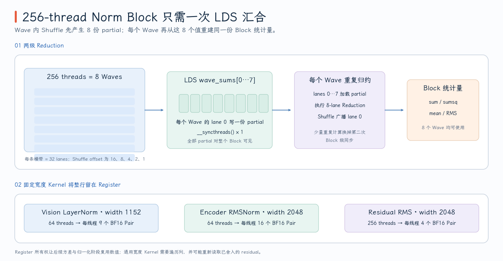

# Normalization Kernel

Normalization 是 PR #213 中 Kernel 数量最多的实现族：3 个 Fixed-width Kernel、3 个 Generic Norm Kernel，再加 2 个 Residual-Norm Fusion Kernel。它们的公共映射是“一个 Workgroup 拥有一整行”，因为 Mean、Variance 或 Mean Square 都必须汇总同一行的全部 Channel。

> 代码块中的中文注释由本文补充，重点标出 Row Ownership、Register/LDS/GMEM 生命周期、Reduction State 与 BF16 舍入边界，不属于上游源码原注释。

实现位于 [`norm_rdna.hip`](https://github.com/flashrt-project/FlashRT/blob/e2cf5d1fe7209e3f4fbf212c5b6321467e8f4874/csrc/amd/kernels/norm_rdna.hip#L1-L384)。所有 Kernel 都使用 FP32 统计量和 BF16 Output，但 Fixed-width 与 Generic 路径对输入行的保留方式不同：前者将整行分散保留在每个 Thread 的 Register Array 中，后者在归约后重新读取 Global Memory。

本章涉及的 8 个 `__global__` Kernel 可以按“统计量、输入保存方式、是否融合 Residual”来读：

| Kernel | 统计量与输出 | 阅读时先抓住的差异 |
| --- | --- | --- |
| `layer_norm_wide_rdna_kernel` | Mean + Variance + Affine | Fixed Width，输入行保留在 Register Array |
| `rms_norm_wide_rdna_kernel` | Mean Square | Fixed Width、无 Weight，输入只读一次 |
| `residual_rms_wide_rdna_kernel` | Residual Sum + RMSNorm | 双输出，并保留 Residual Sum 的 BF16 舍入点 |
| `layer_norm_rdna_kernel` | Mean + Variance + Affine | Generic Width，三次读取 Input |
| `rms_norm_rdna_kernel` | Mean Square | Generic Width，两次读取 Input |
| `adarms_rdna_kernel` | RMSNorm + Scale/Shift | Modulation 使用 `[scale | shift]` |
| `residual_rms_rdna_kernel` | Residual Sum + RMSNorm | 第一个 Pass 写 `output_sum`，第二个 Pass 重读 |
| `residual_adarms_rdna_kernel` | Gated Residual + AdaRMSNorm | Gate、Scale、Shift 分属两个计算阶段 |

源码阅读应先看文件末尾的五个 Host Function，确认哪些 Width 进入 Fixed-width Specialization；再看每个 Kernel 的 Row Ownership 和 Column Loop；最后沿 `local statistic → Wave Reduction → LDS Partial → Block Result → Output` 追踪统计量。Residual Fusion 还要额外追踪 BF16 Cast，因为它既是 Storage Boundary，也是下一阶段 Norm 的输入边界。

## LayerNorm、RMSNorm 和 AdaRMSNorm 的统计量

对一行宽度 $W$ 的输入 $x$，LayerNorm 需要两次归约：

$$
\mu=\frac1W\sum_{j=0}^{W-1}x_j,
\qquad
\sigma^2=\frac1W\sum_{j=0}^{W-1}(x_j-\mu)^2,
$$

$$
y_j=\operatorname{bf16}\left(
(x_j-\mu)\operatorname{rsqrt}(\sigma^2+\epsilon)w_j+b_j
\right).
$$

RMSNorm 不减 Mean，所以只需要一次 Sum-of-squares Reduction：

$$
\rho=\operatorname{rsqrt}\left(\frac1W\sum_jx_j^2+\epsilon\right),
\qquad y_j=\operatorname{bf16}(x_j\rho).
$$

AdaRMSNorm 在 RMSNorm 后使用 Condition 生成的 Scale 和 Shift：

$$
y_j=\operatorname{bf16}\left(x_j\rho(1+scale_j)+shift_j\right).
$$

Python 侧完整 Modulation 是 `[scale | shift | gate]`，但 `adarms_rdna_kernel` 只读取前 `2W` 个 Value。最后的 `gate` 被 Provider 返回给后续 Gated Residual，不参与当前 Norm。这一数据边界可以在 [`adarms_rdna_kernel`](https://github.com/flashrt-project/FlashRT/blob/e2cf5d1fe7209e3f4fbf212c5b6321467e8f4874/csrc/amd/kernels/norm_rdna.hip#L241-L264) 和 [`Rdna35TensorOps.adarms`](https://github.com/flashrt-project/FlashRT/blob/e2cf5d1fe7209e3f4fbf212c5b6321467e8f4874/flash_rt/amd/hardware/rdna35/ops.py#L64-L86) 中交叉确认。

八个 Kernel 都使用 `blockIdx.x=row`。Generic Path 固定 `blockDim.x=256`，Thread `t` 负责：

```text
column = t, t+256, t+512, ... < width
```

每个 Thread 先得到 Local Partial，再经过 Wave32 Shuffle 和 LDS 两级归约得到 Block-wide Statistic。因为一行始终由同一 Workgroup 持有，实现不需要 Atomic、Global Workspace 或第二个 Reduction Kernel。

## 三个 Fixed-width Kernel 如何将输入行留在 Register

Fixed-width Kernel 的关键不是改变 Norm 公式，而是让 Compiler 在编译时知道每个 Thread 必须保留多少个 BF16 Pair：

```cpp
template <int Width, int Threads>
__global__ void ... {
  // 编译期 Width 让每个 Thread 的 Pair 数成为固定数组长度。
  constexpr int kPairsPerThread = Width / (2 * Threads);
  // values 是 Thread-private 的行切片；是否实际全部驻留 VGPR 仍由 Compiler 决定。
  __hip_bfloat162 values[kPairsPerThread];
}
```

| Kernel | `Width` | Threads | Waves | Pair/Thread | Scalar/Thread |
| --- | ---: | ---: | ---: | ---: | ---: |
| `layer_norm_wide_rdna_kernel<1152,64>` | 1152 | 64 | 2 | 9 | 18 |
| `rms_norm_wide_rdna_kernel<2048,64>` | 2048 | 64 | 2 | 16 | 32 |
| `residual_rms_wide_rdna_kernel<2048,256>` | 2048 | 256 | 8 | 4 | 8 |

**`layer_norm_wide_rdna_kernel` 的三个 Pass。** Thread `t` 读取 Pair `t + item*64`，将 9 个 Pair 保存在 `values[9]`，并累加 18 个 FP32 Value 得到 Local Sum。第一次 Block Reduction 得到 Mean 后，Kernel 直接重用 Register 中的 `values[]` 计算 Variance；第二次 Reduction 得到 `inverse_std`，第三个 Pass 仍然使用 `values[]` 做 Affine Transform。输入行只从 GMEM 读取一次，Weight/Bias 在最后阶段各读一次。详见 [`layer_norm_wide_rdna_kernel`](https://github.com/flashrt-project/FlashRT/blob/e2cf5d1fe7209e3f4fbf212c5b6321467e8f4874/csrc/amd/kernels/norm_rdna.hip#L35-L95)。

```cpp
template <int Width, int Threads>
__global__ __launch_bounds__(Threads) void layer_norm_wide_rdna_kernel(
    const __hip_bfloat16 *__restrict__ input,
    const __hip_bfloat16 *__restrict__ weight,
    const __hip_bfloat16 *__restrict__ bias,
    __hip_bfloat16 *__restrict__ output, float epsilon) {
  static_assert(Width % (2 * Threads) == 0);
  constexpr int kPairsPerThread = Width / (2 * Threads);
  constexpr int kWaves = Threads / FLASHRT_RDNA_WAVE_SIZE;
  __shared__ float wave_sums[kWaves];
  // 两次 Block Reduction 使用独立 LDS，避免第二轮过早覆盖第一轮 Partial。
  __shared__ float wave_square_sums[kWaves];

  // row_pair_start 以及后续 pair/column_pair 全部以 BF16x2 Pair 为单位。
  const int row_pair_start = blockIdx.x * (Width / 2);
  const auto *input2 = reinterpret_cast<const __hip_bfloat162 *>(input);
  auto *output2 = reinterpret_cast<__hip_bfloat162 *>(output);
  __hip_bfloat162 values[kPairsPerThread];
  float local_sum = 0.0f;

#pragma unroll
  for (int item = 0; item < kPairsPerThread; ++item) {
    // Thread t 跨 Threads 取 Pair，所有 Thread 合起来恰好覆盖一整行。
    const int pair = row_pair_start + threadIdx.x + item * Threads;
    const __hip_bfloat162 packed = input2[pair];
    const float first = __bfloat162float(packed.x);
    const float second = __bfloat162float(packed.y);
    values[item] = packed;
    local_sum += first + second;
  }

  // 每个 Thread 的 Local Sum -> Wave Partial -> LDS -> Block Mean。
  const float mean = rdna_block_reduce_sum(local_sum, wave_sums) / Width;
  float local_variance = 0.0f;
#pragma unroll
  for (int item = 0; item < kPairsPerThread; ++item) {
    const float first = __bfloat162float(values[item].x) - mean;
    const float second = __bfloat162float(values[item].y) - mean;
    local_variance = fmaf(first, first, local_variance);
    local_variance = fmaf(second, second, local_variance);
  }
  const float variance =
      rdna_block_reduce_sum(local_variance, wave_square_sums) / Width;
  const float inverse_std = rsqrtf(variance + epsilon);
  const auto *weight2 = reinterpret_cast<const __hip_bfloat162 *>(weight);
  const auto *bias2 = reinterpret_cast<const __hip_bfloat162 *>(bias);

#pragma unroll
  for (int item = 0; item < kPairsPerThread; ++item) {
    // 第三个 Pass 重用 values[]，不再读取 input；Weight/Bias 只按 Column 共享于各 Row。
    const int column_pair = threadIdx.x + item * Threads;
    const int pair = row_pair_start + column_pair;
    const __hip_bfloat162 packed_weight = weight2[column_pair];
    const __hip_bfloat162 packed_bias = bias2[column_pair];
    const float first =
        (__bfloat162float(values[item].x) - mean) * inverse_std *
            __bfloat162float(packed_weight.x) +
        __bfloat162float(packed_bias.x);
    const float second =
        (__bfloat162float(values[item].y) - mean) * inverse_std *
            __bfloat162float(packed_weight.y) +
        __bfloat162float(packed_bias.y);
    output2[pair] =
        __hip_bfloat162(__float2bfloat16(first), __float2bfloat16(second));
  }
}
```

这里使用两组 LDS Array，不是为了同时保存 Mean 与 Variance，而是避免第二次 Block Reduction 过早覆盖第一次归约仍可能被其他 Wave 读取的槽位。输入本体则完全不进入 LDS，`values[]` 才是跨三个 Pass 保留数据的关键。

**`rms_norm_wide_rdna_kernel` 的两个 Pass。** Width 2048 被 64 Threads 分成每 Thread 16 Pairs。第一个 Pass 一边存 `values[16]`、一边累加 Square Sum；归约后第二个 Pass 从 Register 中取回输入并乘 `inverse_rms`。它没有 Weight，是因为 Python Provider 只在 `weight is None && width==2048` 时进入该 HIP 路径。详见 [`rms_norm_wide_rdna_kernel`](https://github.com/flashrt-project/FlashRT/blob/e2cf5d1fe7209e3f4fbf212c5b6321467e8f4874/csrc/amd/kernels/norm_rdna.hip#L97-L135)。

```cpp
template <int Width, int Threads>
__global__ __launch_bounds__(Threads) void rms_norm_wide_rdna_kernel(
    const __hip_bfloat16 *__restrict__ input,
    __hip_bfloat16 *__restrict__ output, float epsilon) {
  static_assert(Width % (2 * Threads) == 0);
  constexpr int kPairsPerThread = Width / (2 * Threads);
  constexpr int kWaves = Threads / FLASHRT_RDNA_WAVE_SIZE;
  __shared__ float wave_sums[kWaves];
  // 一个 Workgroup 拥有一行；每个 Thread 保存 kPairsPerThread 个 Pair。
  const int row_pair_start = blockIdx.x * (Width / 2);
  const auto *input2 = reinterpret_cast<const __hip_bfloat162 *>(input);
  auto *output2 = reinterpret_cast<__hip_bfloat162 *>(output);
  __hip_bfloat162 values[kPairsPerThread];
  float local_square_sum = 0.0f;

#pragma unroll
  for (int item = 0; item < kPairsPerThread; ++item) {
    const int pair = row_pair_start + threadIdx.x + item * Threads;
    const __hip_bfloat162 packed = input2[pair];
    const float first = __bfloat162float(packed.x);
    const float second = __bfloat162float(packed.y);
    values[item] = packed;
    // 统计量始终用 FP32 累加，BF16 只作为输入/输出存储格式。
    local_square_sum = fmaf(first, first, local_square_sum);
    local_square_sum = fmaf(second, second, local_square_sum);
  }

  const float inverse_rms = rsqrtf(
      rdna_block_reduce_sum(local_square_sum, wave_sums) / Width + epsilon);
#pragma unroll
  for (int item = 0; item < kPairsPerThread; ++item) {
    // 输出 Pass 从 Thread-private values[] 取回输入，不重读 GMEM。
    const int pair = row_pair_start + threadIdx.x + item * Threads;
    output2[pair] = __hip_bfloat162(
        __float2bfloat16(__bfloat162float(values[item].x) * inverse_rms),
        __float2bfloat16(__bfloat162float(values[item].y) * inverse_rms));
  }
}
```

与 LayerNorm 对比时，重点不是少了几行代码，而是依赖链缩短为“一次统计量归约 → 一次输出 Pass”。没有 Mean，也就不需要第二组 LDS Partial 或第二次遍历 `values[]` 计算中心化方差。

**`residual_rms_wide_rdna_kernel` 的双输出。** 每个 Thread 读取 4 组 `update/residual` Pair，先在 FP32 中相加，然后立即舍入为 BF16 `summed`。`summed` 既写入 `output_sum`，也保留在 `values[4]` 中参与 Square Sum；归约后直接从 Register 生成 `output_norm`。它同时避免了独立 Residual Launch 和对 `output_sum` 的二次 GMEM 读取，代码见 [`residual_rms_wide_rdna_kernel`](https://github.com/flashrt-project/FlashRT/blob/e2cf5d1fe7209e3f4fbf212c5b6321467e8f4874/csrc/amd/kernels/norm_rdna.hip#L137-L184)。

```cpp
template <int Width, int Threads>
__global__ __launch_bounds__(Threads) void residual_rms_wide_rdna_kernel(
    const __hip_bfloat16 *__restrict__ update,
    const __hip_bfloat16 *__restrict__ residual,
    __hip_bfloat16 *__restrict__ output_sum,
    __hip_bfloat16 *__restrict__ output_norm, float epsilon) {
  static_assert(Width % (2 * Threads) == 0);
  constexpr int kPairsPerThread = Width / (2 * Threads);
  constexpr int kWaves = Threads / FLASHRT_RDNA_WAVE_SIZE;
  __shared__ float wave_sums[kWaves];
  // row_pair_start 的单位是 Pair；output_sum/output_norm 使用相同 Pair Layout。
  const int row_pair_start = blockIdx.x * (Width / 2);
  const auto *update2 = reinterpret_cast<const __hip_bfloat162 *>(update);
  const auto *residual2 = reinterpret_cast<const __hip_bfloat162 *>(residual);
  auto *sum2 = reinterpret_cast<__hip_bfloat162 *>(output_sum);
  auto *norm2 = reinterpret_cast<__hip_bfloat162 *>(output_norm);
  __hip_bfloat162 values[kPairsPerThread];
  float local_square_sum = 0.0f;

#pragma unroll
  for (int item = 0; item < kPairsPerThread; ++item) {
    const int pair = row_pair_start + threadIdx.x + item * Threads;
    const __hip_bfloat162 update_value = update2[pair];
    const __hip_bfloat162 residual_value = residual2[pair];
    // 先将 FP32 Residual Sum 舍入为 BF16，保留 Unfused Graph 的可观察边界。
    const __hip_bfloat162 summed(
        __float2bfloat16(__bfloat162float(update_value.x) +
                         __bfloat162float(residual_value.x)),
        __float2bfloat16(__bfloat162float(update_value.y) +
                         __bfloat162float(residual_value.y)));
    sum2[pair] = summed;
    // 同一个已舍入 Pair 一份写入 GMEM，一份留作当前 Kernel 的 Norm 输入。
    values[item] = summed;
    const float first = __bfloat162float(summed.x);
    const float second = __bfloat162float(summed.y);
    local_square_sum = fmaf(first, first, local_square_sum);
    local_square_sum = fmaf(second, second, local_square_sum);
  }

  const float inverse_rms = rsqrtf(
      rdna_block_reduce_sum(local_square_sum, wave_sums) / Width + epsilon);
#pragma unroll
  for (int item = 0; item < kPairsPerThread; ++item) {
    const int pair = row_pair_start + threadIdx.x + item * Threads;
    norm2[pair] = __hip_bfloat162(
        __float2bfloat16(__bfloat162float(values[item].x) * inverse_rms),
        __float2bfloat16(__bfloat162float(values[item].y) * inverse_rms));
  }
}
```

`sum2[pair] = summed` 与 `values[item] = summed` 保存的是同一个已经舍入的 Pair：前者让后续层在 GMEM 中看到 Residual Stream，后者让当前 Kernel 不必为了 Norm 再从 GMEM 读回来。

{ width="95%" }

固定宽度并不是免费的。`values[16]` 等 Register Array 会增加 VGPR Pressure，而减少 Thread 数又会改变 Occupancy。PR 只对 Pi0.5 的 1152/2048 Hot Width 保留这些 Specialization，其他 Width 仍走 Generic Kernel，说明它们是 Shape-specific Trade-off，而不是“寄存器越多越好”的通用结论。

## 三个 Generic Norm Kernel 如何支持任意 Width

`layer_norm_rdna_kernel`、`rms_norm_rdna_kernel` 和 `adarms_rdna_kernel` 都使用 256 Threads，通过 Grid-stride Column Loop 覆盖任意 Width。

**`layer_norm_rdna_kernel`。** 它不能将长度未知的整行放进固定 Register Array，所以会从 GMEM 读取三次 Input：第一次求 Sum，第二次求 Variance，第三次做 Normalize + Affine。两次 `rdna_block_reduce_sum` 各有一次 Block Barrier。不过每个 Thread 仍然只写自己遍历的 Column，所以归一化后的 Store 无需同步。

**`rms_norm_rdna_kernel`。** 第一个 Pass 读 Input 并累加 $x^2$，第二个 Pass 重读 Input 并写出 `x*inverse_rms`。相比 LayerNorm，它少一次 Reduction 和一次 Input Pass，因为不需要先求 Mean。

**`adarms_rdna_kernel`。** 它的 Reduction 与 Generic RMSNorm 相同，只在第二个 Pass 额外读取 `modulation[column]` 和 `modulation[width+column]`。Scale 用 `1+scale` 而不是直接 `scale`，这使 Zero Modulation 表示 Identity Scale。

三条 Generic 路径的源码把上述 Pass 结构直接展开。先看 LayerNorm，它对同一个 `input[row_start+column]` 进行了三轮 Grid-stride 访问：

```cpp
__global__ __launch_bounds__(kNormThreads) void layer_norm_rdna_kernel(
    const __hip_bfloat16 *__restrict__ input,
    const __hip_bfloat16 *__restrict__ weight,
    const __hip_bfloat16 *__restrict__ bias,
    __hip_bfloat16 *__restrict__ output, int width, float epsilon) {
  __shared__ float wave_sums[kMaxWaves];
  const int row = blockIdx.x;
  const int row_start = row * width;

  float local_sum = 0.0f;
  // Thread t 拥有 column=t,t+blockDim.x,...；无 Column 的 Thread 仍要参加后续 Barrier。
  for (int column = threadIdx.x; column < width; column += blockDim.x) {
    local_sum += __bfloat162float(input[row_start + column]);
  }
  const float mean = rdna_block_reduce_sum(local_sum, wave_sums) / width;

  float local_variance = 0.0f;
  // Generic Width 无法声明固定 Register Array，因此第二个 Pass 重读 GMEM。
  for (int column = threadIdx.x; column < width; column += blockDim.x) {
    const float centered = __bfloat162float(input[row_start + column]) - mean;
    local_variance += centered * centered;
  }
  const float variance =
      // 注意：这里复用 wave_sums；Helper 没有 Reader 完成后的第二个 Barrier。
      rdna_block_reduce_sum(local_variance, wave_sums) / width;
  const float inverse_std = rsqrtf(variance + epsilon);

  for (int column = threadIdx.x; column < width; column += blockDim.x) {
    // 第三个 Pass 再次读取 input，并由原 Thread Owner 写回对应 Column。
    const float value =
        (__bfloat162float(input[row_start + column]) - mean) * inverse_std;
    output[row_start + column] =
        __float2bfloat16(value * __bfloat162float(weight[column]) +
                         __bfloat162float(bias[column]));
  }
}
```

这里源码在两次 Reduction 之间复用了同一个 `wave_sums`。需要注意：`rdna_block_reduce_sum` 内部的 Barrier 只保证第一批 Partial Store 先于后续 Load，并没有显式保证“所有 Wave 都完成 Load”之后才允许下一次 Reduction 写回同一数组。Fixed-width LayerNorm 为两次归约使用 `wave_sums` 与 `wave_square_sums` 两组 LDS，规避了这种跨调用复用；Generic LayerNorm 则依赖两次调用之间的 Variance Loop 拉开执行距离。测试覆盖了当前目标 Shape，但从严格的同步语义看，这仍是阅读和后续维护时应重点复核的边界，而不能简单理解为 Barrier 已经覆盖整个数组生命周期。

RMSNorm 与 AdaRMSNorm 只需要一次归约，差异集中在第二个 Pass：

```cpp
__global__ __launch_bounds__(kNormThreads) void rms_norm_rdna_kernel(
    const __hip_bfloat16 *__restrict__ input,
    __hip_bfloat16 *__restrict__ output, int width, float epsilon) {
  __shared__ float wave_sums[kMaxWaves];
  // blockIdx.x 选择 Row，Thread 在该 Row 内做 Grid-stride Column Loop。
  const int row_start = blockIdx.x * width;
  float local_square_sum = 0.0f;
  for (int column = threadIdx.x; column < width; column += blockDim.x) {
    const float value = __bfloat162float(input[row_start + column]);
    local_square_sum += value * value;
  }
  const float inverse_rms = rsqrtf(
      rdna_block_reduce_sum(local_square_sum, wave_sums) / width + epsilon);
  // Reduction 返回后所有 Thread 都持有相同 inverse_rms。
  for (int column = threadIdx.x; column < width; column += blockDim.x) {
    output[row_start + column] = __float2bfloat16(
        __bfloat162float(input[row_start + column]) * inverse_rms);
  }
}

__global__ __launch_bounds__(kNormThreads) void adarms_rdna_kernel(
    const __hip_bfloat16 *__restrict__ input,
    const __hip_bfloat16 *__restrict__ modulation,
    __hip_bfloat16 *__restrict__ output, int width, float epsilon) {
  __shared__ float wave_sums[kMaxWaves];
  const int row_start = blockIdx.x * width;
  float local_square_sum = 0.0f;
  for (int column = threadIdx.x; column < width; column += blockDim.x) {
    const float value = __bfloat162float(input[row_start + column]);
    local_square_sum += value * value;
  }
  const float inverse_rms = rsqrtf(
      rdna_block_reduce_sum(local_square_sum, wave_sums) / width + epsilon);
  for (int column = threadIdx.x; column < width; column += blockDim.x) {
    const float normalized =
        __bfloat162float(input[row_start + column]) * inverse_rms;
    // modulation 不带 row_start：同一份 [scale | shift] 广播给全部 Token Row。
    const float scale = __bfloat162float(modulation[column]);
    const float shift = __bfloat162float(modulation[width + column]);
    output[row_start + column] =
        __float2bfloat16(normalized * (1.0f + scale) + shift);
  }
}
```

`modulation` 没有 `row_start`，因为当前 Provider 为所有 Token Row 共享同一份 Condition Result；而 `input/output` 必须带 `row_start`。这类“不对称 Address Formula”通常正是判断 Broadcast 语义的关键。

三者的主循环都是：

```cpp
for (int column = threadIdx.x; column < width; column += blockDim.x) {
  // 这个 Thread 处理 column, column+256, ...
}
```

当 `width<256` 时，高编号 Thread 的 Local Partial 为 0，仍必须参加 Block Reduction 中的 Barrier，不能因为“没有 Column”就提前 `return`。这是 Reduction Kernel 与无 Barrier Elementwise Kernel 在 Tail Handling 上的根本差别。

## Residual-Norm Fusion 为什么要先舍入 BF16

`residual_rms_rdna_kernel` 和 `residual_adarms_rdna_kernel` 都产生两个 Tensor：向后传递的 BF16 Residual Stream `output_sum`，以及当前子层要消费的 `output_norm`。

未融合图中，Residual Kernel 会先写出 BF16，Norm Kernel 再将它读回 FP32。因此融合实现必须保留这个可观察的舍入点：

$$
s_j=\operatorname{bf16}\left(
\operatorname{float}(residual_j)+
\operatorname{float}(update_j)\operatorname{float}(gate_j)
\right),
$$

$$
\rho=\operatorname{rsqrt}\left(
\frac1W\sum_j\operatorname{float}(s_j)^2+\epsilon
\right).
$$

无 Gate 的 Residual-RMS 只需去掉 $gate_j$。如果 Kernel 直接用未舍入的 FP32 `residual + update*gate` 统计 RMS，即使最后输出仍转成 BF16，Normalization Factor 也可能已经不同。

Generic `residual_rms_rdna_kernel` 的第一个 Pass 完成 `sum → BF16 round → output_sum store → FP32 square`；Block Reduction 得到 `inverse_rms` 后，第二个 Pass 重读 `output_sum` 生成 `output_norm`。`residual_adarms_rdna_kernel` 在第一个 Pass 增加 Gate Multiply，在第二个 Pass 增加 Scale/Shift，但 Storage Lifecycle 相同。完整代码见 [`generic residual kernels`](https://github.com/flashrt-project/FlashRT/blob/e2cf5d1fe7209e3f4fbf212c5b6321467e8f4874/csrc/amd/kernels/norm_rdna.hip#L266-L323)。

```cpp
__global__ __launch_bounds__(kNormThreads) void residual_rms_rdna_kernel(
    const __hip_bfloat16 *__restrict__ update,
    const __hip_bfloat16 *__restrict__ residual,
    __hip_bfloat16 *__restrict__ output_sum,
    __hip_bfloat16 *__restrict__ output_norm, int width, float epsilon) {
  __shared__ float wave_sums[kMaxWaves];
  // 一个 Workgroup 独占一行；output_sum 是阶段间可见的 BF16 中间 Tensor。
  const int row_start = blockIdx.x * width;
  float local_square_sum = 0.0f;
  for (int column = threadIdx.x; column < width; column += blockDim.x) {
    const int index = row_start + column;
    // FP32 Add 后立即舍入 BF16；RMS 统计量必须观察这个 summed，而非未舍入临时值。
    const __hip_bfloat16 summed = __float2bfloat16(
        __bfloat162float(residual[index]) + __bfloat162float(update[index]));
    output_sum[index] = summed;
    const float value = __bfloat162float(summed);
    local_square_sum += value * value;
  }
  const float inverse_rms = rsqrtf(
      rdna_block_reduce_sum(local_square_sum, wave_sums) / width + epsilon);
  // 第二个 Pass 从 GMEM 重读 output_sum，Norm 与后续消费者看到完全相同的 BF16 Value。
  for (int column = threadIdx.x; column < width; column += blockDim.x) {
    const int index = row_start + column;
    output_norm[index] =
        __float2bfloat16(__bfloat162float(output_sum[index]) * inverse_rms);
  }
}

__global__ __launch_bounds__(kNormThreads) void residual_adarms_rdna_kernel(
    const __hip_bfloat16 *__restrict__ update,
    const __hip_bfloat16 *__restrict__ residual,
    const __hip_bfloat16 *__restrict__ gate,
    const __hip_bfloat16 *__restrict__ modulation,
    __hip_bfloat16 *__restrict__ output_sum,
    __hip_bfloat16 *__restrict__ output_norm, int width, float epsilon) {
  __shared__ float wave_sums[kMaxWaves];
  const int row_start = blockIdx.x * width;
  float local_square_sum = 0.0f;
  for (int column = threadIdx.x; column < width; column += blockDim.x) {
    const int index = row_start + column;
    // gate[column] 按 Column 广播；它不随 Token Row 改变。
    const __hip_bfloat16 summed = __float2bfloat16(
        __bfloat162float(residual[index]) +
        __bfloat162float(update[index]) * __bfloat162float(gate[column]));
    output_sum[index] = summed;
    const float value = __bfloat162float(summed);
    local_square_sum += value * value;
  }
  const float inverse_rms = rsqrtf(
      rdna_block_reduce_sum(local_square_sum, wave_sums) / width + epsilon);
  for (int column = threadIdx.x; column < width; column += blockDim.x) {
    const int index = row_start + column;
    const float normalized = __bfloat162float(output_sum[index]) * inverse_rms;
    // 第二阶段才消费 [scale | shift]，并继续以已物化的 output_sum 为 Norm 输入。
    const float scale = __bfloat162float(modulation[column]);
    const float shift = __bfloat162float(modulation[width + column]);
    output_norm[index] = __float2bfloat16(normalized * (1.0f + scale) + shift);
  }
}
```

第二个 Pass 选择重读 `output_sum` 而不是重新计算 `residual + update*gate`，一方面复用了刚刚物化的结果，另一方面强制 Norm 观察到与后续消费者完全相同的 BF16 Value。

Host Dispatch 与 Python Provider 共同决定最终路径：

| Provider 操作 | HIP Kernel | 生产路径条件 |
| --- | --- | --- |
| `layer_norm` | `layer_norm_wide_rdna_kernel<1152,64>` | `fused_large_ops && width==1152` |
| `rms_norm` | `rms_norm_wide_rdna_kernel<2048,64>` | `fused_large_ops && weight is None && width==2048` |
| `adarms` | `adarms_rdna_kernel` | `fused_decoder_ops && width==1024` |
| `residual_rms` | `residual_rms_wide_rdna_kernel<2048,256>` | `fused_large_ops && width==2048` |
| `residual_adarms` | `residual_adarms_rdna_kernel` | `fused_decoder_ops && cond is None && modulation exists && width==1024` |

Native Host Function 中的 Generic LayerNorm/RMSNorm/Residual-RMS 保留了更宽的 ABI 能力，但当前 Python Provider 不会把所有 Width 都路由进 HIP。这个区别很重要：“源码中有 Generic Kernel”说明 Native Implementation 能处理该 Shape，但只有 Provider Contract 才说明它是否位于当前 Pi0.5 生产路径。

例如三个存在 Fixed-width Specialization 的 Host Function 明确采用“命中 Hot Width 就提前返回，否则进入 Generic Kernel”的结构：

```cpp
void layer_norm_rdna(..., int rows, int width, float epsilon,
                     hipStream_t stream) {
  // Hot Width 命中 Fixed-width Template；否则保留 Generic Native Fallback。
  if (width == 1152) {
    layer_norm_wide_rdna_kernel<1152, 64><<<rows, 64, 0, stream>>>(...);
    return;
  }
  layer_norm_rdna_kernel<<<rows, kNormThreads, 0, stream>>>(...);
}

void rms_norm_rdna(..., int rows, int width, float epsilon,
                   hipStream_t stream) {
  // Template Parameter 固化 Register Array 长度和 Launch Block Size。
  if (width == 2048) {
    rms_norm_wide_rdna_kernel<2048, 64><<<rows, 64, 0, stream>>>(...);
    return;
  }
  rms_norm_rdna_kernel<<<rows, kNormThreads, 0, stream>>>(...);
}

void residual_rms_rdna(..., int rows, int width, float epsilon,
                       hipStream_t stream) {
  // 同一公开 Native Entry 内完成 Shape Dispatch，不改变调用侧 Tensor Contract。
  if (width == 2048) {
    residual_rms_wide_rdna_kernel<2048, 256>
        <<<rows, 256, 0, stream>>>(...);
    return;
  }
  residual_rms_rdna_kernel<<<rows, kNormThreads, 0, stream>>>(...);
}
```

这里的 `...` 只省略重复 Pointer Argument，分派条件、Template Parameter、Grid 和 Block 均保持源码原样。它们说明 Fixed-width Kernel 并不是另一个公开 API，而是同一 Native Entry 内部的 Shape Specialization。
