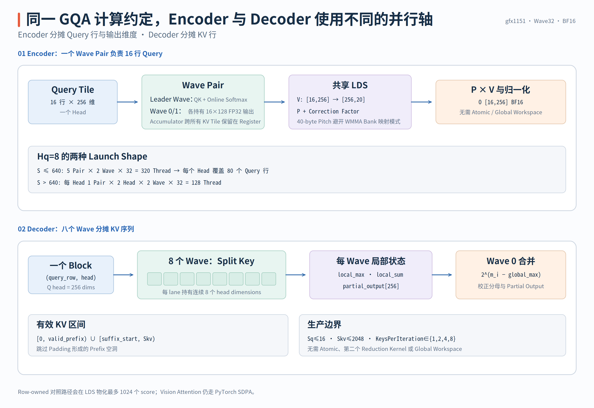
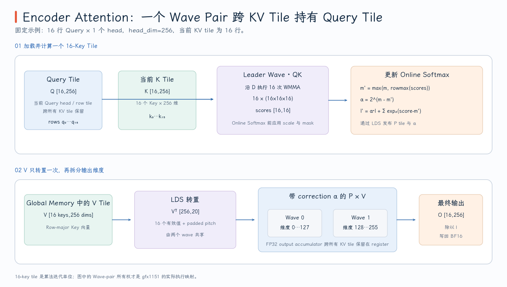

# Encoder FlashAttention Kernel

Pi0.5 Prefix Encoder 一次需要处理数百个 Query Row，Q 和 K/V 的 Sequence Length 基本一致。`attention_encoder_gqa_rdna_kernel` 因此沿 Query 分 Tile，再顺序流过所有 KV Tile；它不物化完整 Score Matrix，而是使用 Online Softmax 一边扫描 K/V、一边更新输出。

> 代码块中的中文注释由本文补充，重点标出 Wave Pair Ownership、LDS Producer/Consumer、Tail Predicate 与 Online-softmax State，不属于上游源码原注释。

源码中只有一个 Templated `__global__` Body，但 Host 会根据 Query Rows 和 Head Count 实例化出不同 Launch Shape。实现位于 [`encoder_flash_rdna.hip`](https://github.com/flashrt-project/FlashRT/blob/e2cf5d1fe7209e3f4fbf212c5b6321467e8f4874/csrc/amd/attention/encoder_flash_rdna.hip#L1-L351)。

| 源码对象 | 负责的工作 | 阅读时先抓住什么 |
| --- | --- | --- |
| `attention_encoder_gqa_rdna_kernel<QueryTilesPerHead,HeadsPerGroup,RuntimeHeadStride>` | QK、Online Softmax、P×V 与 Output Epilogue | 一个 Wave Pair 拥有一个 `16×256` Query/Output Tile |
| `EncoderAttentionLdsRdna` | 在不同 Producer/Consumer Wave 间交换 V、P 和 Softmax State | 每个字段由谁写、在哪个 Barrier 后读取 |
| `encoder_row_reduce_max/sum_rdna` | 对 WMMA 产生的一行 16 个 Score 做 Subgroup Reduction | XOR Offset 只覆盖 16-lane Row |
| `attention_encoder_gqa_rdna` | 校验 Shape 并选择四种 Template Launch | `QueryTilesPerHead × HeadsPerGroup × 2 Waves` 如何决定 Block Size |

阅读顺序应从 Host Template 组合开始，先确定一个 Workgroup 包含多少 Wave Pair；随后固定其中一个 Pair，依次跟踪 `QK → Tile Softmax → P×V`；最后再扩大到整个 Workgroup，检查共享 V Tile、两次 Barrier 和下一轮 KV Tile 的 LDS Reuse。若直接从 WMMA Intrinsic 开始，容易知道“做了矩阵乘”，却看不出不同 Wave 之间如何分工。

## Wave Pair 如何拥有 16 行 Query 和 256 维输出

Kernel 的 Tensor Contract 是：

```text
Q : [S, Hq, 256] BF16
K : [S, 1,  256] BF16
V : [S, 1,  256] BF16
O : [S, Hq, 256] BF16

1 <= S <= 4096
1 <= Hq <= 16
valid KV rows = [0, valid_kv_rows)
```

K/V 只有一个共享 Head，但每个 Query Head 仍有自己的 Score、Softmax State 和 Output。这个 Kernel 的基本协作单位是 2 Waves：

```text
Wave Pair owns:
  Q tile : 16 rows × 256 dims × one query head
  O tile : 16 rows × 256 dims

leader wave (output_wave=0): QK + Online Softmax
both waves:                 P × V
wave 0 output half:         dims [0,128)
wave 1 output half:         dims [128,256)
```

Thread 索引被分解为：

```cpp
template <int QueryTilesPerHead, int HeadsPerGroup, bool RuntimeHeadStride>
__global__ __launch_bounds__(QueryTilesPerHead * HeadsPerGroup *
                                 kEncoderWavesPerQueryTile *
                                 FLASHRT_RDNA_WAVE_SIZE,
                             2) void attention_encoder_gqa_rdna_kernel(
    const __hip_bfloat16 *__restrict__ query,
    const __hip_bfloat16 *__restrict__ key,
    const __hip_bfloat16 *__restrict__ value,
    __hip_bfloat16 *__restrict__ output, int query_rows, int valid_kv_rows,
    int query_heads, float scale_log2) {
  __shared__ __align__(16) EncoderAttentionLdsRdna lds;
  constexpr int wave_pairs = QueryTilesPerHead * HeadsPerGroup;
  constexpr int threads =
      wave_pairs * kEncoderWavesPerQueryTile * FLASHRT_RDNA_WAVE_SIZE;
  constexpr int query_tile = QueryTilesPerHead * kEncoderWaveQueryTile;
  const int tid = threadIdx.x;
  const int wave = tid / FLASHRT_RDNA_WAVE_SIZE;
  const int lane = tid & (FLASHRT_RDNA_WAVE_SIZE - 1);
  // fragment_row 是 WMMA Operand 的 16-lane 坐标；不是最终 Accumulator Row。
  const int fragment_row = lane & 15;
  // 每两个 Wave 组成一个 Pair，共同拥有一个 16-row Query/Output Tile。
  const int wave_pair = wave / kEncoderWavesPerQueryTile;
  const int head_in_group = wave_pair / QueryTilesPerHead;
  const int query_tile_in_head = wave_pair % QueryTilesPerHead;
  // Pair 内 Wave 0/1 分别拥有 Output Dim [0,128) / [128,256)。
  const int output_wave = wave % kEncoderWavesPerQueryTile;
  const int head = blockIdx.y * HeadsPerGroup + head_in_group;
  const int head_stride = RuntimeHeadStride ? query_heads : kEncoderHeads;
  const int query_start = blockIdx.x * query_tile +
                          query_tile_in_head * kEncoderWaveQueryTile;
  // ...
}
```

这段 Template Index 是整章最重要的源码。`wave_pair` 先决定一个 16-row Query Tile，`head_in_group/query_tile_in_head` 再把 Pair 映射到 Head 与 Row Tile，最后 `output_wave` 把 Pair 中的两个 Wave 分成 Output Dim 的前后两半。`RuntimeHeadStride` 只影响地址跨度，不改变 Wave Pair 的计算结构。

`fragment_row` 在 Lane 0–15 和 Lane 16–31 中各出现一次，这与 gfx11 `16×16×16` BF16 WMMA Accumulator 的行映射配合。每个 Lane 拥有 8 个 FP32 Accumulator Element，其行号是：

```cpp
row = 2 * element + (lane >> 4);
```

Lane 0–15 产生偶数行，Lane 16–31 产生奇数行；8 个 Accumulator Element 扩展到 16 行。`fragment_row=lane&15` 则表示当前 Lane 在 WMMA Fragment 中的 Column Position。这两个坐标不能混淆：一个用来解释 Accumulator Output Row，另一个用来选择 Operand Fragment 中的位置。映射 Helper 见 [`encoder_accumulator_row_rdna`](https://github.com/flashrt-project/FlashRT/blob/e2cf5d1fe7209e3f4fbf212c5b6321467e8f4874/csrc/amd/attention/encoder_flash_rdna.hip#L69-L72)。

{ width="95%" }

## 一个 KV Tile 内部的 V Staging、QK 和 P×V

Head Dim 256 被分为 16 个 Dim Tile，每个 Dim Tile 的 K 宽度是 16。KV Sequence 也以 16 Rows 为一个 Tile。每轮 `key_start += 16` 内部有三个阶段。

**Phase A：整个 Workgroup 协作转置 V Tile。** `V[16,256]` 共有 `16×(256/8)=512` 个 8-BF16 Vector。Thread `tid` 以 `vector += threads` 遍历这些 Vector，每次从 GMEM 读连续 8 BF16，再将它们写成 LDS 中的 `[dim][key_in_tile]`：

```text
GMEM V tile       [key=16][dim=256]
                         ↓ cooperative load + transpose
LDS value tile    [dim=256][key pitch=20]
```

这个 Transpose 不改变 Attention 数学，目的是让后续 `P[16,16] × V[16,16]` 中的 V Fragment 能够从 LDS 连续读取。一个 Workgroup 中的多个 Wave Pair 共享同一份 V Tile，因此 V 不会为每个 Query Tile 重复从 GMEM 加载。末尾不满 16 行时，无效 V Row 被填 0，但所有 Thread 仍然进入 Barrier。

实际 Cooperative Load 没有使用额外 Vector Type，而是每个迭代显式搬运 8 个 BF16：

```cpp
constexpr int vectors_per_value_row = kEncoderDim / 8;
for (int key_start = 0; key_start < valid_kv_rows;
     key_start += kEncoderKeyTile) {
  const int key_count = min(kEncoderKeyTile, valid_kv_rows - key_start);
  // vector 的单位是 8 个连续 BF16；整个 Workgroup 协作搬运同一份 V Tile。
  for (int vector = tid;
       vector < kEncoderKeyTile * vectors_per_value_row;
       vector += threads) {
    const int key_in_tile = vector / vectors_per_value_row;
    const int dim_start =
        (vector - key_in_tile * vectors_per_value_row) * 8;
    __bf16 loaded[8];
    if (key_in_tile < key_count) {
      // GMEM 按 [key][dim] 连续读取 8 个 BF16。
      const __hip_bfloat16 *source =
          value + static_cast<size_t>(key_start + key_in_tile) *
                      kEncoderDim +
          dim_start;
#pragma unroll
      for (int item = 0; item < 8; ++item) {
        loaded[item] = source[item];
      }
    } else {
      // Tail Key Row 仍写入 LDS，但写成 0，保证所有 Thread 走相同 Barrier 序列。
#pragma unroll
      for (int item = 0; item < 8; ++item) {
        loaded[item] = __float2bfloat16(0.0f);
      }
    }
#pragma unroll
    for (int item = 0; item < 8; ++item) {
      // LDS 改为 [dim][key]，供后续 P[16,16] x V[16,16] 连续取 Fragment。
      lds.value_transposed[dim_start + item][key_in_tile] = loaded[item];
    }
  }
```

`vector` 是“8-BF16 Chunk”的线性编号。先除以 `vectors_per_value_row=32` 得到 Key Row，再用余数乘 8 得到 Dim Offset。GMEM 读取沿 Dim 连续，LDS 写入则交换了两个坐标。

**Phase B：每个 Pair 的 Leader Wave 计算 QK。** `output_wave==0` 的 Wave 将 `Q[16,256]` 与 `K[16,256]` 沿 Head Dim 分成 16 份，连续执行 16 次 WMMA：

```cpp
if (output_wave == 0) {
  // Pair 的 Leader Wave 独占 QK 与 Online Softmax State；另一个 Wave 不重复计算 Score。
  Floatx8EncoderRdna score_accumulator =
      (Floatx8EncoderRdna){0.0f, 0.0f, 0.0f, 0.0f,
                          0.0f, 0.0f, 0.0f, 0.0f};
  const int query_row = min(query_start + fragment_row, query_rows - 1);
  const int key_row = key_start + min(fragment_row, key_count - 1);
  // Clamp 只保证 Load Address 合法；Tail 是否有效由后面的 Predicate 决定。
  const __bf16 *query_head = reinterpret_cast<const __bf16 *>(
      query + (static_cast<size_t>(query_row) * head_stride + head) *
                  kEncoderDim);
  const __bf16 *key_head = reinterpret_cast<const __bf16 *>(
      key + static_cast<size_t>(key_row) * kEncoderDim);
#pragma unroll
  for (int dim = 0; dim < kEncoderDim; dim += 16) {
    // 16 次 WMMA 沿 Head Dim 累加，得到当前 16x16 QK Tile。
    score_accumulator = __builtin_amdgcn_wmma_f32_16x16x16_bf16_w32(
        load_encoder_fragment_rdna(query_head + dim),
        load_encoder_fragment_rdna(key_head + dim), score_accumulator);
  }

  float probability[8];
  float next_max[8];
  // fragment_row 对应 Key-in-tile；无效 Tail Key 的 Probability 必须为 0。
  const bool valid_key = fragment_row < key_count;
#pragma unroll
  for (int item = 0; item < 8; ++item) {
    const float score = valid_key
                            ? score_accumulator[item] * scale_log2
                            : kEncoderNegInf;
    next_max[item] =
        encoder_row_reduce_max_rdna(fmaxf(running_max[item], score));
    probability[item] = score;
  }
#pragma unroll
  for (int item = 0; item < 8; ++item) {
    const float correction = exp2f(running_max[item] - next_max[item]);
    const float unnormalized =
        valid_key ? exp2f(probability[item] - next_max[item]) : 0.0f;
    const float tile_sum = encoder_row_reduce_sum_rdna(unnormalized);
    running_sum[item] = fmaf(running_sum[item], correction, tile_sum);
    running_max[item] = next_max[item];
    const int row = encoder_accumulator_row_rdna(lane, item);
    lds.probability[wave_pair][row][fragment_row] =
        __float2bfloat16(unnormalized);
    if (fragment_row == 0) {
      // 每个 Query Row 只发布一次旧 Numerator 的缩放因子。
      lds.output_scale[wave_pair][row] = correction;
    }
  }
}
```

结果是该 Query Tile 与当前 Key Tile 的 `16×16` Score。每行的 16 个 Score 分布在 16-lane Subgroup 中，因此 Row Max/Sum 使用 `__shfl_xor` 的 Offset `1,2,4,8`，不需要再跨过 16-lane 边界。Leader 将当前 Tile 的 BF16 Probability 和旧 Output Accumulator 的 FP32 Correction 写入 LDS。

**Phase C：两个 Wave 共同计算 P×V。** Barrier 之后，Pair 内的两个 Wave 都可以读取 Leader 生成的 Probability，但它们选择不同的 V Dim Tile。每个 Wave 拥有 8 个 `16-column` Tile，也就是 128 Output Dims。在进入新 P×V 前，先将旧 `output_accumulator` 乘上 Online Softmax Correction，然后再用 WMMA 累加当前 Tile。这部分实现见 [`P×V stage`](https://github.com/flashrt-project/FlashRT/blob/e2cf5d1fe7209e3f4fbf212c5b6321467e8f4874/csrc/amd/attention/encoder_flash_rdna.hip#L222-L241)。

```cpp
// 笔记注释：Producer -> Consumer Barrier，发布 V、P 与 correction 给所有 Wave。
__syncthreads();

#pragma unroll
for (int tile = 0; tile < kEncoderDimTilesPerWave; ++tile) {
#pragma unroll
  for (int item = 0; item < 8; ++item) {
    const int row = encoder_accumulator_row_rdna(lane, item);
    output_accumulator[tile][item] *=
        lds.output_scale[wave_pair][row];
  }
  // output_wave 选择 128-dim Half，tile 再选择其中的 16-dim Fragment。
  const int dim_tile = output_wave * kEncoderDimTilesPerWave + tile;
  output_accumulator[tile] =
      __builtin_amdgcn_wmma_f32_16x16x16_bf16_w32(
          load_encoder_fragment_rdna(
              &lds.probability[wave_pair][fragment_row][0]),
          load_encoder_fragment_rdna(
              &lds.value_transposed[dim_tile * 16 + fragment_row][0]),
          output_accumulator[tile]);
}

// 笔记注释：Consumer -> Reuse Barrier，所有 WMMA 读完后下一轮才能覆盖 LDS。
__syncthreads();
```

第一处 Barrier 是 Producer→Consumer 边界；第二处 Barrier 是 Consumer→Reuse 边界。两者不能合并，因为中间的 WMMA 正在读取同一块 LDS。

第二次 Barrier 保证所有 Consumer Wave 已经读完 P/V/Correction，下一轮 KV Tile 才能覆盖 LDS。因此每个 KV Tile 有两个必要的 Block Synchronization：一个发布 Producer 数据，一个保护 LDS Reuse。

{ width="95%" }

## Online Softmax 如何让 Output Accumulator 跨 Tile 保持等价

对某一 Query Row，Kernel 在每个 KV Tile 之后保留：

```text
running_max : 已处理 Score 的最大值
running_sum : 以 running_max 为基准的 Exponential Sum
output_accumulator : 同一基准下、未除 denominator 的 P×V Numerator
```

当新 Tile 的 Score 为 $s_j$时，先计算：

$$
m'=\max(m,\max_js_j),
\qquad c=2^{m-m'}.
$$

然后更新：

$$
l'=c\,l+\sum_j2^{s_j-m'},
$$

$$
o'=c\,o+\sum_j2^{s_j-m'}v_j.
$$

源码使用 `exp2f`，所以 Host 预先将 Attention Scale $1/\sqrt{256}=0.0625$ 乘以 $\log_2e$。这只是把 $e^x$ 换成 $2^{x\log_2e}$，不改变 Softmax 定义。

关键是 Old Denominator 和 Old Output 必须同时乘以 $c$。如果只修正 `running_sum`而不修正 `output_accumulator`，两个 Tile 的 Numerator 就处于不同指数基准，最终除法无法恢复正确结果。

末尾 Query/Key Tile 不能通过 Thread Early Return 处理，因为后面仍有 Workgroup Barrier。Kernel 采用 Clamp + Predicate：

- 无效 Query Row 从最后一个有效 Row 读取，但 Epilogue 通过 `query_row<query_rows` 禁止写回。
- 无效 Key Row 从最后一个有效 Row 读取，但 Score 被置为 Negative Infinity，Probability 为 0。
- 无效 V Row 在 LDS 中填 0。

所有 Thread 因而能执行相同的 Barrier Sequence，同时无效数据不会进入最终 Output。

KV Loop 结束后，Leader Wave 把每行的倒数分母发布到 LDS，两个 Output Wave 再分别写回自己的 128 个 Dimension：

```cpp
if (output_wave == 0 && fragment_row == 0) {
  // Leader Wave 为 16 个 Query Row 发布最终 1 / denominator。
#pragma unroll
  for (int item = 0; item < 8; ++item) {
    const int row = encoder_accumulator_row_rdna(lane, item);
    lds.inverse_sum[wave_pair][row] =
        1.0f / fmaxf(running_sum[item], 1.0e-30f);
  }
}
// Producer -> Consumer：两个 Output Wave 都要读取 inverse_sum。
__syncthreads();

#pragma unroll
for (int tile = 0; tile < kEncoderDimTilesPerWave; ++tile) {
#pragma unroll
  for (int item = 0; item < 8; ++item) {
    const int query_in_tile = encoder_accumulator_row_rdna(lane, item);
    const int query_row = query_start + query_in_tile;
    const int dim =
        (output_wave * kEncoderDimTilesPerWave + tile) * 16 + fragment_row;
    // Tail Query 参与前面的 Clamp 计算与 Barrier，但只在这里禁止可见 Store。
    if (query_row < query_rows) {
      output[(static_cast<size_t>(query_row) * head_stride + head) *
                 kEncoderDim +
             dim] =
          __float2bfloat16(output_accumulator[tile][item] *
                           lds.inverse_sum[wave_pair][query_in_tile]);
    }
  }
}
```

只有最终 Store 对 `query_row<query_rows` 做 Predicate；之前的 Q Load 使用 Clamp，因此 Tail Query 仍然参加所有 WMMA 与 Barrier，但不会产生可见 Output。

## LDS Pitch、Template Dispatch 与 Provider 边界

LDS 结构中 Key 方向的 Pitch 是 20 个 BF16，即 40 bytes：

```cpp
value_transposed[256][20]
probability[5][16][20]
output_scale[5][16]
inverse_sum[5][16]
```

其中每行只有 16 个有效 Key Position，多出的 4 个 BF16 不是模型 Padding，而是为 gfx1151 WMMA LDS Access 选择的 Bank-conflict Padding。将 Pitch 误写成 16 会改变 Bank Mapping，将它误解为有效 KV Length 则会混淆物理布局与模型 Shape。定义见 [`EncoderAttentionLdsRdna`](https://github.com/flashrt-project/FlashRT/blob/e2cf5d1fe7209e3f4fbf212c5b6321467e8f4874/csrc/amd/attention/encoder_flash_rdna.hip#L57-L67)。

Host Dispatch 共有四种 Template 组合：

| 条件 | Template | Threads | 一个 Workgroup 的 Query/Head 所有权 |
| --- | --- | ---: | --- |
| `Hq=8, S≤640` | `<5,1,false>` | 320 | 同一 Head 的 `5×16=80` Query Rows |
| `Hq=8, S>640` | `<1,2,false>` | 128 | 2 Heads，每个 Head 16 Query Rows |
| `Hq≠8, S≤640` | `<5,1,true>` | 320 | 1 Head 的 80 Query Rows，Head Stride 运行期传入 |
| `Hq≠8, S>640` | `<1,1,true>` | 64 | 1 Head 的 16 Query Rows，Head Stride 运行期传入 |

下面两段是 Pi0.5 `Hq=8` 路径的实际 Launch Code。可以直接从 `threads` 的编译期表达式验证表中的 320 与 128：

```cpp
if (query_heads == kEncoderHeads && query_rows <= 640) {
  // 5 个 Wave Pair 共同处理同一 Head 的 5 个连续 Query Tile。
  constexpr int query_tiles_per_head = 5;
  constexpr int heads_per_group = 1;
  constexpr int query_tile =
      query_tiles_per_head * kEncoderWaveQueryTile;
  constexpr int threads = query_tiles_per_head * heads_per_group *
                          kEncoderWavesPerQueryTile *
                          FLASHRT_RDNA_WAVE_SIZE;
  const dim3 grid((query_rows + query_tile - 1) / query_tile,
                  kEncoderHeads / heads_per_group);
  attention_encoder_gqa_rdna_kernel<query_tiles_per_head,
                                    heads_per_group, false>
      <<<grid, threads, 0, stream>>>(
          query, key, value, output, query_rows,
          valid_kv_rows, query_heads, scale_log2);
} else if (query_heads == kEncoderHeads) {
  // Long Sequence 改为每个 Workgroup 处理 2 个 Head、每个 Head 1 个 Query Tile。
  constexpr int query_tiles_per_head = 1;
  constexpr int heads_per_group = 2;
  constexpr int query_tile =
      query_tiles_per_head * kEncoderWaveQueryTile;
  constexpr int threads = query_tiles_per_head * heads_per_group *
                          kEncoderWavesPerQueryTile *
                          FLASHRT_RDNA_WAVE_SIZE;
  const dim3 grid((query_rows + query_tile - 1) / query_tile,
                  kEncoderHeads / heads_per_group);
  attention_encoder_gqa_rdna_kernel<query_tiles_per_head,
                                    heads_per_group, false>
      <<<grid, threads, 0, stream>>>(
          query, key, value, output, query_rows,
          valid_kv_rows, query_heads, scale_log2);
}
```

`RuntimeHeadStride=false` 让 Pi0.5 的 8-head 路径在编译期固定 Head Stride。大于 640 Rows 时切换到较小 Workgroup，是为了避免 320-thread Shape 在 gfx1151 上的 Tail-wave Residency Cliff，不是改换 Attention 算法。完整 Launch 分支见 [`attention_encoder_gqa_rdna`](https://github.com/flashrt-project/FlashRT/blob/e2cf5d1fe7209e3f4fbf212c5b6321467e8f4874/csrc/amd/attention/encoder_flash_rdna.hip#L275-L350)。

Python Provider 还会要求 `Sq>16`、`Sq≤4096`、`Sq==Skv`、Q/K/V/Output Contiguous，并限制 Dense Long Sequence：`Sq>1024` 且 `valid_prefix>640` 时保留 SDPA。所以 Native Kernel 的 `S≤4096` Contract 不等于生产路径会对所有 `S≤4096` 都选它。Provider 条件见 [`Rdna35AttentionBackend.gqa`](https://github.com/flashrt-project/FlashRT/blob/e2cf5d1fe7209e3f4fbf212c5b6321467e8f4874/flash_rt/amd/hardware/rdna35/attention.py#L61-L122)。

该 Kernel 的正确性证据包括不同 Sequence Length、Valid Prefix、Head Count、Partial Tile 和 HIP Graph Replay，见 [`test_hip_encoder_gqa_matches_sdpa`](https://github.com/flashrt-project/FlashRT/blob/e2cf5d1fe7209e3f4fbf212c5b6321467e8f4874/tests/test_amd_rdna35_ops.py#L490-L515) 与 [Encoder Graph Tests](https://github.com/flashrt-project/FlashRT/blob/e2cf5d1fe7209e3f4fbf212c5b6321467e8f4874/tests/test_amd_rdna35_ops.py#L725-L775)。因为 WMMA、BF16 Probability 和 Reduction Order 与 SDPA 实现不同，这里检查的是 BF16 Tolerance，而不是 Bitwise Equality。
