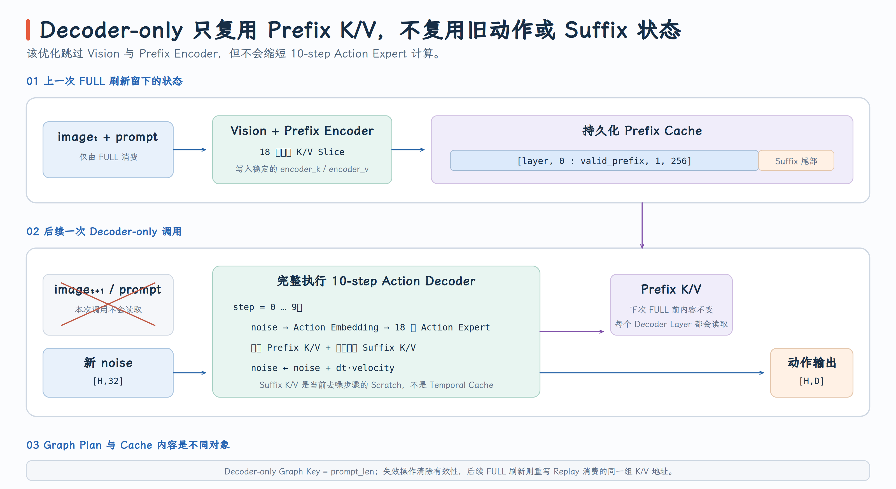
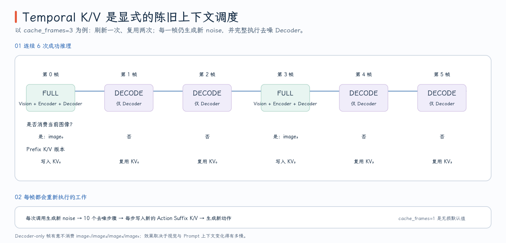
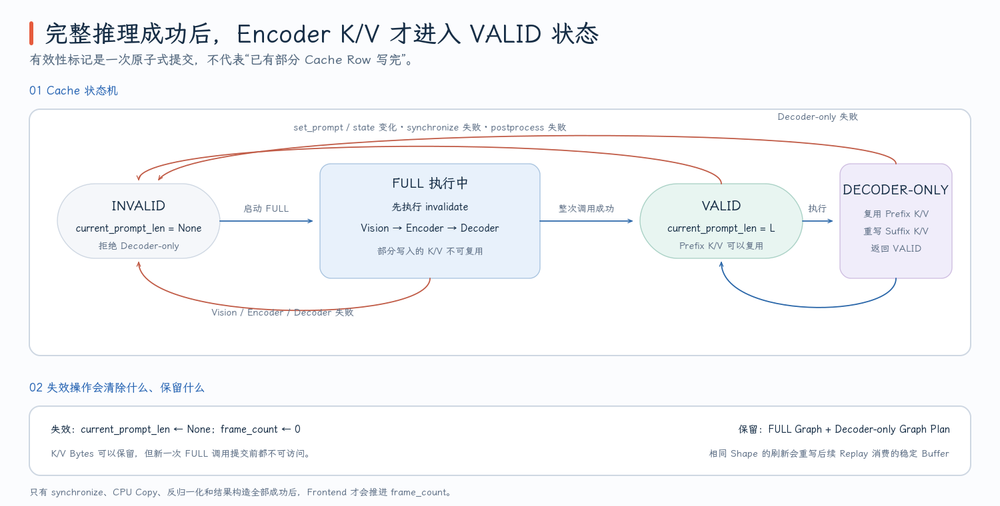

# FlashRT PR #215：Temporal K/V 跨帧复用

机器人控制通常连续处理相邻视频帧。若每一帧都完整执行 Vision、Prefix Encoder 和 Action Decoder，Prefix K/V 会随当前图像重新生成；但相邻帧的视觉与语言上下文往往变化有限，因此可以显式选择在若干帧内复用最近一次完整推理得到的 Prefix K/V，只重新运行 Action Decoder。

Temporal K/V 的关键不是“缓存上一次动作”，而是缓存 **18 层 Prefix Encoder 各自产生的 K/V**。每个复用帧仍从新的 action noise 开始，重新执行完整去噪循环并重写 Action Suffix K/V。它是一种有明确刷新周期的 stale-context 近似，而不是把整个模型输出冻结。

- PR：[#215 Support temporal KV cache on AMD RDNA 3.5](https://github.com/flashrt-project/FlashRT/pull/215)
- 固定源码版本：[`839b159`](https://github.com/flashrt-project/FlashRT/commit/839b15977f0ddf4e525e3511ec3b67b157b25acf)
- Pipeline 实现：[`Pi05TorchPipeline`](https://github.com/flashrt-project/FlashRT/blob/839b15977f0ddf4e525e3511ec3b67b157b25acf/flash_rt/models/pi05/torch_pipeline.py#L534-L713)
- RDNA frontend 调度：[`Pi05TorchFrontendAmdRdna35.infer`](https://github.com/flashrt-project/FlashRT/blob/839b15977f0ddf4e525e3511ec3b67b157b25acf/flash_rt/amd/frontends/torch/pi05_rdna35.py#L334-L392)

## 1. Temporal K/V 复用跳过了什么，又保留了什么

先看普通完整推理。第 $t$ 帧的图像和当前 prompt 经过 Vision 与 Prefix Encoder，在每一层写出一份 Prefix K/V；Action Decoder 的第 $i$ 层读取 Encoder 第 $i$ 层的 K/V，并把当前 Action Suffix 的 K/V 追加到同一层 cache 尾部：

```text
frame t
  images_t
    → Vision
    → Prefix Encoder
    → encoder_k/v[layer, Prefix]

  new noise_t
    → 10-step Action Decoder
    → rewrite encoder_k/v[layer, Suffix] on every denoise step
    → actions_t
```

Temporal reuse 帧不消费本帧图像，也不重新读取 prompt embedding。它直接保留上一次完整推理提交的 Prefix K/V：

```text
frame t+1
  images_t+1       ── not consumed
  prompt embeds    ── not consumed

  cached Prefix K/V from frame t
  + new noise_t+1
    → complete 10-step Action Decoder
    → new actions_t+1
```

因此复用对象和重新计算对象必须严格区分：

| 对象 | Decode-only 帧是否更新 | 原因 |
| --- | --- | --- |
| Vision hidden / image Prefix | 否 | 整个 Vision 与 Prefix Encoder 被跳过 |
| 语言 prompt 对应的 Prefix K/V | 否 | 与图像 Prefix 一起来自最近一次 full forward |
| Action noise | 是 | 每次调用都复制或采样新的 `[horizon,32]` noise |
| 18 层 Action Suffix K/V | 是 | 每个 denoise step 都由当前 Action Expert hidden 重写 |
| Action Decoder 18 层与 Euler update | 是 | Temporal K/V 不缩短 10-step 去噪过程 |

{ width="95%" }

这意味着 cached frame 使用的是最近一次 full frame 的视觉上下文。若相机画面在两个 full frame 之间发生变化，本轮 decoder-only 仍然忽略新图像；变化要等到下一次 refresh 才进入动作条件。`cache_frames=1` 保持原始行为，每帧都重新生成 Prefix K/V。

## 2. `cache_frames` 如何形成 Full / Decode-only 周期

RDNA frontend 用两个状态决定下一帧走哪条路径：

```text
_cache_frames   用户设置的刷新周期
_frame_count    已成功完成的推理帧数
```

选择规则是：

```python
use_full = (
    cache_frames <= 1
    or frame_count % cache_frames == 0
    or not pipeline.has_encoder_cache
)
```

实现见 [`_use_full_pipeline_for_next_frame`](https://github.com/flashrt-project/FlashRT/blob/839b15977f0ddf4e525e3511ec3b67b157b25acf/flash_rt/amd/frontends/torch/pi05_rdna35.py#L334-L340)。例如 `cache_frames=3` 时，前六次成功调用的调度为：

```text
frame_count before call : 0  1  2  3  4  5
selected path           : F  D  D  F  D  D
```

其中 `F` 是 Vision + Prefix Encoder + Decoder，`D` 是 decoder-only。第一次调用必然是 full；即使计数本来落在 cached frame，只要 cache 当前无效，也会强制 refresh。

{ width="95%" }

`frame_count` 不是调用尝试次数，而是 **成功返回的帧数**。Frontend 只有在 GPU synchronize、CPU copy、action 反归一化和结果构造全部完成后，才执行 `_frame_count += 1`。失败调用不会消耗周期中的一个位置，否则一次失败可能让下一次请求错误地进入 decoder-only。

Prompt 与 robot state 处在另一条更新路径。`VLAModel.predict()` 发现 prompt 或 state 变化时会调用 `set_prompt()`；RDNA frontend 在重新 embedding 之前先使 cache 失效并把 `frame_count` 归零，见 [`set_prompt`](https://github.com/flashrt-project/FlashRT/blob/839b15977f0ddf4e525e3511ec3b67b157b25acf/flash_rt/amd/frontends/torch/pi05_rdna35.py#L264-L280)。因此如果应用每帧都用新的 state 调用 `set_prompt()`，每一帧都会重新走 full path，Temporal K/V 不会跨帧生效。

## 3. Cache 有效性为什么必须是提交后的状态

`encoder_k/v` 是持久 buffer。完整 forward 执行到一半时，某些 layer 的 Prefix K/V 可能已经被覆盖；但只要后续 Vision、Encoder、Decoder、同步或后处理失败，这些内容都不能被 decoder-only 当作一份完整上下文继续使用。

Pipeline 因而把 `_current_prompt_len` 同时用作 Prefix 长度和 cache commit 标记：

```text
None          → INVALID
positive int  → VALID，且记录最近一次成功 full forward 的 prompt_len
```

完整 forward 的状态顺序是：

1. 入口立即 `invalidate_encoder_cache()`。
2. 验证 images、prompt、noise 的 shape、dtype 和 device。
3. 执行完整 Vision → Encoder → Decoder。
4. 只有全部成功后才写入 `_current_prompt_len = prompt_len`。
5. 任意 `BaseException` 都再次 invalidate，然后把异常向上传递。

对应实现见 [`has_encoder_cache` 与 `invalidate_encoder_cache`](https://github.com/flashrt-project/FlashRT/blob/839b15977f0ddf4e525e3511ec3b67b157b25acf/flash_rt/models/pi05/torch_pipeline.py#L606-L613) 和 [`forward_with_inputs`](https://github.com/flashrt-project/FlashRT/blob/839b15977f0ddf4e525e3511ec3b67b157b25acf/flash_rt/models/pi05/torch_pipeline.py#L615-L656)。这里的有效性是事务式提交：**“已经写过一些 K/V 行”不等于“cache 可以被复用”。**

{ width="95%" }

失效操作本身只把 `_current_prompt_len` 设为 `None`，不会清零整块 K/V，也不会销毁已经捕获的 full 或 decoder-only graph。旧字节可以留在显存中，因为无效状态下没有入口允许读取它们；下一次成功 full forward 会在相同地址写入新 Prefix K/V，再重新提交 valid 状态。

Frontend 还包住了 Pipeline 之外的失败点。`infer()` 内从 noise 准备、图像填充、模型执行、`torch.cuda.synchronize()`、CPU copy 到反归一化都位于同一个 `try` 中；任一环节失败都会 invalidate cache 并将 `_frame_count` 归零，见 [`infer` 的异常路径](https://github.com/flashrt-project/FlashRT/blob/839b15977f0ddf4e525e3511ec3b67b157b25acf/flash_rt/amd/frontends/torch/pi05_rdna35.py#L342-L392)。下一次重试因此必然从 full refresh 开始。

## 4. Decoder-only 与 HIP Graph 如何复用同一批地址

`forward_decode_only()` 首先要求 cache 已提交；直接在无 cache 状态调用会抛出 `RuntimeError`。有效状态下，它由保存的 prompt 长度计算：

$$
valid\_prefix=num\_views\times256+current\_prompt\_len.
$$

随后只复制新的 noise，并调用与 full forward 相同的 `_decoder(valid_prefix)`。这点很重要：Temporal K/V 新增的是一个更短的入口，不是第二套 Decoder 实现。完整路径见 [`_run_decoder_static`](https://github.com/flashrt-project/FlashRT/blob/839b15977f0ddf4e525e3511ec3b67b157b25acf/flash_rt/models/pi05/torch_pipeline.py#L540-L543) 与 [`forward_decode_only`](https://github.com/flashrt-project/FlashRT/blob/839b15977f0ddf4e525e3511ec3b67b157b25acf/flash_rt/models/pi05/torch_pipeline.py#L658-L713)。

Decoder-only graph 也按 prompt length 建立：

1. 用当前 `valid_prefix` warmup 3 次。
2. capture `_run_decoder_static(valid_prefix)`。
3. replay 前把新 noise 复制到稳定的 `input_noise` 地址。
4. prompt length 改变时重新 capture；长度相同则可以复用 graph plan。

Graph 保存的是操作和地址关系，不保存 Prefix K/V 的旧值。一次新的 full refresh 会把 `encoder_k/v` 的相同物理地址更新成新内容；随后复用同一个 decoder-only graph 时，kernel 读取的是这些地址中的新 K/V。实现见 [`_record_decoder_only_graph`](https://github.com/flashrt-project/FlashRT/blob/839b15977f0ddf4e525e3511ec3b67b157b25acf/flash_rt/models/pi05/torch_pipeline.py#L545-L561)。

这也解释了两种 context change：

| 变化 | Prefix K/V | Decoder-only graph |
| --- | --- | --- |
| state 改变，但 token 长度相同 | full refresh 后内容改变 | shape 相同，可复用原 graph plan |
| prompt 改变且 token 长度不同 | full refresh 后内容改变 | `valid_prefix` 改变，需要重新 capture |

Cache invalidation 刻意保留 graph plan。它撤销的是“当前 K/V 内容可以读取”的权限，不是已经为某个 shape 建好的执行计划；对应测试直接检查 invalidation 后 graph object 与 prompt-length key 都保持不变，见 [`test_prompt_invalidation_preserves_graph_plans`](https://github.com/flashrt-project/FlashRT/blob/839b15977f0ddf4e525e3511ec3b67b157b25acf/tests/test_pi05_torch_pipeline.py#L271-L286)。

## 5. 适用边界、Fallback 与验证证据

Temporal K/V 的 fallback 不是换到另一套数值 backend，而是放弃本帧复用、重新执行 full pipeline。以下情况都会选择或强制下一次 full refresh：

- `cache_frames=1`；
- 周期中的 refresh 帧；
- 第一次推理，或 cache 尚未提交；
- prompt 或 state 改变；
- full / decoder-only 执行失败；
- GPU synchronize、CPU copy、反归一化或结果构造失败。

直接调用 `forward_decode_only()` 时不会静默 full fallback，因为这个低层接口没有 images 和 prompt 输入可供重建 Prefix；它会在 cache 无效时明确报错。Frontend 才拥有足够输入，并通过 `has_encoder_cache` 将下一次公开 `infer()` 路由到 full path。

这项机制还有一个必须显式接受的模型边界：cached frame 的当前图像不会被读取。测试将图像改为另一帧后发现，周期内 decoder-only 的 fixed-noise 输出仍与上一 full frame 相同；到下一次 full refresh，变化后的图像才影响结果，见 [`test_frontend_cache_frames_alternates_full_and_decoder_only`](https://github.com/flashrt-project/FlashRT/blob/839b15977f0ddf4e525e3511ec3b67b157b25acf/tests/test_amd_rdna35_model.py#L193-L216)。这证明了调度语义，也说明 Temporal K/V 应由能接受视觉上下文滞后的应用显式开启。

测试证据分成四层：

- shared CPU pipeline 验证 decoder-only 必须先 full，并在相同 context/noise 下复用 K/V 得到相同结果，见 [`test_shared_pipeline_decoder_only_reuses_last_encoder_cache`](https://github.com/flashrt-project/FlashRT/blob/839b15977f0ddf4e525e3511ec3b67b157b25acf/tests/test_pi05_torch_pipeline.py#L77-L94)；
- frontend 状态机覆盖首次、prompt/state 变化、周期 refresh 以及各阶段失败后的 full retry，见 [`test_failed_refresh_retry_uses_full_pipeline`](https://github.com/flashrt-project/FlashRT/blob/839b15977f0ddf4e525e3511ec3b67b157b25acf/tests/test_pi05_torch_pipeline.py#L191-L224) 和 [异常失效测试](https://github.com/flashrt-project/FlashRT/blob/839b15977f0ddf4e525e3511ec3b67b157b25acf/tests/test_pi05_torch_pipeline.py#L227-L268)；
- gfx1151 模型测试对比 full、decoder-only、full graph 与 decoder-only graph，并验证 same-length state refresh 与 different-length prompt recapture，见 [`test_decoder_only_graph_refreshes_changed_context`](https://github.com/flashrt-project/FlashRT/blob/839b15977f0ddf4e525e3511ec3b67b157b25acf/tests/test_amd_rdna35_model.py#L83-L188)；
- routing/API 测试检查 `cache_frames` 暴露、1/2/3 周期调度与公开参数转发，见 [`test_rdna35_temporal_cache_surface_matches_other_pi05_backends`](https://github.com/flashrt-project/FlashRT/blob/839b15977f0ddf4e525e3511ec3b67b157b25acf/tests/test_amd_rdna35_routing.py#L35-L62) 和 [`test_public_api_forwards_robot_action_schema`](https://github.com/flashrt-project/FlashRT/blob/839b15977f0ddf4e525e3511ec3b67b157b25acf/tests/test_amd_rdna35_routing.py#L238-L255)。

公开 API 将 `cache_frames` 定义为 Pi0.5 RTX/Orin 与 AMD CDNA4/RDNA 3.5 支持的刷新周期，见 [`flash_rt.load_model`](https://github.com/flashrt-project/FlashRT/blob/839b15977f0ddf4e525e3511ec3b67b157b25acf/flash_rt/api.py#L502-L506)。默认值为 1，因此不显式开启时仍是每帧完整计算；更大的周期是在减少 Vision/Encoder 刷新频率和允许视觉上下文滞后之间做出的应用级选择。
