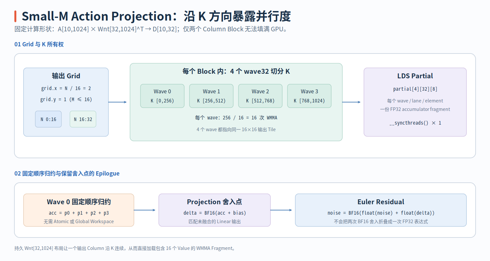
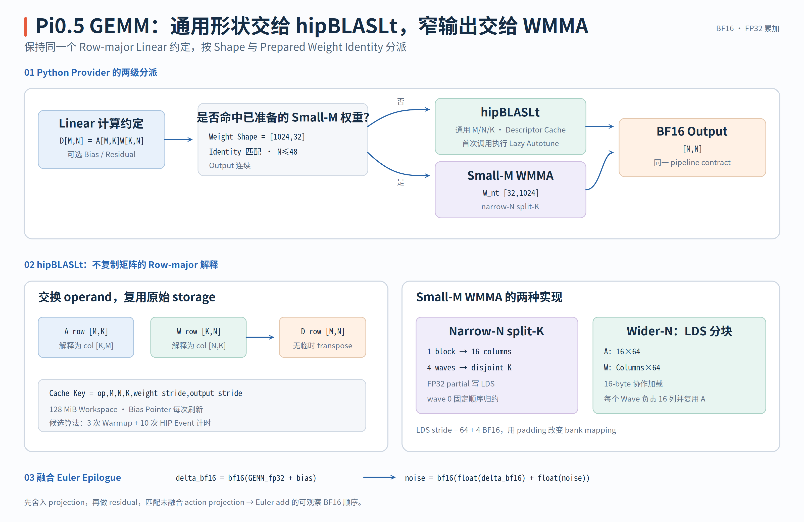
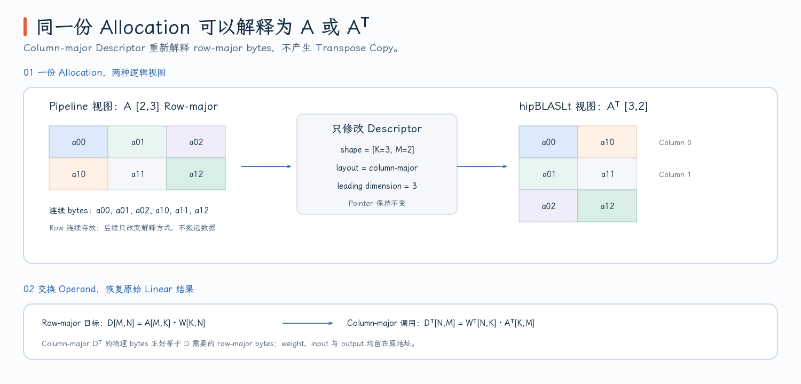

# Small-M WMMA GEMM Kernel

Pi0.5 的 Linear 并不具有统一 Shape。Vision 和 Prefix Encoder 中的大 GEMM 适合交给 hipBLASLt，而每个 Denoising Step 末尾的 Action Projection 典型 Shape 是 `M=10,K=1024,N=32`：M 和 N 很小，仅靠 Output Tile 数量难以暴露足够并行度。

> 代码块中的中文注释由本文补充，重点标出 WMMA Fragment Mapping、Split-K Partial、GMEM→LDS Staging、Barrier 与 Dispatch/Epilogue 边界，不属于上游源码原注释。

PR #213 没有用手写 Kernel 接管所有 GEMM，而是建立两层路径：[`hipblaslt_runner_rdna.hip`](https://github.com/flashrt-project/FlashRT/blob/e2cf5d1fe7209e3f4fbf212c5b6321467e8f4874/csrc/amd/gemm/hipblaslt_runner_rdna.hip) 负责通用 BF16 Linear，[`smallm_wmma_rdna.hip`](https://github.com/flashrt-project/FlashRT/blob/e2cf5d1fe7209e3f4fbf212c5b6321467e8f4874/csrc/amd/gemm/smallm_wmma_rdna.hip#L1-L351) 中的两个 `__global__` Kernel 只处理 `M<=48`、N/K 为 16 的倍数且已准备 Transposed Weight 的 Shape。

| 源码对象 | Parallelism | 数据复用方式 | 首要阅读问题 |
| --- | --- | --- | --- |
| `smallm_wmma_bf16_rdna_kernel<Waves,MultipleRowTiles>` | 多个 Wave 计算同一 Output Tile 的不同 K Segment | LDS 保存 Split-K Partial | 为什么 Narrow N 需要沿 K 增加并行度 |
| `smallm_wmma_bf16_tiled_rdna_kernel<Columns,Waves,MultipleRowTiles>` | 每个 Wave 拥有不同的 16-column Tile | A/W Tile 先进入 LDS，A 被多个 Wave 共享 | Wider N 时如何减少重复 A Load |
| `stage_wmma_tile_rdna` | Workgroup 协作搬运 16-byte Chunk | GMEM `uint4` Load，LDS Padded Row | Chunk Index 如何同时覆盖 A 与 W |
| `dispatch_smallm_wmma_bf16_rdna` | 根据 M/N/K 选择 Template | 无运行时 Autotuning | 分支顺序如何决定 Direct 或 Tiled |
| `RdnaGemmRunner` | 调用 hipBLASLt Library Kernel | Descriptor/Algorithm Cache | 通用 GEMM 为什么不进入手写 WMMA |

阅读时先固定数学 Shape `D[M,N]=A[M,K]W_{nt}[N,K]^T`，再从 Output Tile 反推 Wave/Lane Mapping；之后分别沿 K Segment 或 K Tile 跟踪 Operand，最后检查 Bias、Residual 与 BF16 Rounding 的 Epilogue。`W_nt` 是这里最容易漏掉的前置条件：没有这份持久 Transpose，后续连续 Fragment Load 的地址推导便不成立。

## Wave32 WMMA 的 Fragment 与 Output Mapping

Small-M Kernel 计算：

$$
D_{M\times N}=A_{M\times K}W_{nt,N\times K}^{T}+bias_N.
$$

`W_nt` 是 Checkpoint Weight `W[K,N]` 的持久 Row-major Transpose。它让某个 Output Column 在 K 方向的 16 个 BF16 连续存储，从而可以直接加载 WMMA B Fragment；若直接使用 `W[K,N]`，同一 Column 的 K Value 会以 Stride N 分布。

RDNA wave32 BF16 WMMA Intrinsic 是：

```cpp
// 一个 Wave 协作消费 A/B Fragment，并将 16x16 Tile 累加在 FP32 Fragment 中。
accumulator = __builtin_amdgcn_wmma_f32_16x16x16_bf16_w32(
    a, b, accumulator);
```

一个 Wave 协作计算 `16×16×16`：A/B Operand 使用 BF16，Accumulator 使用 FP32。源码中每个 Lane 都加载 16 个 BF16 的 Operand Fragment，并持有 8 个 FP32 Accumulator Element。Output Coordinate 由下式恢复：

```cpp
const int lane = threadIdx.x & (FLASHRT_RDNA_WAVE_SIZE - 1);
// Lane 0..15 与 16..31 共享 Column 坐标，但分别贡献偶数/奇数 Output Row。
const int fragment_row = lane & 15;
const int column = blockIdx.x * 16 + fragment_row;

#pragma unroll
for (int element = 0; element < 8; ++element) {
  // 每个 Lane 的 8 个 Accumulator Element 展开为 8 个 Row。
  const int row = 2 * element + lane / 16;
  // accumulator[element] belongs to output[row, column]
}
```

Lane 0–15 和 16–31 对应同样的 16 Columns，但 `lane/16` 分别产生偶数行和奇数行。对 `element=0..7`，一个 Lane 产生 8 个 Output Element，整个 Wave 恰好覆盖 `16 Rows × 16 Columns`。

M 尾块不能让越界 Lane 不参加 WMMA，因为 Intrinsic 需要完整 Wave。Split-K 路径将越界 `candidate_row` Clamp 到当前 Tile 的第一行进行安全读取，只在 Epilogue 通过 `global_row<rows` 禁止写回。Tiled 路径则在 GMEM→LDS 阶段对越界 Row 填 0，Epilogue 使用同样的 Store Predicate。

## `smallm_wmma_bf16_rdna_kernel`：沿 K 拆分多个 Wave

Direct Split-K Kernel 让一个 Workgroup 拥有 `16×16` Output Tile，不同 Wave 计算同一 Tile 在不同 K Segment 上的 Partial：

```cpp
template <int Waves, bool MultipleRowTiles>
__global__
__launch_bounds__(Waves * FLASHRT_RDNA_WAVE_SIZE)
void smallm_wmma_bf16_rdna_kernel(
    const __hip_bfloat16 *__restrict__ input,
    const __hip_bfloat16 *__restrict__ weight_nt,
    const __hip_bfloat16 *__restrict__ bias,
    __hip_bfloat16 *__restrict__ output, int rows, int columns, int inner,
    bool accumulate) {
  __shared__ float partial[Waves][FLASHRT_RDNA_WAVE_SIZE][8];

  const int wave = threadIdx.x / FLASHRT_RDNA_WAVE_SIZE;
  const int lane = threadIdx.x & (FLASHRT_RDNA_WAVE_SIZE - 1);
  const int fragment_row = lane & 15;
  const int column = blockIdx.x * 16 + fragment_row;
  const int row_start = MultipleRowTiles ? blockIdx.y * 16 : 0;
  // 同一 Output Tile 沿 K 等分给多个 Wave；每个 Wave 只产生一个 Partial。
  const int segment = inner / Waves;
  const int k_begin = wave * segment;
  const int k_end = k_begin + segment;

  Floatx8Rdna accumulator = {0.0f, 0.0f, 0.0f, 0.0f,
                             0.0f, 0.0f, 0.0f, 0.0f};
  const int candidate_row = row_start + fragment_row;
  // Clamp 保证 Tail Lane 的 WMMA Load 合法；最终 Store 仍由 global_row<rows 决定。
  const int input_row = candidate_row < rows ? candidate_row : row_start;
  const __bf16 *input_base = reinterpret_cast<const __bf16 *>(
      input + static_cast<size_t>(input_row) * inner);
  const __bf16 *weight_base = reinterpret_cast<const __bf16 *>(
      weight_nt + static_cast<size_t>(column) * inner);

  for (int k = k_begin; k < k_end; k += 16) {
    // 每次 WMMA 消费当前 Wave K Segment 中的 16-wide Slice。
    const Bf16x16Rdna a =
        *reinterpret_cast<const Bf16x16Rdna *>(input_base + k);
    const Bf16x16Rdna b =
        *reinterpret_cast<const Bf16x16Rdna *>(weight_base + k);
    accumulator = __builtin_amdgcn_wmma_f32_16x16x16_bf16_w32(
        a, b, accumulator);
  }
  // LDS reduction and epilogue continue below.
}
```

`fragment_row` 同时用于选择 A 的 Row Fragment 和 W 的 Output Column Fragment。M Tail 时 `input_row` Clamp 到 `row_start`，所以所有 Lane 都能执行合法的 WMMA Load；真正属于越界 Row 的 Accumulator 最终不会 Store。

对 `M=10,N=32,K=1024,Waves=4`：

```text
grid.x = N / 16 = 2 workgroups
grid.y = 1
block  = 4 waves × 32 lanes = 128 threads

wave 0: K [  0, 256)
wave 1: K [256, 512)
wave 2: K [512, 768)
wave 3: K [768,1024)
```

每个 Wave 在自己的 256-wide Segment 中执行 `256/16=16` 次 WMMA，得到同一 Output Tile 的一份 FP32 Partial。所有 Lane 将 8 个 Accumulator Element 写入：

```cpp
#pragma unroll
for (int element = 0; element < 8; ++element) {
  // 每个 Wave 将同一 Output Tile 的 K-partial 发布到 LDS。
  partial[wave][lane][element] = accumulator[element];
}
// Producer -> Consumer Barrier：Wave 0 必须看到所有 Split-K Partial。
__syncthreads();

if (wave != 0) {
  // 后续无 Block Barrier，只有 Wave 0 负责 Reduction 与唯一 Output Store。
  return;
}

#pragma unroll
for (int element = 0; element < 8; ++element) {
  float result = partial[0][lane][element];
#pragma unroll
  for (int other_wave = 1; other_wave < Waves; ++other_wave) {
    // 按固定 Wave Index 合并同一 (lane, element) 的 K-partial。
    result += partial[other_wave][lane][element];
  }
  const int row = 2 * element + lane / 16;
  const int global_row = (MultipleRowTiles ? row_start : 0) + row;
  if (global_row < rows) {
    if (bias != nullptr) {
      result += __bfloat162float(bias[column]);
    }
    if (accumulate) {
      // 先舍入 Projection，再与已有 Residual 相加，保留 Unfused BF16 Boundary。
      result = __bfloat162float(__float2bfloat16(result)) +
               __bfloat162float(
                   output[static_cast<size_t>(global_row) * columns + column]);
    }
    output[static_cast<size_t>(global_row) * columns + column] =
        __float2bfloat16(result);
  }
}
```

4-wave 配置的 LDS 用量是 $4\times32\times8\times4=4096$ bytes。一次 Barrier 后 Wave 1–3 退出，Wave 0 按固定的 Wave Index 顺序对同一 `(lane,element)` 累加 Partial，再执行 Bias/Residual Epilogue。这样不需要 Atomic 或 Global Split-K Workspace，完整路径见 [`smallm_wmma_bf16_rdna_kernel`](https://github.com/flashrt-project/FlashRT/blob/e2cf5d1fe7209e3f4fbf212c5b6321467e8f4874/csrc/amd/gemm/smallm_wmma_rdna.hip#L183-L255)。

Split-K 的主要作用不是让 Kernel 支持更大 K，而是在 N 很窄时增加同一 Workgroup 内的 K-direction Parallelism。对 `N=32`，Grid X 只有 2 个 Output Tile；如果每个 Tile 只用 1 Wave，整个 Launch 只有 2 Waves 的有效工作。4-wave Split-K 将每个 Tile 扩展为 4 Waves，再在 LDS 中收敛回同一份 Output。

{ width="95%" }

## `smallm_wmma_bf16_tiled_rdna_kernel`：在 LDS 中共享 A Tile

对更宽 N，让多个 Wave 计算同一 Output Tile 会重复读取 A。Tiled Kernel 改为让每个 Wave 拥有不同的 16 Columns，并在 Workgroup 内共享同一份 A Tile：

```text
Rows tile  = 16
K tile     = 64
Columns    = 32 or 64
Waves      = Columns / 16 = 2 or 4

A LDS tile = [16, 68]
W LDS tile = [Columns, 68]
```

`stage_wmma_tile_rdna` 将 A 和 W 的 Row 视为统一的 Chunk Space。一个 Chunk 是 8 BF16，也就是 16 bytes，用 `uint4` 从 GMEM 读取，再用两个 `uint2` 写入 LDS：

```cpp
template <int Rows, int Columns, int InnerTile, int Threads,
          bool MultipleRowTiles>
__device__ __forceinline__ void stage_wmma_tile_rdna(
    const __hip_bfloat16 *__restrict__ input,
    const __hip_bfloat16 *__restrict__ weight_nt,
    __bf16 *input_lds, __bf16 *weight_lds, int rows, int columns, int inner,
    int column_start, int row_start, int inner_start) {
  constexpr int chunks_per_row = InnerTile / 8;
  constexpr int chunks = (Rows + Columns) * chunks_per_row;
  constexpr int input_stride = InnerTile + 4;
  constexpr int weight_stride = InnerTile + 4;
  static_assert(chunks % Threads == 0);

#pragma unroll
  for (int item = 0; item < chunks / Threads; ++item) {
    // chunk 的单位是 8 BF16 / 16 bytes；线性空间先覆盖 A Rows，再覆盖 W Rows。
    const int chunk = threadIdx.x + item * Threads;
    const int tile_row = chunk / chunks_per_row;
    const int inner_offset = (chunk % chunks_per_row) * 8;
    const int global_inner = inner_start + inner_offset;
    uint4 loaded = make_uint4(0, 0, 0, 0);
    __bf16 *destination;
    if (tile_row < Rows) {
      // A Tile：越界 M Row 或 K Tail 保持 Zero-fill。
      const int global_row =
          (MultipleRowTiles ? row_start : 0) + tile_row;
      if (global_row < rows && global_inner < inner) {
        loaded = *reinterpret_cast<const uint4 *>(
            input + static_cast<size_t>(global_row) * inner + global_inner);
      }
      destination = input_lds + tile_row * input_stride + inner_offset;
    } else {
      // W Tile：weight_nt 以 Output Column 为 Row，K 方向连续。
      const int weight_row = tile_row - Rows;
      const int global_column = column_start + weight_row;
      if (global_column < columns && global_inner < inner) {
        loaded = *reinterpret_cast<const uint4 *>(
            weight_nt + static_cast<size_t>(global_column) * inner +
            global_inner);
      }
      destination = weight_lds + weight_row * weight_stride + inner_offset;
    }
    // GMEM 使用一次 16-byte Load；LDS 以两个 8-byte Store 写入 Padded Row。
    reinterpret_cast<uint2 *>(destination)[0] =
        make_uint2(loaded.x, loaded.y);
    reinterpret_cast<uint2 *>(destination)[1] =
        make_uint2(loaded.z, loaded.w);
  }
}
```

这里的统一 Chunk Space 很值得注意：`tile_row<Rows` 是 A 区，之后的 `Columns` 行是 W 区。一个 Linear Thread Index 因而能平均分配两类 Operand 的搬运工作，而不需要为 A/W 分别设计两套 Load Loop。越界 A Row 或 W Column 保持 `loaded=0`，从而得到合法的 Zero-filled LDS Tile。

当 `tile_row<16` 时搬 A，否则搬 `W_nt` 的对应 Output Column。对 `Columns=64,Threads=128`，总共有 `(16+64)×8=640` Chunks，每个 Thread 恰好搬 5 个 16-byte Chunk。对 `Columns=32,Threads=64`，总共 384 Chunks，每 Thread 搬 6 个。

每轮 K Tile 的顺序是：

```text
cooperative GMEM → LDS staging
    ↓ __syncthreads()
4 × WMMA, each consumes K=16
    ↓ __syncthreads()
reuse the same LDS allocation for next K tile
```

LDS Stride 是 `64+4=68` BF16。多出的 4 个 Element 不属于数学 Tile，而是用来改变相邻 Row 的 Bank Mapping。第一次 Barrier 保证 Operand Tile 已经完整写入，第二次 Barrier 保证所有 Wave 已读完当前 Tile，才允许下一轮覆盖 LDS。代码见 [`stage_wmma_tile_rdna`](https://github.com/flashrt-project/FlashRT/blob/e2cf5d1fe7209e3f4fbf212c5b6321467e8f4874/csrc/amd/gemm/smallm_wmma_rdna.hip#L59-L102) 和 [`smallm_wmma_bf16_tiled_rdna_kernel`](https://github.com/flashrt-project/FlashRT/blob/e2cf5d1fe7209e3f4fbf212c5b6321467e8f4874/csrc/amd/gemm/smallm_wmma_rdna.hip#L104-L167)。

Tiled Kernel 的主循环直接消费上面的 Staging Helper：

```cpp
template <int Columns, int Waves, bool MultipleRowTiles>
__global__
__launch_bounds__(Waves * FLASHRT_RDNA_WAVE_SIZE)
void smallm_wmma_bf16_tiled_rdna_kernel(
    const __hip_bfloat16 *__restrict__ input,
    const __hip_bfloat16 *__restrict__ weight_nt,
    const __hip_bfloat16 *__restrict__ bias,
    __hip_bfloat16 *__restrict__ output, int rows, int columns, int inner,
    bool accumulate) {
constexpr int rows_tile = 16;
constexpr int inner_tile = 64;
constexpr int stride = inner_tile + 4;
constexpr int threads = Waves * FLASHRT_RDNA_WAVE_SIZE;
__shared__ __align__(16) __bf16 input_lds[rows_tile * stride];
__shared__ __align__(16) __bf16 weight_lds[Columns * stride];

const int wave = threadIdx.x / FLASHRT_RDNA_WAVE_SIZE;
const int lane = threadIdx.x & (FLASHRT_RDNA_WAVE_SIZE - 1);
const int fragment_row = lane & 15;
const int row_start = MultipleRowTiles ? blockIdx.y * rows_tile : 0;
const int column_start = blockIdx.x * Columns;
// Tiled Path 中每个 Wave 独占 16 个 Output Column，不再沿 K 做 Split。
const int column = column_start + wave * 16 + fragment_row;
Floatx8Rdna accumulator = {0.0f, 0.0f, 0.0f, 0.0f,
                           0.0f, 0.0f, 0.0f, 0.0f};

for (int inner_start = 0; inner_start < inner; inner_start += inner_tile) {
  // 全 Workgroup 协作把当前 A/W K-tile 从 GMEM 发布到 LDS。
  stage_wmma_tile_rdna<rows_tile, Columns, inner_tile, threads,
                       MultipleRowTiles>(
      input, weight_nt, input_lds, weight_lds, rows, columns, inner,
      column_start, row_start, inner_start);
  // Producer -> Consumer：所有 LDS Chunk 完整后才允许 WMMA Load。
  __syncthreads();

#pragma unroll
  for (int k = 0; k < inner_tile; k += 16) {
    // 所有 Wave 共享同一 A Fragment；B Fragment 由 wave*16 选择各自 Column Tile。
    const Bf16x16Rdna a =
        load_lds_bf16x16_rdna(input_lds + fragment_row * stride + k);
    const Bf16x16Rdna b = load_lds_bf16x16_rdna(
        weight_lds + (wave * 16 + fragment_row) * stride + k);
    accumulator = __builtin_amdgcn_wmma_f32_16x16x16_bf16_w32(
        a, b, accumulator);
  }
  // Consumer -> Reuse：全部 WMMA 读完后，下一轮才能覆盖同一 LDS Allocation。
  __syncthreads();
}

// Bias/residual epilogue follows the same code shown below.
}
```

所有 Wave 的 A Address 都是 `fragment_row*stride+k`，所以它们共享同一 A Tile；B Address 包含 `wave*16`，每个 Wave 读取自己负责的 16 个 Output Column。

## Shape Dispatch、hipBLASLt 边界与 Residual Epilogue

Native Dispatch 首先要求：

```text
1 <= M <= 48
N >= 16, N % 16 == 0
K >= 16, K % 16 == 0
```

`M<=16` 使用 `MultipleRowTiles=false`，从 Hot Path 中删掉 `blockIdx.y*16` 的 Row-tile 算术；`16<M<=48` 使用 `MultipleRowTiles=true`，以 `grid.y=ceil(M/16)` 覆盖多个 Row Tile。内部 Kernel 选择按分支顺序为：

| 条件 | 路径 |
| --- | --- |
| `K%64==0` 且 `N<=32` | 4-wave Direct Split-K |
| `K%64==0` 且 `K<=2048 && N<4096` | 4-wave Direct Split-K |
| `K%64==0` 且 `K<=4096 && N<=1024` | 4-wave Direct Split-K |
| 上述条件失败，但 `K%64==0 && N>=64` | 64-column/4-wave LDS Tiled |
| 上述条件失败，但 `K%64==0 && N>=32` | 32-column/2-wave LDS Tiled |
| `K%32==0 && K>=256` | 2-wave Direct Split-K |
| 其他已支持 Shape | 1-wave Direct Path |

这个顺序很重要：“N 更宽”不代表必然进入 Tiled Kernel，前面的 4-wave 条件仍可以捕获多种中等 N/K Shape。这些 Threshold 是为 Pi0.5 BF16 Projection 选择的 Shape Policy，不是通用 GEMM Autotuner。完整顺序见 [`dispatch_smallm_wmma_bf16_rdna`](https://github.com/flashrt-project/FlashRT/blob/e2cf5d1fe7209e3f4fbf212c5b6321467e8f4874/csrc/amd/gemm/smallm_wmma_rdna.hip#L271-L331)。

```cpp
// 分支顺序本身就是 Shape Policy：命中后不会继续尝试后面的 Tiled Path。
if (inner % 64 == 0 &&
    (columns <= 32 || (inner <= 2048 && columns < 4096) ||
     (inner <= 4096 && columns <= 1024))) {
  launch_smallm_wmma_bf16_rdna<4, MultipleRowTiles>(...);
} else if (inner % 64 == 0 && columns >= 64) {
  launch_smallm_wmma_bf16_tiled_rdna<64, 4, MultipleRowTiles>(...);
} else if (inner % 64 == 0 && columns >= 32) {
  launch_smallm_wmma_bf16_tiled_rdna<32, 2, MultipleRowTiles>(...);
} else if (inner % 32 == 0 && inner >= 256) {
  launch_smallm_wmma_bf16_rdna<2, MultipleRowTiles>(...);
} else {
  launch_smallm_wmma_bf16_rdna<1, MultipleRowTiles>(...);
}
```

这里省略的只有重复 Pointer、Shape 和 Stream Argument，所有影响 Kernel 选择的条件与 Template Argument 都按源码保留。

Python Provider 的边界更窄。当前只对 `(K,N)=(1024,32)` 的 Action Projection 创建一份 `W_nt[32,1024]` 持久 Transpose，占用 64 KiB。调用时除了比较 Data Pointer，还比较原 Weight 的 Python Object Identity，避免 Allocator 复用旧地址后命中错误 Transpose。只有 Prepared Weight、`M<=48`、Contiguous Input/Output 等条件同时满足时，才调用 Small-M Kernel；否则进入 hipBLASLt。见 [`Rdna35GemmBackend`](https://github.com/flashrt-project/FlashRT/blob/e2cf5d1fe7209e3f4fbf212c5b6321467e8f4874/flash_rt/amd/hardware/rdna35/gemm.py#L40-L141)。

{ width="95%" }

hipBLASLt 路径没有为 Row-major Tensor 启动 Transpose Kernel。它将 Row-major `A[M,K]`、`W[K,N]`、`D[M,N]` 的同一份内存分别用 Column-major `A^T[K,M]`、`W^T[N,K]`、`D^T[N,M]` Descriptor 解释，并交换 Matmul Operand 计算 $W^TA^T=D^T$。Descriptor Cache Key 包含 Operation、M/N/K、Weight Stride 和 Output Stride；Bias Pointer 在每次调用前更新，不进入 Key。

```cpp
check_hipblaslt(
    // 同一块 Row-major Weight Memory 被描述为 Column-major W^T[N,K]。
    hipblasLtMatrixLayoutCreate(&entry.weight, HIP_R_16BF, columns, inner,
                                weight_stride),
    "hipblasLtMatrixLayoutCreate(weight)");
check_hipblaslt(
    hipblasLtMatrixLayoutCreate(&entry.input, HIP_R_16BF, inner, rows,
                                inner),
    "hipblasLtMatrixLayoutCreate(input)");
check_hipblaslt(
    hipblasLtMatrixLayoutCreate(&entry.output, HIP_R_16BF, columns, rows,
                                output_stride),
    "hipblasLtMatrixLayoutCreate(output)");

check_hipblaslt(
    // 交换 Operand，计算 W^T A^T = D^T，无需额外 Transpose Kernel。
    hipblasLtMatmul(handle_, entry.operation, &alpha, weight, entry.weight,
                   input, entry.input, &beta, output, entry.output, output,
                   entry.output, &entry.algorithm, workspace_,
                   workspace_size_, stream),
    "hipblasLtMatmul");
```

注意 `weight` 被作为 Matmul 的第一个 Operand、`input` 作为第二个 Operand；这正是通过 $W^TA^T=D^T$ 恢复 Row-major Linear 的“交换 Operand”步骤，而不是额外执行一次 Transpose。

{ width="95%" }

两个 Small-M Kernel 都通过 Runtime `accumulate` Flag 共享同一套 Epilogue 语义。对 Residual 版本，必须保留 Unfused Graph 的两次 BF16 舍入：

```cpp
float result = accumulator[element];
if (bias != nullptr) {
  result += __bfloat162float(bias[column]);
}
if (accumulate) {
  // Projection+bias 先单独舍入 BF16，再与旧 Output/Residual 在 FP32 中相加。
  result = __bfloat162float(__float2bfloat16(result)) +
           __bfloat162float(
               output[static_cast<size_t>(global_row) * columns + column]);
}
output[static_cast<size_t>(global_row) * columns + column] =
    __float2bfloat16(result);
```

如果直接计算 `bf16(accumulator+bias+residual)`，便会跳过 Projection Output 原本可观察的 BF16 边界。该 Epilogue 同时存在于 Tiled 与 Split-K Kernel，可见 [`tiled epilogue`](https://github.com/flashrt-project/FlashRT/blob/e2cf5d1fe7209e3f4fbf212c5b6321467e8f4874/csrc/amd/gemm/smallm_wmma_rdna.hip#L148-L166) 和 [`split-K epilogue`](https://github.com/flashrt-project/FlashRT/blob/e2cf5d1fe7209e3f4fbf212c5b6321467e8f4874/csrc/amd/gemm/smallm_wmma_rdna.hip#L228-L253)。

测试覆盖多种 M/N/K、Bias、Prepared Weight Routing、Residual Rounding 与 HIP Graph Replay，见 [`small-M tests`](https://github.com/flashrt-project/FlashRT/blob/e2cf5d1fe7209e3f4fbf212c5b6321467e8f4874/tests/test_amd_rdna35_ops.py#L646-L906)。这些证据支持已选 Shape 的数值正确性与 Graph Safety，不能外推为手写 WMMA 对任意 GEMM 都优于 hipBLASLt。
