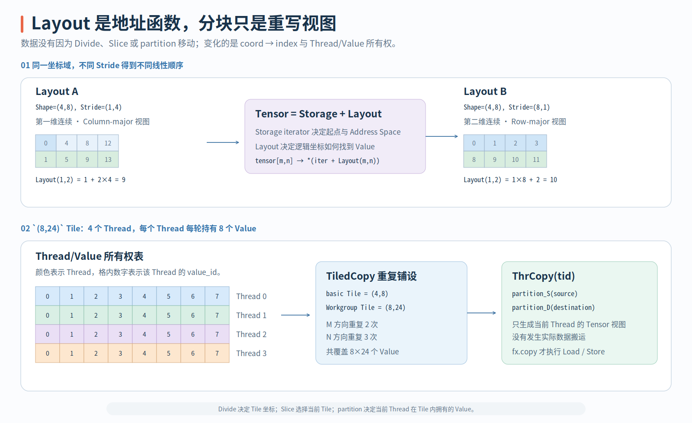

# Layout 代数与 Tile 编程

FlyDSL Kernel 的大部分代码都在回答同一个问题：“哪个 Thread，以什么地址顺序，处理哪些 Value。”`Layout` 是这个问题的统一表达。它不仅能描述 Row-major/Column-major Tensor，还能描述嵌套 Tile、Thread/Value 所有权、LDS Swizzle 和 MFMA Operand 的 Lane 分布。

本篇一直使用官方 [`02-tiledCopy.py`](https://github.com/ROCm/FlyDSL/blob/1941889400621f1fc3d8f03bada1a4e7380cdf7e/examples/02-tiledCopy.py#L10-L60) 中的对象：完整 Tensor Shape 是 `(24,120)`，每个 Workgroup 处理 `(8,24)` Tile，Block 只有 4 Threads。我们会从 `coord → index` 出发，逐步推到“每个 Thread 拥有 48 Values，4 Threads 恰好覆盖 192 个 Tile Value”，从而把 Divide、Slice、Tensor View 和 Tiled Copy 放进同一条数据映射中理解。

{ width="96%" }

## Layout 是从坐标到线性索引的函数

对一个 PyTorch Row-major Tensor，Shape `(24,120)` 通常对应 Stride `(120,1)`：

```python
layout = fx.make_layout((24, 120), (120, 1))
```

`Layout=(Shape,Stride)` 首先是一个整数函数。坐标 $(m,n)$ 满足 $0\le m<24$、$0\le n<120$，对应线性索引为：

$$
Layout(m,n)=120m+n
$$

例如 `Layout(3,5)=365`。Stride 为 1 的 N Mode 是连续轴，因此相邻 N 坐标对应相邻 Storage Element。如果使用 `(1,24)`，则映射变为 $m+24n$，M Mode 连续。FlyDSL 的 `crd2idx` 完成坐标到索引的映射，`idx2crd` 和 `get_flat_coord` 等操作则从线性位置恢复坐标，相关接口见 [`primitive.py`](https://github.com/ROCm/FlyDSL/blob/1941889400621f1fc3d8f03bada1a4e7380cdf7e/python/flydsl/expr/primitive.py#L812-L877)。

`size` 和 `cosize` 看似相近，实际回答的问题不同：

- `size(layout)` 是坐标域中的逻辑元素数，即 Shape 各维的乘积。
- `cosize(layout)` 是这个映射触及的线性索引范围，可以理解为容纳最大可访问索引所需的 Storage Span。

例如：

```python
layout = fx.make_layout((2, 3), (1, 4))
```

它只有 $2\times3=6$ 个逻辑坐标，所以 `size=6`；但访问到的索引是 `{0,1,4,5,8,9}`，覆盖从 0 到 9 的 Storage Span，因此 `cosize=10`。对紧密 Layout，两者往往相等；出现 Padding、Broadcast Stride 或稀疏映射后，用 `size` 代替 `cosize` 估计 Storage 可能会丢失地址范围信息。

Shape 还可以嵌套：

```python
shape = ((2, 4), 16)
stride = ((1, 2), 8)
layout = fx.make_layout(shape, stride)
```

此时 Top-level Rank 仍然是 2，因为最外层只有两个 Mode；但第一个 Mode 还有一层 `(2,4)` 结构，所以 Depth 增加，Flatten 后的 Leaf 数也增加。更准确的说法是：嵌套不增加 Top-level Mode 数，但会保留 Tile 内部的层次。`select`、`group`、`slice` 和 Divide 可以在后续变换中继续利用这种层次，而不是过早把所有坐标展平。

Composition 则用于组合坐标变换。若 $B$ 先重排输入坐标，$A$ 再将重排后的坐标映射到物理索引，那么：

$$
composition(A,B)(x)=A(B(x))
$$

这使“Storage 怎样排列”与“某个 Copy/MMA 需要什么访问顺序”可以先分开表达，再组合成最终地址函数。`coalesce` 可在保持映射不变的前提下合并可连续化的 Mode，`right_inverse` 则常被用来构造从线性位置返回逻辑坐标的逆向映射。这些代数变换可以改变坐标的组织形式，但它们不应悄悄改变 Value 的身份。

## Divide 与 Slice 选出当前 Workgroup Tile

先用一维 Shape 16、Tile 4 理解 Divide。原坐标 $x$ 可以改写成：

$$
(x_{tile},x_{rest})=(x\bmod4,\lfloor x/4\rfloor)
$$

```text
original x:     0 1 2 3 | 4 5 6 7 | 8 9 10 11 | 12 13 14 15
tile coord:     0 1 2 3 | 0 1 2 3 | 0 1  2  3 |  0  1  2  3
rest coord:     0 0 0 0 | 1 1 1 1 | 2 2  2  2 |  3  3  3  3
```

这个变换没有搬运任何 Value；它只是把原来的坐标域表达为 `Tile Coord × Rest Coord`。回到 `(24,120)` Tensor，用 `(8,24)` 分块后，Rest Shape 是：

$$
(24/8,120/24)=(3,5)
$$

因此总共有 $3\times5=15$ 个 Workgroup Tile，这与官方示例的 `grid=(15,1,1)` 一致。`zipped_divide(A, (8,24))` 会把 Tile Mode 聚合在一起、Rest Mode 聚合在一起，可以概念化地读成：

```text
((m_in_tile, n_in_tile), (tile_m, tile_n))
```

官方示例随后执行：

```python
bA = fx.zipped_divide(A, (8, 24))
bA = fx.slice(bA, (None, bid))
```

`None` 表示保留 Tile 内坐标，`bid` 固定 Rest 坐标域中的当前 Tile，因而结果 `bA` 是一个 `(8,24)` Tensor View。`slice` 中的整数坐标会被固定并从结果 Shape 中消失，`None` 对应的 Mode 则继续保留，实现契约见 [`slice`](https://github.com/ROCm/FlyDSL/blob/1941889400621f1fc3d8f03bada1a4e7380cdf7e/python/flydsl/expr/primitive.py#L774-L792)。

多种 Divide 的核心区别不是“切出的 Value 不同”，而是 Tile Mode 和 Rest Mode 以什么层次排列：

| 操作 | 结果的组织方式 | 常见用途 |
| --- | --- | --- |
| `logical_divide` | 在各 Mode 内保留 Tile/Rest 层次 | 通用 Layout 推导与组合 |
| `zipped_divide` | 聚合所有 Tile Mode，再聚合所有 Rest Mode | 先选 Workgroup Tile，再处理 Tile 内坐标 |
| `tiled_divide` | 保留层次化 Tiler 结构 | 多级 Tile |
| `flat_divide` | 按规则展平分块结果 | 用固定坐标位置索引 Grid Mode |

Product 与 Divide 在代数构造上相关，但不宜简单地把 Product 称为 Divide 的逆操作。Divide 用 Tiler 把一个坐标域表达为 Tile 与 Rest；Product 用 Tiler 扩张或组合既有 Layout。`raked_product`、`blocked_product` 等变体会使 Mode 以不同方式交织或分组，所以最终映射必须回到小 Tile 中的 `(thread_id,value_id) → tile_coord` 进行检查，不能只根据函数名推断。

## Tensor View、Fragment 与真实数据移动

FlyDSL `Tensor` 的核心关系是：

$$
Tensor=(Storage\ Iterator,Layout)
$$

`Tensor.shape` 和 `Tensor.stride` 都由 Layout 派生，`Tensor.iter` 指向 Storage。对 Tensor 使用不含 `None` 的完整坐标会生成 Load/Store；坐标中含 `None` 时则返回 Slice View，这一区分直接体现在 [`Tensor.__getitem__`](https://github.com/ROCm/FlyDSL/blob/1941889400621f1fc3d8f03bada1a4e7380cdf7e/python/flydsl/expr/typing.py#L1149-L1167) 中。

因此，阅读一段 Copy 代码时，应先将操作分成三类：

| 操作 | 是否创建新 Storage | 是否移动 Value |
| --- | --- | --- |
| `make_view`、Divide、`slice`、`partition`、`retile` | 否 | 否，只改变 View 或坐标解释 |
| `make_fragment_like` | 是 | 否，只创建与线程视图匹配的 Register Storage |
| `fx.copy`、Tensor `load/store` | 使用已有 Storage | 是，此时才生成真实数据移动 |

官方 Tiled Copy 示例的关键路径是：

```python
bA = fx.zipped_divide(A, (8, 24))
bA = fx.slice(bA, (None, bid))

partition_src = thr_copy.partition_S(bA)
fragment = fx.make_fragment_like(partition_src)
fx.copy(copy_atom, partition_src, fragment)
```

`bA` 仍然指向原 GMEM Storage，只是已经缩小为当前 Workgroup Tile 的 View。`partition_S` 固定 `thread_id` 并产生当前 Thread 的 Source View，仍然没有 Copy；`make_fragment_like` 才创建 Register Fragment；最后 `fx.copy` 根据 Copy Atom 将 GMEM Value 搬进 VGPR。`ThrCopy.partition_S/D` 本身只调用 Tensor Partition Primitive，可见 [`derived.py`](https://github.com/ROCm/FlyDSL/blob/1941889400621f1fc3d8f03bada1a4e7380cdf7e/python/flydsl/expr/derived.py#L28-L55)。

LDS 也遵循同一模型：先从 Dynamic Shared Memory 取得 Iterator，再用 Layout 创建 LDS Tensor View。Swizzle 不是数据在 LDS 中又被 Copy 了一次，而是物理地址函数发生变化：逻辑坐标和 Value 身份不变，只是它们落入 LDS Bank 的方式被重排。

## Thread/Value Layout 如何闭合覆盖 Tile

选出 `(8,24)` Workgroup Tile 后，还必须把 192 Values 分给 4 Threads。官方示例使用：

```python
thr_layout = fx.make_layout((4, 1), (1, 1))
val_layout = fx.make_layout((1, 8), (1, 1))
tile_mn, tv_layout = fx.make_layout_tv(thr_layout, val_layout)
```

Thread Layout `(4,1)` 表示 4 Threads 沿 M Mode 排列，Value Layout `(1,8)` 表示每个 Thread 在基本映射中沿 N Mode 拥有 8 Values。两者组合得到 `(4,8)` 基本 TV Tile：

```text
M=0: Thread 0 → N=0..7
M=1: Thread 1 → N=0..7
M=2: Thread 2 → N=0..7
M=3: Thread 3 → N=0..7
```

`make_layout_tv` 要求 Thread Layout 和 Value Layout 都是 Static Layout。它先用 `raked_product` 构造 Tile 坐标排列，再通过 `right_inverse + composition` 得到 `(thread,value) → tile_coord` 映射，并返回基本 Tiler `(4,8)`，实现见 [`make_layout_tv`](https://github.com/ROCm/FlyDSL/blob/1941889400621f1fc3d8f03bada1a4e7380cdf7e/python/flydsl/expr/derived.py#L110-L133)。

基本 TV Tile 还小于 Workgroup Tile，所以 `TiledCopy` 需要沿两个 Mode 重复铺设：

$$
\text{repeat}_M=8/4=2,\qquad \text{repeat}_N=24/8=3
$$

因此每个 Thread 拥有的 Value 数是：

$$
8\ \text{values/basic tile}\times2\times3=48\ \text{values/thread}
$$

全部 Thread 的覆盖数则是：

$$
4\ \text{threads}\times48\ \text{values/thread}=192=8\times24
$$

这个等式同时证明了三件事：4 Threads 的所有权表在数量上闭合，一个 Workgroup 恰好覆盖一个 `(8,24)` Tile，15 Workgroups 则恰好覆盖 $15\times192=2880=24\times120$ 个 Tensor Value。该官方示例的 Shape 能被 Tile 整除，因此不需要边界 Predicate；如果 M/N 不整除，仍需要用 Identity Coord Tensor 判断每个 Atom-sized 访问是否越界。

Copy Atom 为这张所有权表补上“一次用什么指令搬”：

```python
copy_atom = fx.make_copy_atom(
    fx.rocdl.BufferCopy128b(),
    fx.Float32,
)
tiled_copy = fx.make_tiled_copy(copy_atom, tv_layout, tile_mn)
thr_copy = tiled_copy.get_slice(tid)
```

`BufferCopy128b` 每个 Atom 搬运 128 bit，即 4 个 FP32，而不是 8 个 FP32。Value Layout 中的 8 表示每个 Thread 在基本 TV Tile 中拥有 8 Values，所以这一基本分区对应两个 128-bit Atom-sized Group；在 `(2,3)` 外层重复后，每个 Thread 的 48 FP32 对应 12 个 Atom-sized Group。Thread/Value Layout 决定“搬哪些 Value”，Copy Atom 决定“每次以多宽的指令搬”，两者不能混为同一个概念。

最后，`get_slice(tid)` 固定 Thread Mode，`partition_S/D` 将这一 Thread 的映射应用到 Source/Destination Tensor，`make_fragment_like` 为它创建 Register Storage，`fx.copy` 才发出真实搬运。检查更复杂的 Tiled Copy 时，也可以按同样的顺序逐层闭合：基本 TV Tile 是否无重叠覆盖、重复次数是否覆盖 Workgroup Tile、Atom Width 是否与连续性和 Alignment 匹配，以及边缘 Tile 是否有 Predicate。
