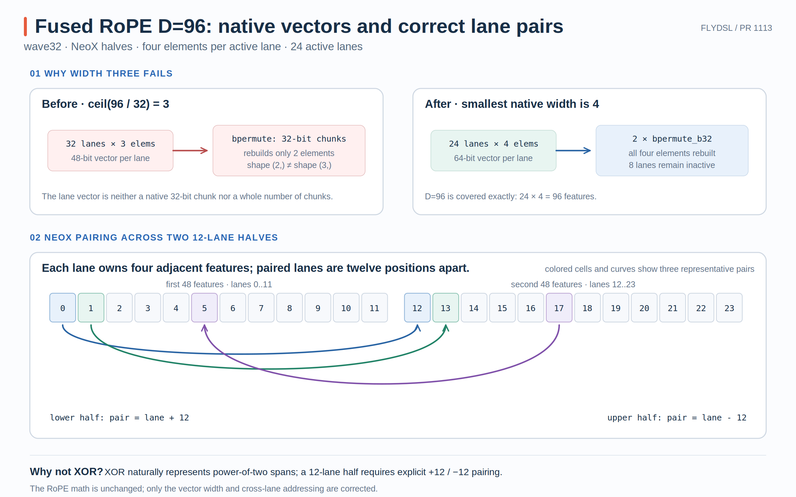

# FlyDSL PR #1113：Fused RoPE 如何支持 Head Dimension 96

FlyDSL 的 fused RoPE + KV cache kernel 用一个 wave 处理一个 token 的一个 head。旧实现根据 `ceil(head_dim / wave_size)` 选择每线程向量宽度，这对 64、128、256 等常见维度可以工作，但在 wave32 上遇到 `head_dim=96` 时会得到不受底层 copy/shuffle 路径支持的三元素向量。

PR #1113 的修复由两部分组成：把 vector width 限制为原生 `{1,2,4,8}`，并在 NeoX 两半各占 12 lanes 时，用显式 `+/- 12` 代替只适合 2 次幂跨度的 XOR 配对。

- PR：[#1113 Fix fused RoPE for head dimension 96](https://github.com/ROCm/FlyDSL/pull/1113)
- 本文对应源码：[`f4fa09f`](https://github.com/ROCm/FlyDSL/commit/f4fa09f694871a815084ddbb56116afd4843a118)
- 核心文件：[`fused_rope_cache_kernel.py`](https://github.com/ROCm/FlyDSL/blob/f4fa09f694871a815084ddbb56116afd4843a118/kernels/attention/fused_rope_cache_kernel.py)

{ width="95%" }

## 1. Fused kernel 与 NeoX 配对关系

对每个 token 和 head，这个 kernel 同时处理：

```text
Q -> apply NeoX RoPE -> Q_out
K -> apply NeoX RoPE -> K_out -> key cache
V ----------------------------> value cache
```

grid 的 x 轴选择 head，y 轴选择 token；一个 block 只有一个 wave。Q/K 做位置旋转，V 不旋转，只写入 KV cache。cache 可使用 flash layout 或 ATOM 的 packed layout。

PR 修复的是每个 head 内部“元素如何分给 lanes、lane 如何找到旋转伙伴”，并没有改变 RoPE 数学、grid 语义或 KV cache 布局。

设 head dimension 为 $D$，把向量分成等长两半：

$$
x=[x_0,\ldots,x_{D/2-1}\mid x_{D/2},\ldots,x_{D-1}].
$$

第 $i$ 个前半元素与第 $i+D/2$ 个后半元素组成一对：

$$
\begin{aligned}
y_i &= x_i\cos\theta_i-x_{i+D/2}\sin\theta_i,\\
y_{i+D/2} &= x_{i+D/2}\cos\theta_i+x_i\sin\theta_i.
\end{aligned}
$$

因此线程映射必须同时满足两个条件：每个 lane 能完整读写自己的向量片段，并且能够从另一个 lane 取得配对半区的同位置片段。

## 2. 从非法的 width 3 到原生 width 4

旧选择公式是：

```python
VEC_WIDTH = ceil(head_dim / WARP_SIZE)
```

在 wave32 上：

```text
D = 96
VEC_WIDTH = ceil(96 / 32) = 3
vecs_per_head = 96 / 3 = 32 lanes
```

表面上它正好填满一个 wave，但 `VEC_WIDTH=3` 不是底层 copy 与 `ds_bpermute_b32` 重建逻辑的原生宽度。shuffle 按 32-bit chunk 搬运，而三个 BF16/FP16 元素共 48 bit；旧路径按 `VEC_WIDTH // 2` 只能重建一个 32-bit chunk，也就是两个元素，最终出现 `(2,)` 与 `(3,)` 无法广播的编译错误。

这说明“元素总数能塞进一个 wave”只是必要条件，不是充分条件。向量宽度还必须匹配 load/store 与跨 lane 交换的位宽。

新实现从 `{1,2,4,8}` 中选择满足以下条件的最小宽度 $w$：

$$
D\bmod w=0,
$$

$$
\frac{D}{2}\bmod w=0,
$$

$$
\frac{D}{w}\le \text{WARP\_SIZE}.
$$

第一条保证完整 head 能切成等宽向量；第二条保证 NeoX 的两半边界不会切穿一个 vector；第三条保证所有 vector 能在一个 wave 中分配。

源码实现见 [vector-width selection](https://github.com/ROCm/FlyDSL/blob/f4fa09f694871a815084ddbb56116afd4843a118/kernels/attention/fused_rope_cache_kernel.py#L74-L106)。常见配置变为：

| Head dim | wave32 width | active lanes | lanes / half | wave64 width | active lanes |
| ---: | ---: | ---: | ---: | ---: | ---: |
| 64 | 2 | 32 | 16 | 1 | 64 |
| 96 | 4 | 24 | 12 | 2 | 48 |
| 128 | 4 | 32 | 16 | 2 | 64 |
| 256 | 8 | 32 | 16 | 4 | 64 |

D=96/wave32 不再勉强使用 32 个三元素 lane，而是使用 24 个四元素 lane；剩余 8 个 lane 通过 `tid < vecs_per_head` 保持 inactive。

`ds_bpermute_b32` 每次根据 byte address，从另一个 lane 的 VGPR 读取一个 32-bit word。它使用 LDS cross-lane 指令族，但这里搬的是 peer lane 的寄存器值，不代表 kernel 把 Q/K 写进了 LDS buffer。

对 FP16/BF16：

```text
VEC_WIDTH = 1 -> 16 bit -> zero-extend to one 32-bit word
VEC_WIDTH = 2 -> 32 bit -> one bpermute
VEC_WIDTH = 4 -> 64 bit -> two bpermutes
VEC_WIDTH = 8 -> 128 bit -> four bpermutes
```

新 helper 先把 vector bitcast 成若干 `i32` chunk，对每个 chunk 使用相同的 peer address，再拼回原 dtype，见 [`ds_bpermute_pair`](https://github.com/ROCm/FlyDSL/blob/f4fa09f694871a815084ddbb56116afd4843a118/kernels/attention/fused_rope_cache_kernel.py#L158-L184)。这解决了三元素 vector 无法完整重建的问题。

## 3. 12-lane half 为什么必须显式加减

对 D=128/wave32：

```text
VEC_WIDTH = 4
vecs_per_half = 128 / 2 / 4 = 16
```

两半分别占 lanes `[0,15]` 与 `[16,31]`。此时 `lane ^ 16` 恰好翻转一个二进制位，得到对称配对：

```text
0 <-> 16
1 <-> 17
...
15 <-> 31
```

但 D=96/wave32 时：

```text
VEC_WIDTH = 4
vecs_per_half = 12
first half  = lanes  0..11
second half = lanes 12..23
```

`12` 不是 2 的幂，`lane ^ 12` 不等价于“跨过 12 个 lane”。例如 `4 ^ 12 = 8`，仍停留在第一半；正确伙伴应是 16。

因此新 mapping 是：

```text
if span is power of two:
    pair = lane XOR span
else if lane is in first half:
    pair = lane + span
else:
    pair = lane - span
```

最终实现见 [pair-lane selection](https://github.com/ROCm/FlyDSL/blob/f4fa09f694871a815084ddbb56116afd4843a118/kernels/attention/fused_rope_cache_kernel.py#L195-L206)。

固定 wave32、BF16、`D=96`：

```text
VEC_WIDTH = 4
vecs_per_head = 24
vecs_per_half = 12
```

lane 3 负责前半区元素：

```text
[12, 13, 14, 15]
```

它的伙伴 lane 是 `3 + 12 = 15`，后者负责：

```text
[60, 61, 62, 63]
```

lane 3 对自己的四个元素应用：

$$
x_{front}\cos\theta-x_{back}\sin\theta.
$$

lane 15 从 lane 3 读取同一对的前半片段，并应用：

$$
x_{back}\cos\theta+x_{front}\sin\theta.
$$

两边读取相同的 cos/sin vector，只是正负号不同。高层 RoPE 公式因此被准确映射成“两个 lane 互取四元素 VGPR 片段”。

## 4. 数据流与旧 specialization 的兼容性

一个 active lane 的 Q 路径是：

```text
load Q vector
  -> bpermute paired Q vector
  -> q * cos +/- q_pair * sin
  -> store Q_out
```

K 路径执行相同旋转，并把结果同时写入 `K_out` 与 key cache。V 不参与 RoPE，只根据 slot mapping 写入 value cache。负 slot 会跳过 cache write，但不影响 Q/K 输出。

这也是为什么测试不能只比较 Q：修复必须同时保证 Q、K、key cache 和 value cache 的最终状态正确。

D=64、128、256 的 `vecs_per_half` 都是 2 的幂，因此新代码继续走 XOR 分支；对应 vector width 也是原生 1/2/4/8。PR 报告这些已有路径在 gfx1151 上生成的 ISA 与 `origin/main` byte-for-byte 相同。

这个结果比“benchmark 看起来差不多”更强：它说明新增的通用分支在编译期被消除，没有改变旧 specialization 的最终指令流。

## 5. 正确性、性能与适用边界

新增测试固定 `head_dim=96`、`num_q_heads=num_kv_heads=32`，覆盖：

```text
BF16 × flash cache layout
BF16 × non-flash cache layout
FP16 × flash cache layout
FP16 × non-flash cache layout
```

测试入口见 [`test_head_dim_96`](https://github.com/ROCm/FlyDSL/blob/f4fa09f694871a815084ddbb56116afd4843a118/tests/kernels/test_fused_rope_cache.py#L628-L645)。PR 报告完整测试结果为 `74 passed, 248 skipped`，并确认 Q、K、key cache、value cache 与 PyTorch reference 匹配。

这些测试证明的是当前 kernel 已支持的组合：NeoX-style、full rotary dimension、FP16/BF16，以及两种 cache layout。它们不意味着 partial RoPE、GPT-J pairing 或任意 dtype 已被一并支持；源码仍显式拒绝这些范围外配置。

PR 在 Radeon 8060S 的原生 `gfx1151` wave32 上报告 D=96、BF16、`QH=KH=32` 的 graph replay 延迟（ROCm 仍沿用 PyTorch 的 `torch.cuda` API 命名）：

| Tokens | Latency |
| ---: | ---: |
| 1 | 4.025 μs |
| 128 | 10.637 μs |
| 512 | 35.252 μs |
| 2048 | 456.657 μs |
| 4096 | 909.765 μs |

生成 kernel 使用 35 VGPR、26 SGPR，无 LDS、scratch 或 register spill。D=96 没有旧版本可运行的直接性能基线，所以这些数字只能描述新路径的资源形态与绝对延迟，不能声称相对旧 D=96 实现获得加速。

一句话概括：**PR #1113 把“能塞进一个 wave”扩展为一组完整约束：vector width 必须可原生搬运、必须整除 head 与 NeoX half；当 half span 不是 2 的幂时，lane 配对必须从 XOR 切换为显式加减。**
